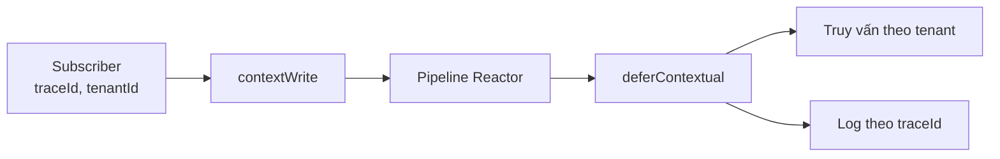
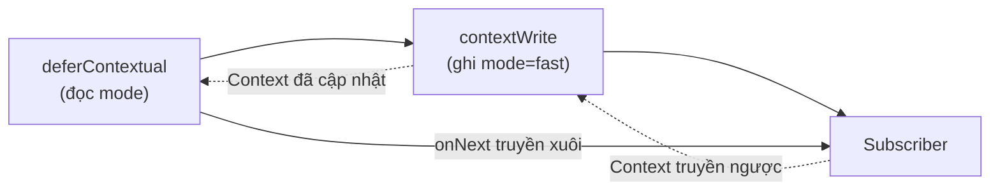

# Đọc và bổ sung ngữ cảnh tại thời điểm đăng ký

Trong chương **Ngữ cảnh**, bài học này giải thích cách một pipeline Reactor đọc và bổ sung thông tin gắn với subscriber ngay khi subscription diễn ra. Các thông tin như mã tương quan của request, tenant hiện tại, ngôn ngữ hiển thị hoặc danh tính đã được xác thực thường cần đi qua nhiều bước xử lý mà không phải thêm chúng vào tham số của mọi hàm.

Bài học thuộc module **REACTIVE_PROGRAMMING**. Module hướng dẫn: “Học tư duy reactive qua các luồng sự kiện bất đồng bộ, hợp đồng Publisher–Subscriber và cơ chế backpressure của Reactive Streams. Thực hành Mono, Flux, kết hợp toán tử, kiểm soát scheduler, xử lý lỗi và kiểm thử pipeline trong hệ sinh thái Java.” Reactor cung cấp `Context` và `ContextView` để lưu thông tin theo subscription, cùng `contextWrite` và `deferContextual` để ghi và đọc thông tin đó.

## 1. Vì sao cần ngữ cảnh theo subscription?

Hãy xét một request xử lý đơn hàng. Nhiều bước trong pipeline có thể cần cùng mã tenant và mã trace:

- Bước truy vấn cần tenant để giới hạn dữ liệu.
- Bước ghi log cần trace ID để liên kết các sự kiện.
- Bước gọi dịch vụ khác cần thông tin định tuyến hoặc locale.
- Bước xử lý kết quả cần giữ cùng ngữ cảnh của request ban đầu.

Nếu truyền từng giá trị qua mọi phương thức, chữ ký hàm có thể trở nên dài và các tham số kỹ thuật lẫn vào dữ liệu nghiệp vụ. Nếu dùng `ThreadLocal` như nơi lưu duy nhất, thông tin có thể không đi theo pipeline khi việc thực thi chuyển qua thread khác.

Reactor Context giải quyết nhu cầu này bằng một vùng key-value gắn với subscriber. Thông tin được truyền theo subscription và có thể được đọc tại các điểm cần thiết trong chuỗi xử lý.



Context thuộc về subscription cụ thể. Hai subscriber của cùng một publisher có thể cung cấp hai Context khác nhau mà không phải thay đổi dữ liệu nguồn hoặc chia sẻ một biến toàn cục.

## 2. Context và ContextView

`Context` là cấu trúc key-value bất biến mà Reactor truyền cùng subscriber. `ContextView` là giao diện chỉ đọc để các toán tử truy cập những giá trị đã có.

Ví dụ, khai báo các khóa dùng chung:

```java
private static final String TRACE_ID = "traceId";
private static final String TENANT_ID = "tenantId";
```

Có thể xem Context như một tập thông tin nhỏ:

| Thành phần | Vai trò |
|---|---|
| Key | Định danh một giá trị, ví dụ `TRACE_ID` |
| Value | Thông tin gắn với subscription, ví dụ `"trace-42"` |
| `Context` | Cấu trúc bất biến hỗ trợ thêm, thay thế hoặc xóa giá trị |
| `ContextView` | Góc nhìn chỉ đọc để kiểm tra và lấy giá trị |

Context không phải một `Map` có thể sửa tại chỗ. Những thao tác như `put` hoặc `delete` tạo ra Context mới; chúng không sửa đối tượng Context cũ.

```java
Context initial = Context.empty();

Context requestContext = initial
    .put(TRACE_ID, "trace-42")
    .put(TENANT_ID, "tenant-a");

Context updated = requestContext
    .put(TENANT_ID, "tenant-b");

Context withoutTrace = updated.delete(TRACE_ID);
```

Sau các phép biến đổi trên, `initial` vẫn rỗng, `requestContext` vẫn chứa tenant `tenant-a`, còn `updated` chứa tenant `tenant-b`. Đây là đặc tính quan trọng giúp các subscription không vô tình ghi đè ngữ cảnh của nhau.

Context không chấp nhận giá trị `null`. Nếu một thông tin có thể không tồn tại, hãy bỏ key khỏi Context hoặc dùng một kiểu biểu diễn rõ ràng như `Optional`, thay vì cố lưu `null`.

## 3. Đọc ngữ cảnh bằng deferContextual

`Mono.deferContextual` tạo publisher dựa trên ContextView của subscriber tại thời điểm subscription. Hàm nhận ContextView chỉ được gọi khi publisher được subscribe, vì vậy có thể đọc dữ liệu ngữ cảnh gắn với chính subscription đó.

```java
Mono<String> greeting =
    Mono.deferContextual(context ->
        Mono.just("Xin chào " + context.get("user"))
    );
```

Publisher trên chưa biết tên người dùng khi được lắp ráp. Tên được đọc khi subscriber đăng ký. Có thể cung cấp giá trị đó bằng `contextWrite`:

```java
Mono<String> greeting =
    Mono.deferContextual(context ->
        Mono.just("Xin chào " + context.get("user"))
    )
    .contextWrite(context -> context.put("user", "Lan"));

greeting.subscribe(System.out::println);
```

Kết quả là `Xin chào Lan`. `deferContextual` đọc ContextView của subscriber, còn `contextWrite` bổ sung key `user` cho subscription trước khi nguồn được thực thi.

Có thể kiểm tra key trước khi đọc để xử lý trường hợp ngữ cảnh không được cung cấp:

```java
Mono<String> currentTenant =
    Mono.deferContextual(context -> {
        if (!context.hasKey(TENANT_ID)) {
            return Mono.error(
                new IllegalStateException("Thiếu tenantId")
            );
        }

        String tenantId = context.get(TENANT_ID);
        return Mono.just(tenantId);
    });
```

Nếu key không có, pipeline phát lỗi theo chính sách được chọn. Nếu key tồn tại, publisher phát giá trị tương ứng.

Khi có giá trị mặc định hợp lệ, có thể dùng `getOrDefault`:

```java
Mono<String> locale =
    Mono.deferContextual(context ->
        Mono.just(context.getOrDefault("locale", "vi"))
    );
```

Cách này phù hợp với thông tin tùy chọn như locale hoặc định dạng hiển thị. Với tenant ID hoặc danh tính xác thực, thường nên yêu cầu key bắt buộc và báo lỗi nếu thiếu, thay vì âm thầm chọn một giá trị mặc định.

## 4. Bổ sung ngữ cảnh bằng contextWrite

`contextWrite` tạo một ranh giới cập nhật Context trong pipeline. Toán tử nhận Context hiện tại và trả về Context mới; Reactor sử dụng Context mới đó cho các toán tử upstream trong quá trình subscription.

```java
Mono<Order> order =
    Mono.deferContextual(context -> {
        String tenantId = context.get(TENANT_ID);
        return orderRepository.findByTenant(tenantId, orderId);
    })
    .contextWrite(context ->
        context.put(TENANT_ID, "tenant-a")
    );
```

Ở đây, `contextWrite` thêm tenant vào Context trước khi `deferContextual` chạy. Repository đọc tenant từ Context và thực hiện truy vấn phù hợp.

Có thể bổ sung nhiều giá trị trong một lần:

```java
Mono<Result> result =
    service.execute(command)
        .contextWrite(context -> context
            .put(TRACE_ID, traceId)
            .put(TENANT_ID, tenantId)
            .put("locale", "vi")
        );
```

Mỗi subscription có thể cung cấp Context khác nhau:

```java
Mono<String> currentTenant =
    Mono.deferContextual(context ->
        Mono.just(context.get(TENANT_ID))
    );

currentTenant
    .contextWrite(context -> context.put(TENANT_ID, "tenant-a"))
    .subscribe(value -> log.info("A: {}", value));

currentTenant
    .contextWrite(context -> context.put(TENANT_ID, "tenant-b"))
    .subscribe(value -> log.info("B: {}", value));
```

Hai subscription đọc hai tenant khác nhau. Publisher `currentTenant` có thể được tái sử dụng; dữ liệu Context được cung cấp riêng cho từng subscriber.

## 5. Hiểu chiều lan truyền của Context

Một điểm dễ nhầm là dữ liệu và Context đi theo hai chiều khác nhau:

- Tín hiệu dữ liệu `onNext` đi từ upstream đến downstream.
- Context được truyền từ subscriber downstream ngược về phía upstream trong quá trình subscription.

Do đó, `contextWrite` thường được đặt bên phải toán tử đọc Context để cập nhật thông tin mà toán tử bên trái có thể nhìn thấy.

```java
Mono<String> value =
    Mono.deferContextual(context ->
        Mono.just(context.get("mode"))
    )
    .contextWrite(context ->
        context.put("mode", "fast")
    );
```

Sơ đồ thứ tự:



Có thể đọc biểu thức từ trái sang phải để hiểu luồng dữ liệu, nhưng khi xác định Context mà một toán tử upstream nhìn thấy, hãy nhớ Context được truyền ngược từ subscriber. Một `contextWrite` chỉ ảnh hưởng đến phần upstream của vị trí nó được đặt; nó không sửa một biến Context toàn cục cho toàn bộ các toán tử ở phía downstream.

Ví dụ, trong chuỗi:

```java
source
    .contextWrite(context -> context.put("role", "worker"))
    .map(this::toView);
```

Context được cập nhật cho `source` ở phía upstream. Không nên giả định rằng một toán tử downstream như `map` sẽ đọc được giá trị vừa ghi bằng cách truy cập Context trực tiếp. Nếu một toán tử cần đọc Context, hãy dùng một API có khả năng truy cập Context và đặt ranh giới `contextWrite` ở vị trí phù hợp với chiều lan truyền.

## 6. Kết hợp Context với defer và flatMap

`defer` trì hoãn việc tạo publisher đến lúc subscribe, nhưng không cung cấp ContextView trực tiếp cho callback. Khi cần đọc Context trong lúc tạo publisher, dùng `deferContextual`.

```java
Mono<String> fromContext =
    Mono.deferContextual(context -> {
        String traceId = context.get(TRACE_ID);
        return Mono.just("trace=" + traceId);
    });
```

Khi cần gọi một publisher khác dựa trên dữ liệu Context, có thể trả publisher đó từ callback:

```java
Mono<OrderView> orderView =
    Mono.deferContextual(context -> {
        String tenantId = context.get(TENANT_ID);

        return orderRepository.findByTenant(tenantId, orderId)
            .map(OrderView::from);
    })
    .contextWrite(context -> context
        .put(TENANT_ID, tenantId)
        .put(TRACE_ID, traceId)
    );
```

Context được đọc tại thời điểm đăng ký, sau đó giá trị tenant được dùng để tạo publisher truy vấn. Cách viết này hữu ích khi tham số kỹ thuật cần thiết để gọi dịch vụ được cung cấp theo subscription.

Các publisher con được tạo trong pipeline Reactor thường tiếp tục nhận Context từ subscriber hiện tại. Vì vậy, một bước `flatMap` có thể tạo publisher khác mà vẫn đọc được Context của subscription:

```java
Mono<String> result =
    Mono.just(orderId)
        .flatMap(id ->
            Mono.deferContextual(context -> {
                String traceId = context.get(TRACE_ID);
                return orderService.load(id)
                    .map(order -> traceId + ":" + order.id());
            })
        )
        .contextWrite(context -> context.put(TRACE_ID, "trace-99"));
```

Context không cần được truyền thành tham số qua từng lambda. Tuy nhiên, nếu một publisher bên trong được subscribe độc lập bằng cách tự gọi `subscribe()`, nó tạo một subscription mới và không tự động kế thừa Context của pipeline cha. Hãy trả publisher từ `flatMap` hoặc toán tử kết hợp thay vì tự subscribe bên trong callback.

## 7. Context vẫn đi theo subscription khi đổi scheduler

Reactor Context gắn với subscriber, không gắn trực tiếp với một thread cụ thể. Khi pipeline chuyển việc thực thi qua scheduler bằng `publishOn` hoặc `subscribeOn`, các toán tử Reactor vẫn có thể truy cập Context của subscription.

```java
Mono<String> tracedResult =
    Mono.just("request")
        .publishOn(Schedulers.parallel())
        .flatMap(value ->
            Mono.deferContextual(context ->
                Mono.just(context.get(TRACE_ID) + ":" + value)
            )
        )
        .contextWrite(context ->
            context.put(TRACE_ID, "trace-202")
        );
```

Dù phần xử lý sau `publishOn` có thể chạy trên thread thuộc scheduler song song, publisher con vẫn đọc được `TRACE_ID` từ Context. Việc chuyển scheduler không tự xóa Context.

Điều này khác với `ThreadLocal`. ThreadLocal lưu giá trị theo thread vật lý; khi pipeline chuyển sang thread khác, giá trị ThreadLocal không tự đi theo. Context của Reactor được truyền theo subscription và là lựa chọn phù hợp để mang metadata qua các ranh giới thực thi reactive.

Nếu tích hợp thư viện cũ yêu cầu ThreadLocal, cần dùng cơ chế bridge phù hợp và cấu hình rõ ràng. Không giả định rằng mọi ThreadLocal đều tự động được đồng bộ với Reactor Context. Khi có dùng thư viện context-propagation, hãy kiểm tra cấu hình accessor và chế độ propagation của ứng dụng.

## 8. Cập nhật và xóa thông tin ngữ cảnh

Vì Context bất biến, muốn thay giá trị cần trả về Context mới từ `contextWrite`:

```java
Mono<String> operation =
    Mono.deferContextual(context ->
        Mono.just(context.get("locale"))
    )
    .contextWrite(context ->
        context.put("locale", "en")
    );
```

Có thể xóa một key bằng `delete`:

```java
.contextWrite(context -> context.delete("temporaryToken"))
```

Việc xóa cũng chỉ tạo Context mới cho phần upstream của ranh giới đó. Nó không sửa Context của subscription khác.

Nếu cần gộp một Context đã được chuẩn bị trước, có thể dùng các thao tác kết hợp Context phù hợp. Hãy tránh lưu trạng thái nghiệp vụ có thể thay đổi liên tục vào Context. Context phù hợp nhất cho metadata nhỏ, tương đối ổn định trong suốt một subscription, chẳng hạn trace ID, tenant ID, locale hoặc thông tin bảo mật đã được xác thực.

Không nên lưu các collection lớn, buffer hoặc đối tượng mutable dùng chung vào Context. Việc đặt một đối tượng mutable trong Context không làm đối tượng đó trở nên bất biến; các tham chiếu vẫn có thể trỏ đến cùng một đối tượng và bị thay đổi từ nhiều nơi.

## 9. Ứng dụng thực tế: trace ID và tenant ID

Một pipeline xử lý yêu cầu có thể nhận tenant và trace ID ở biên ứng dụng rồi đưa chúng vào Context. Các bước sâu hơn sử dụng chúng mà không cần thêm tham số kỹ thuật vào mọi hàm:

```java
Mono<OrderView> handleRequest(
        String tenantId,
        String traceId,
        String orderId) {

    return Mono.deferContextual(context -> {
        String currentTenant = context.get(TENANT_ID);
        String currentTrace = context.get(TRACE_ID);

        log.info("Bắt đầu xử lý trace={}", currentTrace);

        return orderRepository
            .findByTenant(currentTenant, orderId)
            .map(OrderView::from);
    })
    .contextWrite(context -> context
        .put(TENANT_ID, tenantId)
        .put(TRACE_ID, traceId)
    );
}
```

Thông tin được đưa vào Context ở ranh giới request. Phần truy vấn đọc tenant từ subscription hiện tại và log dùng trace ID để liên kết sự kiện.

Context không tự xác thực tenant hay cấp quyền truy cập. Giá trị tenant và danh tính phải được xác minh tại biên tin cậy trước khi đưa vào Context; repository và tầng nghiệp vụ vẫn cần áp dụng kiểm tra truy cập phù hợp. Context chỉ là phương tiện truyền thông tin trong pipeline, không phải cơ chế bảo mật độc lập.

Tương tự, trace ID nên được tạo hoặc lấy từ hệ thống tracing đáng tin cậy. Không dùng một giá trị từ request tùy ý làm định danh đáng tin cậy nếu hệ thống cần bảo đảm tính duy nhất hoặc chống giả mạo.

## 10. Kiểm thử Context với StepVerifier

Có thể kiểm tra việc đọc và ghi Context bằng `StepVerifier`. Dùng `expectAccessibleContext` để xác nhận subscriber nhận đúng key-value:

```java
Mono<String> trace =
    Mono.deferContextual(context ->
        Mono.just(context.get(TRACE_ID))
    );

StepVerifier.create(
        trace.contextWrite(context ->
            context.put(TRACE_ID, "trace-test")
        )
    )
    .expectAccessibleContext()
    .contains(TRACE_ID, "trace-test")
    .then()
    .expectNext("trace-test")
    .verifyComplete();
```

Có thể kiểm tra hai subscription độc lập:

```java
Mono<String> tenant =
    Mono.deferContextual(context ->
        Mono.just(context.get(TENANT_ID))
    );

StepVerifier.create(
        tenant.contextWrite(context ->
            context.put(TENANT_ID, "tenant-a")
        )
    )
    .expectNext("tenant-a")
    .verifyComplete();

StepVerifier.create(
        tenant.contextWrite(context ->
            context.put(TENANT_ID, "tenant-b")
        )
    )
    .expectNext("tenant-b")
    .verifyComplete();
```

Một test khác có thể xác nhận thiếu key được xử lý đúng:

```java
StepVerifier.create(
        Mono.deferContextual(context -> {
            if (!context.hasKey(TENANT_ID)) {
                return Mono.error(
                    new IllegalStateException("missing tenant")
                );
            }
            return Mono.just(context.get(TENANT_ID));
        })
    )
    .expectErrorMessage("missing tenant")
    .verify();
```

Các test này giúp phát hiện lỗi đặt `contextWrite` sai vị trí, quên cung cấp key bắt buộc hoặc vô tình dùng chung Context giữa các subscription.

## 11. Những lỗi thường gặp khi dùng Context

- **Nhầm Context với ThreadLocal.** Context đi theo subscriber; ThreadLocal đi theo thread vật lý.
- **Đặt contextWrite sai phía.** Context truyền từ downstream về upstream, vì vậy toán tử đọc Context thường cần nằm upstream so với nơi cập nhật.
- **Cố sửa Context tại chỗ.** Các thao tác như `put` và `delete` trả về Context mới; phải trả kết quả đó từ hàm `contextWrite`.
- **Đọc key không tồn tại.** `get(key)` có thể phát sinh lỗi nếu key vắng mặt; dùng `hasKey`, `getOrDefault` hoặc phát lỗi nghiệp vụ rõ ràng.
- **Lưu giá trị null.** Context không hỗ trợ giá trị null; hãy biểu diễn sự vắng mặt bằng cách không thêm key hoặc dùng kiểu dữ liệu phù hợp.
- **Tự subscribe trong pipeline.** Subscription mới không tự kế thừa Context của pipeline cha; hãy trả publisher từ `flatMap` hoặc toán tử kết hợp.
- **Lưu trạng thái mutable hoặc dữ liệu lớn.** Context nên chứa metadata nhỏ, ổn định và có phạm vi theo request.
- **Coi Context là cơ chế cấp quyền.** Context chỉ truyền dữ liệu; xác thực và phân quyền vẫn phải được thực hiện bởi tầng nghiệp vụ phù hợp.

## 12. Bài tập vận dụng

Một API reactive xử lý yêu cầu tra cứu đơn hàng. Mỗi subscription có hai metadata bắt buộc: `tenantId` và `traceId`. Repository cần tenant ID để truy vấn, còn các bước ghi log cần trace ID.

Hãy xây dựng pipeline đáp ứng các yêu cầu:

1. Khai báo key ổn định cho tenant ID và trace ID.
2. Dùng `contextWrite` để bổ sung cả hai giá trị ở biên subscription.
3. Dùng `deferContextual` để đọc tenant ID khi bắt đầu truy vấn.
4. Trong một bước `flatMap`, đọc trace ID để tạo thông tin log hoặc kết quả có gắn trace.
5. Chuyển pipeline qua `publishOn(Schedulers.parallel())` và xác nhận Context vẫn đọc được sau ranh giới scheduler.
6. Nếu thiếu tenant ID hoặc trace ID, phát lỗi rõ ràng.
7. Dùng `StepVerifier` kiểm tra hai subscription với hai tenant khác nhau và một trường hợp thiếu key.

Sau khi thực hành, hãy giải thích vì sao Context thuộc về subscriber, vì sao `contextWrite` thường được đặt sau toán tử đọc Context trong biểu thức pipeline, và tại sao Context vẫn đi theo subscription khi thread thực thi thay đổi.
