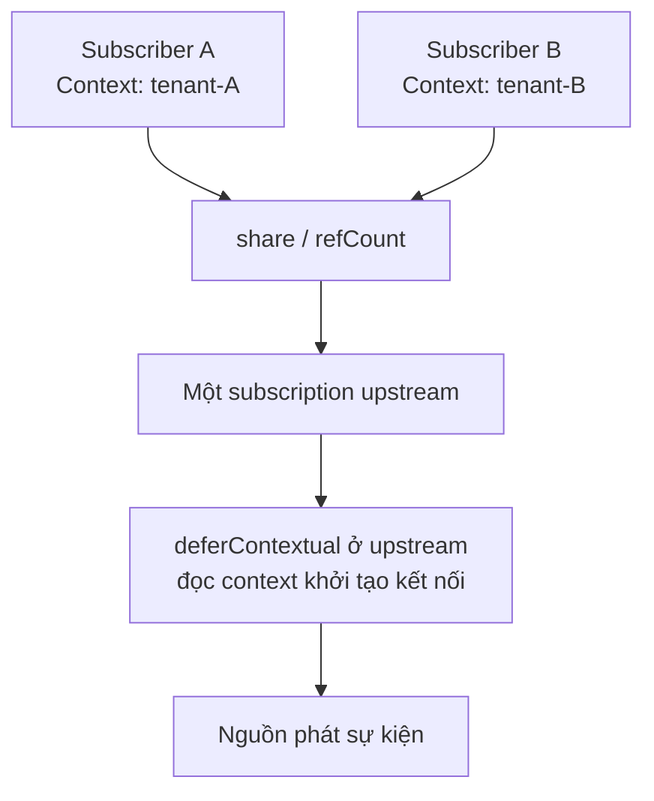

# Tránh rò rỉ ngữ cảnh giữa các yêu cầu dùng chung luồng

## Vì sao dùng chung luồng có thể làm lẫn ngữ cảnh?

Trong ứng dụng reactive, nhiều yêu cầu có thể đi qua cùng một pipeline hoặc cùng nghe một luồng sự kiện. Mỗi yêu cầu thường mang metadata riêng như `requestId`, `tenantId`, người dùng hiện tại, quyền truy cập, locale hoặc thông tin tracing. Nếu metadata này bị lưu trong biến mutable dùng chung, `ThreadLocal` không được quản lý đúng cách hoặc publisher đã chia sẻ một lần thực thi phụ thuộc vào request, dữ liệu của yêu cầu này có thể xuất hiện trong yêu cầu khác.

Project Reactor cung cấp `Context` để gắn metadata với subscription. `Context` được truyền ngược từ subscriber về upstream và có thể được đọc bằng `deferContextual`. Mỗi subscription có context riêng, kể cả khi nhiều subscriber dùng cùng một publisher cold. Tuy nhiên, khi pipeline dùng `share()`, `publish().refCount(...)` hoặc một cơ chế multicast khác, nhiều subscriber có thể cùng dùng một subscription upstream. Subscription upstream dùng context của subscriber khởi tạo kết nối; context riêng của subscriber đến sau không tự thay thế context đã gắn với upstream đó.

Đây là điểm cần đặc biệt chú ý khi một nguồn dùng chung đọc `tenantId` hoặc thông tin xác thực trước ranh giới chia sẻ. Nếu subscriber của tenant A khởi tạo kết nối, nguồn có thể được tạo với ngữ cảnh A; subscriber của tenant B tham gia sau đó vẫn nhận tín hiệu từ cùng nguồn upstream. Với dữ liệu đa tenant, lỗi này có thể trở thành rò rỉ dữ liệu giữa các yêu cầu.

## Context thuộc về subscription

`Context` là cấu trúc key-value bất biến được Reactor gắn với subscriber. Toán tử `contextWrite` tạo context mới cho phần upstream; `deferContextual` đọc `ContextView` tại thời điểm subscription. Context đi cùng subscription qua các ranh giới scheduler, vì vậy không phụ thuộc vào thread hiện tại như `ThreadLocal`.

```java
import reactor.core.publisher.Mono;

Mono<String> currentRequest = Mono.deferContextual(context ->
    Mono.just("request=" + context.get("requestId"))
);

Mono<String> requestA = currentRequest
    .contextWrite(context -> context.put("requestId", "req-A"));

Mono<String> requestB = currentRequest
    .contextWrite(context -> context.put("requestId", "req-B"));
```

Hai publisher dẫn xuất từ cùng `currentRequest` nhưng mỗi lần đăng ký có context riêng. Khi subscribe `requestA`, `deferContextual` đọc `req-A`; khi subscribe `requestB`, nó đọc `req-B`. Không cần tạo một biến `currentRequestId` toàn cục rồi thay đổi giá trị trước mỗi request.

### contextWrite tác động về phía upstream

Context được truyền từ subscriber ngược về nguồn. Vì vậy, vị trí `contextWrite` trong chuỗi toán tử quan trọng:

```java
Mono<String> result = Mono.deferContextual(context ->
        Mono.just(context.get("tenantId")))
    .map(tenantId -> "Đang xử lý tenant " + tenantId)
    .contextWrite(context -> context.put("tenantId", "tenant-A"));
```

`contextWrite` nằm ở phía downstream của `deferContextual`, nên giá trị được thêm vào context trước khi subscription đi lên nguồn. Ngược lại, nếu đặt `contextWrite` ở phía upstream của một toán tử đọc context, toán tử đó không nhìn thấy giá trị được ghi ở phía sau nó. Khi debug, hãy lần theo hướng truyền context từ subscriber lên publisher thay vì đọc chuỗi mã theo hướng dữ liệu đi xuống.

Context bất biến ở cấp cấu trúc, nhưng giá trị được lưu bên trong vẫn có thể là object mutable. Tránh đặt `Map`, collection hoặc đối tượng request mutable vào Context rồi sửa đổi chúng từ nhiều nhánh. Nên lưu các giá trị metadata bất biến như chuỗi ID, enum, principal bất biến hoặc một object context chỉ đọc.

## Ranh giới share: một upstream không thể mang nhiều context request

`share()` cho phép nhiều subscriber đang hoạt động cùng nhận tín hiệu từ một subscription upstream. Điều đó giúp tránh chạy lại nguồn cold cho từng subscriber, nhưng cũng có nghĩa upstream chỉ được đăng ký một lần trong vòng đời kết nối đang chia sẻ. Context của subscriber làm phát sinh kết nối được dùng khi subscribe nguồn upstream; subscriber tham gia sau không thể yêu cầu nguồn đã chạy lại với context khác.



Ví dụ sau có rủi ro nếu `eventClient.eventsForCurrentTenant()` đọc tenant từ Reactor Context bên trong nguồn:

```java
Flux<Event> sharedTenantEvents = Flux.deferContextual(context ->
        eventClient.eventsForTenant(context.get("tenantId")))
    .share();
```

Giả sử subscriber A với context `tenant-A` là bên đầu tiên làm nguồn kết nối. `deferContextual` tạo publisher cho tenant A. Khi subscriber B với context `tenant-B` tham gia cùng `sharedTenantEvents`, B vẫn nhận tín hiệu từ upstream đang chạy cho tenant A. Context B không làm `share()` tạo thêm một nguồn upstream riêng.

Với nguồn có dữ liệu tenant hoặc quyền truy cập, không đặt việc lựa chọn tenant ở phía upstream của một publisher được chia sẻ giữa nhiều tenant. Hãy chọn một trong hai hướng: tạo nguồn riêng theo context của từng subscription, hoặc chia sẻ một nguồn trung lập với request rồi áp dụng logic phụ thuộc subscriber ở phía downstream. Nếu cần chia sẻ nguồn đã phân vùng, mỗi tenant phải có một publisher/connection riêng được quản lý theo khóa tenant.

## Cách an toàn 1: tạo nguồn riêng theo từng subscription

Nếu mỗi yêu cầu cần nguồn dữ liệu được lọc hoặc xác thực theo tenant riêng, tạo nguồn bên trong `deferContextual` và không dùng chung subscription upstream giữa các tenant:

```java
import reactor.core.publisher.Flux;

Flux<Event> eventsForCurrentTenant = Flux.deferContextual(context -> {
    String tenantId = context.get("tenantId");
    return eventClient.eventsForTenant(tenantId);
});

Flux<Event> tenantA = eventsForCurrentTenant
    .contextWrite(context -> context.put("tenantId", "tenant-A"));

Flux<Event> tenantB = eventsForCurrentTenant
    .contextWrite(context -> context.put("tenantId", "tenant-B"));
```

Mỗi subscription gọi supplier của `deferContextual` và tạo publisher nguồn dựa trên context của chính subscription đó. Tenant A và tenant B có nguồn upstream riêng. Cách này phù hợp khi client cần tenant để xác thực, định tuyến hoặc truy vấn dữ liệu.

Nếu nguồn là một luồng dài hạn, hãy quản lý cancellation và cleanup riêng cho từng subscription. Khi request kết thúc hoặc subscriber hủy, adapter phải dừng listener hoặc request tương ứng. Không giữ subscription của một tenant trong singleton rồi thay đổi tenant hiện tại để phục vụ request tiếp theo.

## Cách an toàn 2: chia sẻ nguồn trung lập, áp dụng context sau share

Đôi khi ứng dụng có một luồng sự kiện dùng chung không phụ thuộc vào request, chẳng hạn sự kiện công khai của hệ thống hoặc một nguồn nội bộ đã được phân quyền ở tầng hạ tầng. Có thể chia sẻ nguồn đó trước, sau đó áp dụng bộ lọc hoặc phép biến đổi theo Context của từng subscriber:

```java
import reactor.core.publisher.Flux;

Flux<Event> sharedEvents = eventClient.allAuthorizedEvents().share();

Flux<Event> eventsForSubscriber = sharedEvents
    .transformDeferredContextual((events, context) -> {
        String tenantId = context.get("tenantId");
        return events.filter(event -> event.tenantId().equals(tenantId));
    });

Flux<Event> tenantAEvents = eventsForSubscriber
    .contextWrite(context -> context.put("tenantId", "tenant-A"));

Flux<Event> tenantBEvents = eventsForSubscriber
    .contextWrite(context -> context.put("tenantId", "tenant-B"));
```

`transformDeferredContextual` áp dụng phép biến đổi khi có subscription và cung cấp context của subscriber cho phép biến đổi đó. Vì bộ lọc nằm sau `share()`, mỗi subscriber có thể lọc theo tenant riêng trong khi cùng nghe nguồn trung lập. Context của A và B không cần đi ngược vào subscription upstream đã chia sẻ.

Mẫu này chỉ phù hợp khi mọi subscriber được phép tiêu thụ nguồn trung lập và việc phân quyền ở downstream là ranh giới bảo mật được kiểm soát. Nếu sự kiện chứa dữ liệu bí mật mà subscriber không được phép nhìn thấy, không phát toàn bộ sự kiện đó vào một luồng dùng chung rồi dựa duy nhất vào bộ lọc ứng dụng. Hãy lọc hoặc phân vùng tại nguồn có thẩm quyền, chẳng hạn broker topic, truy vấn hoặc connection riêng theo tenant. Các toán tử quan sát, log và side effect đặt trước bộ lọc downstream cũng có thể nhìn thấy mọi sự kiện; cần đặt chúng sau bước phân quyền hoặc bảo đảm chúng không làm lộ dữ liệu.

## Không cache kết quả phụ thuộc Context ở phạm vi toàn cục

Một lỗi tinh vi khác xảy ra khi cache publisher đọc Context. `Mono.cache()` chia sẻ và lưu tín hiệu đã tính. Nếu một publisher cache toàn cục phụ thuộc vào `tenantId`, subscription đầu tiên có thể quyết định dữ liệu được tải và kết quả đó được phát lại cho subscriber khác:

```java
// Rủi ro: một cache dùng chung cho nhiều tenant.
Mono<TenantConfig> sharedConfig = Mono.deferContextual(context ->
        configClient.loadForTenant(context.get("tenantId")))
    .cache();
```

Nếu tenant A subscribe trước, publisher có thể tải và cache cấu hình A. Tenant B subscribe sau có thể nhận lại tín hiệu đã cache mà không gọi `loadForTenant("tenant-B")`. Đây là rò rỉ dữ liệu dù `deferContextual` tự nó đọc đúng context của subscription đầu tiên.

Có ba cách tổ chức an toàn hơn:

- Không cache publisher phụ thuộc Context ở phạm vi dùng chung; để mỗi subscription tải dữ liệu theo context của mình.
- Cache theo khóa nghiệp vụ rõ ràng, chẳng hạn `tenantId`, bằng một cache có API lấy dữ liệu theo key và TTL/eviction phù hợp.
- Tạo publisher cache trong phạm vi đã được phân vùng theo tenant, bảo đảm publisher không thể được dùng nhầm bởi tenant khác.

Ví dụ, cache theo khóa tenant có thể được quản lý bởi một service chuyên trách:

```java
Mono<TenantConfig> configFor(String tenantId) {
    return tenantConfigCache.get(tenantId,
        key -> configClient.loadForTenant(key));
}

Mono<TenantConfig> currentConfig = Mono.deferContextual(context ->
    configFor(context.get("tenantId")));
```

`tenantConfigCache` ở đây là cache ứng dụng có API lấy theo khóa; nó phải phân vùng key theo tenant, có TTL/eviction và không dùng một giá trị cache chung cho mọi tenant. `deferContextual` chỉ lấy khóa từ Context rồi gọi cache đúng phân vùng.

## ThreadLocal và MDC không phải nguồn context đáng tin cậy

Trong mã imperative truyền thống, `ThreadLocal` thường được dùng để lưu request ID, người dùng hoặc tenant hiện tại. Cách này dựa vào giả định một request tiếp tục chạy trên cùng thread. Reactive pipeline có thể chuyển thread qua `publishOn`, `subscribeOn`, client bất đồng bộ hoặc callback từ event loop; một thread pool cũng được tái sử dụng cho nhiều request khác nhau.

Nếu một request đặt `ThreadLocal` rồi không xóa trong mọi đường kết thúc, thread có thể được tái sử dụng cho request khác và mang theo giá trị cũ. Ngay cả khi luôn gọi `remove()`, việc chuyển thread vẫn khiến giá trị không tự đi theo subscription. Điều này có thể làm log gắn nhầm request ID hoặc code xác thực đọc nhầm tenant.

Ưu tiên Reactor `Context` cho metadata theo subscription:

```java
Mono<Response> execute(Request request) {
    return Mono.deferContextual(context -> {
        String requestId = context.get("requestId");
        return service.execute(requestId);
    }).contextWrite(context -> context
        .put("requestId", request.id())
        .put("tenantId", request.tenantId()));
}
```

Nếu thư viện logging hoặc thư viện imperative chỉ đọc MDC/ThreadLocal, dùng cơ chế bridge context propagation tương thích với phiên bản Reactor và thư viện đang cài. Cấu hình tự động hoặc hook toàn cục cần được bật có chủ đích và kiểm thử ở ranh giới thread. Không tự sao chép metadata vào một `ThreadLocal` tĩnh mà không có quy tắc khôi phục và xóa trong `finally`.

## Đặt context ở ranh giới request

Trong ứng dụng web reactive, nên đưa metadata vào Context tại ranh giới tiếp nhận request, trước khi gọi các service downstream. Khi đó, các service có thể đọc cùng key mà không cần truyền tenant hoặc request ID qua mọi chữ ký phương thức:

```java
Mono<Receipt> handle(CreateOrderRequest request) {
    return orderService.create(request)
        .contextWrite(context -> context
            .put("requestId", request.requestId())
            .put("tenantId", request.tenantId())
            .put("principal", request.principal()));
}

Mono<Order> createOrder(CreateOrderRequest request) {
    return Mono.deferContextual(context -> {
        String tenantId = context.get("tenantId");
        Principal principal = context.get("principal");
        return orderRepository.insertForTenant(tenantId, principal, request);
    });
}
```

Ví dụ giả định `CreateOrderRequest` mang metadata đã được xác thực tại tầng tiếp nhận request. Không lấy `tenantId` từ một trường do client tùy ý gửi rồi xem đó là danh tính đã xác thực; tầng bảo mật phải xác minh principal và quyền truy cập trước khi ghi Context. Context giúp truyền metadata qua pipeline, không thay thế xác thực hoặc kiểm tra quyền ở tầng dữ liệu.

Giữ các key Context nhất quán bằng hằng số hoặc kiểu wrapper thay vì gõ chuỗi rải rác. Với ứng dụng lớn, có thể tạo helper đọc Context và trả lỗi rõ ràng khi thiếu key, tránh `get` một khóa không tồn tại rồi để lỗi khó hiểu xuất hiện sâu trong pipeline.

## Kiểm thử việc cô lập Context giữa các subscription

Một publisher cold dùng `deferContextual` phải đọc context riêng của từng subscription:

```java
import reactor.core.publisher.Mono;
import reactor.test.StepVerifier;

Mono<String> tenantName = Mono.deferContextual(context ->
    Mono.just(context.get("tenantId")));

StepVerifier.create(tenantName.contextWrite(context ->
        context.put("tenantId", "tenant-A")))
    .expectNext("tenant-A")
    .verifyComplete();

StepVerifier.create(tenantName.contextWrite(context ->
        context.put("tenantId", "tenant-B")))
    .expectNext("tenant-B")
    .verifyComplete();
```

Hai lần kiểm thử subscribe cùng một publisher nhưng mỗi lần nhận tenant tương ứng. Đây là kiểm tra cơ bản để phát hiện biến request hoặc tenant bị capture ở phạm vi assembly.

Có thể kiểm thử riêng phép biến đổi theo Context bằng một nguồn hữu hạn, rồi bổ sung integration test với nguồn chia sẻ và hai subscriber hoạt động đồng thời:

```java
import reactor.core.publisher.Flux;
import reactor.test.StepVerifier;

Flux<Event> allEvents = Flux.just(eventA, eventB);

Flux<Event> visible = allEvents.transformDeferredContextual((events, context) -> {
    String tenantId = context.get("tenantId");
    return events.filter(event -> event.tenantId().equals(tenantId));
});

StepVerifier.create(visible.contextWrite(context ->
        context.put("tenantId", "tenant-A")))
    .expectNextMatches(event -> event.tenantId().equals("tenant-A"))
    .verifyComplete();

StepVerifier.create(visible.contextWrite(context ->
        context.put("tenantId", "tenant-B")))
    .expectNextMatches(event -> event.tenantId().equals("tenant-B"))
    .verifyComplete();
```

`eventA` và `eventB` trong đoạn mã là hai sự kiện mẫu có tenant tương ứng. Trong integration test, thay `Flux.just` bằng nguồn sự kiện dùng chung và giữ hai subscriber hoạt động đồng thời; phát sự kiện có tenant khác nhau rồi xác nhận A chỉ nhận sự kiện A, B chỉ nhận sự kiện B. Nên kiểm tra cả trường hợp subscriber đến muộn, một subscriber hủy và nguồn upstream tiếp tục phục vụ subscriber còn lại.

Đối với cache, hãy kiểm thử thứ tự subscription đảo nhau: A trước B và B trước A. Nếu kết quả của subscriber đầu ảnh hưởng đến subscriber thứ hai, publisher cache có thể đang giữ dữ liệu phụ thuộc Context ở phạm vi quá rộng. Với dữ liệu tenant, kiểm thử nên xác nhận cả giá trị trả về lẫn số lần gọi repository/client và khóa cache được sử dụng.

## Checklist tránh rò rỉ ngữ cảnh

- Đưa `requestId`, `tenantId` và principal đã xác thực vào Reactor `Context` tại ranh giới request.
- Dùng `deferContextual` hoặc `transformDeferredContextual` để đọc Context trong pipeline.
- Xác định toán tử chia sẻ nằm ở đâu; mọi nguồn đọc Context phía upstream của `share` chỉ nhận context của subscription khởi tạo kết nối.
- Không chia sẻ một nguồn đã được chọn tenant hoặc principal giữa nhiều tenant.
- Nếu chia sẻ nguồn trung lập, đặt logic theo subscriber ở downstream và kiểm tra ranh giới bảo mật trước khi phát dữ liệu.
- Không dùng cache toàn cục cho publisher phụ thuộc Context; cache theo tenant/request key và TTL rõ ràng.
- Không dùng `ThreadLocal` hoặc MDC như nguồn dữ liệu nghiệp vụ trong pipeline chuyển thread; dùng bridge tương thích nếu cần tích hợp thư viện imperative.
- Không đặt object mutable dùng chung trong Context; chỉ lưu metadata bất biến hoặc object chỉ đọc.
- Kiểm thử nhiều subscription, thứ tự subscriber, cancellation, cache hit/miss và truy cập đồng thời.

## Quy trình thiết kế luồng dùng chung an toàn

Trước khi chia sẻ một `Flux`, hãy xác định nguồn có phụ thuộc vào request, tenant hoặc quyền truy cập hay không. Nếu có, tạo nguồn theo từng subscription hoặc phân vùng nguồn theo khóa bảo mật. Nếu nguồn thực sự trung lập, có thể chia sẻ upstream rồi áp dụng phép biến đổi theo Context ở phía downstream. Đừng để một subscriber đầu tiên quyết định ngữ cảnh dữ liệu cho mọi subscriber tham gia sau.

Tiếp theo, kiểm tra các toán tử cache và trạng thái mutable được capture. Cache cần khóa phân vùng đúng; trạng thái request phải được tạo theo subscription; metadata phải đi theo Reactor Context thay vì thread hiện tại. Cuối cùng, kiểm thử hai yêu cầu khác tenant chạy đồng thời và đảo thứ tự đăng ký để phát hiện rò rỉ khó tái hiện.

Quản lý đúng Context giúp cùng một pipeline phục vụ nhiều request mà vẫn giữ được danh tính và dữ liệu của từng subscription. Khi kết hợp Context với ranh giới chia sẻ rõ ràng, cache được phân vùng và kiểm thử cô lập, ứng dụng Reactor có thể tận dụng luồng dùng chung mà không trộn ngữ cảnh giữa các yêu cầu.
