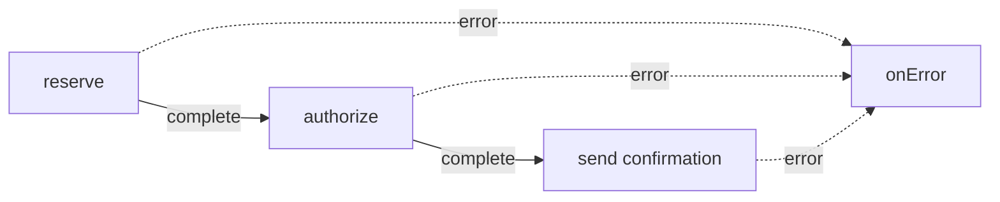

# then, thenReturn và xử lý Mono<Void>

Trong một pipeline reactive, nhiều thao tác chỉ cần báo rằng công việc đã hoàn tất: lưu audit, gửi thông báo, ghi lịch sử hoặc xác nhận một lệnh. Những thao tác này không cần trả về payload cho bước tiếp theo, nhưng caller vẫn cần biết chúng hoàn tất thành công hay phát sinh lỗi. Trong Project Reactor, kiểu `Mono<Void>` biểu diễn một tác vụ có kết quả là tín hiệu hoàn tất mà không phát phần tử dữ liệu.

Các toán tử `then`, `thenReturn` và `thenMany` giúp nối những công việc như vậy theo thứ tự. Chúng bỏ qua payload của publisher trước, chờ publisher đó hoàn tất thành công rồi mới chuyển sang publisher tiếp theo hoặc phát một giá trị cố định. Hiểu đúng ngữ nghĩa này giúp viết pipeline tuần tự, tránh `flatMap` trên một nguồn không phát phần tử và không nhầm hoàn tất rỗng với lỗi.

## 1. Mono<Void> biểu diễn hoàn tất không có payload

`Mono<T>` có thể phát tối đa một phần tử rồi hoàn tất, hoặc hoàn tất rỗng, hoặc kết thúc bằng lỗi. Với `Mono<Void>`, publisher không phát một giá trị `Void`; nó biểu diễn một thao tác chỉ có trạng thái kết thúc:

```java
Mono<Void> saveAudit = auditRepository.save(entry).then();
Mono<Void> sendNotice = notificationClient.send(message);
```

`saveAudit` bỏ qua đối tượng mà repository trả về và chỉ giữ tín hiệu hoàn tất hoặc lỗi. `sendNotice` cũng thường có kiểu `Mono<Void>` vì việc gửi thông báo chỉ cần báo thành công hay thất bại.

Có thể hình dung tín hiệu của một thao tác hoàn tất thành công như sau:

```text
Publisher<Void>:  onSubscribe ---------------- onComplete
                  (không có onNext)
```

Nếu thao tác thất bại, publisher phát `onError` thay vì `onComplete`:

```text
Publisher<Void>:  onSubscribe ---------------- onError(error)
                  (không có onNext)
```

`Mono<Void>` vì vậy vẫn mang thông tin quan trọng. Nó cho biết khi nào công việc kết thúc, có lỗi hay không và subscription có thể bị hủy hay không, dù không có payload.

## 2. then() bỏ payload và chỉ giữ tín hiệu hoàn tất

`then()` nhận publisher hiện tại, bỏ qua mọi phần tử mà publisher phát ra và trả về `Mono<Void>` hoàn tất khi nguồn hoàn tất thành công:

```java
Mono<Void> auditSaved = auditRepository.save(entry)
    .then();
```

Nếu `auditRepository.save(entry)` phát một `AuditEntry`, giá trị đó bị bỏ qua. Nếu nguồn hoàn tất rỗng, `then()` cũng hoàn tất bình thường. Nếu nguồn phát lỗi, lỗi được giữ nguyên và kết quả không hoàn tất thành công.

`then()` hữu ích khi một thao tác có trả payload nhưng bước tiếp theo chỉ quan tâm nó đã hoàn tất hay chưa. Ví dụ, service lưu bản ghi rồi chỉ trả về trạng thái hoàn tất:

```java
public Mono<Void> recordAccess(AccessEvent event) {
    return accessRepository.save(event).then();
}
```

Caller có thể nối thao tác này với công việc khác mà không phải mang theo đối tượng đã lưu:

```java
Mono<Void> workflow = accessService.recordAccess(event)
    .then(notificationClient.notifyAccess(event));
```

Publisher thông báo chỉ được đăng ký sau khi thao tác ghi access hoàn tất thành công.

## 3. then(Mono<V>) nối công việc tiếp theo

Overload `then(other)` bỏ qua payload của nguồn hiện tại, chờ nguồn hoàn tất thành công rồi subscribe publisher `other`. Kiểu kết quả là kiểu của publisher tiếp theo:

```java
Mono<Receipt> receipt = orderRepository.save(order)
    .then(receiptService.createFor(order));
```

Ở đây, kết quả của `save` không được phát xuống downstream. Sau khi `save` hoàn tất, Reactor đăng ký `receiptService.createFor(order)` và chuyển kết quả `Receipt` của publisher đó xuống subscriber.

Với hai thao tác chỉ báo hoàn tất, có thể nối trực tiếp:

```java
Mono<Void> workflow = inventoryService.reserve(command)
    .then(paymentService.authorize(command))
    .then(notificationService.sendConfirmation(command));
```

Thứ tự được biểu diễn trong pipeline: reserve hoàn tất trước, sau đó mới authorize; authorize hoàn tất trước, sau đó mới gửi confirmation. Nếu bất kỳ bước nào phát lỗi, các bước phía sau không được đăng ký theo đường thành công và lỗi đi xuống subscriber.



Để đảm bảo thứ tự này, mỗi phương thức cần trả publisher reactive đại diện cho toàn bộ công việc của nó. Nếu phương thức thực hiện tác dụng phụ ngay khi được gọi rồi mới trả về một publisher, việc tạo đối số `other` có thể đã khởi chạy công việc sớm. Khi cần trì hoãn cả việc tạo publisher tiếp theo, hãy dùng `Mono.defer`:

```java
Mono<Void> workflow = inventoryService.reserve(command)
    .then(Mono.defer(() -> paymentService.authorize(command)))
    .then(Mono.defer(() -> notificationService.sendConfirmation(command)));
```

Với API reactive được thiết kế đúng, lời gọi phương thức thường chỉ lắp ráp publisher và công việc bắt đầu khi publisher được subscribe. `defer` hữu ích khi cần bảo đảm supplier chỉ được gọi sau khi bước trước hoàn tất hoặc khi mỗi subscription phải tạo một publisher mới.

## 4. thenReturn(value) phát giá trị cố định sau khi hoàn tất

`thenReturn(value)` bỏ qua mọi phần tử của nguồn hiện tại, chờ nguồn hoàn tất thành công rồi phát đúng giá trị được cung cấp:

```java
Mono<String> result = auditRepository.save(entry)
    .thenReturn("AUDIT_RECORDED");
```

Nếu lưu audit thành công, subscriber nhận `"AUDIT_RECORDED"` rồi `onComplete`. Nếu lưu audit lỗi, subscriber nhận `onError` và không nhận giá trị thay thế. Vì vậy, `thenReturn` không phải toán tử fallback cho lỗi; nó chỉ tạo payload sau khi nguồn hoàn tất bình thường.

Một trường hợp thường gặp là giữ lại đối tượng ban đầu sau khi một thao tác phụ hoàn tất:

```java
Mono<Order> savedOrder = orderRepository.save(order)
    .flatMap(saved -> auditRepository.save(AuditEntry.created(saved))
        .thenReturn(saved));
```

`flatMap` nhận `saved` từ bước lưu đơn hàng. Publisher audit có thể phát một đối tượng audit, nhưng `thenReturn(saved)` bỏ qua payload đó và phát lại đơn hàng sau khi audit hoàn tất. Nếu audit lỗi, đơn hàng không được phát xuống caller theo đường thành công.

Khi giá trị cần phát phải được tính sau khi công việc trước hoàn tất, hãy dùng `then(Mono.fromSupplier(...))` hoặc `then(Mono.defer(...))` thay vì tính giá trị quá sớm:

```java
Mono<Receipt> receipt = orderRepository.save(order)
    .then(Mono.fromSupplier(() -> receiptFactory.create(order)));
```

`thenReturn` nhận một giá trị đã có tại thời điểm lắp ráp pipeline. Điều đó phù hợp với giá trị cố định hoặc đối tượng đã sẵn sàng; supplier phù hợp hơn khi việc tạo giá trị có chi phí hoặc phụ thuộc thời điểm thực thi.

## 5. thenMany nối một publisher nhiều phần tử

Nếu công việc đầu tiên cần hoàn tất trước khi bắt đầu một `Flux`, dùng `thenMany(other)`:

```java
Flux<LineItem> items = orderRepository.save(order)
    .thenMany(lineItemRepository.findByOrderId(order.getId()));
```

Publisher lưu order có thể phát một đối tượng, nhưng payload đó bị bỏ qua. Khi lưu hoàn tất thành công, Reactor subscribe vào `findByOrderId` và chuyển các `LineItem` tới downstream. Kiểu kết quả là `Flux<LineItem>`.

Một ví dụ khác là ghi nhận việc bắt đầu một phiên rồi mới phát các sự kiện trong phiên:

```java
Flux<Event> events = sessionRepository.open(sessionId)
    .thenMany(eventRepository.streamForSession(sessionId));
```

Nếu thao tác mở session lỗi, luồng sự kiện không được subscribe. Nếu mở thành công nhưng nguồn sự kiện rỗng, kết quả vẫn hoàn tất rỗng bình thường. Nếu nguồn sự kiện phát lỗi, lỗi được truyền xuống subscriber.

## 6. Phân biệt then với map và flatMap

`map` và `flatMap` cần một phần tử `onNext` để gọi mapper. `Mono<Void>` không phát phần tử, nên mapper không được gọi. Đây là lý do không thể dùng `map` để nối bước sau một tác vụ `Mono<Void>`:

```java
Mono<Void> save = repository.save(entity).then();

// Không chạy mapper vì save không phát onNext.
Mono<String> wrong = save.map(ignored -> "saved");
```

Hãy dùng `thenReturn` nếu chỉ cần phát một giá trị sau khi hoàn tất, hoặc `then` nếu cần subscribe publisher tiếp theo:

```java
Mono<String> status = save.thenReturn("saved");
Mono<Void> nextStep = save.then(nextService.execute());
```

| Toán tử | Cần `onNext` từ nguồn? | Mục đích |
| --- | --- | --- |
| `map` | Có | Biến đổi payload hiện tại |
| `flatMap` | Có | Dùng payload hiện tại để tạo publisher tiếp theo |
| `then()` | Không | Bỏ payload, chỉ giữ hoàn tất |
| `then(other)` | Không | Chờ nguồn hoàn tất rồi chạy publisher khác |
| `thenReturn(value)` | Không | Chờ nguồn hoàn tất rồi phát giá trị cố định |
| `thenMany(other)` | Không | Chờ nguồn hoàn tất rồi chạy publisher nhiều phần tử |

Nếu bước tiếp theo cần dữ liệu của bước trước, hãy dùng `flatMap` hoặc `map` tùy publisher được trả về. Nếu bước tiếp theo chỉ cần chạy sau khi bước trước hoàn tất, `then` diễn đạt ý định rõ hơn.

## 7. Mono<Void> hoàn tất rỗng không có nghĩa là thất bại

Một `Mono<Void>` hoàn tất thành công không phát `onNext`. Vì vậy, không thể phân biệt “thao tác thành công nhưng không có payload” với “publisher rỗng vì không tìm thấy dữ liệu” chỉ bằng việc kiểm tra empty ở downstream. Với kiểu `Void`, hoàn tất rỗng chính là hợp đồng thành công bình thường.

Điều này có ý nghĩa khi dùng `switchIfEmpty`:

```java
Mono<Void> save = repository.save(entity).then();

Mono<Void> result = save.switchIfEmpty(
    Mono.error(new IllegalStateException("Không có kết quả lưu"))
);
```

Nhánh thay thế sẽ được kích hoạt khi `save` hoàn tất bình thường vì `Mono<Void>` không phát phần tử. Đoạn mã trên vì vậy biến một thao tác thành công thành lỗi. Không dùng `switchIfEmpty` để kiểm tra thành công/thất bại của `Mono<Void>`; hãy để lỗi được truyền bằng `onError`, hoặc thay đổi hợp đồng để thao tác phát một kiểu kết quả tường minh như `Mono<SaveResult>`.

Tương tự, `zip` cần mỗi nguồn phát một phần tử để tạo tuple. Một nguồn `Mono<Void>` không phát payload nên không phù hợp để ghép giá trị bằng `zip`:

```java
Mono<Tuple2<Void, User>> wrong = saveAudit.zipWith(userRepository.findById(userId));
```

Nếu cần chờ nhiều tác vụ completion-only hoàn tất, dùng `Mono.when(...)`. Nếu cần chạy tuần tự, dùng `then`:

```java
Mono<Void> parallelTasks = Mono.when(
    auditRepository.save(entry).then(),
    metricsClient.record(event)
);

Mono<Void> sequentialTasks = auditRepository.save(entry)
    .then(metricsClient.record(event));
```

`Mono.when` đăng ký các nguồn để chúng tiến triển đồng thời và hoàn tất khi các nguồn hoàn tất; `then` chỉ subscribe publisher sau khi publisher trước hoàn tất. Chọn theo quan hệ độc lập hay phụ thuộc giữa các công việc.

## 8. Lỗi và cancellation trong chuỗi then

`then` chỉ chuyển sang publisher tiếp theo sau khi nguồn trước hoàn tất bình thường. Nếu nguồn phát `onError`, publisher tiếp theo không được subscribe và lỗi đi thẳng xuống downstream:

```java
Mono<Void> workflow = firstStep()
    .then(secondStep())
    .then(thirdStep());
```

Nếu `secondStep()` lỗi, `thirdStep()` không chạy. Muốn phục hồi lỗi trước khi tiếp tục, đặt toán tử xử lý lỗi ở đúng vị trí:

```java
Mono<Void> workflow = firstStep()
    .onErrorResume(RecoverableException.class, error -> recoveryStep())
    .then(secondStep());
```

Ở đây, `secondStep` chỉ chạy nếu `firstStep` hoàn tất thành công hoặc lỗi của nó được phục hồi thành công. Nếu recovery cũng lỗi, lỗi tiếp tục xuống downstream.

Khi downstream hủy trong lúc một bước đang chạy, subscription hiện tại bị hủy theo khả năng của publisher. Các bước tiếp theo chưa được subscribe sẽ không chạy. Nếu publisher hiện tại bọc một API blocking không hỗ trợ cancellation, công việc bên dưới có thể vẫn tiếp tục dù pipeline đã bị hủy.

## 9. Không gọi subscribe bên trong chuỗi then

Các toán tử `then` được thiết kế để nối publisher trong cùng một subscription. Không gọi `subscribe()` bên trong callback chỉ để kích hoạt công việc tiếp theo:

```java
// Không nên: tạo subscription tách rời và trả về trước khi bước sau hoàn tất.
Mono<Void> wrong = firstStep()
    .doOnSuccess(ignored -> secondStep().subscribe());
```

Caller không thể chờ `secondStep`, nhận lỗi của nó qua publisher `wrong` hoặc hủy nó theo cùng vòng đời. Hãy trả publisher từ `then`:

```java
Mono<Void> correct = firstStep()
    .then(Mono.defer(() -> secondStep()));
```

Khi đó, lỗi và cancellation của bước thứ hai thuộc cùng chuỗi với bước thứ nhất. Tầng sở hữu subscription có thể quản lý toàn bộ workflow bằng một publisher duy nhất.

## 10. Kiểm thử then và Mono<Void> bằng StepVerifier

`StepVerifier` xác minh được một `Mono<Void>` hoàn tất mà không phát phần tử:

```java
Mono<Void> completion = Mono.fromRunnable(() -> auditLog.write("created"));

StepVerifier.create(completion)
    .verifyComplete();
```

Kiểm thử `thenReturn` xác nhận giá trị chỉ xuất hiện sau khi publisher trước hoàn tất:

```java
StepVerifier.create(Mono.just("ignored").thenReturn("done"))
    .expectNext("done")
    .verifyComplete();
```

Kiểm thử lỗi xác nhận publisher tiếp theo không thay thế lỗi nguồn:

```java
StepVerifier.create(
        Mono.error(new IllegalStateException("save failed"))
            .thenReturn("saved")
    )
    .expectErrorMessage("save failed")
    .verify();
```

Có thể xác minh thứ tự các bước bằng một danh sách ghi nhận:

```java
List<String> steps = new ArrayList<>();

Mono<Void> workflow = Mono.fromRunnable(() -> steps.add("first"))
    .then(Mono.fromRunnable(() -> steps.add("second")))
    .then(Mono.fromRunnable(() -> steps.add("third")));

StepVerifier.create(workflow)
    .verifyComplete();

assertEquals(List.of("first", "second", "third"), steps);
```

Nên có thêm test khi từng bước lỗi, khi bước đầu hoàn tất rỗng và khi subscriber cancel. Với `Mono<Void>`, đừng dùng `expectNext` để chờ một giá trị thành công; dùng `verifyComplete()` để xác minh hợp đồng completion-only.

## 11. Chọn toán tử theo ý nghĩa của bước tiếp theo

Hãy xác định bước sau cần dữ liệu hay chỉ cần chờ công việc trước kết thúc. Nếu cần biến đổi payload hiện tại, dùng `map`. Nếu cần dữ liệu đó để gọi một publisher khác, dùng `flatMap`. Nếu chỉ cần nối các thao tác completion-only, dùng `then`. Nếu muốn phát một giá trị cố định sau khi thao tác hoàn tất, dùng `thenReturn`. Nếu muốn bắt đầu một `Flux` sau một thao tác đơn, dùng `thenMany`.

`Mono<Void>` là cách biểu diễn rõ ràng cho thao tác không có payload nhưng vẫn có trạng thái complete/error/cancel. Không xem empty completion là lỗi, không dùng `switchIfEmpty` để kiểm tra thành công của `Mono<Void>`, và không dùng `zip` để ghép một nguồn không phát phần tử. Khi nối công việc bằng `then`, các bước thuộc cùng subscription nên có thể truyền lỗi, cancellation và chính sách vòng đời xuyên suốt pipeline Project Reactor.
