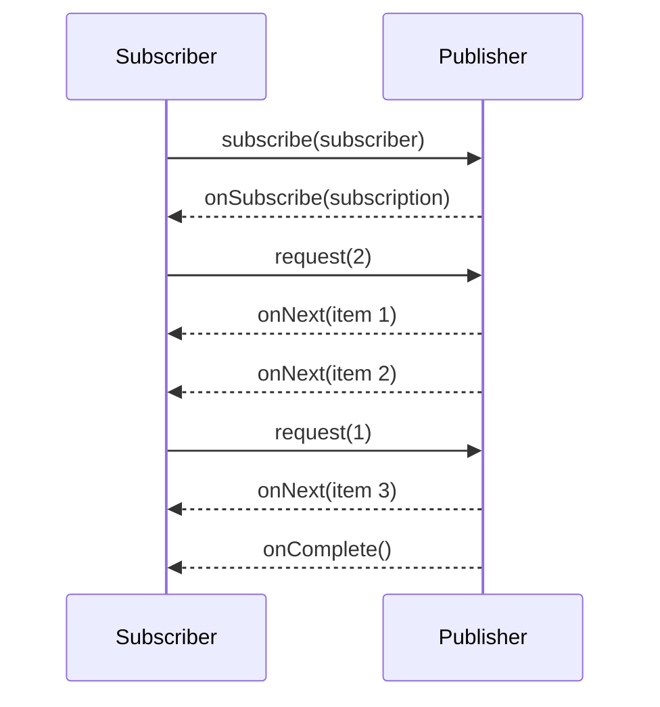

# Đồng bộ và bất đồng bộ trong vòng đời một tác vụ

Khi một ứng dụng xử lý yêu cầu, truy vấn cơ sở dữ liệu hoặc gửi thông báo, mỗi việc đó đều có thể xem là một **tác vụ**. Tác vụ có điểm bắt đầu, thời gian thực thi và một kết quả cuối cùng. Khác biệt giữa xử lý đồng bộ và bất đồng bộ nằm ở cách luồng điều khiển của chương trình tiếp tục trong lúc tác vụ chưa hoàn tất.

Trong Java, hiểu rõ khác biệt này giúp chọn đúng cách gọi hàm, `CompletableFuture`, `Mono` hoặc `Flux`. Đây cũng là nền tảng để hiểu luồng sự kiện, hợp đồng Publisher–Subscriber và backpressure trong Reactive Streams.

## 1. Nhìn vào vòng đời của tác vụ

Một tác vụ thường đi qua các giai đoạn sau:

1. **Khởi tạo:** tạo dữ liệu đầu vào và xác định công việc cần thực hiện.
2. **Bắt đầu:** gọi trực tiếp công việc hoặc gửi nó tới một executor hay một publisher.
3. **Thực thi:** đọc dữ liệu, tính toán, gọi dịch vụ khác hoặc chờ tài nguyên bên ngoài.
4. **Hoàn tất:** tác vụ trả về giá trị, không có giá trị, phát sinh lỗi hoặc bị hủy.
5. **Tiếp tục xử lý:** chương trình sử dụng kết quả, chuyển lỗi tới nơi xử lý hoặc dừng chuỗi công việc.

Ở cách đồng bộ, luồng gọi thường phải chờ tác vụ kết thúc mới đi qua bước tiếp theo. Ở cách bất đồng bộ, luồng gọi có thể tiếp tục công việc khác trong khi tác vụ đang chạy; kết quả sẽ được chuyển tới chương trình sau đó thông qua một cơ chế hoàn tất, chẳng hạn callback, future hoặc tín hiệu reactive.

| Khía cạnh | Đồng bộ | Bất đồng bộ |
| --- | --- | --- |
| Luồng điều khiển | Đi tiếp sau khi lời gọi hoàn tất | Có thể đi tiếp trước khi tác vụ hoàn tất |
| Nhận kết quả | Giá trị trả về trực tiếp hoặc exception | Callback, future hoặc tín hiệu từ publisher |
| Thứ tự | Thường thể hiện trực tiếp qua thứ tự lời gọi | Cần mô tả thứ tự bằng các bước nối tiếp hoặc phối hợp |
| Chờ đợi | Lời gọi có thể giữ luồng gọi trong thời gian chờ | Luồng gọi có thể được giải phóng để làm việc khác |
| Xử lý lỗi | Thường nằm trong call stack hiện tại | Phải được chuyển tiếp qua cơ chế hoàn tất bất đồng bộ |

## 2. Tác vụ đồng bộ: hoàn tất rồi mới tiếp tục

Ví dụ một quy trình xử lý đơn hàng gồm tải đơn, tính phí và gửi biên nhận:

```java
Order order = orderService.loadOrder(orderId);
Payment payment = paymentService.charge(order);
Receipt receipt = receiptService.create(order, payment);
notificationService.send(receipt);
```

Mỗi lời gọi trả về trước khi câu lệnh kế tiếp được thực hiện. Nếu `loadOrder` mất hai giây, luồng gọi không thể chạy đến `charge` cho tới khi việc tải đơn kết thúc. Nếu một lời gọi ném exception, exception truyền ngược qua call stack và có thể được bắt bằng `try/catch` ở phía gọi.

Cách làm này dễ đọc, dễ gỡ lỗi và phù hợp khi công việc ngắn, cần kết quả ngay hoặc khi việc chờ không gây lãng phí đáng kể. Nó trở thành vấn đề khi luồng phải chờ I/O lâu, ví dụ chờ phản hồi HTTP hoặc truy vấn cơ sở dữ liệu. Trong lúc chờ, luồng đó không thể dùng để xử lý một yêu cầu khác.

Đồng bộ không đồng nghĩa với chạy trên một luồng duy nhất trong toàn ứng dụng. Nhiều yêu cầu vẫn có thể được xử lý đồng thời trên các luồng khác nhau; điều quan trọng ở đây là quan hệ giữa lời gọi và tác vụ mà lời gọi đó khởi chạy.

## 3. Tác vụ bất đồng bộ: tách thời điểm khởi chạy khỏi thời điểm hoàn tất

Với `CompletableFuture`, chương trình có thể gửi công việc tới một `Executor` rồi mô tả các bước tiếp theo. Ví dụ dưới đây giả định `chargeAsync` trả về `CompletableFuture<Payment>`:

```java
CompletableFuture<Void> workflow = CompletableFuture
    .supplyAsync(() -> orderService.loadOrder(orderId), ioExecutor)
    .thenApply(orderService::enrich)
    .thenCompose(paymentService::chargeAsync)
    .thenAccept(notificationService::sendReceipt)
    .whenComplete((ignored, error) -> {
        if (error != null) {
            log.error("Không thể hoàn tất quy trình đơn hàng", error);
        }
    });
```

`ioExecutor` quyết định nơi chạy tác vụ được gửi bằng `supplyAsync`. Các toán tử `thenApply`, `thenCompose` và `thenAccept` nối những giai đoạn xử lý thành một chuỗi:

- `thenApply` biến đổi kết quả đồng bộ khi giai đoạn trước đã có kết quả.
- `thenCompose` nối một thao tác bất đồng bộ khác và làm phẳng future lồng nhau.
- `thenAccept` nhận kết quả để thực hiện hành động không cần trả về giá trị.
- `whenComplete` quan sát kết quả cuối cùng hoặc lỗi mà không biến một kết quả lỗi thành kết quả thành công.

Lời gọi tạo `workflow` trả về một `CompletableFuture` để theo dõi tiến trình. Nó không có nghĩa mọi giai đoạn đều tự động chạy song song. Các giai đoạn nối tiếp phụ thuộc vào kết quả trước đó vẫn phải chờ kết quả ấy; executor và các toán tử bất đồng bộ quyết định nơi cũng như thời điểm chúng được thực thi.

Khi lỗi xảy ra trong một giai đoạn, các giai đoạn thành công tiếp theo sẽ không chạy theo đường thành công. Future chuyển sang trạng thái hoàn tất lỗi và lỗi được chuyển qua chuỗi. Có thể dùng `exceptionally` hoặc `handle` để phục hồi, nhưng cần quyết định rõ lỗi nào có thể chuyển thành giá trị thay thế và lỗi nào phải tiếp tục được báo lên phía gọi.

## 4. Bất đồng bộ, không chặn, đồng thời và song song là các khái niệm khác nhau

Các khái niệm này thường xuất hiện cùng nhau nhưng không thể dùng thay thế cho nhau:

- **Bất đồng bộ (asynchronous)** mô tả cách chương trình tách thời điểm khởi chạy khỏi thời điểm nhận kết quả. Bên gọi có thể tiếp tục trước khi tác vụ hoàn tất.
- **Không chặn (non-blocking)** mô tả hành vi chờ: khi chưa có kết quả, luồng có thể trả quyền điều khiển thay vì đứng chờ. Một API bất đồng bộ có thể vẫn chặn ở một đoạn bên trong nếu đoạn đó gọi I/O đồng bộ.
- **Đồng thời (concurrency)** nghĩa là nhiều tác vụ có tiến trình chồng lấp theo thời gian. Chúng có thể luân phiên trên cùng một luồng.
- **Song song (parallelism)** nghĩa là nhiều tác vụ thực sự chạy cùng một thời điểm, thường trên nhiều lõi hoặc nhiều luồng.

Ví dụ, một event loop có thể tiếp nhận nhiều yêu cầu bất đồng bộ trên một luồng. Khi một yêu cầu đang chờ I/O, event loop xử lý yêu cầu khác. Hệ thống có concurrency dù không nhất thiết thực thi hai đoạn mã cùng một thời điểm. Ngược lại, gửi một tác vụ vào thread pool không tự làm cho API bên trong trở thành non-blocking; nếu tác vụ gọi một hàm đọc tệp đồng bộ, luồng worker vẫn bị chặn trong lúc đọc.

Vì vậy, khi đánh giá một API, hãy hỏi riêng: lời gọi có trả về trước khi công việc kết thúc không, luồng có bị giữ trong lúc chờ không, và có bao nhiêu tác vụ thực sự chạy cùng lúc?

## 5. Vòng đời trong Reactive Streams

Reactive Programming biểu diễn một hoặc nhiều kết quả theo thời gian dưới dạng một luồng tín hiệu. Trong Reactor của hệ sinh thái Java:

- `Mono<T>` biểu diễn tối đa một phần tử kiểu `T`, hoặc hoàn tất rỗng, hoặc kết thúc bằng lỗi.
- `Flux<T>` biểu diễn từ không đến nhiều phần tử kiểu `T`, sau đó hoàn tất hoặc kết thúc bằng lỗi.
- `Publisher` phát tín hiệu; `Subscriber` đăng ký nhận tín hiệu và điều khiển nhu cầu thông qua `Subscription`.

Với Reactor, việc mô tả pipeline thường chưa thực thi nguồn dữ liệu ngay. Chuỗi toán tử được lắp ráp trước; khi có subscriber đăng ký, quá trình xử lý mới bắt đầu theo cách publisher đó định nghĩa. Một nguồn như `Mono.just(value)` giữ sẵn giá trị đã được tính trước khi tạo publisher, trong khi `Mono.fromCallable(...)` có thể trì hoãn việc gọi hàm cho tới lúc subscribe.

Hợp đồng Reactive Streams có trình tự cơ bản như sau:



`onSubscribe` cung cấp đối tượng `Subscription`. Subscriber gọi `request(n)` để báo số phần tử đang sẵn sàng tiếp nhận. Publisher phát tối đa số phần tử đã được yêu cầu, có thể nhận thêm yêu cầu trong quá trình xử lý, rồi gửi một tín hiệu kết thúc là `onComplete` hoặc `onError`. Subscriber cũng có thể gọi `cancel()` để báo rằng nó không còn muốn nhận dữ liệu.

Cơ chế yêu cầu theo nhu cầu này là **backpressure**. Nó giúp điều tiết tốc độ phát dữ liệu theo khả năng tiếp nhận của downstream, tránh để một nguồn phát nhanh đẩy vô hạn phần tử vào một nơi xử lý chậm. Backpressure là một phần của hợp đồng truyền tín hiệu; nó không tự động làm cho mọi thao tác I/O trở thành non-blocking và cũng không thay thế việc đặt giới hạn bộ nhớ, timeout hoặc chính sách xử lý khi hàng đợi đầy.

## 6. Ví dụ một tác vụ bất đồng bộ với Mono

Giả sử ứng dụng đang dùng một repository có phương thức đọc đơn hàng dạng blocking. Có thể đưa lời gọi đó vào `Mono` và chỉ định scheduler phù hợp:

```java
Mono<Receipt> workflow = Mono
    .fromCallable(() -> orderRepository.findByIdBlocking(orderId))
    .subscribeOn(Schedulers.boundedElastic())
    .switchIfEmpty(Mono.error(new OrderNotFoundException(orderId)))
    .flatMap(paymentService::charge)
    .map(Receipt::from)
    .doOnError(error ->
        log.error("Không thể tạo biên nhận cho đơn hàng {}", orderId, error)
    );
```

Trong ví dụ này, `fromCallable` trì hoãn lời gọi repository tới lúc subscribe. Nếu phương thức trả về `null`, Reactor chuyển kết quả đó thành một `Mono` rỗng; `switchIfEmpty` chuyển trường hợp này thành lỗi nghiệp vụ. Nếu repository ném exception, lỗi được chuyển thành tín hiệu `onError`. `flatMap` nối thao tác thanh toán vốn trả về một `Mono`, còn `map` biến đổi kết quả thanh toán thành biên nhận.

`subscribeOn(Schedulers.boundedElastic())` đưa việc thực thi nguồn blocking sang scheduler phù hợp với các tác vụ có thời gian chờ. Điều này giúp tránh giữ một event-loop thread trong lúc repository chờ I/O. Với một repository reactive vốn đã non-blocking, hãy dùng trực tiếp publisher của repository thay vì bọc nó trong `fromCallable` hoặc chuyển nó sang `boundedElastic` một cách máy móc.

Khi cần tự khởi chạy pipeline trong một chương trình độc lập, có thể đăng ký subscriber:

```java
workflow.subscribe(
    this::deliverReceipt,
    this::reportFailure
);
```

Trong ứng dụng WebFlux, thông thường controller trả `Mono` hoặc `Flux` cho framework để framework quản lý subscription. Tự gọi `subscribe()` bên trong controller hoặc service có thể tách công việc khỏi vòng đời yêu cầu, khiến việc truyền lỗi, hủy tác vụ và quản lý tài nguyên khó kiểm soát hơn.

## 7. Scheduler, lỗi và hủy tác vụ là một phần của vòng đời

Bất đồng bộ không loại bỏ nhu cầu chọn nơi thực thi. Trong Reactor, `subscribeOn` tác động tới việc đăng ký và thực thi nguồn; `publishOn` chuyển việc xử lý các toán tử phía sau nó sang scheduler được chỉ định. Có thể dùng `Schedulers.parallel()` cho công việc tính toán ngắn, có tính CPU-bound và `Schedulers.boundedElastic()` để cô lập các lời gọi blocking. Tránh chạy I/O blocking trực tiếp trên event loop vì một lời gọi chậm có thể làm trì hoãn nhiều tác vụ khác đang dùng chung luồng đó.

Lỗi cũng đi theo vòng đời bất đồng bộ. Một `try/catch` quanh dòng tạo `Mono` không bắt được mọi lỗi phát sinh sau đó khi publisher được subscribe. Hãy xử lý lỗi trong pipeline bằng những toán tử phù hợp như `doOnError` để quan sát, `onErrorResume` để chuyển sang publisher thay thế, hoặc `retryWhen` để thử lại theo chính sách rõ ràng. Chỉ retry thao tác có thể thực hiện lại an toàn; một lệnh thanh toán hoặc ghi dữ liệu không có tính idempotent có thể gây tác dụng phụ lặp lại.

Hủy subscription cũng là một sự kiện trong vòng đời. Khi subscriber gọi `cancel`, yêu cầu nhận dữ liệu được dừng và tín hiệu hủy được truyền ngược về phía nguồn theo khả năng của publisher. Tuy nhiên, hủy không bảo đảm mọi lời gọi bên ngoài lập tức dừng: một thư viện blocking hoặc một hệ thống từ xa có thể không hỗ trợ ngắt giữa chừng. Vì thế, timeout, giới hạn tài nguyên và cơ chế hủy của client I/O vẫn cần được cấu hình phù hợp.

## 8. Chọn cách xử lý theo đặc điểm tác vụ

Đồng bộ thường là lựa chọn dễ hiểu cho phép tính ngắn, đoạn xử lý cần kết quả ngay hoặc quy trình nhỏ không phải chờ tài nguyên bên ngoài. Bất đồng bộ hữu ích khi tác vụ phải chờ I/O, khi nhiều yêu cầu cần tiến triển đồng thời, hoặc khi kết quả đến theo thời gian dưới dạng một luồng sự kiện.

Trước khi chuyển một đoạn xử lý sang bất đồng bộ, hãy xác định rõ ai sở hữu kết quả, lỗi được chuyển tới đâu, khi nào tác vụ hết thời gian, điều gì xảy ra khi bên nhận hủy và tốc độ dữ liệu được kiểm soát thế nào. Với một giá trị đơn lẻ, `CompletableFuture` hoặc `Mono` có thể diễn đạt vòng đời của kết quả. Với nhiều phần tử phát theo thời gian, `Flux` cùng backpressure giúp mô tả cả dữ liệu lẫn nhu cầu của bên nhận.

Khi đọc một pipeline, hãy lần theo ba điều: tác vụ bắt đầu ở thời điểm nào, tín hiệu hoàn tất được chuyển qua những bước nào, và điều gì xảy ra nếu có lỗi hoặc hủy giữa chừng. Nắm được ba điểm này sẽ giúp phân biệt chính xác xử lý đồng bộ, bất đồng bộ và reactive trong một ứng dụng Java.
