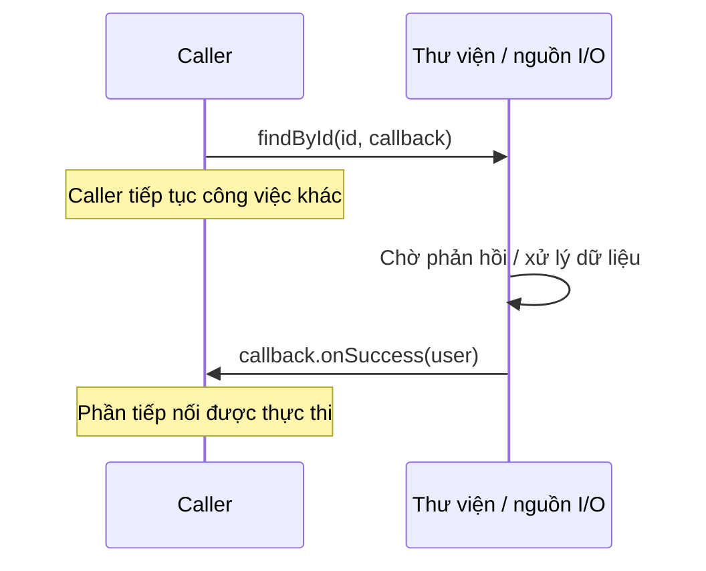

# Hàm gọi lại: đảo quyền điều khiển và khó khăn khi phối hợp

Hàm gọi lại (callback) là một hàm hoặc đối tượng hành vi được truyền vào một thành phần khác để thành phần đó gọi lại khi một việc đã xảy ra. Trong Java, callback thường được biểu diễn bằng interface, functional interface, lambda hoặc method reference. Với xử lý bất đồng bộ, caller đăng ký callback rồi tiếp tục công việc; thư viện hoặc nguồn dữ liệu sẽ gọi callback sau khi có kết quả, lỗi hoặc sự kiện.

Callback giúp tách thời điểm yêu cầu công việc khỏi thời điểm nhận kết quả. Tuy nhiên, nó cũng chuyển một phần quyền điều khiển từ caller sang bên thực thi callback. Caller không còn tự đi tuần tự qua từng lệnh để lấy kết quả; nó phải chuẩn bị phần xử lý tiếp theo và để thư viện quyết định khi nào, trên thread nào gọi phần xử lý đó. Khi một quy trình gồm nhiều bước phụ thuộc nhau, nhiều nhánh song song hoặc nhiều điểm lỗi, cách phối hợp bằng callback lồng nhau dễ làm luồng điều khiển phân tán, khó đọc, khó kiểm thử và khó quản lý vòng đời.

## 1. Callback là gì?

Trong lời gọi đồng bộ, hàm được gọi thường trả kết quả cho caller. Caller nhận kết quả ngay trong luồng điều khiển hiện tại và quyết định bước tiếp theo:

```java
User user = userRepository.findById(userId);
showProfile(user);
```

Với callback, caller cung cấp trước hành vi cần chạy khi kết quả sẵn sàng:

```java
userClient.findById(userId, user -> showProfile(user));
```

Ví dụ thứ hai chỉ minh họa hình dạng API; `findById` không trả `User` trực tiếp. Nó nhận một callback và gọi callback khi có kết quả. Callback có thể được gọi sau khi thao tác mạng hoàn tất, sau khi một tác vụ trong executor kết thúc hoặc ngay trong lời gọi nếu API được thiết kế theo kiểu đồng bộ.

Một callback không nhất thiết là bất đồng bộ. Từ *callback* mô tả cách truyền hành vi vào một thành phần để thành phần đó gọi lại; từ *bất đồng bộ* mô tả cách caller không phải chờ kết quả theo luồng gọi thông thường. Hai đặc điểm thường đi cùng nhau trong API I/O, nhưng không đồng nghĩa. Khi dùng một API callback, cần đọc hợp đồng để biết callback có thể chạy ngay lập tức hay luôn chạy sau, được gọi một lần hay nhiều lần, và chạy trên thread nào.

### Callback bằng functional interface

Java có sẵn nhiều kiểu biểu diễn callback trong `java.util.function`, chẳng hạn `Consumer<T>` cho hành vi nhận một giá trị, `BiConsumer<T, U>` cho hai giá trị, `Function<T, R>` cho phép biến đổi và `Runnable` cho một công việc không nhận tham số. API có thể định nghĩa interface riêng khi cần biểu diễn rõ thành công, lỗi hoặc sự kiện nhiều lần.

Ví dụ một callback trả kết quả thành công hoặc thất bại:

```java
public interface ResultCallback<T> {
    void onSuccess(T value);
    void onFailure(Throwable error);
}

public interface UserClient {
    void findById(String userId, ResultCallback<User> callback);
}
```

`ResultCallback<T>` cho biết hai kết quả kết thúc mà caller phải xử lý. Cách này rõ hơn việc chỉ nhận `Consumer<T>` nếu API cũng có thể thất bại. Trong ứng dụng thật, kiểu lỗi có thể được thu hẹp thành một exception miền nghiệp vụ hoặc một kiểu kết quả riêng, tùy hợp đồng của API.

## 2. Callback tạo ra đảo quyền điều khiển như thế nào?

Khi caller gọi một hàm đồng bộ, caller thường kiểm soát trình tự: gọi hàm, nhận giá trị, rồi gọi bước tiếp theo. Với callback, caller đăng ký phần tiếp nối, sau đó thư viện hoặc nguồn dữ liệu nắm quyền quyết định thời điểm gọi phần tiếp nối đó. Đây là hiện tượng đảo quyền điều khiển (inversion of control).



Caller quyết định *việc gì* cần thực hiện khi có kết quả bằng cách cung cấp callback. Thư viện quyết định *khi nào* callback được gọi theo hợp đồng của nó. Nếu callback chạy trên một executor, thread hiện tại của caller có thể đã kết thúc công việc từ lâu. Nếu callback chạy trên event-loop, phần xử lý bên trong callback cần ngắn và không được chặn thread đó.

Đảo quyền điều khiển không phải điều xấu. Nó cho phép thư viện quản lý I/O, thread và thời điểm phát kết quả mà không buộc caller chờ. Khó khăn xuất hiện khi ứng dụng có nhiều callback phụ thuộc nhau nhưng không có một cấu trúc thống nhất để biểu diễn toàn bộ quy trình.

## 3. Một callback bất đồng bộ hoạt động ra sao?

Ví dụ dưới đây dùng `ExecutorService` để minh họa một client chạy công việc trên thread nền rồi gọi callback. Repository được giả định là thành phần có thể trả về người dùng hoặc ném exception:

```java
public final class AsyncUserClient {
    private final ExecutorService executor;
    private final UserRepository repository;

    public AsyncUserClient(ExecutorService executor,
                           UserRepository repository) {
        this.executor = executor;
        this.repository = repository;
    }

    public void findById(String userId,
                         ResultCallback<User> callback) {
        executor.execute(() -> {
            try {
                User user = repository.findById(userId);
                callback.onSuccess(user);
            } catch (Exception error) {
                callback.onFailure(error);
            }
        });
    }
}
```

Caller đăng ký và nhận kết quả ở callback:

```java
userClient.findById(userId, new ResultCallback<>() {
    @Override
    public void onSuccess(User user) {
        renderProfile(user);
    }

    @Override
    public void onFailure(Throwable error) {
        showLoadError(error);
    }
});
```

Trong ví dụ, `findById` trả về ngay sau khi gửi tác vụ vào executor; thao tác repository và callback chạy sau trên thread thực thi tác vụ. Caller không có đối tượng `User` ngay tại vị trí gọi để dùng cho dòng lệnh kế tiếp. Nó phải đặt phần xử lý phụ thuộc vào `User` bên trong callback hoặc chuyển kết quả sang một abstraction khác.

Đoạn mã minh họa cần được hoàn thiện trong ứng dụng thực tế: xác định cách xử lý `userId` không hợp lệ, cách biểu diễn không tìm thấy người dùng, cách đóng executor, và việc callback có được phép ném exception hay không. Cũng cần quyết định API có bảo đảm callback chỉ được gọi đúng một lần hay không.

## 4. Khó khăn thứ nhất: luồng điều khiển bị phân tán

Trong chương trình đồng bộ, có thể đọc từ trên xuống để thấy thứ tự các bước. Khi dùng callback, phần tiếp theo được đặt trong một hàm khác, có thể ở lớp khác và chạy sau trên thread khác. Khi một quy trình có nhiều bước phụ thuộc, mỗi bước lại đăng ký callback cho bước kế tiếp.

Giả sử cần tải hồ sơ người dùng, sau đó tải đơn hàng của người dùng, tính tổng chi tiêu rồi gửi thông báo. Với callback, cấu trúc có thể dần trở thành:

```java
userClient.findById(userId, new ResultCallback<>() {
    @Override
    public void onSuccess(User user) {
        orderClient.findByUserId(user.id(), new ResultCallback<>() {
            @Override
            public void onSuccess(List<Order> orders) {
                reportClient.calculateTotal(orders, new ResultCallback<>() {
                    @Override
                    public void onSuccess(Money total) {
                        notificationClient.sendSummary(user, total,
                            new ResultCallback<>() {
                                @Override
                                public void onSuccess(Void ignored) {
                                    System.out.println("Đã gửi thông báo");
                                }

                                @Override
                                public void onFailure(Throwable error) {
                                    logFailure(error);
                                }
                            });
                    }

                    @Override
                    public void onFailure(Throwable error) {
                        logFailure(error);
                    }
                });
            }

            @Override
            public void onFailure(Throwable error) {
                logFailure(error);
            }
        });
    }

    @Override
    public void onFailure(Throwable error) {
        logFailure(error);
    }
});
```

Đây là ví dụ cấu trúc để nhận diện vấn đề; kiểu `Void` và chữ ký các client phụ thuộc vào API cụ thể. Khi lồng nhiều tầng, phần xử lý chính bị đẩy sâu vào bên trong. Nếu thêm điều kiện, nhánh dự phòng hoặc bước dọn dẹp, độ lồng tăng nhanh. Người đọc phải lần theo nhiều callback để hiểu toàn bộ quy trình.

Hiện tượng này thường được gọi là *callback hell* hoặc *pyramid of doom*. Vấn đề cốt lõi là luồng điều khiển và quan hệ phụ thuộc không còn được thể hiện tập trung. Mỗi callback chứa cả logic nghiệp vụ lẫn cách đăng ký bước tiếp theo, khiến việc thay đổi thứ tự hoặc tái sử dụng một bước trở nên khó khăn.

## 5. Khó khăn thứ hai: xử lý lỗi không đi theo stack của caller

Với lời gọi đồng bộ, exception thường truyền ngược qua stack đến nơi gọi có thể bắt nó:

```java
try {
    User user = repository.findById(userId);
    renderProfile(user);
} catch (RepositoryException error) {
    showLoadError(error);
}
```

Với callback bất đồng bộ, `try/catch` quanh lời gọi đăng ký thường chỉ bắt được lỗi phát sinh ngay trong quá trình đăng ký. Nó không tự bắt được exception xảy ra sau đó trên thread khác:

```java
try {
    userClient.findById(userId, user -> renderProfile(user));
} catch (Exception error) {
    // Không tự bắt được lỗi bất đồng bộ xảy ra sau khi callback được gọi.
    showLoadError(error);
}
```

Vì vậy, API callback cần một kênh lỗi riêng như `onFailure`, `onError` hoặc một kiểu kết quả chứa cả thành công và thất bại. Mỗi tầng lồng callback phải quyết định lỗi nào được chuyển tiếp, lỗi nào được chuyển thành fallback và lỗi nào cần kết thúc quy trình. Nếu một tầng quên gọi callback lỗi, caller phía trên có thể chờ mãi mà không biết công việc đã thất bại.

Ngoài ra, exception do chính logic trong callback ném ra cũng không quay lại stack của caller ban đầu. Thư viện gọi callback có thể bắt, ghi log, chuyển sang error handler hoặc để exception thoát khỏi thread thực thi. Hợp đồng phải nói rõ cách xử lý trường hợp này. Không nên giả định `try/catch` ở nơi đăng ký callback bảo vệ được mọi đoạn code chạy sau đó.

## 6. Khó khăn thứ ba: phối hợp nhiều tác vụ và nhánh song song

Một quy trình có thể cần chạy hai tác vụ độc lập rồi chỉ tiếp tục khi cả hai hoàn tất. Với callback, caller phải tự đếm số kết quả, lưu trạng thái trung gian và xử lý trường hợp một nhánh lỗi trước hoặc sau nhánh còn lại.

Ví dụ, một màn hình cần hồ sơ và quyền truy cập. Hai lời gọi có thể chạy song song:

```java
AtomicReference<User> userResult = new AtomicReference<>();
AtomicReference<Permissions> permissionResult = new AtomicReference<>();
AtomicInteger completed = new AtomicInteger();

userClient.findById(userId, callbackFor(userResult, completed));
permissionClient.findFor(userId, callbackFor(permissionResult, completed));
```

Đoạn mã trên chỉ phác thảo trạng thái phối hợp, chưa phải một triển khai hoàn chỉnh. Một triển khai thật cần bảo đảm chỉ tiếp tục một lần khi đủ hai kết quả, xử lý lỗi từ bất kỳ nhánh nào, tránh race condition khi hai callback chạy đồng thời, và không giữ kết quả vô thời hạn nếu một nhánh không phản hồi. Cần có timeout, trạng thái terminal và chính sách hủy nhánh còn lại.

Khi tự quản lý bộ đếm hoặc biến dùng chung, các lỗi thường gặp gồm:

- Hai callback cùng nhìn thấy trạng thái chưa hoàn tất và cùng gọi bước tổng hợp.
- Một callback lỗi nhưng nhánh khác vẫn tiếp tục, làm công việc thừa hoặc phát ra kết quả không hợp lệ.
- Kết quả được ghi vào biến dùng chung mà không có đồng bộ hoặc quy tắc an toàn luồng.
- Nhánh chậm không bao giờ hoàn tất, khiến quy trình không giải phóng trạng thái trung gian.
- Callback bị gọi lặp khiến bộ đếm vượt ngưỡng hoặc một side effect chạy nhiều lần.

Các tình huống này đòi hỏi cơ chế phối hợp có cấu trúc, chẳng hạn `CompletableFuture.allOf`, `CompletionStage`, hoặc toán tử kết hợp của Reactor như `Mono.zip`. Các abstraction đó mô tả quan hệ giữa tác vụ rõ ràng hơn so với việc tự duy trì bộ đếm và biến dùng chung.

## 7. Khó khăn thứ tư: thread, thứ tự và trạng thái dùng chung

Callback có thể được gọi trên thread của caller, thread trong executor, event-loop của thư viện hoặc một thread được tạo bởi framework. Nếu hợp đồng không nói rõ, caller không nên tự giả định callback chạy ở đâu.

Điều này tạo ra một số rủi ro:

**Race condition:** hai callback cùng cập nhật một đối tượng hoặc cùng thay đổi trạng thái nghiệp vụ. Nếu không có đồng bộ, kết quả phụ thuộc vào thứ tự thực thi.

**Thứ tự không xác định:** nếu nhiều tác vụ chạy song song, callback hoàn tất theo thời gian phản hồi chứ không nhất thiết theo thứ tự đăng ký. Nếu nghiệp vụ yêu cầu thứ tự, phải tuần tự hóa hoặc gắn sequence/version và kiểm tra trước khi cập nhật.

**Reentrancy:** một API có thể gọi callback ngay trong lời gọi đăng ký nếu kết quả đã có sẵn, nhưng gọi bất đồng bộ trong trường hợp khác. Khi đó, callback có thể chạy trước khi caller hoàn tất việc khởi tạo trạng thái sau lệnh đăng ký. Nếu caller giữ lock trong lúc gọi API, callback đồng bộ có thể gây deadlock hoặc thay đổi trạng thái ở thời điểm bất ngờ.

**Chặn thread quan trọng:** nếu callback chạy trên event-loop mà gọi truy vấn blocking, `Thread.sleep` hoặc tính toán quá nặng, các tác vụ khác dùng chung event-loop cũng bị trì hoãn.

Để giảm rủi ro, nên ưu tiên dữ liệu bất biến, giới hạn vùng trạng thái dùng chung, dùng primitive đồng bộ phù hợp khi thật sự cần, và ghi rõ hợp đồng về thread, thứ tự, số lần gọi. Nếu cần chuyển công việc sang executor khác, phải quản lý executor và hàng đợi có giới hạn; tạo thread mới cho mỗi callback không phải giải pháp bền vững.

## 8. Khó khăn thứ năm: cancellation và vòng đời

Một lời gọi callback thường cần cách để caller báo rằng kết quả không còn cần thiết. Ví dụ, người dùng rời màn hình trước khi API trả dữ liệu, request HTTP bị client đóng hoặc một nhánh song song đã thất bại khiến các nhánh còn lại không cần chạy nữa.

Nếu API chỉ nhận callback mà không trả về handle hủy, caller khó dừng công việc và khó giải phóng tài nguyên. Callback có thể vẫn được gọi sau khi đối tượng giao diện đã bị hủy hoặc request đã kết thúc. Điều này có thể gây cập nhật trạng thái không còn hợp lệ, giữ tham chiếu đến đối tượng lâu hơn cần thiết hoặc thực hiện side effect không còn mong muốn.

Một API tốt có thể trả về một handle như `Cancellable`, `Future` hoặc `AutoCloseable` để caller hủy đăng ký hay yêu cầu dừng công việc:

```java
public interface Cancellable {
    void cancel();
}

public interface AsyncUserClient {
    Cancellable findById(String userId, ResultCallback<User> callback);
}
```

Caller cần xác định điều gì xảy ra nếu `cancel()` được gọi trước khi callback bắt đầu, trong lúc callback đang chạy hoặc sau khi kết quả đã được gửi. Hủy thường là yêu cầu hợp tác; nó không bảo đảm thu hồi được một request đã đến server hoặc đảo ngược một thao tác ghi đã thành công.

Với callback dùng để đăng ký sự kiện lâu dài, vòng đời còn bao gồm đăng ký và gỡ listener. Nếu quên gỡ listener khi component không còn hoạt động, nguồn có thể tiếp tục giữ tham chiếu đến component và gửi sự kiện không cần thiết.

## 9. Khó khăn thứ sáu: callback không tự cung cấp backpressure

Callback một lần thường biểu diễn kết quả của một thao tác đơn lẻ. Với callback sự kiện được gọi lặp lại, nguồn có thể đẩy sự kiện đến nhanh hơn tốc độ consumer xử lý. Một callback kiểu `onEvent(event)` không tự có cơ chế để consumer yêu cầu “chỉ gửi thêm ba phần tử”.

Nếu nguồn phát 10.000 sự kiện mỗi giây còn consumer chỉ xử lý 2.000 sự kiện mỗi giây, ứng dụng cần quyết định nơi giữ phần chênh lệch và khi nào từ chối hoặc bỏ dữ liệu. Buffer không giới hạn có thể làm tăng heap cho đến khi ứng dụng gặp sự cố. Các lựa chọn thường gồm:

- Giới hạn buffer và báo quá tải khi đầy.
- Bỏ sự kiện cũ hoặc mới nếu nghiệp vụ cho phép mất dữ liệu.
- Giữ giá trị mới nhất cho dữ liệu trạng thái như nhiệt độ hoặc vị trí hiện tại.
- Yêu cầu nguồn giảm tốc nếu API hoặc giao thức nguồn hỗ trợ.
- Chuyển nguồn callback thành publisher reactive và áp dụng chính sách backpressure tại adapter.

Không phải mọi callback đều cần backpressure. Nhưng khi callback biểu diễn một luồng sự kiện có tốc độ không ổn định, cần có chính sách rõ ràng về hàng đợi, bộ nhớ, thứ tự và mất dữ liệu. Reactive Streams chuẩn hóa demand giữa publisher và subscriber; callback thuần túy không cung cấp hợp đồng này.

## 10. Cách giảm callback lồng nhau

Callback phù hợp với một thao tác nhỏ, một listener hoặc một API tích hợp đơn giản. Khi quy trình có nhiều bước, có thể chọn abstraction biểu diễn kết quả bất đồng bộ để compose các bước theo cấu trúc tuyến tính hơn.

### Dùng CompletableFuture

`CompletableFuture<T>` biểu diễn một kết quả sẽ có trong tương lai và cung cấp các thao tác ghép nối như `thenApply`, `thenCompose`, `thenCombine`, `allOf` và xử lý lỗi. Một API callback cũ có thể được chuyển thành future ở ranh giới tích hợp:

```java
CompletableFuture<User> findUser(String userId) {
    CompletableFuture<User> future = new CompletableFuture<>();

    legacyClient.findById(userId, new ResultCallback<>() {
        @Override
        public void onSuccess(User user) {
            future.complete(user);
        }

        @Override
        public void onFailure(Throwable error) {
            future.completeExceptionally(error);
        }
    });

    return future;
}
```

Sau khi chuyển đổi, có thể compose các bước phụ thuộc:

```java
CompletableFuture<Summary> summary = findUser(userId)
    .thenCompose(user -> findOrders(user.id())
        .thenApply(orders -> new Summary(user, orders)))
    .exceptionally(error -> fallbackSummary(error));
```

`thenCompose` nối một bước bất đồng bộ khác mà không tạo `CompletableFuture<CompletableFuture<T>>`. `thenCombine` có thể kết hợp hai future độc lập. Cần chọn executor phù hợp cho các biến thể async và hiểu nơi callback continuation chạy; một future không tự bảo đảm mọi thao tác đều non-blocking nếu hàm bên trong thực hiện blocking.

### Dùng Reactor khi cần luồng dữ liệu và backpressure

Trong module này, Reactor cung cấp `Mono` và `Flux` để biểu diễn kết quả đơn lẻ hoặc luồng nhiều phần tử, kết hợp toán tử, điều khiển demand và quản lý tín hiệu lỗi/hủy. Callback một lần có thể được chuyển thành `Mono` ở ranh giới tích hợp; callback nhiều lần có thể được chuyển thành `Flux` nếu adapter xử lý đúng vòng đời và chính sách quá tải.

Ví dụ một callback API được bọc thành `Mono` bằng `Mono.create`:

```java
Mono<User> findUserReactive(String userId) {
    return Mono.create(sink -> {
        Cancellable request = legacyClient.findById(userId,
            new ResultCallback<>() {
                @Override
                public void onSuccess(User user) {
                    sink.success(user);
                }

                @Override
                public void onFailure(Throwable error) {
                    sink.error(error);
                }
            });

        sink.onCancel(request::cancel);
    });
}
```

Đây là mẫu minh họa, giả định `legacyClient` trả về `Cancellable` và callback chỉ có một kết quả kết thúc. Adapter cần bảo đảm không phát nhiều kết quả terminal, xử lý trường hợp API gọi callback đồng bộ trước khi `findById` trả handle, và giải quyết race giữa callback với cancellation. Nếu nguồn có thể gọi lại nhiều lần, cần dùng một abstraction phù hợp hơn như `Flux.create` hoặc `Flux.push` và xác định chính sách backpressure, buffer, dispose listener. Chỉ bọc callback vào publisher chưa tự động làm nguồn hỗ trợ demand.

Việc chuyển sang `Mono`/`Flux` giúp downstream compose pipeline bằng `map`, `flatMap`, `zip`, `onErrorResume`, `timeout` và các toán tử khác. Caller có thể giữ luồng điều khiển ở một pipeline thay vì lồng nhiều callback, đồng thời framework reactive có thể quản lý subscription theo lifecycle của request.

## 11. Khi nào nên dùng callback trực tiếp?

Callback vẫn là một công cụ hợp lý khi hành vi đơn giản và hợp đồng rõ ràng. Ví dụ: đăng ký listener cho một nút bấm, nhận một lần hoàn tất từ thư viện, hoặc tích hợp với một API cũ vốn chỉ cung cấp callback. Một callback đơn giản thường ít overhead và dễ hiểu hơn việc đưa cả một framework reactive vào một thao tác nhỏ.

Nên cân nhắc một abstraction compose khi:

- Có nhiều bước bất đồng bộ phụ thuộc nhau.
- Cần chạy nhiều nhánh song song rồi ghép kết quả.
- Lỗi phải được chuyển tiếp qua nhiều tầng với chính sách nhất quán.
- Cần timeout, retry, cancellation hoặc giới hạn concurrency.
- Nguồn phát nhiều phần tử và consumer cần backpressure.
- Cần kiểm thử thứ tự và thời gian của cả pipeline.

Chọn `CompletableFuture` khi bài toán chủ yếu là một kết quả đơn lẻ hoặc vài tác vụ bất đồng bộ cần kết hợp. Chọn `Mono`/`Flux` khi cần mô hình luồng dữ liệu, nhiều phần tử, demand/backpressure và các toán tử Reactor. Có thể dùng callback ở ranh giới adapter rồi chuyển sang abstraction phù hợp bên trong ứng dụng.

## 12. Kiểm thử mã dùng callback

Kiểm thử callback cần xác minh callback được gọi đúng lúc, đúng số lần và với đúng kết quả hoặc lỗi. Không nên dùng `Thread.sleep` để hy vọng tác vụ đã hoàn tất, vì test sẽ không ổn định theo tốc độ máy hoặc tải hệ thống.

Với một callback bất đồng bộ đơn giản, `CountDownLatch` có thể giúp test chờ có giới hạn:

```java
CountDownLatch completed = new CountDownLatch(1);
AtomicReference<User> result = new AtomicReference<>();
AtomicReference<Throwable> failure = new AtomicReference<>();

userClient.findById("u-42", new ResultCallback<>() {
    @Override
    public void onSuccess(User user) {
        result.set(user);
        completed.countDown();
    }

    @Override
    public void onFailure(Throwable error) {
        failure.set(error);
        completed.countDown();
    }
});

assertTrue(completed.await(2, TimeUnit.SECONDS));
assertNull(failure.get());
assertEquals("u-42", result.get().id());
```

Đoạn mã giả định test framework và các kiểu miền đã được khai báo. Timeout trong `await` giúp test thất bại rõ ràng nếu callback không bao giờ được gọi. Việc chờ này chỉ dành cho thread test; không dùng latch để chặn event-loop hoặc thread phục vụ request trong ứng dụng.

Ngoài đường đi thành công, cần kiểm tra callback lỗi, callback không bị gọi lặp, callback không được gọi sau khi hủy nếu hợp đồng yêu cầu, thứ tự khi có nhiều sự kiện, và khả năng xử lý khi callback chạy đồng bộ hoặc trên thread khác. Có thể dùng fake client để chủ động phát kết quả và lỗi theo thứ tự mong muốn, thay vì phụ thuộc vào mạng hoặc thời gian thực.

## 13. Danh sách kiểm tra khi thiết kế một API callback

Trước khi sử dụng hoặc công bố một API callback, hãy làm rõ các câu hỏi sau:

| Câu hỏi | Điều cần xác định |
| --- | --- |
| Callback được gọi khi nào? | Đồng bộ ngay trong lời gọi hay bất đồng bộ sau đó? |
| Callback chạy trên thread nào? | Caller thread, executor, event-loop hay thread do framework quản lý? |
| Callback được gọi bao nhiêu lần? | Một lần kết thúc hay nhiều lần cho một luồng sự kiện? |
| Kết quả lỗi được biểu diễn ra sao? | Callback lỗi, exception, kiểu kết quả hay một kênh riêng? |
| Callback có thể ném exception không? | Ai bắt và xử lý exception phát sinh trong callback? |
| Có bảo đảm thứ tự không? | Các sự kiện có giữ thứ tự phát hoặc thứ tự hoàn tất không? |
| Có thể hủy không? | Caller nhận handle nào và cancellation có hiệu lực đến đâu? |
| Consumer chậm thì sao? | Có demand, buffer giới hạn, drop policy hay báo quá tải? |
| Ai sở hữu tài nguyên? | Ai đóng executor, gỡ listener và giải phóng kết nối? |
| Có thể kiểm thử độc lập không? | Có thể giả lập success, error, timeout, cancellation và callback lặp không? |

## 14. Những lỗi thường gặp

- **Giả định callback luôn bất đồng bộ:** API có thể gọi callback ngay trong lời gọi nếu kết quả sẵn có. Hãy đọc và kiểm thử hợp đồng về thời điểm gọi.
- **Dùng `try/catch` quanh lệnh đăng ký để bắt mọi lỗi:** exception phát sinh sau đó trên thread khác cần được chuyển qua kênh lỗi của callback.
- **Quên xử lý nhánh lỗi:** một quy trình có thể không bao giờ hoàn tất hoặc để lỗi bị bỏ qua nếu một tầng không chuyển tiếp failure.
- **Lồng callback cho mọi bước:** cấu trúc sâu làm luồng điều khiển và chính sách lỗi phân tán; hãy cân nhắc `CompletableFuture` hoặc Reactor để compose.
- **Chia sẻ biến mutable không đồng bộ:** callback chạy đồng thời có thể gây race condition và cập nhật sai trạng thái.
- **Không định nghĩa số lần gọi:** callback completion bị gọi lặp có thể thực hiện side effect nhiều lần.
- **Không có cơ chế hủy hoặc gỡ listener:** công việc và tham chiếu có thể tồn tại sau khi caller không còn cần kết quả.
- **Để callback chặn event-loop:** một thao tác blocking trong callback có thể ảnh hưởng đến nhiều request khác.
- **Không giới hạn hàng đợi cho luồng sự kiện:** callback push liên tục có thể làm bộ nhớ tăng nếu consumer chậm.

Callback là nền tảng quan trọng của nhiều API bất đồng bộ và là cách tích hợp phổ biến với thư viện Java. Khi quy trình chỉ có một bước, callback có thể đơn giản và hiệu quả. Khi có nhiều bước, nhánh song song, lỗi, timeout, cancellation hoặc luồng sự kiện có tốc độ thay đổi, việc tự điều phối callback làm tăng đáng kể độ phức tạp. Hiểu rõ đảo quyền điều khiển và các giới hạn này giúp chọn đúng abstraction: giữ callback ở ranh giới tích hợp, dùng `CompletableFuture` cho việc phối hợp kết quả đơn lẻ, và dùng `Mono`/`Flux` khi cần compose luồng dữ liệu cùng hợp đồng backpressure của Reactive Streams.
