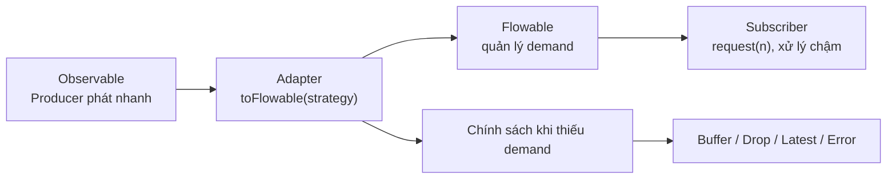

# Chiến lược áp lực ngược khi chuyển Observable sang Flowable

Trong chương **RxJava**, bài học này giải quyết tình huống một nguồn `Observable` phát dữ liệu nhanh hơn tốc độ mà subscriber có thể xử lý. `Observable` không có cơ chế demand của Reactive Streams, trong khi `Flowable` hỗ trợ subscriber yêu cầu số phần tử bằng `request(n)`. Khi chuyển đổi giữa hai kiểu nguồn, ứng dụng phải chọn cách xử lý phần tử đến trong lúc downstream chưa sẵn sàng nhận thêm.

Bài học thuộc module **REACTIVE_PROGRAMMING**. Module hướng dẫn: “Học tư duy reactive qua các luồng sự kiện bất đồng bộ, hợp đồng Publisher–Subscriber và cơ chế backpressure của Reactive Streams. Thực hành Mono, Flux, kết hợp toán tử, kiểm soát scheduler, xử lý lỗi và kiểm thử pipeline trong hệ sinh thái Java.” Trong RxJava, các chiến lược backpressure giúp xác định dữ liệu nào được giữ, bỏ, thay thế hoặc chuyển thành lỗi khi adapter đưa một nguồn `Observable` vào thế giới `Flowable`.

Các ví dụ dùng API RxJava 3 với package `io.reactivex.rxjava3`. Với RxJava 2, tên package tương ứng bắt đầu bằng `io.reactivex`; hãy dùng nhất quán phiên bản thư viện trong dự án.

## 1. Vì sao Observable cần chiến lược backpressure?

`Observable<T>` phát các tín hiệu `onNext`, `onError` và `onComplete`, nhưng subscriber không gửi demand để yêu cầu một số lượng phần tử cụ thể. Nguồn có thể tiếp tục phát theo nhịp của nó.

`Flowable<T>` triển khai hợp đồng Reactive Streams. Sau khi nhận `Subscription`, subscriber gọi `request(n)` để báo số phần tử muốn nhận. Publisher phải tôn trọng demand và không phát vượt quá số lượng đã được yêu cầu.

Sự khác biệt trở nên quan trọng khi producer nhanh hơn consumer. Ví dụ, cảm biến có thể phát 20.000 mẫu mỗi giây trong khi màn hình chỉ cập nhật được 30 lần mỗi giây. Nếu giữ mọi mẫu trong một hàng đợi không giới hạn, bộ nhớ có thể tăng liên tục. Nếu bỏ tùy tiện, dữ liệu phân tích có thể mất tính chính xác.



Chiến lược backpressure là quyết định nghiệp vụ về cách ứng xử khi downstream chưa thể nhận thêm. Không có một chiến lược tốt nhất cho mọi nguồn; lựa chọn phụ thuộc vào việc ứng dụng có cần giữ mọi sự kiện, chỉ cần trạng thái mới nhất hay cần phát hiện quá tải ngay lập tức.

## 2. Chuyển Observable thành Flowable

RxJava cung cấp `toFlowable(BackpressureStrategy)` để chuyển một `Observable` thành `Flowable` và chỉ định cách adapter xử lý phần tử khi downstream thiếu demand.

```java
Observable<Integer> source =
    Observable.range(1, 5);

Flowable<Integer> flow =
    source.toFlowable(BackpressureStrategy.BUFFER);
```

Sau chuyển đổi, downstream làm việc với `Flowable` và có thể điều khiển demand. Chiến lược được chọn quyết định adapter làm gì với các phần tử mà nguồn Observable phát ra trong lúc chưa có demand tương ứng.

Năm chiến lược chính:

| Chiến lược | Hành vi khi downstream chưa nhận kịp | Đánh đổi chính |
|---|---|---|
| `BUFFER` | Giữ các phần tử đang chờ trong hàng đợi | Có thể tốn nhiều bộ nhớ |
| `DROP` | Bỏ các phần tử không thể chuyển tiếp ngay | Có thể mất sự kiện |
| `LATEST` | Giữ phần tử mới nhất đang chờ, thay thế phần tử chờ cũ | Mất các giá trị trung gian |
| `ERROR` | Phát `MissingBackpressureException` | Báo quá tải sớm |
| `MISSING` | Không áp dụng chính sách tại adapter | Cần tự chọn xử lý ở bước downstream |

Chọn chiến lược ngay tại ranh giới chuyển đổi để người đọc pipeline thấy rõ chính sách được áp dụng cho nguồn không hỗ trợ demand.

## 3. BUFFER: giữ các phần tử cho đến khi downstream yêu cầu

`BackpressureStrategy.BUFFER` đưa các phần tử chưa được tiêu thụ vào hàng đợi. Khi subscriber phát sinh demand, các phần tử được chuyển tiếp theo thứ tự đã nhận.

```java
Flowable<SensorReading> readings =
    sensor.readings()
        .toFlowable(BackpressureStrategy.BUFFER);

readings
    .observeOn(Schedulers.computation())
    .subscribe(this::analyze, this::reportError);
```

Chiến lược này phù hợp khi từng sự kiện đều có ý nghĩa và ứng dụng chấp nhận lưu chúng trong bộ nhớ cho đến khi consumer xử lý. Tuy nhiên, `BUFFER` ở `toFlowable` là hàng đợi không giới hạn. Nếu producer liên tục nhanh hơn consumer, hàng đợi có thể tăng đến khi cạn bộ nhớ.

Không nên chọn `BUFFER` chỉ vì muốn “không mất dữ liệu” mà không tính tốc độ phát, thời gian consumer bị chậm, kích thước mỗi phần tử và ngân sách bộ nhớ. Một hàng đợi trong RAM cũng không bảo đảm dữ liệu tồn tại khi tiến trình dừng đột ngột.

### Giới hạn hàng đợi sau khi dùng MISSING

Nếu cần tự đặt dung lượng và chính sách khi hàng đợi đầy, có thể dùng `MISSING` ở adapter rồi áp dụng toán tử backpressure có giới hạn lên Flowable:

```java
Flowable<SensorReading> boundedReadings =
    sensor.readings()
        .toFlowable(BackpressureStrategy.MISSING)
        .onBackpressureBuffer(
            1024,
            () -> metrics.incrementBufferOverflow(),
            BackpressureOverflowStrategy.ERROR
        );
```

Hàng đợi giữ tối đa 1.024 phần tử đang chờ theo cấu hình. Khi vượt giới hạn, callback overflow được gọi và chính sách `ERROR` kết thúc luồng bằng lỗi quá tải. Nhờ vậy, hệ thống phát hiện tình trạng không thể giữ thêm dữ liệu thay vì tiếp tục tăng bộ nhớ không giới hạn.

Nếu nghiệp vụ cho phép bỏ dữ liệu cũ hoặc mới khi hàng đợi đầy, có thể chọn `DROP_OLDEST` hoặc `DROP_LATEST` theo semantics của API phiên bản đang dùng. Hãy ghi nhận số phần tử bị loại để vận hành có thể phát hiện việc mất dữ liệu.

Nếu yêu cầu là lưu mọi sự kiện một cách bền vững, hãy cân nhắc broker, log bền vững hoặc hàng đợi lưu trữ có giới hạn và cơ chế xác nhận. Buffer trong bộ nhớ chỉ là một phần của chiến lược, không thay thế lưu trữ bền vững.

## 4. DROP: bỏ phần tử khi consumer chưa sẵn sàng

`BackpressureStrategy.DROP` bỏ những phần tử được phát đến khi downstream chưa có demand để nhận chúng. Phần tử mới không được xếp hàng chờ.

```java
Flowable<MousePosition> positions =
    mouseEvents()
        .toFlowable(BackpressureStrategy.DROP);

positions.subscribe(this::updatePointer, this::reportError);
```

Đối với vị trí con trỏ, một số sự kiện trung gian có thể không cần thiết. Nếu giao diện chưa xử lý xong vị trí trước, bỏ một vị trí cũ có thể chấp nhận được vì sự kiện kế tiếp sẽ cung cấp vị trí mới hơn.

Có thể quan sát phần tử bị bỏ bằng toán tử `onBackpressureDrop` khi dùng chiến lược `MISSING`:

```java
Flowable<Event> visibleEvents =
    eventSource()
        .toFlowable(BackpressureStrategy.MISSING)
        .onBackpressureDrop(dropped ->
            metrics.recordDroppedEvent(dropped.type())
        );
```

Callback nhận phần tử bị bỏ, cho phép ghi metric hoặc log có kiểm soát. Tránh ghi toàn bộ payload nhạy cảm vào log; thường chỉ cần loại sự kiện, số lượng và mã tương quan.

DROP phù hợp với dữ liệu có thể bỏ qua theo yêu cầu nghiệp vụ như cập nhật giao diện, vị trí con trỏ hoặc tín hiệu trạng thái trung gian. Không nên dùng cho giao dịch, lệnh thanh toán hoặc sự kiện audit nếu mỗi sự kiện đều phải được xử lý.

## 5. LATEST: chỉ giữ trạng thái mới nhất đang chờ

`BackpressureStrategy.LATEST` giữ phần tử mới nhất trong khi downstream chưa có demand. Nếu thêm phần tử đến trước khi consumer sẵn sàng, giá trị đang chờ bị thay bằng giá trị mới hơn.

```java
Flowable<Temperature> currentTemperature =
    temperatureSensor.readings()
        .toFlowable(BackpressureStrategy.LATEST);

currentTemperature
    .observeOn(Schedulers.computation())
    .subscribe(this::refreshDashboard);
```

Dashboard thường quan tâm nhiệt độ hiện tại hơn mọi mẫu trung gian. Nếu consumer đang bận, giữ giá trị mới nhất giúp màn hình cập nhật bằng trạng thái gần hiện tại khi có demand tiếp theo.

`LATEST` khác với `DROP`:

- `DROP` bỏ phần tử đến khi downstream chưa nhận kịp.
- `LATEST` thay thế phần tử đang chờ bằng phần tử mới nhất, vì vậy sau khoảng bận consumer vẫn có một giá trị để nhận.

Chiến lược này không giữ lịch sử. Nếu downstream cần tính trung bình, phát hiện đỉnh hoặc phân tích chuỗi biến động, bỏ các mẫu trung gian có thể làm thay đổi kết quả. Hãy xác định xem dữ liệu là trạng thái có thể thay thế hay sự kiện cần xử lý đầy đủ.

## 6. ERROR: phát lỗi khi không thể đáp ứng demand

`BackpressureStrategy.ERROR` báo lỗi khi nguồn phát một phần tử mà downstream chưa có demand phù hợp. Adapter phát `MissingBackpressureException` để biểu thị rằng luồng không thể tiếp tục theo hợp đồng backpressure.

```java
Flowable<Command> commands =
    legacyCommandSource()
        .toFlowable(BackpressureStrategy.ERROR);
```

Chiến lược này phù hợp khi việc consumer không theo kịp cần được phát hiện ngay và tầng ứng dụng có thể xử lý tình trạng quá tải. Ví dụ, một hệ thống xử lý lệnh có thể từ chối request mới, trả trạng thái quá tải hoặc kích hoạt cơ chế giảm tải ở upstream.

ERROR không tự làm producer chậm lại. Nó làm vấn đề trở nên rõ ràng bằng một tín hiệu lỗi. Nếu tầng trên chỉ retry ngay mà không có backoff hoặc giảm tải, hệ thống có thể tiếp tục tạo thêm áp lực.

Khi nhận `MissingBackpressureException`, hãy xem xét tốc độ producer, demand, queue và vị trí xử lý downstream. Không nên bắt lỗi rồi bỏ qua như thể dữ liệu đã được xử lý thành công.

## 7. MISSING: để chính sách cho toán tử downstream quyết định

`BackpressureStrategy.MISSING` không thêm cách xử lý phần tử vượt demand ở ranh giới chuyển đổi. Nó hữu ích khi muốn áp dụng một toán tử backpressure cụ thể sau khi chuyển sang Flowable.

```java
Flowable<Metric> metrics =
    metricObservable()
        .toFlowable(BackpressureStrategy.MISSING)
        .onBackpressureLatest();
```

Trong ví dụ này, adapter không chọn chính sách; `onBackpressureLatest()` thực hiện việc giữ giá trị mới nhất ở downstream. Có thể thay bằng `onBackpressureDrop()`, `onBackpressureBuffer(...)` hoặc `onBackpressureError()` theo yêu cầu.

Không nên để một Flowable dùng MISSING đi thẳng đến một consumer mà không hiểu hành vi của upstream và downstream. MISSING không có nghĩa là nguồn đã được điều tiết theo demand. Nó chuyển trách nhiệm chọn chính sách sang phần còn lại của pipeline.

## 8. Các toán tử backpressure sau khi đã có Flowable

Ngoài strategy của `toFlowable`, RxJava có các toán tử trên Flowable để chọn cách xử lý khi downstream không theo kịp:

| Toán tử | Hành vi |
|---|---|
| `onBackpressureBuffer()` | Đệm phần tử đang chờ; overload mặc định không giới hạn cần được dùng thận trọng |
| `onBackpressureBuffer(capacity, ...)` | Đặt giới hạn buffer và chính sách khi tràn |
| `onBackpressureDrop()` | Bỏ phần tử không thể chuyển tiếp |
| `onBackpressureLatest()` | Giữ phần tử mới nhất đang chờ |
| `onBackpressureError()` | Phát lỗi khi upstream vượt khả năng tiếp nhận |

Ví dụ áp dụng chính sách bỏ và quan sát phần tử bị bỏ:

```java
Flowable<ClickEvent> clicks =
    clickObservable()
        .toFlowable(BackpressureStrategy.MISSING)
        .onBackpressureDrop(event ->
            metrics.incrementDroppedClicks()
        );
```

Ví dụ buffer có dung lượng giới hạn và phát lỗi khi đầy:

```java
Flowable<AuditEvent> auditEvents =
    auditObservable()
        .toFlowable(BackpressureStrategy.MISSING)
        .onBackpressureBuffer(
            512,
            () -> log.error("Audit buffer overflow"),
            BackpressureOverflowStrategy.ERROR
        );
```

Việc chọn toán tử downstream làm rõ chính sách, nhưng không thay đổi đặc tính cơ bản của nguồn Observable: nó không nhận demand để tự giảm tốc độ phát. Khi producer có khả năng điều khiển tốc độ, giải pháp tốt hơn có thể là yêu cầu upstream tạm dừng, điều tiết ở adapter hoặc dùng nguồn Flowable ngay từ đầu.

## 9. observeOn và prefetch không thay thế chiến lược backpressure

`observeOn` chuyển việc xử lý downstream sang scheduler khác và dùng bộ đệm nội bộ để tách tốc độ phát với tốc độ xử lý. Với Flowable, toán tử này tôn trọng demand và có cơ chế prefetch để yêu cầu trước một số phần tử. Tham số buffer size có thể điều chỉnh lượng phần tử được lấy trước.

```java
Flowable<Event> events =
    eventObservable()
        .toFlowable(BackpressureStrategy.LATEST)
        .observeOn(Schedulers.computation(), false, 128)
        .map(this::transform)
        .onBackpressureDrop();
```

Trong ví dụ, nguồn Observable được chuyển đổi với chính sách LATEST; `observeOn` đưa bước downstream sang scheduler computation và dùng prefetch 128. `observeOn` không làm cho nguồn Observable ban đầu hỗ trợ demand. Chính sách ở ranh giới chuyển đổi vẫn phải được lựa chọn theo ý nghĩa dữ liệu.

Không nên thêm nhiều hàng đợi mà không hiểu tổng dung lượng. Adapter, `onBackpressureBuffer` và `observeOn` đều có thể giữ dữ liệu đang chờ. Khi kết hợp chúng, hãy tính tổng lượng phần tử có thể tồn tại trong bộ nhớ và xác định cách ứng dụng phản ứng khi tải tăng.

## 10. Chọn chiến lược theo ý nghĩa dữ liệu

Hãy bắt đầu từ câu hỏi: nếu consumer chậm, dữ liệu nào được phép mất?

| Loại dữ liệu | Chiến lược thường phù hợp | Lý do |
|---|---|---|
| Trạng thái mới nhất của cảm biến hoặc dashboard | `LATEST` | Giá trị mới thay thế trạng thái cũ |
| Sự kiện giao diện có thể bỏ qua | `DROP` | Không cần xử lý mọi cập nhật trung gian |
| Dữ liệu cần giữ tạm trong tải ngắn | `BUFFER` có giới hạn | Chấp nhận queue trong ngân sách xác định |
| Lệnh mà quá tải phải được báo rõ | `ERROR` | Không âm thầm bỏ hoặc giữ vô hạn |
| Cần chọn operator cụ thể ở downstream | `MISSING` kết hợp toán tử backpressure | Chính sách được đặt rõ tại bước xử lý |

Một vài nguyên tắc thực tế:

- Nếu mọi sự kiện đều phải được xử lý, ưu tiên nguồn có thể điều tiết theo demand hoặc cơ chế queue bền vững.
- Nếu dùng buffer trong RAM, đặt dung lượng tối đa, metric overflow và hành vi khi đầy.
- Nếu dữ liệu chỉ biểu diễn trạng thái hiện tại, LATEST thường phù hợp hơn lưu mọi trạng thái cũ.
- Nếu bỏ dữ liệu là chấp nhận được, ghi nhận số lượng bị bỏ để theo dõi chất lượng xử lý.
- Nếu chọn ERROR, phải có tầng xử lý lỗi có chủ đích; retry vô hạn không phải giải pháp cho quá tải.

## 11. Kiểm thử backpressure bằng TestSubscriber

`TestSubscriber` cho phép thiết lập demand ban đầu và yêu cầu thêm phần tử trong test. Điều này giúp quan sát chính sách của adapter mà không cần tạo tải thực tế.

Ví dụ kiểm tra BUFFER: nguồn phát năm giá trị, subscriber ban đầu không yêu cầu phần tử nào, sau đó yêu cầu theo từng đợt:

```java
TestSubscriber<Integer> buffered = new TestSubscriber<>(0L);

Observable.range(1, 5)
    .toFlowable(BackpressureStrategy.BUFFER)
    .subscribe(buffered);

buffered.assertNoValues();

buffered.request(2);
buffered.assertValues(1, 2);

buffered.request(3);
buffered.assertValues(1, 2, 3, 4, 5);
buffered.assertComplete();
```

Kiểm thử LATEST: khi chưa có demand, nguồn phát năm giá trị; sau đó subscriber yêu cầu một phần tử và nhận giá trị mới nhất đang chờ:

```java
TestSubscriber<Integer> latest = new TestSubscriber<>(0L);

Observable.range(1, 5)
    .toFlowable(BackpressureStrategy.LATEST)
    .subscribe(latest);

latest.assertNoValues();

latest.request(1);
latest.assertValue(5);
latest.assertComplete();
```

Kiểm thử ERROR: subscriber chưa yêu cầu dữ liệu, nên nguồn phát ngay lập tức vượt demand:

```java
TestSubscriber<Integer> failing = new TestSubscriber<>(0L);

Observable.range(1, 5)
    .toFlowable(BackpressureStrategy.ERROR)
    .subscribe(failing);

failing.assertError(MissingBackpressureException.class);
```

Có thể kiểm tra DROP bằng callback đếm phần tử bị bỏ:

```java
AtomicInteger dropped = new AtomicInteger();
TestSubscriber<Integer> dropSubscriber = new TestSubscriber<>(0L);

Observable.range(1, 5)
    .toFlowable(BackpressureStrategy.MISSING)
    .onBackpressureDrop(value -> dropped.incrementAndGet())
    .subscribe(dropSubscriber);

dropSubscriber.request(1);
dropSubscriber.assertNoValues();
assertEquals(5, dropped.get());
dropSubscriber.assertComplete();
```

Các test trên dùng nguồn đồng bộ hữu hạn để làm rõ hành vi khi demand bằng không. Với nguồn bất đồng bộ hoặc hot source, cần kiểm soát thời điểm phát và đồng bộ test để kết quả không phụ thuộc tốc độ máy chạy.

## 12. Những lỗi thường gặp khi chuyển Observable sang Flowable

- **Cho rằng đổi kiểu là producer tự chậm lại.** `toFlowable` tạo ranh giới xử lý backpressure; Observable gốc vẫn không nhận demand.
- **Dùng BUFFER không giới hạn cho luồng vô hạn.** Nếu producer nhanh hơn consumer trong thời gian dài, queue có thể làm cạn bộ nhớ.
- **Dùng DROP cho dữ liệu phải kiểm toán.** Phần tử đã bị bỏ không thể được xử lý lại từ buffer.
- **Dùng LATEST cho chuỗi sự kiện cần lịch sử.** Các giá trị trung gian có thể bị thay thế trước khi consumer nhận.
- **Dùng ERROR nhưng không xử lý quá tải.** `MissingBackpressureException` phải được quan sát và chuyển thành hành động phù hợp.
- **Chọn MISSING rồi quên toán tử phía sau.** MISSING không tự giải quyết chênh lệch tốc độ; cần xác định rõ operator xử lý.
- **Nghĩ observeOn giải quyết mọi backpressure.** Nó có prefetch và queue riêng, nhưng không làm Observable nguồn hỗ trợ demand.
- **Tạo nhiều queue mà không tính tổng bộ nhớ.** Buffer ở adapter, toán tử và scheduler có thể cộng dồn.
- **Không kiểm thử với demand bằng không.** Test luôn yêu cầu vô hạn phần tử sẽ khó phát hiện lỗi chính sách khi consumer chậm.

## 13. Bài tập vận dụng

Một ứng dụng nhận hai luồng từ thư viện cũ. Luồng thứ nhất là số đo nhiệt độ, nơi dashboard chỉ cần giá trị mới nhất. Luồng thứ hai là sự kiện thanh toán, nơi mỗi sự kiện cần được xử lý và đối soát.

Hãy thiết kế cách chuyển đổi:

1. Chuyển luồng nhiệt độ từ Observable sang Flowable bằng chiến lược phù hợp để giữ trạng thái mới nhất.
2. Chuyển luồng thanh toán bằng chính sách có giới hạn để phát hiện quá tải; giải thích vì sao buffer RAM không phải giải pháp lưu trữ bền vững.
3. Chỉ ra trường hợp nào có thể dùng DROP và trường hợp nào không được phép bỏ sự kiện.
4. Giải thích vai trò của MISSING khi muốn áp dụng `onBackpressureBuffer` hoặc `onBackpressureDrop` ở downstream.
5. Viết test với `TestSubscriber(0L)` để xác nhận hành vi của BUFFER, LATEST và ERROR.
6. Đề xuất metric cần theo dõi: số phần tử bị bỏ, số lần buffer overflow, số lỗi backpressure và độ trễ xử lý.

Sau khi hoàn thành, hãy giải thích sự khác nhau giữa demand của Flowable và tốc độ phát của Observable, cũng như lý do chiến lược backpressure phải phản ánh ý nghĩa của dữ liệu.
