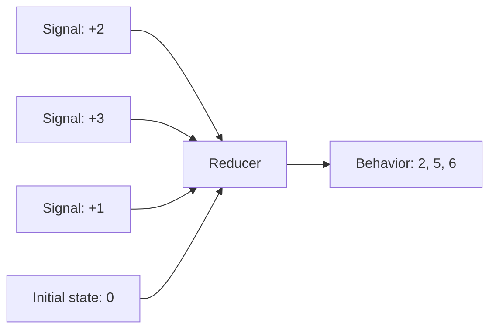

# Behavior và Signal: cách mô hình hóa giá trị theo thời gian

Trong chương **Phản ứng hàm** của module `REACTIVE_PROGRAMMING`, ta tìm hiểu cách mô hình hóa sự thay đổi theo thời gian bằng các luồng sự kiện bất đồng bộ, hợp đồng Publisher–Subscriber và cơ chế backpressure của Reactive Streams. Khi thực hành `Mono`, `Flux`, toán tử, scheduler và xử lý lỗi, cần phân biệt hai khái niệm: **Signal** biểu diễn một sự kiện hoặc một lần thay đổi xảy ra tại một thời điểm; **Behavior** biểu diễn giá trị hiện tại được duy trì và cập nhật theo thời gian.

Hai khái niệm này giúp trả lời hai câu hỏi khác nhau. Signal trả lời “điều gì vừa xảy ra?”, còn Behavior trả lời “trạng thái hiện tại là gì?”. Ví dụ, `TemperatureChanged(28)` là một signal cho biết cảm biến vừa báo 28 độ; Behavior `currentTemperature` là giá trị nhiệt độ hiện tại sau khi đã áp dụng các lần cập nhật. Giữ rõ ranh giới này giúp pipeline vừa lưu được lịch sử sự kiện khi cần, vừa cung cấp trạng thái mới nhất cho giao diện hoặc nghiệp vụ.

## 1. Signal và Behavior biểu diễn hai góc nhìn

Trong mô hình FRP cổ điển, Behavior thường được mô tả như một giá trị thay đổi liên tục theo thời gian, có thể được lấy mẫu tại một thời điểm. Event hoặc Signal thường mô tả những lần xảy ra rời rạc, chẳng hạn một lần nhấn nút, một bản tin đến hoặc một thay đổi từ cảm biến. Các thư viện hiện đại có thể dùng từ *Signal* theo nghĩa rộng hơn, ví dụ một biến reactive có thể đọc giá trị hiện tại và phát thông báo khi thay đổi.

Trong bài này, ta dùng quy ước thực hành sau:

- **Signal** là một sự kiện miền nghiệp vụ có thời điểm xảy ra và dữ liệu mô tả sự kiện.
- **Behavior** là trạng thái hiện tại được khởi tạo từ một giá trị ban đầu và được cập nhật khi các signal liên quan đến.

| Góc nhìn | Signal | Behavior |
|---|---|---|
| Câu hỏi | Điều gì đã xảy ra? | Giá trị hiện tại là gì? |
| Hình dạng | Các lần xảy ra rời rạc | Một giá trị có thể thay đổi theo thời gian |
| Ví dụ | `OrderPaid`, `TemperatureChanged`, `ButtonClicked` | Trạng thái đơn hàng hiện tại, nhiệt độ hiện tại, nút đang được bật hay tắt |
| Dữ liệu trùng | Hai sự kiện giống payload vẫn có thể là hai lần xảy ra khác nhau | Hai cập nhật cùng giá trị có thể không làm trạng thái thay đổi |
| Người tiêu thụ | Audit log, xử lý sự kiện, thông báo | UI, quyết định nghiệp vụ, tính toán dựa trên trạng thái mới nhất |

Signal và Behavior có quan hệ với nhau: một chuỗi signal có thể tạo ra chuỗi phiên bản của Behavior. Nhưng Behavior không nhất thiết giữ toàn bộ lịch sử signal; nó thường chỉ giữ giá trị hiện tại hoặc một ảnh chụp trạng thái.

## 2. Mô hình thời gian và giá trị hiện tại

Giả sử bộ đếm bắt đầu từ 0. Mỗi signal `CounterIncremented(2)` làm giá trị tăng thêm 2. Chuỗi signal có thể là:

```text
thời điểm       signal                  Behavior sau cập nhật
10:00:00        CounterIncremented(2)   value = 2
10:00:01        CounterIncremented(3)   value = 5
10:00:04        CounterIncremented(1)   value = 6
```

Signal là những lần cập nhật rời rạc. Behavior là kết quả tích lũy sau mỗi lần cập nhật. Tại thời điểm 10:00:02, giá trị hiện tại vẫn là 5 dù không có signal nào xảy ra đúng thời điểm đó.

Có thể mô tả Behavior về mặt khái niệm bằng hàm \(B(t)\), trả về giá trị tại thời điểm \(t\). Với các signal rời rạc, trạng thái được giữ ổn định giữa hai lần cập nhật và thay đổi khi có signal mới. Đây là mô hình trạng thái theo thời gian, không có nghĩa Reactor liên tục phát lại cùng một giá trị ở mọi khoảnh khắc.



Một Behavior cần có giá trị ban đầu hoặc quy tắc thể hiện trạng thái chưa biết. Nếu hệ thống chưa đọc được nhiệt độ hiện tại, không nên tự gán 0 độ chỉ để có giá trị khởi tạo. Có thể biểu diễn trạng thái chưa có dữ liệu bằng `Optional`, một kiểu `Loading/Ready/Unavailable`, hoặc một trạng thái miền nghiệp vụ tương ứng.

## 3. Biểu diễn signal và behavior bằng kiểu dữ liệu Java

Hãy tạo kiểu riêng để phân biệt sự kiện với trạng thái. Ví dụ bộ đếm:

```java
import java.time.Instant;

record CounterIncremented(
    long amount,
    Instant occurredAt
) {}

record CounterBehavior(
    long value,
    Instant updatedAt
) {
    CounterBehavior apply(CounterIncremented signal) {
        return new CounterBehavior(
            value + signal.amount(),
            signal.occurredAt()
        );
    }
}
```

`CounterIncremented` là signal: nó mô tả một lần tăng và thời điểm sự kiện xảy ra. `CounterBehavior` là trạng thái: nó chứa giá trị bộ đếm hiện tại và thời điểm trạng thái được cập nhật. Phương thức `apply` tạo trạng thái mới từ trạng thái hiện tại và signal đầu vào.

Hàm cập nhật nên có tính thuần (*pure*) khi có thể: cùng trạng thái và cùng signal sẽ tạo cùng trạng thái mới, không tự ghi database, gửi email hoặc thay đổi biến toàn cục. Điều này giúp dễ kiểm thử, phát lại event log và suy luận về kết quả. Side effect có thể đặt ở bước riêng sau khi đã xác định trạng thái cần thiết.

Trong hệ thống có thể nhận lại sự kiện nhiều lần, signal nên mang một định danh như `eventId`. Reducer hoặc tầng trước nó cần có chính sách loại trùng phù hợp. Nếu áp dụng cùng một signal tăng bộ đếm hai lần, Behavior sẽ tăng hai lần; `scan` không tự biết hai message có cùng ý nghĩa hay là bản sao do broker gửi lại.

## 4. Tạo Behavior từ luồng Signal bằng `scan`

Reactor không có một kiểu `Behavior<T>` chuẩn trong Reactive Streams. Ta có thể mô hình hóa các phiên bản trạng thái bằng `Flux<T>` và toán tử `scan`. `scan(initialState, accumulator)` phát trạng thái ban đầu rồi phát trạng thái mới sau mỗi phần tử đầu vào.

```java
CounterBehavior initial = new CounterBehavior(
    0,
    Instant.parse("2026-01-01T00:00:00Z")
);

Flux<CounterBehavior> counterBehavior = counterSignals
    .scan(initial, CounterBehavior::apply);
```

Nếu `counterSignals` phát lần lượt các signal tăng 2, tăng 3 và tăng 1, `counterBehavior` phát các trạng thái 0, 2, 5 và 6. Mỗi phần tử của Flux là một phiên bản Behavior tại một bước trong lịch sử xử lý.

`scan` khác `reduce` ở chỗ `scan` phát từng trạng thái trung gian, còn `reduce` chỉ phát kết quả tích lũy cuối cùng khi nguồn hoàn tất. Với luồng vô hạn, `reduce` thường không phát kết quả vì nguồn không hoàn tất; `scan` phù hợp để quan sát trạng thái trong khi luồng vẫn hoạt động.

Nếu chỉ cần trạng thái cuối cùng của một nguồn hữu hạn, có thể dùng `reduce` hoặc `last`. Nếu cần trạng thái hiện tại liên tục cho UI hoặc dịch vụ khác, giữ chuỗi cập nhật dưới dạng Publisher và chọn chính sách chia sẻ thích hợp.

## 5. Chia sẻ Behavior và phát lại trạng thái mới nhất

Nếu nhiều subscriber cùng đăng ký vào một nguồn lạnh, mỗi subscription có thể chạy lại nguồn và reducer riêng. Điều này có thể gây lặp I/O hoặc tạo ra những chuỗi trạng thái độc lập. Khi muốn nhiều người tiêu thụ cùng quan sát một Behavior được tính một lần, có thể chia sẻ chuỗi trạng thái và lưu lại phần tử mới nhất bằng `replay(1)`:

```java
ConnectableFlux<CounterBehavior> sharedBehavior = counterSignals
    .scan(initial, CounterBehavior::apply)
    .replay(1);

Disposable connection = sharedBehavior.connect();
Flux<CounterBehavior> behavior = sharedBehavior;
```

`connect()` tạo một subscription upstream dùng chung. `replay(1)` lưu trạng thái mới nhất để subscriber đến sau nhận được ảnh chụp hiện tại trước khi nhận các cập nhật tiếp theo. Subscriber đầu tiên không cần phải là nơi khởi động nguồn vì connection được mở tường minh.

Connection có vòng đời riêng. Khi thành phần sở hữu Behavior kết thúc, cần dispose connection:

```java
connection.dispose();
```

Nếu muốn tự động kết nối khi subscriber đầu tiên xuất hiện và ngắt khi subscriber cuối cùng hủy, có thể cân nhắc `replay(1).refCount(1)`. Khi upstream là nguồn lạnh, việc kết nối lại sau khi tất cả subscriber đã rời đi có thể chạy lại nguồn và khởi tạo lại trạng thái. Hãy chọn chính sách vòng đời theo yêu cầu: Behavior tồn tại suốt vòng đời ứng dụng, theo phiên người dùng hay chỉ trong thời gian có subscriber.

Với nguồn nóng, cần bảo đảm subscription được thiết lập trước khi sự kiện đầu tiên cần giữ được phát ra. `replay(1)` chỉ lưu các phần tử sau khi connection đã kết nối; nó không thể phục hồi những signal đã bị bỏ lỡ trước đó.

## 6. Mô hình Behavior như một trạng thái hiện tại có thể cập nhật

Khi ứng dụng cần một nơi giữ trạng thái hiện tại và phát nó cho nhiều subscriber, Reactor cung cấp `Sinks`. Một sink kiểu `replay().latest()` giữ lại phần tử mới nhất để subscriber đến sau nhận được:

```java
Sinks.Many<CounterBehavior> stateSink =
    Sinks.many().replay().latest();

CounterBehavior initialState = new CounterBehavior(
    0,
    Instant.parse("2026-01-01T00:00:00Z")
);
stateSink.tryEmitNext(initialState);

Flux<CounterBehavior> currentBehavior = stateSink.asFlux();
```

Khi trạng thái thay đổi, thành phần sở hữu state phát phiên bản mới:

```java
CounterBehavior nextState = new CounterBehavior(
    5,
    Instant.parse("2026-01-01T00:00:05Z")
);

Sinks.EmitResult result = stateSink.tryEmitNext(nextState);
if (result.isFailure()) {
    // Ghi nhận và xử lý lỗi phát theo chính sách của ứng dụng.
}
```

Subscriber có thể đăng ký vào `currentBehavior` để nhận trạng thái mới nhất và các cập nhật tiếp theo. `tryEmitNext` trả về `EmitResult`, vì vậy không nên bỏ qua trường hợp phát thất bại. Nếu nhiều thread cùng phát vào một sink, cần tuần tự hóa producer hoặc dùng API phát có cơ chế xử lý cạnh tranh phù hợp; không giả định mọi sink tự động tuần tự hóa mọi producer.

Sink này là một nơi công bố trạng thái. Nó không tự thực hiện reducer hoặc xác thực quy tắc nghiệp vụ. Có thể kết hợp nó với một reducer thuần, một actor hoặc một service chịu trách nhiệm duy nhất cập nhật trạng thái.

## 7. Kết hợp nhiều Behavior để tạo trạng thái dẫn xuất

Một trạng thái giao diện hoặc nghiệp vụ thường được tính từ nhiều Behavior. Ví dụ, trạng thái tiện nghi của căn phòng phụ thuộc vào nhiệt độ và độ ẩm hiện tại. Có thể dùng `Flux.combineLatest` để kết hợp giá trị mới nhất của từng nguồn:

```java
record RoomComfort(
    BigDecimal temperature,
    BigDecimal humidity,
    String description
) {}

Flux<RoomComfort> comfort = Flux.combineLatest(
    temperatureBehavior,
    humidityBehavior,
    (temperature, humidity) -> new RoomComfort(
        temperature.celsius(),
        humidity.percent(),
        describeComfort(temperature.celsius(), humidity.percent())
    )
);
```

`combineLatest` chờ mỗi nguồn phát ít nhất một giá trị. Sau đó, mỗi lần một Behavior cập nhật, nó kết hợp giá trị mới nhất của nguồn đó với giá trị mới nhất của nguồn còn lại để tạo `RoomComfort`. Vì vậy, trạng thái dẫn xuất luôn phản ánh cặp giá trị gần nhất mà pipeline đã quan sát.

Nếu một nguồn chưa có giá trị ban đầu, `combineLatest` chưa thể phát trạng thái kết hợp. Có thể giải quyết bằng cách nạp snapshot ban đầu trước khi nhận signal mới, hoặc biểu diễn trạng thái chưa sẵn sàng bằng một kiểu dữ liệu rõ ràng. Không nên dùng giá trị mặc định tùy tiện nếu nó có thể khiến quyết định nghiệp vụ sai.

Behavior dẫn xuất cũng là một luồng cập nhật. Nếu downstream chỉ cần trạng thái mới nhất, có thể chia sẻ nó bằng `replay(1)` tương tự phần trước. Nếu cần giảm tần suất cập nhật giao diện, có thể dùng `sample(Duration)`; toán tử này có thể bỏ qua trạng thái trung gian, nên chỉ dùng khi giá trị mới nhất quan trọng hơn mọi lần chuyển tiếp.

## 8. Signal, event time và processing time

Một signal thường có ít nhất hai mốc thời gian cần phân biệt:

- **Event time**: thời điểm sự kiện thực sự xảy ra ở nguồn, thường được gắn vào payload.
- **Processing time**: thời điểm ứng dụng nhận hoặc xử lý sự kiện.

Hai thời điểm này có thể khác nhau do mạng trễ, hàng đợi, retry hoặc đồng hồ giữa các máy không đồng bộ. Nếu reducer cập nhật `updatedAt` bằng processing time, Behavior phản ánh lúc ứng dụng xử lý. Nếu dùng event time, Behavior phản ánh thời điểm nguồn cho biết sự kiện xảy ra. Hãy chọn đúng ý nghĩa cho nghiệp vụ.

Với sự kiện đến sai thứ tự, một reducer đơn giản như `scan` sẽ áp dụng theo thứ tự nhận. Nếu trạng thái phải dựa trên event time, cần sắp xếp trong một cửa sổ có giới hạn, dùng sequence number hoặc từ chối sự kiện cũ theo chính sách. Không thể sắp xếp chính xác một luồng vô hạn mà không có quy tắc về độ trễ tối đa hoặc watermark.

Signal trùng cũng cần được xử lý rõ ràng. Với một event log có thể giao ít nhất một lần, dùng `eventId` và cơ chế deduplication trước reducer nếu sự kiện lặp không được phép áp dụng hai lần. Nếu hai signal có payload giống nhau nhưng đại diện cho hai lần xảy ra hợp lệ, không được loại chúng chỉ vì giá trị bằng nhau.

## 9. Phân biệt Signal của FRP với `Signal<T>` trong Reactor

Trong Reactor, `reactor.core.publisher.Signal<T>` là kiểu biểu diễn tín hiệu của giao thức Reactive Streams, chẳng hạn `onNext`, `onError` hoặc `onComplete`. Nó không đồng nghĩa với một domain event như `OrderPaid` hay `TemperatureChanged`.

Có thể dùng `materialize()` để chuyển các tín hiệu giao thức thành phần tử dữ liệu và `dematerialize()` để khôi phục chúng:

```java
Flux<Signal<Integer>> protocolSignals = Flux.just(1, 2)
    .materialize();

Flux<Integer> values = protocolSignals.dematerialize();
```

`materialize` hữu ích khi cần quan sát hoặc xử lý chính các tín hiệu kết thúc như dữ liệu. Trong mô hình Behavior/Signal của bài này, domain signal là kiểu sự kiện do ứng dụng định nghĩa. Hãy đặt tên rõ ràng như `OrderPaid`, `CounterIncremented` hoặc `TemperatureChanged` để tránh nhầm với `Signal<T>` của Reactor.

## 10. Lỗi và backpressure trong mô hình trạng thái

Một lỗi trong pipeline tạo Behavior có thể có hai bản chất khác nhau:

- Signal không hợp lệ theo quy tắc miền nghiệp vụ: có thể biểu diễn kết quả validation như dữ liệu, ghi nhận lý do và tiếp tục với signal khác.
- Lỗi vận hành hoặc lỗi không thể phục hồi trong reducer/nguồn: thường trở thành `onError` và kết thúc subscription tạo Behavior.

Nếu một signal sai làm reducer ném ngoại lệ, `scan` sẽ phát lỗi và subscription kết thúc. Với luồng dài hạn, có thể kiểm tra signal trước khi đưa vào reducer:

```java
Flux<CounterIncremented> validSignals = counterSignals
    .filter(signal -> signal.amount() > 0);

Flux<CounterBehavior> behavior = validSignals
    .scan(initial, CounterBehavior::apply);
```

Ví dụ này bỏ signal có lượng tăng không hợp lệ. Nếu cần giải thích vì sao bị loại, hãy tạo `ValidationResult<CounterIncremented>` rồi tách nhánh hợp lệ và không hợp lệ thay vì chỉ `filter`.

Backpressure cũng cần được xem xét. Một subscriber chậm có thể không theo kịp mọi lần cập nhật Behavior. Nếu mỗi signal là giao dịch hoặc sự kiện kiểm toán, cần bảo toàn mọi signal bằng nguồn và hàng đợi phù hợp. Nếu Behavior chỉ phục vụ hiển thị trạng thái mới nhất, có thể chấp nhận gộp hoặc bỏ các trạng thái trung gian, miễn là trạng thái cuối vẫn đúng. `replay(1)` lưu một giá trị mới nhất cho subscriber đến sau; nó không tự quyết định chính sách overflow của toàn bộ nguồn hoặc bảo đảm mọi subscriber đang hoạt động tiêu thụ kịp.

Không nên dùng một luồng trạng thái đã gộp thay cho event log khi cần kiểm toán hoặc tái dựng lịch sử. Hãy lưu signal/event ở nơi phù hợp và tạo Behavior như một projection có thể tính lại từ snapshot cùng các event tiếp theo.

## 11. Kiểm thử Signal và Behavior bằng `StepVerifier`

Vì Behavior được tạo từ signal bằng một reducer thuần, có thể kiểm tra toàn bộ chuỗi trạng thái một cách xác định:

```java
CounterBehavior initial = new CounterBehavior(
    0,
    Instant.parse("2026-01-01T00:00:00Z")
);

Flux<CounterIncremented> signals = Flux.just(
    new CounterIncremented(
        2, Instant.parse("2026-01-01T00:00:01Z")
    ),
    new CounterIncremented(
        3, Instant.parse("2026-01-01T00:00:02Z")
    )
);

Flux<CounterBehavior> behavior = signals
    .scan(initial, CounterBehavior::apply);

StepVerifier.create(behavior)
    .expectNext(initial)
    .expectNext(new CounterBehavior(
        2, Instant.parse("2026-01-01T00:00:01Z")
    ))
    .expectNext(new CounterBehavior(
        5, Instant.parse("2026-01-01T00:00:02Z")
    ))
    .verifyComplete();
```

Nên bổ sung các trường hợp kiểm thử:

1. Không có signal: Behavior chỉ phát trạng thái ban đầu rồi hoàn tất nếu nguồn hữu hạn.
2. Signal hợp lệ liên tiếp: mỗi signal tạo trạng thái đúng.
3. Signal không hợp lệ: kiểm tra chính sách loại bỏ hoặc kết quả validation.
4. Signal trùng: xác nhận deduplication đúng theo `eventId` nếu nghiệp vụ yêu cầu.
5. Subscriber đến muộn: xác nhận `replay(1)` phát trạng thái mới nhất trước cập nhật tiếp theo.
6. Upstream lỗi: xác nhận Behavior kết thúc bằng `onError` hoặc được phục hồi theo chính sách đã chọn.

Với logic thời gian, dùng virtual time hoặc timestamp cố định trong test thay vì phụ thuộc `Instant.now()` và `Thread.sleep`. Điều này làm kết quả dễ lặp lại và tránh test dao động theo tải máy.

## 12. Chọn mô hình phù hợp

| Nhu cầu | Mô hình phù hợp | Cân nhắc |
|---|---|---|
| Ghi nhận mọi lần xảy ra | `Flux<DomainSignal>` | Giữ event ID, event time và chính sách deduplication |
| Tính trạng thái hiện tại từ sự kiện | `scan(initial, reducer)` | Reducer thuần, thứ tự sự kiện và trạng thái ban đầu |
| Nhiều subscriber cùng quan sát một trạng thái | `replay(1)` hoặc sink replay latest | Vòng đời connection và chính sách subscriber chậm |
| Tạo trạng thái từ nhiều nguồn hiện tại | `combineLatest` | Mỗi nguồn cần có giá trị ban đầu |
| Chỉ cần giá trị mới nhất theo chu kỳ | `sample(Duration)` | Chấp nhận bỏ qua trạng thái trung gian |
| Lưu lịch sử và tái dựng trạng thái | Event log + snapshot/projection | Behavior không thay thế lịch sử sự kiện |

Khi thiết kế một pipeline FRP, hãy xác định rõ dữ liệu nào là signal, dữ liệu nào là Behavior và ai sở hữu vòng đời của trạng thái. Signal mô tả những lần thay đổi; Behavior mô tả kết quả hiện tại sau khi áp dụng các thay đổi đó. Với Reactor, ta có thể biểu diễn signal bằng `Flux<DomainEvent>`, tạo các phiên bản Behavior bằng `scan`, chia sẻ trạng thái mới nhất bằng `replay(1)` hoặc `Sinks`, rồi kết hợp các Behavior bằng `combineLatest`. Cách tổ chức này giúp pipeline vừa giữ được ý nghĩa của sự kiện, vừa cung cấp trạng thái hiện tại nhất quán cho các thành phần tiêu thụ.
