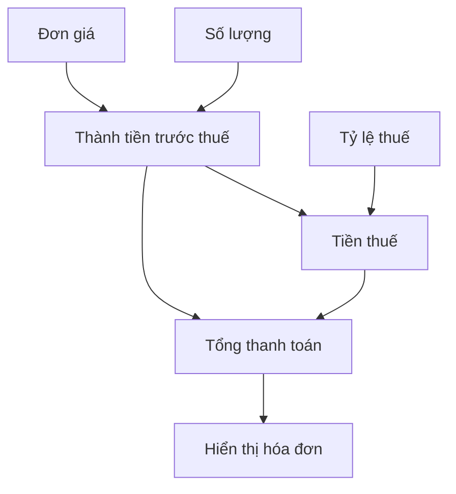
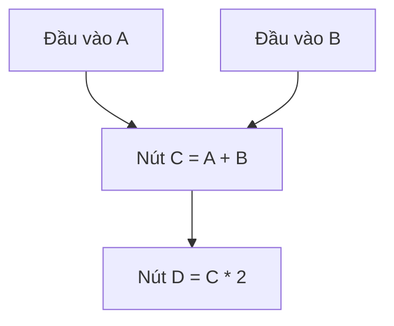
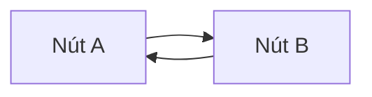

# Đồ thị phụ thuộc và lan truyền thay đổi

Trong lập trình phản ứng hàm (Functional Reactive Programming – FRP), một giá trị có thể được định nghĩa từ các giá trị khác và tự cập nhật khi đầu vào thay đổi. Thay vì gọi từng hàm theo một chuỗi lệnh để tính lại giao diện hoặc trạng thái nghiệp vụ, ta mô tả quan hệ phụ thuộc giữa các giá trị. Hệ thống theo dõi các quan hệ đó, xác định phần nào bị ảnh hưởng khi đầu vào thay đổi và lan truyền kết quả mới tới những nơi đang quan sát.

Đồ thị phụ thuộc là cấu trúc giúp mô tả và thực thi quan hệ này. Các nút biểu diễn nguồn dữ liệu hoặc giá trị được suy ra; cạnh có hướng biểu diễn một giá trị cần giá trị khác để tính toán. Khi một nút nguồn thay đổi, hệ thống đánh dấu hoặc tính lại các nút phụ thuộc theo một thứ tự hợp lệ. Cách tổ chức này giúp tránh tính lại toàn bộ trạng thái khi chỉ một đầu vào thay đổi, đồng thời làm rõ nơi cần xử lý tính nhất quán, vòng lặp phụ thuộc và vòng đời đăng ký.

Chủ đề này thuộc chương **Phản ứng hàm** của REACTIVE_PROGRAMMING. Module học các luồng sự kiện bất đồng bộ, hợp đồng Publisher–Subscriber và backpressure của Reactive Streams; đồng thời thực hành Mono, Flux, kết hợp operator, scheduler, xử lý lỗi và kiểm thử pipeline trong Java. Đồ thị phụ thuộc bổ sung một góc nhìn quan trọng: cách các giá trị dẫn xuất được tính lại và cách thay đổi lan truyền trong một hệ thống reactive.

## Đồ thị phụ thuộc biểu diễn điều gì?

Một đồ thị phụ thuộc gồm các thành phần sau:

- **Nút nguồn (source node):** giá trị được đưa từ bên ngoài vào, chẳng hạn giá sản phẩm, số lượng, tỷ lệ thuế hoặc trạng thái người dùng.
- **Nút dẫn xuất (derived node):** giá trị được tính từ một hoặc nhiều nút khác bằng một hàm, chẳng hạn thành tiền, thuế hoặc tổng hóa đơn.
- **Cạnh phụ thuộc (dependency edge):** quan hệ có hướng từ giá trị đầu vào tới giá trị cần nó.
- **Observer/consumer:** thành phần đăng ký để nhận giá trị mới khi nút mà nó quan tâm thay đổi.

Ví dụ, một hóa đơn có giá đơn vị, số lượng và tỷ lệ thuế:



Trong đồ thị này, `thành tiền trước thuế` phụ thuộc vào đơn giá và số lượng. `tiền thuế` phụ thuộc vào thành tiền và tỷ lệ thuế. `tổng thanh toán` phụ thuộc vào thành tiền và tiền thuế. Khi đơn giá thay đổi, hệ thống có thể xác định các nút bị ảnh hưởng bằng cách đi theo cạnh từ `đơn giá`: thành tiền, tiền thuế, tổng thanh toán và phần hiển thị hóa đơn.

Đồ thị cho biết quan hệ dữ liệu, không nhất thiết mô tả thread hoặc thời điểm thực thi. Một hệ thống có thể tính các nút đồng bộ, bất đồng bộ, theo kiểu push, pull hoặc kết hợp.

## Giá trị dẫn xuất nên được mô tả bằng hàm

FRP khuyến khích biểu diễn giá trị dẫn xuất bằng hàm từ các đầu vào hiện tại. Ví dụ:

```java
import java.math.BigDecimal;

final class InvoiceCalculator {
    record InvoiceInputs(
        BigDecimal unitPrice,
        int quantity,
        BigDecimal taxRate
    ) {}

    record InvoiceView(
        BigDecimal subtotal,
        BigDecimal tax,
        BigDecimal total
    ) {}

    static InvoiceView calculate(InvoiceInputs input) {
        BigDecimal subtotal = input.unitPrice()
            .multiply(BigDecimal.valueOf(input.quantity()));
        BigDecimal tax = subtotal.multiply(input.taxRate());
        BigDecimal total = subtotal.add(tax);
        return new InvoiceView(subtotal, tax, total);
    }
}
```

`calculate` là hàm thuần: cùng một `InvoiceInputs` sẽ cho cùng một `InvoiceView`, và hàm không sửa đầu vào hoặc tạo side effect bên ngoài. Tính thuần giúp hệ thống có thể tính lại nút dẫn xuất bất cứ khi nào đầu vào thay đổi mà không phải lo một lần tính trước đã âm thầm thay đổi trạng thái khác.

Nếu một hàm dẫn xuất vừa tính giá trị vừa gửi email, ghi database hoặc sửa một biến toàn cục, việc tính lại có thể lặp side effect. Vì vậy, nên tách hai việc: tính giá trị dẫn xuất bằng hàm thuần, sau đó thực hiện side effect tại một ranh giới được quản lý rõ ràng.

## Lan truyền thay đổi từ nút nguồn

Khi `unitPrice` thay đổi, một hệ thống theo dõi đồ thị có thể thực hiện các bước khái quát sau:

1. Cập nhật giá trị mới tại nút nguồn.
2. Tìm các nút dẫn xuất có đường phụ thuộc từ nút nguồn đó.
3. Đánh dấu các nút bị ảnh hưởng là cần tính lại, hoặc đưa chúng vào hàng đợi tính toán.
4. Tính các nút theo thứ tự bảo đảm đầu vào của mỗi nút đã có giá trị mới.
5. Công bố snapshot hoặc giá trị mới cho observer sau khi trạng thái liên quan đã ổn định theo chính sách của hệ thống.

Với đồ thị không có chu trình, thứ tự topo (topological order) là một thứ tự hợp lệ để tính các nút dẫn xuất: một nút chỉ được tính sau các nút mà nó phụ thuộc. Hệ thống không nhất thiết phải tính mọi nút trong đồ thị; nó có thể chỉ tính lại tập nút nằm trong vùng bị ảnh hưởng.

```text
Thay đổi đơn giá
      |
      v
Đánh dấu thành tiền cần tính lại
      |
      v
Tính thành tiền mới
      |
      +------> Tính tiền thuế mới
      |                  |
      +------------------+----> Tính tổng thanh toán mới
                                      |
                                      v
                               Cập nhật phần hiển thị
```

Nếu nhiều nút cùng phụ thuộc vào một đầu vào, chúng tạo thành các nhánh. Các nhánh độc lập có thể được tính song song nếu hệ thống bảo đảm việc đọc đầu vào nhất quán và việc công bố kết quả không tạo trạng thái trung gian sai lệch.

## Push, pull và mô hình kết hợp

Đồ thị phụ thuộc có thể được thực thi theo nhiều chiến lược. Mỗi chiến lược cân bằng khác nhau giữa độ trễ, lượng tính toán và chi phí lưu trạng thái.

| Chiến lược | Cách hoạt động | Ưu điểm | Điểm cần cân nhắc |
|---|---|---|---|
| Push (đẩy) | Khi nguồn thay đổi, thông báo lan xuống các nút phụ thuộc và kích hoạt tính toán | Giá trị dẫn xuất được cập nhật sớm; observer nhận thay đổi nhanh | Có thể tính những nhánh hiện không ai quan sát; nhiều thay đổi liên tiếp có thể gây nhiều lần tính |
| Pull (kéo) | Khi consumer cần giá trị, hệ thống kiểm tra và tính lại các nút đã bị đánh dấu cũ | Tránh tính nhánh không được sử dụng | Consumer có thể phải chờ tính toán tại thời điểm đọc |
| Push-pull | Thay đổi đẩy trạng thái invalidation xuống; giá trị chỉ được tính khi cần hoặc khi đến pha ổn định | Kết hợp tránh tính thừa với khả năng cập nhật có kiểm soát | Cần quản lý trạng thái dirty, cache và thứ tự tính toán |

### Push: cập nhật ngay khi nguồn đổi

Trong mô hình push, thay đổi ở nút nguồn được truyền tới các nút dẫn xuất. Mỗi nút nhận thông báo có thể tính lại và tiếp tục thông báo cho các nút phía sau. Mô hình này phù hợp khi observer cần nhận giá trị mới nhanh và số nhánh phụ thuộc được kiểm soát.

Nếu nguồn phát một chuỗi thay đổi dày đặc, push eager có thể tính lại cùng một nút nhiều lần. Ví dụ, người dùng kéo thanh số lượng qua các giá trị 2, 3, 4, 5; nếu mỗi thay đổi đều kích hoạt tính toán và render, hệ thống có thể làm nhiều công việc mà cuối cùng chỉ giá trị 5 còn quan trọng.

### Pull: chỉ tính khi có nhu cầu đọc

Trong mô hình pull, khi nguồn thay đổi, hệ thống đánh dấu các nút dẫn xuất liên quan là stale/dirty. Khi observer yêu cầu giá trị, hệ thống mới tính lại các nút cần thiết. Nếu một nhánh không có consumer, nó có thể không bao giờ được tính.

Pull phù hợp với các giá trị được truy vấn không thường xuyên hoặc đồ thị có nhiều nhánh ít được sử dụng. Đổi lại, lần đọc đầu tiên sau khi invalidation có thể phải trả chi phí tính toán.

### Push-pull: đánh dấu trước, tính khi ổn định

Một chiến lược kết hợp có thể đẩy tín hiệu invalidation ngay khi nguồn thay đổi, nhưng trì hoãn việc tính giá trị cho tới khi có demand hoặc tới cuối một transaction/batch. Nhờ đó, nhiều thay đổi liên quan có thể được gom lại thành một lần tính.

Điểm quan trọng là invalidation và recomputation là hai việc khác nhau. Một nút có thể được đánh dấu dirty nhiều lần trong một batch nhưng chỉ cần tính lại một lần sau khi các đầu vào đã cập nhật xong.

## Tránh glitch khi nhiều đầu vào thay đổi

Glitch là giá trị trung gian không nhất quán xuất hiện khi các nhánh phụ thuộc được cập nhật ở những thời điểm khác nhau. Xét đồ thị:



Giả sử một thao tác nghiệp vụ cập nhật đồng thời cả A và B. Nếu hệ thống công bố A mới trước, nút C có thể được tính với A mới và B cũ. Sau đó B mới đến và C lại được tính lần nữa. Consumer quan sát D có thể nhận một giá trị trung gian không tương ứng với snapshot nghiệp vụ nào mà ứng dụng muốn công bố.

Để tránh glitch, hệ thống có thể dùng một hoặc nhiều kỹ thuật:

- **Transaction/batch:** gom các cập nhật liên quan, áp dụng tất cả đầu vào rồi mới tính và công bố giá trị dẫn xuất.
- **Pha ổn định:** đánh dấu các nút dirty trước, sau đó tính theo thứ tự topo sau khi tất cả thay đổi của lượt hiện tại đã được ghi nhận.
- **Version/snapshot:** gắn phiên bản cho dữ liệu đầu vào và chỉ công bố kết quả khi các phụ thuộc được tính từ cùng một snapshot hợp lệ.
- **Coalesce:** gộp nhiều invalidation liên tiếp để mỗi nút chỉ tính lại một lần trong một lượt xử lý.

Chỉ tính theo thứ tự topo là chưa đủ nếu các đầu vào thay đổi trong những lượt riêng và kết quả trung gian vẫn được công bố. Cần một ranh giới transaction hoặc quy tắc ổn định xác định khi nào snapshot mới được xem là hoàn chỉnh.

### Phân biệt glitch với kết quả cập nhật từng phần có chủ đích

Không phải mọi giá trị trung gian đều là lỗi. Một dashboard có thể chủ ý hiển thị mỗi thay đổi ngay khi nó đến. Khi đó, việc `price` cập nhật trước `quantity` là một trạng thái quan sát hợp lệ của hai stream độc lập. Glitch chỉ xuất hiện khi ứng dụng coi nhiều thay đổi là một cập nhật logic nguyên tử nhưng hệ thống lại công bố kết hợp cũ/mới như thể đó là một snapshot hoàn chỉnh.

Hãy xác định semantics của đầu vào: mỗi trường thay đổi độc lập hay một nhóm trường được cập nhật như một transaction. Nếu cần tính nguyên tử, hãy truyền một object state mới chứa toàn bộ trường liên quan hoặc dùng cơ chế transaction/batch ở nguồn.

## Đồ thị phụ thuộc động

Trong một số ứng dụng, tập phụ thuộc thay đổi theo dữ liệu. Ví dụ, giá trị thuế có thể phụ thuộc vào loại khách hàng: khách hàng trong nước dùng thuế suất A, khách hàng quốc tế dùng thuế suất B. Khi nhánh điều kiện đổi, đồ thị phụ thuộc hiệu lực cũng đổi.

```text
customerType ──> chọn nhánh thuế
                    |
          ┌─────────┴─────────┐
          v                   v
   domesticRate          internationalRate
          └─────────┬─────────┘
                    v
                taxAmount
```

Một hệ thống hỗ trợ dependency tracking động cần cập nhật cạnh khi nhánh thực thi thay đổi: bỏ đăng ký khỏi dependency cũ và đăng ký với dependency mới. Nếu vẫn giữ cạnh cũ, thay đổi ở nhánh không còn được dùng có thể kích hoạt tính toán thừa; nếu quên thêm cạnh mới, kết quả sẽ không cập nhật khi dependency mới thay đổi.

Với đồ thị động, cần chú ý:

- Xóa dependency cũ khi nhánh không còn đọc nó.
- Đăng ký dependency mới khi nhánh bắt đầu sử dụng nó.
- Tránh rò rỉ listener/subscription của nhánh đã bị bỏ.
- Xử lý thay đổi dependency trong cùng transaction để tránh công bố snapshot nửa cũ nửa mới.
- Phát hiện chu trình mới có thể xuất hiện sau khi tái cấu trúc cạnh.

## Chu trình phụ thuộc và feedback loop

Đồ thị phụ thuộc dùng cho tính toán dẫn xuất thường được kỳ vọng là DAG (directed acyclic graph – đồ thị có hướng không chu trình). Khi A phụ thuộc B và B lại phụ thuộc A, không tồn tại thứ tự topo để tính mỗi nút một lần.



Chu trình có thể làm hệ thống tính lặp vô hạn, liên tục phát thay đổi hoặc không xác định được giá trị ban đầu. Nếu bài toán thực sự cần feedback, phải mô hình hóa nó rõ ràng bằng một quy tắc thời gian hoặc thuật toán hội tụ, chẳng hạn dùng giá trị ở bước trước, delay một tick, giới hạn số vòng lặp hoặc giải điểm bất động (fixed point) với điều kiện hội tụ.

Không nên vô tình tạo chu trình bằng cách để một observer nhận giá trị dẫn xuất rồi ghi ngược vào chính nguồn mà nó phụ thuộc. Nếu cần chuẩn hóa đầu vào, hãy đặt quy tắc chuẩn hóa tại biên nhập dữ liệu hoặc tách state đầu vào và state dẫn xuất.

## Tính toán gia tăng và cache giá trị dẫn xuất

Khi một nút nguồn thay đổi, tính lại toàn bộ đồ thị có thể lãng phí. Incremental computation chỉ tính các nút nằm trong vùng phụ thuộc bị ảnh hưởng. Một nút dẫn xuất có thể giữ giá trị đã tính và trạng thái phiên bản của các dependency để biết cache còn hợp lệ hay không.

Ví dụ, nếu `shippingAddress` thay đổi nhưng tổng tiền chỉ phụ thuộc vào giá, số lượng và thuế suất, hệ thống không cần tính lại tổng tiền. Nó chỉ cần cập nhật nhánh giao hàng và những giá trị thực sự phụ thuộc vào địa chỉ.

Các kỹ thuật thường gặp:

1. **Dirty marking:** đánh dấu các nút dẫn xuất bị ảnh hưởng là stale.
2. **Memoization:** lưu kết quả của hàm thuần theo đầu vào hoặc phiên bản dependency.
3. **Equality check:** nếu giá trị mới bằng giá trị cũ theo quy tắc so sánh, có thể ngăn lan truyền tiếp.
4. **Coalescing:** gom nhiều thay đổi trước khi tính lại.
5. **Subgraph recomputation:** chỉ duyệt vùng phụ thuộc từ những nguồn đã thay đổi tới observer cần cập nhật.

Equality suppression cần dùng đúng ngữ nghĩa. Nếu hai object khác nhau về identity nhưng bằng nhau về giá trị, so sánh identity có thể làm phát thay đổi không cần thiết. Ngược lại, nếu comparator bỏ qua một field có ý nghĩa, hệ thống có thể không thông báo một thay đổi thực sự cần thiết.

Cache cũng cần vòng đời rõ ràng. Nếu graph giữ tham chiếu tới observer hoặc dependency không còn được sử dụng, các object có thể không được giải phóng. Khi consumer hủy đăng ký, hệ thống cần tháo listener/cạnh không còn cần thiết hoặc giữ chúng chỉ khi có chủ sở hữu lâu dài được xác định.

## Kết nối ý tưởng đồ thị với `Flux.combineLatest`

Trong Reactor, `Flux.combineLatest` kết hợp các luồng thay đổi và tính một giá trị từ phần tử mới nhất của mỗi nguồn. Đây là cách hữu ích để biểu diễn một giá trị dẫn xuất từ nhiều event stream:

```java
import java.math.BigDecimal;
import reactor.core.publisher.Flux;

Flux<BigDecimal> priceChanges = priceEvents();
Flux<Integer> quantityChanges = quantityEvents();

Flux<BigDecimal> subtotalChanges = Flux.combineLatest(
    priceChanges,
    quantityChanges,
    (price, quantity) -> price.multiply(BigDecimal.valueOf(quantity))
);
```

`combineLatest` đợi mỗi nguồn phát ít nhất một giá trị, sau đó mỗi lần một nguồn phát giá trị mới, nó kết hợp giá trị mới đó với giá trị gần nhất của nguồn còn lại. Kết quả là một stream các subtotal thay đổi theo đầu vào.

Đây là phép kết hợp luồng sự kiện theo giá trị mới nhất, không phải một dependency graph FRP hoàn chỉnh. Nó không tự cung cấp transaction đa nguồn hoặc bảo đảm hai stream độc lập được cập nhật nguyên tử. Nếu `priceChanges` và `quantityChanges` là hai luồng riêng, thay đổi của một nguồn có thể tạo subtotal trung gian với giá trị mới của một bên và giá trị cũ của bên kia. Nếu nghiệp vụ yêu cầu snapshot nhất quán, hãy phát một object chứa cả `price` và `quantity` như một đơn vị cập nhật hoặc gom chúng qua cơ chế đồng bộ phù hợp.

Ví dụ dùng một stream state tổng hợp:

```java
record InvoiceInputs(BigDecimal price, int quantity) {}

Flux<InvoiceInputs> inputChanges = invoiceInputEvents();

Flux<BigDecimal> subtotalChanges = inputChanges
    .map(input -> input.price()
        .multiply(BigDecimal.valueOf(input.quantity())));
```

Mỗi phần tử `InvoiceInputs` là một snapshot hoàn chỉnh. Khi giá hoặc số lượng thay đổi, nguồn phát một object state mới. Downstream tính subtotal từ cùng snapshot nên không ghép hai phiên bản đầu vào khác nhau.

## Phân biệt đồ thị giá trị với stream sự kiện

Một đồ thị FRP thường mô tả các giá trị thay đổi theo thời gian và quan hệ giữa chúng. Một stream sự kiện mô tả các lần phát xảy ra theo thời gian. Hai khái niệm có thể kết hợp nhưng không đồng nhất:

| Khía cạnh | Giá trị/behavior trong FRP | Event stream trong Reactive Streams |
|---|---|---|
| Ý nghĩa | Giá trị hiện tại và cách nó thay đổi theo thời gian | Chuỗi tín hiệu/phần tử được phát |
| Truy vấn | Có thể đọc giá trị hiện tại tùy mô hình | Thường tiêu thụ các phần tử khi chúng được phát |
| Quan hệ phụ thuộc | Có thể được theo dõi thành đồ thị giữa các giá trị dẫn xuất | Được mô tả bằng chuỗi operator và Publisher kết hợp |
| Backpressure | Tùy hệ thống FRP và cơ chế cập nhật | Có hợp đồng demand của Reactive Streams nếu Publisher tuân thủ |
| Tính nhất quán | Có thể hỗ trợ transaction, glitch-free propagation hoặc snapshot | Phụ thuộc cách ghép stream và chính sách đồng bộ được thiết kế |

Reactor `Flux` là abstraction cho event stream theo Reactive Streams. Dùng `map`, `combineLatest`, `scan` hoặc `share` có thể mô phỏng một số quan hệ phụ thuộc, nhưng không tự tạo toàn bộ semantics của một FRP signal graph như dependency tracking động, transaction propagation hoặc glitch freedom.

## Xử lý lỗi trong đồ thị phụ thuộc

Nếu một hàm tính nút dẫn xuất ném exception, hệ thống cần xác định lỗi ảnh hưởng tới đâu. Có thể:

- Đánh dấu nút dẫn xuất ở trạng thái lỗi và truyền lỗi tới observer phụ thuộc.
- Giữ giá trị gần nhất cùng metadata báo stale/error nếu giao diện cần tiếp tục hiển thị dữ liệu cũ.
- Dùng giá trị fallback có ý nghĩa rõ ràng nếu nghiệp vụ cho phép.
- Cô lập lỗi trong một nhánh để các nhánh độc lập vẫn hoạt động.

Không nên thay lỗi bằng một giá trị mặc định mà consumer không thể phân biệt với dữ liệu hợp lệ. Ví dụ, nếu tính thuế thất bại, đặt thuế bằng 0 có thể khiến hóa đơn hiển thị tổng tiền sai mà không có cảnh báo.

Với Reactor, lỗi trong một `map` thông thường là terminal error của subscription. Nếu từng phần tử hoặc từng nhánh cần được phục hồi độc lập, hãy cô lập chúng bằng inner Publisher và đặt `onErrorResume` đúng phạm vi. Nếu một stream nguồn phát lỗi terminal, các operator downstream không tự tiếp tục nhận phần tử mới từ chính subscription đã kết thúc.

## Vòng đời observer và dependency

Đăng ký observer thường tạo một quan hệ giữ tham chiếu giữa nguồn, nút dẫn xuất và consumer. Khi consumer không còn quan tâm, cần hủy đăng ký để tránh:

- Nguồn tiếp tục phát dữ liệu cho consumer đã rời màn hình.
- Listener cũ giữ tham chiếu tới view hoặc service không còn dùng.
- Các nhánh đồ thị tiếp tục tính toán dù không còn observer.
- Nhiều lần subscribe tạo nhiều side effect hoặc listener trùng lặp.

Trong Reactor, subscription trả về `Disposable` cho phép hủy một subscription:

```java
import reactor.core.Disposable;

Disposable subscription = subtotalChanges.subscribe(this::renderSubtotal);

// Khi màn hình hoặc thành phần không còn cần dữ liệu:
subscription.dispose();
```

Hủy subscription ngừng việc tiêu thụ ở nhánh đó và truyền cancellation upstream theo hợp đồng của operator. Nếu stream được chia sẻ với consumer khác, cancellation của một consumer không nhất thiết hủy nguồn dùng chung khi vẫn còn consumer khác. Với dependency graph tự xây dựng, cần quản lý số observer và tháo cạnh/listener khi không còn chủ sở hữu.

## Kiểm thử lan truyền thay đổi

Một test cho đồ thị phụ thuộc nên xác nhận không chỉ giá trị cuối, mà cả phạm vi cập nhật và các trạng thái trung gian có được phép xuất hiện hay không.

### Kiểm thử hàm dẫn xuất thuần

```java
import java.math.BigDecimal;
import org.junit.jupiter.api.Test;
import static org.junit.jupiter.api.Assertions.assertEquals;

class InvoiceCalculationTest {
    @Test
    void derivesSubtotalTaxAndTotalFromOneSnapshot() {
        InvoiceCalculator.InvoiceInputs input = new InvoiceCalculator.InvoiceInputs(
            new BigDecimal("100.00"),
            2,
            new BigDecimal("0.10")
        );

        InvoiceCalculator.InvoiceView view = InvoiceCalculator.calculate(input);

        assertEquals(new BigDecimal("200.00"), view.subtotal());
        assertEquals(new BigDecimal("20.0000"), view.tax());
        assertEquals(new BigDecimal("220.0000"), view.total());
    }
}
```

Test này xác nhận hàm dẫn xuất thuần tính mọi giá trị từ cùng một snapshot đầu vào. Trong dự án thật, có thể chuẩn hóa scale của `BigDecimal` theo quy tắc tiền tệ và dùng comparator phù hợp nếu scale khác nhau nhưng giá trị số học tương đương.

### Kiểm thử stream giá trị dẫn xuất

```java
import java.math.BigDecimal;
import org.junit.jupiter.api.Test;
import reactor.core.publisher.Flux;
import reactor.test.StepVerifier;

record PriceQuantity(BigDecimal price, int quantity) {}

class DerivedStreamTest {
    @Test
    void emitsDerivedValueForEachCompleteInputSnapshot() {
        Flux<BigDecimal> subtotals = Flux.just(
                new PriceQuantity(new BigDecimal("10"), 2),
                new PriceQuantity(new BigDecimal("12"), 2)
            )
            .map(input -> input.price()
                .multiply(BigDecimal.valueOf(input.quantity())));

        StepVerifier.create(subtotals)
            .expectNext(new BigDecimal("20"), new BigDecimal("24"))
            .verifyComplete();
    }
}
```

Test dùng snapshot đầu vào hoàn chỉnh cho mỗi lần cập nhật, nên mỗi subtotal được tính từ một cặp giá và số lượng nhất quán. Với pipeline sử dụng nhiều stream độc lập qua `combineLatest`, cần test rõ giá trị đầu tiên, thứ tự cập nhật và những trạng thái trung gian có thể được phát.

### Kiểm thử batching và glitch

Nếu hệ thống hỗ trợ transaction hoặc batch, hãy tạo test cập nhật nhiều nguồn trong cùng một transaction và xác nhận observer chỉ nhận snapshot sau khi transaction kết thúc. Nếu dùng virtual time hoặc scheduler riêng, điều khiển scheduler trong test để tránh phụ thuộc vào `Thread.sleep`.

Các trường hợp nên kiểm tra:

- Một nguồn thay đổi chỉ làm tính lại các nút dẫn xuất phụ thuộc vào nó.
- Một nút có nhiều upstream chỉ công bố kết quả sau khi các đầu vào của transaction đã ổn định.
- Nhiều invalidation trong cùng batch không khiến cùng nút bị tính lại dư thừa.
- Dependency động được thêm và gỡ đúng khi nhánh điều kiện thay đổi.
- Chu trình bị phát hiện hoặc được xử lý bằng quy tắc feedback đã định nghĩa.
- Observer hủy đăng ký không còn nhận tín hiệu và không giữ tài nguyên không cần thiết.
- Lỗi ở một nhánh được truyền hoặc phục hồi theo đúng phạm vi đã thiết kế.

## Những lỗi thiết kế thường gặp

**Tính lại toàn bộ đồ thị khi một đầu vào thay đổi.** Cách này dễ triển khai nhưng tốn tài nguyên khi graph lớn. Theo dõi dependency và chỉ tính lại vùng bị ảnh hưởng nếu bài toán cần tối ưu.

**Dùng hàm dẫn xuất có side effect.** Tính lại có thể gọi side effect nhiều lần. Giữ hàm tính toán thuần và thực hiện side effect ở ranh giới riêng.

**Cho rằng thứ tự topo tự động loại bỏ mọi glitch.** Nếu đầu vào thay đổi qua nhiều lượt và intermediate value được công bố ngay, consumer vẫn có thể thấy snapshot trộn cũ/mới. Cần transaction, pha ổn định hoặc versioning.

**Nhầm `combineLatest` với transaction đa nguồn.** Nó kết hợp giá trị mới nhất khi từng stream phát; nó không bảo đảm các stream độc lập cập nhật nguyên tử.

**Không gỡ dependency động.** Listener hoặc cạnh cũ có thể gây tính toán thừa và giữ tham chiếu, dẫn đến rò rỉ bộ nhớ.

**Để chu trình xuất hiện ngoài ý muốn.** Chu trình có thể gây cập nhật lặp hoặc không hội tụ. Dùng DAG cho giá trị dẫn xuất hoặc mô hình hóa feedback bằng quy tắc thời gian/hội tụ rõ ràng.

**Không giới hạn trạng thái và observer.** Cache, dependency và subscription có thể giữ dữ liệu lâu hơn cần thiết. Quản lý vòng đời và hủy đăng ký khi consumer rời đi.

**Nuốt lỗi tính toán bằng fallback mơ hồ.** Giá trị mặc định có thể trông hợp lệ dù kết quả thực tế không tính được. Giữ trạng thái lỗi hoặc metadata đủ rõ để consumer xử lý.

## Tự kiểm tra

1. Nút nguồn, nút dẫn xuất và cạnh phụ thuộc có vai trò gì trong đồ thị?
2. Vì sao hàm tính giá trị dẫn xuất nên thuần và không có side effect?
3. Mô hình push, pull và push-pull khác nhau thế nào về thời điểm tính toán?
4. Glitch xảy ra như thế nào khi hai đầu vào cùng thay đổi nhưng các nhánh được cập nhật riêng?
5. Vì sao thứ tự topo chưa đủ để bảo đảm snapshot nhất quán nếu hệ thống công bố giá trị trung gian?
6. Khi nào cần dependency tracking động và điều gì xảy ra nếu không gỡ cạnh cũ?
7. Vì sao chu trình phụ thuộc gây khó khăn cho việc tính giá trị dẫn xuất?
8. `Flux.combineLatest` giúp kết hợp nhiều luồng thay đổi ra sao và vì sao nó không tự bảo đảm transaction đa nguồn?
9. Khi observer hủy đăng ký, hệ thống cần giải phóng hoặc cập nhật những quan hệ nào?

Khi mô tả dữ liệu bằng đồ thị phụ thuộc, bạn có thể lần theo đường lan truyền từ nguồn tới giá trị dẫn xuất, chỉ tính lại phần bị ảnh hưởng và kiểm soát thời điểm công bố snapshot. Kết hợp hàm thuần, batching, dependency tracking và vòng đời observer giúp hệ thống reactive dễ dự đoán hơn khi nhiều giá trị thay đổi cùng lúc.
