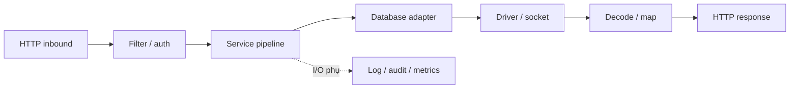

# Kiểm tra toàn bộ đường đi I/O có thực sự không chặn

Trong chương **Tích hợp I/O**, bài học này hướng dẫn cách kiểm tra một pipeline reactive từ lúc nhận request đến khi dữ liệu được đọc, biến đổi và gửi đi. Một endpoint trả về `Mono` hoặc `Flux` chưa đủ để kết luận toàn bộ đường đi không chặn. Chỉ một lời gọi JDBC, SDK HTTP đồng bộ, thao tác file hoặc `block()` đặt sai chỗ cũng có thể giữ event-loop và làm chậm nhiều request khác.

Bài học thuộc module **REACTIVE_PROGRAMMING**. Module hướng dẫn: “Học tư duy reactive qua các luồng sự kiện bất đồng bộ, hợp đồng Publisher–Subscriber và cơ chế backpressure của Reactive Streams. Thực hành Mono, Flux, kết hợp toán tử, kiểm soát scheduler, xử lý lỗi và kiểm thử pipeline trong hệ sinh thái Java.” Vì vậy, việc kiểm tra cần nhìn xuyên suốt nguồn, driver, adapter, callback và nơi phát phản hồi; ta cần xác nhận cả đường đi thực thi, không chỉ kiểu trả về của một phương thức.

## 1. Một publisher reactive không chứng minh I/O không chặn

Một phương thức trả về `Mono<T>` hoặc `Flux<T>` chỉ cho biết kết quả được biểu diễn bằng publisher. Nó không bảo đảm công việc bên trong phương thức là bất đồng bộ hoặc không chặn.

Ví dụ dưới đây trả về `Mono`, nhưng lời gọi SDK đã xảy ra ngay khi lắp ráp pipeline:

```java
Mono<Customer> customer =
    Mono.just(legacyClient.fetchCustomer(customerId));
```

`legacyClient.fetchCustomer` chạy trước khi subscriber đăng ký. Nếu đây là lời gọi HTTP đồng bộ, thread đang xây dựng pipeline bị giữ trong suốt thời gian chờ phản hồi. Đặt `subscribeOn` sau `Mono.just` không chuyển lời gọi đã xảy ra sang scheduler khác.

Một cách trì hoãn lời gọi là:

```java
Mono<Customer> customer =
    Mono.fromCallable(() ->
        legacyClient.fetchCustomer(customerId)
    )
    .subscribeOn(Schedulers.boundedElastic());
```

`fromCallable` gọi SDK khi subscription bắt đầu; `subscribeOn` đưa công việc đó sang scheduler phù hợp cho tác vụ blocking. Cách này cô lập thao tác đồng bộ khỏi event-loop, nhưng bản thân I/O vẫn là blocking. Nó là biện pháp tích hợp có kiểm soát, không biến thư viện đồng bộ thành thư viện non-blocking.

Với client reactive thực sự, API thường trả publisher và thực hiện I/O theo cơ chế bất đồng bộ của driver hoặc event-loop:

```java
Mono<Customer> customer =
    webClient.get()
        .uri("/customers/{id}", customerId)
        .retrieve()
        .bodyToMono(Customer.class);
```

Ngay cả khi dùng client reactive, vẫn cần kiểm tra các bước khác trong pipeline. Một `map` gọi thư viện đồng bộ, một bộ giải mã tùy chỉnh chặn thread hoặc một logger ghi file đồng bộ vẫn có thể làm đường đi bị blocking.

## 2. Vẽ toàn bộ đường đi I/O trước khi kết luận

Hãy lần theo một request từ biên vào đến biên ra. Với một API reactive, đường đi thường bao gồm:

1. Server nhận request và giải mã dữ liệu đầu vào.
2. Middleware thực hiện xác thực, phân quyền, tracing và routing.
3. Service gọi repository hoặc dịch vụ từ xa.
4. Connection pool cấp kết nối; driver gửi truy vấn hoặc request.
5. Dữ liệu được nhận, giải mã, ánh xạ và kết hợp với dữ liệu khác.
6. Kết quả được tuần tự hóa và gửi về client.
7. Logging, metrics, audit hoặc callback phụ trợ có thể phát sinh I/O bổ sung.



Ở mỗi chặng, hãy xác định API nào thực sự chạy, thread nào thực thi và publisher có phát tín hiệu theo cơ chế bất đồng bộ hay không. Đừng dừng ở lớp service: một repository tự viết có thể bọc JDBC trong `Mono`, một SDK có thể trả `CompletionStage` nhưng lại thực hiện một phần công việc đồng bộ ngay lúc gọi, và một adapter có thể dùng thư viện blocking bên dưới.

Bảng sau giúp định hướng việc kiểm tra:

| Thành phần | Ví dụ thường gặp | Điều cần xác minh |
|---|---|---|
| HTTP client | `WebClient`, `RestTemplate` | Client reactive hay gọi đồng bộ; có gọi `block()` không |
| Database | R2DBC, JDBC | Driver thực sự reactive hay JDBC được bọc trong publisher |
| File | NIO asynchronous API, `Files.readString` | Đọc file có giữ thread gọi hay không |
| SDK bên thứ ba | Client reactive, client đồng bộ | Hợp đồng thực thi và thời điểm gọi I/O |
| Serialization | Codec, mapper tùy chỉnh | Có đọc/ghi blocking hoặc tính toán quá nặng không |
| Logging / audit | Async appender, ghi file đồng bộ | Callback có chờ I/O log hoặc audit không |
| Connection pool | Pool reactive hoặc pool đồng bộ | Lấy kết nối là bất đồng bộ hay chặn thread |

Mục tiêu là xác định mọi điểm có thể chờ I/O. Một đường đi chỉ được xem là non-blocking khi các điểm chờ đó không chiếm thread xử lý tín hiệu trong lúc chờ.

## 3. Kiểm tra nguồn dữ liệu và driver bên dưới

### Database

Một repository trả về `Mono<Order>` không tự chứng minh driver là non-blocking:

```java
// JDBC vẫn là API blocking dù được bọc trong Mono
Mono<Order> findOrder(String id) {
    return Mono.fromCallable(() ->
        jdbcTemplate.queryForObject(SQL, mapper, id)
    );
}
```

Nếu publisher này được subscribe trực tiếp trên event-loop, JDBC giữ event-loop trong lúc chờ database. Có thể cô lập nó bằng scheduler dành cho blocking:

```java
Mono<Order> findOrder(String id) {
    return Mono.fromCallable(() ->
        jdbcTemplate.queryForObject(SQL, mapper, id)
    )
    .subscribeOn(Schedulers.boundedElastic());
}
```

Với stack reactive, dùng driver và adapter được thiết kế bất đồng bộ, chẳng hạn R2DBC trong ứng dụng Spring reactive:

```java
Mono<Order> findOrder(String id) {
    return orderRepository.findById(id);
}
```

Hãy kiểm tra dependency và cấu hình thực tế của repository. Tên phương thức, kiểu trả về hoặc annotation không thay thế việc xác minh driver mà nó đang gọi.

### HTTP và SDK

`WebClient` được thiết kế để thực hiện HTTP reactive. `RestTemplate` là client đồng bộ. Một SDK có tên gọi “async” vẫn cần được kiểm tra: phương thức có thể thực hiện DNS, chuẩn bị request, đọc file hoặc chờ lock đồng bộ trước khi trả về publisher/future.

Khi tích hợp SDK, đọc hợp đồng API và quan sát thread lúc gọi phương thức. Nếu lời gọi giữ thread trong lúc chờ mạng, hãy dùng API async/non-blocking thực sự hoặc cô lập phần blocking trên scheduler phù hợp.

### File và hệ thống bên ngoài

Các lời gọi như `Files.readString`, `Files.writeString`, `FileInputStream.read` hoặc thao tác file đồng bộ có thể chặn thread. Việc đặt chúng trong `map` không làm chúng trở thành bất đồng bộ.

```java
Mono<String> fileContent =
    Mono.fromCallable(() ->
        Files.readString(Path.of("config.json"))
    )
    .subscribeOn(Schedulers.boundedElastic());
```

Ví dụ này cô lập thao tác đọc file đồng bộ. Nếu hệ thống cần I/O file bất đồng bộ thực sự hoặc tải file lớn, hãy chọn API và mô hình streaming phù hợp thay vì đọc toàn bộ nội dung vào bộ nhớ.

## 4. Tìm blocking ẩn trong operator và callback

Một pipeline có thể dùng client reactive ở nguồn nhưng lại chuyển sang blocking ở bước biến đổi:

```java
Mono<CustomerView> view =
    customerRepository.findById(customerId)
        .map(customer -> {
            Address address =
                legacyAddressClient.lookup(customer.addressId());

            return CustomerView.from(customer, address);
        });
```

Nếu `legacyAddressClient.lookup` là đồng bộ, nó giữ thread đang phát tín hiệu. Với một client reactive, hãy nối publisher bằng `flatMap`:

```java
Mono<CustomerView> view =
    customerRepository.findById(customerId)
        .flatMap(customer ->
            addressClient.lookup(customer.addressId())
                .map(address ->
                    CustomerView.from(customer, address)
                )
        );
```

Nếu buộc phải dùng client blocking, bọc đúng thao tác trong publisher lazy và chuyển nó sang scheduler blocking:

```java
Mono<CustomerView> view =
    customerRepository.findById(customerId)
        .flatMap(customer ->
            Mono.fromCallable(() ->
                legacyAddressClient.lookup(customer.addressId())
            )
            .subscribeOn(Schedulers.boundedElastic())
            .map(address ->
                CustomerView.from(customer, address)
            )
        );
```

Cần kiểm tra cả những nơi không nằm trong `map`:

- Callback xác thực hoặc kiểm tra quyền gọi dịch vụ đồng bộ.
- Hàm chuyển đổi dữ liệu đọc file hoặc truy vấn cache đồng bộ.
- Hook `doOnNext`, `doOnError` hoặc `doFinally` ghi audit bằng thao tác blocking.
- Bộ mã hóa, bộ giải mã hoặc mapper gọi API đồng bộ.
- Lambda của `subscribe` thực hiện `block()`, `Future.get()` hoặc chờ lock.
- Logging hoặc metrics dùng exporter đồng bộ có thể chờ I/O.

Các toán tử quan sát như `doOnNext` không tự chạy trên thread riêng. Nếu callback blocking, thread phát tín hiệu vẫn bị giữ.

## 5. Đặt ranh giới scheduler đúng vị trí

Khi chưa thể thay thư viện blocking, `Schedulers.boundedElastic()` là lựa chọn thường dùng để cô lập các tác vụ blocking có thời lượng không xác định. Bọc lời gọi trong `fromCallable` hoặc `defer`, rồi dùng `subscribeOn` để chuyển quá trình thực thi của nguồn.

```java
Mono<LegacyResult> result =
    Mono.fromCallable(() -> legacyClient.call(request))
        .subscribeOn(Schedulers.boundedElastic());
```

Không viết:

```java
Mono<LegacyResult> result =
    Mono.just(legacyClient.call(request))
        .publishOn(Schedulers.boundedElastic());
```

Trong đoạn sai, `legacyClient.call` đã chạy trước khi publisher được tạo. `publishOn` chỉ ảnh hưởng đến các tín hiệu downstream sau ranh giới; nó không thể chuyển ngược một lời gọi đã hoàn tất hoặc đang chặn ở phía upstream.

Nếu một phép biến đổi downstream là blocking, có thể đặt `publishOn` trước bước đó để chuyển phần downstream sang scheduler phù hợp, nhưng hãy cân nhắc giới hạn và cấu trúc pipeline. Thường rõ ràng hơn khi cô lập chính lời gọi blocking thành một publisher:

```java
Mono<View> view =
    reactiveRepository.findById(id)
        .flatMap(entity ->
            Mono.fromCallable(() -> legacyClient.load(entity.key()))
                .subscribeOn(Schedulers.boundedElastic())
                .map(data -> View.from(entity, data))
        );
```

Trong ví dụ thực tế, cần tạo publisher blocking bên trong nhánh sử dụng nếu nó phụ thuộc dữ liệu của từng entity; không tái sử dụng một publisher đã thực thi hoặc chứa giá trị request khác. Mẫu cốt lõi vẫn là: lời gọi blocking phải được trì hoãn và subscription vào nó phải được điều phối trên scheduler thích hợp.

Không dùng `boundedElastic` như nơi chứa mọi loại công việc. Tác vụ CPU-bound thường phù hợp với `parallel`; tác vụ blocking cần giới hạn thread và hàng đợi. Scheduler chỉ bảo vệ thread phát tín hiệu khỏi bị giữ bởi thao tác blocking; nó không làm I/O nhanh hơn và cũng không loại bỏ giới hạn của dịch vụ bên ngoài.

## 6. Những dấu hiệu cho thấy đường đi vẫn đang blocking

Một số dấu hiệu thường gặp khi chạy ứng dụng:

- Event-loop có thời gian xử lý callback tăng cao dù tải I/O không lớn.
- Request khác nhau cùng chậm khi một số callback thực hiện I/O đồng bộ.
- Thread dump cho thấy event-loop đang ở `SocketInputStream.read`, `SocketDispatcher`, `FileInputStream.read`, `Future.get`, `Object.wait` hoặc các hàm chờ tương tự.
- Latency tăng mạnh khi database, HTTP service hoặc file system chậm.
- Số thread tăng bất thường do tạo scheduler hoặc executor theo từng request.
- Hàng đợi của bounded elastic tăng, thread đạt giới hạn hoặc tác vụ bị từ chối.
- Throughput giảm khi thêm nhiều request dù số kết nối và CPU vẫn còn khả năng xử lý.

Tên thread là một tín hiệu chẩn đoán hữu ích. Trong Reactor Netty, các thread event-loop thường có tên gợi ý như `reactor-http-nio`; tên cụ thể có thể thay đổi theo phiên bản và cấu hình. Hãy xác định thread theo cấu hình thực tế thay vì phụ thuộc tuyệt đối vào chuỗi tên.

Có thể ghi thread tại các ranh giới quan trọng:

```java
Mono<Response> response =
    webClient.get()
        .uri("/resource")
        .retrieve()
        .bodyToMono(Response.class)
        .doOnNext(value ->
            log.info("Nhận response trên {}",
                Thread.currentThread().getName())
        )
        .map(this::toView);
```

Log thread giúp xác định nơi callback chạy. Nó không tự chứng minh I/O non-blocking; cần kết hợp với thread dump, profiler và kiểm tra driver.

## 7. Dùng BlockHound để phát hiện blocking trên thread không cho phép

BlockHound là công cụ kiểm thử/runtime instrumentation có thể phát hiện một số lời gọi blocking khi chúng chạy trên thread được đánh dấu là không được phép blocking. Với Reactor, công cụ này hữu ích để phát hiện các trường hợp như `Thread.sleep` hoặc thao tác blocking đã được instrumented chạy trên scheduler non-blocking.

Thêm BlockHound vào cấu hình test theo phiên bản tương thích với JDK và Reactor của dự án. Khởi tạo một lần trong test suite, thường ở giai đoạn thiết lập:

```java
@BeforeAll
static void installBlockHound() {
    BlockHound.install();
}
```

Ví dụ kiểm tra một thao tác blocking không được chạy trên scheduler song song:

```java
@Test
void detectsBlockingOnParallelScheduler() {
    Mono<String> operation =
        Mono.fromCallable(() -> {
            Thread.sleep(20);
            return "done";
        })
        .subscribeOn(Schedulers.parallel());

    StepVerifier.create(operation)
        .expectError(BlockingOperationError.class)
        .verify();
}
```

Khi BlockHound nhận diện `Thread.sleep` trên thread non-blocking, pipeline kết thúc bằng lỗi blocking. Đây là một test âm: nó xác nhận công cụ phát hiện hành vi không được phép.

Có thể viết test dương cho cách cô lập blocking:

```java
@Test
void blockingCallIsIsolatedOnBoundedElastic() {
    Mono<String> operation =
        Mono.fromCallable(() -> {
            Thread.sleep(20);
            return "done";
        })
        .subscribeOn(Schedulers.boundedElastic());

    StepVerifier.create(operation)
        .expectNext("done")
        .verifyComplete();
}
```

BlockHound không phải bằng chứng tuyệt đối rằng mọi I/O trong hệ thống đều non-blocking. Công cụ chỉ phát hiện các thao tác mà nó biết cách instrument và các thread được cấu hình theo chính sách blocking. Một thư viện native, một đoạn mã chưa được instrument hoặc một tác vụ chờ theo cơ chế riêng có thể không bị phát hiện. Vì vậy, hãy dùng BlockHound cùng với integration test, thread dump và quan sát vận hành.

Nếu ứng dụng có thư viện thực sự cần blocking trong một vùng đã được kiểm soát, có thể cần cấu hình allow/blocking integration phù hợp với phiên bản BlockHound. Chỉ cho phép ngoại lệ khi đã hiểu tác động; không thêm allow rule rộng để làm test xanh mà che mất lỗi.

## 8. Kiểm tra cả inbound, outbound và phần phụ trợ

Một endpoint có thể dùng WebFlux và R2DBC nhưng vẫn bị chặn ở middleware hoặc phần phản hồi. Hãy kiểm tra tất cả lớp:

| Vùng | Câu hỏi kiểm tra |
|---|---|
| Inbound server | Filter, auth, body decoder có gọi API blocking không? |
| Service | Có `block()`, `join()`, `Future.get()` hoặc SDK đồng bộ không? |
| Repository | Driver là R2DBC/reactive hay JDBC? |
| Outbound HTTP | Client có thực sự async/non-blocking không? |
| File / object storage | Đọc ghi có chặn event-loop không? |
| Serialization | Codec tùy chỉnh có I/O hoặc xử lý CPU nặng không? |
| Logging / audit | Ghi log hoặc audit có chờ đĩa/mạng không? |
| Response | Ghi body có được quản lý bởi server reactive không? |

Cũng cần phân biệt I/O non-blocking với công việc CPU-bound. Một phép tính mã hóa lớn có thể không thực hiện I/O nhưng vẫn chiếm thread event-loop quá lâu. Đưa công việc CPU nặng sang scheduler phù hợp là một quyết định về điều phối thực thi, khác với việc thay driver blocking bằng driver non-blocking.

Connection pool cũng cần được kiểm tra. Pool reactive có thể biểu diễn việc chờ kết nối bằng publisher, nhưng khi pool cạn, request vẫn phải chờ và latency vẫn tăng. Chờ bất đồng bộ không chiếm thread trong suốt thời gian chờ, song không có nghĩa tài nguyên kết nối là vô hạn. Hãy đo thời gian chờ pool, số kết nối đang dùng và số request đang xếp hàng.

## 9. Quy trình kiểm chứng từ code đến lúc chạy

Một quy trình có thể áp dụng cho từng endpoint:

1. **Lập sơ đồ call path.** Bắt đầu ở controller/handler và lần theo service, repository, client, driver, codec, logging và response writer.
2. **Tìm API blocking.** Tìm các lời gọi như `block()`, `blockFirst()`, `blockLast()`, `Future.get()`, `join()`, `Thread.sleep()`, JDBC, client HTTP đồng bộ và API file đồng bộ. Đọc cả implementation của adapter nội bộ.
3. **Xác nhận thời điểm thực thi.** Kiểm tra lời gọi được thực hiện ở assembly hay subscription. Đảm bảo I/O không xảy ra trước khi publisher lazy được tạo.
4. **Kiểm tra thread tại ranh giới.** Ghi thread name hoặc dùng profiler để xem callback chạy trên event-loop, scheduler blocking hay executor riêng.
5. **Chạy BlockHound.** Thêm test âm cho thao tác blocking và test dương cho vùng blocking đã được cô lập.
6. **Chạy integration test.** Dùng database, HTTP server hoặc file system thực tế phù hợp để kiểm tra adapter đang dùng, không chỉ mock một publisher.
7. **Kiểm tra dưới tải và khi dependency chậm.** Quan sát latency, event-loop, connection pool, bounded elastic queue, thread count và timeout.
8. **Kiểm tra cancellation và lỗi.** Hủy request trong lúc chờ I/O, làm dependency timeout hoặc ngắt kết nối để xác nhận tài nguyên được giải phóng.

Một kết quả test đơn lẻ không đủ chứng minh toàn bộ hệ thống non-blocking. Cần kết hợp bằng chứng tĩnh, test có instrumentation và hành vi khi chạy với dependency thật.

## 10. Ví dụ một đường đi reactive và một đường đi có blocking

Đường đi reactive có thể kết hợp repository reactive với HTTP client reactive:

```java
Mono<OrderView> getOrder(String orderId) {
    return orderRepository.findById(orderId)
        .flatMap(order ->
            webClient.get()
                .uri("/customers/{id}", order.customerId())
                .retrieve()
                .bodyToMono(Customer.class)
                .map(customer -> OrderView.from(order, customer))
        );
}
```

Trong pipeline này, repository và HTTP client đều trả publisher và sử dụng driver/client reactive. Không gọi `block()`; publisher con được nối bằng `flatMap`, vì vậy Reactor quản lý subscription và tín hiệu xuyên suốt.

Đường đi có adapter blocking cần được đánh dấu rõ:

```java
Mono<OrderView> getOrder(String orderId) {
    return orderRepository.findById(orderId)
        .flatMap(order ->
            Mono.fromCallable(() ->
                legacyCustomerClient.fetch(order.customerId())
            )
            .subscribeOn(Schedulers.boundedElastic())
            .map(customer -> OrderView.from(order, customer))
        );
}
```

Phần repository vẫn reactive. Lời gọi SDK đồng bộ được đặt trong `fromCallable` và chuyển sang bounded elastic. Cần theo dõi tải và giới hạn của scheduler này; nếu SDK có API reactive chính thức, ưu tiên dùng API đó để tránh tiêu thụ thread trong thời gian chờ I/O.

## 11. Những lỗi thường gặp khi xác nhận non-blocking

- **Chỉ nhìn kiểu trả về `Mono` hoặc `Flux`.** Kiểu publisher không chứng minh driver hoặc adapter bên trong không chặn.
- **Dùng `Mono.just(blockingCall())`.** Lời gọi đã chạy ở assembly, trước khi scheduler có thể điều phối.
- **Đặt `publishOn` sau một lời gọi blocking ở nguồn.** Ranh giới downstream không chuyển ngược thao tác đã xảy ra.
- **Bọc JDBC trong `Mono` rồi gọi trên event-loop.** Publisher vẫn giữ event-loop nếu không chuyển công việc blocking.
- **Cho rằng `boundedElastic` làm I/O trở thành non-blocking.** Nó cô lập thread bị chặn và giới hạn tài nguyên, còn thao tác vẫn blocking.
- **Chỉ kiểm tra service mà bỏ qua filter, codec và logging.** Blocking có thể nằm ở bất kỳ bước nào trên call path.
- **Chỉ dùng mock trong integration test.** Mock không thể chứng minh driver thật hoặc SDK thật không chặn.
- **Xem BlockHound là chứng nhận tuyệt đối.** Công cụ có phạm vi phát hiện; cần kết hợp với profiler, thread dump và test dưới tải.
- **Bỏ qua chờ connection pool.** Chờ bất đồng bộ vẫn có thể tạo latency và hàng đợi lớn.
- **Nhầm CPU-bound với I/O blocking.** Công việc CPU nặng cũng có thể làm event-loop chậm dù không chờ I/O.

## 12. Bài tập vận dụng

Một endpoint WebFlux nhận mã đơn hàng, truy vấn database, gọi dịch vụ khách hàng, đọc một file cấu hình và ghi audit. Nhóm phát triển cho biết mọi phương thức đều trả về `Mono`, nhưng khi tải tăng, latency cao và thread `reactor-http-nio` đôi lúc xuất hiện trong stack trace của JDBC.

Hãy lập sơ đồ toàn bộ call path và kiểm tra:

1. Repository đang dùng R2DBC hay JDBC được bọc trong `Mono`?
2. Client khách hàng là WebClient hay SDK đồng bộ?
3. File cấu hình được đọc ở assembly, subscription hay trong callback?
4. Audit logger có chờ I/O đĩa hoặc mạng không?
5. Có callback nào gọi `block()`, `Future.get()` hoặc `Thread.sleep()` không?
6. Những thao tác blocking bắt buộc phải giữ lại được cô lập ở đâu và bằng scheduler nào?
7. Có thể thay adapter nào bằng API reactive thực sự?
8. BlockHound, integration test và thread dump sẽ cung cấp bằng chứng gì?

Viết một phiên bản pipeline dùng driver/client reactive cho những tích hợp có hỗ trợ. Với thành phần legacy blocking, bọc từng lời gọi bằng publisher lazy và điều phối trên bounded elastic. Sau đó thiết kế test âm để phát hiện blocking trên event-loop, test dương cho vùng blocking đã cô lập, và một bài kiểm tra dưới tải khi database hoặc HTTP service phản hồi chậm.

Chỉ kết luận đường đi I/O không chặn sau khi đã kiểm tra từ inbound đến outbound, bao gồm driver, callback và tác vụ phụ trợ. Nếu vẫn phải dùng một thành phần blocking, hãy ghi rõ ranh giới cô lập, giới hạn tài nguyên và cách theo dõi nó trong vận hành.
