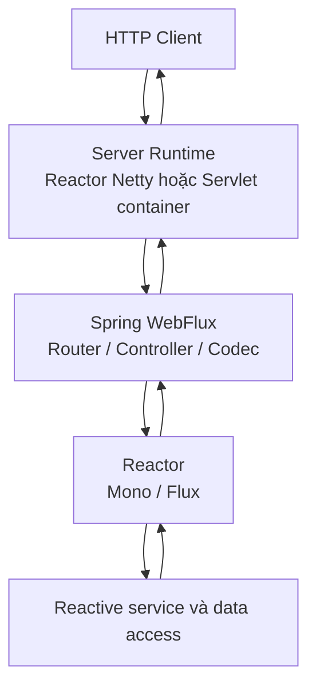

# Spring WebFlux: vị trí trong hệ sinh thái lập trình phản ứng

Trong module `REACTIVE_PROGRAMMING`, ta học cách xây dựng luồng sự kiện bất đồng bộ theo hợp đồng Publisher–Subscriber và cơ chế backpressure của Reactive Streams, đồng thời thực hành `Mono`, `Flux`, toán tử, scheduler, xử lý lỗi và kiểm thử pipeline trong hệ sinh thái Java. **Spring WebFlux** là lớp web reactive của Spring Framework: nó kết nối giao thức HTTP với các Publisher, cho phép ứng dụng nhận request, gọi dịch vụ bất đồng bộ và ghi response theo một pipeline reactive.

WebFlux không thay thế vai trò của Reactor hay Reactive Streams. Reactive Streams định nghĩa hợp đồng trao đổi tín hiệu và demand; Reactor cung cấp các kiểu triển khai như `Mono` và `Flux` cùng bộ toán tử; WebFlux tích hợp các kiểu đó vào tầng HTTP, routing, controller, codec và client. Hiểu vị trí của từng lớp giúp thiết kế ứng dụng web có khả năng xử lý I/O bất đồng bộ mà không nhầm rằng chỉ cần trả về `Mono` hoặc `Flux` là toàn bộ hệ thống đã non-blocking.

## 1. WebFlux nằm ở đâu trong hệ sinh thái?

Một ứng dụng web reactive thường có các lớp trách nhiệm sau:

| Lớp | Vai trò | Ví dụ trong Spring |
|---|---|---|
| Giao thức và hợp đồng | Quy định Publisher, Subscriber, Subscription và demand | Reactive Streams |
| Thư viện reactive | Cung cấp kiểu dữ liệu, toán tử, scheduler và xử lý lỗi | Project Reactor: `Mono`, `Flux` |
| Tầng web | Ánh xạ HTTP request/response vào pipeline reactive | Spring WebFlux |
| Runtime máy chủ | Nhận kết nối, đọc request và ghi response | Reactor Netty, hoặc Servlet container tương thích non-blocking I/O |
| Tầng truy cập dịch vụ/dữ liệu | Gọi dịch vụ và kho dữ liệu theo API bất đồng bộ | `WebClient`, R2DBC, reactive Redis/MongoDB driver |



Reactive Streams là hợp đồng giao tiếp giữa các thành phần; Reactor là một implementation phổ biến của hợp đồng đó; WebFlux là framework web sử dụng các abstraction reactive để xử lý HTTP. Một ứng dụng WebFlux thường dùng Reactor làm thư viện reactive chính, nhưng Spring cũng có cơ chế adapter cho một số kiểu reactive khác thông qua `ReactiveAdapterRegistry`.

## 2. Vòng đời một HTTP request trong WebFlux

Khi một client gửi request, server runtime nhận dữ liệu từ socket và chuyển request vào hạ tầng HTTP của Spring. WebFlux tìm handler phù hợp, giải mã body nếu cần, gọi controller hoặc handler function, rồi ghi kết quả trả về thành response.

Với một controller trả về `Mono<Order>`, luồng xử lý có thể hình dung như sau:

1. Runtime nhận request và chuyển nó vào WebFlux.
2. WebFlux chọn handler theo route hoặc mapping của controller.
3. Các tham số request được giải mã và chuyển thành kiểu Java.
4. Controller gọi service và trả về một Publisher, thường là `Mono` hoặc `Flux`.
5. WebFlux subscribe vào Publisher để xử lý kết quả.
6. Khi Publisher phát dữ liệu, codec chuyển dữ liệu thành bytes và runtime ghi chúng vào response.
7. Khi Publisher hoàn tất hoặc lỗi, WebFlux kết thúc response theo trạng thái và quy tắc xử lý lỗi tương ứng.

Điểm quan trọng là controller thường trả về một mô tả công việc reactive. Việc subscribe và ghi response thuộc trách nhiệm của framework. Không nên gọi `.block()` trong controller để lấy kết quả đồng bộ, vì thao tác đó sẽ chặn thread đang xử lý request và phá vỡ lợi ích của pipeline bất đồng bộ.

## 3. Dùng `Mono` và `Flux` trong annotated controller

WebFlux hỗ trợ mô hình controller với annotation tương tự Spring MVC. Khác biệt quan trọng là method có thể trả về Publisher thay vì phải chờ lấy giá trị trước khi trả response.

```java
@RestController
@RequestMapping("/api/orders")
class OrderController {
    private final OrderService orderService;

    OrderController(OrderService orderService) {
        this.orderService = orderService;
    }

    @GetMapping("/{id}")
    Mono<OrderView> findById(@PathVariable String id) {
        return orderService.findById(id)
            .map(OrderView::from);
    }

    @GetMapping
    Flux<OrderView> findAll() {
        return orderService.findAll()
            .map(OrderView::from);
    }
}
```

`Mono<OrderView>` phù hợp với một kết quả có thể không tồn tại hoặc chỉ có một giá trị. `Flux<OrderView>` phù hợp với một chuỗi kết quả. WebFlux quản lý việc subscribe và chuyển tín hiệu thành HTTP response.

Một endpoint tạo tài nguyên cũng có thể trả về `Mono<ResponseEntity<OrderView>>` để quyết định status và header theo kết quả bất đồng bộ:

```java
@PostMapping
Mono<ResponseEntity<OrderView>> create(@RequestBody Mono<CreateOrder> body) {
    return body
        .flatMap(orderService::create)
        .map(OrderView::from)
        .map(view -> ResponseEntity.created(
                URI.create("/api/orders/" + view.id())
            ).body(view));
}
```

Request body được biểu diễn bằng `Mono<CreateOrder>`, nên WebFlux có thể giải mã body theo pipeline. Nếu body không hợp lệ hoặc service phát lỗi, lỗi có thể được xử lý tại service, controller advice hoặc cơ chế xử lý lỗi chung của ứng dụng.

## 4. Phát dữ liệu theo luồng qua HTTP

Trả về `Flux<T>` không có nghĩa mọi media type đều được truyền đến client theo cùng cách. Cách mã hóa response quyết định dữ liệu được ghi theo dạng một tài liệu tổng hợp hay từng phần tử.

Với dữ liệu sự kiện cần phát dần, có thể dùng Server-Sent Events (SSE):

```java
@GetMapping(value = "/events", produces = MediaType.TEXT_EVENT_STREAM_VALUE)
Flux<ServerSentEvent<OrderEvent>> events() {
    return orderEventService.events()
        .map(event -> ServerSentEvent.builder(event)
            .event("order-update")
            .id(event.id())
            .build());
}
```

SSE dùng `text/event-stream`, phù hợp với luồng sự kiện một chiều từ server đến client. Với dữ liệu dạng JSON Lines, có thể dùng media type `application/x-ndjson` để ghi từng JSON object theo dòng:

```java
@GetMapping(value = "/export", produces = "application/x-ndjson")
Flux<OrderView> exportOrders() {
    return orderService.findAll().map(OrderView::from);
}
```

Với `application/json`, client thường nhận một tài liệu JSON hoàn chỉnh, ví dụ một mảng. Không nên giả định client sẽ quan sát từng phần tử ngay khi Publisher phát ra. Nếu yêu cầu là streaming từng bản ghi, hãy chọn media type có ngữ nghĩa streaming và kiểm thử với client thực tế, proxy và gateway trong môi trường triển khai.

## 5. Functional endpoints: RouterFunction và HandlerFunction

Ngoài annotated controller, WebFlux cung cấp mô hình functional endpoint. Route mô tả điều kiện khớp request, còn handler xử lý request và trả về `Mono<ServerResponse>`.

```java
@Configuration
class OrderRoutes {
    @Bean
    RouterFunction<ServerResponse> orderRoutes(OrderHandler handler) {
        return RouterFunctions.route()
            .GET("/functional/orders/{id}", handler::findById)
            .POST("/functional/orders", handler::create)
            .build();
    }
}

@Component
class OrderHandler {
    private final OrderService orderService;

    OrderHandler(OrderService orderService) {
        this.orderService = orderService;
    }

    Mono<ServerResponse> findById(ServerRequest request) {
        String id = request.pathVariable("id");
        return orderService.findById(id)
            .flatMap(order -> ServerResponse.ok().bodyValue(OrderView.from(order)))
            .switchIfEmpty(ServerResponse.notFound().build());
    }

    Mono<ServerResponse> create(ServerRequest request) {
        return request.bodyToMono(CreateOrder.class)
            .flatMap(orderService::create)
            .flatMap(order -> ServerResponse.accepted()
                .bodyValue(OrderView.from(order)));
    }
}
```

Functional endpoints hữu ích khi muốn mô tả routing bằng code và nhóm handler theo module. Annotated controller thường quen thuộc với ứng dụng CRUD và binding annotation; functional endpoint cung cấp cách tổ chức route và handler tường minh. Cả hai đều sử dụng cùng nền tảng reactive của WebFlux và có thể trả về `Mono`/`Flux`.

## 6. WebClient kết nối WebFlux với dịch vụ bên ngoài

`WebClient` là HTTP client reactive của Spring. Nó cho phép gửi request và nhận response dưới dạng `Mono` hoặc `Flux`, phù hợp để kết hợp nhiều dịch vụ trong cùng pipeline mà không cần chờ bằng `block()`.

```java
@Component
class InventoryClient {
    private final WebClient webClient;

    InventoryClient(WebClient.Builder builder) {
        this.webClient = builder
            .baseUrl("http://inventory-service")
            .build();
    }

    Mono<Inventory> findBySku(String sku) {
        return webClient.get()
            .uri("/api/inventory/{sku}", sku)
            .retrieve()
            .bodyToMono(Inventory.class);
    }
}
```

Một service có thể kết hợp kết quả từ nhiều client:

```java
Mono<OrderSummary> loadSummary(String orderId) {
    return orderClient.findById(orderId)
        .flatMap(order -> Mono.zip(
            inventoryClient.findBySku(order.sku()),
            customerClient.findById(order.customerId())
        ).map(tuple -> OrderSummary.from(
            order, tuple.getT1(), tuple.getT2()
        )));
}
```

`Mono.zip` kết hợp hai lời gọi độc lập sau khi chúng phát giá trị. Nếu một nguồn hoàn tất rỗng, `zip` không thể tạo tuple và kết quả có thể hoàn tất rỗng; nếu một nguồn phát lỗi, lỗi được truyền xuống theo ngữ nghĩa của toán tử. Cần quyết định rõ chính sách khi một dịch vụ phụ trợ không có dữ liệu hoặc thất bại, ví dụ dùng `switchIfEmpty`, `onErrorResume` hoặc lỗi nghiệp vụ phù hợp.

## 7. WebFlux và Spring MVC khác nhau ở đâu?

Spring MVC và Spring WebFlux cùng thuộc Spring Framework nhưng được thiết kế quanh mô hình thực thi web khác nhau.

| Tiêu chí | Spring MVC | Spring WebFlux |
|---|---|---|
| Mô hình web | Servlet stack truyền thống | Reactive stack |
| Mô hình xử lý thường gặp | Một request được xử lý trên thread servlet; có thể dùng async support | Pipeline bất đồng bộ, non-blocking I/O với event-loop hoặc runtime tương thích |
| Kiểu trả về | Đối tượng, `Callable`, `DeferredResult`, reactive types... | `Mono`, `Flux`, reactive types và kiểu được adapter hỗ trợ |
| Hệ sinh thái dữ liệu | Phù hợp với JDBC và thư viện blocking | Phù hợp với R2DBC và driver reactive |
| Server | Servlet container | Reactor Netty mặc định phổ biến; cũng có thể chạy trên Servlet container tương thích |
| Trường hợp phù hợp | Ứng dụng dùng nhiều API blocking, mô hình request/response truyền thống | I/O bất đồng bộ, streaming, nhiều kết nối đồng thời và stack reactive xuyên suốt |

Spring MVC cũng có thể nhận reactive return types và hỗ trợ xử lý bất đồng bộ trên Servlet stack. Vì vậy, khác biệt không đơn giản là “MVC không hỗ trợ reactive”. WebFlux cung cấp một web stack được thiết kế quanh non-blocking I/O và Reactive Streams; MVC giữ mô hình Servlet và tích hợp reactive types ở những điểm phù hợp.

WebFlux không tự động nhanh hơn MVC trong mọi tải. Nếu phần lớn công việc là CPU-bound hoặc ứng dụng phụ thuộc vào JDBC và SDK blocking, lợi ích của event-loop có thể không bù được chi phí chuyển đổi và cô lập blocking. Khi toàn bộ đường đi chủ yếu là I/O bất đồng bộ và có nhiều request đang chờ mạng hoặc dữ liệu, WebFlux có thể sử dụng tài nguyên thread hiệu quả hơn.

## 8. Backpressure ở ranh giới HTTP

Trong nội bộ pipeline, `Flux` và các Publisher tuân thủ Reactive Streams trao đổi demand qua `Subscription.request(n)`. WebFlux phối hợp việc đọc và ghi body với cơ chế reactive để tránh buộc ứng dụng phải giữ toàn bộ dữ liệu trong bộ nhớ trong mọi trường hợp.

Tuy nhiên, backpressure không phải lúc nào cũng truyền nguyên vẹn qua mọi thành phần mạng. Browser, reverse proxy, API gateway, load balancer hoặc client HTTP có thể buffer dữ liệu, đọc theo tốc độ riêng hoặc áp dụng giới hạn. Một HTTP client thông thường cũng không nhất thiết cho phép ứng dụng cuối điều khiển demand theo cùng giao thức Reactive Streams.

Vì vậy:

- Dùng `Flux` cho dữ liệu nhiều phần tử và xử lý theo từng phần tử trong server.
- Chọn media type streaming khi client cần nhận từng phần tử sớm.
- Giới hạn buffer và concurrency ở các bước xử lý có thể tích lũy dữ liệu.
- Đặt timeout và giới hạn kích thước request/response phù hợp.
- Kiểm thử hành vi qua proxy và client thực tế, không chỉ kiểm thử Publisher trong JVM.

Backpressure giúp phối hợp tốc độ giữa các thành phần reactive tuân thủ giao thức. Nó không thay thế giới hạn tài nguyên, quota, rate limit hoặc chính sách chống quá tải ở biên HTTP.

## 9. Tránh blocking trên event-loop

Một server runtime như Reactor Netty thường dùng số lượng thread event-loop tương đối nhỏ để phục vụ nhiều kết nối. Nếu callback trên event-loop gọi JDBC đồng bộ, `Thread.sleep`, file I/O blocking hoặc một SDK đồng bộ, thread đó bị giữ trong lúc chờ. Các request khác dùng chung event-loop có thể bị chậm theo.

Không nên viết:

```java
@GetMapping("/legacy/{id}")
Mono<LegacyRecord> findLegacy(@PathVariable String id) {
    return Mono.just(legacyJdbcRepository.findById(id));
}
```

`findById` được gọi ngay khi Java đánh giá đối số của `Mono.just`, và có thể block thread đang gọi controller. Nếu chưa thể thay thư viện blocking, có thể cô lập thao tác bằng `fromCallable` và `boundedElastic`:

```java
@GetMapping("/legacy/{id}")
Mono<LegacyRecord> findLegacy(@PathVariable String id) {
    return Mono.fromCallable(() -> legacyJdbcRepository.findById(id))
        .subscribeOn(Schedulers.boundedElastic());
}
```

Đây là giải pháp chuyển tác vụ blocking sang scheduler phù hợp, không biến JDBC thành non-blocking. Về lâu dài, nếu ứng dụng cần một reactive stack xuyên suốt, hãy cân nhắc driver reactive như R2DBC cho cơ sở dữ liệu quan hệ và các client reactive tương ứng. Không nên gọi `.block()` trong controller hoặc service đang chạy trên event-loop.

## 10. Xử lý lỗi và cancellation theo vòng đời request

Trong WebFlux, lỗi từ Publisher có thể được ánh xạ thành HTTP response bằng `@ExceptionHandler`, `@ControllerAdvice` hoặc cơ chế xử lý lỗi của ứng dụng. Không nên biến mọi lỗi thành HTTP 200 kèm body lỗi, vì điều đó làm sai ngữ nghĩa HTTP và gây khó khăn cho client.

Ví dụ service phát `Mono.empty()` khi không tìm thấy dữ liệu; controller có thể ánh xạ thành 404:

```java
@GetMapping("/{id}")
Mono<ResponseEntity<OrderView>> find(@PathVariable String id) {
    return orderService.findById(id)
        .map(OrderView::from)
        .map(ResponseEntity::ok)
        .defaultIfEmpty(ResponseEntity.notFound().build());
}
```

Nếu client ngắt kết nối hoặc hủy việc đọc response, WebFlux có thể hủy subscription liên quan. Cancellation truyền ngược qua pipeline theo hợp đồng reactive, nhưng tác vụ bên dưới chỉ dừng thực sự nếu driver hoặc API hỗ trợ cancellation. Một JDBC call đang chạy hoặc side effect đã được gửi đến dịch vụ ngoài có thể không dừng ngay khi subscriber hủy.

Với thao tác ghi dữ liệu, cần xác định hành vi khi client mất kết nối sau khi server đã thực hiện side effect. Không nên coi cancellation là rollback. Dùng transaction, idempotency key hoặc cơ chế đối soát phù hợp với nghiệp vụ.

## 11. Kiểm thử endpoint bằng WebTestClient

`WebTestClient` là công cụ kiểm thử HTTP dành cho Spring WebFlux. Nó có thể kiểm thử controller/handler trực tiếp hoặc gửi request đến ứng dụng đã khởi động.

Ví dụ kiểm thử controller:

```java
WebTestClient client = WebTestClient
    .bindToController(new OrderController(orderService))
    .build();

client.get()
    .uri("/api/orders/order-100")
    .exchange()
    .expectStatus().isOk()
    .expectBody(OrderView.class)
    .value(view -> assertEquals("order-100", view.id()));
```

Để kiểm thử response streaming, có thể nhận body dưới dạng `Flux` từ kết quả:

```java
FluxExchangeResult<OrderEvent> result = client.get()
    .uri("/api/orders/events")
    .accept(MediaType.TEXT_EVENT_STREAM)
    .exchange()
    .expectStatus().isOk()
    .returnResult(OrderEvent.class);

StepVerifier.create(result.getResponseBody())
    .expectNextMatches(event -> event.type().equals("ORDER_CREATED"))
    .thenCancel()
    .verify();
```

Trong test thực tế, service nên dùng nguồn có thể điều khiển như `Sinks` hoặc `TestPublisher` để phát event theo kịch bản. `thenCancel()` mô phỏng consumer dừng đọc; có thể bổ sung kiểm tra rằng subscription upstream được hủy và tài nguyên liên quan được giải phóng theo thiết kế.

`WebTestClient` giúp kiểm tra status, header, codec và body HTTP. `StepVerifier` giúp kiểm tra tín hiệu reactive, demand và cancellation trong pipeline. Hai công cụ bổ trợ nhau: một kiểm tra ranh giới web, một kiểm tra hành vi Publisher.

## 12. Khi nào nên chọn WebFlux?

WebFlux phù hợp khi ứng dụng có nhiều I/O bất đồng bộ, cần streaming response, cần kết hợp nhiều dịch vụ reactive hoặc cần phục vụ nhiều kết nối đồng thời trong khi phần lớn thời gian request đang chờ I/O. Nó phát huy hiệu quả tốt hơn khi các tầng service, HTTP client và data access cũng có API non-blocking.

Spring MVC có thể là lựa chọn đơn giản hơn nếu ứng dụng chủ yếu dùng JDBC, thư viện đồng bộ và mô hình xử lý request truyền thống. Chọn WebFlux chỉ vì muốn dùng `Mono` hoặc `Flux` thường không đủ lý do; cần đánh giá toàn bộ đường đi của request và năng lực của các dependency.

| Tình huống | Hướng chọn ban đầu |
|---|---|
| API gọi nhiều dịch vụ HTTP reactive và R2DBC | WebFlux |
| Endpoint SSE hoặc stream dữ liệu liên tục | WebFlux thường là lựa chọn tự nhiên |
| Ứng dụng CRUD dựa chủ yếu trên JDBC và SDK blocking | Spring MVC thường đơn giản hơn |
| Ứng dụng MVC hiện có chỉ cần một vài API trả reactive type | Có thể tích hợp reactive type trong MVC mà chưa cần chuyển toàn bộ stack |
| Tải chủ yếu CPU-bound | Đo benchmark và thiết kế concurrency; WebFlux không tự làm phép tính nhanh hơn |

## 13. Quy trình thiết kế ứng dụng WebFlux

Khi bắt đầu một ứng dụng web reactive, hãy xác định theo thứ tự:

1. **Chọn mô hình web:** annotated controller hoặc functional endpoint theo cách tổ chức phù hợp.
2. **Chọn kiểu kết quả:** dùng `Mono` cho tối đa một kết quả, `Flux` cho chuỗi phần tử.
3. **Kiểm tra dependency:** ưu tiên `WebClient`, R2DBC và driver reactive; nhận diện mọi lời gọi blocking.
4. **Chọn runtime:** dùng Reactor Netty hoặc Servlet container tương thích theo yêu cầu triển khai.
5. **Xác định ngữ nghĩa HTTP:** status, header, codec và media type, đặc biệt với SSE/NDJSON.
6. **Thiết kế quá tải:** giới hạn concurrency, buffer, payload, timeout và rate limit.
7. **Thiết kế lỗi và cancellation:** xác định ánh xạ HTTP, tài nguyên cần giải phóng và side effect có thể đã xảy ra.
8. **Kiểm thử hai lớp:** dùng `WebTestClient` cho HTTP và `StepVerifier` cho pipeline reactive.

Spring WebFlux là cầu nối giữa HTTP và mô hình Publisher–Subscriber. Nó cung cấp routing, controller, codec, client và tích hợp runtime để ứng dụng dùng `Mono`/`Flux` trong xử lý request/response. Hiệu quả của WebFlux phụ thuộc vào việc giữ đường đi I/O non-blocking, hiểu giới hạn backpressure ở biên mạng, quản lý cancellation và chọn đúng nơi cho các tác vụ blocking. Khi nhìn WebFlux như một lớp trong hệ sinh thái gồm Reactive Streams, Reactor, server runtime và các driver dữ liệu, ta có thể thiết kế ứng dụng web reactive đúng ngữ nghĩa và dễ kiểm thử hơn.
