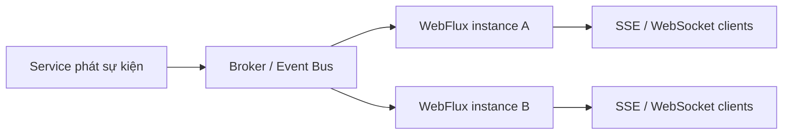

# Phát dữ liệu bằng Server-Sent Events và WebSocket

Ứng dụng web thường cần đẩy dữ liệu mới tới trình duyệt mà không bắt người dùng tải lại trang hoặc liên tục gửi request hỏi máy chủ. Ví dụ, bảng theo dõi đơn hàng cần nhận trạng thái giao hàng mới, dashboard cần cập nhật số liệu, còn màn hình chat cần gửi và nhận tin nhắn ngay khi có sự kiện. Hai giao thức thường được dùng cho các tình huống này là **Server-Sent Events (SSE)** và **WebSocket**.

SSE mở một HTTP response dạng stream để máy chủ gửi các sự kiện văn bản tới trình duyệt theo một chiều. WebSocket thiết lập một kết nối hai chiều để cả trình duyệt và máy chủ đều có thể gửi thông điệp trên cùng một phiên. Trong Spring WebFlux, cả hai có thể được biểu diễn bằng các luồng reactive như `Flux`, nhưng khác nhau về giao thức, cách client sử dụng, vòng đời kết nối và chính sách xử lý khi client chậm hoặc mất kết nối.

Chủ đề này thuộc chương **Ứng dụng Web** của REACTIVE_PROGRAMMING. Module học tư duy reactive qua các luồng sự kiện bất đồng bộ, hợp đồng Publisher–Subscriber và backpressure của Reactive Streams; đồng thời thực hành Mono, Flux, kết hợp operator, scheduler, xử lý lỗi và kiểm thử pipeline trong hệ sinh thái Java. Bài học tập trung vào cách phát dữ liệu từ máy chủ web tới client bằng SSE và WebSocket, từ controller/handler tới quản lý subscription, bảo mật và vận hành.

## Chọn giao thức theo hướng trao đổi dữ liệu

SSE phù hợp khi dữ liệu chủ yếu đi từ server tới browser. Trình duyệt dùng `EventSource` để mở một kết nối HTTP dài hạn; server gửi các event nối tiếp. Client vẫn có thể gửi lệnh bằng các request HTTP riêng như `POST`, trong khi SSE giữ vai trò kênh nhận cập nhật.

WebSocket phù hợp khi hai phía cần trao đổi thường xuyên trên cùng một kết nối: chat, trò chơi trực tuyến, cộng tác thời gian thực hoặc điều khiển thiết bị. Sau bước handshake, kết nối chuyển sang giao thức WebSocket và hai phía có thể gửi frame theo cả hai hướng.

| Tiêu chí | Server-Sent Events | WebSocket |
|---|---|---|
| Hướng dữ liệu | Server → browser | Hai chiều: server ↔ browser |
| Nền tảng giao thức | HTTP response dạng `text/event-stream` | Kết nối WebSocket sau handshake HTTP |
| Định dạng dữ liệu phổ biến | Văn bản UTF-8 theo định dạng event; thường mang JSON trong `data` | Text frame hoặc binary frame do ứng dụng quy định |
| API trình duyệt | `EventSource` | `WebSocket` |
| Tự kết nối lại | `EventSource` có cơ chế reconnect và hỗ trợ `retry`/`Last-Event-ID` | Ứng dụng thường tự thiết kế reconnect và resume |
| Client gửi dữ liệu | Dùng HTTP request riêng | Gửi trực tiếp qua WebSocket |
| Trường hợp phù hợp | Thông báo, trạng thái, feed, dashboard | Chat, cộng tác hai chiều, tương tác liên tục |

Không cần dùng WebSocket chỉ vì dữ liệu được cập nhật theo thời gian thực. Nếu trình duyệt chỉ cần nhận thông báo và có thể gửi thao tác bằng HTTP thông thường, SSE thường đơn giản hơn. Ngược lại, nếu client phải gửi nhiều thông điệp nhỏ liên tục và cần phản hồi trên cùng kết nối, WebSocket có thể phù hợp hơn.

## Server-Sent Events hoạt động như thế nào?

SSE sử dụng một HTTP response có content type `text/event-stream`. Server giữ response mở và ghi từng event theo định dạng văn bản UTF-8. Một event kết thúc bằng một dòng trống. Các trường quan trọng gồm:

- `data`: nội dung event; có thể xuất hiện nhiều dòng `data` trong cùng một event.
- `event`: tên loại event để client đăng ký listener riêng.
- `id`: định danh event, được browser lưu để gửi lại trong header `Last-Event-ID` khi reconnect.
- `retry`: thời gian chờ reconnect tính bằng mili giây.
- `:` ở đầu dòng: comment, thường dùng làm heartbeat để giữ kết nối qua proxy.

Ví dụ một response SSE:

```text
id: order-847-12
event: order-status
retry: 5000
data: {"orderId":"847","status":"SHIPPED"}

: keepalive

```

Event đầu tiên có ID `order-847-12`, tên `order-status` và payload JSON. Dòng comment `: keepalive` không tạo event cho listener; nó chỉ gửi dữ liệu nhỏ để duy trì hoạt động của kết nối qua một số proxy hoặc load balancer.

SSE là giao thức một chiều. Client không gửi message qua `EventSource`; nếu người dùng thay đổi trạng thái đơn hàng, browser gửi request HTTP riêng tới endpoint command. Tách kênh command và kênh notification thường làm API dễ quan sát và bảo mật hơn.

## Phát SSE từ Spring WebFlux bằng `Flux<ServerSentEvent<T>>`

Spring WebFlux có thể ghi một `Flux` thành response stream. Với SSE, dùng `ServerSentEvent<T>` để khai báo ID, tên event, retry hoặc comment cùng payload:

```java
import java.time.Duration;
import org.springframework.http.MediaType;
import org.springframework.http.codec.ServerSentEvent;
import org.springframework.web.bind.annotation.GetMapping;
import org.springframework.web.bind.annotation.RestController;
import reactor.core.publisher.Flux;

record OrderUpdate(String eventId, String orderId, String status) {}

@RestController
class OrderEventController {
    private final OrderEventService events;

    OrderEventController(OrderEventService events) {
        this.events = events;
    }

    @GetMapping(value = "/api/orders/events", produces = MediaType.TEXT_EVENT_STREAM_VALUE)
    Flux<ServerSentEvent<OrderUpdate>> streamOrderUpdates() {
        return events.streamUpdates()
            .map(update -> ServerSentEvent.builder(update)
                .id(update.eventId())
                .event("order-status")
                .retry(Duration.ofSeconds(5))
                .build());
    }
}
```

`eventId` phải ổn định và duy nhất trong phạm vi stream mà client resume. Nếu hệ thống dùng sequence theo từng order, hãy kết hợp order ID và sequence theo một định dạng không nhập nhằng. Server cần dùng cùng quy tắc đó khi xử lý `Last-Event-ID` để truy vấn event tiếp theo.

Có thể trả trực tiếp `Flux<OrderUpdate>` với `produces = TEXT_EVENT_STREAM_VALUE`; Spring sẽ mã hóa từng phần tử theo định dạng SSE. Dùng `ServerSentEvent<T>` khi cần điều khiển metadata như `id`, `event`, `retry` hoặc comment.

### Tạo luồng sự kiện trong service

Service có thể lấy dữ liệu từ broker, event bus hoặc một Publisher nội bộ. Ví dụ minh họa một nguồn sự kiện được chia sẻ:

```java
import reactor.core.publisher.Flux;
import reactor.core.publisher.Sinks;

class OrderEventService {
    private final Sinks.Many<OrderUpdate> sink =
        Sinks.many().multicast().onBackpressureBuffer(256);

    Flux<OrderUpdate> streamUpdates() {
        return sink.asFlux();
    }

    void publish(OrderUpdate update) {
        Sinks.EmitResult result = sink.tryEmitNext(update);
        if (result.isFailure()) {
            handleEmitFailure(result, update);
        }
    }
}
```

`Sinks.Many` là một cách đưa sự kiện từ code imperative vào Publisher. `multicast()` phát sự kiện tới các subscriber đang hoạt động; subscriber kết nối muộn không tự nhận lại toàn bộ lịch sử. Overload `onBackpressureBuffer(256)` đặt giới hạn buffer cho subscriber chậm; khi không thể nhận thêm, thao tác emit có thể thất bại và cần được xử lý qua `EmitResult`. Chọn giới hạn theo kích thước payload và tải thực tế. Nếu cần replay event cho client reconnect, hãy dùng event store hoặc broker có khả năng đọc lại theo sequence, thay vì giả định multicast sink là kho lịch sử.

`tryEmitNext` trả về `EmitResult`. Không nên bỏ qua kết quả này: có thể thất bại khi sink đã kết thúc, không có subscriber theo semantics đã chọn hoặc vi phạm điều kiện phát. Ghi metric và xác định cách retry/drop/fail theo loại lỗi phát.

## Nhận SSE trong trình duyệt

Browser API `EventSource` tự quản lý kết nối và reconnect khi kết nối bị đóng ngoài ý muốn:

```javascript
const source = new EventSource("/api/orders/events");

source.addEventListener("order-status", (event) => {
  const update = JSON.parse(event.data);
  renderOrderStatus(update);
});

source.onopen = () => {
  console.log("SSE connected");
};

source.onerror = () => {
  // EventSource thường tự thử kết nối lại khi có thể.
  showConnectionState("reconnecting");
};

// Khi rời màn hình hoặc không còn cần nhận cập nhật:
source.close();
```

Nếu server gửi trường `event: order-status`, client đăng ký listener bằng đúng tên đó. Nếu server không đặt tên event, có thể dùng `source.onmessage`. `event.data` là chuỗi; nếu payload là JSON, client cần parse và xử lý lỗi dữ liệu.

### Reconnect và `Last-Event-ID`

Khi nhận event có trường `id`, browser lưu ID gần nhất. Khi kết nối bị ngắt và `EventSource` reconnect, trình duyệt có thể gửi header `Last-Event-ID` để server biết client đã nhận tới đâu. Server có thể đọc header đó và truy vấn event store để phát tiếp các event mới hơn:

```java
import org.springframework.web.bind.annotation.RequestHeader;

@GetMapping(value = "/api/orders/events", produces = MediaType.TEXT_EVENT_STREAM_VALUE)
Flux<ServerSentEvent<OrderUpdate>> streamOrderUpdates(
        @RequestHeader(name = "Last-Event-ID", required = false) String lastEventId) {
    return events.streamAfter(lastEventId)
        .map(update -> ServerSentEvent.builder(update)
            .id(update.eventId())
            .event("order-status")
            .build());
}
```

`Last-Event-ID` chỉ là vị trí client báo đã nhận; nó không tự bảo đảm exactly-once delivery. Mạng có thể đứt sau khi server gửi nhưng trước khi client xử lý xong, hoặc client có thể xử lý event rồi mất kết nối trước khi trạng thái được lưu. Thiết kế consumer nên idempotent theo event ID và chấp nhận khả năng nhận lặp. Nếu cần đảm bảo không mất sự kiện, lưu event bền vững và xác định rõ chính sách retention, replay và cursor.

Trường `retry` trong SSE gợi ý khoảng thời gian reconnect cho browser. Nó không phải retry của thao tác nghiệp vụ ở server và cũng không tự phát lại event đã mất nếu server không có cơ chế resume.

### Giới hạn của `EventSource`

API `EventSource` gốc chủ yếu mở kết nối GET và không cho đặt tùy ý header như `Authorization: Bearer ...`. Với xác thực, thường dùng cookie phiên an toàn cùng `withCredentials` khi cần gửi credential cross-origin:

```javascript
const source = new EventSource("https://api.example.com/api/events", {
  withCredentials: true
});
```

Nếu hệ thống bắt buộc dùng bearer token trong header, có thể dùng client streaming dựa trên `fetch` hoặc thư viện hỗ trợ header tùy chỉnh; khi đó ứng dụng phải tự triển khai parsing SSE, reconnect và `Last-Event-ID`. Tránh đặt access token dài hạn trong query string vì URL có thể xuất hiện trong log, lịch sử trình duyệt hoặc hệ thống quan sát.

## Heartbeat, timeout và proxy cho SSE

Một kết nối SSE có thể không có event nghiệp vụ trong thời gian dài. Một số proxy hoặc load balancer sẽ đóng kết nối idle. Server có thể gửi comment heartbeat định kỳ:

```java
Flux<ServerSentEvent<OrderUpdate>> heartbeats =
    Flux.interval(Duration.ofSeconds(20))
        .map(tick -> ServerSentEvent.<OrderUpdate>builder()
            .comment("keepalive")
            .build());
```

Có thể kết hợp heartbeat với luồng event:

```java
Flux<ServerSentEvent<OrderUpdate>> response = Flux.merge(
    orderEvents.streamUpdates().map(this::toSse),
    heartbeats
);
```

Heartbeat chỉ giúp duy trì kết nối qua một số thành phần mạng; nó không chứng minh client đang xử lý event hoặc còn hiển thị trang. Cần cấu hình timeout của proxy/load balancer phù hợp, kiểm tra response không bị buffering ở tầng trung gian và bảo đảm server hủy timer khi client disconnect.

Trong ví dụ `Flux.merge`, heartbeat là nguồn không hoàn tất nên response tiếp tục mở ngay cả khi nguồn event nghiệp vụ tạm thời hoàn tất. Đây là chủ ý với endpoint stream dài hạn; khi client disconnect, cancellation phải được truyền tới cả hai nguồn để dừng timer và giải phóng subscription.

Khi client đóng tab hoặc gọi `source.close()`, server nhận cancellation khi transport đóng. Có thể dùng `doFinally` để ghi nhận vòng đời subscription:

```java
return events.streamUpdates()
    .doFinally(signal -> metrics.recordSseTermination(signal));
```

Không nên ghi log mọi heartbeat ở mức INFO nếu số lượng client lớn. Dùng metric tổng hợp cho số kết nối đang mở, thời gian sống, reconnect, lỗi ghi response và số event phát.

## WebSocket: kết nối hai chiều

WebSocket bắt đầu bằng một handshake HTTP, sau đó chuyển sang giao thức WebSocket. Kết nối tồn tại lâu hơn một request/response thông thường và cho phép hai phía gửi text hoặc binary frame. Một message có thể gồm một hoặc nhiều frame; tầng thư viện xử lý việc ghép frame theo giao thức.

Browser dùng `WebSocket`:

```javascript
const socket = new WebSocket("wss://example.com/ws/chat");

socket.addEventListener("open", () => {
  socket.send(JSON.stringify({ type: "join", roomId: "room-7" }));
});

socket.addEventListener("message", (event) => {
  const message = JSON.parse(event.data);
  renderMessage(message);
});

socket.addEventListener("close", (event) => {
  showConnectionState(`closed: ${event.code}`);
});

socket.addEventListener("error", () => {
  showConnectionState("connection error");
});
```

Trang web nên dùng `wss://` trong production để mã hóa kết nối. `send()` chỉ gửi dữ liệu khi socket ở trạng thái OPEN; ứng dụng cần kiểm tra `readyState` và xử lý trường hợp kết nối chưa sẵn sàng hoặc đã đóng.

## Xử lý WebSocket bằng Spring WebFlux

Trong Spring WebFlux, `WebSocketHandler` nhận một `WebSocketSession`. Session cung cấp Publisher cho dữ liệu inbound (`receive()`) và phương thức gửi một Publisher outbound (`send(...)`). Có thể mô hình hóa cả hai hướng thành pipeline reactive:

```java
import org.springframework.stereotype.Component;
import org.springframework.web.reactive.socket.WebSocketHandler;
import org.springframework.web.reactive.socket.WebSocketSession;
import reactor.core.publisher.Mono;

@Component
class ChatWebSocketHandler implements WebSocketHandler {
    private final ChatService chatService;

    ChatWebSocketHandler(ChatService chatService) {
        this.chatService = chatService;
    }

    @Override
    public Mono<Void> handle(WebSocketSession session) {
        String connectionId = session.getId();

        Mono<Void> inbound = session.receive()
            .map(message -> message.getPayloadAsText())
            .concatMap(text -> chatService.handleMessage(connectionId, text))
            .then();

        Mono<Void> outbound = session.send(
            chatService.messagesFor(connectionId)
                .map(session::textMessage)
        );

        return Mono.when(inbound, outbound);
    }
}
```

`session.receive()` tạo luồng các message từ client. `concatMap` xử lý tuần tự để giữ thứ tự command của một kết nối; nếu xử lý độc lập và muốn concurrency, có thể dùng `flatMap` với giới hạn phù hợp. `session.send(...)` tiêu thụ Publisher outbound và ghi message xuống kết nối. `Mono.when` kết hợp vòng đời hai hướng; khi một nhánh kết thúc hoặc lỗi, hành vi kết thúc của session cần được xác định theo hợp đồng của handler và service.

Ví dụ dùng `connectionId` để minh họa định danh kết nối. Trong ứng dụng thật, không dùng session ID thay cho danh tính người dùng. Lấy principal đã xác thực từ handshake/session hoặc cơ chế bảo mật của ứng dụng, sau đó kiểm tra quyền truy cập room/topic cho từng message.

### Đăng ký WebSocket handler vào route

Một cách cấu hình handler trong WebFlux là ánh xạ URL bằng `SimpleUrlHandlerMapping` và cung cấp `WebSocketHandlerAdapter`:

```java
import java.util.Map;
import org.springframework.context.annotation.Bean;
import org.springframework.context.annotation.Configuration;
import org.springframework.web.reactive.HandlerMapping;
import org.springframework.web.reactive.handler.SimpleUrlHandlerMapping;
import org.springframework.web.reactive.socket.server.support.WebSocketHandlerAdapter;

@Configuration
class WebSocketConfiguration {
    @Bean
    HandlerMapping webSocketMapping(ChatWebSocketHandler handler) {
        SimpleUrlHandlerMapping mapping = new SimpleUrlHandlerMapping();
        mapping.setOrder(-1);
        mapping.setUrlMap(Map.of("/ws/chat", handler));
        return mapping;
    }

    @Bean
    WebSocketHandlerAdapter webSocketHandlerAdapter() {
        return new WebSocketHandlerAdapter();
    }
}
```

Trong một ứng dụng đã có cấu hình WebFlux hoặc thư viện bảo mật, hãy bảo đảm mapping và adapter không xung đột với cấu hình hiện tại. Nếu dùng Spring Boot, nhiều thành phần nền tảng được auto-configure; chỉ khai báo bean cần thiết theo cách cấu hình của phiên bản đang dùng.

## Quản lý protocol và kiểu message WebSocket

WebSocket chỉ định nghĩa framing và kiểu dữ liệu text/binary ở tầng giao thức. Cấu trúc JSON, tên command, version, acknowledgement và lỗi là hợp đồng do ứng dụng thiết kế. Nên dùng envelope có trường `type`, `id`, `version` và `payload` để mở rộng mà vẫn giữ khả năng tương thích:

```json
{
  "type": "chat.message",
  "id": "msg-8f31",
  "version": 1,
  "payload": {
    "roomId": "room-7",
    "text": "Xin chào"
  }
}
```

Server nên xác thực schema và kích thước message trước khi xử lý. Không tin cậy `userId` hoặc `role` do client tự gửi; lấy danh tính từ security context và kiểm tra quyền ở server. Với command cần xác nhận, phản hồi bằng message acknowledgement mang ID tương quan để client biết command đã được tiếp nhận hoặc thất bại.

WebSocket không tự cung cấp lưu trữ message, replay hay exactly-once delivery. Nếu client reconnect, ứng dụng cần giao thức resume riêng: sequence number, cursor, acknowledgement hoặc truy vấn lại lịch sử từ backend. Thiết kế idempotency cho command để message gửi lại không tạo side effect trùng.

## Backpressure và client chậm

`Flux` và `Mono` trong server tuân thủ Reactive Streams ở bên trong ứng dụng. Tuy nhiên, giao thức SSE và WebSocket không cung cấp trực tiếp API `request(n)` cho JavaScript browser consumer. `EventSource` và `WebSocket` có thể nhận dữ liệu từ mạng mà không báo cho server chính xác lúc ứng dụng đã xử lý xong từng event. Vì vậy, không nên cho rằng backpressure của Reactive Streams tự động đi xuyên qua browser tới Publisher nguồn.

Ở phía server, WebFlux phối hợp demand với việc ghi response/socket và transport buffer. Nếu client hoặc mạng đọc chậm, write có thể chậm lại; các operator có hàng đợi hoặc adapter nguồn push-only vẫn có thể tích lũy dữ liệu. Cần xác định chính sách rõ ràng:

- Giới hạn buffer và concurrency ở các ranh giới nội bộ.
- Bỏ event cũ nếu chỉ trạng thái mới nhất có ý nghĩa, ví dụ vị trí hiện tại.
- Giữ event trong broker/event store nếu không được phép mất dữ liệu.
- Ngắt kết nối client quá chậm nếu việc giữ queue gây ảnh hưởng toàn hệ thống.
- Dùng acknowledgement/window ở tầng ứng dụng nếu server phải biết client đã xử lý tới sequence nào.

Với SSE, `Last-Event-ID` có thể giúp browser báo cursor đã nhận; server cần replay từ nguồn bền vững. Với WebSocket, thiết kế acknowledgement message tương tự nếu nghiệp vụ cần xác nhận xử lý. TCP flow control bảo vệ khả năng truyền byte ở tầng mạng, nhưng không thay thế acknowledgement nghiệp vụ.

## Bảo mật kết nối và message

SSE và WebSocket đều là kết nối dài hạn, nên kiểm tra bảo mật cần bao gồm thời điểm handshake, vòng đời session và từng thông điệp:

1. **Xác thực:** xác định người dùng trước khi mở stream hoặc WebSocket. Dùng TLS (`https`/`wss`) trong production.
2. **Ủy quyền:** kiểm tra người dùng có quyền nhận event của order/room/topic cụ thể; không chỉ xác thực một lần ở URL.
3. **Origin:** với WebSocket, kiểm tra header `Origin` theo allowlist phù hợp để giảm nguy cơ Cross-Site WebSocket Hijacking khi dùng cookie.
4. **Kích thước và schema:** giới hạn kích thước message, số trường, kiểu dữ liệu và tốc độ gửi; từ chối payload sai định dạng.
5. **Rate limit:** giới hạn kết nối đồng thời và message mỗi client để tránh một kết nối chiếm tài nguyên.
6. **Dữ liệu nhạy cảm:** không phát token, thông tin cá nhân hoặc payload vượt quyền; tránh ghi nội dung bí mật vào log.
7. **Vòng đời credential:** xử lý token hết hạn, logout, thu hồi quyền và đóng kết nối tương ứng.

SSE qua HTTP vẫn cần CORS và chính sách credential phù hợp khi cross-origin. WebSocket handshake có thể đi qua filter/security chain của ứng dụng, nhưng phải xác nhận cụ thể cấu hình WebFlux Security đang bảo vệ endpoint. Không giả định chỉ vì endpoint không phải REST controller nên nó tự được bảo vệ.

## Khả năng mở rộng và triển khai nhiều instance

Khi ứng dụng chạy trên nhiều instance, một kết nối SSE hoặc WebSocket thường gắn với instance đã nhận kết nối đó. Nếu event được phát trên instance khác, client có thể không nhận được nếu các instance không chia sẻ sự kiện.

Một kiến trúc phổ biến là dùng broker hoặc event bus làm nguồn phân phối chung:



Mỗi instance đăng ký vào topic/partition cần thiết và phát tới những client đang kết nối với instance đó. Với SSE replay, event store cần hỗ trợ truy vấn theo cursor hoặc ID. Với WebSocket, session state nên được xem là state cục bộ của kết nối; dữ liệu room, presence và quyền truy cập cần được lưu hoặc đồng bộ qua hệ thống dùng chung nếu nhiều instance cùng phục vụ.

Sticky session ở load balancer có thể giúp một client reconnect về cùng instance trong một số kiến trúc, nhưng không thay thế broker hoặc state dùng chung. Instance có thể restart, scale down hoặc mất kết nối; client phải có khả năng reconnect và khôi phục trạng thái từ nguồn bền vững.

## Kiểm thử SSE bằng `WebTestClient` và `StepVerifier`

Có thể kiểm tra status, content type và các event phát ra từ endpoint SSE. Ví dụ dưới đây xác nhận response có media type SSE và nhận một số event đầu tiên:

```java
import org.junit.jupiter.api.Test;
import org.springframework.core.ParameterizedTypeReference;
import org.springframework.http.MediaType;
import org.springframework.http.codec.ServerSentEvent;
import org.springframework.test.web.reactive.server.WebTestClient;
import reactor.test.StepVerifier;

class OrderEventControllerTest {
    private final WebTestClient client;

    OrderEventControllerTest(WebTestClient client) {
        this.client = client;
    }

    @Test
    void streamsOrderEvents() {
        var result = client.get()
            .uri("/api/orders/events")
            .accept(MediaType.TEXT_EVENT_STREAM)
            .exchange()
            .expectStatus().isOk()
            .expectHeader().contentTypeCompatibleWith(MediaType.TEXT_EVENT_STREAM)
            .returnResult(new ParameterizedTypeReference<ServerSentEvent<OrderUpdate>>() {});

        StepVerifier.create(result.getResponseBody())
            .expectNextCount(2)
            .thenCancel()
            .verify();
    }
}
```

Test hủy subscription sau hai event vì endpoint SSE thường là stream dài hạn. Trong test tích hợp, cần điều khiển nguồn event bằng sink hoặc test publisher để phát dữ liệu theo kịch bản; không chờ event thật theo thời gian hoặc dùng `Thread.sleep`. Nếu kiểm tra resume, gửi header `Last-Event-ID` và xác nhận service chỉ phát các event sau cursor đó.

## Kiểm thử WebSocket

Với WebSocket, có thể dùng `WebSocketClient` của Spring để kết nối tới endpoint trong test tích hợp. Một test nên xác nhận handshake thành công, message client gửi được handler nhận, và response từ server quay lại đúng session. Có thể kiểm tra các trường hợp message sai schema, quyền truy cập không hợp lệ, client disconnect và lỗi từ service.

Ví dụ khung kiểm thử phía client:

```java
import java.net.URI;
import java.time.Duration;
import org.junit.jupiter.api.Test;
import org.springframework.web.reactive.socket.WebSocketMessage;
import org.springframework.web.reactive.socket.client.WebSocketClient;
import reactor.core.publisher.Mono;
import reactor.test.StepVerifier;
import static org.junit.jupiter.api.Assertions.assertEquals;

Mono<Void> exchange = webSocketClient.execute(
    URI.create("ws://localhost:" + port + "/ws/chat"),
    session -> {
        Mono<Void> send = session.send(
            Mono.just(session.textMessage("ping"))
        );
        Mono<Void> receive = session.receive()
            .map(WebSocketMessage::getPayloadAsText)
            .take(1)
            .doOnNext(response -> assertEquals("pong", response))
            .then();
        return Mono.when(send, receive);
    }
).timeout(Duration.ofSeconds(3));

StepVerifier.create(exchange).verifyComplete();
```

Test gửi `ping`, đồng thời subscribe để nhận message đầu tiên và xác nhận server trả `pong`. `Mono.when` chạy hai nhánh gửi/nhận đồng thời để không bỏ lỡ phản hồi đến sớm. Trong test tích hợp thực tế, bảo đảm server đóng session sau phản hồi hoặc teardown hủy kết nối; timeout giúp test thất bại rõ ràng nếu server không phản hồi.

## Theo dõi vận hành kết nối dài hạn

HTTP request ngắn thường được đo bằng request count và latency. Với SSE/WebSocket, cần thêm metric vòng đời kết nối:

- Số kết nối đang mở theo endpoint, tenant và instance.
- Thời gian sống của kết nối và tỷ lệ disconnect/reconnect.
- Số event/message gửi, nhận, lỗi ghi và bị drop.
- Queue depth, buffer overflow, số client chậm và thời gian chờ ghi.
- Độ trễ từ lúc event được tạo tới lúc server gửi.
- Số handshake thất bại, lỗi xác thực/ủy quyền và close code WebSocket.
- Số lần replay, cursor không hợp lệ và event ID bị lặp.

Không dùng user ID hoặc room ID có cardinality rất cao làm metric label nếu hệ thống metrics không hỗ trợ tốt; có thể ghi chúng trong trace hoặc log có kiểm soát. Với kết nối lâu dài, log một bản ghi khi mở và khi đóng thường hữu ích hơn log mọi frame.

## Những lỗi thiết kế thường gặp

**Dùng WebSocket cho mọi luồng cập nhật.** Nếu chỉ cần server đẩy event một chiều, SSE thường đơn giản hơn và có reconnect sẵn trong browser.

**Dùng SSE cho trao đổi hai chiều liên tục.** `EventSource` không gửi message lên server. Dùng HTTP command riêng hoặc WebSocket nếu client cần trao đổi liên tục.

**Cho rằng `retry` của SSE phát lại event đã mất.** `retry` chỉ gợi ý thời gian reconnect. Muốn resume cần event ID, `Last-Event-ID` và nguồn dữ liệu có replay.

**Cho rằng `Last-Event-ID` bảo đảm exactly-once.** Đây là cursor client báo đã nhận; ứng dụng vẫn cần idempotency và xử lý event lặp.

**Dùng sink multicast như event store.** Subscriber mới có thể không nhận lịch sử. Dùng broker hoặc storage bền vững nếu cần replay.

**Không kiểm tra `EmitResult` của sink.** Sự kiện có thể không được phát vì sink đã kết thúc hoặc điều kiện phát không hợp lệ. Ghi nhận và xử lý thất bại rõ ràng.

**Để buffer không giới hạn cho client chậm.** Kết nối mạng chậm hoặc browser không xử lý kịp có thể làm queue tăng. Đặt giới hạn và chính sách drop/replay/disconnect phù hợp.

**Tin dữ liệu nhận từ WebSocket.** Client có thể gửi payload giả mạo hoặc vượt quyền. Xác thực, kiểm tra schema, giới hạn kích thước và ủy quyền từng thao tác.

**Dùng session ID như danh tính người dùng.** Session ID định danh kết nối, không chứng minh quyền truy cập. Dùng principal đã xác thực và kiểm tra quyền nghiệp vụ.

**Chỉ dựa vào sticky session khi scale.** Instance có thể restart hoặc client reconnect sang instance khác. Dùng broker/event store và cơ chế resume phù hợp.

## Tự kiểm tra

1. SSE và WebSocket khác nhau thế nào về hướng dữ liệu và API trình duyệt?
2. Những trường `data`, `event`, `id` và `retry` trong một SSE event có ý nghĩa gì?
3. Vì sao `Last-Event-ID` cần kết hợp với event store hoặc broker có khả năng replay?
4. Khi nào nên dùng `Flux<ServerSentEvent<T>>` thay vì chỉ trả `Flux<T>` với content type SSE?
5. `EventSource` có giới hạn gì khi cần gửi bearer token trong header?
6. Trong WebFlux, `WebSocketSession.receive()` và `session.send(...)` đại diện cho hai hướng nào?
7. Vì sao `concatMap` có thể phù hợp để xử lý tuần tự command từ một WebSocket session?
8. Backpressure của Reactive Streams có truyền trực tiếp tới JavaScript `EventSource` hoặc `WebSocket` không? Nếu cần xác nhận client đã xử lý event, cần thêm gì?
9. Khi chạy nhiều instance, broker và event store giải quyết vấn đề phân phối/replay ra sao?
10. Những metric nào giúp phát hiện client chậm hoặc kết nối dài hạn gặp sự cố?

Khi chọn SSE cho luồng thông báo một chiều và WebSocket cho trao đổi hai chiều, đồng thời quản lý cursor, cancellation, buffer, bảo mật và vòng đời session, ứng dụng WebFlux có thể phát dữ liệu liên tục tới trình duyệt mà vẫn giữ được khả năng quan sát và kiểm soát tài nguyên.
