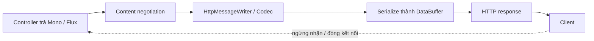

# Tuần tự hóa phản hồi theo luồng và giới hạn đệm

Trong chương **Ứng dụng Web**, bài học này giải thích cách Spring WebFlux biến dữ liệu reactive thành HTTP response, cách chọn định dạng cho phản hồi nhiều phần tử và cách giới hạn bộ nhớ khi codec phải gom dữ liệu. Một controller trả về `Flux<T>` chưa tự động bảo đảm client nhận từng phần tử ngay khi có dữ liệu. Định dạng media type, encoder, cách ứng dụng kết hợp publisher và cấu hình bộ đệm đều ảnh hưởng đến hành vi truyền phản hồi.

Bài học thuộc module **REACTIVE_PROGRAMMING**. Module hướng dẫn: “Học tư duy reactive qua các luồng sự kiện bất đồng bộ, hợp đồng Publisher–Subscriber và cơ chế backpressure của Reactive Streams. Thực hành Mono, Flux, kết hợp toán tử, kiểm soát scheduler, xử lý lỗi và kiểm thử pipeline trong hệ sinh thái Java.” Vì vậy, ta cần thiết kế phản hồi sao cho dữ liệu được tuần tự hóa đúng hợp đồng HTTP, bộ nhớ có giới hạn và việc hủy subscription được truyền đến nguồn khi client ngừng nhận.

## 1. Từ Publisher đến HTTP response

Trong WebFlux, controller có thể trả về `Mono<T>`, `Flux<T>` hoặc một kiểu phản hồi khác được hỗ trợ. Framework đăng ký publisher, chuyển các phần tử thành byte thông qua codec và ghi byte vào response.



Các phần việc cần phân biệt:

- **Publisher** quyết định dữ liệu, tín hiệu và demand.
- **Content negotiation** chọn media type theo mapping của endpoint và header `Accept`.
- **Codec** chuyển đối tượng Java thành byte theo định dạng đã chọn.
- **HTTP server** ghi byte vào kết nối và điều phối việc ghi.
- **Client** tiêu thụ response; nếu client đóng kết nối, quá trình ghi có thể bị hủy và cancellation truyền ngược qua pipeline.

Do đó, muốn xác nhận phản hồi streaming, hãy kiểm tra cả kiểu publisher, media type, codec thực tế và cách client đọc response. Chỉ nhìn chữ ký `Flux<T>` là chưa đủ.

## 2. Phân biệt response đơn, collection và stream

Ba kiểu khai báo sau có ý nghĩa khác nhau:

```java
Mono<OrderView> oneOrder();

Mono<List<OrderView>> allOrdersAsOneResult();

Flux<OrderView> ordersAsAStream();
```

- `Mono<OrderView>` biểu diễn tối đa một đối tượng.
- `Mono<List<OrderView>>` biểu diễn một kết quả duy nhất là danh sách; ứng dụng thường phải gom các phần tử trước khi phát danh sách.
- `Flux<OrderView>` biểu diễn nhiều phần tử được phát theo thời gian.

Ví dụ, `collectList()` chuyển `Flux<T>` thành `Mono<List<T>>` và giữ tất cả phần tử cho đến khi nguồn hoàn tất:

```java
Mono<List<OrderView>> snapshot =
    orderService.findAll()
        .map(OrderView::from)
        .collectList();
```

Cách này phù hợp khi API cần một JSON array hoàn chỉnh và kích thước tập dữ liệu có giới hạn. Với hàng triệu bản ghi hoặc một nguồn không bao giờ hoàn tất, việc gom toàn bộ sẽ giữ bộ nhớ tăng theo số phần tử và có thể không bao giờ phát kết quả.

Nếu client cần xử lý từng bản ghi khi nó đến, hãy giữ dữ liệu ở dạng `Flux` và chọn một định dạng phản hồi hỗ trợ streaming.

## 3. Chọn media type cho dữ liệu nhiều phần tử

Media type không chỉ là nhãn mô tả nội dung. Nó ảnh hưởng cách encoder đóng khung và phát dữ liệu.

| Media type | Hình dạng dữ liệu | Phù hợp khi |
|---|---|---|
| `application/json` | Một tài liệu JSON, thường là object hoặc array | Response hữu hạn cần được hiểu như một tài liệu hoàn chỉnh |
| `application/x-ndjson` | Mỗi dòng là một JSON value độc lập | Client xử lý bản ghi tuần tự, theo từng dòng |
| `application/stream+json` | Chuỗi JSON value được phát theo định dạng streaming của Spring codec | Cần truyền các JSON value liên tiếp theo hỗ trợ của client |
| `text/event-stream` | Các sự kiện SSE với trường `data`, `id`, `event` và dấu phân cách | Server đẩy sự kiện đến trình duyệt hoặc client SSE |

Đối với `application/json`, client mong đợi một tài liệu JSON hoàn chỉnh. Tùy encoder và cấu hình, một `Flux<T>` có thể được gom thành collection rồi tuần tự hóa thành JSON array. Điều này có nghĩa response có thể phải đợi nguồn hoàn tất trước khi encoder tạo tài liệu cuối cùng.

Với media type streaming được codec hỗ trợ, encoder có thể tuần tự hóa và flush từng phần tử. Các phần tử được gửi theo thời gian mà không cần gom toàn bộ thành một collection. Hãy xác minh media type và hành vi của phiên bản Spring đang dùng; không giả định mọi media type JSON đều có cùng cách đóng khung.

### NDJSON: một JSON value trên mỗi dòng

NDJSON hữu ích cho export, log hoặc danh sách sự kiện mà client muốn xử lý từng dòng:

```java
@GetMapping(
    value = "/orders/export",
    produces = "application/x-ndjson"
)
public Flux<OrderExportRow> exportOrders() {
    return orderService.findAll()
        .map(OrderExportRow::from);
}
```

Một response minh họa:

```text
{"id":"O-101","status":"PAID"}
{"id":"O-102","status":"PENDING"}
{"id":"O-103","status":"SHIPPED"}
```

Mỗi dòng là một JSON document độc lập. Client có thể parse và xử lý dòng đầu tiên trước khi dòng cuối được gửi. Cần cấu hình và kiểm tra codec hỗ trợ media type NDJSON tương ứng; nếu dùng media type khác, hai phía phải thống nhất cùng định dạng.

### Server-Sent Events: phát sự kiện có khung giao thức

SSE dùng `text/event-stream`. Spring WebFlux có thể tuần tự hóa `ServerSentEvent<T>` thành các trường sự kiện:

```java
@GetMapping(
    value = "/orders/events",
    produces = MediaType.TEXT_EVENT_STREAM_VALUE
)
public Flux<ServerSentEvent<OrderEvent>> events() {
    return orderEventService.events()
        .map(event -> ServerSentEvent.builder(event)
            .id(event.id())
            .event("order-update")
            .build());
}
```

Một sự kiện SSE trên dây có dạng:

```text
id: 42
event: order-update
data: {"orderId":"O-101","status":"PAID"}

```

Dấu dòng trống kết thúc một sự kiện. Trình duyệt có thể nhận sự kiện mới khi nó được phát, thay vì chờ toàn bộ luồng kết thúc. Với luồng dài hạn, hãy thiết kế heartbeat, chính sách reconnect và cách client xử lý sự kiện trùng hoặc bị bỏ lỡ.

## 4. Không gom stream nếu mục tiêu là truyền từng phần tử

Một lỗi thường gặp là chuyển `Flux` thành danh sách trước khi trả response:

```java
@GetMapping("/events")
public Mono<List<Event>> events() {
    return eventService.stream()
        .collectList();
}
```

Đây là response dạng collection. Framework chỉ có danh sách sau khi publisher hoàn tất, nên không phù hợp với nguồn liên tục hoặc tập dữ liệu lớn.

Nếu muốn streaming, trả trực tiếp publisher và khai báo media type streaming:

```java
@GetMapping(
    value = "/events",
    produces = "application/x-ndjson"
)
public Flux<Event> events() {
    return eventService.stream();
}
```

Tránh các thao tác làm mất tính streaming như `collectList()`, `reduce` thành một collection lớn, hoặc tự đọc toàn bộ body vào một mảng byte trước khi trả response. Những thao tác tổng hợp vẫn có ích khi nghiệp vụ thực sự cần một kết quả duy nhất, nhưng chúng thay đổi yêu cầu bộ nhớ và thời điểm response có thể bắt đầu.

## 5. Giới hạn bộ nhớ của codec với maxInMemorySize

Codec đôi khi phải gom dữ liệu vào bộ nhớ trước khi giải mã hoặc mã hóa. Ví dụ: đọc một JSON document lớn, giải mã một giá trị cần buffer, hoặc gom nhiều phần tử để tạo một JSON array không streaming. Nếu không có giới hạn, một request lớn hoặc nhiều request đồng thời có thể tiêu thụ lượng heap không kiểm soát.

Trong Spring WebFlux, có thể cấu hình giới hạn bộ nhớ cho các codec mặc định bằng `maxInMemorySize`:

```java
@Configuration
public class WebFluxCodecConfiguration
        implements WebFluxConfigurer {

    @Override
    public void configureHttpMessageCodecs(
            ServerCodecConfigurer configurer) {
        configurer.defaultCodecs()
            .maxInMemorySize(512 * 1024);
    }
}
```

Ví dụ đặt giới hạn 512 KiB cho các thao tác codec cần buffer. Giá trị thực tế cần dựa trên kích thước payload hợp lệ, số request đồng thời và ngân sách heap của ứng dụng.

Khi dữ liệu cần được buffer vượt giới hạn, codec có thể phát `DataBufferLimitException`. Đây là tín hiệu cho biết thao tác buffering vượt ngưỡng cấu hình; nó không có nghĩa mọi response lớn hơn giới hạn đều thất bại. Một stream được mã hóa và ghi từng phần tử có thể không cần giữ toàn bộ response trong bộ nhớ, trong khi một object hoặc phần tử đơn lẻ quá lớn vẫn có thể vượt giới hạn buffer.

### Giới hạn này không phải giới hạn tổng kích thước response

Cần phân biệt:

- `maxInMemorySize` giới hạn việc codec buffer dữ liệu trong bộ nhớ ở những đường xử lý có buffering.
- Nó không phải quota tổng số byte mà endpoint được phép gửi trong toàn bộ vòng đời.
- Nó không phải kích thước tối đa của TCP packet hay HTTP chunk.
- Nó không tự giới hạn số phần tử trong một `Flux`.

Nếu cần giới hạn tổng số bản ghi, dùng toán tử như `take(n)` hoặc phân trang theo nghiệp vụ. Nếu cần giới hạn tổng byte, phải thiết kế quota/stream accounting ở tầng ứng dụng hoặc gateway phù hợp.

## 6. Tính bộ nhớ theo kích thước phần tử và số request

Giả sử mỗi response phải gom trung bình 400 KiB dữ liệu trước khi tuần tự hóa, và có 100 request như vậy đang hoạt động. Riêng phần dữ liệu được gom có thể cần khoảng:

[
400 	ext{KiB} 	imes 100 = 40{,}000 	ext{KiB}
]

Con số này chưa bao gồm object overhead, buffer trung gian, bản sao khi serialize, bộ nhớ của server và các request khác. Khi response lớn, số request đồng thời có thể quan trọng hơn kích thước của một request riêng lẻ.

Một cách giảm áp lực heap là:

- Dùng NDJSON hoặc SSE khi client có thể xử lý từng phần tử.
- Phân trang dữ liệu khi API không cần truyền toàn bộ tập kết quả.
- Tránh `collectList()` cho tập dữ liệu không có giới hạn rõ ràng.
- Đặt `maxInMemorySize` theo ngân sách và payload hợp lệ.
- Theo dõi heap, allocation rate, số request đang ghi và kích thước response.
- Giới hạn concurrency ở nguồn hoặc service nếu việc tạo dữ liệu có chi phí cao.

Không nên tăng `maxInMemorySize` chỉ để làm một request lỗi biến mất. Trước tiên hãy xác định codec đang buffer phần nào, kích thước hợp lệ là bao nhiêu và liệu API có thể chuyển sang streaming hoặc phân trang hay không.

## 7. Backpressure và ghi response

Reactive Streams cho phép downstream yêu cầu số phần tử theo demand. Trong WebFlux, quá trình ghi response có thể điều phối việc tiêu thụ publisher theo khả năng ghi của server và các buffer trung gian.

Tuy nhiên, backpressure không có nghĩa toàn bộ đường truyền không có buffer. Dữ liệu có thể được giữ ở codec, HTTP server, socket, kernel, proxy hoặc client. Một proxy có thể buffer response và khiến client không nhìn thấy từng phần tử ngay cả khi ứng dụng phát chúng theo thời gian.

Khi thiết kế streaming:

- Giữ mỗi phần tử ở kích thước hợp lý.
- Không tạo trước một danh sách vô hạn trong bộ nhớ.
- Kiểm tra buffer ở reverse proxy và gateway.
- Không đặt `Content-Length` cố định nếu tổng kích thước chưa biết trước.
- Quan sát tốc độ phát từ nguồn và tốc độ ghi ra mạng.
- Có timeout và chính sách xử lý client chậm.

Với HTTP/1.1, server có thể dùng cơ chế truyền từng chunk khi không biết trước Content-Length; HTTP/2 dùng các DATA frame theo giao thức của nó. Ứng dụng thường không cần tự tạo chunk hoặc tự đặt header truyền tải. Hãy để server quản lý framing HTTP phù hợp.

Backpressure giúp điều phối nhu cầu giữa các publisher, nhưng không thay thế giới hạn tài nguyên, timeout, quota hay chính sách xử lý client quá chậm.

## 8. Flush và độ trễ khi gửi từng sự kiện

Streaming chỉ hữu ích nếu dữ liệu được flush đến client theo nhịp mong muốn. Một số encoder hoặc server flush từng phần tử với media type streaming. Với SSE, mỗi sự kiện được đóng khung và flush để client nhận sớm. Với NDJSON, client có thể đọc từng dòng khi byte tương ứng đã được gửi.

Tuy nhiên, proxy, CDN, compression middleware hoặc client library có thể gom dữ liệu trước khi chuyển tiếp. Vì vậy, khi kiểm tra latency của stream, hãy đo ở cả server và client. Một test chỉ xác nhận controller phát ba phần tử không chứng minh trình duyệt nhận chúng thành ba lần riêng biệt.

Không nên flush quá thường xuyên với các phần tử rất nhỏ và tần suất cao nếu điều đó làm tăng overhead. Hãy chọn kích thước batch và nhịp phát phù hợp với độ trễ mục tiêu, thông lượng và chi phí mạng. Nếu cần nhóm sự kiện trước khi gửi, dùng batching có giới hạn thay vì buffer vô hạn.

## 9. Xử lý lỗi sau khi response đã bắt đầu

Một response streaming có thể đã gửi status và một số byte trước khi nguồn phát `onError`. Khi response đã commit, server thường không thể thay đổi status code hoặc thay toàn bộ body bằng một JSON error envelope mới.

Ví dụ: client đã nhận hai dòng NDJSON rồi nguồn gặp lỗi ở phần tử thứ ba. Server không thể quay lại và biến response đã gửi thành HTTP 500 với một tài liệu JSON hoàn chỉnh. Client có thể nhận stream bị kết thúc sớm và cần biết cách phát hiện dữ liệu chưa đầy đủ.

Với SSE, ứng dụng có thể biểu diễn một lỗi nghiệp vụ như một event có tên `error` nếu hợp đồng API cho phép, rồi hoàn tất stream. Đây là dữ liệu ở cấp giao thức ứng dụng, không thay thế lỗi transport hoặc lỗi server đã xảy ra sau khi response commit.

Cần xác định trước:

- Lỗi nào có thể được chuyển thành một phần tử/event lỗi.
- Lỗi nào phải kết thúc stream ngay.
- Client nhận biết stream hoàn tất bình thường hay bị cắt giữa chừng ra sao.
- Có thể reconnect và tiếp tục từ event ID hoặc cursor nào.
- Dữ liệu đã nhận trước lỗi có cần idempotent khi phát lại không.

Đừng dùng `onErrorResume` để âm thầm biến mọi lỗi thành một stream rỗng nếu client cần phân biệt dữ liệu đầy đủ với dữ liệu bị thiếu.

## 10. Cancellation khi client ngắt kết nối

Khi client đóng kết nối hoặc hủy việc đọc response, server có thể hủy subscription vào publisher nguồn. Pipeline cần tôn trọng cancellation để dừng truy vấn, giải phóng cursor, đóng file và dừng các tác vụ không còn cần thiết.

Ví dụ, một nguồn đọc dữ liệu lớn nên gắn cleanup vào vòng đời:

```java
Flux<Row> exportRows() {
    return databaseClient.sql("SELECT * FROM orders")
        .map(this::toRow)
        .all()
        .doFinally(signal ->
            log.debug("Export kết thúc: {}", signal)
        );
}
```

`doFinally` quan sát các tín hiệu kết thúc như complete, error hoặc cancel. Nếu dùng API tài nguyên thủ công, hãy bảo đảm tài nguyên được đóng khi subscription bị hủy; ưu tiên các abstraction reactive có quản lý vòng đời như publisher từ driver hoặc `usingWhen` khi phù hợp.

Không phải mọi I/O bên dưới đều có thể dừng tức thì. Một tác vụ blocking đang chạy có thể không phản hồi cancellation ngay. Vì vậy, ngoài việc truyền cancellation, hãy đặt timeout và dùng client/driver có hỗ trợ hủy tác vụ.

## 11. Kiểm thử response streaming bằng WebTestClient

Khi kiểm thử response dạng stream, tránh `expectBodyList` nếu mục tiêu là xác nhận dữ liệu đến từng phần tử. Phương thức đó gom body thành danh sách và kiểm tra một kết quả đã aggregate.

Có thể lấy response body dưới dạng `Flux` bằng `returnResult`:

```java
FluxExchangeResult<OrderEvent> result =
    webTestClient.get()
        .uri("/orders/events")
        .accept(MediaType.APPLICATION_NDJSON)
        .exchange()
        .expectStatus().isOk()
        .expectHeader()
        .contentTypeCompatibleWith(MediaType.APPLICATION_NDJSON)
        .returnResult(OrderEvent.class);

StepVerifier.create(result.getResponseBody())
    .expectNextMatches(event -> event.id().equals("O-101"))
    .expectNextMatches(event -> event.id().equals("O-102"))
    .thenCancel()
    .verify();
```

Test này kiểm tra response có đúng status, media type và body publisher phát các phần tử mong đợi. `thenCancel()` mô phỏng subscriber ngừng nhận sau hai phần tử; với nguồn có thể quan sát cancellation, hãy xác nhận tài nguyên upstream được giải phóng.

Có thể kiểm tra lỗi do vượt giới hạn buffer bằng một test integration cấu hình codec với ngưỡng nhỏ rồi gửi payload lớn hơn ngưỡng. Hãy xác định rõ test đang kiểm tra request decoding hay response encoding, vì cấu hình và đường codec được kích hoạt có thể khác nhau.

Với SSE, kiểm tra `text/event-stream`, event ID, event name và dữ liệu. Nếu yêu cầu là độ trễ giữa các sự kiện, cần kiểm tra thời điểm nhận từng sự kiện bằng cơ chế thời gian phù hợp; chỉ kiểm tra danh sách cuối cùng không chứng minh response được flush theo thời gian.

## 12. Quy trình thiết kế và chẩn đoán

Khi một endpoint trả dữ liệu lớn hoặc liên tục, hãy thực hiện theo thứ tự:

1. **Xác định hợp đồng response.** Client cần một JSON document, NDJSON record, SSE event hay một định dạng khác?
2. **Kiểm tra kiểu publisher.** Endpoint trả một giá trị, collection đã gom hay một stream nhiều phần tử?
3. **Kiểm tra codec và media type.** Encoder có hỗ trợ streaming cho media type đã chọn không? Có aggregation hay không?
4. **Kiểm tra giới hạn bộ nhớ.** Xác định `maxInMemorySize`, kích thước phần tử và số request đồng thời.
5. **Kiểm tra các bước aggregate.** Tìm `collectList()`, `reduce`, `join` hoặc thao tác chuyển toàn bộ body thành byte array.
6. **Quan sát việc flush.** Kiểm tra server, proxy, compression và client có buffer dữ liệu hay không.
7. **Kiểm tra cancellation và lỗi.** Ngắt client giữa stream, làm nguồn phát lỗi sau vài phần tử và xác nhận cleanup.
8. **Đo dưới tải.** Theo dõi heap, số buffer, connection, latency phần tử đầu tiên và tốc độ tiêu thụ.

Các phép đo nên phân biệt thời gian đến phần tử đầu tiên, khoảng cách giữa các phần tử, tổng thời gian hoàn tất và tổng byte. Một endpoint có tổng thời gian nhanh nhưng phần tử đầu tiên đến rất muộn có thể đang buffer toàn bộ response.

## 13. Những lỗi thường gặp

- **Cho rằng `Flux<T>` luôn được gửi streaming.** Hành vi còn phụ thuộc media type và codec.
- **Dùng `collectList()` cho nguồn lớn hoặc vô hạn.** Toàn bộ phần tử phải được giữ trước khi phát danh sách.
- **Dùng `application/json` khi client cần xử lý từng record ngay.** Hãy cân nhắc NDJSON hoặc SSE nếu phù hợp với hợp đồng.
- **Tăng `maxInMemorySize` mà không hiểu nguyên nhân.** Giới hạn cao hơn làm tăng ngân sách bộ nhớ có thể tiêu thụ trên mỗi request.
- **Coi `maxInMemorySize` là giới hạn tổng response.** Nó giới hạn buffering của codec, không giới hạn toàn bộ byte stream.
- **Bỏ qua proxy buffering.** Ứng dụng có thể phát từng phần tử nhưng proxy gom lại trước khi gửi đến client.
- **Cho rằng HTTP status có thể đổi sau khi gửi phần đầu body.** Response đã commit không thể được thay bằng một status/error document mới.
- **Không xử lý cancellation.** Client rời đi mà nguồn vẫn tiếp tục đọc database hoặc giữ tài nguyên.
- **Chỉ test bằng body đã aggregate.** Test cần đọc response body dạng Flux nếu muốn xác nhận hành vi streaming.

## 14. Bài tập vận dụng

Một API xuất dữ liệu đơn hàng có thể trả hàng trăm nghìn bản ghi. Hiện tại controller gọi `collectList()`, trả `application/json`, và đôi lúc gặp `DataBufferLimitException` khi có nhiều request đồng thời.

Hãy thiết kế lại endpoint theo hai hợp đồng:

1. Một endpoint snapshot hữu hạn trả JSON array có giới hạn kích thước và có phân trang.
2. Một endpoint export trả NDJSON để client xử lý từng bản ghi khi nhận được.

Với mỗi endpoint, hãy giải thích media type, kiểu publisher, thời điểm bắt đầu gửi, hành vi khi nguồn lỗi giữa chừng và cách client phát hiện dữ liệu không đầy đủ. Cấu hình `maxInMemorySize` theo ngân sách hợp lý; không dùng việc tăng giới hạn như cách duy nhất để xử lý một tập dữ liệu không giới hạn.

Tiếp theo, viết test bằng `WebTestClient` để xác nhận content type, thứ tự bản ghi, cancellation sau một vài phần tử và trường hợp buffer vượt giới hạn. Thử chạy qua proxy hoặc môi trường gần production để xác định liệu dữ liệu có được flush đến client theo từng phần hay bị buffer ở tầng trung gian.

Một response reactive tốt cần có hợp đồng định dạng rõ ràng, cách truyền dữ liệu phù hợp với kích thước và tốc độ nguồn, giới hạn bộ nhớ có chủ đích và hành vi xác định khi client chậm, hủy kết nối hoặc nguồn phát lỗi.
