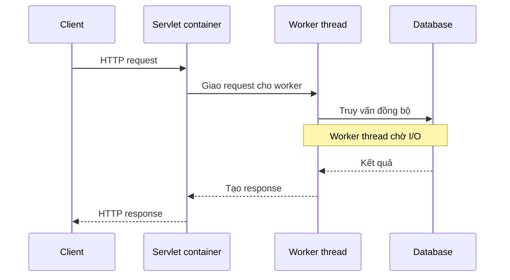
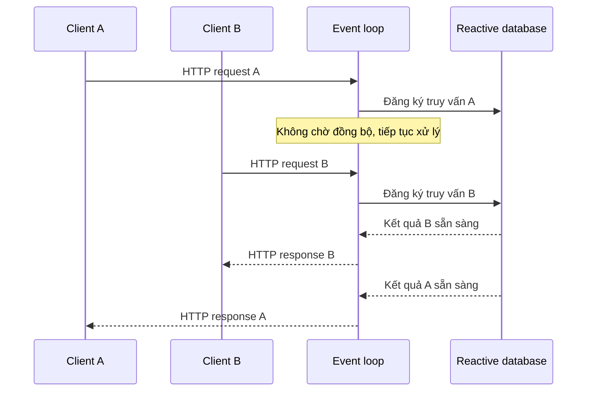

# Lựa chọn WebFlux hoặc mô hình Web chặn theo đặc điểm tải

## Chọn mô hình xử lý theo loại công việc của ứng dụng

Khi xây dựng API Java, câu hỏi nên dùng Spring WebFlux hay mô hình Web chặn như Spring MVC trên Servlet thường được đặt ra như một lựa chọn về framework. Thực chất, đây là quyết định về cách ứng dụng sử dụng thread, chờ I/O, quản lý tải đồng thời và tổ chức các tầng truy cập dữ liệu.

Mô hình Web chặn thường gắn với cách xử lý mỗi request trên một thread worker: thread gọi database hoặc dịch vụ khác, chờ kết quả rồi tiếp tục tạo response. Cách này dễ hiểu, phù hợp với thư viện JDBC/JPA và nhiều hệ thống nghiệp vụ vốn được thiết kế theo kiểu đồng bộ. Khi request chờ I/O lâu, thread worker vẫn bị giữ trong thời gian chờ.

Spring WebFlux được thiết kế cho xử lý bất đồng bộ và non-blocking. Với server dựa trên event loop, một số ít thread có thể điều phối nhiều kết nối đang chờ I/O. Các tầng trong pipeline trả về `Mono` hoặc `Flux`, cho phép nối các thao tác mà không phải giữ một thread riêng cho toàn bộ thời gian chờ. Mô hình này phù hợp khi ứng dụng có nhiều I/O bất đồng bộ, cần streaming hoặc cần xử lý nhiều kết nối đồng thời với lượng thread hữu hạn.

Không có mô hình nào luôn nhanh hơn. Một ứng dụng chủ yếu dùng JDBC/JPA đồng bộ có thể vận hành đơn giản và hiệu quả với Spring MVC. Một gateway gọi nhiều dịch vụ non-blocking hoặc một API phát sự kiện liên tục có thể tận dụng WebFlux tốt hơn. Lựa chọn nên dựa trên toàn bộ đường đi của request, bao gồm server, client HTTP, driver cơ sở dữ liệu, thư viện nghiệp vụ và cách vận hành.

## Hai mô hình xử lý request

### Thread-per-request trong mô hình Web chặn

Trong mô hình Servlet truyền thống, container nhận request rồi phân công cho một thread worker. Thread đó chạy controller, gọi service, truy cập database hoặc dịch vụ bên ngoài, rồi ghi response. Khi lời gọi JDBC hoặc HTTP đồng bộ chờ kết quả, thread vẫn ở trạng thái chờ và không thể xử lý một request khác trong khoảng thời gian đó.



Khi số request đồng thời tăng, container cần đủ worker để phục vụ request. Nếu tất cả worker đang chờ database hoặc dịch vụ bên ngoài, request mới phải đợi trong hàng đợi hoặc bị từ chối theo cấu hình. Tăng thread pool có thể tăng số request được tiếp nhận, nhưng cũng làm tăng bộ nhớ stack, chi phí lập lịch, context switching và áp lực lên database connection pool.

Ưu điểm của mô hình này là luồng điều khiển tuần tự, dễ gỡ lỗi và tương thích với hệ sinh thái blocking phong phú. Với JDBC, JPA/Hibernate và các thư viện chỉ có API đồng bộ, việc giữ mô hình đồng bộ thường tránh được chi phí chuyển đổi không cần thiết.

### Event loop trong WebFlux non-blocking

WebFlux có thể chạy trên runtime non-blocking như Reactor Netty. Event loop nhận sự kiện I/O, gọi các callback khi socket sẵn sàng và điều phối pipeline. Một thread event loop không nên bị giữ trong thời gian chờ database hoặc dịch vụ bên ngoài; thay vào đó, thao tác non-blocking đăng ký công việc rồi trả quyền điều khiển để event loop xử lý kết nối khác.



Trong thời gian truy vấn A chờ database, event loop vẫn có thể nhận request B hoặc xử lý tín hiệu khác. Khi kết quả có sẵn, callback được đưa về pipeline để tiếp tục. Nhiều request có thể cùng tiến triển mà không cần một thread bị giữ riêng cho mỗi request đang chờ I/O.

WebFlux không đồng nghĩa mọi thao tác đều chạy trên một thread, cũng không đồng nghĩa toàn bộ ứng dụng tự động song song. Các scheduler, client và toán tử có thể chuyển công việc sang worker khác. Điều cốt yếu là các thao tác I/O trên đường xử lý không chặn thread điều phối trong lúc chờ.

## WebFlux không loại bỏ thread; nó thay đổi cách dùng thread

Ứng dụng WebFlux vẫn sử dụng thread để chạy mã Java. Event loop xử lý các đoạn công việc ngắn; scheduler có thể chạy tác vụ CPU hoặc blocking được cô lập; client và driver có thể có pool riêng. Lợi ích non-blocking đến từ việc không giữ thread chỉ để chờ I/O.

Một request WebFlux có thể đi qua nhiều callback và worker trong suốt vòng đời. Vì vậy, không nên dựa vào giả định thread cố định, dùng `ThreadLocal` làm nơi lưu metadata request hoặc thực hiện thao tác blocking trong callback event loop. Dùng Reactor `Context` cho metadata theo subscription và chọn scheduler đúng loại công việc.

Nếu gọi `block()` trên một pipeline từ event loop, hoặc gọi JDBC/JPA trực tiếp trong `map`, `flatMap` hay controller WebFlux, thread điều phối có thể bị chặn. Chỉ cần một số ít thao tác blocking kéo dài cũng có thể làm giảm khả năng phục vụ của event loop và ảnh hưởng nhiều request cùng lúc.

## So sánh theo đặc điểm tải

| Đặc điểm | Spring MVC / mô hình Web chặn | Spring WebFlux / mô hình non-blocking |
|---|---|---|
| Kiểu xử lý phổ biến | Một request chạy trên worker thread; lời gọi đồng bộ giữ thread khi chờ | Pipeline bất đồng bộ; thread không bị giữ chỉ để chờ I/O non-blocking |
| I/O database | JDBC/JPA phù hợp tự nhiên | Nên dùng driver reactive như R2DBC nếu muốn đường đi non-blocking |
| Gọi dịch vụ HTTP | Client blocking dễ tích hợp | WebClient hoặc client non-blocking phù hợp |
| Nhiều request đang chờ I/O | Cần đủ worker hoặc async request handling; thread pool có giới hạn | Có thể quản lý nhiều kết nối đang chờ với số event-loop thread nhỏ hơn |
| Tính toán CPU nặng | Dùng worker/executor riêng nếu cần | Cũng cần giới hạn scheduler CPU; event loop không được chạy phép tính dài |
| Streaming | Có hỗ trợ streaming và async tùy API/container | `Flux`, SSE, streaming response và WebSocket là trường hợp sử dụng tự nhiên |
| Độ phức tạp | Luồng điều khiển đồng bộ quen thuộc | Cần hiểu subscription, cancellation, backpressure, scheduler và context |
| Thư viện blocking hiện có | Tích hợp trực tiếp | Phải cô lập blocking hoặc thay bằng client/driver non-blocking |
| Kiểm thử và gỡ lỗi | Thường theo call stack đồng bộ | Cần theo dõi tín hiệu bất đồng bộ, context và ranh giới scheduler |

## Khi mô hình Web chặn là lựa chọn hợp lý

Spring MVC thường là lựa chọn phù hợp khi phần lớn request có các đặc điểm sau:

- Nghiệp vụ chủ yếu gọi JDBC/JPA hoặc SDK đồng bộ.
- Tải đồng thời ở mức mà worker thread và connection pool có thể phục vụ ổn định.
- Request là thao tác ngắn, trả về một response hữu hạn, ít nhu cầu streaming.
- Đội ngũ và hệ thống hiện tại đã có cách vận hành, quan sát và kiểm thử đồng bộ hiệu quả.
- Chi phí chuyển toàn bộ tầng dữ liệu và service sang reactive không mang lại lợi ích đo được.

Ví dụ controller MVC gọi service đồng bộ:

```java
@RestController
class OrderController {
    private final OrderService orderService;

    OrderController(OrderService orderService) {
        this.orderService = orderService;
    }

    @GetMapping("/orders/{id}")
    OrderView find(@PathVariable String id) {
        return orderService.findById(id);
    }
}
```

Controller trả về đối tượng kết quả. Service có thể gọi repository JDBC/JPA theo cách đồng bộ, giữ call stack tuyến tính. Nếu thời gian truy vấn và tải được kiểm soát, mô hình này dễ vận hành và không cần thêm độ phức tạp reactive.

Spring MVC cũng hỗ trợ asynchronous request processing thông qua các kiểu như `Callable`, `DeferredResult` hoặc `CompletionStage`. Điều đó có thể giải phóng servlet request thread trong khi chờ kết quả bất đồng bộ. Tuy nhiên, nó không tự biến lời gọi JDBC/JPA blocking thành non-blocking; nếu công việc được chuyển sang một executor khác rồi chặn ở đó, tài nguyên thread vẫn bị sử dụng. Cần đánh giá đúng API và executor thực tế thay vì chỉ nhìn kiểu trả về của controller.

## Khi WebFlux có lợi thế rõ ràng

WebFlux thường đáng cân nhắc khi:

- Một request tổng hợp dữ liệu từ nhiều dịch vụ non-blocking và có nhiều I/O đang chờ đồng thời.
- Ứng dụng làm gateway, proxy hoặc API composition với lượng kết nối đồng thời lớn.
- Dữ liệu được phát liên tục qua SSE, WebSocket hoặc streaming HTTP.
- Pipeline cần truyền dữ liệu theo luồng, tránh thu toàn bộ kết quả vào một danh sách lớn.
- Các tầng quan trọng đều có client và driver non-blocking, cho phép giữ đường đi non-blocking từ server đến dependency.
- Hệ thống cần quản lý demand và cancellation xuyên qua các publisher để dừng công việc không còn cần thiết.

Ví dụ controller WebFlux kết hợp hai nguồn reactive:

```java
import reactor.core.publisher.Mono;

@RestController
class ReactiveOrderController {
    private final ReactiveOrderService orderService;

    ReactiveOrderController(ReactiveOrderService orderService) {
        this.orderService = orderService;
    }

    @GetMapping("/reactive/orders/{id}")
    Mono<OrderView> find(@PathVariable String id) {
        return orderService.findView(id);
    }
}

class ReactiveOrderService {
    private final ReactiveOrderRepository orders;
    private final WebClient inventoryClient;

    Mono<OrderView> findView(String id) {
        return orders.findById(id)
            .flatMap(order -> inventoryClient.get()
                .uri("/inventory/{sku}", order.sku())
                .retrieve()
                .bodyToMono(Inventory.class)
                .map(inventory -> new OrderView(order, inventory)));
    }
}
```

Ví dụ giả định repository sử dụng driver reactive và `WebClient` thực hiện HTTP non-blocking. Controller trả `Mono<OrderView>` để server đăng ký và ghi response khi kết quả sẵn sàng. Không cần gọi `block()` để lấy `OrderView` trong controller; làm vậy sẽ phá vỡ lợi ích của pipeline và có thể chặn event loop.

Với response nhiều phần tử, controller có thể trả `Flux<T>` để streaming. Cần quyết định định dạng và semantics HTTP phù hợp, chẳng hạn JSON array, NDJSON hoặc Server-Sent Events. Nếu dùng `collectList()` trước khi trả response, ứng dụng lại thu toàn bộ phần tử vào bộ nhớ và mất lợi ích phát từng phần.

## Trường hợp hỗn hợp: WebFlux nhưng còn dependency blocking

Không phải hệ thống nào cũng có thể thay JDBC/JPA hoặc SDK blocking ngay lập tức. Có thể tích hợp tạm thời bằng cách cô lập thao tác blocking trên `Schedulers.boundedElastic()`:

```java
import reactor.core.publisher.Mono;
import reactor.core.scheduler.Schedulers;

Mono<LegacyOrder> findLegacyOrder(String id) {
    return Mono.fromCallable(() -> legacyJpaRepository.findById(id)
            .orElseThrow(() -> new OrderNotFoundException(id)))
        .subscribeOn(Schedulers.boundedElastic());
}
```

`fromCallable` trì hoãn lời gọi JPA đến khi có subscription. `subscribeOn(boundedElastic())` đưa thao tác blocking sang pool được thiết kế để cô lập công việc chặn, tránh chạy trực tiếp trên event loop. Tuy nhiên, lời gọi JPA vẫn giữ một worker trong suốt thời gian truy vấn. Pool có giới hạn; khi quá nhiều thao tác blocking cùng chờ, chúng có thể xếp hàng và làm tăng độ trễ.

Đây là cầu nối hữu ích trong quá trình chuyển đổi hoặc khi một thư viện blocking không thể thay thế. Nó không tạo ra đường đi non-blocking hoàn toàn. Nếu hầu hết request đều gọi JDBC/JPA blocking, lợi ích của WebFlux có thể bị giảm đáng kể trong khi ứng dụng phải quản lý thêm scheduler và ranh giới reactive.

Không gọi phương thức blocking trực tiếp trong pipeline:

```java
// Không nên: lời gọi JDBC/JPA chạy ngay trên thread phát tín hiệu.
Mono<Order> unsafe = orderRepository.findById(id);

// Nên: trì hoãn và cô lập thao tác blocking.
Mono<Order> isolated = Mono.fromCallable(() -> blockingRepository.findById(id))
    .subscribeOn(Schedulers.boundedElastic());
```

Trong mã thật, `orderRepository` ở ví dụ đầu cần là repository blocking để thấy rõ vấn đề. Một repository reactive trả `Mono<Order>` không cần được bọc bằng `fromCallable` hay chuyển sang `boundedElastic` chỉ vì nó truy cập database.

## Java virtual threads ảnh hưởng thế nào đến quyết định?

Với Java 21 trở lên, virtual threads có thể làm mô hình thread-per-request dễ mở rộng hơn cho workload blocking, vì chi phí mỗi thread chờ I/O thấp hơn platform thread truyền thống trong nhiều tình huống. Spring MVC và các thư viện blocking có thể hưởng lợi nếu runtime và cấu hình ứng dụng hỗ trợ virtual threads.

Virtual threads không làm JDBC/JPA trở thành reactive non-blocking, không tự tạo backpressure trong toàn bộ dependency chain và không loại bỏ giới hạn của database connection pool. Nếu 5.000 request cùng chờ nhưng database chỉ phục vụ được 100 connection, giới hạn database vẫn là nút thắt. Virtual threads giúp quản lý nhiều tác vụ chờ hiệu quả hơn, nhưng không tăng năng lực xử lý của hệ thống đích.

Vì vậy, sự xuất hiện của virtual threads làm cho mô hình Web chặn trở thành lựa chọn cạnh tranh hơn trong nhiều ứng dụng I/O-bound dùng thư viện đồng bộ. Quyết định vẫn cần dựa vào khả năng của driver, nhu cầu streaming, tải đồng thời, độ trễ và chi phí vận hành. Không nên chuyển sang WebFlux chỉ vì muốn có nhiều request đồng thời nếu virtual-thread MVC đã đáp ứng SLA và đơn giản hóa hệ thống.

## Backpressure và streaming trong WebFlux

Reactor dùng Reactive Streams để truyền demand giữa publisher và subscriber. Với `Flux`, downstream có thể yêu cầu dữ liệu theo nhu cầu; các toán tử trung gian phối hợp demand và có thể dùng prefetch hoặc buffer. Điều này hữu ích khi xử lý luồng dữ liệu lớn hoặc dài hạn.

Tuy nhiên, không nên hiểu rằng backpressure của Reactor tự động điều tiết toàn bộ mạng HTTP, reverse proxy, broker và database. Một số nguồn là push-based và không thể tạm dừng; server hoặc client có thể có buffer riêng; HTTP protocol và proxy có thể đệm dữ liệu. Nếu adapter nhận dữ liệu nhanh hơn downstream, cần chọn overflow strategy và giới hạn queue. Nếu response dùng `Flux`, vẫn phải quan sát buffer, kích thước phần tử và tốc độ ghi ra socket.

Ví dụ streaming sự kiện bằng SSE:

```java
import java.time.Duration;
import org.springframework.http.MediaType;
import reactor.core.publisher.Flux;

@GetMapping(value = "/events", produces = MediaType.TEXT_EVENT_STREAM_VALUE)
Flux<ServerEvent> events() {
    return eventService.streamEvents()
        .timeout(Duration.ofSeconds(30));
}
```

Ví dụ này giả định `eventService.streamEvents()` trả một `Flux` có thể phát sự kiện và có chính sách timeout phù hợp. Với luồng SSE dài hạn, timeout giữa các tín hiệu cần được cân nhắc: nếu không có sự kiện trong 30 giây nhưng nguồn vẫn hợp lệ, pipeline sẽ phát lỗi. Một lựa chọn khác là phát heartbeat hoặc dùng timeout theo yêu cầu nghiệp vụ.

Streaming phù hợp khi client cần nhận kết quả từng phần hoặc sự kiện liên tục. Nếu endpoint chỉ trả một danh sách nhỏ và hữu hạn, response JSON thông thường trong MVC có thể đơn giản hơn. WebFlux không làm một response nhỏ tự nhiên nhanh hơn chỉ vì nó dùng `Flux`.

## CPU-bound workload không tự hưởng lợi từ WebFlux

WebFlux giải quyết hiệu quả chờ I/O; nó không làm phép tính CPU nặng chạy nhanh hơn. Nếu controller thực hiện nén ảnh, mã hóa lớn, render tài liệu hoặc tính toán phức tạp ngay trên event loop, event loop bị giữ và nhiều request khác có thể bị ảnh hưởng.

Với tác vụ CPU-bound, hãy dùng scheduler CPU có giới hạn hoặc một worker pool riêng và kiểm soát concurrency. Nếu tác vụ có thể chạy nền lâu, cân nhắc đưa nó vào hàng đợi công việc và trả mã theo dõi thay vì giữ HTTP request mở. Cả MVC lẫn WebFlux đều cần chiến lược riêng cho CPU-bound work; chọn WebFlux không thay thế việc phân chia tải CPU.

## Những chi phí và rủi ro khi chọn WebFlux

WebFlux có thể tăng hiệu quả sử dụng thread trong workload I/O-bound, nhưng yêu cầu kỷ luật thiết kế cao hơn:

- Mọi thao tác blocking trên event loop có thể ảnh hưởng nhiều request cùng lúc.
- Driver reactive có thể có hành vi, giới hạn connection và mô hình transaction khác JDBC/JPA.
- Pipeline bất đồng bộ làm call stack khó theo dõi hơn; cần tracing, correlation ID và metric tốt.
- Cancellation phải được truyền đến client và resource thực tế; không phải API blocking nào cũng dừng được ngay.
- `flatMap` concurrency, prefetch và buffer cần được giới hạn để tránh tạo quá nhiều request hoặc dữ liệu chờ.
- Trạng thái theo request nên dùng Reactor Context hoặc context propagation tương thích, không dựa vào `ThreadLocal` cố định.
- Đội ngũ cần nắm `Mono`, `Flux`, demand, error recovery, scheduler và kiểm thử bằng Reactor Test.

Ngoài ra, WebFlux có thể chạy trên runtime khác nhau. Spring WebFlux hỗ trợ runtime non-blocking như Reactor Netty và cũng có thể chạy trên Servlet container tương thích. Vì vậy, không nên đồng nhất “WebFlux” với “Netty” trong mọi triển khai; cần kiểm tra runtime thực tế và cách server được cấu hình. Tương tự, Spring MVC không chỉ có một cách xử lý đồng bộ duy nhất vì nó có các cơ chế async request.

## Bảng quyết định theo workload

| Đặc điểm hệ thống | Hướng lựa chọn ban đầu | Lý do và điều kiện |
|---|---|---|
| CRUD nghiệp vụ, JDBC/JPA, request ngắn | Spring MVC | Phù hợp với driver đồng bộ và call stack dễ hiểu |
| Gateway gọi nhiều dịch vụ WebClient non-blocking | WebFlux | Có thể giữ request ở trạng thái chờ mà không giữ worker thread riêng |
| API SSE/WebSocket hoặc streaming liên tục | WebFlux thường thuận tiện | `Flux` và mô hình bất đồng bộ phù hợp với luồng dài hạn |
| Ứng dụng dùng nhiều SDK blocking | Spring MVC thường đơn giản hơn | Tránh phải cô lập blocking ở hầu hết các tầng |
| WebFlux nhưng chỉ một dependency blocking nhỏ | Có thể dùng WebFlux với boundedElastic tạm thời | Cần giới hạn pool và đo hàng đợi; không xem đây là non-blocking hoàn toàn |
| Tải I/O-bound lớn, driver và client đều non-blocking | WebFlux đáng thử nghiệm | Có cơ hội giảm số thread bị giữ trong thời gian chờ |
| Tác vụ chủ yếu CPU-bound | Không quyết định chỉ dựa vào MVC/WebFlux | Cần worker pool CPU, giới hạn concurrency và tách tác vụ nặng |
| Java 21+ và workload blocking phù hợp virtual threads | Đánh giá MVC với virtual threads | Có thể giữ mô hình imperative và giảm chi phí thread chờ |

## Đánh giá bằng benchmark thay vì suy đoán

Trước khi chuyển một hệ thống đang chạy từ MVC sang WebFlux, hãy lập mô hình tải gần với production. Cùng một endpoint có thể cho kết quả khác nhau tùy thời gian database, tỷ lệ cache hit, kích thước payload, số request đồng thời và giới hạn của dịch vụ phụ.

Một quy trình so sánh có thể thực hiện như sau:

1. **Chọn workload đại diện:** bao gồm request nhanh, request chờ I/O lâu, burst traffic, streaming nếu có và trường hợp lỗi/timeout.
2. **Giữ điều kiện tương đương:** cùng dữ liệu, database, connection pool, cấu hình client, giới hạn CPU/RAM và phiên bản dependency khi so sánh.
3. **Đo throughput và latency:** theo dõi request mỗi giây cùng p50, p95, p99, không chỉ nhìn thời gian trung bình.
4. **Quan sát tài nguyên:** số thread, CPU, heap, garbage collection, queue, số connection đang dùng và số request in-flight.
5. **Kiểm tra điểm nghẽn:** xác định server thread, database, HTTP client, connection pool hay dịch vụ phụ đang giới hạn thông lượng.
6. **Kiểm tra hành vi quá tải:** tăng tải đến khi hệ thống bão hòa, quan sát queue tăng, timeout, lỗi từ dependency và khả năng phục hồi sau burst.
7. **Đánh giá chi phí vận hành:** độ phức tạp code, tracing, kiểm thử, kỹ năng đội ngũ và công sức thay driver/client.

Benchmark cần chạy đủ lâu để hệ thống đạt trạng thái ổn định và lặp lại nhiều lần. Không so sánh một lần chạy MVC đã warm-up với một lần chạy WebFlux chưa warm-up. Cũng không tăng connection pool hoặc thread pool ở một phía mà giữ phía còn lại ở cấu hình mặc định nếu mục tiêu là so sánh kiến trúc công bằng.

Các chỉ số nên được đặt cạnh nhau:

| Nhóm chỉ số | Điều cần quan sát | Ý nghĩa |
|---|---|---|
| Throughput | Request/second ở từng mức tải | Khả năng phục vụ tổng thể |
| Latency | p50, p95, p99 và timeout rate | Trải nghiệm request thường và request chậm |
| Thread | Số worker, event loop, thread bị block | Mức sử dụng tài nguyên thực thi |
| CPU | Utilization, run queue, thời gian xử lý | Phân biệt nút thắt CPU với I/O |
| Memory | Heap, allocation, GC, buffer | Phát hiện queue hoặc collection tăng |
| Dependency | Connection pool, query time, HTTP in-flight | Xác định nút thắt nằm ngoài web server |
| Resilience | Retry, cancellation, lỗi và thời gian phục hồi | Hành vi khi dependency chậm hoặc lỗi |

## Những ngộ nhận thường gặp

- **WebFlux luôn nhanh hơn MVC:** lợi ích phụ thuộc workload và mức độ non-blocking của toàn bộ dependency chain.
- **Trả về `Mono` là đủ để ứng dụng non-blocking:** nếu bên trong gọi JDBC/JPA hoặc `block()`, thread vẫn bị chặn.
- **MVC không thể xử lý bất đồng bộ:** Spring MVC có async request processing; cần phân biệt async response với I/O non-blocking xuyên suốt.
- **WebFlux bắt buộc dùng Netty:** WebFlux có thể chạy trên runtime non-blocking hoặc Servlet container tương thích; hãy kiểm tra runtime thực tế.
- **Backpressure bảo vệ toàn bộ hệ thống tự động:** buffer ở adapter, server, proxy và broker vẫn có thể tích tụ; cần giới hạn và quan sát từng ranh giới.
- **Nhiều request đồng thời đồng nghĩa CPU chạy song song:** concurrency I/O không tạo thêm năng lực CPU cho phép tính nặng.
- **Virtual threads làm mất ý nghĩa của mọi quyết định reactive:** virtual threads giúp mô hình blocking mở rộng tốt hơn trong một số workload, nhưng không cung cấp semantics streaming, demand hoặc backpressure của Reactive Streams.
- **Có thể dùng boundedElastic cho mọi blocking call mà không cần giới hạn:** pool có giới hạn và hàng đợi; tải blocking lớn vẫn gây nghẽn.

## Quy trình ra quyết định

Hãy bắt đầu bằng cách phân loại thời gian của một request: bao nhiêu phần trăm dành cho xử lý CPU, bao nhiêu phần trăm chờ database, HTTP hoặc message broker. Sau đó kiểm tra các thư viện ở từng tầng có API non-blocking thực sự hay không. Nếu phần lớn đường đi là JDBC/JPA và SDK đồng bộ, Spring MVC thường là lựa chọn tự nhiên. Nếu request chủ yếu phối hợp nhiều I/O non-blocking, cần streaming hoặc phục vụ nhiều kết nối đang chờ, WebFlux có thể mang lại lợi ích rõ hơn.

Tiếp theo, kiểm tra giới hạn của dependency và vận hành: connection pool, rate limit, timeout, buffer, thread pool và cách truyền cancellation. Nếu còn dependency blocking, xác định chính xác vị trí cô lập nó và đo ảnh hưởng của boundedElastic; đừng để blocking chạy trên event loop. Nếu dùng Java 21 trở lên, so sánh thêm mô hình MVC với virtual threads khi workload chủ yếu blocking.

Cuối cùng, benchmark hai phương án trên cùng workload và điều kiện hạ tầng. Chọn mô hình đáp ứng SLA, tải dự kiến và khả năng vận hành với độ phức tạp hợp lý. WebFlux phát huy tác dụng khi toàn bộ pipeline tận dụng bất đồng bộ và non-blocking; mô hình Web chặn vẫn là lựa chọn vững chắc khi hệ sinh thái ứng dụng vốn đồng bộ và tải được kiểm soát. Quyết định dựa trên đặc điểm tải thực tế sẽ giúp ứng dụng Java sử dụng thread, I/O và bộ nhớ đúng với nhu cầu của nó.
