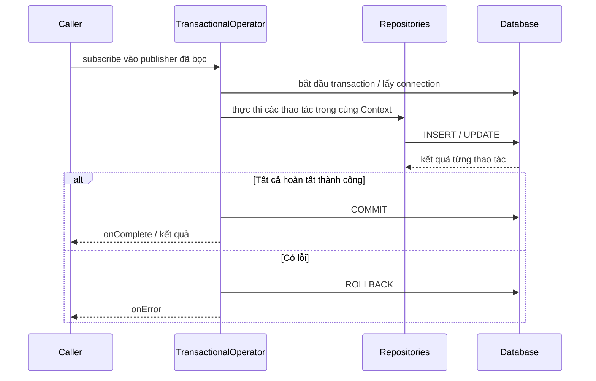
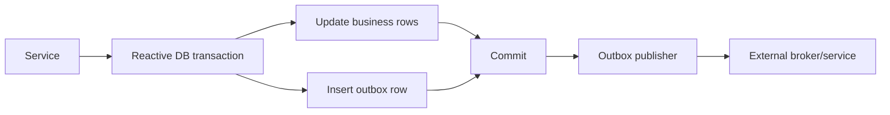

# Phối hợp nhiều thao tác trong cùng một giao dịch

Một nghiệp vụ thường gồm nhiều thao tác dữ liệu có quan hệ với nhau. Khi tạo đơn hàng, ứng dụng có thể phải lưu đơn, lưu các dòng hàng, cập nhật số lượng tồn và ghi lịch sử. Nếu một bước thất bại, các thay đổi trước đó cần được hoàn tác để dữ liệu không rơi vào trạng thái dở dang. Giao dịch (transaction) cung cấp ranh giới nguyên tử cho nhóm thao tác đó.

Trong ứng dụng reactive dùng Spring và R2DBC, transaction gắn với subscription và Reactor Context. Vì vậy, các thao tác repository phải được compose trong cùng một pipeline và cùng ranh giới transaction. `TransactionalOperator` cho phép bọc publisher bằng transaction; `@Transactional` cũng hỗ trợ phương thức trả về reactive type khi ứng dụng dùng reactive transaction manager. Gọi `subscribe()` hoặc `block()` giữa các bước sẽ tách công việc khỏi ranh giới này và làm mất khả năng điều phối transaction thống nhất.

## 1. Xác định những thao tác phải cùng thành công

Giả sử nghiệp vụ tạo đơn hàng cần thực hiện các bước sau:

1. Lưu bản ghi đơn hàng.
2. Lưu từng dòng hàng gắn với mã đơn vừa tạo.
3. Cập nhật bản ghi tồn kho trong cùng cơ sở dữ liệu.
4. Hoàn tất và trả đơn hàng cho caller.

Nếu bước 1 và 2 thành công nhưng bước 3 thất bại, hệ thống không nên giữ lại đơn hàng cùng các dòng hàng mà tồn kho chưa được cập nhật. Các thao tác ghi thuộc cùng một cơ sở dữ liệu và cùng transaction manager có thể được gom vào một transaction để commit hoặc rollback cùng nhau.

Không phải mọi công việc xảy ra trong một request đều nên nằm trong transaction. Gọi dịch vụ thanh toán bên ngoài, gửi email hoặc chờ người dùng xác nhận có thể kéo dài transaction và giữ connection/lock lâu. Transaction cơ sở dữ liệu nên bao quanh nhóm thao tác dữ liệu cần tính nguyên tử; tác dụng phụ ở hệ thống khác cần một chiến lược phối hợp riêng.

## 2. Transaction reactive được gắn với subscription

Trong R2DBC, reactive transaction manager lấy connection và gắn tài nguyên giao dịch vào Reactor Context của subscription. Các repository tham gia cùng transaction cần dùng cùng cấu hình `ConnectionFactory` và reactive transaction manager. Khi publisher được subscribe, transaction được bắt đầu; khi chuỗi hoàn tất bình thường, transaction commit; khi chuỗi phát lỗi, transaction rollback theo chính sách mặc định.



Transaction không được tạo chỉ vì phương thức service được gọi hoặc publisher được lắp ráp. Nó bắt đầu khi subscription đi qua ranh giới transaction. Đây là lý do phương thức reactive nên trả publisher cho caller và để framework hoặc tầng điều phối đăng ký subscription.

## 3. Phối hợp tuần tự bằng flatMap và then

Khi bước sau cần dữ liệu của bước trước, dùng `flatMap`. Khi chỉ cần chờ bước trước hoàn tất rồi chạy bước tiếp theo, dùng `then`:

```java
Mono<Order> createOrder(CreateOrder command) {
    return orderRepository.save(Order.from(command))
        .flatMap(savedOrder ->
            saveLines(savedOrder, command.items())
                .then(inventoryRepository.reserve(
                    savedOrder.id(), command.items()))
                .thenReturn(savedOrder)
        );
}

private Mono<Void> saveLines(Order order, List<CreateOrderItem> items) {
    return Flux.fromIterable(items)
        .concatMap(item -> orderLineRepository.save(
            OrderLine.from(order.id(), item)))
        .then();
}
```

`orderRepository.save` phát đơn hàng đã lưu. `flatMap` lấy mã đơn đó để tạo các dòng hàng. `concatMap` lưu từng dòng theo thứ tự, còn `then` chờ toàn bộ publisher lưu dòng hàng hoàn tất trước khi cập nhật tồn kho. `thenReturn` phát lại đơn hàng sau khi cập nhật tồn kho hoàn tất.

Các phương thức repository trong ví dụ phải tham gia cùng reactive transaction manager và cùng transaction context. Khi được bọc bởi transaction ở tầng service hoặc caller, toàn bộ thao tác ghi nằm trong một ranh giới commit/rollback.

Nếu các dòng hàng độc lập, có thể cân nhắc `flatMap` để xử lý nhiều thao tác đồng thời. Tuy nhiên, không nên mặc định một connection R2DBC có thể thực thi nhiều câu lệnh đồng thời an toàn. Một số driver tuần tự hóa lệnh trên connection hoặc không hỗ trợ nhiều statement đang chạy cùng lúc. Với các thao tác cùng transaction dùng chung connection, `concatMap` là lựa chọn dễ dự đoán; chỉ tăng concurrency sau khi xác minh driver và semantics của repository.

## 4. Bọc chuỗi thao tác bằng TransactionalOperator

`TransactionalOperator` là cách tường minh để đặt ranh giới transaction quanh một publisher:

```java
@Service
class OrderService {
    private final OrderRepository orderRepository;
    private final OrderLineRepository orderLineRepository;
    private final InventoryRepository inventoryRepository;
    private final TransactionalOperator tx;

    OrderService(
            OrderRepository orderRepository,
            OrderLineRepository orderLineRepository,
            InventoryRepository inventoryRepository,
            TransactionalOperator tx) {
        this.orderRepository = orderRepository;
        this.orderLineRepository = orderLineRepository;
        this.inventoryRepository = inventoryRepository;
        this.tx = tx;
    }

    Mono<Order> create(CreateOrder command) {
        Mono<Order> work = orderRepository.save(Order.from(command))
            .flatMap(order -> saveLines(order, command.items())
                .then(inventoryRepository.reserve(
                    order.id(), command.items()))
                .thenReturn(order));

        return tx.transactional(work);
    }
}
```

`tx.transactional(work)` tạo publisher được quản lý bởi transaction. Khi caller subscribe vào publisher trả về, transaction được mở trước khi công việc repository thực thi. Kết quả `Order` chỉ được chuyển xuống downstream sau khi transaction hoàn tất theo semantics của operator.

Cũng có thể dùng dạng compose:

```java
return work.as(tx::transactional);
```

Hai cách đều thể hiện việc bọc publisher. Chọn một kiểu nhất quán trong codebase để người đọc nhận ra ranh giới transaction dễ dàng.

## 5. Dùng @Transactional cho phương thức reactive

Spring hỗ trợ khai báo transaction cho phương thức trả về reactive type khi cấu hình reactive transaction manager phù hợp:

```java
@Service
class OrderService {
    private final OrderRepository orderRepository;
    private final OrderLineRepository orderLineRepository;

    @Transactional
    public Mono<Order> create(CreateOrder command) {
        return orderRepository.save(Order.from(command))
            .flatMap(order -> Flux.fromIterable(command.items())
                .concatMap(item -> orderLineRepository.save(
                    OrderLine.from(order.id(), item)))
                .thenReturn(order));
    }
}
```

Với phương thức reactive, transaction được gắn với quá trình subscribe vào publisher được trả về, không phải một block đồng bộ kết thúc ngay khi phương thức Java return. Cần bảo đảm lời gọi đi qua Spring proxy; self-invocation trong cùng bean thường không kích hoạt interceptor `@Transactional`. Không gọi `subscribe()` bên trong phương thức vì transaction interceptor không còn kiểm soát subscription tách rời đó.

Chọn `@Transactional` khi transaction là một phần ổn định của hợp đồng service. Chọn `TransactionalOperator` khi cần đặt ranh giới theo từng pipeline, phối hợp nhiều publisher hoặc muốn thấy rõ phạm vi transaction trong code. Tránh bọc cùng một chuỗi bằng nhiều ranh giới transaction không cần thiết vì propagation và rollback có thể trở nên khó hiểu.

## 6. Tất cả thao tác phải tham gia cùng transaction manager

Một transaction local chỉ bảo đảm tính nguyên tử cho tài nguyên do transaction manager đó quản lý. Để nhiều repository cùng tham gia một transaction R2DBC:

- Chúng phải sử dụng cùng `ConnectionFactory` hoặc tài nguyên được transaction manager quản lý.
- Các thao tác phải chạy trong cùng subscription/context transaction.
- Không tạo subscription mới bằng `subscribe()` cho từng repository call.
- Không gọi `.block()` để lấy kết quả giữa các bước.
- Không mở connection độc lập ngoài cơ chế quản lý của transaction manager.

Nếu hai repository dùng hai `ConnectionFactory` khác nhau, việc bọc publisher bằng một `TransactionalOperator` không tự biến chúng thành một transaction phân tán. Một thao tác có thể commit trong database A trong khi database B rollback. Với nhiều database hoặc nhiều dịch vụ, cần thiết kế saga, outbox/inbox, hoặc cơ chế distributed transaction được hỗ trợ rõ ràng; không giả định transaction reactive local bao trùm mọi hệ thống.

## 7. Lỗi làm rollback; vị trí phục hồi lỗi rất quan trọng

Khi một publisher bên trong transaction phát `onError`, transaction operator nhận được lỗi và thực hiện rollback theo chính sách của nó. Các bước sau trong chuỗi `then` hoặc `flatMap` không được tiếp tục theo đường thành công.

```java
Mono<Order> work = orderRepository.save(order)
    .flatMap(saved -> inventoryRepository.reserve(saved.id(), items)
        .thenReturn(saved));

return tx.transactional(work);
```

Nếu `reserve` lỗi, lỗi thoát khỏi `work` và transaction rollback cả thao tác lưu order, miễn là chúng cùng tham gia transaction.

Một lỗi thường gặp là phục hồi lỗi bên trong ranh giới transaction:

```java
// Cẩn thận: lỗi được biến thành kết quả thành công bên trong transaction.
return tx.transactional(work
    .onErrorResume(error -> Mono.just(fallbackOrder)));
```

Sau `onErrorResume`, publisher bên trong có thể hoàn tất bình thường. Transaction operator nhìn thấy complete thay vì error và có thể commit những thay đổi đã thực hiện trước lỗi. Nếu mục tiêu là rollback rồi mới chuyển lỗi thành response nghiệp vụ, đặt phục hồi bên ngoài transaction:

```java
Order fallbackOrder = Order.unavailable(orderId);

return tx.transactional(work)
    .onErrorResume(InventoryUnavailableException.class,
        error -> Mono.just(fallbackOrder));
```

Ở cách này, kiểu kết quả của publisher phục hồi vẫn là `Mono<Order>`, tương thích với `work`; transaction operator quan sát lỗi và rollback trước khi publisher ngoài phát giá trị dự phòng. Trong nghiệp vụ thực tế, chỉ trả một giá trị dự phòng nếu hợp đồng cho phép biểu diễn tình trạng không cập nhật được theo cách đó. Nếu cần một chính sách rollback khác, có thể dùng transaction status và đánh dấu rollback-only trong callback `TransactionalOperator.execute`; phải làm rõ quyết định commit/rollback thay vì nuốt lỗi một cách vô tình.

## 8. Empty completion không tự động rollback

`Mono.empty()` là hoàn tất bình thường, không phải lỗi. Nếu một thao tác repository không tìm thấy bản ghi và trả empty, transaction có thể commit những thay đổi trước đó nếu publisher tổng thể hoàn tất bình thường.

Ví dụ, nếu cần bảo đảm đơn hàng phải tồn tại trước khi cập nhật:

```java
Mono<Void> updateOrder(String id, OrderChange change) {
    Mono<Void> work = orderRepository.findById(id)
        .switchIfEmpty(Mono.error(new OrderNotFoundException(id)))
        .flatMap(order -> orderRepository.save(order.apply(change)))
        .then();

    return tx.transactional(work);
}
```

`switchIfEmpty` chuyển trường hợp không có đơn hàng thành lỗi miền nghiệp vụ. Lỗi đó thoát khỏi transaction và kích hoạt rollback. Nếu nghiệp vụ coi không tìm thấy là kết quả bình thường, có thể trả empty và chấp nhận commit/no-op; điều quan trọng là phải quyết định rõ semantics.

Không dùng `switchIfEmpty` sau một `Mono<Void>` để phát hiện thao tác thành công hay thất bại. `Mono<Void>` hoàn tất thành công cũng không phát `onNext`, nên nó vốn là empty completion theo góc nhìn payload.

## 9. Không chạy công việc độc lập song song một cách tùy tiện trong transaction

`Mono.when` hoặc `flatMap` có thể subscribe nhiều publisher đồng thời. Điều đó phù hợp với các lời gọi độc lập khi tài nguyên hỗ trợ concurrency. Nhưng trong một transaction R2DBC, các repository thường chia sẻ connection gắn với transaction context. Không phải mọi driver đều cho phép nhiều statement đồng thời trên cùng connection.

Với các lệnh ghi phụ thuộc hoặc cùng dùng một connection, ưu tiên tuần tự:

```java
Mono<Void> work = repository.save(first)
    .then(repository.save(second))
    .then(repository.save(third))
    .then();
```

Nếu cần xử lý song song, hãy xác minh semantics của driver, connection và transaction manager; đo concurrency thực tế và kiểm tra thứ tự commit. Tạo nhiều transaction riêng để chạy song song sẽ không còn bảo đảm tất cả thao tác thuộc cùng một transaction nguyên tử.

## 10. Giữ transaction ngắn và tránh gọi dịch vụ bên ngoài

Một transaction giữ connection và có thể giữ lock cho tới khi commit hoặc rollback. Nếu trong transaction có HTTP request chậm, gửi email hoặc chờ broker, connection database bị giữ trong thời gian chờ đó. Điều này làm giảm pool capacity và tăng nguy cơ timeout/deadlock.

Thực hiện các bước xác thực hoặc lấy dữ liệu không cần transaction trước khi mở transaction nếu có thể. Trong transaction, chỉ giữ các thao tác dữ liệu cần tính nguyên tử và cố gắng hoàn tất nhanh. Không gọi API thanh toán bên ngoài rồi mới quyết định commit database nếu không có cơ chế phối hợp rõ ràng.

Một mẫu thường dùng là transactional outbox: trong cùng transaction, ghi dữ liệu nghiệp vụ và một bản ghi outbox. Sau khi commit, một worker riêng đọc outbox và gửi sự kiện tới broker hoặc dịch vụ ngoài. Nếu gửi thất bại, worker có thể retry dựa trên trạng thái outbox; sự kiện không bị mất chỉ vì process dừng sau commit.



Outbox không tạo một transaction phân tán với broker; nó lưu ý định phát sự kiện cùng dữ liệu trong database. Worker cần xử lý gửi lặp an toàn, đánh dấu trạng thái và có chính sách retry.

## 11. Isolation và xung đột dữ liệu

Transaction bảo đảm các thao tác thuộc cùng ranh giới commit/rollback, nhưng mức độ cô lập giữa các transaction đồng thời phụ thuộc isolation level của database và transaction manager. Một transaction không tự ngăn mọi race nghiệp vụ.

Ví dụ, hai request cùng đọc số lượng tồn là 1 rồi cùng tạo đơn hàng. Nếu cả hai cùng quyết định rằng còn hàng trước khi ghi giảm số lượng, dữ liệu có thể bị oversell nếu câu lệnh cập nhật không bảo vệ điều kiện cạnh tranh.

Có thể dùng cập nhật có điều kiện:

```sql
UPDATE inventory
SET available = available - :quantity
WHERE product_id = :productId
  AND available >= :quantity;
```

Sau đó kiểm tra số dòng được cập nhật. Nếu không có dòng nào thay đổi, tồn kho không đủ hoặc bản ghi không tồn tại; chuyển kết quả đó thành lỗi miền nghiệp vụ nếu transaction cần rollback. Tùy mô hình, có thể dùng optimistic locking với version, khóa bi quan hoặc isolation level cao hơn. Cần cân nhắc deadlock và khả năng retry transaction khi database báo lỗi xung đột.

## 12. Cancellation và rollback

Downstream có thể hủy subscription trước khi transaction hoàn tất, ví dụ client ngắt kết nối hoặc timeout ở tầng gọi. Transaction manager nhận cancellation và thực hiện cleanup/rollback theo semantics của reactive transaction manager. Không nên giả định một tác vụ đã commit chỉ vì một bước repository đã phát `onNext`; commit xảy ra ở ranh giới transaction khi chuỗi kết thúc thành công.

Cancellation có thể đến sau khi database đã thực thi một câu lệnh nhưng trước khi transaction commit. Khi transaction còn mở, rollback có thể hoàn tác thay đổi. Nếu commit đã hoàn tất trước khi cancellation được xử lý, dữ liệu đã được ghi. Vì vậy, caller có thể không nhận được response dù thao tác đã commit; với các lệnh có thể được gửi lại, nên dùng idempotency key hoặc mã nghiệp vụ duy nhất để tránh tạo dữ liệu trùng.

Không tự gọi `subscribe()` bên trong transaction để chạy một bước “nền”. Subscription mới có thể không tham gia transaction và không bị hủy/rollback cùng chuỗi chính. Hãy trả publisher để transaction operator quản lý toàn bộ vòng đời.

## 13. Kiểm thử tính nguyên tử bằng StepVerifier và database thật

Kiểm thử đơn vị có thể xác minh thứ tự publisher, nhưng tính nguyên tử cần được kiểm tra với transaction manager và database tương ứng. Một test tích hợp có thể thực hiện:

1. Gọi service tạo đơn hàng với dữ liệu hợp lệ và xác minh đơn cùng các dòng hàng được lưu.
2. Cấu hình một bước giữa chuỗi phát lỗi sau khi bước trước đã ghi.
3. Subscribe và xác minh publisher kết thúc bằng lỗi.
4. Truy vấn lại database bằng một transaction/test scope độc lập và xác minh không còn bản ghi được ghi trước lỗi.

Ví dụ cấu trúc kiểm thử publisher:

```java
StepVerifier.create(orderService.create(commandThatFailsAtInventory))
    .expectError(InventoryUnavailableException.class)
    .verify();

StepVerifier.create(orderRepository.findByBusinessKey(commandThatFailsAtInventory.key()))
    .verifyComplete();
```

Phần truy vấn kiểm tra phải chạy sau khi transaction của thao tác chính đã kết thúc và cần bảo đảm nó không vô tình tham gia cùng transaction test đang mở. Nếu dùng test transaction tự rollback sau mỗi test, hãy kiểm tra cách test framework quản lý transaction reactive để assertion quan sát được trạng thái commit/rollback thực tế.

Nên kiểm thử thêm các trường hợp: repository trả empty; lỗi ở thao tác đầu, giữa và cuối; lỗi được phục hồi bên trong hay bên ngoài transaction; cancellation; xung đột optimistic lock; và retry sau lỗi deadlock/serialization nếu ứng dụng hỗ trợ. Kiểm tra cả trạng thái dữ liệu, không chỉ tín hiệu `onError`.

## 14. Chọn ranh giới transaction theo nghiệp vụ

| Tình huống | Cách phối hợp |
| --- | --- |
| Nhiều thao tác ghi cùng database phải cùng thành công | Bọc một pipeline bằng `TransactionalOperator` hoặc `@Transactional` reactive |
| Bước sau cần ID/kết quả bước trước | Dùng `flatMap` |
| Bước sau chỉ cần chờ bước trước hoàn tất | Dùng `then`/`thenReturn` |
| Một thao tác không tìm thấy dữ liệu phải làm rollback | Chuyển empty thành lỗi trước khi thoát transaction |
| Cần chuyển lỗi thành response sau rollback | Phục hồi lỗi bên ngoài publisher đã bọc transaction |
| Ghi database rồi phát sự kiện ra ngoài | Ghi outbox trong transaction, phát sau commit |
| Nhiều database hoặc dịch vụ phải phối hợp | Dùng saga/outbox hoặc cơ chế phân tán được thiết kế rõ |

Hãy xác định những thay đổi dữ liệu nào phải nguyên tử, bảo đảm tất cả repository tham gia cùng transaction manager và compose chúng trong một subscription. Dùng `flatMap` cho quan hệ phụ thuộc, `then` cho thứ tự hoàn tất, và giới hạn transaction vào các thao tác dữ liệu cần bảo vệ. Xử lý empty/error có chủ đích, tránh nuốt lỗi trước ranh giới commit và không tự subscribe trong service. Khi cần phối hợp với hệ thống ngoài, dùng outbox hoặc saga thay vì kéo dài transaction database qua các lời gọi mạng. Như vậy, một chuỗi thao tác reactive có thể giữ tính nhất quán dữ liệu mà vẫn tận dụng được cách thực thi bất đồng bộ của Project Reactor.
