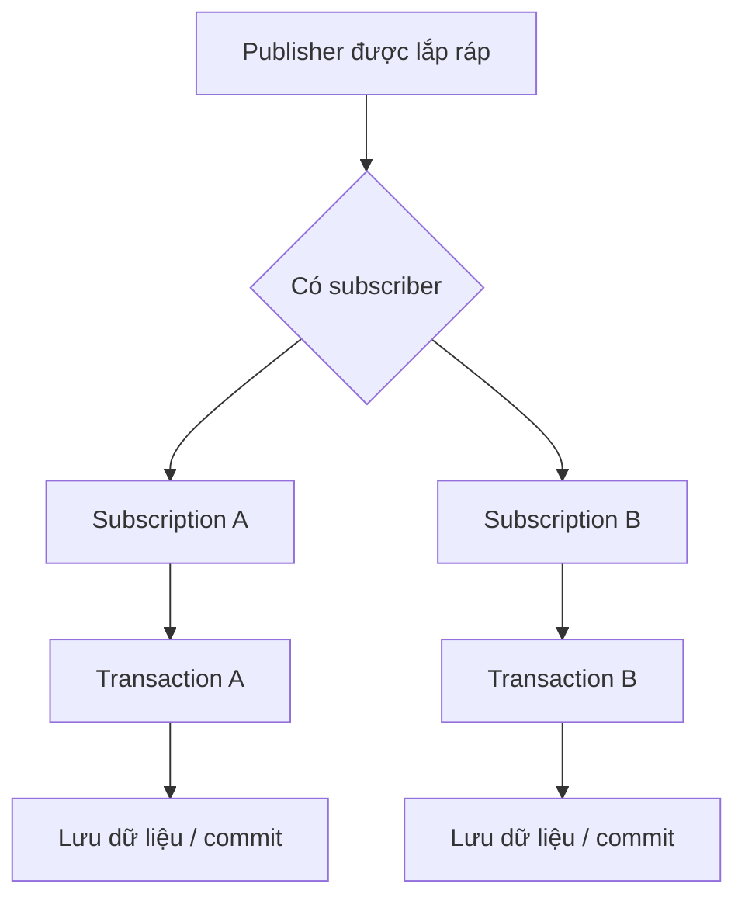

# Tránh mở nhiều giao dịch ngoài ý muốn do đăng ký lặp lại

Trong chương **Dữ liệu và giao dịch**, bài học này giải thích vì sao một publisher reactive được đăng ký nhiều lần có thể khiến cùng một thao tác nghiệp vụ chạy nhiều lần và mở nhiều transaction. Hiện tượng này thường xuất hiện khi một service gọi `subscribe()` bên trong pipeline, nhiều thành phần cùng subscribe một publisher, hoặc một toán tử retry đăng ký lại nguồn.

Bài học thuộc module **REACTIVE_PROGRAMMING**. Module hướng dẫn: “Học tư duy reactive qua các luồng sự kiện bất đồng bộ, hợp đồng Publisher–Subscriber và cơ chế backpressure của Reactive Streams. Thực hành Mono, Flux, kết hợp toán tử, kiểm soát scheduler, xử lý lỗi và kiểm thử pipeline trong hệ sinh thái Java.” Với giao dịch reactive, điều quan trọng là hiểu transaction gắn với subscription và Reactor Context. Mỗi lần subscription độc lập có thể tạo một lần thực thi nghiệp vụ và một transaction riêng.

## 1. Vì sao đăng ký lặp lại có thể mở nhiều transaction?

Các publisher từ repository reactive thường là nguồn lạnh (*cold publisher*). Khi subscriber đăng ký, publisher bắt đầu thực hiện công việc. Một subscription mới thường thực hiện lại truy vấn hoặc thao tác ghi.

Ví dụ:

```java
Mono<Order> saveOrder =
    orderRepository.save(order)
        .as(transactionalOperator::transactional);

saveOrder.subscribe(order -> log.info("A: {}", order.id()));
saveOrder.subscribe(order -> log.info("B: {}", order.id()));
```

Hai lệnh `subscribe()` tạo hai subscription độc lập. Với publisher được bọc bởi `TransactionalOperator`, mỗi subscription có thể khởi động một transaction riêng, thực hiện thao tác lưu và kết thúc transaction đó. Nếu thao tác là tạo đơn hàng, hệ thống có thể tạo hai bản ghi hoặc thực hiện hai lần các tác dụng phụ đi kèm.

Sơ đồ vòng đời:



Publisher là một mô tả công việc có thể được thực thi theo subscription. Giữ publisher trong một biến không có nghĩa kết quả đã được tính một lần hoặc transaction được chia sẻ tự động.

## 2. Transaction reactive bắt đầu khi subscription diễn ra

Với Spring Reactive Transaction Management, transaction được gắn với quá trình thực thi publisher. Khi subscriber đăng ký vào publisher đã được bọc bởi transaction operator hoặc được quản lý bởi reactive `@Transactional`, transaction manager bắt đầu và liên kết tài nguyên giao dịch với Reactor Context của subscription.

Một transaction điển hình có các bước:

1. Subscriber đăng ký vào publisher.
2. Transaction manager bắt đầu transaction và gắn tài nguyên như connection vào Context.
3. Các thao tác repository trong cùng pipeline sử dụng tài nguyên giao dịch đó.
4. Khi pipeline hoàn tất bình thường, transaction được commit.
5. Khi pipeline phát lỗi hoặc bị hủy theo chính sách transaction, transaction manager thực hiện rollback hoặc cleanup tương ứng.

Vì transaction gắn với subscription, hai subscriber riêng biệt không tự dùng chung một transaction chỉ vì chúng subscribe cùng một biến publisher.

Điều này khác với cách nghĩ đồng bộ kiểu “gọi phương thức service là mở transaction ngay”. Với reactive transaction, phương thức có thể trả về publisher trước; transaction thực sự được quản lý khi publisher được subscribe. Vì vậy, nếu cùng publisher được subscribe hai lần, transaction logic có thể được chạy hai lần.

## 3. Để tầng gọi quản lý subscription

Trong service reactive, thông thường hãy trả về publisher để tầng gọi kết hợp các bước và quyết định thời điểm subscription. Tránh tự gọi `subscribe()` bên trong service.

Cách dễ gây lỗi:

```java
public Mono<Order> createOrder(Order order) {
    Mono<Order> saved =
        orderRepository.save(order)
            .as(transactionalOperator::transactional);

    saved.subscribe(); // Tạo subscription độc lập
    return saved;      // Tầng gọi sẽ subscribe lần nữa
}
```

Nếu controller hoặc tầng gọi subscribe vào publisher được trả về, thao tác lưu có thể chạy thêm lần nữa. Lệnh subscribe bên trong cũng tạo một luồng xử lý tách biệt: lỗi, cancellation và kết quả của nó không còn được điều phối đầy đủ bởi publisher trả về.

Cách phù hợp:

```java
public Mono<Order> createOrder(Order order) {
    return orderRepository.save(order)
        .as(transactionalOperator::transactional);
}
```

Controller hoặc tầng điều phối nhận publisher và để WebFlux quản lý subscription:

```java
@PostMapping("/orders")
public Mono<OrderView> create(@RequestBody CreateOrderRequest request) {
    return orderService.createOrder(toOrder(request))
        .map(OrderView::from);
}
```

Một subscription tại biên request kích hoạt một lần thực thi. Service không tự tạo subscription phụ.

Không gọi `block()`, `blockOptional()`, `toFuture()` rồi tạo thêm luồng tiêu thụ trong service chỉ để lấy kết quả giữa pipeline. Các terminal operation như `block()` cũng subscribe vào publisher; gọi lặp có thể thực hiện lại nguồn và transaction, đồng thời làm mất lợi ích non-blocking.

## 4. Kết hợp nhiều bước trong cùng một transaction

Nếu một nghiệp vụ cần lưu đơn hàng và ghi audit trong cùng transaction, hãy nối các publisher bằng `flatMap`, `then` hoặc toán tử kết hợp khác rồi bọc toàn bộ chuỗi bằng transaction operator.

```java
public Mono<Order> createOrder(Order order) {
    Mono<Order> work =
        orderRepository.save(order)
            .flatMap(saved ->
                auditRepository.save(
                    AuditRecord.orderCreated(saved.id())
                )
                .thenReturn(saved)
            );

    return work.as(transactionalOperator::transactional);
}
```

Trong một subscription, transaction operator bao quanh toàn bộ công việc. Nếu lưu audit phát lỗi, lỗi đi ngược ra transaction boundary và transaction có thể rollback cả thao tác lưu đơn hàng, tùy transaction manager và cấu hình rollback.

Không tách audit thành subscription riêng:

```java
// Không nên: audit tự chạy trong subscription độc lập
return orderRepository.save(order)
    .doOnSuccess(saved ->
        auditRepository.save(AuditRecord.orderCreated(saved.id()))
            .subscribe()
    );
```

Subscription audit có thể không tham gia transaction của thao tác lưu đơn hàng, có thể chạy sau khi transaction ngoài đã kết thúc và có vòng đời lỗi/cancellation riêng. Dùng `flatMap` để giữ audit trong cùng pipeline và cùng transaction context.

## 5. Nhiều consumer cần cùng một kết quả: kết hợp trước khi subscribe

Đôi khi một kết quả được dùng cho nhiều bước, ví dụ vừa tạo response vừa phát thông tin cho một bước xử lý khác. Nếu mỗi bước tự subscribe cùng publisher, công việc nguồn có thể chạy nhiều lần.

Cách dễ tạo thực thi lặp:

```java
Mono<Order> created = orderService.createOrder(command);

created.subscribe(this::sendNotification);
created.subscribe(this::updateMetrics);
```

Nếu `created` là publisher lạnh, hai subscriber có thể tạo hai lần thực hiện nghiệp vụ. Hãy kết hợp các bước vào cùng một pipeline khi chúng thuộc cùng request và cùng kết quả:

```java
Mono<OrderView> createAndPrepare(Order order) {
    return orderService.createOrder(order)
        .flatMap(saved ->
            notificationService.prepare(saved)
                .thenReturn(OrderView.from(saved))
        );
}
```

Nếu notification là tác dụng phụ không thuộc transaction cơ sở dữ liệu, cần quyết định rõ nó chạy trước hay sau commit và xử lý lỗi như thế nào. Không phải mọi I/O đều nên nằm trong database transaction; transaction dài có thể giữ connection và lock lâu. Nhưng vẫn cần nối công việc vào pipeline để quản lý lỗi và cancellation.

Khi thật sự cần nhiều consumer quan sát cùng một lần thực thi, có thể cân nhắc chia sẻ hoặc cache publisher. Tuy nhiên, các toán tử chia sẻ thay đổi ngữ nghĩa vòng đời và dữ liệu; chúng không phải cách sửa mặc định cho việc subscribe trùng.

## 6. Phân biệt share, cache và transaction

Các publisher chia sẻ có thể giảm số lần thực thi upstream, nhưng cần chọn theo ý nghĩa dữ liệu:

- `share()` chia sẻ một subscription upstream giữa các subscriber cùng tham gia trong vòng đời kết nối. Subscriber đến muộn không mặc nhiên nhận lại toàn bộ lịch sử.
- `cache()` lưu tín hiệu đã phát để subscriber sau nhận lại kết quả mà không chạy lại nguồn trong thời gian cache còn hiệu lực. Nó có thể lưu cả completion hoặc error tùy overload và chính sách.
- `publish().refCount(...)` hoặc các biến thể multicast cho phép điều khiển ngưỡng subscriber và vòng đời kết nối.

Ví dụ về cache một kết quả đọc:

```java
Mono<ProductCatalog> catalog =
    catalogRepository.loadCurrentCatalog()
        .cache();
```

Nhiều subscriber có thể nhận cùng kết quả đã cache mà không truy vấn lại nguồn sau lần tải đầu. Nhưng cache có thể giữ dữ liệu cũ, giữ lỗi, và bỏ qua ngữ cảnh riêng của subscriber sau. Nếu kết quả phụ thuộc tenant, quyền truy cập hoặc dữ liệu người dùng, dùng cache chia sẻ không có khóa phân vùng phù hợp có thể trả nhầm dữ liệu giữa các request.

Đặc biệt, không dùng `cache()` một cách máy móc để tránh nhiều transaction. Nếu nghiệp vụ yêu cầu mỗi request có transaction riêng, cache kết quả sẽ thay đổi hành vi đó. Nếu muốn một lần ghi duy nhất được chia sẻ cho nhiều consumer, hãy xác định rõ chủ sở hữu thao tác, thời gian sống kết quả và chính sách lỗi trước khi chọn cơ chế chia sẻ.

## 7. Retry và repeat cũng có thể tạo subscription mới

Các toán tử `retry` và `retryWhen` đăng ký lại upstream khi gặp lỗi theo chính sách. `repeat` có thể đăng ký lại sau khi nguồn hoàn tất. Nếu upstream chứa một transaction boundary, vị trí của toán tử quyết định transaction được tạo lại ở phạm vi nào.

Ví dụ, retry bên ngoài transaction wrapper:

```java
Mono<Order> retryWithNewTransactionPerAttempt =
    orderRepository.save(order)
        .as(transactionalOperator::transactional)
        .retryWhen(Retry.max(2));
```

Khi lỗi khiến `retryWhen` đăng ký lại publisher upstream, subscription mới đi qua transaction wrapper và có thể tạo transaction mới cho lần thử tiếp theo. Với hai lần retry, có tối đa ba lần thực hiện tính cả lần đầu.

Nếu đặt retry bên trong transaction boundary:

```java
Mono<Order> retryInsideOneTransaction =
    orderRepository.save(order)
        .retryWhen(Retry.max(2))
        .as(transactionalOperator::transactional);
```

Transaction bao quanh chuỗi retry. Các lần thử diễn ra trong cùng phạm vi transaction; nếu lỗi database đã khiến transaction không còn khả năng tiếp tục hoặc bị đánh dấu rollback-only, lần thử sau có thể thất bại ngay hoặc không đạt hành vi mong muốn. Cần chọn ranh giới theo loại lỗi, transaction manager và yêu cầu nhất quán.

Với thao tác ghi, retry còn có nguy cơ lặp tác dụng phụ nếu lần đầu đã được hệ thống bên ngoài xử lý nhưng phản hồi bị mất. Hãy dùng idempotency key hoặc cơ chế chống trùng ở biên nghiệp vụ. Không giả định rollback database có thể hoàn tác email, HTTP request hoặc thông điệp đã gửi sang hệ thống khác.

## 8. @Transactional reactive cũng phụ thuộc subscription

Spring hỗ trợ khai báo transaction reactive bằng `@Transactional` trên phương thức trả về publisher, với reactive transaction manager tương ứng.

```java
@Service
public class OrderService {

    @Transactional
    public Mono<Order> create(Order order) {
        return orderRepository.save(order)
            .flatMap(saved ->
                auditRepository.save(
                    AuditRecord.orderCreated(saved.id())
                )
                .thenReturn(saved)
            );
    }
}
```

Khi proxy Spring quản lý lời gọi và publisher được subscribe, reactive transaction được áp dụng theo transaction manager. Nếu publisher trả về được subscribe nhiều lần, mỗi subscription có thể tạo một lần thực thi và transaction tương ứng.

Không gọi `subscribe()` bên trong phương thức `@Transactional`:

```java
@Transactional
public Mono<Order> createIncorrectly(Order order) {
    Mono<Order> saved = orderRepository.save(order);
    saved.subscribe(); // Tạo subscription tách rời transaction boundary
    return saved;
}
```

Subscription tự tạo không nhất thiết tham gia transaction của publisher được trả về. Nó có Context và vòng đời riêng. Hãy trả publisher nguyên vẹn và để tầng ngoài quản lý subscription.

Nếu dùng `@Transactional` kết hợp `TransactionalOperator`, hoặc gọi các service transactional lồng nhau, hãy xác định rõ transaction manager và propagation. Với propagation mặc định `REQUIRED`, các thao tác trong cùng reactive transaction context thường tham gia transaction hiện có; `REQUIRES_NEW` yêu cầu transaction độc lập. Không nên thêm nhiều boundary chỉ để “chắc chắn” có transaction mà không hiểu propagation.

## 9. Reactor Context giữ tài nguyên giao dịch theo subscription

Reactive transaction không dựa vào việc một thread duy nhất giữ connection suốt quá trình. Spring gắn tài nguyên transaction vào Reactor Context để các thao tác reactive liên quan có thể tìm thấy tài nguyên đó ngay cả khi pipeline chuyển thread.

Vì vậy:

- Các repository reactive dùng cùng transaction manager và cùng Context có thể tham gia cùng transaction.
- Chuyển scheduler bằng `publishOn` không tự tạo transaction mới.
- Tạo một subscription mới bằng `subscribe()` tạo một Context riêng và không tự kế thừa transaction của pipeline cha.
- Tự subscribe trong callback làm đứt chuỗi điều phối transaction, lỗi và cancellation.

Một pipeline hợp lệ nên giữ các thao tác cơ sở dữ liệu liên quan trong cùng chuỗi publisher:

```java
Mono<Order> work =
    orderRepository.save(order)
        .flatMap(saved ->
            lineItemRepository.saveAll(saved.items())
                .then(auditRepository.save(
                    AuditRecord.orderCreated(saved.id())
                ))
                .thenReturn(saved)
        )
        .as(transactionalOperator::transactional);
```

Nếu một bước tự gọi `subscribe()`, nó không còn được nối như một bước con của publisher transaction. Dù callback có chạy gần cùng thời điểm hoặc trên cùng thread, subscription vẫn là ranh giới thực thi độc lập.

## 10. Đo và kiểm thử số lần transaction bắt đầu

Để phát hiện đăng ký lặp lại, kiểm thử cần quan sát số lần thao tác nguồn hoặc transaction manager bắt đầu. Không chỉ kiểm tra giá trị cuối cùng, vì hai lần ghi giống nhau có thể vẫn trả về một kết quả nhìn bề ngoài hợp lệ.

Có thể dùng một bộ đếm trong publisher kiểm thử để xác nhận số subscription:

```java
AtomicInteger subscriptions = new AtomicInteger();

Mono<String> source =
    Mono.defer(() -> {
        subscriptions.incrementAndGet();
        return Mono.just("saved");
    });

StepVerifier.create(source)
    .expectNext("saved")
    .verifyComplete();

assertEquals(1, subscriptions.get());
```

Nếu subscribe thêm lần nữa, bộ đếm tăng thêm. Với tích hợp transaction, có thể dùng test transaction manager hoặc spy/mock phù hợp để đếm số lần `getReactiveTransaction`, commit và rollback được gọi. Trong integration test, nên kiểm tra cả số bản ghi thực tế sau khi hoàn tất.

Ví dụ kiểm tra một pipeline chỉ thực hiện một lần:

```java
AtomicInteger writes = new AtomicInteger();

Mono<String> writeOnce =
    Mono.defer(() -> {
        writes.incrementAndGet();
        return Mono.just("created");
    });

StepVerifier.create(
        writeOnce.flatMap(value -> Mono.just(value + "-view"))
    )
    .expectNext("created-view")
    .verifyComplete();

assertEquals(1, writes.get());
```

Đối với retry, hãy kiểm tra số lần thử và số transaction theo đúng vị trí transaction boundary. Đối với cancellation, hãy xác nhận transaction được rollback hoặc cleanup theo hợp đồng của transaction manager khi subscriber hủy trước khi hoàn tất.

## 11. Những dấu hiệu của transaction bị mở lặp

Trong log và metrics, có thể nhận thấy:

- Một request ID tương ứng với nhiều transaction begin/commit dù nghiệp vụ chỉ cần một lần ghi.
- Một câu lệnh insert hoặc update xuất hiện nhiều lần với cùng dữ liệu.
- Nhiều bản ghi trùng được tạo sau một request hoặc một lần retry.
- Connection pool có nhiều connection đang được giữ bởi các thao tác giống nhau.
- Một service gọi `subscribe()` hoặc `block()` trong khi vẫn trả về publisher.
- Một publisher dùng cho nhiều nhánh terminal operation như `subscribe`, `block` hoặc `toFuture`.
- Retry bao quanh transaction boundary không đúng ý định hoặc thiếu idempotency.

Nên gắn trace ID, request ID và transaction correlation vào log để liên kết transaction với subscription và request. Không dùng thread name làm định danh transaction vì reactive pipeline có thể đổi thread trong khi vẫn thuộc cùng một transaction context.

## 12. Những lỗi thường gặp

- **Subscribe cùng publisher nhiều lần.** Publisher lạnh có thể thực hiện lại truy vấn/ghi và mở transaction mới cho mỗi subscription.
- **Tự subscribe trong service.** Subscription phụ có Context, lỗi và cancellation riêng; hãy trả publisher về tầng gọi.
- **Dùng `block()` để lấy kết quả giữa pipeline.** Đây là một lần subscribe và có thể kích hoạt thao tác/transaction mới.
- **Chia một nghiệp vụ thành nhiều subscription không chủ ý.** Dùng `flatMap`, `then`, `zipWhen` hoặc toán tử phù hợp để nối các bước.
- **Dùng cache để che subscription lặp.** Cache thay đổi semantics, có thể giữ dữ liệu cũ hoặc kết quả phụ thuộc Context.
- **Không xem xét vị trí retry.** Retry có thể tạo transaction mới cho mỗi lần thử hoặc chạy các lần thử bên trong một transaction, tùy ranh giới.
- **Cho rằng rollback hoàn tác hệ thống ngoài.** Email, HTTP call và message đã gửi thường không được database transaction hoàn tác.
- **Bọc nhiều transaction boundary không cần thiết.** Kiểm tra propagation và transaction manager trước khi thêm boundary mới.
- **Chỉ kiểm tra giá trị trả về.** Hãy đếm số subscription, transaction begin/commit/rollback và số lần ghi thực tế.

## 13. Bài tập vận dụng

Một endpoint tạo đơn hàng cần lưu đơn, lưu các dòng hàng và ghi audit. Sau đó một bước khác gửi thông báo. Nhóm phát triển nhận thấy đôi khi có hai đơn hàng giống nhau dù client chỉ gửi một request.

Hãy rà soát thiết kế và trả lời:

1. Có service nào gọi `subscribe()` hoặc `block()` bên trong phương thức trả về `Mono` không?
2. Publisher tạo đơn có bị hai nhánh độc lập cùng subscribe không?
3. Các thao tác lưu đơn, dòng hàng và audit có thể được nối trong cùng transaction bằng `flatMap`/ `then` như thế nào?
4. Notification nên chạy trước hay sau commit? Làm sao tránh gửi thông báo trùng khi retry?
5. Nếu dùng `retryWhen`, nên đặt retry trong hay ngoài transaction boundary theo chính sách lỗi?
6. Làm thế nào dùng idempotency key để một request lặp không tạo hai đơn?
7. Test nào có thể đếm số subscription, transaction begin/commit và số bản ghi được tạo?

Viết lại service để trả một publisher duy nhất, giữ các thao tác cơ sở dữ liệu cần tính nguyên tử trong cùng transaction và để WebFlux quản lý subscription ở biên request. Sau đó dùng integration test mô phỏng retry, cancellation và request gửi lặp để xác nhận số transaction cũng như kết quả dữ liệu đúng với hợp đồng nghiệp vụ.

Khi làm việc với transaction reactive, hãy luôn coi subscription là một lần thực thi có vòng đời riêng. Giữ một nghiệp vụ trong một chuỗi publisher được quản lý rõ ràng, xác định ranh giới transaction và chỉ dùng cơ chế chia sẻ khi thực sự muốn nhiều consumer quan sát cùng một kết quả.
