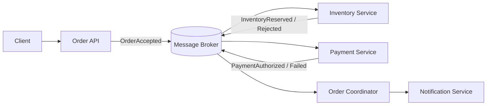
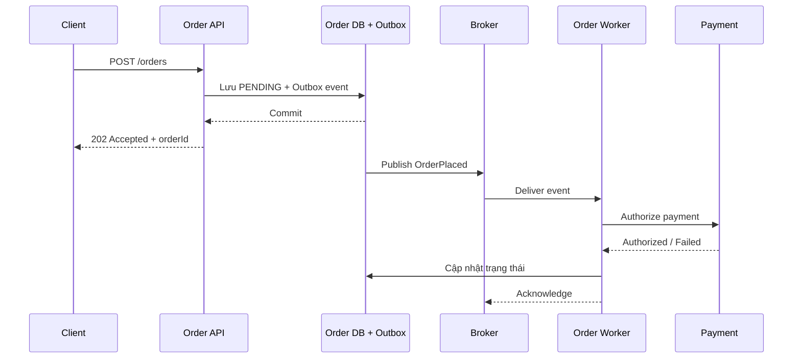

# Phân biệt áp dụng thư viện phản ứng với thiết kế cả hệ thống

Một ứng dụng dùng `Mono`, `Flux`, `Publisher` hoặc một framework non-blocking chưa chắc đã là một **hệ thống phản ứng (reactive system)**. Những thư viện này giúp lập trình viên biểu diễn luồng dữ liệu bất đồng bộ, phối hợp tác vụ và điều tiết demand trong phạm vi một tiến trình. Thiết kế cả hệ thống phản ứng là một bài toán rộng hơn: các thành phần phải trao đổi thông điệp qua ranh giới rõ ràng, cô lập lỗi, kiểm soát tải, mở rộng theo nhu cầu và tiếp tục đáp ứng khi một phần hạ tầng gặp sự cố.

Khác biệt này rất quan trọng trong hệ sinh thái Java. Ta có thể viết một REST controller bằng Spring WebFlux nhưng vẫn gọi database blocking, giữ một hàng đợi không giới hạn và phụ thuộc vào một dịch vụ duy nhất. Mã nguồn có vẻ reactive, nhưng hệ thống vẫn có thể bị nghẽn hoặc ngừng đáp ứng khi tải tăng hay một dependency chậm. Ngược lại, một hệ thống có kiến trúc message-driven, giới hạn tài nguyên và cô lập lỗi có thể mang đặc tính reactive dù một số thành phần bên trong dùng API đồng bộ.

Chủ đề này thuộc chương **Hệ thống phản ứng** của REACTIVE_PROGRAMMING. Module học tư duy reactive qua các luồng sự kiện bất đồng bộ, hợp đồng Publisher–Subscriber và cơ chế backpressure của Reactive Streams; đồng thời thực hành Mono, Flux, kết hợp operator, scheduler, xử lý lỗi và kiểm thử pipeline trong hệ sinh thái Java. Bài học này phân biệt phạm vi của thư viện lập trình với các quyết định kiến trúc cần có để toàn hệ thống phản hồi tốt trước tải, lỗi và thay đổi môi trường.

## Hai phạm vi khác nhau: lập trình phản ứng và hệ thống phản ứng

**Reactive programming** là cách biểu diễn và kết hợp các giá trị hoặc luồng sự kiện thay đổi theo thời gian. Trong Java, Reactor, RxJava và Reactive Streams cung cấp API để mô tả Publisher, Subscriber, operator, demand, scheduler và xử lý lỗi. Phạm vi thường là một module, một service hoặc một tiến trình.

**Reactive systems** là cách thiết kế một hệ thống gồm nhiều thành phần để hệ thống vẫn đáp ứng trong điều kiện bình thường, khi tải biến động và khi một số thành phần thất bại. Tư duy này được diễn đạt qua bốn đặc tính liên quan với nhau:

- **Responsive – phản hồi:** hệ thống trả lời trong thời gian hợp lý và có thể dự đoán; khi không thể hoàn thành yêu cầu, nó vẫn trả lỗi hoặc trạng thái có ý nghĩa thay vì treo vô hạn.
- **Resilient – có khả năng chống chịu:** lỗi được cô lập và xử lý; một thành phần hỏng không nhất thiết kéo theo toàn hệ thống ngừng hoạt động.
- **Elastic – co giãn:** tài nguyên và năng lực xử lý có thể điều chỉnh theo tải, tránh vừa thiếu năng lực khi tải cao vừa lãng phí khi tải thấp.
- **Message-driven – hướng thông điệp:** các thành phần giao tiếp qua thông điệp bất đồng bộ, với ranh giới và giao thức rõ ràng, nhờ đó giảm phụ thuộc thời gian và vị trí giữa các thành phần.

Bốn đặc tính hỗ trợ lẫn nhau. Giao tiếp qua message giúp tách các thành phần; sự tách biệt tạo điều kiện cô lập lỗi và mở rộng độc lập; khả năng cô lập và co giãn giúp duy trì thời gian phản hồi khi môi trường thay đổi.

| Khía cạnh | Dùng thư viện reactive | Thiết kế reactive system |
|---|---|---|
| Phạm vi | Pipeline, API hoặc một tiến trình | Nhiều thành phần, dịch vụ và hạ tầng vận hành |
| Mối quan tâm chính | Publisher, operator, scheduler, demand, cancellation | Giao tiếp, ranh giới lỗi, tải, phân phối, nhất quán và vận hành |
| Bất đồng bộ | Không chặn thread trong luồng xử lý phù hợp | Thành phần giao tiếp qua message và không phụ thuộc đồng thời vào thời gian sống của nhau |
| Backpressure | Điều tiết demand giữa Publisher và Subscriber tương thích | Kiểm soát tải từ đầu vào tới tài nguyên thực, kể cả broker, queue và dịch vụ ngoài |
| Lỗi | `onError`, retry, fallback trong pipeline | Timeout, circuit breaker, bulkhead, retry policy, failover, dead-letter và phục hồi vận hành |
| Mở rộng | Scheduler, concurrency trong một tiến trình | Scale instance, partition, consumer group, quota và capacity planning |
| Kết quả | Mã bất đồng bộ dễ kết hợp hơn | Toàn hệ thống giữ khả năng phản hồi, chống chịu và co giãn |

Không nên đồng nhất hai phạm vi này. Thư viện reactive là công cụ hữu ích để xây dựng thành phần; nó không tự đưa ra các quyết định kiến trúc và vận hành thay cho nhóm phát triển.

## Một WebFlux controller chưa đủ để tạo thành reactive system

Ví dụ sau sử dụng kiểu trả về reactive:

```java
@GetMapping("/orders/{id}")
Mono<OrderView> getOrder(@PathVariable String id) {
    return orderRepository.findById(id)
        .map(OrderView::from);
}
```

Đây là cách biểu diễn API bằng `Mono`. Nếu repository dùng driver non-blocking, request có thể được xử lý mà không chiếm một thread chờ I/O trong suốt thời gian truy vấn. Tuy nhiên, đoạn code không cho biết:

- Database có đủ connection và capacity khi số request tăng không?
- Request có timeout khi database không phản hồi không?
- Hệ thống có giới hạn số truy vấn đang chạy và số request đang chờ không?
- Nếu database mất kết nối, API trả lỗi nhanh hay giữ request tới khi hết tài nguyên?
- Khi nhiều instance chạy đồng thời, dữ liệu và tải được phân phối ra sao?
- Người vận hành có thể nhận biết queue tăng, latency tăng và lỗi theo dependency không?

Những câu hỏi đó thuộc thiết kế hệ thống. Việc đổi kiểu trả về từ `OrderView` sang `Mono<OrderView>` không tự giải quyết chúng.

Một ví dụ khác cho thấy mã reactive vẫn có thể chặn thread:

```java
import reactor.core.publisher.Mono;

@GetMapping("/reports/{id}")
Mono<Report> getReport(@PathVariable String id) {
    return Mono.just(reportClient.loadBlocking(id));
}
```

`loadBlocking` được gọi ngay khi phương thức controller chạy, trước khi `Mono.just` được tạo. Nếu lời gọi chậm, thread xử lý request bị chặn. Có thể cô lập lời gọi blocking bằng `fromCallable` và `subscribeOn(boundedElastic())`:

```java
import reactor.core.publisher.Mono;
import reactor.core.scheduler.Schedulers;

@GetMapping("/reports/{id}")
Mono<Report> getReport(@PathVariable String id) {
    return Mono.fromCallable(() -> reportClient.loadBlocking(id))
        .subscribeOn(Schedulers.boundedElastic());
}
```

Đây là cải thiện ở phạm vi thực thi trong một tiến trình. Nó vẫn cần timeout, giới hạn concurrency, pool có giới hạn và chính sách khi dịch vụ báo cáo không khả dụng. Nếu tất cả request cùng dồn vào một dependency chậm, scheduler chỉ thay đổi nơi các tác vụ chờ; nó không tạo thêm năng lực xử lý cho dependency đó.

## Message-driven là ranh giới giao tiếp, không chỉ là dùng `Flux`

Một reactive system thường tách các thành phần bằng giao tiếp qua message bất đồng bộ. Thành phần gửi không cần giữ thread chờ thành phần nhận xử lý xong; nó gửi message theo một hợp đồng và nhận acknowledgement, event hoặc kết quả qua một cơ chế được xác định.

Ví dụ quy trình đặt hàng:



Order API có thể xác nhận đã tiếp nhận yêu cầu sau khi lưu trạng thái và message cần phát. Inventory và Payment xử lý độc lập, phát kết quả theo hợp đồng event. Coordinator cập nhật tiến trình đơn hàng và Notification gửi thông tin tới người dùng.

Kiến trúc này có thể tăng khả năng chịu tải và cô lập lỗi, nhưng chỉ khi các ranh giới được thiết kế đúng. Cần xác định message schema, version, partition key, acknowledgement, retry, thời hạn xử lý, idempotency và nơi lưu trạng thái. Chỉ đưa Kafka, RabbitMQ hoặc một broker khác vào sơ đồ không tự tạo ra hệ thống phản ứng.

### Tách command và event

Command diễn đạt yêu cầu thực hiện một hành động, chẳng hạn `PlaceOrder`. Event diễn đạt điều đã xảy ra, chẳng hạn `OrderPlaced` hoặc `PaymentAuthorized`. Command thường có một bên chịu trách nhiệm xử lý; event có thể được nhiều consumer quan tâm.

Hợp đồng nên mô tả rõ:

- ID duy nhất của message và ID tương quan của quy trình.
- Loại message, version schema và thời điểm phát.
- Khóa phân vùng hoặc aggregate ID nếu cần giữ thứ tự theo thực thể.
- Quy tắc retry, acknowledgement, hết hạn và dead-letter.
- Cách consumer xử lý message trùng và message đến muộn.

Message bất đồng bộ không bảo đảm thứ tự toàn cục. Nếu các thay đổi của một đơn hàng cần đúng thứ tự, hãy dùng khóa phân vùng phù hợp và kiểm tra version/sequence ở consumer. Không dựa vào thứ tự giữa các partition hoặc giữa các broker consumer group khác nhau.

## Backpressure trong thư viện và kiểm soát tải toàn hệ thống

Reactive Streams định nghĩa demand: Subscriber yêu cầu số phần tử bằng `request(n)`, Publisher tương thích không được phát nhiều `onNext` hơn demand đã nhận. Reactor dùng hợp đồng này để phối hợp các operator trong pipeline.

Nhưng demand trong một pipeline không tự truyền xuyên qua mọi ranh giới hệ thống. Một browser, HTTP client, broker, database driver hoặc API bên ngoài có thể có cơ chế flow control khác hoặc không hỗ trợ demand của Reactive Streams. Khi dữ liệu đi qua network, broker và nhiều service, cần kiểm soát tải tại từng ranh giới.

Các cơ chế thường phối hợp với nhau:

| Cơ chế | Vai trò | Ví dụ |
|---|---|---|
| Backpressure nội bộ | Giới hạn phần tử được yêu cầu giữa Publisher và Subscriber tương thích | `limitRate`, `BaseSubscriber`, operator có prefetch |
| Admission control | Từ chối hoặc trì hoãn yêu cầu mới khi hệ thống đã gần ngưỡng | Giới hạn request đồng thời theo tenant hoặc endpoint |
| Bounded queue | Giới hạn lượng message chờ và quy định hành vi khi đầy | Queue tối đa 5.000 message, sau đó pause, reject hoặc dead-letter |
| Concurrency limit | Giới hạn số tác vụ đang gọi dependency | `flatMap(mapper, 32)` hoặc giới hạn connection pool |
| Rate limit | Giới hạn tốc độ request trong một khoảng thời gian | 100 request/giây cho mỗi client |
| Load shedding | Bỏ hoặc từ chối công việc không thể xử lý kịp để giữ năng lực cho phần còn lại | Trả `429` hoặc `503` sớm khi quá tải |
| Consumer lag monitoring | Theo dõi khoảng cách giữa message được tạo và message được xử lý | Broker lag, oldest message age |

Một queue không giới hạn có thể biến tải tăng đột biến thành độ trễ tăng dần và cuối cùng là hết bộ nhớ. Queue hữu hạn buộc hệ thống có chính sách rõ ràng khi không thể nhận thêm công việc. Tùy nghiệp vụ, có thể tạm dừng consumer, trả lỗi retryable, từ chối yêu cầu, ghi vào storage bền vững hoặc bỏ dữ liệu cũ nếu chỉ trạng thái mới nhất có ý nghĩa.

Không phải dữ liệu nào cũng được phép drop. Sự kiện telemetry có thể chấp nhận lấy mẫu; giao dịch thanh toán thì không. Chính sách overflow phải dựa trên semantics của dữ liệu, không chỉ dựa trên cấu hình kỹ thuật.

## Resilience: lỗi phải được giới hạn trong phạm vi có thể kiểm soát

Một hệ thống phản ứng không giả định mọi dependency luôn hoạt động. Nó thiết kế để lỗi xảy ra mà không lan truyền vô hạn.

### Timeout

Mọi lời gọi qua network cần deadline hoặc timeout phù hợp. Nếu service A chờ service B vô hạn, thread, connection và request context có thể bị giữ lại. Timeout giúp giới hạn thời gian chờ và cho phép A trả kết quả có ý nghĩa hoặc chuyển sang phương án khác.

```java
import java.time.Duration;
import reactor.core.publisher.Mono;

Mono<Customer> customer = customerClient.fetch(customerId)
    .timeout(Duration.ofSeconds(2));
```

Timeout ở Reactor giới hạn thời gian chờ tín hiệu theo subscription. Cần phối hợp với timeout ở HTTP client, gateway và service đích. Nếu chỉ timeout ở lớp ngoài nhưng request bên dưới vẫn tiếp tục chạy không thể hủy, tài nguyên vẫn có thể bị tiêu thụ.

### Circuit breaker

Circuit breaker theo dõi kết quả gọi dependency và tạm ngừng gọi khi tỷ lệ lỗi hoặc timeout vượt ngưỡng. Khi circuit mở, hệ thống trả fallback hoặc lỗi nhanh thay vì tiếp tục gửi request tới dependency đang gặp sự cố. Sau một khoảng thời gian, circuit cho phép một số request thử để xác định dependency đã phục hồi chưa.

Circuit breaker không sửa lỗi dependency và không thay thế timeout. Nó giúp ngăn một dependency lỗi làm tiêu hao toàn bộ tài nguyên của caller. Fallback phải trung thực: dữ liệu cache cũ cần được đánh dấu stale, còn thao tác ghi không nên báo thành công nếu thực tế chưa được lưu.

### Bulkhead và giới hạn concurrency

Bulkhead chia tài nguyên thành các vùng độc lập. Ví dụ, lời gọi tới dịch vụ tìm kiếm có thể dùng một pool và concurrency limit riêng với lời gọi thanh toán. Khi search bị chậm, nó không chiếm hết connection hoặc worker dành cho payment.

Giới hạn concurrency trong `flatMap` có ích ở cấp pipeline:

```java
import reactor.core.publisher.Flux;

Flux<Result> results = requests
    .flatMap(this::callRemoteService, 16);
```

Con số `16` giới hạn số inner Publisher được subscribe đồng thời trong đoạn pipeline này. Nó không thay thế bulkhead toàn hệ thống nếu nhiều request hoặc nhiều instance cùng gọi service. Cần giới hạn ở tầng client pool, service, gateway và broker consumer tương ứng.

### Retry có kiểm soát

Retry chỉ phù hợp khi lỗi có khả năng tạm thời và thao tác có thể lặp an toàn. Retry không giới hạn có thể làm dependency đang quá tải càng quá tải hơn. Nên dùng số lần thử hữu hạn, backoff, jitter, deadline tổng và phân loại lỗi retryable/non-retryable.

Với command có side effect, dùng idempotency key hoặc deduplication để một message gửi lại không tạo giao dịch trùng. Không retry lỗi validation hoặc lỗi quyền truy cập như thể đó là lỗi mạng tạm thời.

## Elasticity: co giãn dựa trên tín hiệu tải

`Schedulers.parallel()` và `boundedElastic()` là scheduler trong một JVM. Chúng không tự tăng số instance của service, mở rộng partition broker hoặc tăng capacity database. Elasticity của cả hệ thống cần phối hợp nhiều lớp:

- Đo throughput, latency, queue depth và consumer lag.
- Xác định ngưỡng scale dựa trên tín hiệu phản ánh tải thực, không chỉ CPU.
- Tăng hoặc giảm số instance/consumer theo năng lực xử lý và giới hạn dependency.
- Chia partition hoặc workload để nhiều consumer có thể xử lý độc lập.
- Giữ giới hạn kết nối, thread và memory để scale-out không gây quá tải cho database hoặc dịch vụ phía sau.
- Xử lý thời gian khởi động, warm-up, rebalance và scale-in an toàn.

Ví dụ, tăng số consumer có thể giảm lag của broker, nhưng nếu tất cả consumer cùng gọi một database có connection pool nhỏ, database sẽ trở thành nút nghẽn. Co giãn phải xét toàn bộ đường đi của request và giới hạn capacity của dependency yếu nhất.

Elasticity cũng không chỉ có nghĩa scale-out. Khi tải giảm, hệ thống nên thu hẹp tài nguyên để giảm chi phí mà vẫn giữ đủ năng lực cho đỉnh tải dự kiến và thời gian khởi động lại.

## Consistency và failure handling trong quy trình bất đồng bộ

Message-driven architecture thường không giữ một transaction ACID duy nhất xuyên qua nhiều service. Một đơn hàng có thể được lưu ở Order Service, tồn kho được giữ ở Inventory Service và thanh toán được xử lý ở Payment Service. Các thay đổi diễn ra theo thời gian, vì vậy trạng thái trung gian là một phần của quy trình.

Một cách thiết kế là Saga: quy trình gồm các bước cục bộ, mỗi bước có hành động bù trừ nếu bước sau thất bại. Ví dụ, nếu đã giữ tồn kho nhưng thanh toán thất bại, hệ thống phát command giải phóng tồn kho. Hành động bù trừ không phải rollback database xuyên service; nó là một nghiệp vụ riêng có thể thất bại và cần retry/quan sát.

Để tránh ghi database thành công nhưng message không được phát, có thể dùng Transactional Outbox: ghi trạng thái nghiệp vụ và outbox record trong cùng transaction database, sau đó một publisher đọc outbox và gửi message tới broker. Consumer vẫn cần idempotency vì message có thể được phát lại nếu publisher không biết chắc broker đã nhận trước khi connection đứt.

Các khái niệm cần phân biệt:

- **At-least-once:** message có thể được giao nhiều lần; consumer phải xử lý trùng an toàn.
- **At-most-once:** message không được giao lặp nhưng có thể bị mất nếu lỗi xảy ra ở thời điểm không thuận lợi.
- **Exactly-once:** cần hiểu chính xác phạm vi bảo đảm của nền tảng; không suy ra rằng toàn bộ side effect bên ngoài broker/database được thực hiện đúng một lần chỉ vì broker có tính năng exactly-once.
- **Eventual consistency:** các bản sao hoặc service có thể tạm thời khác nhau, rồi hội tụ khi message được xử lý thành công.

API và UI nên thể hiện trạng thái bất đồng bộ một cách trung thực, chẳng hạn `ACCEPTED`, `PROCESSING`, `COMPLETED` hoặc `FAILED`, thay vì trả `COMPLETED` ngay khi mới nhận command.

## Ví dụ thiết kế một luồng xử lý đơn hàng

Một API có thể nhận command, xác thực dữ liệu và lưu trạng thái ban đầu. Phần xử lý tiếp theo diễn ra qua message:



Điểm đáng chú ý:

1. API trả `202 Accepted` vì command đã được tiếp nhận, không khẳng định toàn bộ quy trình đã hoàn tất.
2. Outbox giúp trạng thái `PENDING` và sự kiện cần phát được commit cùng nhau.
3. Worker xử lý message theo ID và có thể nhận lại message sau lỗi; thao tác cập nhật phải idempotent.
4. Payment có timeout, circuit breaker và giới hạn concurrency.
5. Nếu thanh toán thất bại, quy trình cập nhật `FAILED` hoặc phát bước bù trừ tương ứng.
6. Client có thể đọc trạng thái qua REST polling hoặc nhận cập nhật qua SSE/WebSocket; kênh cập nhật cần có cursor/reconnect nếu không được phép bỏ lỡ trạng thái.

Ở đây, Reactor có thể được dùng trong API, worker và adapter broker để xử lý từng luồng bất đồng bộ. Nhưng đặc tính phản ứng của toàn hệ thống đến từ hợp đồng message, persistence, timeout, retry, idempotency, giới hạn tải và khả năng quan sát kết hợp với nhau.

## Quan sát toàn hệ thống, không chỉ quan sát pipeline

Log trong một `map` hoặc `doOnError` giúp hiểu một pipeline, nhưng vận hành reactive system cần quan sát luồng công việc xuyên qua nhiều thành phần.

Các tín hiệu quan trọng gồm:

| Nhóm | Chỉ số hoặc dữ liệu nên theo dõi | Câu hỏi cần trả lời |
|---|---|---|
| Responsiveness | p50/p95/p99 latency, timeout rate, request rejection | Người dùng đang chờ bao lâu? |
| Resilience | Tỷ lệ lỗi theo dependency, circuit state, retry count, failover | Thành phần nào đang lỗi và phạm vi ảnh hưởng tới đâu? |
| Elasticity | Throughput, CPU, memory, connection pool, instance/consumer count | Hệ thống có đủ năng lực và scale đúng hướng không? |
| Message flow | Queue depth, oldest message age, consumer lag, redelivery, DLQ | Message đang bị nghẽn ở đâu? |
| Data consistency | Event version, duplicate count, outbox age, saga state | Quy trình nào chưa hội tụ hoặc đang mắc kẹt? |
| User outcome | Tỷ lệ đơn hoàn tất, thời gian xử lý end-to-end, trạng thái thất bại | Người dùng có đạt được kết quả cuối cùng không? |

Correlation ID hoặc trace ID cần được truyền qua HTTP request, message header và log để nối các bước của một quy trình. Tránh dùng ID có cardinality cao làm metric label; dùng trace/log có kiểm soát để truy vấn chi tiết.

Một hệ thống có throughput cao nhưng p99 latency tăng, DLQ tăng và nhiều quy trình không hoàn tất vẫn chưa thể xem là phản ứng tốt. Đo lường cần gắn với kết quả người dùng và trạng thái nghiệp vụ, không chỉ số lượng message được xử lý.

## Các ngộ nhận thường gặp

**Dùng WebFlux đồng nghĩa hệ thống đã reactive.** WebFlux giúp xử lý request bất đồng bộ và non-blocking khi toàn bộ stack hỗ trợ. Nó không tự thiết kế giao tiếp, resilience, elasticity hoặc consistency giữa các service.

**Dùng `Flux` đồng nghĩa message-driven architecture.** `Flux` là abstraction Publisher trong tiến trình. Giao tiếp message qua broker hoặc network cần protocol, durability, acknowledgement và quản lý lỗi riêng.

**Backpressure của Reactive Streams giải quyết mọi quá tải.** Demand chỉ điều tiết các Publisher/Subscriber tương thích trong phạm vi giao thức. Queue của broker, database, browser và API bên ngoài cần cơ chế kiểm soát tải tương ứng.

**Thêm broker là có khả năng chống chịu.** Broker cần persistence, replication, quota, retry policy, monitoring và quy trình vận hành. Một broker đơn lẻ không được cấu hình HA có thể trở thành điểm lỗi trung tâm.

**Retry càng nhiều thì càng đáng tin cậy.** Retry không giới hạn có thể khuếch đại sự cố. Dùng timeout, backoff, jitter, deadline và idempotency.

**Scale consumer luôn làm hệ thống nhanh hơn.** Dependency phía sau có thể bị quá tải. Scale cần dựa trên capacity của toàn bộ đường đi.

**Eventual consistency là dữ liệu sai.** Nó là mô hình nhất quán có độ trễ; API cần thể hiện trạng thái trung gian và quy trình phải có cách xử lý lỗi để hội tụ.

**Exactly-once của broker bảo đảm side effect chỉ xảy ra một lần.** Phạm vi bảo đảm thường giới hạn ở broker hoặc transaction được tích hợp. Database, email, payment và API bên ngoài vẫn cần idempotency và đối soát.

## Lộ trình chuyển từ một ứng dụng dùng thư viện reactive sang hệ thống phản ứng

Không nhất thiết phải chuyển toàn bộ ứng dụng thành microservices hoặc đưa broker vào mọi luồng. Có thể tiến từng bước theo vấn đề thực tế:

1. **Đo hiện trạng:** xác định endpoint chậm, dependency gây lỗi, queue tăng, thread bị block và quy trình nghiệp vụ hay mắc kẹt.
2. **Làm rõ ranh giới:** phân biệt xử lý đồng bộ cần phản hồi ngay với công việc có thể hoàn tất bất đồng bộ; định nghĩa command/event và trạng thái nghiệp vụ.
3. **Loại bỏ blocking không cần thiết:** dùng driver non-blocking khi phù hợp; cô lập API blocking bằng scheduler và giới hạn concurrency khi chưa thể thay thế.
4. **Đặt giới hạn tải:** timeout, connection pool, bounded queue, rate limit, admission control và load shedding.
5. **Cô lập lỗi:** circuit breaker, bulkhead, retry có backoff, fallback trung thực và dead-letter path.
6. **Bảo đảm message an toàn:** idempotency, outbox/inbox, version, ordering key và chính sách replay.
7. **Kiểm thử sự cố:** mô phỏng dependency chậm, broker ngắt, consumer restart, message trùng, queue đầy và tải tăng đột biến.
8. **Quan sát và co giãn:** nối trace xuyên service, theo dõi lag/latency và scale theo capacity thực.

Chỉ tách service khi ranh giới nghiệp vụ, ownership dữ liệu hoặc nhu cầu scale độc lập đủ rõ. Một modular monolith có message nội bộ, giới hạn tài nguyên và khả năng chống chịu tốt vẫn có thể đáp ứng nhiều mục tiêu mà không phải trả chi phí vận hành phân tán quá sớm.

## Kiểm thử ở hai cấp độ

Kiểm thử thư viện reactive và kiểm thử hệ thống phản ứng trả lời hai nhóm câu hỏi khác nhau.

**Ở cấp pipeline**, dùng `StepVerifier` để xác nhận thứ tự tín hiệu, demand, cancellation, lỗi và retry:

```java
import reactor.test.StepVerifier;

StepVerifier.create(orderService.findOrder("order-42"))
    .expectNextMatches(order -> order.id().equals("order-42"))
    .verifyComplete();
```

Test này xác nhận contract của Publisher trong một thành phần. Nó không chứng minh broker có thể replay hoặc hệ thống chịu được dependency outage.

**Ở cấp hệ thống**, kiểm thử tích hợp và fault injection cần xác nhận:

- Khi Payment chậm quá deadline, Order API/worker không giữ tài nguyên vô hạn.
- Khi broker tạm mất kết nối, outbox vẫn giữ message chưa phát và publisher tiếp tục sau phục hồi.
- Khi consumer nhận cùng event nhiều lần, trạng thái nghiệp vụ không bị áp dụng trùng.
- Khi queue đạt giới hạn, hệ thống từ chối, pause hoặc chuyển hướng theo chính sách đã công bố.
- Khi một instance dừng đột ngột, message chưa acknowledgement được giao lại và consumer mới tiếp tục.
- Khi tải tăng, latency và queue vẫn nằm trong SLO hoặc hệ thống load-shed có kiểm soát.
- Khi một nhánh nghiệp vụ thất bại, Saga thực hiện bước bù trừ hoặc chuyển quy trình sang trạng thái cần can thiệp.

Kiểm thử tải và sự cố nên đo latency, throughput, error rate, queue depth và kết quả nghiệp vụ. Một test chỉ xác nhận HTTP trả `200` không chứng minh toàn bộ quy trình bất đồng bộ đã hoàn tất đúng.

## Tự kiểm tra

1. `Mono` và `Flux` giải quyết vấn đề nào trong phạm vi một tiến trình? Chúng không tự giải quyết những vấn đề kiến trúc nào?
2. Bốn đặc tính responsive, resilient, elastic và message-driven bổ trợ nhau như thế nào?
3. Vì sao một controller trả `Mono<T>` vẫn có thể chặn thread hoặc làm hệ thống mất khả năng đáp ứng?
4. Backpressure của Reactive Streams có thể truyền qua broker, database và browser không? Cần thêm những cơ chế kiểm soát tải nào?
5. Command khác event ở mục đích và cách tiêu thụ ra sao?
6. Vì sao message-driven architecture cần idempotency, version và chính sách ordering?
7. Timeout, circuit breaker, bulkhead và retry có vai trò khác nhau thế nào?
8. Vì sao tăng consumer có thể làm database quá tải thay vì cải thiện throughput?
9. Transactional Outbox giải quyết khoảng trống nào giữa commit database và publish message?
10. Một test `StepVerifier` chứng minh được điều gì và không chứng minh được điều gì về toàn hệ thống?

Khi phân biệt rõ thư viện reactive với thiết kế reactive system, bạn có thể dùng Reactor đúng phạm vi ở từng service, đồng thời thiết kế message boundary, kiểm soát tải, cô lập lỗi, quản lý nhất quán và quan sát toàn bộ quy trình để hệ thống duy trì khả năng phản hồi khi tải và môi trường thay đổi.
