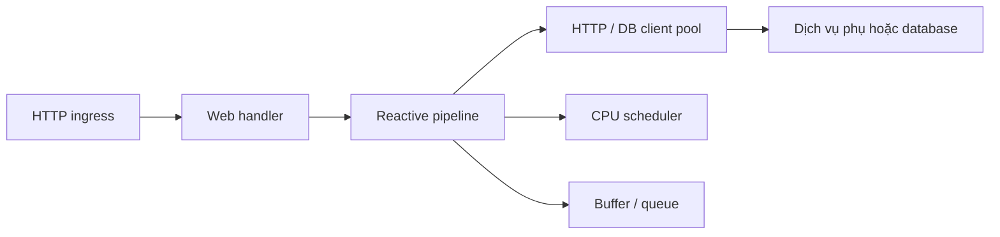

# Giới hạn tải đầu vào và bảo vệ tài nguyên hữu hạn

## Vì sao hệ thống reactive vẫn cần giới hạn tải?

Một hệ thống reactive có thể xử lý nhiều thao tác I/O đang chờ mà không giữ một thread cho mỗi thao tác. Điều đó giúp sử dụng tài nguyên hiệu quả, nhưng không làm tài nguyên trở nên vô hạn. CPU, heap, connection pool, số request đến dịch vụ phụ, hàng đợi message, file descriptor và băng thông đều có giới hạn.

Khi tốc độ đầu vào vượt quá khả năng xử lý trong một khoảng thời gian đủ dài, công việc chờ sẽ tích tụ. Hàng đợi tăng làm bộ nhớ tăng; thời gian chờ kéo dài khiến request dễ timeout; retry tạo thêm tải; dịch vụ phụ càng chậm thì hệ thống càng giữ nhiều công việc đang hoạt động. Nếu không có cơ chế bảo vệ, một đợt tải tăng ngắn có thể biến thành tình trạng quá tải kéo dài.

Trong `REACTIVE_PROGRAMMING`, Reactive Streams và Reactor cung cấp demand, `Mono`, `Flux`, các toán tử điều tiết và cancellation để phối hợp tốc độ giữa publisher và subscriber. Các cơ chế này là một phần của giải pháp, nhưng một hệ thống thực tế còn cần giới hạn đầu vào, concurrency, buffer, thời gian chờ và chính sách từ chối công việc. Mục tiêu là giữ hệ thống trong vùng có thể phục vụ ổn định, đồng thời phản hồi rõ ràng khi nhu cầu vượt năng lực.

## Xác định tài nguyên và điểm nghẽn

Trước khi chọn giới hạn, hãy xác định tài nguyên nào có thể cạn và nơi nào đang giữ nó. Một request HTTP có thể đi qua nhiều tầng:



Mỗi tầng có giới hạn riêng. Ví dụ, WebFlux có thể nhận hàng nghìn kết nối đang chờ I/O, nhưng database chỉ cho phép một số lượng connection đồng thời nhỏ hơn nhiều. Nếu mọi request đều mở truy vấn cùng lúc, connection pool hoặc database sẽ trở thành điểm nghẽn. Nếu chuyển tất cả công việc sang `boundedElastic` mà không giới hạn số tác vụ, hàng đợi của scheduler cũng có thể tăng.

| Tài nguyên | Dấu hiệu quá tải | Cơ chế bảo vệ thường dùng |
|---|---|---|
| CPU | CPU gần bão hòa, run queue tăng, p95/p99 tăng | Giới hạn concurrency CPU, chia tải, từ chối sớm |
| Heap | GC thường xuyên, allocation tăng, nguy cơ OOM | Buffer hữu hạn, giới hạn payload, xử lý theo lô |
| Database connection | Chờ lấy connection, pool cạn, query latency tăng | Giới hạn truy vấn đồng thời, timeout, bulkhead |
| HTTP client connection | Pending acquire tăng, request chờ lâu | Giới hạn in-flight, connection pool và timeout |
| Scheduler worker | Worker bận lâu, task queue tăng | Tách CPU/blocking, giới hạn tác vụ và hàng đợi |
| Message queue | Consumer lag tăng, backlog kéo dài | Điều chỉnh prefetch, pause/resume, quota và load shedding |
| File descriptor/socket | Lỗi mở kết nối, số handle tăng | Giới hạn kết nối, timeout và cleanup |

Không nên bắt đầu bằng cách tăng thread pool hoặc queue size. Trước hết cần xác định tài nguyên nào đang bão hòa, request giữ tài nguyên đó trong bao lâu và tầng nào có thể từ chối hoặc trì hoãn công việc.

## Tốc độ đầu vào, thời gian xử lý và lượng công việc đang chờ

Một mô hình hữu ích để suy nghĩ về tải là định luật Little:

\[
L = \lambda \times W
\]

Trong đó:

- `L` là số công việc trung bình đang ở trong hệ thống, gồm cả công việc đang xử lý và đang chờ.
- `λ` là tốc độ công việc đi vào hệ thống, thường đo bằng request mỗi giây.
- `W` là thời gian trung bình một công việc ở trong hệ thống.

Ví dụ, nếu hệ thống nhận trung bình 100 request/giây và mỗi request ở trong hệ thống 0,2 giây, số request đang hoạt động trung bình xấp xỉ 20. Nếu dependency chậm khiến thời gian tăng lên 2 giây trong khi đầu vào vẫn là 100 request/giây, số request đang hoạt động trung bình có thể tăng lên khoảng 200. Số request tăng không nhất thiết vì có nhiều người dùng hơn; chỉ riêng thời gian chờ dài hơn cũng làm nhiều tài nguyên bị giữ cùng lúc.

Định luật Little mô tả trạng thái ổn định, không thay thế benchmark hay capacity planning. Nhưng nó giúp nhận ra rằng khi độ trễ tăng, số công việc in-flight và bộ nhớ cần thiết cũng tăng nếu tốc độ đầu vào không đổi. Vì vậy, giới hạn concurrency và queue là cần thiết ngay cả khi ứng dụng sử dụng I/O non-blocking.

## Ba lớp bảo vệ cần phối hợp

Một hệ thống chịu tải tốt thường kết hợp ba lớp:

1. **Admission control:** quyết định có nhận công việc mới hay từ chối ngay tại cửa vào. Mục tiêu là không để số request được chấp nhận vượt ngân sách của hệ thống.
2. **Flow control và backpressure:** điều tiết lượng dữ liệu được truyền giữa các publisher và subscriber bên trong pipeline. Mục tiêu là để bên tiêu thụ không bị buộc nhận nhiều phần tử hơn demand.
3. **Load shedding và recovery:** khi tải vượt giới hạn hoặc dependency suy giảm, chủ động bỏ, trì hoãn, từ chối hoặc chuyển hướng một phần công việc; kết hợp timeout, cancellation và circuit breaker để ngăn sự cố lan rộng.

Không lớp nào thay thế hoàn toàn lớp khác. Backpressure trong một `Flux` không tự giới hạn số HTTP request mới được server chấp nhận. Admission control không thay thế demand giữa các toán tử. Rate limit không bảo đảm một request đang chạy sẽ không giữ connection vô thời hạn. Cần đặt giới hạn ở đúng ranh giới tài nguyên.

## Admission control tại cửa vào

Admission control giới hạn số request hoặc công việc được phép đi vào phần xử lý đắt đỏ. Nếu năng lực phục vụ đã đạt ngưỡng, ứng dụng có thể trả `503 Service Unavailable` hoặc `429 Too Many Requests` thay vì tiếp nhận thêm rồi để tất cả chờ trong bộ nhớ.

Ví dụ WebFlux filter đơn giản giới hạn số HTTP request đang được xử lý trong một instance:

```java
import java.util.concurrent.atomic.AtomicInteger;
import org.springframework.http.HttpStatus;
import org.springframework.stereotype.Component;
import org.springframework.web.server.ServerWebExchange;
import org.springframework.web.server.WebFilter;
import org.springframework.web.server.WebFilterChain;
import reactor.core.publisher.Mono;

@Component
final class IngressConcurrencyFilter implements WebFilter {
    private static final int MAX_ACTIVE_REQUESTS = 200;
    private final AtomicInteger activeRequests = new AtomicInteger();

    @Override
    public Mono<Void> filter(ServerWebExchange exchange, WebFilterChain chain) {
        if (activeRequests.incrementAndGet() > MAX_ACTIVE_REQUESTS) {
            activeRequests.decrementAndGet();
            exchange.getResponse().setStatusCode(HttpStatus.SERVICE_UNAVAILABLE);
            return exchange.getResponse().setComplete();
        }

        return Mono.defer(() -> chain.filter(exchange))
            .doFinally(signal -> activeRequests.decrementAndGet());
    }
}
```

Bộ đếm được tăng trước khi chuyển request vào chain. Nếu vượt ngưỡng, filter giảm lại bộ đếm và trả response từ chối. Với request được nhận, `doFinally` giảm bộ đếm khi request hoàn tất, lỗi hoặc bị hủy. Dùng `AtomicInteger` vì nhiều request có thể đi qua filter đồng thời.

Đây là ví dụ admission control trong phạm vi một instance, không phải rate limiter phân tán. Nếu chạy nhiều replica, mỗi replica có giới hạn riêng và tổng số request được nhận có thể bằng giới hạn nhân số replica. Với quota toàn hệ thống, quota theo tenant hoặc giới hạn theo người dùng, cần gateway hoặc bộ điều phối có trạng thái dùng chung. Trong production, cũng nên tách giới hạn theo route hoặc nhóm tài nguyên để endpoint nhẹ không bị chặn bởi endpoint rất đắt.

Admission control theo concurrency khác rate limiting. Concurrency limit giới hạn số request đang hoạt động cùng lúc; rate limit giới hạn số request được phép bắt đầu trong một khoảng thời gian. Một API có thể cần cả hai: ví dụ tối đa 100 request in-flight và tối đa 500 request mỗi giây cho một tenant. Khi từ chối, trả mã trạng thái và thông tin retry phù hợp với hợp đồng API; không để client retry ngay lập tức theo vòng lặp.

Rate limiter thường dùng fixed window, sliding window hoặc token bucket. Token bucket cho phép một lượng burst trong giới hạn dung lượng bucket, sau đó tốc độ cấp token quyết định tốc độ trung bình dài hạn. Đây là cách hữu ích khi API chấp nhận burst ngắn nhưng vẫn cần giới hạn tốc độ trung bình. Với quota theo người dùng hoặc tenant, khóa quota phải gắn với danh tính đã xác thực; không tin một header do client tự đặt nếu chưa được gateway kiểm chứng.

## Giới hạn concurrency của các lời gọi phụ

Trong Reactor, `flatMap` có overload nhận `concurrency` và `prefetch`. `concurrency` giới hạn số publisher con được subscribe đồng thời trong một subscription; đây là công cụ quan trọng khi mỗi phần tử nguồn kích hoạt một lời gọi HTTP hoặc database.

```java
import java.time.Duration;
import reactor.core.publisher.Flux;
import reactor.core.publisher.Mono;

Flux<EnrichedOrder> enrich(Flux<Order> orders) {
    return orders.flatMap(
        order -> inventoryClient.findBySku(order.sku())
            .timeout(Duration.ofSeconds(2))
            .map(stock -> new EnrichedOrder(order, stock)),
        16,  // Tối đa 16 publisher phụ đang hoạt động trong subscription này.
        1    // Prefetch nhỏ cho mỗi publisher phụ.
    );
}
```

Trong ví dụ, mỗi đơn hàng tạo một lời gọi tồn kho; `flatMap` giới hạn số nhánh đang hoạt động ở mức 16. `prefetch` điều chỉnh lượng phần tử được yêu cầu trước từ publisher con. Timeout giúp giải phóng nhánh nếu dịch vụ phụ không phản hồi trong thời gian cho phép.

Giới hạn này có phạm vi theo subscription. Nếu 50 HTTP request cùng chạy pipeline trên và mỗi request có thể mở 16 nhánh, tổng số lời gọi tồn kho có thể lớn hơn 16. Muốn giới hạn toàn instance hoặc toàn hệ thống, cần thêm bulkhead, giới hạn ở HTTP client connection pool, rate limiter hoặc cơ chế quota dùng chung. Không nên nhầm `flatMap(..., 16)` với giới hạn toàn cục cho mọi request.

Nếu thứ tự đầu ra phải giống thứ tự đầu vào, có thể cân nhắc `flatMapSequential` với concurrency hữu hạn. Nếu cần chỉ một lời gọi phụ hoạt động tại một thời điểm, `concatMap` là lựa chọn rõ ràng hơn nhưng giảm thông lượng. Chọn toán tử theo yêu cầu thứ tự và khả năng của dịch vụ đích.

## Backpressure điều tiết dữ liệu bên trong pipeline

Reactive Streams cho phép subscriber gọi `request(n)` để biểu đạt số phần tử sẵn sàng nhận. Demand đi ngược từ downstream lên upstream; dữ liệu đi từ upstream xuống downstream. Các toán tử Reactor phối hợp demand theo ngữ nghĩa riêng của chúng.

`limitRate(highTide)` điều chỉnh cách yêu cầu upstream thành các lô nhỏ hơn. Nó hữu ích khi muốn tránh chuyển một demand lớn thành một yêu cầu lớn duy nhất:

```java
Flux<Record> records = recordRepository.streamAll()
    .limitRate(64)
    .map(this::toRecordView);
```

`limitRate(64)` điều tiết các đợt request upstream; nó không giới hạn tổng số record được phát ở mức 64, không giới hạn số request HTTP và không phải giới hạn tốc độ theo giây. Nếu downstream tiếp tục yêu cầu, toàn bộ nguồn hữu hạn vẫn có thể được đọc. Muốn giới hạn tổng số phần tử, dùng `take(n)`; muốn giới hạn số tác vụ phụ đang hoạt động, dùng concurrency; muốn giới hạn tốc độ bắt đầu request, dùng rate limiter.

Backpressure chỉ có tác dụng nếu nguồn có thể tuân thủ demand. Một `Flux.range` hoặc driver reactive có thể điều tiết phát dữ liệu theo request. Một callback API, thiết bị hoặc event bus push-based có thể tiếp tục phát bất kể subscriber đang yêu cầu bao nhiêu. Khi đó, adapter phải dùng cơ chế pause/resume, acknowledgement hoặc chính sách overflow.

## Buffer phải hữu hạn và có chính sách overflow

Buffer hấp thụ chênh lệch tốc độ trong thời gian ngắn. Nếu producer phát nhanh hơn consumer nhưng sự chênh lệch chỉ tạm thời, một hàng đợi hữu hạn có thể giúp pipeline tiếp tục. Nếu tốc độ đầu vào luôn cao hơn tốc độ xử lý, mọi buffer cuối cùng cũng đầy; tăng kích thước buffer chỉ trì hoãn thời điểm quá tải và làm tăng độ trễ/bộ nhớ.

Với nguồn push, có thể chọn chiến lược backpressure theo ý nghĩa dữ liệu:

```java
import reactor.core.publisher.Flux;

Flux<StatusSnapshot> snapshots = hotStatusSource
    .onBackpressureLatest();

Flux<AuditEvent> auditEvents = hotAuditSource
    .onBackpressureBuffer(256);
```

`onBackpressureLatest()` giữ giá trị mới nhất khi downstream chưa thể nhận, phù hợp với snapshot trạng thái mà giá trị cũ có thể thay thế. `onBackpressureBuffer(256)` đệm tối đa 256 phần tử; nếu buffer đầy, pipeline phát lỗi overflow. Với audit event hoặc giao dịch không được mất, lỗi overflow cần được quan sát và xử lý ở tầng nghiệp vụ, chẳng hạn dừng nhận message, retry có kiểm soát hoặc lưu vào hàng đợi bền vững.

Các toán tử `onBackpressure...` thường yêu cầu upstream phát tối đa theo cơ chế riêng của toán tử rồi quản lý phần tử ở phía buffer/drop/latest. Vì vậy, `onBackpressureBuffer` không làm producer chậm lại; nó tạo hàng đợi để hấp thụ chênh lệch trong giới hạn đã đặt. Nếu nguồn hỗ trợ pause/resume hoặc acknowledgement, điều tiết trực tiếp ở nguồn thường giúp tránh tạo thêm backlog trong bộ nhớ ứng dụng.

Nếu nghiệp vụ cho phép bỏ sự kiện mới khi downstream không theo kịp, `onBackpressureDrop(...)` có thể ghi nhận phần tử bị bỏ. Không dùng `DROP` hoặc `LATEST` cho dữ liệu bắt buộc phải xử lý đầy đủ. Ngược lại, không dùng buffer không giới hạn cho nguồn dài hạn vì heap có thể tăng cho đến khi tiến trình gặp lỗi.

| Chính sách | Hành vi | Dữ liệu phù hợp |
|---|---|---|
| Buffer hữu hạn, overflow thành lỗi | Giữ dữ liệu trong giới hạn; báo lỗi khi đầy | Sự kiện cần bảo toàn và có đường xử lý quá tải rõ ràng |
| Drop phần tử mới | Bỏ sự kiện không thể nhận | Telemetry hoặc cập nhật có thể bỏ qua |
| Latest | Chỉ giữ trạng thái mới nhất | Tiến độ, giá trị cảm biến hiện tại, snapshot |
| Pause/resume hoặc acknowledgement | Điều tiết producer ở nguồn | Broker hoặc API có hỗ trợ flow control |
| Ghi ra hàng đợi bền vững | Chuyển backlog sang storage/broker | Công việc cần được xử lý sau nhưng không thể giữ hết trong heap |

Buffer phải được đánh giá trên toàn tuyến. Một buffer 256 phần tử trong mỗi subscription có thể trở thành hàng chục nghìn phần tử khi có nhiều subscriber. Cần tính số queue đồng thời, kích thước payload trung bình và số tầng có buffer, không chỉ nhìn giới hạn của một toán tử.

## Rate limit, concurrency limit và bulkhead

Ba cơ chế này thường cùng xuất hiện nhưng kiểm soát những đại lượng khác nhau:

| Cơ chế | Giới hạn điều gì? | Ví dụ |
|---|---|---|
| Rate limit | Số thao tác bắt đầu trong một khoảng thời gian | Tối đa 100 request/giây cho mỗi API key |
| Concurrency limit | Số thao tác đang hoạt động cùng lúc | Tối đa 20 truy vấn đang chạy đến dịch vụ tồn kho |
| Bulkhead | Phần tài nguyên được dành riêng cho một nhóm công việc | Tách pool hoặc semaphore cho thanh toán và báo cáo |

Rate limit bảo vệ dịch vụ khỏi tốc độ request quá cao, nhưng không ngăn một request chậm giữ tài nguyên trong thời gian dài. Concurrency limit giữ số thao tác in-flight trong giới hạn, nhưng nếu mỗi thao tác rất ngắn thì tốc độ tổng vẫn có thể cao. Bulkhead cô lập nhóm tài nguyên để một dependency hoặc loại request không chiếm hết năng lực của phần còn lại.

Trong ứng dụng reactive, bulkhead nên được áp dụng ở ranh giới gọi dependency hoặc pool tài nguyên. Có thể dùng thư viện resilience có hỗ trợ reactive publisher, semaphore bulkhead hoặc giới hạn connection pool. Hãy kiểm tra adapter có thực sự trả lỗi khi không lấy được slot hay lại xếp hàng không giới hạn; một bulkhead có queue lớn vẫn có thể giữ quá nhiều request chờ.

Với các dependency khác nhau, đặt ngân sách riêng. Ví dụ, truy vấn hồ sơ có thể được phép 40 request đồng thời, còn dịch vụ thanh toán chỉ cho phép 8. Không nên dùng một concurrency limit lớn chung cho toàn bộ hệ thống nếu các dependency có năng lực và mức độ quan trọng khác nhau.

## Timeout, cancellation và circuit breaker

Giới hạn tải cần kết hợp với thời gian chờ. Một request có thể chiếm slot concurrency quá lâu nếu dependency treo. Đặt timeout theo hợp đồng của từng dependency để kết thúc công việc không còn hữu ích:

```java
import java.time.Duration;
import reactor.core.publisher.Mono;

Mono<PaymentStatus> status = paymentClient.lookup(paymentId)
    .timeout(Duration.ofSeconds(2));
```

Khi timeout xảy ra, Reactor hủy subscription upstream và phát lỗi timeout. Adapter/client cần truyền cancellation đến request I/O thực tế để giải phóng connection hoặc tài nguyên sớm nhất có thể. Nếu thư viện blocking không hỗ trợ hủy, timeout ở pipeline có thể chỉ dừng việc chờ kết quả; thao tác vật lý vẫn chạy trên worker cho đến khi API tự kết thúc.

Retry phải có giới hạn và backoff. Retry ngay lập tức khi dependency đang quá tải có thể nhân số request và làm sự cố nặng hơn. Chỉ retry lỗi tạm thời, đặt deadline tổng, thêm jitter và bảo đảm thao tác có side effect là idempotent. Không retry cancellation do caller.

Circuit breaker bổ sung một lớp bảo vệ: khi tỷ lệ lỗi hoặc thời gian chậm vượt ngưỡng, breaker tạm ngừng gọi dependency và trả lỗi/fallback ngay trong khoảng open. Sau thời gian chờ, breaker cho phép một số request thăm dò ở half-open để đánh giá dependency đã phục hồi chưa. Circuit breaker không thay thế timeout hoặc concurrency limit; nó giảm việc tiếp tục gửi request đến một dependency đang suy giảm.

Khi fallback, chọn dữ liệu có thể chấp nhận về độ mới và tính đúng đắn. Dữ liệu cache cũ có thể phù hợp với catalog nhưng không phù hợp với số dư thanh toán. Nếu không có fallback an toàn, trả lỗi rõ ràng thường tốt hơn trả một kết quả giả có thể gây sai nghiệp vụ.

## Load shedding và ưu tiên công việc

Khi hệ thống đã đạt ngưỡng, cố gắng xử lý mọi request thường làm giảm chất lượng cho tất cả người dùng. Load shedding chủ động loại bỏ một phần công việc để bảo vệ phần còn lại. Các lựa chọn thường gặp:

- Từ chối request mới ngay tại ingress bằng `429` hoặc `503`.
- Bỏ telemetry hoặc cập nhật trạng thái trung gian khi dữ liệu mới đã thay thế dữ liệu cũ.
- Giới hạn hoặc tạm dừng consumer đọc message khi downstream không theo kịp.
- Ưu tiên giao dịch quan trọng và giảm tải tác vụ báo cáo, thống kê hoặc tác vụ nền.
- Trả fallback đã được nghiệp vụ cho phép thay vì tiếp tục gọi dependency đang quá tải.

Chính sách shedding phải dựa trên mức độ quan trọng của dữ liệu. Không được bỏ giao dịch, audit hoặc lệnh nghiệp vụ bắt buộc chỉ để giữ thông lượng. Với công việc cần xử lý đầy đủ nhưng không thể xử lý ngay, chuyển nó sang broker hoặc kho lưu trữ bền vững có giới hạn và cơ chế backpressure ở producer.

Trong hệ thống đa tenant, giới hạn toàn cục có thể khiến một tenant tải lớn chiếm hết năng lực. Cân nhắc quota theo tenant, user hoặc API key, đồng thời giữ một phần capacity cho công việc hệ thống và request ưu tiên. Fairness cần được kiểm tra trong điều kiện burst, không chỉ ở tải trung bình.

## Không chuyển blocking sang event loop để xử lý quá tải

Một lỗi phổ biến là dùng WebFlux nhưng gọi JDBC/JPA hoặc SDK blocking trực tiếp trong controller hoặc `map`. Khi event loop bị chặn, nhiều kết nối cùng phụ thuộc vào event loop đó có thể bị trì hoãn. Việc tăng số request đồng thời lúc này chỉ làm hàng đợi lớn hơn.

Nếu chưa thể thay thư viện blocking, trì hoãn và cô lập thao tác bằng `fromCallable` cùng `subscribeOn(Schedulers.boundedElastic())`:

```java
import java.time.Duration;
import reactor.core.publisher.Mono;
import reactor.core.scheduler.Schedulers;

Mono<LegacyRecord> loadLegacyRecord(String id) {
    return Mono.fromCallable(() -> legacyRepository.load(id))
        .subscribeOn(Schedulers.boundedElastic())
        .timeout(Duration.ofSeconds(3));
}
```

`boundedElastic` có giới hạn worker và hàng đợi, nhưng mỗi lời gọi blocking vẫn giữ một worker trong lúc chờ. Vì vậy, cần giới hạn concurrency trước khi đưa nhiều tác vụ vào pool và quan sát queue/rejection. Không dùng `Schedulers.parallel()` cho I/O blocking; pool này dành cho công việc CPU ngắn.

## Quan sát tải và đặt ngưỡng bằng số liệu

Một hệ thống chỉ có thể bảo vệ đúng nếu biết nó đang gần giới hạn nào. Theo dõi các metric tại ingress, pipeline và dependency:

| Metric | Câu hỏi cần trả lời |
|---|---|
| Request in-flight | Có bao nhiêu request đang hoạt động ở từng route/tenant? |
| Admission rejected | Bao nhiêu request bị từ chối và vì lý do nào? |
| Queue depth và queue wait | Hàng đợi có tăng liên tục không; thời gian chờ là bao lâu? |
| `flatMap`/bulkhead active | Có bao nhiêu lời gọi phụ đang hoạt động so với giới hạn? |
| Buffer overflow/drop | Có sự kiện bị bỏ hoặc buffer đầy không? |
| Connection pool pending/active | Dependency có đang chờ lấy connection không? |
| Timeout và retry | Bao nhiêu request timeout; retry có làm tăng tải không? |
| CPU, heap và GC | Nút thắt là CPU, bộ nhớ hay thời gian chờ? |
| p50/p95/p99 latency | Người dùng có bị ảnh hưởng trước khi throughput giảm không? |

Đặt cảnh báo theo xu hướng và ngưỡng vận hành, không chỉ theo CPU. Ví dụ, connection pool pending tăng cùng p99 có thể báo hiệu database bão hòa dù CPU của ứng dụng còn thấp. Queue depth tăng liên tục là dấu hiệu tốc độ đầu vào đang vượt tốc độ xử lý; tăng queue chỉ kéo dài thời gian trước khi hệ thống thất bại.

Khi đặt giới hạn, bắt đầu từ capacity đo được của dependency và ngân sách latency. Chạy thử tải tăng dần, burst và tải kéo dài; quan sát thời điểm latency tăng mạnh, queue bắt đầu tích tụ và lỗi xuất hiện. Đặt admission/concurrency limit thấp hơn vùng bão hòa để giữ headroom cho biến động và tác vụ nội bộ.

## Kiểm thử demand và hành vi quá tải

Reactor Test cho phép xác nhận publisher chỉ phát theo demand đã yêu cầu. Ví dụ:

```java
import reactor.core.publisher.Flux;
import reactor.test.StepVerifier;

Flux<Integer> source = Flux.range(1, 5);

StepVerifier.create(source, 0)
    .thenRequest(2)
    .expectNext(1, 2)
    .thenRequest(3)
    .expectNext(3, 4, 5)
    .verifyComplete();
```

Verifier bắt đầu với demand bằng không, yêu cầu hai phần tử rồi mới yêu cầu ba phần tử còn lại. Kiểm thử xác nhận nguồn tuân thủ demand tại ranh giới này. Với pipeline thực tế, có thể đặt `doOnRequest` để quan sát demand qua từng toán tử và xác nhận prefetch/concurrency không vượt ngân sách dự kiến.

Ngoài unit test, cần có kiểm thử tải và kiểm thử quá tải:

1. Tăng tốc độ đầu vào từng bước để xác định throughput ổn định và điểm bão hòa.
2. Tạo burst ngắn để kiểm tra buffer có hấp thụ được mà không vượt giới hạn bộ nhớ không.
3. Làm chậm hoặc ngắt dependency để kiểm tra timeout, circuit breaker, bulkhead và fallback.
4. Giữ tải cao đủ lâu để xác nhận queue không tăng vô hạn và hệ thống phục hồi sau khi tải giảm.
5. Hủy request ở giữa pipeline để xác nhận cancellation giải phóng connection, listener và slot concurrency.
6. Chạy nhiều tenant cùng lúc để kiểm tra quota và fairness.

Một test chỉ xác nhận `Flux` phát đúng giá trị không chứng minh hệ thống chịu tải tốt. Cần kiểm tra cả giới hạn số request, dung lượng queue, hành vi từ chối, tỷ lệ lỗi và khả năng phục hồi.

## Những ngộ nhận thường gặp

- **Reactive đồng nghĩa tài nguyên không giới hạn:** non-blocking giúp dùng thread hiệu quả hơn, nhưng CPU, connection, heap và băng thông vẫn hữu hạn.
- **Backpressure tự giới hạn số HTTP request:** demand điều tiết phần tử trong subscription; admission control mới quyết định nhận request mới.
- **`limitRate(64)` giới hạn 64 phần tử mỗi giây:** nó chia demand thành các lô, không phải rate limiter.
- **`flatMap(..., 16)` giới hạn toàn bộ ứng dụng ở 16 request:** giới hạn này thuộc một subscription; nhiều request bên ngoài có thể nhân số nhánh đang hoạt động.
- **Buffer càng lớn càng an toàn:** buffer lớn chỉ trì hoãn overflow, tăng memory footprint và latency.
- **`onBackpressureBuffer` luôn bảo toàn dữ liệu an toàn:** buffer hữu hạn vẫn có thể overflow; buffer không giới hạn có thể gây OOM.
- **Timeout luôn dừng được I/O bên ngoài:** chỉ dừng vật lý nếu adapter/client hỗ trợ cancellation; blocking call có thể tiếp tục chạy.
- **Retry giúp phục hồi mà không tạo thêm tải:** retry sai thời điểm có thể khuếch đại sự cố và tạo side effect trùng lặp.
- **Circuit breaker thay thế mọi giới hạn khác:** breaker giảm gọi đến dependency đang lỗi, nhưng không thay admission control, timeout, bulkhead hoặc queue bound.
- **CPU còn thấp nghĩa là hệ thống chưa quá tải:** database pool, queue, scheduler hoặc dịch vụ phụ có thể đã bão hòa trước CPU.

## Quy trình thiết kế giới hạn tải

Khi xây dựng một dịch vụ reactive, hãy liệt kê tài nguyên hữu hạn và xác định giới hạn ở từng ranh giới: số request được nhận, số lời gọi phụ đang hoạt động, số connection, kích thước buffer và thời gian chờ. Dùng admission control để từ chối sớm khi đã hết capacity; dùng demand và `limitRate` để điều tiết dữ liệu trong pipeline; dùng `flatMap` concurrency, bulkhead và pool limit để kiểm soát công việc in-flight.

Tiếp theo, chọn chính sách overflow theo loại dữ liệu: giữ trong buffer hữu hạn, drop, latest, pause/resume hoặc lưu bền vững. Đặt timeout và cancellation để giải phóng tài nguyên khi công việc không còn hữu ích; thêm retry có giới hạn và circuit breaker để tránh khuếch đại lỗi. Với hệ thống đa tenant, phân bổ quota và giữ capacity cho request quan trọng.

Cuối cùng, quan sát queue, in-flight work, pool wait, overflow, timeout, retry, latency và rejection; kiểm thử cả tải ổn định, burst và dependency chậm. Một hệ thống reactive vững chắc không cố nhận mọi công việc bằng mọi giá. Nó kiểm soát lượng việc đang hoạt động, từ chối có chủ đích khi vượt năng lực và phục hồi khi tài nguyên trở lại trạng thái bình thường.
