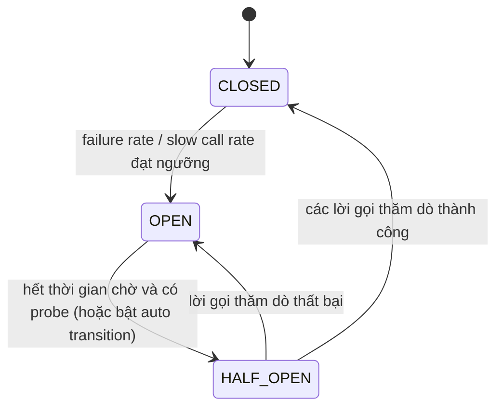

# Cô lập lỗi bằng bulkhead và ngắt mạch bằng circuit breaker

Một dịch vụ reactive có thể xử lý nhiều request đồng thời trên một số lượng thread nhỏ. Điều đó giúp sử dụng tài nguyên hiệu quả, nhưng cũng khiến một dependency chậm hoặc lỗi có thể chiếm hết connection, slot xử lý và bộ nhớ chờ của ứng dụng. Hai cơ chế thường dùng để giới hạn ảnh hưởng là **bulkhead** và **circuit breaker**. Bulkhead giới hạn số thao tác được phép chạy đồng thời; circuit breaker ngừng gửi request mới đến dependency đang có dấu hiệu thất bại.

Bài học thuộc chương **Hệ thống phản ứng** của module `REACTIVE_PROGRAMMING`. Module hướng dẫn tư duy reactive qua các luồng sự kiện bất đồng bộ, hợp đồng Publisher–Subscriber và cơ chế backpressure của Reactive Streams; người học thực hành `Mono`, `Flux`, kết hợp toán tử, điều khiển scheduler, xử lý lỗi và kiểm thử pipeline trong hệ sinh thái Java. Trọng tâm ở đây là áp dụng bulkhead và circuit breaker với Reactor, hiểu cách các operator tương tác với backpressure, timeout, fallback và cancellation.

Sau bài học, bạn có thể:

- Giải thích bulkhead và circuit breaker bảo vệ các phần khác nhau của hệ thống.
- Giới hạn số request đồng thời bằng semaphore bulkhead của Resilience4j.
- Cấu hình circuit breaker với sliding window, failure rate và trạng thái half-open.
- Đặt timeout để các lời gọi chậm có cơ hội được ghi nhận là slow call hoặc failure.
- Sắp xếp operator để lỗi do bulkhead không bị tính nhầm thành lỗi của dependency.
- Chọn fallback và retry mà không che giấu lỗi hoặc tạo tải lớn hơn.
- Kiểm thử từ chối do bulkhead, trạng thái open của circuit breaker và việc giải phóng permit khi cancel.

## 1. Hai cơ chế, hai loại rủi ro

Giả sử một API WebFlux gọi dịch vụ danh mục sản phẩm. Khi dịch vụ danh mục chậm, các request có thể chờ lâu và giữ connection, bộ đệm hoặc các slot xử lý. Khi dịch vụ liên tục trả lỗi, ứng dụng vẫn tiếp tục gửi request mới, làm tăng tải lên dependency vốn đang gặp sự cố.

Bulkhead và circuit breaker xử lý hai vấn đề khác nhau:

| Cơ chế | Câu hỏi được trả lời | Hành vi chính |
|---|---|---|
| Bulkhead | Có bao nhiêu lời gọi được phép đồng thời sử dụng tài nguyên này? | Cấp permit cho số lời gọi trong giới hạn; từ chối hoặc chờ khi hết permit. |
| Circuit breaker | Dependency có đang ở trạng thái đủ khỏe để nhận lời gọi mới không? | Theo dõi kết quả và độ chậm; mở mạch khi ngưỡng lỗi đạt điều kiện. |

Bulkhead bảo vệ năng lực xử lý cục bộ. Circuit breaker bảo vệ hệ thống khỏi tiếp tục gọi một dependency đang thất bại. Chúng thường được dùng cùng nhau, bên cạnh timeout và giới hạn hàng đợi.

```text
                         Request
                            |
                            v
                    +---------------+
                    |   Bulkhead    |
                    | giới hạn đồng |
                    | thời           |
                    +---------------+
                            |
                            v
                    +---------------+
                    | Circuit       |
                    | Breaker       |
                    | quyết định có |
                    | gọi dependency|
                    | hay không     |
                    +---------------+
                            |
                            v
                    Remote dependency
```

Sơ đồ chỉ mô tả một cách bố trí phổ biến. Thứ tự operator trong code quyết định cơ chế nào nhận và quan sát lỗi của cơ chế nào; cần chọn thứ tự có chủ đích.

## 2. Bulkhead: giới hạn số lời gọi đồng thời

Bulkhead lấy tên từ các vách ngăn trên tàu: một khoang bị ngập không nên làm chìm toàn bộ con tàu. Trong phần mềm, ta giới hạn tài nguyên hoặc concurrency dành cho từng dependency để sự cố ở một nhánh không chiếm hết năng lực của ứng dụng.

Ví dụ, một service gọi ba dependency:

- Catalog: tối đa 30 lời gọi đồng thời.
- Recommendation: tối đa 8 lời gọi đồng thời.
- Audit: tối đa 12 lời gọi đồng thời.

Nếu Recommendation chậm và dùng hết 8 permit, các lời gọi Catalog vẫn có thể tiếp tục sử dụng pool riêng. Đây là cách cô lập sự cố giữa các dependency.

### Semaphore bulkhead và thread-pool bulkhead

Resilience4j cung cấp hai mô hình bulkhead thường gặp:

| Loại | Cơ chế | Đặc điểm |
|---|---|---|
| Semaphore bulkhead | Cấp permit cho mỗi lời gọi đang hoạt động | Giới hạn concurrency, không tạo thread riêng và không tự chuyển scheduler. |
| Thread-pool bulkhead | Dùng thread pool và queue có giới hạn | Cách ly việc thực thi bằng pool riêng, có giới hạn số thread và hàng đợi. |

Với Reactor, `BulkheadOperator` tích hợp semaphore bulkhead vào Publisher. Nó không tự biến một lời gọi blocking thành non-blocking và không chuyển việc thực thi sang thread khác. Nếu dependency dùng API blocking, cần điều phối nó trên scheduler phù hợp, chẳng hạn `Schedulers.boundedElastic()`, hoặc thay bằng client reactive.

Thread-pool bulkhead là một mô hình thực thi khác. Khi tích hợp với Reactor, cần dùng API/adapter tương thích của Resilience4j để chuyển `CompletionStage` hoặc tác vụ được submit thành Publisher. Không truyền nhầm `ThreadPoolBulkhead` vào operator dành cho semaphore `Bulkhead`.

## 3. Cấu hình semaphore bulkhead với Resilience4j

Ví dụ dùng Resilience4j 2.x và Reactor. Hãy quản lý các dependency bằng cùng BOM/version trong dự án:

```xml
<dependency>
    <groupId>io.github.resilience4j</groupId>
    <artifactId>resilience4j-reactor</artifactId>
</dependency>
<dependency>
    <groupId>io.github.resilience4j</groupId>
    <artifactId>resilience4j-bulkhead</artifactId>
</dependency>
<dependency>
    <groupId>io.github.resilience4j</groupId>
    <artifactId>resilience4j-circuitbreaker</artifactId>
</dependency>
```

Tạo bulkhead dùng chung cho dependency Catalog:

```java
BulkheadConfig config = BulkheadConfig.custom()
    .maxConcurrentCalls(30)
    .maxWaitDuration(Duration.ZERO)
    .build();

Bulkhead catalogBulkhead = Bulkhead.of("catalog", config);
```

- `maxConcurrentCalls(30)` giới hạn tối đa 30 lời gọi đang giữ permit.
- `maxWaitDuration(Duration.ZERO)` yêu cầu từ chối ngay khi hết permit, không chờ trong hàng đợi của bulkhead.

Áp dụng vào Publisher:

```java
Mono<Product> product = webClient.get()
    .uri("/products/{id}", productId)
    .retrieve()
    .bodyToMono(Product.class)
    .transformDeferred(BulkheadOperator.of(catalogBulkhead));
```

Khi có subscription, operator thử lấy permit trước khi cho lời gọi đi tiếp. Permit được giải phóng khi Publisher kết thúc bằng complete hoặc error, hoặc khi subscription bị cancel. Nếu không lấy được permit theo chính sách chờ đã cấu hình, downstream nhận `BulkheadFullException`.

### Bulkhead phải được chia sẻ giữa các request cần cùng giới hạn

Không tạo một `Bulkhead` mới bên trong mỗi lần gọi controller:

```java
// Không nên: mỗi request có giới hạn riêng nên không tạo được giới hạn chung.
Mono<Product> find(String id) {
    Bulkhead bulkhead = Bulkhead.ofDefaults("catalog");
    return callCatalog(id).transformDeferred(BulkheadOperator.of(bulkhead));
}
```

Hãy tạo instance theo dependency ở phạm vi ứng dụng, ví dụ một Spring bean singleton:

```java
@Configuration
class ResilienceConfiguration {
    @Bean
    Bulkhead catalogBulkhead() {
        BulkheadConfig config = BulkheadConfig.custom()
            .maxConcurrentCalls(30)
            .maxWaitDuration(Duration.ZERO)
            .build();
        return Bulkhead.of("catalog", config);
    }
}
```

Một instance dùng chung giúp các subscription trong cùng process chia sẻ giới hạn. Bulkhead này vẫn là giới hạn theo instance ứng dụng; nếu chạy 5 replica, tổng concurrency toàn cụm có thể lên đến 5 lần giới hạn mỗi instance. Nếu cần quota toàn cụm, phải phối hợp ở gateway, service mesh hoặc một cơ chế điều phối phân tán khác.

## 4. Bulkhead khác với `flatMap` concurrency và scheduler

Reactor có nhiều công cụ điều tiết nhưng phạm vi của chúng khác nhau:

| Công cụ | Phạm vi giới hạn | Có dùng chung giữa nhiều request không? |
|---|---|---|
| `flatMap(mapper, concurrency)` | Số Publisher con đang hoạt động trong một pipeline cụ thể | Không; giới hạn gắn với lần chạy pipeline đó. |
| Semaphore bulkhead | Số lời gọi cùng sử dụng một dependency trong process | Có, nếu các pipeline dùng chung instance. |
| `Schedulers.parallel()` | Nơi thực thi các tác vụ CPU-bound | Không phải giới hạn request của dependency. |
| `Schedulers.boundedElastic()` | Tài nguyên thread cho công việc blocking | Không thay thế chính sách concurrency theo dependency. |

Ví dụ `flatMap`:

```java
Flux<Product> products = productIds
    .flatMap(id -> callCatalog(id), 10);
```

`10` giới hạn số inner Publisher đồng thời trong pipeline này. Nếu 100 HTTP request độc lập cùng chạy pipeline, mỗi request có thể có tối đa 10 inner Publisher; tổng số lời gọi vẫn có thể lớn hơn 10. Một bulkhead dùng chung mới tạo giới hạn đồng thời ở phạm vi dependency trong process.

Scheduler cũng không phải bulkhead. `publishOn(Schedulers.parallel())` chuyển execution context nhưng không đảm bảo chỉ có tối đa một số lời gọi Catalog nhất định. Ngược lại, semaphore bulkhead giới hạn permit nhưng không đổi thread thực thi.

## 5. Circuit breaker: ngừng gọi dependency đang thất bại

Circuit breaker theo dõi kết quả các lời gọi và chuyển trạng thái dựa trên ngưỡng cấu hình. Ba trạng thái chính:



- **CLOSED:** cho phép lời gọi đi qua và ghi nhận kết quả.
- **OPEN:** từ chối lời gọi mới ngay lập tức.
- **HALF_OPEN:** cho phép một số lời gọi thăm dò có giới hạn để đánh giá dependency đã phục hồi chưa.

Nếu các lời gọi thăm dò đủ tốt, breaker đóng lại; nếu tiếp tục thất bại, breaker mở lại.

Circuit breaker có thể còn các trạng thái vận hành khác như `DISABLED`, `FORCED_OPEN` hoặc `METRICS_ONLY`, tùy thư viện và cấu hình. Ba trạng thái trên là vòng đời thường dùng trong chính sách tự phục hồi.

### Sliding window và ngưỡng lỗi

Circuit breaker thường đánh giá một cửa sổ thống kê:

- **Count-based window:** số lượng lời gọi gần nhất.
- **Time-based window:** kết quả trong một khoảng thời gian.
- **Minimum number of calls:** số mẫu tối thiểu trước khi đánh giá tỷ lệ.
- **Failure rate threshold:** tỷ lệ lỗi đủ cao để mở mạch.
- **Slow call rate threshold:** tỷ lệ lời gọi chậm đủ cao để mở mạch.

Ví dụ, cửa sổ 20 lời gọi, tối thiểu 10 mẫu và failure rate threshold 50% có nghĩa breaker chỉ bắt đầu đánh giá sau khi có ít nhất 10 kết quả. Nếu tỷ lệ lỗi trong cửa sổ đạt hoặc vượt 50%, breaker chuyển OPEN.

### Circuit breaker không phải timeout hoặc bulkhead

- Circuit breaker không tự giới hạn số lời gọi đang chạy khi CLOSED.
- Circuit breaker không tự kết thúc một request đang treo; cần timeout để giới hạn thời gian chờ.
- Khi chuyển OPEN, breaker từ chối lời gọi mới; các lời gọi đã được cho phép trước đó thường tiếp tục đến khi hoàn tất hoặc bị hủy bởi cơ chế khác.
- Circuit breaker không tự retry và không tự tạo dữ liệu fallback.

Do đó, circuit breaker thường được kết hợp với timeout, bulkhead và một chính sách fallback riêng.

## 6. Cấu hình circuit breaker

Ví dụ cấu hình một breaker cho Catalog:

```java
CircuitBreakerConfig config = CircuitBreakerConfig.custom()
    .slidingWindowType(CircuitBreakerConfig.SlidingWindowType.COUNT_BASED)
    .slidingWindowSize(20)
    .minimumNumberOfCalls(10)
    .failureRateThreshold(50)
    .slowCallDurationThreshold(Duration.ofSeconds(2))
    .slowCallRateThreshold(60)
    .waitDurationInOpenState(Duration.ofSeconds(5))
    .permittedNumberOfCallsInHalfOpenState(3)
    .build();

CircuitBreaker catalogCircuitBreaker =
    CircuitBreaker.of("catalog", config);
```

Các tham số cần được chọn theo latency và lưu lượng thực tế:

- `slidingWindowSize(20)`: xem 20 lời gọi gần nhất.
- `minimumNumberOfCalls(10)`: cần ít nhất 10 kết quả trước khi đánh giá.
- `failureRateThreshold(50)`: mở mạch khi tỷ lệ lỗi đạt 50% trở lên.
- `slowCallDurationThreshold(2s)`: một lời gọi lâu hơn hai giây được xem là slow call.
- `slowCallRateThreshold(60)`: mở mạch nếu tỷ lệ slow call đạt ngưỡng sau số mẫu tối thiểu.
- `waitDurationInOpenState(5s)`: chờ ít nhất năm giây trước khi cho phép probe ở HALF_OPEN. Với cấu hình mặc định không bật automatic transition, lần gọi tiếp theo sau khoảng chờ sẽ kích hoạt việc chuyển trạng thái; nếu bật automatic transition, breaker tự chuyển khi hết thời gian.
- `permittedNumberOfCallsInHalfOpenState(3)`: tối đa ba lời gọi thăm dò đồng thời theo cấu hình.

### Chọn exception được tính là failure

Không phải mọi exception đều phản ánh dependency đang hỏng. Ví dụ, lỗi validate hoặc lỗi nghiệp vụ `404` có thể là kết quả bình thường của request và không nên làm breaker mở mạch.

Resilience4j cho phép cấu hình `recordExceptions`, `ignoreExceptions` hoặc predicate ghi nhận lỗi. Khi khai báo danh sách `recordExceptions`, các exception không khớp danh sách đó được xem là kết quả thành công theo semantics cấu hình; `ignoreExceptions` loại các exception được chỉ định khỏi phép tính. Hãy xác định rõ lỗi nào biểu thị dependency failure, ví dụ timeout mạng, lỗi kết nối hoặc lỗi server upstream.

`BulkheadFullException` là lỗi do giới hạn cục bộ của ứng dụng, không phải bằng chứng Catalog bị lỗi. Nếu thứ tự operator khiến exception này đi qua circuit breaker, cần loại nó khỏi thống kê failure hoặc điều chỉnh thứ tự để breaker chỉ đo lời gọi thực sự được gửi tới dependency.

## 7. Áp dụng CircuitBreakerOperator cho Mono và Flux

Resilience4j cung cấp Reactor operator để bọc Publisher. Với `Mono`:

```java
Mono<Product> protectedCall = webClient.get()
    .uri("/products/{id}", productId)
    .retrieve()
    .bodyToMono(Product.class)
    .transformDeferred(CircuitBreakerOperator.of(catalogCircuitBreaker));
```

`transformDeferred` áp dụng operator theo subscription. Khi subscribe, circuit breaker kiểm tra có cho phép lời gọi hay không. Nếu breaker OPEN, downstream nhận `CallNotPermittedException` mà nguồn remote không được gọi. Nếu được phép, kết quả complete/error của Publisher được dùng để cập nhật thống kê breaker theo cấu hình.

Với `Flux`, operator có thể bọc một luồng nhiều phần tử:

```java
Flux<PriceUpdate> updates = webClient.get()
    .uri("/prices/stream")
    .retrieve()
    .bodyToFlux(PriceUpdate.class)
    .transformDeferred(CircuitBreakerOperator.of(priceCircuitBreaker));
```

Hãy thận trọng khi bọc stream dài hạn hoặc vô hạn như SSE/WebSocket. Một subscription có thể chỉ được ghi nhận khi terminal signal xuất hiện; một stream không kết thúc có thể giữ một call đang hoạt động trong thời gian dài và không cung cấp mẫu hoàn tất như một request-response thông thường. Bulkhead cũng có thể giữ permit suốt vòng đời stream. Với stream dài hạn, hãy thiết kế chính sách theo kết nối hoặc theo từng thao tác/message phù hợp, thay vì áp dụng nguyên xi cấu hình dành cho HTTP request ngắn.

## 8. Timeout phải nằm trong vùng được circuit breaker quan sát

Circuit breaker chỉ có thể đánh giá slow call khi lời gọi hoàn tất và thời gian thực thi được đo. Nếu dependency treo vô thời hạn, nó không tạo kết quả để breaker ghi nhận. Đặt timeout bên trong vùng được breaker bọc để timeout trở thành tín hiệu lỗi mà breaker quan sát:

```java
Mono<Product> remoteCall = webClient.get()
    .uri("/products/{id}", productId)
    .retrieve()
    .bodyToMono(Product.class)
    .timeout(Duration.ofSeconds(2))
    .transformDeferred(CircuitBreakerOperator.of(catalogCircuitBreaker));
```

Ở đây, circuit breaker bọc cả thao tác timeout. Nếu hai giây trôi qua mà không có kết quả, `TimeoutException` được phát qua vùng breaker và có thể được tính là failure nếu cấu hình ghi nhận exception đó.

Nếu đặt timeout bên ngoài circuit breaker:

```java
Mono<Product> remoteCall = webClient.get()
    .uri("/products/{id}", productId)
    .retrieve()
    .bodyToMono(Product.class)
    .transformDeferred(CircuitBreakerOperator.of(catalogCircuitBreaker))
    .timeout(Duration.ofSeconds(2));
```

timeout xảy ra sau ranh giới breaker. Breaker có thể chỉ nhìn thấy cancellation từ phía downstream thay vì `TimeoutException` như một lỗi của Publisher được bọc. Nếu mục tiêu là tính timeout của dependency vào failure rate, hãy đặt timeout bên trong breaker và kiểm tra cấu hình exception.

Timeout của Reactor cũng không thay thế connect/read timeout ở HTTP client. Hãy cấu hình timeout ở cả tầng transport và tầng Publisher theo deadline tổng của request.

## 9. Kết hợp bulkhead và circuit breaker đúng thứ tự

Một cách bố trí hữu ích là đặt timeout trong vùng circuit breaker, rồi đặt semaphore bulkhead ở ngoài circuit breaker:

```java
Mono<Product> primary = webClient.get()
    .uri("/products/{id}", productId)
    .retrieve()
    .bodyToMono(Product.class)
    .timeout(Duration.ofSeconds(2))
    .transformDeferred(CircuitBreakerOperator.of(catalogCircuitBreaker))
    .transformDeferred(BulkheadOperator.of(catalogBulkhead));
```

Theo cách bố trí này:

1. Bulkhead cấp permit trước khi subscription đi vào circuit breaker.
2. Circuit breaker kiểm tra trạng thái và chỉ cho lời gọi đi tiếp khi được phép.
3. Timeout nằm trong Publisher được circuit breaker quan sát.
4. Khi nguồn complete, error hoặc cancel, bulkhead giải phóng permit.
5. Nếu bulkhead từ chối do hết permit, `BulkheadFullException` phát ra bên ngoài circuit breaker và không bị tính nhầm là lỗi Catalog.

Nếu đổi thứ tự operator, phạm vi quan sát lỗi cũng đổi. Ví dụ, khi circuit breaker bọc bên ngoài bulkhead, lỗi `BulkheadFullException` có thể đi qua circuit breaker và ảnh hưởng thống kê nếu không được ignore. Hãy xác định rõ breaker cần đo lỗi của dependency hay cả lỗi điều phối cục bộ.

## 10. Fallback sau khi cơ chế bảo vệ đã ghi nhận lỗi

Fallback nên nằm sau các operator bảo vệ lời gọi chính. Khi đó circuit breaker có thể ghi nhận lỗi của nguồn chính trước khi ứng dụng chuyển sang cache hoặc giá trị dự phòng.

```java
Mono<Product> findProduct(String productId) {
    Mono<Product> primary = webClient.get()
        .uri("/products/{id}", productId)
        .retrieve()
        .bodyToMono(Product.class)
        .timeout(Duration.ofSeconds(2))
        .transformDeferred(CircuitBreakerOperator.of(catalogCircuitBreaker))
        .transformDeferred(BulkheadOperator.of(catalogBulkhead));

    return primary
        .onErrorResume(CallNotPermittedException.class,
            error -> productCache.find(productId))
        .onErrorResume(BulkheadFullException.class,
            error -> productCache.find(productId))
        .onErrorResume(TimeoutException.class,
            error -> productCache.find(productId));
}
```

Ví dụ dùng cache cho ba trường hợp: circuit breaker đang OPEN, bulkhead hết permit và lời gọi chính timeout. Trong ứng dụng thực tế, nên tránh lặp code fallback bằng một hàm riêng và chỉ fallback nếu cache đáp ứng yêu cầu freshness, tenant và quyền truy cập. Cache cũng cần timeout và giới hạn tài nguyên riêng để không trở thành dependency quá tải tiếp theo.

Không đặt `onErrorResume` bên trong Publisher mà circuit breaker đang đo nếu muốn breaker ghi nhận lỗi nguồn chính. Nếu fallback thành công trước khi lỗi đến breaker, breaker có thể chỉ nhìn thấy completion thành công và không nhận ra dependency chính đang lỗi.

### Fallback không phải retry

- Fallback chuyển sang một nguồn hoặc kết quả khác.
- Retry subscribe lại nguồn chính theo chính sách.
- Circuit breaker từ chối lời gọi mới khi trạng thái OPEN.

Không retry `CallNotPermittedException`: breaker đã quyết định tạm ngừng gọi dependency. Retry liên tục chỉ tạo thêm tải cục bộ. Nếu cần thử lại, hãy chờ trạng thái cho phép hoặc dùng fallback có kiểm soát.

## 11. Đặt retry cùng circuit breaker

Retry và circuit breaker có thể tương tác theo thứ tự operator. Một cấu hình thường gặp là retry lỗi tạm thời bên trong vùng circuit breaker để breaker quan sát kết quả của một thao tác logic đã bao gồm retry:

```java
Mono<Product> primary = webClient.get()
    .uri("/products/{id}", productId)
    .retrieve()
    .bodyToMono(Product.class)
    .timeout(Duration.ofSeconds(2))
    .retryWhen(Retry.max(1)
        .filter(TransientNetworkException.class::isInstance))
    .transformDeferred(CircuitBreakerOperator.of(catalogCircuitBreaker));
```

Trong cấu trúc này, breaker đo Publisher đã bao gồm một lần retry. Nếu retry cuối cùng thành công, breaker có thể ghi nhận call thành công; nếu vẫn lỗi, breaker ghi nhận lỗi cuối. Một cách bố trí khác có thể khiến mỗi lần thử được tính như một call riêng. Hãy chọn semantics phù hợp với cách bạn muốn thống kê dependency.

Retry làm tăng số request gửi tới upstream. Chỉ retry lỗi tạm thời, giới hạn số lần thử, thêm backoff/jitter khi phù hợp và bảo đảm thao tác an toàn khi lặp. Không retry lỗi validate, lỗi phân quyền hoặc lỗi do bulkhead/circuit breaker từ chối.

## 12. Kiểm thử bulkhead từ chối và giải phóng permit

Có thể kiểm tra semaphore bulkhead bằng một Publisher không bao giờ kết thúc để giữ permit của subscription đầu tiên:

```java
Bulkhead bulkhead = Bulkhead.of(
    "test-catalog",
    BulkheadConfig.custom()
        .maxConcurrentCalls(1)
        .maxWaitDuration(Duration.ZERO)
        .build()
);

Flux<String> guarded = Flux.<String>never()
    .transformDeferred(BulkheadOperator.of(bulkhead));

Disposable first = guarded.subscribe();

StepVerifier.create(guarded)
    .expectError(BulkheadFullException.class)
    .verify();

first.dispose();

assertThat(bulkhead.getMetrics().getAvailableConcurrentCalls())
    .isEqualTo(1);
```

Subscription đầu tiên giữ permit vì nguồn `never` chưa kết thúc. Subscription thứ hai bị từ chối do `maxConcurrentCalls(1)`. Khi dispose subscription đầu tiên, cancellation được truyền đến operator và permit được giải phóng. Kiểm thử xác nhận số permit khả dụng trở lại là một.

## 13. Kiểm thử circuit breaker chuyển sang OPEN

Để kiểm thử xác định, dùng cửa sổ nhỏ và số mẫu tối thiểu thấp:

```java
CircuitBreakerConfig config = CircuitBreakerConfig.custom()
    .slidingWindowSize(2)
    .minimumNumberOfCalls(2)
    .failureRateThreshold(50)
    .waitDurationInOpenState(Duration.ofSeconds(30))
    .build();

CircuitBreaker breaker = CircuitBreaker.of("test-catalog", config);

Mono<String> failing = Mono.<String>error(new IOException("upstream down"))
    .transformDeferred(CircuitBreakerOperator.of(breaker));

StepVerifier.create(failing)
    .expectError(IOException.class)
    .verify();

StepVerifier.create(failing)
    .expectError(IOException.class)
    .verify();

assertThat(breaker.getState()).isEqualTo(CircuitBreaker.State.OPEN);

StepVerifier.create(
        Mono.just("should-not-run")
            .transformDeferred(CircuitBreakerOperator.of(breaker))
    )
    .expectError(CallNotPermittedException.class)
    .verify();
```

Hai lần lỗi đủ số mẫu tối thiểu và tạo failure rate 100%, nên breaker chuyển OPEN. Lần subscribe tiếp theo bị từ chối với `CallNotPermittedException`. Trong test này, Publisher lỗi là cold nên mỗi lần subscribe tạo một lần gọi được breaker ghi nhận.

Các kiểm thử bổ sung nên xác nhận:

- Thành công được ghi nhận là success.
- Exception nghiệp vụ được ignore hoặc không ghi nhận là dependency failure theo config.
- Timeout được tính vào failure/slow-call theo chính sách.
- Sau `waitDurationInOpenState`, breaker cho phép số probe giới hạn ở HALF_OPEN.
- Fallback chỉ chạy sau lỗi phù hợp và không bị circuit breaker ghi nhận nhầm là success của nguồn chính.

## 14. Quan sát và vận hành

Bulkhead và circuit breaker cần được quan sát bằng metric và event, không chỉ bằng log lỗi. Các tín hiệu hữu ích gồm:

| Thành phần | Metric hoặc sự kiện nên theo dõi | Dấu hiệu cần chú ý |
|---|---|---|
| Bulkhead | Available concurrent calls, maximum allowed calls, rejected calls | Permit thường xuyên bằng 0 hoặc tỷ lệ từ chối tăng. |
| Circuit breaker | State, failure rate, slow call rate, buffered calls | OPEN lặp lại hoặc HALF_OPEN không phục hồi. |
| Dependency | Latency, timeout, HTTP status, connection errors | P95/P99 tăng hoặc lỗi upstream tăng. |
| Fallback | Fallback count, fallback latency, cache hit/miss | Fallback trở thành đường đi chính kéo dài. |
| Pipeline | Cancellation, queue size, in-flight calls | Tác vụ bị giữ lâu hoặc không giải phóng tài nguyên. |

Resilience4j có metrics/event API và có thể tích hợp Micrometer/Actuator khi ứng dụng cấu hình dependency tương ứng. Không nên tạo một instance breaker/bulkhead cho mỗi request vì metric sẽ bị phân mảnh và giới hạn không còn dùng chung.

Các instance Resilience4j trong ứng dụng thường quản lý trạng thái trong process. Khi chạy nhiều replica, mỗi replica có breaker và bulkhead riêng. Dashboard nên phân biệt metric theo instance và dependency; nếu cần quyết định toàn cụm, hãy dùng cơ chế ở tầng phân phối phù hợp.

## 15. Những lỗi thường gặp

| Cách làm sai | Hậu quả | Cách xử lý |
|---|---|---|
| Nghĩ bulkhead tự chuyển thread | Blocking call vẫn có thể chặn event loop. | Dùng client non-blocking hoặc scheduler phù hợp cho blocking; bulkhead chỉ giới hạn permit. |
| Tạo bulkhead/breaker mới trong mỗi request | Mỗi request có giới hạn riêng, không bảo vệ dependency dùng chung. | Dùng instance singleton theo dependency trong process. |
| Dùng `flatMap` concurrency như giới hạn toàn ứng dụng | Mỗi pipeline có giới hạn riêng, tổng request vẫn có thể rất lớn. | Dùng bulkhead chia sẻ khi cần giới hạn theo dependency. |
| Nghĩ circuit breaker giới hạn concurrency | CLOSED vẫn có thể cho phép nhiều request đồng thời. | Kết hợp bulkhead với circuit breaker. |
| Không đặt timeout cho dependency có thể treo | Lời gọi không hoàn tất nên không tạo mẫu slow/failure đúng lúc. | Đặt timeout trong vùng breaker quan sát và cấu hình timeout transport. |
| Để `BulkheadFullException` bị tính là lỗi dependency | Breaker có thể mở do chính ứng dụng hết permit. | Chọn thứ tự operator hoặc ignore exception cục bộ. |
| Đặt fallback trước circuit breaker | Breaker có thể chỉ thấy kết quả fallback thành công. | Đặt fallback sau vùng breaker nếu muốn ghi nhận lỗi nguồn chính. |
| Retry `CallNotPermittedException` | Tạo thêm tải khi breaker đã mở. | Không retry lỗi từ circuit breaker hoặc bulkhead. |
| Bọc stream vô hạn như một request ngắn | Permit có thể bị giữ lâu và breaker thiếu terminal sample. | Thiết kế bảo vệ theo kết nối, message hoặc thao tác ngắn. |
| Cho rằng một instance bảo vệ toàn cụm | Mỗi replica có trạng thái và giới hạn riêng. | Dùng gateway/service mesh hoặc cơ chế phân tán nếu cần quota toàn cụm. |

## 16. Checklist thiết kế resilience cho dependency

Trước khi đưa bulkhead và circuit breaker vào production, hãy xác nhận:

- Mỗi dependency có giới hạn concurrency phù hợp với capacity và connection pool không?
- Bulkhead có được dùng chung giữa các request trong process không?
- Hết permit thì từ chối ngay hay chờ; thời gian chờ có nằm trong deadline tổng không?
- Circuit breaker có sliding window và minimum sample đủ hợp lý không?
- Exception nào được ghi nhận là failure, exception nào cần ignore?
- Timeout có nằm trong vùng circuit breaker quan sát không?
- Slow call threshold có phản ánh SLO của dependency không?
- Thứ tự operator có ngăn lỗi bulkhead bị tính nhầm thành lỗi dependency không?
- Fallback có giới hạn riêng, tuân thủ tenant/security và freshness không?
- Retry có giới hạn, backoff và idempotency phù hợp không?
- Cancellation có giải phóng permit và tài nguyên upstream không?
- Metrics có phân biệt trạng thái breaker, từ chối bulkhead, timeout và fallback không?
- Giới hạn theo process có phù hợp với số replica và capacity toàn cụm không?

Bulkhead giới hạn mức độ một dependency có thể chiếm tài nguyên đồng thời; circuit breaker ngăn hệ thống tiếp tục gọi dependency khi thống kê cho thấy nó đang thất bại hoặc quá chậm. Khi kết hợp chúng với timeout, fallback có kiểm soát và cancellation đúng vòng đời, pipeline `Mono`/`Flux` có thể cô lập sự cố mà vẫn giữ được backpressure, khả năng quan sát và giới hạn tài nguyên của ứng dụng.
