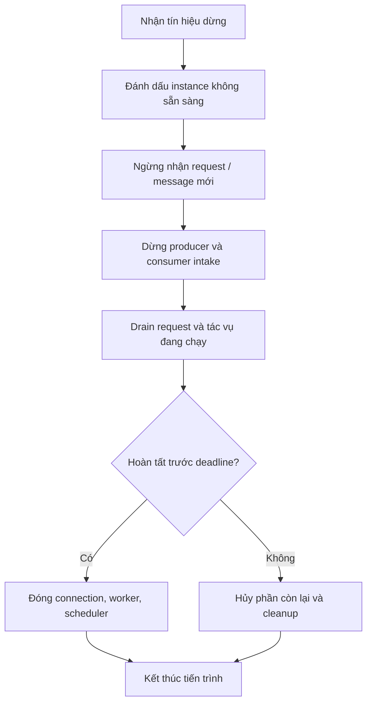

# Dừng ứng dụng có kiểm soát và hoàn tất tác vụ đang chạy

Trong chương **Hệ thống phản ứng**, bài học này trình bày cách dừng một ứng dụng reactive mà vẫn cho các request và tác vụ đang thực hiện cơ hội hoàn tất. Một ứng dụng không chỉ cần ngừng nhận công việc mới; nó còn phải xử lý các publisher đang hoạt động, transaction, consumer hàng đợi, kết nối mạng và scheduler theo một thứ tự có kiểm soát.

Bài học thuộc module **REACTIVE_PROGRAMMING**. Module hướng dẫn: “Học tư duy reactive qua các luồng sự kiện bất đồng bộ, hợp đồng Publisher–Subscriber và cơ chế backpressure của Reactive Streams. Thực hành Mono, Flux, kết hợp toán tử, kiểm soát scheduler, xử lý lỗi và kiểm thử pipeline trong hệ sinh thái Java.” Vì vậy, shutdown cần tôn trọng vòng đời subscription, tín hiệu hoàn tất, cancellation và giới hạn thời gian của từng thành phần.

## 1. Shutdown là một quy trình có nhiều giai đoạn

Khi tiến trình nhận tín hiệu dừng như SIGTERM, ứng dụng cần thực hiện nhiều bước. Nếu đóng ngay mọi executor, connection pool hoặc server, các request đang xử lý có thể bị lỗi giữa chừng. Nếu chờ vô hạn, tiến trình có thể không bao giờ kết thúc.

Một quy trình shutdown có kiểm soát thường gồm:

1. **Ngừng nhận việc mới:** đánh dấu instance không còn sẵn sàng trong hệ thống điều phối và ngừng nhận request hoặc message mới.
2. **Ngừng nguồn phát công việc nền:** yêu cầu scheduler job, poller, listener và producer dừng phát thêm công việc.
3. **Drain công việc đang chạy:** chờ request, message handler và pipeline đã bắt đầu hoàn tất trong một khoảng thời gian giới hạn.
4. **Đóng tài nguyên:** đóng transaction, cursor, connection, worker và scheduler do ứng dụng sở hữu.
5. **Kết thúc tiến trình:** hoàn tất shutdown trước deadline của nền tảng triển khai.



Các giai đoạn này cần có thứ tự. Ví dụ, không nên dispose scheduler mà consumer đang dùng trước khi consumer đã dừng nhận dữ liệu và hoàn tất công việc cần giữ lại.

## 2. Phân biệt complete, cancel và dispose

Trong Reactive Streams, ba khái niệm này có vai trò khác nhau:

- **Complete (`onComplete`):** publisher thông báo luồng đã kết thúc bình thường. Subscriber nhận các phần tử đã phát rồi nhận tín hiệu hoàn tất.
- **Cancel:** subscriber yêu cầu dừng subscription. Publisher nên ngừng phát dữ liệu và giải phóng tài nguyên theo khả năng.
- **Dispose:** API của Reactor dùng để hủy một subscription hoặc giải phóng tài nguyên như scheduler, worker hay server handle.

Shutdown graceful thường cố gắng để các publisher hữu hạn hoàn tất bằng `onComplete`. Khi hết thời gian chờ, ứng dụng có thể phải cancel các subscription còn lại. Cancel không tương đương với complete: downstream không nhận được một kết thúc bình thường nếu subscription bị hủy.

Ví dụ, một consumer đang xử lý message bằng `concatMap` có thể hoàn tất message hiện tại rồi dừng nguồn phát. Nếu gọi `dispose()` ngay trên subscription, consumer có thể bị hủy giữa lúc xử lý message. Vì vậy, cần có tín hiệu dừng intake riêng và chỉ dùng cancellation như bước cuối khi deadline đã hết.

## 3. Ngừng nhận request mới trước khi drain

Với ứng dụng Spring Boot WebFlux, có thể bật graceful shutdown của server:

```yaml
server:
  shutdown: graceful

spring:
  lifecycle:
    timeout-per-shutdown-phase: 25s
```

Cấu hình này yêu cầu server tham gia vòng đời shutdown của Spring và dành thời gian cho request đang hoạt động hoàn tất theo cơ chế của server. Giá trị timeout cần được điều chỉnh theo thời gian xử lý thực tế và deadline của môi trường triển khai.

Ở hệ thống có load balancer hoặc orchestrator, nên đánh dấu instance không sẵn sàng trước khi dừng nhận request. Ví dụ, readiness probe chuyển sang trạng thái không sẵn sàng để bộ điều phối ngừng gửi request mới; sau đó tiến trình nhận SIGTERM và bắt đầu shutdown.

Không nên chỉ dựa vào readiness để bảo đảm không có request mới. Cần để HTTP server thực hiện graceful shutdown và xử lý các kết nối đang hoạt động. Với kết nối dài như SSE hoặc WebSocket, thời gian sống có thể không có giới hạn tự nhiên; cần quy định cách đóng kết nối và deadline rõ ràng.

## 4. Dừng producer và consumer theo thứ tự

Các consumer message hoặc job định kỳ thường tạo publisher dài hạn. Khi shutdown, hãy dừng việc nhận message mới trước, rồi chờ những message đã nhận được xử lý xong.

Ví dụ một nguồn event được điều khiển bằng tín hiệu dừng:

```java
Sinks.One<Boolean> stopSignal = Sinks.one();

Flux<Event> processing =
    eventSource
        .takeUntilOther(stopSignal.asMono())
        .concatMap(this::processEvent);
```

Khi ứng dụng cần dừng intake, phát tín hiệu:

```java
stopSignal.tryEmitValue(true);
```

`takeUntilOther` kết thúc luồng nguồn khi publisher tín hiệu phát giá trị. `concatMap` xử lý tuần tự; khi nguồn hoàn tất, thao tác con đang chạy có thể hoàn tất trước khi pipeline downstream kết thúc. Các phần tử đã được đưa vào hàng đợi của toán tử có thể tiếp tục được xử lý theo cơ chế prefetch và cancellation của pipeline.

Nếu cần bảo đảm mọi message đã được broker giao đều xử lý xong, hãy phối hợp với API của broker: pause hoặc stop consumer, chờ handler đang hoạt động, ack/nack theo hợp đồng, rồi đóng consumer. Một tín hiệu trong Reactor không tự bảo đảm broker đã ngừng gửi message hoặc đã ghi nhận acknowledgement.

Hàng đợi cần có giới hạn. Nếu consumer có thể nhận vô hạn dữ liệu nhanh hơn tốc độ xử lý, shutdown drain sẽ không có điểm kết thúc thực tế. Hãy kiểm soát prefetch, concurrency, số message đang chờ và chính sách khi hết deadline.

## 5. Chờ các pipeline đang hoạt động hoàn tất

Một thành phần có thể theo dõi các tác vụ đang chạy và cung cấp publisher đại diện cho quá trình drain. Ví dụ dưới đây mô tả hợp đồng của một shutdown coordinator:

```java
Mono<Void> stopGracefully() {
    return stopAcceptingNewWork()
        .then(stopBackgroundProducers())
        .then(awaitInFlightTasks());
}
```

Mỗi bước trả về `Mono<Void>` để thể hiện công việc bất đồng bộ đã hoàn tất. `then` chỉ chuyển sang bước tiếp theo khi publisher trước hoàn tất bình thường. Nếu một bước phát lỗi, chuỗi dừng ở lỗi đó trừ khi có chính sách phục hồi rõ ràng.

Không nên tạo một publisher drain rồi gọi `subscribe()` nhiều lần. Mỗi subscription có thể kích hoạt lại các thao tác dừng hoặc tạo nhiều lần chờ khác nhau. Hãy để một thành phần sở hữu shutdown coordinator và quản lý đúng một lần thực thi shutdown.

Với các tác vụ độc lập có thể chạy song song, có thể kết hợp publisher bằng `Mono.when` hoặc `whenDelayError` tùy chính sách lỗi. Chỉ dùng song song khi các bước không phụ thuộc thứ tự và không đóng tài nguyên mà bước khác vẫn cần.

## 6. Đặt deadline và có bước fallback

Graceful shutdown phải có giới hạn thời gian. Nếu một request chờ dịch vụ bên ngoài vô hạn hoặc một consumer không thể hoàn tất, tiến trình cần chuyển sang bước hủy và cleanup.

```java
Mono<Void> shutdown =
    stopAcceptingNewWork()
        .then(stopBackgroundProducers())
        .then(awaitInFlightTasks())
        .timeout(Duration.ofSeconds(20))
        .onErrorResume(TimeoutException.class, error ->
            cancelRemainingTasks()
                .then(Mono.error(error))
        );
```

Trong ví dụ này, toàn bộ quá trình graceful được giới hạn 20 giây. Nếu hết thời gian, timeout hủy subscription đang chờ và nhánh phục hồi yêu cầu hủy các tác vụ còn lại trước khi truyền lỗi tiếp.

Trong ứng dụng thực tế, `cancelRemainingTasks()` cần có hành vi rõ ràng và idempotent: gọi nhiều lần cũng không đóng tài nguyên sai trạng thái. Có thể ghi log số request còn hoạt động, consumer chưa drain hoặc tài nguyên chưa giải phóng để điều tra sau shutdown.

Timeout của ứng dụng phải ngắn hơn deadline kết thúc tiến trình do orchestrator cấp. Nếu orchestrator chỉ cho phép 30 giây, không nên để từng giai đoạn ứng dụng chờ 30 giây cộng dồn rồi mới bắt đầu cleanup. Hãy phân bổ ngân sách cho drain và cleanup, chừa khoảng dự phòng để tiến trình thoát bình thường.

## 7. Tích hợp shutdown với Spring lifecycle

Spring cung cấp lifecycle callback để thành phần quản lý thời điểm bắt đầu và dừng. Với tác vụ cần dừng bất đồng bộ, `SmartLifecycle` có phương thức `stop(Runnable callback)`; callback báo cho container biết thành phần đã dừng.

Ví dụ một thành phần ủy quyền quá trình dừng cho coordinator:

```java
@Component
final class ReactiveWorkerLifecycle implements SmartLifecycle {

    private final ShutdownCoordinator coordinator;
    private volatile boolean running;

    ReactiveWorkerLifecycle(ShutdownCoordinator coordinator) {
        this.coordinator = coordinator;
    }

    @Override
    public void start() {
        running = true;
    }

    @Override
    public void stop(Runnable callback) {
        coordinator.stopGracefully()
            .doFinally(signal -> {
                running = false;
                callback.run();
            })
            .subscribe(
                ignored -> {},
                error -> log.error("Shutdown worker thất bại", error)
            );
    }

    @Override
    public void stop() {
        stop(() -> {});
    }

    @Override
    public boolean isRunning() {
        return running;
    }

    @Override
    public boolean isAutoStartup() {
        return true;
    }

    @Override
    public int getPhase() {
        return 0;
    }
}
```

Ví dụ này minh họa cách nối một publisher shutdown vào lifecycle callback. Trong ứng dụng thực tế, cần bảo đảm coordinator có thể được gọi đúng một lần, lỗi được ghi nhận và callback luôn được gọi khi publisher kết thúc. Giá trị phase cần được chọn theo quan hệ phụ thuộc giữa các thành phần: thành phần phụ thuộc vào tài nguyên khác phải dừng trước khi tài nguyên đó bị đóng.

Nếu ứng dụng dùng Spring Boot và server đã được cấu hình graceful shutdown, hãy để container quản lý vòng đời server. Không tự đóng server handle từ một bean khác trước khi các request đang hoạt động được drain.

## 8. Đóng transaction và tài nguyên theo đúng vòng đời

Các thao tác database reactive thường nằm trong transaction gắn với subscription. Khi pipeline hoàn tất bình thường, transaction manager commit; khi pipeline lỗi hoặc bị hủy, transaction manager thực hiện rollback hoặc cleanup theo hợp đồng của nó.

Trong shutdown:

- Dừng nhận công việc mới trước khi đóng connection factory.
- Cho các transaction đang hoạt động cơ hội hoàn tất trong thời gian drain.
- Nếu deadline hết, hủy subscription và để transaction manager cleanup.
- Không đóng connection pool trong khi publisher vẫn cần lấy hoặc trả connection.
- Với tài nguyên được mở thủ công, dùng abstraction có cleanup theo complete, error và cancel.

Ví dụ dùng `usingWhen` để gắn cleanup với vòng đời publisher:

```java
Mono<Result> executeWithResource() {
    return Mono.usingWhen(
        resourceFactory.open(),
        resource -> performWork(resource),
        Resource::close,
        (resource, error) -> resource.close(),
        Resource::close
    );
}
```

Các hàm cleanup được gọi theo kết thúc bình thường, lỗi hoặc cancellation. Nhờ đó, khi shutdown hủy một subscription, tài nguyên vẫn có đường cleanup tương ứng. Cần bảo đảm thao tác `close()` là an toàn khi được gọi trong các tình huống kết thúc khác nhau.

## 9. Dispose scheduler và tài nguyên dùng chung ở cuối

Scheduler do ứng dụng tạo cần được dispose khi thành phần sở hữu đã dừng công việc. Với scheduler riêng, có thể dùng `disposeGracefully()` nếu phiên bản Reactor đang dùng hỗ trợ và cần chờ tác vụ đang chạy kết thúc theo chính sách của scheduler:

```java
Mono<Void> closeWorkerResources() {
    return dedicatedScheduler.disposeGracefully();
}
```

Không dispose scheduler riêng trước khi các pipeline phụ thuộc vào nó đã drain. Nếu dispose quá sớm, tác vụ đang chờ có thể bị từ chối hoặc hủy.

Các scheduler dùng chung như `Schedulers.parallel()` và `Schedulers.boundedElastic()` thường do Reactor quản lý. Một service không nên dispose chúng trong callback shutdown riêng của mình vì những thành phần khác có thể vẫn đang sử dụng. Việc dừng tài nguyên Reactor toàn cục, chẳng hạn `Schedulers.shutdownNow()`, chỉ phù hợp ở ranh giới shutdown toàn ứng dụng khi quyền sở hữu và thứ tự đóng đã được xác định rõ; không gọi nó từ từng bean hoặc từng request.

Tương tự, connection pool, event-loop và client dùng chung cần được đóng bởi thành phần sở hữu. Nếu Spring Boot hoặc framework đã quản lý vòng đời của tài nguyên đó, hãy để framework thực hiện shutdown thay vì đóng thủ công lần nữa.

## 10. Shutdown hook không thay thế lifecycle coordinator

Một JVM shutdown hook có thể được dùng cho ứng dụng Java độc lập để nhận biết thời điểm tiến trình kết thúc:

```java
Runtime.getRuntime().addShutdownHook(
    new Thread(() -> {
        log.info("JVM shutdown bắt đầu");
        applicationShutdown.close();
    }, "application-shutdown")
);
```

Hook chỉ nên là điểm khởi động quy trình đóng đã được thiết kế. Không nên đặt toàn bộ logic cleanup phức tạp, blocking I/O hoặc nhiều lệnh `subscribe()` rời rạc trong hook. Với Spring, ưu tiên lifecycle callback và cơ chế graceful shutdown của container để tránh hai nơi cùng đóng một tài nguyên.

Nếu cần chờ một publisher từ shutdown hook, chỉ thực hiện việc chờ đồng bộ ở thread shutdown riêng, có deadline rõ ràng và không chặn event-loop. Không gọi `block()` từ callback đang chạy trên thread xử lý request. Đồng thời, JVM shutdown hook không chạy trong mọi tình huống: ví dụ tiến trình bị kill cưỡng bức hoặc máy chủ mất điện đột ngột có thể không cho hook cơ hội thực thi.

## 11. Kết nối dài hạn và tác vụ không tự hoàn tất

Một số publisher được thiết kế để không hoàn tất tự nhiên:

- SSE hoặc WebSocket session tồn tại đến khi client ngắt kết nối.
- `Flux.interval` phát tick liên tục.
- Consumer queue tiếp tục nhận message cho đến khi bị dừng.
- Event listener lắng nghe sự kiện từ hệ thống bên ngoài.

Không thể chờ những publisher này hoàn tất tự nhiên nếu không có tín hiệu dừng. Hãy thiết kế cơ chế stop riêng: đóng listener, pause consumer, phát tín hiệu dừng, hoàn tất sink hoặc đóng session. Sau đó chờ phần xử lý đang chạy hoàn tất trong giới hạn thời gian.

Với SSE/WebSocket, cần quyết định client có nhận một event báo server đang shutdown hay không, kết nối được đóng sau bao lâu và client reconnect bằng cursor nào. Với consumer queue, cần quyết định message chưa xử lý được giữ lại, nack hay trả về queue. Những quyết định này thuộc hợp đồng nghiệp vụ và broker, không thể giải quyết chỉ bằng cách gọi `dispose()`.

## 12. Kiểm thử shutdown và cancellation

Một test nên xác nhận tín hiệu dừng làm publisher dài hạn kết thúc:

```java
@Test
void stopSignalCompletesLongLivedPublisher() {
    Sinks.One<Boolean> stopSignal = Sinks.one();

    StepVerifier.withVirtualTime(() ->
        Flux.interval(Duration.ofSeconds(1))
            .takeUntilOther(stopSignal.asMono())
    )
        .thenAwait(Duration.ofSeconds(2))
        .expectNext(0L, 1L)
        .then(() -> stopSignal.tryEmitValue(true))
        .verifyComplete();
}
```

Test dùng thời gian ảo để không phải chờ thật. Khi stop signal phát giá trị, publisher dài hạn kết thúc bình thường.

Ngoài test publisher, cần integration test cho lifecycle coordinator:

- Xác nhận instance chuyển sang không sẵn sàng trước khi ngừng server.
- Xác nhận request đang xử lý được phép hoàn tất trong drain window.
- Xác nhận request mới bị từ chối hoặc không còn được định tuyến đến instance.
- Xác nhận consumer dừng nhận message mới và hoàn tất handler đang chạy.
- Xác nhận timeout kích hoạt cancellation và cleanup.
- Xác nhận scheduler, connection pool và tài nguyên do ứng dụng sở hữu được đóng đúng một lần.
- Xác nhận lỗi ở một thành phần không ngăn các thành phần khác được cleanup.

Có thể kiểm tra quy trình dưới tải bằng cách gửi request dài, phát tín hiệu dừng tiến trình và quan sát request hoàn tất, bị hủy hoặc timeout theo đúng chính sách. Một unit test của `Mono<Void>` không thể thay thế việc kiểm tra hành vi thực tế của server và orchestrator.

## 13. Những lỗi thường gặp khi shutdown reactive

- **Dispose subscription ngay khi nhận SIGTERM.** Việc này có thể hủy request và transaction đang chạy trước khi drain.
- **Chỉ dừng HTTP server mà quên consumer nền.** Poller, listener và scheduler job có thể tiếp tục nhận công việc.
- **Chờ publisher vô hạn hoàn tất tự nhiên.** SSE, WebSocket và interval cần tín hiệu dừng rõ ràng.
- **Không đặt deadline.** Một dependency treo có thể giữ tiến trình không thoát.
- **Đóng connection pool quá sớm.** Pipeline đang hoạt động có thể không hoàn tất được transaction.
- **Dispose scheduler dùng chung từ một bean.** Các thành phần khác có thể vẫn cần scheduler đó.
- **Tạo nhiều shutdown subscription.** Gọi coordinator nhiều lần có thể đóng tài nguyên lặp hoặc gây race condition.
- **Dùng shutdown hook thay cho lifecycle.** Hook không quản lý thứ tự phụ thuộc và không chạy khi tiến trình bị kill cưỡng bức.
- **Bỏ qua cancellation cleanup.** Cursor, file, connection hoặc message lease có thể bị giữ lại.
- **Đặt timeout ứng dụng bằng deadline của orchestrator.** Không còn thời gian cho cleanup và thoát tiến trình.

## 14. Bài tập vận dụng

Một dịch vụ xử lý đơn hàng chạy WebFlux và có ba thành phần nền: consumer nhận message từ broker, publisher phát sự kiện trạng thái đơn hàng liên tục và scheduler chạy tác vụ tổng hợp mỗi phút. Khi triển khai phiên bản mới, nền tảng gửi SIGTERM và chỉ cho tiến trình một khoảng thời gian hữu hạn để dừng.

Hãy thiết kế shutdown coordinator đáp ứng các yêu cầu:

1. Đánh dấu instance không sẵn sàng và ngừng nhận request mới.
2. Dừng poller/consumer nhận message mới nhưng giữ các handler đang chạy cơ hội hoàn tất.
3. Phát stop signal cho luồng sự kiện dài hạn.
4. Chờ request, message handler và transaction đang hoạt động trong một drain window có giới hạn.
5. Khi hết deadline, cancel phần còn lại và xác nhận tài nguyên được cleanup.
6. Dispose scheduler riêng sau khi các tác vụ phụ thuộc đã kết thúc.
7. Để framework quản lý server và tài nguyên dùng chung theo đúng lifecycle.
8. Ghi log số tác vụ hoàn tất, bị timeout và bị hủy.

Viết unit test cho stop signal bằng `StepVerifier.withVirtualTime`, test cho timeout và cancellation, rồi viết integration test mô phỏng SIGTERM khi có request và message đang xử lý. Giải thích cách ngân sách shutdown của ứng dụng phải nằm trong deadline của nền tảng triển khai.

Một shutdown tốt có thứ tự rõ ràng: ngừng nhận việc mới, dừng nguồn phát, drain công việc đang chạy, đóng tài nguyên theo ownership và chỉ hủy cưỡng bức phần còn lại khi deadline yêu cầu.
