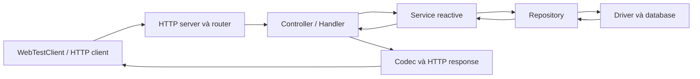

# Kiểm thử HTTP và dữ liệu phản ứng bằng hạ tầng tích hợp

Trong chương **Kiểm thử**, bài học này trình bày cách kiểm tra một ứng dụng reactive qua ranh giới HTTP và database bằng hạ tầng tích hợp thật. Một unit test có thể xác nhận mapper hoặc toán tử hoạt động đúng, nhưng chưa chứng minh controller, HTTP server, codec, repository, driver và transaction phối hợp chính xác khi một request đi qua toàn bộ ứng dụng.

Bài học thuộc module **REACTIVE_PROGRAMMING**. Module hướng dẫn: “Học tư duy reactive qua các luồng sự kiện bất đồng bộ, hợp đồng Publisher–Subscriber và cơ chế backpressure của Reactive Streams. Thực hành Mono, Flux, kết hợp toán tử, kiểm soát scheduler, xử lý lỗi và kiểm thử pipeline trong hệ sinh thái Java.” Vì vậy, bài kiểm thử tích hợp cần quan sát cả hợp đồng HTTP, tín hiệu reactive, dữ liệu đã ghi xuống database, hành vi khi lỗi và việc hủy subscription.

## 1. Kiểm thử tích hợp xác nhận điều gì?

Một request reactive thường đi qua nhiều thành phần trước khi tạo response:



Kiểm thử tích hợp nên xác nhận những hợp đồng nằm giữa các thành phần:

- HTTP method, path, status code, header và content type có đúng không.
- Request body được decode thành dữ liệu đúng và validation được áp dụng.
- Publisher được subscribe và hoàn tất theo hành vi mong đợi.
- Repository dùng driver thực tế để đọc hoặc ghi dữ liệu.
- Transaction commit hoặc rollback theo kết quả nghiệp vụ.
- Lỗi từ database hoặc dịch vụ ngoài được chuyển thành HTTP response phù hợp.
- Stream phát phần tử theo thứ tự, và cancellation được truyền đến nguồn khi client ngừng nhận.
- Các tài nguyên test được tạo và đóng đúng vòng đời.

Không phải mọi test đều cần khởi động toàn bộ hệ thống. Unit test vẫn phù hợp với mapper, predicate và phép biến đổi thuần. Integration test tập trung vào các ranh giới mà mock không thể chứng minh, chẳng hạn giao thức HTTP, codec, SQL, driver và transaction.

## 2. Chọn mức tích hợp phù hợp

Spring WebFlux cung cấp nhiều cách tạo `WebTestClient`. Cách chọn phụ thuộc vào ranh giới cần kiểm tra:

| Cách khởi tạo | Hạ tầng được chạy | Phù hợp khi |
|---|---|---|
| `WebTestClient.bindToController(...)` | Controller được bind trực tiếp | Kiểm tra nhanh handler và mapping đơn giản |
| `WebTestClient.bindToApplicationContext(...)` | ApplicationContext và WebFlux infrastructure | Kiểm tra router, filter, controller và codec trong context |
| `@SpringBootTest(webEnvironment = MOCK)` kết hợp WebTestClient | Spring context với web environment mô phỏng | Kiểm tra tích hợp trong ứng dụng mà không mở cổng HTTP thật |
| `@SpringBootTest(webEnvironment = RANDOM_PORT)` | Ứng dụng và HTTP server thật trên cổng ngẫu nhiên | Kiểm tra request qua network stack và server thực tế |

Khi cần xác minh HTTP server, codec và hành vi response trên kết nối thực, dùng `RANDOM_PORT`. Khi chỉ cần kiểm tra cấu hình Spring và handler mà không cần socket thật, web environment mô phỏng thường nhanh hơn.

Ví dụ khởi tạo test với server thật:

```java
@SpringBootTest(
    webEnvironment = SpringBootTest.WebEnvironment.RANDOM_PORT
)
@AutoConfigureWebTestClient
class OrderHttpIntegrationTest {

    @Autowired
    WebTestClient webTestClient;
}
```

`WebTestClient` gửi request và cung cấp API assertion tương tự WebFlux client. Với môi trường `RANDOM_PORT`, request đi qua server đang chạy trong test context. Không cần tự chọn một cổng cố định; Spring quản lý cổng ngẫu nhiên để tránh xung đột giữa các test.

## 3. Dùng database thật bằng Testcontainers

Một repository trả về `Mono` hoặc `Flux` chưa chứng minh SQL, schema, driver và transaction hoạt động đúng. Nếu ứng dụng chạy PostgreSQL qua R2DBC, integration test nên khởi động PostgreSQL tương thích bằng Testcontainers thay vì thay repository bằng mock.

Ví dụ dùng JUnit 5 và PostgreSQL container:

```java
@Testcontainers
@SpringBootTest(
    webEnvironment = SpringBootTest.WebEnvironment.RANDOM_PORT
)
@AutoConfigureWebTestClient
class OrderHttpIntegrationTest {

    @Container
    static final PostgreSQLContainer<?> postgres =
        new PostgreSQLContainer<>("postgres:16-alpine");

    @DynamicPropertySource
    static void databaseProperties(DynamicPropertyRegistry registry) {
        registry.add("spring.r2dbc.url", () ->
            "r2dbc:postgresql://"
                + postgres.getHost()
                + ":"
                + postgres.getFirstMappedPort()
                + "/"
                + postgres.getDatabaseName()
        );
        registry.add("spring.r2dbc.username", postgres::getUsername);
        registry.add("spring.r2dbc.password", postgres::getPassword);
    }

    @Autowired
    WebTestClient webTestClient;

    @Autowired
    OrderRepository orderRepository;
}
```

Container được khởi động cho test class; các thuộc tính R2DBC được cung cấp trước khi Spring tạo connection factory. Cấu hình này cần driver R2DBC PostgreSQL và các dependency Testcontainers JUnit Jupiter/PostgreSQL tương ứng trong dự án.

Dùng đúng loại URL của driver. PostgreSQL container thường cung cấp JDBC URL, nhưng ứng dụng R2DBC cần URL có scheme `r2dbc:postgresql://`. Không đưa JDBC URL vào thuộc tính `spring.r2dbc.url`.

### Schema và migration

Test cần tạo schema bằng cùng cơ chế migration mà ứng dụng sử dụng. Nếu production chạy Flyway hoặc Liquibase, hãy cấu hình migration cho test container để kiểm tra schema thực tế. Với ứng dụng dùng Flyway JDBC để migration và R2DBC để truy vấn, hai kết nối có thể dùng chung host, port, database và credentials nhưng URL/driver khác nhau.

Tránh tạo schema thủ công trong test nếu cách đó khác với migration production. Một test có thể xanh trên schema tự dựng nhưng thất bại khi deploy vì thiếu index, constraint hoặc kiểu dữ liệu.

## 4. Gửi HTTP request và xác nhận dữ liệu đã được lưu

Một test tích hợp có giá trị cần đi qua HTTP endpoint, rồi xác nhận dữ liệu trong database. Ví dụ endpoint tạo đơn hàng:

```java
@Test
void createsOrderAndPersistsIt() {
    EntityExchangeResult<OrderView> response =
        webTestClient.post()
            .uri("/orders")
            .contentType(MediaType.APPLICATION_JSON)
            .bodyValue(new CreateOrderRequest("customer-7", 250000))
            .exchange()
            .expectStatus().isCreated()
            .expectHeader()
            .contentTypeCompatibleWith(MediaType.APPLICATION_JSON)
            .expectBody(OrderView.class)
            .returnResult();

    OrderView created = response.getResponseBody();

    assertThat(created).isNotNull();
    assertThat(created.id()).isNotBlank();

    StepVerifier.create(orderRepository.findById(created.id()))
        .assertNext(order -> {
            assertThat(order.customerId()).isEqualTo("customer-7");
            assertThat(order.total()).isEqualByComparingTo("250000");
        })
        .verifyComplete();
}
```

Test này xác nhận nhiều lớp cùng hoạt động:

1. HTTP request được gửi đúng method, path và JSON body.
2. Controller nhận request và gọi service.
3. Service thực hiện thao tác repository.
4. Database thật lưu bản ghi.
5. Response được encode thành JSON với status và content type mong đợi.
6. Repository đọc lại dữ liệu đã commit.

Dùng `StepVerifier` để kiểm tra publisher của repository mà không cần chặn thread bằng `block()`. `verifyComplete()` xác nhận luồng đọc kết thúc bình thường; `assertNext` kiểm tra nội dung phần tử.

Nếu endpoint trả `Mono<Void>`, hãy xác nhận status và kiểm tra side effect qua repository hoặc một truy vấn phù hợp. Đừng chỉ kiểm tra HTTP 204 rồi kết luận dữ liệu đã được ghi.

## 5. Kiểm tra validation và lỗi HTTP

Integration test nên bao phủ cả request hợp lệ lẫn request không hợp lệ. Ví dụ:

```java
@Test
void rejectsInvalidOrderRequest() {
    webTestClient.post()
        .uri("/orders")
        .contentType(MediaType.APPLICATION_JSON)
        .bodyValue(new CreateOrderRequest("", -1))
        .exchange()
        .expectStatus().isBadRequest()
        .expectBody()
        .jsonPath("$.code").isEqualTo("INVALID_REQUEST");
}
```

Test xác nhận validation, exception handler và codec phối hợp để tạo phản hồi lỗi. Cấu trúc JSON lỗi cần khớp hợp đồng API của ứng dụng; không nên kiểm tra một chuỗi message phụ thuộc môi trường nếu API chỉ cam kết error code.

Cần kiểm tra các trường hợp khác nhau:

- JSON sai cú pháp hoặc body không decode được.
- Thiếu field bắt buộc hoặc vi phạm validation.
- Bản ghi không tồn tại và service trả empty.
- Lỗi nghiệp vụ được ánh xạ thành status phù hợp.
- Database không khả dụng hoặc transaction thất bại.
- Dependency HTTP bên ngoài timeout hoặc trả lỗi.

Phân biệt empty với error trong test. Một repository trả `Mono.empty()` có thể được service chuyển thành 404; lỗi kết nối database thường cần response lỗi hạ tầng khác. Không nên biến mọi lỗi thành 404 hoặc response rỗng vì sẽ che giấu sự cố.

## 6. Kiểm tra transaction bằng dữ liệu thật

Để xác nhận transaction, cần kiểm tra kết quả quan sát được từ database sau khi request kết thúc. Ví dụ service lưu đơn hàng và audit trong cùng transaction; nếu bước audit lỗi, cả hai thao tác phải rollback theo cấu hình transaction manager.

Một integration test có thể kích hoạt lỗi có chủ đích ở bước audit:

```java
@Test
void rollsBackOrderWhenAuditWriteFails() {
    StepVerifier.create(
        orderService.createOrderWithFailingAudit(
            new CreateOrder("customer-9", new BigDecimal("100"))
        )
    )
    .expectError(AuditWriteException.class)
    .verify();

    StepVerifier.create(
        orderRepository.findByCustomerId("customer-9")
    )
    .verifyComplete();
}
```

Ví dụ giả định service trả lỗi audit sau khi đã thực hiện lệnh lưu đơn trong cùng reactive transaction. Truy vấn sau đó xác nhận đơn hàng không tồn tại vì transaction đã rollback.

Không nên mặc định `@Transactional` trên phương thức test sẽ rollback mọi request HTTP được gửi qua `WebTestClient`. Với server thật, request được xử lý trong subscription và transaction context riêng của server; transaction quản lý test không tự bao quanh subscription đó. Hãy dùng dữ liệu định danh riêng cho từng test, dọn dữ liệu qua repository hoặc SQL sau test, và kiểm tra commit/rollback từ phía database.

Nếu test cần xác minh transaction boundary ở service, gọi publisher service trực tiếp bằng `StepVerifier` trong test và đọc lại database sau khi publisher kết thúc. Nếu cần xác minh HTTP path, gửi request qua server thật rồi kiểm tra kết quả persistence bằng một kết nối độc lập.

## 7. Cô lập test và dọn dữ liệu

Test tích hợp thường chạy song song hoặc dùng chung container giữa nhiều test method. Dữ liệu của test này không được làm test khác thất bại.

Một số cách cô lập phổ biến:

- Dùng UUID hoặc mã định danh duy nhất cho mỗi test.
- Tạo dữ liệu cần thiết ngay trong test thay vì phụ thuộc thứ tự chạy.
- Xóa dữ liệu được test tạo ra trong cleanup.
- Dùng schema/database riêng nếu test suite cần cô lập mạnh.
- Không giả định thứ tự test hoặc trạng thái còn lại từ test trước.
- Giữ migration và cấu hình database gần với production.

Ví dụ cleanup bằng repository reactive trong JUnit:

```java
@AfterEach
void cleanUp() {
    StepVerifier.create(
        orderRepository.deleteAll()
    ).verifyComplete();
}
```

Cách xóa toàn bộ chỉ phù hợp khi database container được dành riêng cho test class và không có test chạy đồng thời dùng chung dữ liệu. Trong suite lớn, nên xóa theo ID hoặc tenant test cụ thể để tránh xóa dữ liệu của test khác.

Không dựa vào `Thread.sleep` để chờ dữ liệu được ghi hoặc để cleanup hoàn tất. Publisher của thao tác ghi cần được subscribe và xác nhận hoàn tất; các test HTTP cần đợi response trước khi kiểm tra dữ liệu.

## 8. Kiểm thử dịch vụ HTTP bên ngoài bằng server giả lập

Một integration test không nhất thiết phải gọi dịch vụ bên thứ ba thật. Có thể chạy một HTTP server giả lập như MockWebServer hoặc WireMock để kiểm tra giao tiếp HTTP thật ở phía client mà vẫn kiểm soát response.

Ví dụ luồng cần xác minh:

1. Ứng dụng nhận request từ `WebTestClient`.
2. Service gọi `WebClient` đến server giả lập.
3. Server giả lập trả JSON, lỗi 503 hoặc giữ response để mô phỏng timeout.
4. Ứng dụng chuyển kết quả thành response cho client.
5. Test xác nhận request outbound có path, header và body đúng.

Với server giả lập, hãy kiểm tra cả request được gửi đi và response nhận về. Một mock method trên service không kiểm tra được URL, codec, header hoặc cách WebClient xử lý status code.

Các trường hợp nên có:

- Response thành công với JSON hợp lệ.
- Response 4xx và 5xx.
- Body sai định dạng.
- Timeout hoặc kết nối bị đóng.
- Retry có giới hạn và backoff nếu service được cấu hình retry.
- Cancellation khi client inbound đã ngắt kết nối.

Đặt server giả lập ở địa chỉ động và cung cấp base URL qua cấu hình test. Tránh dùng cổng cố định có thể xung đột khi test chạy song song.

## 9. Kiểm tra response streaming và cancellation

Nếu endpoint trả `Flux<T>`, test cần xác minh media type và các phần tử như một stream. `expectBodyList` gom response thành danh sách, nên không phù hợp khi cần kiểm tra dữ liệu được tiêu thụ từng phần tử.

Ví dụ với NDJSON:

```java
FluxExchangeResult<OrderEvent> result =
    webTestClient.get()
        .uri("/orders/events")
        .accept(MediaType.APPLICATION_NDJSON)
        .exchange()
        .expectStatus().isOk()
        .expectHeader()
        .contentTypeCompatibleWith(MediaType.APPLICATION_NDJSON)
        .returnResult(OrderEvent.class);

StepVerifier.create(result.getResponseBody())
    .expectNextMatches(event -> event.id().equals("event-1"))
    .expectNextMatches(event -> event.id().equals("event-2"))
    .thenCancel()
    .verify();
```

Test này kiểm tra response stream phát hai sự kiện theo thứ tự rồi mô phỏng client hủy subscription. Với nguồn có cleanup, hãy quan sát callback `doFinally` hoặc một resource spy để xác nhận cancellation đến nguồn.

Đối với SSE, xác nhận `text/event-stream`, event ID, event name và payload. Nếu endpoint phát vô hạn, không chờ `verifyComplete()`; hãy dùng `thenCancel()` sau số sự kiện cần kiểm tra.

Một test nhận được hai phần tử chưa chứng minh proxy hoặc client production flush từng phần tử ngay lập tức. Nếu latency giữa các event là yêu cầu quan trọng, cần kiểm tra qua môi trường gần production và đo thời điểm client thực sự nhận byte.

## 10. Kiểm tra backpressure và client chậm

Backpressure là hợp đồng demand giữa subscriber và publisher. Một integration test có thể mô phỏng subscriber yêu cầu dữ liệu theo từng phần tử bằng `StepVerifier` khi kiểm tra publisher nguồn:

```java
StepVerifier.create(eventService.stream(), 0)
    .thenRequest(1)
    .expectNextMatches(event -> event.sequence() == 1)
    .thenRequest(1)
    .expectNextMatches(event -> event.sequence() == 2)
    .thenCancel()
    .verify();
```

Test này xác nhận nguồn chỉ được tiêu thụ theo demand được yêu cầu trong trường hợp publisher hỗ trợ backpressure. Với HTTP response, server, codec, socket và proxy có thể thêm buffer; vì vậy không nên suy luận rằng mỗi `request(1)` ở test publisher tương ứng đúng một packet mạng.

Khi cần kiểm tra client chậm, hãy thiết kế nguồn có thể quan sát demand hoặc hàng đợi, sau đó kiểm tra giới hạn buffer, cancellation và việc không tiếp tục tạo dữ liệu vô hạn sau khi client rời đi. Đo heap và queue size dưới tải nếu mục tiêu là xác nhận giới hạn tài nguyên.

## 11. Dùng thời gian ảo đúng phạm vi

`StepVerifier.withVirtualTime` phù hợp để kiểm thử toán tử thời gian trong publisher, ví dụ `delayElements`, `timeout` hoặc retry backoff. Nó không thay thế thời gian thực của một HTTP server, database container hoặc socket network.

Dùng virtual time cho logic publisher thuần:

```java
StepVerifier.withVirtualTime(() ->
        Mono.delay(Duration.ofSeconds(5))
    )
    .thenAwait(Duration.ofSeconds(5))
    .expectNext(0L)
    .verifyComplete();
```

Với integration test qua HTTP và database thật, dùng timeout thực tế có giới hạn, tránh `Thread.sleep`, và chờ kết quả qua API kiểm thử. Nếu test một HTTP dependency giả lập có độ trễ, hãy điều khiển nó bằng latch hoặc cơ chế đồng bộ phù hợp thay vì giả định virtual scheduler điều khiển được server ngoài tiến trình.

## 12. Quy trình kiểm thử một endpoint reactive

Có thể áp dụng trình tự sau cho một endpoint:

1. **Chuẩn bị hạ tầng:** khởi động database container, migration và server giả lập cho dependency ngoài nếu cần.
2. **Tạo dữ liệu đầu vào:** dùng ID duy nhất và tạo fixture qua repository hoặc API.
3. **Gửi request HTTP:** xác nhận method, path, header, content type và body.
4. **Kiểm tra response:** xác nhận status, header, JSON hoặc stream theo hợp đồng.
5. **Kiểm tra persistence:** đọc lại dữ liệu qua repository hoặc truy vấn database.
6. **Kiểm tra transaction và lỗi:** tạo điều kiện để một bước thất bại rồi xác nhận rollback hoặc error mapping.
7. **Kiểm tra cancellation:** hủy response stream hoặc ngắt request và xác nhận cleanup.
8. **Dọn dữ liệu và đóng hạ tầng:** kết thúc publisher cleanup, dừng server giả lập và để Testcontainers đóng container.

Một test nên kiểm tra một hành vi chính với assertion đủ cụ thể. Không gom quá nhiều tình huống vào một test dài khiến lỗi khó xác định.

## 13. Những lỗi thường gặp

- **Mock repository trong test cần xác minh database.** Mock không kiểm tra SQL, schema, driver hoặc transaction.
- **Chỉ test bằng controller binding khi cần xác minh HTTP server.** Dùng server thật với `RANDOM_PORT` nếu network stack là một phần của yêu cầu.
- **Dùng JDBC URL cho R2DBC.** URL và driver phải khớp connection factory thực tế.
- **Dùng schema khác production.** Hãy chạy migration tương ứng trên test database.
- **Cho rằng test-level transaction rollback request HTTP.** Request server có subscription và transaction context riêng.
- **Dùng `block()` trong code ứng dụng để làm test dễ viết.** Dùng `StepVerifier` để kiểm tra publisher; blocking ở test thread chỉ nên là lựa chọn có chủ đích tại biên đồng bộ.
- **Gom stream bằng `expectBodyList` khi cần kiểm tra streaming.** Dùng `returnResult` và `StepVerifier`.
- **Chờ bằng `Thread.sleep`.** Chờ publisher hoặc dùng cơ chế đồng bộ rõ ràng.
- **Không cô lập dữ liệu.** Test phụ thuộc thứ tự hoặc xóa dữ liệu dùng chung có thể lỗi ngẫu nhiên.
- **Chỉ kiểm tra status code.** Hãy kiểm tra persistence, error body, media type và side effect theo hợp đồng.
- **Dùng virtual time cho I/O thật.** Virtual scheduler không điều khiển database container hoặc socket bên ngoài.

## 14. Bài tập vận dụng

Một API WebFlux tạo đơn hàng, đọc thông tin khách hàng từ một dịch vụ HTTP khác và lưu đơn cùng các dòng hàng trong PostgreSQL qua R2DBC. Khi dịch vụ khách hàng lỗi, API phải trả lỗi phù hợp và không để lại đơn hàng dở dang.

Hãy xây dựng bộ integration test với các yêu cầu:

1. Khởi động PostgreSQL bằng Testcontainers và chạy migration production trên container.
2. Khởi động ứng dụng bằng `@SpringBootTest(webEnvironment = RANDOM_PORT)` và gửi request bằng `WebTestClient`.
3. Dùng HTTP server giả lập cho dịch vụ khách hàng; xác nhận request outbound có đúng path và header.
4. Với request hợp lệ, kiểm tra status, response body và đọc lại đơn cùng dòng hàng qua repository.
5. Với dịch vụ khách hàng trả 503 hoặc timeout, xác nhận error mapping và transaction rollback.
6. Kiểm tra request sai dữ liệu được trả 400 mà không ghi database.
7. Với endpoint stream sự kiện, xác nhận media type, thứ tự phần tử và cancellation.
8. Dùng `StepVerifier` cho publisher repository và stream; dùng virtual time chỉ cho logic thời gian không phụ thuộc I/O thật.
9. Cô lập dữ liệu bằng ID duy nhất và cleanup sau mỗi test.
10. Xác nhận container, server giả lập và tài nguyên test được đóng khi suite kết thúc.

Sau khi hoàn thành, hãy giải thích test nào cần server thật, test nào có thể dùng application context mô phỏng, vì sao mock repository không đủ để chứng minh transaction và driver hoạt động, và cách phân biệt lỗi HTTP với lỗi persistence.

Một integration test reactive đáng tin cậy đi qua đúng ranh giới cần xác minh, chờ tín hiệu bằng công cụ phù hợp, kiểm tra dữ liệu sau commit hoặc rollback và luôn kiểm soát vòng đời của hạ tầng test.
