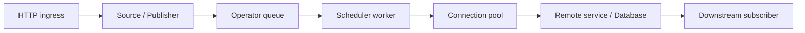

# Theo dõi hàng đợi, nhu cầu, kết nối và mức sử dụng bộ lập lịch

Trong module `REACTIVE_PROGRAMMING`, ta xây dựng các pipeline bất đồng bộ theo hợp đồng Publisher–Subscriber và cơ chế backpressure của Reactive Streams, đồng thời thực hành `Mono`, `Flux`, toán tử, scheduler, xử lý lỗi và kiểm thử trong hệ sinh thái Java. Một pipeline có thể chậm dù từng toán tử riêng lẻ có vẻ đơn giản. Nguyên nhân thường nằm ở hàng đợi tích lũy, downstream tiêu thụ chậm, connection pool cạn hoặc scheduler bị quá tải.

Chẩn đoán hiệu quả cần quan sát đồng thời bốn nhóm tín hiệu: **demand** cho biết downstream đang yêu cầu bao nhiêu dữ liệu; **queue** cho biết có bao nhiêu phần tử hoặc tác vụ đang chờ; **connection** cho biết request đang chờ tài nguyên mạng/database hay đã được xử lý; **scheduler** cho biết worker có đang bận hoặc backlog tác vụ đang tăng hay không. Chỉ nhìn latency tổng hoặc CPU toàn process thường không đủ để xác định nút thắt.

## 1. Nhìn pipeline như các ranh giới có thể đo lường

Một request reactive có thể đi qua nhiều đoạn: nhận dữ liệu, chuyển đổi, gọi dịch vụ, chờ connection, ghi database và tạo response. Mỗi ranh giới có thể tạo queue hoặc thay đổi tốc độ tiêu thụ.



Khi latency tăng, hãy xác định request đang chờ ở đâu:

- Nếu `request(n)` nhỏ hoặc đến muộn, downstream có thể đang điều tiết nguồn.
- Nếu số phần tử trong queue tăng liên tục, tốc độ phát đang vượt tốc độ xử lý trong một khoảng thời gian.
- Nếu connection pool có nhiều request chờ acquire, các lời gọi có thể chưa tới được server đích.
- Nếu scheduler có nhiều tác vụ chờ hoặc thời gian thực thi kéo dài, worker có thể bị bận hoặc thiếu năng lực.

Các nhóm tín hiệu có quan hệ với nhau. Ví dụ, connection pool cạn làm các Publisher chờ lâu; các request đang chờ có thể giữ queue downstream và kéo dài thời gian hoàn tất. Cần đối chiếu cùng một khoảng thời gian và cùng một request/trace để tìm nguyên nhân gốc.

## 2. Theo dõi demand bằng `doOnRequest`

Reactive Streams điều khiển tốc độ qua `Subscription.request(n)`. Subscriber gửi demand ngược về upstream; Publisher không được phát nhiều `onNext` hơn số phần tử đã được yêu cầu. Reactor cung cấp `doOnRequest` để quan sát số lượng demand đi qua một vị trí trong pipeline.

```java
Flux<Event> events = eventSource.read()
    .doOnSubscribe(subscription ->
        log.debug("Đã subscribe event source")
    )
    .doOnRequest(n ->
        log.debug("Upstream nhận demand: {}", n)
    )
    .doOnNext(event ->
        log.debug("Nhận event id={}", event.id())
    )
    .doOnError(error ->
        log.warn("Event source thất bại", error)
    )
    .doFinally(signal ->
        log.debug("Pipeline kết thúc: {}", signal)
    );
```

`doOnRequest` quan sát request tại vị trí được đặt. Vì demand truyền ngược upstream, đặt toán tử ở các vị trí khác nhau có thể cho thấy các request khác nhau sau khi những operator như `publishOn`, `limitRate` hoặc `flatMap` điều chỉnh prefetch/concurrency.

Một request có giá trị `Long.MAX_VALUE` biểu thị demand không giới hạn ở ranh giới đó. Điều này không có nghĩa mọi queue trong pipeline đều vô hạn hoặc toàn bộ nguồn có thể phát vô hạn an toàn; nó chỉ cho biết subscriber tại ranh giới đó không đặt giới hạn số phần tử bằng một demand hữu hạn.

Không nên log mọi request và mọi phần tử ở production với lưu lượng lớn. Logging trên từng tín hiệu có thể làm tăng CPU, I/O và tạo thêm tải đúng lúc hệ thống đang quá tải. Ưu tiên metric tổng hợp, sampling hoặc bật log chi tiết trong thời gian chẩn đoán có giới hạn.

## 3. Phân biệt demand, tốc độ phát và tốc độ tiêu thụ

Ba đại lượng này trả lời các câu hỏi khác nhau:

| Đại lượng | Ý nghĩa | Dấu hiệu cần chú ý |
|---|---|---|
| Demand | Số phần tử downstream cho phép upstream phát | Request nhỏ, dừng hoặc không tăng |
| Production rate | Tốc độ nguồn tạo/phát phần tử | Tăng đột biến hoặc vượt khả năng xử lý |
| Consumption rate | Tốc độ downstream xử lý phần tử | Giảm do I/O chậm, CPU bận hoặc queue chờ |

Nếu production rate lớn hơn consumption rate trong thời gian đủ dài, backlog có thể tăng. Với nguồn tuân thủ backpressure, demand có thể làm giảm tốc độ upstream. Với nguồn nóng không thể dừng hoặc nguồn ngoài không hỗ trợ demand, cần một chính sách buffer, drop, latest hoặc lưu trữ bền vững.

Ví dụ, `limitRate` chia demand thành các đợt nhỏ hơn:

```java
Flux<Event> controlled = eventSource.read()
    .limitRate(64)
    .doOnRequest(n -> metrics.recordUpstreamRequest(n));
```

`limitRate(64)` điều chỉnh cách Reactor yêu cầu dữ liệu từ upstream theo các đợt, giúp tránh một request lớn được chuyển thẳng về nguồn. Nó không làm tăng tốc độ xử lý downstream và không thay thế giới hạn concurrency ở các lời gọi bên ngoài.

## 4. Quan sát queue của operator bằng `Scannable`

Một số operator Reactor có thể được kiểm tra bằng `Scannable`. API này cho phép đọc các thuộc tính introspection mà operator công bố, ví dụ số phần tử đang được buffer, capacity, prefetch, demand, trạng thái cancel và kiểu thực thi.

```java
Flux<Result> pipeline = source
    .publishOn(Schedulers.parallel(), 128)
    .map(this::transform);

Scannable root = Scannable.from(pipeline);

root.parents().forEach(operator -> {
    if (!operator.isScanAvailable()) {
        return;
    }

    Integer buffered = operator.scan(Scannable.Attr.BUFFERED);
    Integer capacity = operator.scan(Scannable.Attr.CAPACITY);
    Integer prefetch = operator.scan(Scannable.Attr.PREFETCH);
    Long requested = operator.scan(Scannable.Attr.REQUESTED_FROM_DOWNSTREAM);

    log.debug(
        "operator={} buffered={} capacity={} prefetch={} requested={}",
        operator.name(), buffered, capacity, prefetch, requested
    );
});
```

Các thuộc tính có thể không được hỗ trợ bởi mọi operator. Giá trị `null` hoặc thuộc tính không có sẵn không đồng nghĩa queue đang rỗng; nó có thể chỉ có nghĩa operator không công bố thông tin đó. `Scannable` phù hợp để chẩn đoán cấu trúc và trạng thái của những operator hỗ trợ scan, không nên dùng như hợp đồng để điều khiển logic nghiệp vụ.

Đặc biệt, `Scannable` cung cấp góc nhìn tại thời điểm đọc. Nếu muốn theo dõi xu hướng queue tăng/giảm, cần lấy mẫu định kỳ ở lớp observability phù hợp và tránh quét toàn bộ cây operator quá thường xuyên. Với các pipeline được tạo mới cho từng request, hãy cân nhắc chi phí introspection và số lượng instance.

## 5. Queue nằm ở đâu trong pipeline?

Queue có thể xuất hiện ở nhiều vị trí:

- `publishOn` cần một hàng đợi để chuyển tín hiệu sang worker downstream.
- `flatMap` có thể có nhiều inner Publisher đang hoạt động và prefetch dữ liệu từ từng nhánh.
- `buffer`, `onBackpressureBuffer` và các operator windowing giữ phần tử cho đến khi điều kiện phát lô được thỏa mãn.
- Scheduler có thể có tác vụ đang chờ worker thực thi.
- Connection pool có hàng đợi request đang chờ một connection rảnh.
- HTTP client, message broker hoặc database driver có thể có buffer nội bộ riêng.

Một queue sâu không tự động chứng minh operator ngay trước nó là nguyên nhân. Có thể downstream bị chậm bởi database hoặc remote API ở xa hơn. Hãy đo cả queue depth, thời gian chờ queue, thời gian xử lý và throughput để xác định đoạn gây backlog.

Với `flatMap`, hai tham số quan trọng là concurrency và prefetch:

```java
Flux<EnrichedOrder> enriched = orders
    .flatMap(order -> inventoryClient.enrich(order), 8, 16);
```

Ở đây, tối đa tám inner Publisher được xử lý đồng thời và mỗi inner có prefetch được cấu hình là 16. Tăng concurrency có thể cải thiện throughput khi dependency còn năng lực, nhưng cũng làm tăng số request đồng thời và áp lực lên connection pool. Nếu pool chỉ có 10 connection mà nhiều nhánh cùng đòi connection, tăng concurrency lên hàng trăm có thể chỉ tạo thêm hàng đợi chờ acquire.

## 6. Đo pipeline bằng Micrometer

Reactor có tích hợp Micrometer trong artifact `reactor-core-micrometer`. Với phiên bản Reactor tương thích, có thể gắn metric vào một pipeline bằng `Micrometer.metrics(registry)`:

```java
import io.micrometer.core.instrument.MeterRegistry;
import reactor.core.observability.micrometer.Micrometer;

Flux<Order> observedOrders = orderSource
    .name("orders.processing")
    .tag("component", "order-service")
    .tap(Micrometer.metrics(registry));
```

Tên và tập hợp meter được cung cấp phụ thuộc phiên bản Reactor và cách cấu hình registry. Tích hợp này có thể ghi nhận các khía cạnh như số subscription, thời gian xử lý, tín hiệu kết thúc và hoạt động request. Hãy xem meter thực tế được đăng ký trong ứng dụng thay vì giả định mọi operator hoặc mọi phiên bản đều phát cùng một bộ metric.

Khi đặt tên và tag:

- Dùng tên pipeline ổn định, mô tả chức năng như `orders.processing`.
- Tag theo nhóm có cardinality thấp như `component`, `operation` hoặc `result`.
- Không tag theo `orderId`, `userId`, trace ID hoặc giá trị đầu vào không giới hạn.
- Giữ trace ID trong tracing/log context thay vì biến mỗi trace thành một time series metric.

Tag có cardinality quá cao có thể làm tăng số time series, bộ nhớ và chi phí của hệ thống metrics. Để tìm một request cụ thể, dùng distributed tracing; để theo dõi xu hướng và cảnh báo, dùng metric tổng hợp.

## 7. Theo dõi scheduler và backlog tác vụ

Scheduler là nơi thực thi các callback và tác vụ đã được lên lịch. Nếu worker bị chiếm bởi blocking I/O hoặc công việc CPU kéo dài, các tác vụ khác có thể phải chờ. Cần phân biệt:

- **Worker utilization:** worker đang bận bao nhiêu thời gian.
- **Pending tasks:** số tác vụ đã được submit nhưng chưa bắt đầu.
- **Execution duration:** thời gian callback/tác vụ thực thi.
- **Queue wait:** thời gian từ lúc submit đến lúc bắt đầu chạy.
- **Rejected/overflow:** tác vụ không được nhận do giới hạn hoặc scheduler đã dispose.

Với Reactor Micrometer, có thể bọc scheduler để đo các tác vụ được gửi qua wrapper:

```java
Scheduler rawScheduler = Schedulers.newBoundedElastic(
    12,
    500,
    "legacy-io"
);

Scheduler measuredScheduler = Micrometer.timedScheduler(
    rawScheduler,
    registry,
    "app.scheduler",
    Tags.of("name", "legacy-io")
);

Mono<Record> record = Mono.fromCallable(() -> legacyClient.load(id))
    .subscribeOn(measuredScheduler);
```

Wrapper đo các tác vụ được submit trực tiếp qua `measuredScheduler`. Nếu một phần khác của ứng dụng tiếp tục dùng `rawScheduler`, các tác vụ đó không nhất thiết được đo bởi wrapper. Nên thống nhất nơi cấp scheduler và quản lý vòng đời của scheduler do ứng dụng tạo.

`boundedElastic` phù hợp để cô lập một số tác vụ blocking, nhưng vẫn có giới hạn thread và hàng đợi. Nếu backlog tăng liên tục, cần tìm callback blocking quá lâu, giảm concurrency đầu vào, tăng năng lực dependency hoặc chuyển sang API non-blocking. Tăng giới hạn queue chỉ trì hoãn thời điểm quá tải và có thể làm tăng latency/bộ nhớ.

Với tác vụ CPU-bound, `parallel` thường là lựa chọn phù hợp hơn. Tuy nhiên, không nên đưa blocking call lên `parallel` chỉ để tránh thấy queue ở `boundedElastic`; điều đó có thể làm worker CPU bị giữ trong lúc chờ I/O.

## 8. Chẩn đoán connection pool

Một pipeline gọi HTTP hoặc database có thể chờ connection trước khi request được gửi. Vì vậy, latency của Publisher không chỉ là thời gian server xử lý.

Các chỉ số hữu ích của connection pool thường gồm:

| Chỉ số | Ý nghĩa khi tăng cao |
|---|---|
| Active connections | Nhiều connection đang được sử dụng; có thể gần giới hạn pool |
| Idle connections | Connection đang rảnh; thấp liên tục có thể cho thấy pool thiếu capacity |
| Pending acquire | Request đang chờ mượn connection |
| Acquire duration | Thời gian chờ để lấy connection |
| Max connections | Giới hạn connection cấu hình |
| Acquire timeout | Số lần hoặc tỷ lệ không lấy được connection trong thời hạn |

Với Reactor Netty, có thể bật metrics cho `ConnectionProvider`:

```java
ConnectionProvider provider = ConnectionProvider.builder("inventory-http")
    .maxConnections(80)
    .pendingAcquireMaxCount(160)
    .pendingAcquireTimeout(Duration.ofMillis(250))
    .metrics(true)
    .build();

HttpClient httpClient = HttpClient.create(provider);
```

Các meter cụ thể phụ thuộc phiên bản Reactor Netty và registry. Khi quan sát, đối chiếu active, idle, pending acquire và thời gian acquire cùng với latency của request. Pool đầy nhưng server đích có CPU thấp có thể là dấu hiệu connection bị giữ quá lâu, response body chưa được tiêu thụ/giải phóng hoặc giới hạn pool quá thấp so với concurrency.

Đối với R2DBC connection pool, theo dõi active/idle/pending acquisition và thời gian lấy connection tương tự. Đừng chỉ tăng `maxSize`: database cũng có giới hạn connection và có thể bị quá tải nếu nhiều client cùng mở pool lớn.

## 9. Phân biệt queue của ứng dụng với queue của connection pool

Giả sử `flatMap` có concurrency 100 nhưng HTTP connection pool chỉ cho phép 20 connection. Có thể có tối đa nhiều nhánh Publisher đang hoạt động, trong khi phần lớn request chờ acquire connection. Lúc này:

- Queue ở operator phản ánh các phần tử hoặc inner Publisher đang chờ xử lý.
- Pending acquire phản ánh request chờ connection.
- Thời gian server xử lý chỉ bắt đầu sau khi connection được cấp và request đến server.

Nếu chỉ nhìn thời gian `WebClient` call, ta có thể kết luận nhầm remote server chậm trong khi phần lớn thời gian thực tế nằm ở pool acquisition. Hãy tách thời gian tạo request, acquire connection, kết nối/trao đổi HTTP và đọc response nếu instrumentation hỗ trợ.

Concurrency nên được điều chỉnh dựa trên capacity của dependency và pool. Một cấu hình tốt thường giới hạn số nhánh đồng thời gần với năng lực downstream, có khoảng dự phòng cho các request khác và có pending queue hữu hạn. Khi queue đầy, hệ thống cần phản hồi quá tải rõ ràng thay vì giữ request vô hạn.

## 10. Theo dõi vòng đời subscription và kết nối chia sẻ

Ngoài connection pool, reactive application còn có subscription và kết nối tới nguồn nóng. Với `ConnectableFlux`, việc subscribe downstream và việc kết nối upstream là hai hành động riêng:

```java
ConnectableFlux<Event> shared = eventSource.publish();

Disposable first = shared.subscribe(this::handleFirst);
Disposable second = shared.subscribe(this::handleSecond);

Disposable connection = shared.connect();
```

Đăng ký các subscriber trước khi gọi `connect()` để chúng sẵn sàng nhận những phần tử đầu tiên. `connect()` bắt đầu subscription upstream dùng chung. Các subscriber downstream cùng nhận dữ liệu từ connection đó. Khi ứng dụng kết thúc vòng đời chia sẻ, cần dispose connection và các subscription downstream theo ownership đã thiết kế.

Để quan sát vòng đời, có thể gắn callback ở các ranh giới:

```java
Flux<Event> observed = shared
    .doOnSubscribe(s -> log.info("Subscriber downstream added"))
    .doFinally(signal -> log.info("Subscriber ended: {}", signal));
```

`doFinally` chạy khi subscription kết thúc do complete, error hoặc cancel. Với nhiều subscriber, callback ở downstream chạy theo từng subscription; nó không tự đại diện cho trạng thái connection upstream dùng chung. Cần đo riêng lifecycle của connection được trả về từ `connect()`.

## 11. Một mẫu pipeline có quan sát nhiều ranh giới

Ví dụ sau gắn log/metric ở nguồn, bước chuyển scheduler và lời gọi HTTP. Trong production, nên thay log từng phần tử bằng metric tổng hợp hoặc tracing có sampling:

```java
Flux<OrderView> views = orderSource
    .name("orders.enrichment")
    .tag("operation", "enrich")
    .doOnRequest(n -> requestMetrics.record("source", n))
    .publishOn(Schedulers.parallel(), 64)
    .doOnNext(order -> stageMetrics.record("before-client"))
    .flatMap(order -> inventoryClient.findBySku(order.sku())
        .timeout(Duration.ofMillis(300))
        .map(inventory -> OrderView.from(order, inventory)),
        8,
        16
    )
    .doOnError(error -> errorMetrics.record("inventory", error))
    .doFinally(signal -> terminationMetrics.record(signal))
    .tap(Micrometer.metrics(registry));
```

Khi latency tăng, đối chiếu:

1. Demand được yêu cầu từ `orderSource` có thay đổi không?
2. Queue của `publishOn` có tăng không?
3. Có bao nhiêu lời gọi inventory đang hoạt động?
4. Connection pool có pending acquire hoặc acquire duration tăng không?
5. Timeout và cancellation có tăng theo không?
6. Scheduler `parallel` có bị chiếm bởi callback blocking không?

Đừng gắn một meter cho mỗi order. Metric `operation=enrich` có cardinality ổn định; `orderId` nên nằm trong trace/log nếu cần điều tra một request cụ thể.

## 12. Dùng BlockHound để phát hiện blocking không mong muốn

Một nguyên nhân thường gặp của scheduler starvation là gọi API blocking trên event-loop hoặc worker dành cho CPU. BlockHound có thể phát hiện một số thao tác blocking trên thread được đánh dấu non-blocking trong môi trường test.

```java
@BeforeAll
static void installBlockHound() {
    BlockHound.install();
}
```

Sau khi cài đặt trong test, nếu code gọi thao tác blocking không được cho phép trên thread non-blocking, BlockHound có thể phát hiện và làm test thất bại. Khả năng phát hiện phụ thuộc integration và các allow-list của thư viện; không coi việc test qua BlockHound là bằng chứng rằng toàn bộ đường đi không có blocking.

Khi phát hiện blocking:

- Chuyển tác vụ blocking sang `boundedElastic` nếu chưa thể thay thư viện.
- Dùng driver/client non-blocking khi có lựa chọn phù hợp.
- Tránh gọi `.block()` trong pipeline đang chạy trên event-loop.
- Đo thời gian thực thi callback để tìm đoạn giữ worker quá lâu.

## 13. Kiểm thử demand, cancellation và queue behavior

`StepVerifier` cho phép điều khiển demand để xác minh pipeline phản ứng với request từng phần:

```java
StepVerifier.create(Flux.range(1, 5), 0)
    .thenRequest(2)
    .expectNext(1, 2)
    .thenRequest(1)
    .expectNext(3)
    .thenCancel()
    .verify();
```

Subscriber bắt đầu với demand bằng không, sau đó yêu cầu hai phần tử, rồi thêm một phần tử và cuối cùng cancel. Test xác nhận tín hiệu theo demand đã cấp.

Có thể quan sát request trong test:

```java
List<Long> requests = new CopyOnWriteArrayList<>();

Flux<Integer> pipeline = Flux.range(1, 5)
    .doOnRequest(requests::add);

StepVerifier.create(pipeline, 0)
    .thenRequest(2)
    .expectNext(1, 2)
    .thenCancel()
    .verify();

assertFalse(requests.isEmpty());
```

Nếu test một operator có prefetch hoặc `limitRate`, không nên khẳng định mọi upstream request bằng đúng demand downstream. Operator có thể yêu cầu trước theo cấu hình. Hãy xác minh hợp đồng của đoạn pipeline cụ thể và dùng test để phát hiện thay đổi không mong muốn khi refactor.

Với queue theo thời gian, dùng virtual time để kiểm thử buffer/timeout mà không chờ đồng hồ thật. Với connection pool, cần integration test hoặc test server có thể điều khiển số connection và thời gian phản hồi; `StepVerifier` một mình không chứng minh pool ở runtime được cấu hình đúng.

## 14. Đọc tín hiệu và xác định nguyên nhân

| Quan sát | Nguyên nhân có thể | Bước kiểm tra tiếp theo |
|---|---|---|
| Queue operator tăng, downstream throughput thấp | Consumer chậm hoặc concurrency thấp | Đo thời gian callback và tốc độ xử lý từng stage |
| Demand nhỏ hoặc không tăng | Downstream chưa yêu cầu thêm, đang chờ hoặc đã cancel | Kiểm tra subscriber, `limitRate`, `take` và cancellation |
| Pending connection acquire tăng | Pool đầy, connection bị giữ lâu hoặc concurrency quá cao | Đo active/idle, acquire duration và thời gian giữ connection |
| Scheduler pending tasks tăng | Worker bận, blocking hoặc burst submit | Kiểm tra task duration, blocking call và loại scheduler |
| CPU thấp nhưng latency cao | Chờ connection, network, lock hoặc queue | Tách thời gian acquire, network và remote processing |
| CPU cao, queue tăng | Tác vụ CPU-bound vượt năng lực worker | Profile callback, giảm đầu vào hoặc tăng xử lý song song có kiểm soát |
| Cancel tăng cùng timeout | Caller hết hạn hoặc downstream không còn cần dữ liệu | Correlate deadline, timeout và cancellation theo trace |

Không kết luận từ một snapshot đơn lẻ. So sánh xu hướng theo thời gian, baseline khi tải bình thường và phân vị latency. Một queue tăng ngắn trong lúc burst có thể là hành vi dự kiến; queue tăng liên tục và không giảm thường là dấu hiệu hệ thống không theo kịp.

## 15. Cảnh báo và vận hành an toàn

Một bộ cảnh báo hữu ích nên phát hiện xu hướng trước khi người dùng gặp lỗi:

- Pending acquire vượt ngưỡng trong một khoảng thời gian liên tục.
- Tỷ lệ timeout hoặc acquire timeout tăng.
- Queue occupancy duy trì ở mức cao hoặc tiến gần capacity.
- Scheduler task queue tăng cùng với execution duration.
- Throughput giảm trong khi số subscription đang hoạt động tăng.
- Cancellation tăng đột ngột hoặc có nhiều request vẫn chạy sau khi caller đã hết deadline.

Chọn ngưỡng theo capacity và baseline thực tế. Cảnh báo theo phần trăm capacity thường hữu ích hơn một con số cố định cho mọi môi trường. Không nên tạo alert trên từng request hoặc từng order ID.

Khi hệ thống quá tải, ưu tiên giới hạn concurrency, timeout, pending queue và admission control. Tăng buffer, connection pool hoặc scheduler queue mà không xử lý nguyên nhân có thể chỉ chuyển lỗi sang tầng khác và làm tăng thời gian giữ tài nguyên.

## 16. Những sai lầm thường gặp

| Sai lầm | Hệ quả | Cách xử lý |
|---|---|---|
| Chỉ đo latency tổng | Không biết request chờ ở queue, pool hay remote service | Instrument từng ranh giới và dùng trace |
| Coi `Long.MAX_VALUE` là queue vô hạn | Nhầm demand với dung lượng buffer | Theo dõi riêng demand, queue và capacity |
| Giả định mọi operator hỗ trợ `Scannable` giống nhau | Đọc giá trị null như queue rỗng | Kiểm tra `isScanAvailable` và khả năng của từng attribute |
| Tăng `flatMap` concurrency không xét pool | Tạo thêm pending acquire và tải cho dependency | Căn concurrency theo capacity downstream |
| Tăng scheduler queue để che backlog | Tăng memory và tail latency | Tìm tác vụ blocking hoặc nguồn phát quá nhanh |
| Gắn tag metric theo ID mỗi request | Cardinality tăng mạnh | Dùng tag nhóm; đưa ID vào trace/log |
| Nghĩ `doFinally` downstream đại diện connection dùng chung | Bỏ sót lifecycle upstream của multicast | Đo subscription downstream và connection riêng |
| Bật log mọi phần tử khi production quá tải | Logging làm tăng tải và che khuất vấn đề | Dùng metric, sampling và log có thời hạn |

## 17. Quy trình chẩn đoán từ ngoài vào trong

Khi một pipeline `Mono`/`Flux` chậm hoặc có dấu hiệu quá tải, hãy thực hiện theo thứ tự:

1. **Xác định phạm vi:** endpoint, operation, dependency và khoảng thời gian bị ảnh hưởng.
2. **Đo latency theo stage:** tách thời gian xử lý nội bộ, chờ scheduler, acquire connection và remote call.
3. **Kiểm tra demand:** dùng metric hoặc `doOnRequest` để xem downstream đang yêu cầu dữ liệu như thế nào.
4. **Kiểm tra queue:** quan sát `BUFFERED`, `CAPACITY`, `PREFETCH` ở operator hỗ trợ scan và queue ở tầng client/pool.
5. **Kiểm tra scheduler:** xem pending tasks, task duration, worker utilization và blocking call.
6. **Kiểm tra connection pool:** so sánh active, idle, pending acquire, acquire duration và giới hạn pool.
7. **Đối chiếu cancellation/timeout:** xác định request bị hủy do deadline, lỗi downstream hay client ngắt kết nối.
8. **Điều chỉnh một biến tại một thời điểm:** concurrency, prefetch, queue capacity, pool size hoặc timeout; đo lại p95/p99 và tài nguyên.
9. **Thiết lập cảnh báo:** theo dõi xu hướng backlog và capacity trước khi xảy ra overflow hoặc timeout hàng loạt.

Theo dõi queue, demand, connection và scheduler cùng lúc giúp phân biệt nguồn phát nhanh, consumer chậm, pool thiếu connection và worker bị chiếm. `doOnRequest` cho biết demand tại ranh giới pipeline; `Scannable` hỗ trợ kiểm tra những queue/operator có công bố thuộc tính; Micrometer cung cấp metric theo thời gian; metrics của scheduler và connection pool chỉ ra nơi tác vụ đang chờ. Khi kết hợp các tín hiệu này với trace và kiểm thử demand/cancellation, ta có thể tìm đúng tầng gây backlog và điều chỉnh giới hạn theo capacity thực tế thay vì chỉ tăng buffer hoặc thread.
