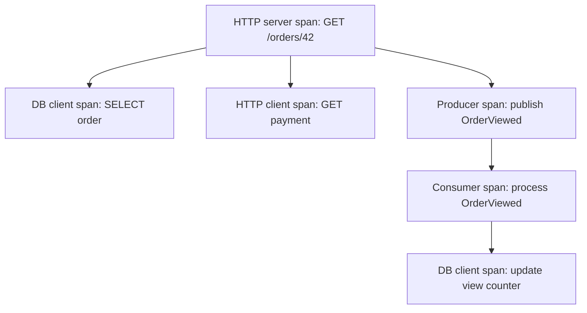
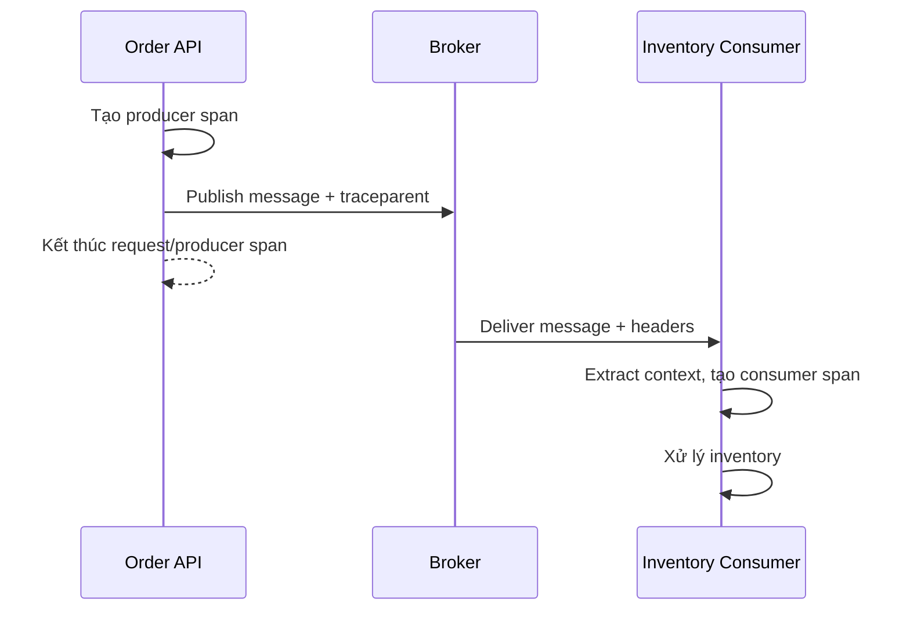

# Truy vết phân tán qua ranh giới bất đồng bộ

Trong một ứng dụng reactive, một yêu cầu có thể đi qua nhiều operator, đổi scheduler, gọi dịch vụ HTTP, được ghi vào broker rồi tiếp tục xử lý ở một consumer khác. Mỗi bước có thể chạy trên thread khác nhau và ở thời điểm khác nhau. Khi một yêu cầu chậm hoặc thất bại, log riêng lẻ của từng thành phần thường không đủ để trả lời câu hỏi: yêu cầu bắt đầu ở đâu, đã đi qua những service nào, mất bao lâu ở mỗi chặng và lỗi xuất hiện tại bước nào?

**Truy vết phân tán (distributed tracing)** giải quyết bài toán đó bằng cách gắn các thao tác liên quan vào cùng một trace. Mỗi thao tác quan trọng được biểu diễn bằng một span có thời điểm bắt đầu, kết thúc, quan hệ nhân quả, thuộc tính và trạng thái. Trace context được truyền qua các ranh giới HTTP, message broker và luồng thực thi bất đồng bộ để thành phần tiếp theo có thể tiếp tục trace ban đầu.

Trong Project Reactor, `Mono` và `Flux` giúp kết hợp các thao tác bất đồng bộ; `publishOn`, `subscribeOn`, `flatMap` và các nguồn sự kiện có thể tạo ra nhiều ranh giới thực thi. Việc đổi thread không được làm mất quan hệ trace. Bài học này thuộc chương **Chẩn đoán** của REACTIVE_PROGRAMMING, tập trung vào cách duy trì ngữ cảnh truy vết từ request đầu tiên tới các callback, scheduler, service và consumer xử lý message.

## Trace, span và quan hệ nhân quả

Một trace là đồ thị các span có quan hệ với nhau, thường biểu diễn một hành trình xử lý bắt đầu từ một request hoặc một sự kiện. Mỗi span mô tả một thao tác có thời lượng, ví dụ:

- Nhận HTTP request tại Order API.
- Truy vấn database để đọc đơn hàng.
- Gọi Payment Service qua HTTP.
- Publish `OrderPlaced` lên broker.
- Consumer nhận message và cập nhật tồn kho.

Các định danh thường gặp:

| Thành phần | Ý nghĩa |
|---|---|
| `traceId` | Định danh trace; các span thuộc cùng hành trình chia sẻ trace ID |
| `spanId` | Định danh duy nhất của một span trong trace |
| `parentSpanId` | Span cha tạo ra hoặc khởi phát span hiện tại theo quan hệ nhân quả |
| `traceFlags` | Cờ trong trace context, thường bao gồm thông tin sampled |
| `tracestate` | Dữ liệu trạng thái bổ sung theo định dạng của hệ thống tracing/vendor |
| `baggage` | Các cặp key/value cần truyền theo hành trình, nếu chính sách cho phép |

Ví dụ một trace của yêu cầu xem trạng thái đơn hàng:



Span con không nhất thiết chạy lồng nhau trên cùng thread. Một span có thể được khởi tạo khi gửi message và span consumer bắt đầu sau vài mili giây hoặc vài phút. Quan hệ cha-con mô tả quan hệ nhân quả, không phải quan hệ call stack đồng bộ.

Trong xử lý batch hoặc fan-in, một span có thể phụ thuộc vào nhiều message/trace context. Khi đó, mô hình tracing có thể dùng **span links** để liên kết span xử lý với nhiều span nguồn thay vì giả định chỉ có một parent duy nhất. Cách chọn parent hay link phụ thuộc semantics của messaging và convention mà hệ thống đang áp dụng.

## Vì sao ranh giới bất đồng bộ dễ làm mất trace context?

Trong mã imperative truyền thống, một số thư viện lưu thông tin request trong `ThreadLocal`, ví dụ MDC của logging hoặc context của tracing. Cách này dựa trên giả định một thao tác tiếp tục chạy trên cùng thread hoặc thư viện sẽ tự sao chép context khi chuyển thread.

Pipeline reactive không bảo đảm giả định đó:

- `publishOn` chuyển callback downstream sang worker khác.
- `subscribeOn` thay đổi nơi subscription và nguồn bắt đầu thực thi.
- `flatMap` có thể chạy nhiều inner Publisher đồng thời.
- Callback của HTTP client, broker hoặc scheduler có thể chạy trên thread do thư viện quản lý.
- Message được đưa vào queue rồi xử lý sau khi request ban đầu đã kết thúc.

Nếu trace context chỉ nằm trong `ThreadLocal`, callback ở thread khác có thể không thấy span hiện tại. Hậu quả thường thấy là trace bị tách thành nhiều trace độc lập, log không có `traceId`, hoặc span con bị gắn nhầm parent. Việc truyền một biến `traceId` thủ công trong một vài lambda cũng không giải quyết đầy đủ lifecycle, span parent, sampling và propagation qua network.

## Phân biệt trace context, correlation ID và business ID

Ba loại định danh này phục vụ những mục đích khác nhau:

| Định danh | Mục đích | Ví dụ |
|---|---|---|
| Trace ID | Nối các span kỹ thuật trong một hành trình quan sát | `4bf92f3577b34da6a3ce929d0e0e4736` |
| Correlation ID | Liên kết các log/message thuộc cùng một quy trình theo quy ước ứng dụng | `corr-order-flow-847` |
| Business ID | Định danh thực thể nghiệp vụ | `order-847` |

Một trace có thể chứa nhiều order hoặc nhiều message; một order cũng có thể xuất hiện trong nhiều trace khác nhau, ví dụ tạo đơn, thanh toán và giao hàng là các hành trình riêng. Vì vậy, không nên dùng `orderId` làm trace ID hoặc giả định correlation ID thay thế được trace context chuẩn.

Business ID thường phù hợp để tìm log hoặc dữ liệu nghiệp vụ. Trace ID phù hợp để mở trace và xem quan hệ giữa các span. Correlation ID hữu ích khi quy trình nghiệp vụ kéo dài qua nhiều trace hoặc cần nối các bước mà không phải cùng một trace runtime.

## W3C Trace Context: định dạng truyền qua ranh giới

W3C Trace Context định nghĩa cách truyền ngữ cảnh truy vết qua HTTP bằng các header tiêu chuẩn, quan trọng nhất là:

- `traceparent`: mang version, trace ID, parent ID và trace flags.
- `tracestate`: mang trạng thái bổ sung theo quy tắc của các tracing system tham gia.

Một `traceparent` có dạng minh họa:

```text
traceparent: 00-4bf92f3577b34da6a3ce929d0e0e4736-00f067aa0ba902b7-01
```

Các phần được phân tách bằng dấu gạch ngang: version `00`, trace ID, parent span ID và flags `01`. Đây là ví dụ minh họa định dạng; ứng dụng không nên tự ghép chuỗi hoặc tự tạo trace ID bằng cách nối UUID. Hãy dùng propagator của OpenTelemetry hoặc instrumentation của thư viện để inject và extract context đúng chuẩn.

Khi một HTTP client đã được instrument, thư viện tracing thường tự inject `traceparent` và `tracestate` vào request outbound. Server nhận request extract context để tạo server span con. Cấu hình cụ thể phụ thuộc stack và phiên bản, nhưng nguyên tắc là các thành phần phải dùng cùng chuẩn propagation.

## Reactor Context và ThreadLocal có vai trò khác nhau

Reactor cung cấp `Context` gắn với subscription. Context không phải map toàn cục và cũng không phải `ThreadLocal`; nó được truyền theo đường subscribe của một pipeline. Operator có thể đọc context bằng `deferContextual` và ghi metadata bằng `contextWrite`.

```java
import reactor.core.publisher.Mono;
import reactor.util.context.Context;

Mono<String> response = Mono.deferContextual(context -> {
    String correlationId = context.get("correlationId");
    return Mono.just("handled request " + correlationId);
}).contextWrite(Context.of("correlationId", "corr-847"));
```

`contextWrite` đặt context cho subscription; `deferContextual` đọc context đó khi nguồn được subscribe. Context truyền theo subscription nên không phụ thuộc callback có chạy trên thread nào. Cần nhớ hướng lan truyền: `contextWrite` tác động tới các operator upstream của nó trong chuỗi subscription, không phải các operator downstream đứng trước nó trong cách đọc từ trái sang phải.

Ví dụ kiểm tra context qua một ranh giới scheduler:

```java
import reactor.core.publisher.Mono;
import reactor.core.scheduler.Schedulers;
import reactor.util.context.Context;
import reactor.test.StepVerifier;

Mono<String> pipeline = Mono.just("request")
    .publishOn(Schedulers.parallel())
    .flatMap(value -> Mono.deferContextual(ctx ->
        Mono.just("processed-" + ctx.get("correlationId"))
    ))
    .contextWrite(Context.of("correlationId", "corr-847"));

StepVerifier.create(pipeline)
    .expectNext("processed-corr-847")
    .verifyComplete();
```

Giá trị context vẫn có thể được đọc trong pipeline sau khi đổi scheduler. Đây là cơ chế context của Reactor; việc MDC hoặc API tracing dựa trên `ThreadLocal` nhìn thấy context đó cần bridge/instrumentation tương ứng.

Không nên lưu toàn bộ object request hoặc dữ liệu nhạy cảm vào Reactor Context. Context phù hợp với metadata nhỏ gắn với subscription như correlation ID, tenant ID đã được xác thực hoặc trace context. Tránh dùng nó như kho state mutable dùng chung.

## Tích hợp tracing trong Spring WebFlux

Trong ứng dụng Spring Boot WebFlux, cách bền vững thường là dùng Micrometer Observation/Micrometer Tracing hoặc OpenTelemetry instrumentation thay vì tự thêm header ở mọi controller. Khi tracing được cấu hình đúng:

1. HTTP server instrumentation tạo span cho request inbound.
2. Trace context được gắn với execution context của request.
3. HTTP client được instrument tạo client span và inject trace context vào request outbound.
4. Logging correlation có thể đưa `traceId` và `spanId` vào MDC khi context propagation được bật và cấu hình đúng.
5. Exporter gửi span tới backend quan sát như OpenTelemetry Collector hoặc tracing backend.

Với Spring Boot, các dependency thường gặp gồm Actuator, bridge Micrometer Tracing phù hợp (ví dụ bridge OpenTelemetry) và exporter/OTLP registry tương ứng. Nên để dependency management của Spring Boot quản lý phiên bản tương thích; tránh tự ghép các phiên bản Micrometer, Reactor và OpenTelemetry không tương thích.

Ví dụ một service gọi WebClient:

```java
import org.springframework.stereotype.Service;
import org.springframework.web.reactive.function.client.WebClient;
import reactor.core.publisher.Mono;

@Service
class PaymentClient {
    private final WebClient webClient;

    PaymentClient(WebClient.Builder builder) {
        this.webClient = builder
            .baseUrl("http://payment-service")
            .build();
    }

    Mono<PaymentStatus> getStatus(String paymentId) {
        return webClient.get()
            .uri("/payments/{id}", paymentId)
            .retrieve()
            .bodyToMono(PaymentStatus.class);
    }
}
```

Đoạn code không tự tạo header `traceparent`. Khi WebClient builder và tracing instrumentation được cấu hình trong ứng dụng, client instrumentation có thể tạo span và inject context tự động. Nếu tạo `WebClient` thủ công ngoài builder đã được instrument hoặc dùng HTTP client không có instrumentation, propagation có thể bị mất; hãy xác minh cấu hình và trace thực tế.

### Không kết thúc span tại assembly time

Một lỗi phổ biến là tạo span khi lắp ráp pipeline rồi đóng span ngay sau khi trả về Publisher:

```java
// Sai về lifecycle: Publisher chưa chắc đã chạy xong khi span bị đóng.
Span span = tracer.nextSpan().name("load-payment").start();
Mono<PaymentStatus> result = paymentClient.getStatus(id);
span.end();
```

Assembly chỉ tạo mô tả pipeline. Công việc có thể bắt đầu sau đó khi có subscription và hoàn tất bất đồng bộ. Span phải bao phủ khoảng thời gian thực thi cần quan sát, kể cả khi kết thúc bằng lỗi hoặc cancellation. Ưu tiên instrumentation đã hỗ trợ Reactor; nếu tạo span thủ công, quản lý lifecycle bằng các tín hiệu reactive (`doOnError`, `doFinally` hoặc API observation reactive phù hợp), và bảo đảm context được khôi phục đúng trong callback.

Không giữ `Scope` dựa trên ThreadLocal mở xuyên suốt một pipeline bất đồng bộ. Scope chỉ nên bao quanh đoạn code đồng bộ đang chạy trên thread hiện tại; context cần được truyền qua cơ chế hỗ trợ reactive.

## Context propagation qua scheduler

Reactor Context và tracing context phải được kết nối với nhau khi thư viện tracing dựa trên `ThreadLocal`/MDC. Các phiên bản Reactor và Micrometer hiện đại có hỗ trợ context propagation thông qua integration tương ứng. Tùy phiên bản và cấu hình, ứng dụng có thể cần bật chế độ automatic context propagation hoặc dùng các operator/bridge được cung cấp.

Với Reactor có hỗ trợ automatic context propagation, một ứng dụng có thể bật hook ở giai đoạn khởi động:

```java
import reactor.core.publisher.Hooks;

// Thực hiện một lần khi khởi động ứng dụng, trước khi tạo pipeline.
Hooks.enableAutomaticContextPropagation();
```

Hook này giúp khôi phục các giá trị ThreadLocal đã được đăng ký với context-propagation library khi callback reactive được thực thi. Nó không tự truyền mọi ThreadLocal tùy ý, không thay thế instrumentation cho HTTP/broker client và không biến state mutable thành thread-safe. Chỉ bật khi phiên bản và thư viện tích hợp hỗ trợ; xác minh bằng test qua `publishOn`, `subscribeOn` và callback bất đồng bộ.

Nếu chỉ cần metadata nghiệp vụ, Reactor Context thường đủ và rõ ràng hơn việc dựa vào MDC. MDC là cơ chế logging gắn với thread; Reactor Context gắn với subscription. Bridge giúp đồng bộ hai cơ chế trong phạm vi callback, nhưng không nên coi chúng là cùng một loại state.

## Truyền trace context qua message broker

HTTP request có response gắn với một thời gian xử lý tương đối ngắn. Message broker tạo ranh giới bất đồng bộ rõ hơn: producer có thể kết thúc trước khi consumer bắt đầu. Trace context phải được serialize vào message headers khi publish và extract khi consume.

Luồng khái quát:



Với một message đơn lẻ, consumer span thường có quan hệ nhân quả với producer span. Với batch gồm nhiều message, có thể dùng span links để liên kết consumer span với nhiều context nguồn. Điều này giúp trace phản ánh đúng việc một consumer batch không nhất thiết có một parent duy nhất.

### Inject context vào header bằng OpenTelemetry

Nếu broker client chưa được tự động instrument, OpenTelemetry propagator có thể inject trace context vào map header. Ví dụ minh họa phần inject:

```java
import java.util.HashMap;
import java.util.Map;
import io.opentelemetry.api.GlobalOpenTelemetry;
import io.opentelemetry.context.Context;
import io.opentelemetry.context.propagation.TextMapSetter;

Map<String, String> headers = new HashMap<>();
TextMapSetter<Map<String, String>> setter = Map::put;

GlobalOpenTelemetry.getPropagators()
    .getTextMapPropagator()
    .inject(Context.current(), headers, setter);

// Đính kèm headers vào message theo API của broker client.
```

`Context.current()` phải đang chứa context của span producer tại thời điểm inject. Nếu gọi đoạn này ở callback reactive mà context không được khôi phục, header có thể không có parent mong muốn. Hãy dùng broker instrumentation nếu có; nếu tự inject, gọi ở ranh giới publish sau khi đã thiết lập đúng tracing context.

### Extract context tại consumer

Phía consumer đọc header và extract context trước khi tạo span xử lý:

```java
import java.util.Map;
import io.opentelemetry.api.GlobalOpenTelemetry;
import io.opentelemetry.api.trace.Span;
import io.opentelemetry.api.trace.SpanKind;
import io.opentelemetry.api.trace.StatusCode;
import io.opentelemetry.api.trace.Tracer;
import io.opentelemetry.context.Context;
import io.opentelemetry.context.Scope;
import io.opentelemetry.context.propagation.TextMapGetter;

TextMapGetter<Map<String, String>> getter = new TextMapGetter<>() {
    @Override
    public String get(Map<String, String> carrier, String key) {
        return carrier == null ? null : carrier.get(key);
    }

    @Override
    public Iterable<String> keys(Map<String, String> carrier) {
        return carrier == null ? java.util.List.of() : carrier.keySet();
    }
};

Context parent = GlobalOpenTelemetry.getPropagators()
    .getTextMapPropagator()
    .extract(Context.root(), headers, getter);

Tracer tracer = GlobalOpenTelemetry.getTracer("inventory-service");
Span span = tracer.spanBuilder("inventory.process")
    .setSpanKind(SpanKind.CONSUMER)
    .setParent(parent)
    .startSpan();

try (Scope scope = span.makeCurrent()) {
    processMessage(message);
} catch (RuntimeException error) {
    span.recordException(error);
    span.setStatus(StatusCode.ERROR);
    throw error;
} finally {
    span.end();
}
```

Đây là ví dụ xử lý đồng bộ trong một consumer callback; `GlobalOpenTelemetry` và `tracer` được lấy từ OpenTelemetry SDK đã cấu hình, còn `headers` và `message` do adapter của broker cung cấp. Nếu `processMessage` trả về `Mono` hoặc `Flux`, không đóng span ngay khi phương thức trả Publisher. Hãy dùng instrumentation reactive hoặc quản lý span theo vòng đời terminal của Publisher và bảo đảm context được truyền qua các callback. API broker và kiểu carrier header có thể khác nhau; chỉ thay phần adapter, giữ nguyên nguyên tắc inject/extract theo propagator chuẩn.

Không truyền toàn bộ object `Context` Java qua broker. Chỉ serialize carrier chuẩn như `traceparent`, `tracestate` và baggage được cho phép. Consumer tạo context runtime mới từ các header nhận được.

## Retry, redelivery và quan hệ trace

Retry có thể diễn ra ở nhiều tầng:

- Reactor retry resubscribe vào Publisher trong cùng tiến trình.
- HTTP client retry tạo thêm lần gọi tới remote service.
- Broker redelivery gửi lại message sau khi consumer không acknowledge.
- Job scheduler có thể chạy lại một tác vụ ở thời điểm khác.

Không phải mọi lần thử đều nên tạo một trace hoàn toàn mới. Nếu retry là một phần của cùng hành trình request, các attempt thường có thể được biểu diễn thành child span hoặc span riêng trong cùng trace. Nếu message được redeliver sau thời gian dài hoặc qua một quy trình độc lập, cách nối trace phụ thuộc chính sách và khả năng giữ trace context của broker. Dù chọn cách nào, cần giữ attempt number, message ID và correlation ID để phân biệt lần xử lý.

Với consumer nhận message trùng, mỗi lần giao có thể tạo span mới để quan sát từng attempt. Business ID và idempotency key giúp xác định đây là cùng một nghiệp vụ, còn trace ID cho biết lần xử lý kỹ thuật thuộc trace nào. Không dùng trace ID để chống trùng message.

Khi xử lý lỗi, ghi nhận exception và trạng thái lỗi trên span phù hợp. Cancellation không nhất thiết là lỗi: client có thể hủy vì rời trang hoặc request không còn cần thiết. Timeout, lỗi dependency và cancellation cần được phân biệt để dashboard không báo sai tỷ lệ lỗi.

## Baggage và dữ liệu nhạy cảm

Baggage là các cặp key/value có thể được truyền cùng trace context qua nhiều service. Nó hữu ích cho metadata nhỏ như tenant classification hoặc experiment cohort khi có chính sách rõ ràng. Tuy nhiên, baggage có thể được gửi qua network và được nhiều service đọc; không đưa password, access token, email, số thẻ, dữ liệu cá nhân hoặc payload nghiệp vụ vào baggage.

Không đưa mọi giá trị baggage thành span attribute hoặc metric label. Attribute có cardinality cao làm tăng chi phí backend và có thể để lộ dữ liệu. Chỉ ghi thuộc tính có ích cho chẩn đoán, đã được kiểm soát và có quy tắc retention phù hợp.

Tenant ID nếu cần truyền phải được xác thực ở server; không tin giá trị do client tự gửi chỉ vì nó nằm trong baggage. Trace context phục vụ quan sát, không phải cơ chế xác thực hoặc phân quyền.

## Sampling và chi phí tracing

Tracing mọi request và mọi span có thể tạo lượng dữ liệu lớn. Sampling quyết định trace nào được ghi và export. Head sampling thường quyết định sớm ở đầu trace; tail sampling có thể quyết định sau khi quan sát nhiều span, chẳng hạn giữ lại trace có lỗi hoặc latency cao.

Sampling ảnh hưởng khả năng tìm trace: một span con không thể tự khẳng định trace đầy đủ nếu parent đã không được sampled hoặc context bị mất. Hệ thống nên dùng policy nhất quán giữa service và hiểu cờ sampled trong trace context. Khi điều tra lỗi hiếm, tail sampling hoặc tăng sampling có kiểm soát trong một khoảng thời gian có thể hữu ích.

Tracing cần cân bằng giữa giá trị chẩn đoán, overhead CPU/network/storage và chính sách dữ liệu. Không tạo span cho từng phép toán nhỏ trong một vòng lặp lớn nếu không đem lại thông tin hữu ích. Dùng span cho ranh giới có ý nghĩa: request, dependency call, publish/consume, batch hoặc tác vụ nghiệp vụ quan trọng.

## Đọc trace để tìm lỗi qua ranh giới bất đồng bộ

Khi một trace có span bị đứt hoặc latency cao, kiểm tra theo thứ tự:

1. **Span đầu vào:** request có được server instrumentation nhận diện không? Có trace ID và parent context hợp lệ không?
2. **Ranh giới scheduler:** sau `publishOn`/`flatMap`, log correlation và span hiện tại có còn đúng không?
3. **HTTP client:** có client span không, `traceparent` có được inject và server đích có tiếp tục cùng trace không?
4. **Publish message:** producer span có message ID và trace context header không?
5. **Consumer:** consumer có extract header và tạo span đúng quan hệ không? Khoảng trống giữa publish và consume có phản ánh broker queue delay không?
6. **Dependency phía consumer:** database hoặc HTTP span nào chiếm phần lớn thời gian?
7. **Terminal signal:** span kết thúc thành công, lỗi, timeout hay cancellation? Có attempt/redelivery không?

Một khoảng trống thời gian giữa producer và consumer không nhất thiết là lỗi propagation. Nó có thể là thời gian message nằm trong queue. Nếu consumer span xuất hiện với trace ID khác, kiểm tra header, instrumentation và context propagation trước khi kết luận broker làm mất trace.

Nếu log có `traceId` nhưng backend không có span tương ứng, kiểm tra sampling, exporter và lỗi gửi telemetry. Nếu span có nhưng log không có trace ID, kiểm tra MDC bridge và context propagation trong logging. Tracing, logging và metrics bổ sung cho nhau; không công cụ nào thay thế hoàn toàn hai công cụ còn lại.

## Kiểm thử Reactor Context qua ranh giới bất đồng bộ

Kiểm thử đầu tiên nên xác nhận metadata gắn với subscription vẫn đọc được sau khi pipeline chuyển scheduler:

```java
import org.junit.jupiter.api.Test;
import reactor.core.publisher.Mono;
import reactor.core.scheduler.Schedulers;
import reactor.test.StepVerifier;
import reactor.util.context.Context;

class ContextPropagationTest {
    @Test
    void keepsSubscriptionContextAcrossPublishOn() {
        Mono<String> pipeline = Mono.just("request")
            .publishOn(Schedulers.parallel())
            .flatMap(value -> Mono.deferContextual(ctx ->
                Mono.just("done-" + ctx.get("correlationId"))
            ))
            .contextWrite(Context.of("correlationId", "corr-847"));

        StepVerifier.create(pipeline)
            .expectNext("done-corr-847")
            .verifyComplete();
    }
}
```

Test này kiểm tra Reactor Context, không chứng minh MDC hoặc OpenTelemetry đã được instrument. Để xác nhận tracing thật, cần test tích hợp với tracer/exporter trong bộ nhớ và kiểm tra:

- Một server/request span được tạo.
- HTTP client hoặc producer span là hậu duệ/được link đúng theo semantics.
- Consumer extract được trace context từ message header.
- Span vẫn tồn tại tới khi Publisher kết thúc, kể cả khi kết thúc bằng lỗi hoặc cancellation.
- `traceId`, `spanId` trong log correlation khớp với span ở callback tương ứng.
- Context của hai subscription đồng thời không bị trộn lẫn.

Không assert một trace ID ngẫu nhiên cố định nếu test không điều khiển ID generator. Hãy kiểm tra quan hệ parent, link, trace ID bằng giá trị lấy từ exporter hoặc dùng propagator với context test được tạo chủ động.

## Những lỗi thiết kế thường gặp

**Chỉ dựa vào `ThreadLocal` hoặc MDC.** Callback reactive có thể chạy trên thread khác. Dùng Reactor Context cùng context propagation bridge/instrumentation phù hợp.

**Tự truyền một chuỗi trace ID nhưng bỏ qua span context.** Trace ID đơn lẻ không đủ để khôi phục parent span, flags, tracestate hoặc sampling. Dùng W3C Trace Context propagator.

**Tự ghép `traceparent`.** Sai định dạng hoặc parent ID không hợp lệ có thể làm trace bị tách. Dùng OpenTelemetry/Micrometer instrumentation.

**Đóng span khi mới lắp ráp Publisher.** Assembly không phải thời điểm thực thi hoàn tất. Kết thúc span theo lifecycle của Publisher hoặc để instrumentation quản lý.

**Giữ ThreadLocal Scope qua async callback.** Scope dựa trên thread không được giữ mở qua thread hop. Dùng context propagation được hỗ trợ và scope ngắn cho đoạn đồng bộ.

**Không inject/extract qua broker.** Context trong JVM producer không tự đi qua message queue. Serialize carrier vào header và extract ở consumer.

**Dùng trace ID làm business ID hoặc idempotency key.** Trace ID có vòng đời quan sát; nghiệp vụ cần định danh ổn định riêng.

**Đưa dữ liệu nhạy cảm vào baggage hoặc span attribute.** Trace có thể được export tới hệ thống bên ngoài. Chỉ truyền metadata được cho phép và giới hạn retention.

**Tạo quá nhiều span hoặc metric label có cardinality cao.** Dữ liệu quan sát có thể tăng chi phí và khó truy vấn. Chọn ranh giới span có ý nghĩa và giữ metric label ở tập giá trị giới hạn.

**Coi cancellation là lỗi.** Client hủy subscription có thể là hành vi bình thường. Phân loại terminal signal và ghi nhận đúng nguyên nhân.

## Tự kiểm tra

1. Trace, span, trace ID và span ID khác nhau thế nào?
2. Vì sao `publishOn`, `flatMap` và broker queue có thể làm mất context nếu tracing chỉ dựa trên `ThreadLocal`?
3. Reactor Context khác MDC ở phạm vi gắn kết và cách truyền như thế nào?
4. `traceparent` và `tracestate` có vai trò gì? Vì sao không nên tự ghép header này?
5. Khi WebClient được instrument, trace context được truyền sang HTTP service tiếp theo như thế nào?
6. Vì sao phải inject trace context vào message header và extract tại consumer?
7. Khi một consumer xử lý batch từ nhiều producer, span links có thể phù hợp hơn parent đơn ở điểm nào?
8. Vì sao không nên đóng span ngay khi phương thức trả về `Mono`?
9. Correlation ID, business ID và trace ID nên được dùng cho những mục đích nào?
10. Những thuộc tính nào không nên đưa vào baggage hoặc span attribute?
11. Cần kiểm tra những gì để xác nhận trace context không bị trộn giữa hai subscription đồng thời?

Khi giữ trace context qua Reactor Context, scheduler và message header, mỗi thành phần có thể tạo span đúng quan hệ nhân quả. Kết hợp instrumentation chuẩn, lifecycle span phù hợp, logging correlation và kiểm thử qua các ranh giới bất đồng bộ giúp truy tìm một yêu cầu từ HTTP đầu vào tới công việc được xử lý sau đó, kể cả khi các bước chạy trên thread hoặc service khác nhau.
