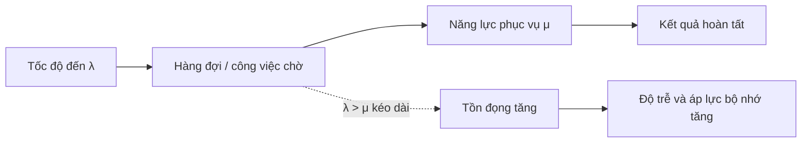

# Lập mô hình tải dựa trên tốc độ đến và khả năng xử lý

Trong chương **Hiệu năng**, bài học này hướng dẫn cách mô tả tải của một hệ thống reactive bằng hai đại lượng cơ bản: tốc độ request hoặc sự kiện đi vào và khả năng hệ thống xử lý chúng. Khi tốc độ đến vượt khả năng phục vụ trong một khoảng thời gian đủ dài, công việc tồn đọng tăng, hàng đợi dài hơn, độ trễ tăng và cuối cùng hệ thống có thể cạn tài nguyên.

Bài học thuộc module **REACTIVE_PROGRAMMING**. Module hướng dẫn: “Học tư duy reactive qua các luồng sự kiện bất đồng bộ, hợp đồng Publisher–Subscriber và cơ chế backpressure của Reactive Streams. Thực hành Mono, Flux, kết hợp toán tử, kiểm soát scheduler, xử lý lỗi và kiểm thử pipeline trong hệ sinh thái Java.” Vì vậy, mô hình tải cần nối được tốc độ đến với demand, concurrency, năng lực của database và dịch vụ phụ thuộc, cũng như cách pipeline phản ứng khi consumer chậm.

## 1. Hai đại lượng nền tảng: tốc độ đến và tốc độ phục vụ

Gọi:

- `λ` (*lambda*) là tốc độ đến trung bình: số request hoặc sự kiện được đưa vào hệ thống trong một đơn vị thời gian.
- `μ` (*mu*) là tốc độ phục vụ: số request hoặc sự kiện mà một thành phần có thể xử lý trong một đơn vị thời gian khi nó bận.
- `L` là số công việc trung bình đang ở trong hệ thống, gồm cả công việc đang xử lý và đang chờ.
- `W` là thời gian trung bình một công việc ở trong hệ thống, gồm thời gian chờ và thời gian phục vụ.

Đơn vị phải nhất quán. Nếu đo tốc độ theo request/giây, thời gian phục vụ nên đổi sang giây/request. Không so sánh request/giây với mili giây mà chưa quy đổi.

Trong một hệ thống ổn định, nếu tốc độ đến lớn hơn năng lực xử lý trong thời gian dài (`λ > μ`), lượng công việc tồn đọng có xu hướng tăng. Nếu `λ < μ`, hệ thống có dư địa để xử lý tải đến và làm giảm hàng đợi sau các đợt tăng tải. Trường hợp `λ` tiến sát `μ` cũng cần thận trọng: chỉ một biến động nhỏ của thời gian phục vụ hoặc tốc độ đến cũng có thể khiến độ trễ hàng đợi tăng mạnh.



Đây là mô hình tổng quát. Một ứng dụng thực tế thường có nhiều chặng nối tiếp như HTTP server, service, connection pool, database và dịch vụ ngoài. Năng lực đầu-cuối bị giới hạn bởi chặng nghẽn nhất, chứ không chỉ bởi số thread của ứng dụng.

## 2. Ước lượng năng lực từ thời gian phục vụ và concurrency

Với một worker xử lý tuần tự, nếu thời gian phục vụ trung bình là `S` giây/request, năng lực lý thuyết xấp xỉ:

$$
μ ≈ 1 / S
$$

Nếu có `C` tác vụ độc lập có thể xử lý đồng thời và không bị giới hạn bởi tài nguyên dùng chung, ước lượng đơn giản là:

$$
μ_max ≈ C / S
$$

Ví dụ, một service có thể giữ tối đa 20 request đang thực hiện, thời gian phục vụ trung bình của mỗi request là 200 ms (0,2 giây). Ước lượng thô:

$$
μ ≈ 20 / 0,2 = 100 request/giây
$$

Đây chỉ là mức lý thuyết theo giả định các request có thể chạy độc lập. Nếu cả 20 request đều phải dùng một pool database chỉ có 5 connection, năng lực thực tế có thể bị giới hạn bởi pool. Nếu mỗi request gọi một API bên ngoài có quota thấp, dịch vụ ngoài có thể trở thành bottleneck.

Vì vậy, hãy tính năng lực theo từng tài nguyên quan trọng:

| Tài nguyên | Đại lượng cần đo | Câu hỏi |
|---|---|---|
| CPU | Thời gian CPU trên mỗi request, mức sử dụng CPU | Có đủ chu kỳ CPU để xử lý tải không? |
| Scheduler | Số worker, hàng đợi, tác vụ đang chạy | Có tạo quá nhiều tác vụ hoặc chờ trên scheduler không? |
| Connection pool | Số connection, thời gian giữ connection | Bao nhiêu request có thể truy cập database đồng thời? |
| Database | Query throughput, lock wait, thời gian query | Database có xử lý kịp tốc độ truy vấn không? |
| HTTP dependency | Quota, latency, số request đồng thời | Dịch vụ ngoài có giới hạn nào? |
| Bộ nhớ | Heap, buffer, số phần tử tồn đọng | Tồn đọng có làm bộ nhớ tăng không? |

Không cộng năng lực của các chặng nối tiếp để suy ra năng lực toàn hệ thống. Với một request cần lần lượt đi qua các chặng, throughput đầu-cuối thường bị giới hạn bởi chặng có năng lực thấp nhất hoặc tài nguyên dùng chung bị tranh chấp nhiều nhất.

## 3. Sử dụng Little’s Law để liên hệ tải, thời gian và công việc tồn đọng

Định luật Little mô tả quan hệ giữa số công việc trung bình trong hệ thống, tốc độ hoàn tất và thời gian trung bình trong hệ thống:

$$
L = λ × W
$$

Trong điều kiện ổn định và đo cùng một phạm vi, `L` là số request trung bình đang xử lý hoặc chờ; `λ` là throughput hoàn tất trung bình; `W` là thời gian trung bình từ lúc vào đến lúc ra.

Ví dụ, một API hoàn tất trung bình 80 request/giây và mỗi request ở trong hệ thống trung bình 0,5 giây:

$$
L = 80 × 0,5 = 40 request
$$

Điều đó có nghĩa trung bình có khoảng 40 request đang ở trong hệ thống. Chúng có thể nằm ở server, chờ connection, thực thi query hoặc chờ dịch vụ ngoài.

Nếu throughput vẫn là 80 request/giây nhưng thời gian trung bình tăng lên 2 giây:

$$
L = 80 × 2 = 160 request
$$

Số request tồn tại đồng thời tăng lên bốn lần. Với một hệ thống có nhiều buffer và object theo từng request, điều này có thể làm tăng heap, connection usage và áp lực garbage collection.

Little’s Law không dự đoán trực tiếp p95 hoặc p99 latency. Nó dùng giá trị trung bình trong một hệ thống ổn định; để đánh giá đuôi phân phối, cần đo percentile và phân tích các trường hợp phục vụ chậm.

## 4. Mức sử dụng tài nguyên và vùng gần bão hòa

Với mô hình một hàng đợi đơn giản, có thể định nghĩa mức sử dụng:

$$
ρ = λ / μ
$$

Khi `ρ < 1`, tốc độ phục vụ lớn hơn tốc độ đến theo mô hình. Khi `ρ` tiến gần 1, phần năng lực dự phòng giảm. Hàng đợi trở nên nhạy với biến động: một số request chậm có thể khiến request đến sau phải chờ lâu hơn.

Ví dụ minh họa cho một pool có 8 connection. Nếu mỗi connection giữ trung bình một request trong 100 ms, năng lực phục vụ thô là khoảng 80 request/giây. Nếu tải đến là 40 request/giây, mức sử dụng lý thuyết là 50%. Nếu tải tăng lên 72 request/giây, mức sử dụng đạt 90%. Khi đó chỉ còn ít dư địa để hấp thụ query chậm, lock hoặc burst.

Không nên đặt mục tiêu vận hành ở sát 100% năng lực lý thuyết. Hệ thống cần headroom cho biến động thời gian phục vụ, tác vụ nền, retry và các request có chi phí khác nhau. Mức headroom thích hợp phải được xác định qua tải thực tế và SLO, không có một tỷ lệ cố định phù hợp mọi hệ thống.

## 5. Phân biệt tốc độ đến, throughput và tốc độ hoàn tất

Ba đại lượng thường bị nhầm lẫn:

- **Offered load:** lượng request mà client hoặc nguồn phát cố gắng đưa vào hệ thống.
- **Throughput:** lượng request hệ thống thực sự tiếp nhận hoặc xử lý trong một đơn vị thời gian; cần ghi rõ đo tại điểm nào.
- **Completion rate:** lượng request hoàn tất thành công trong một đơn vị thời gian.

Khi hệ thống bão hòa, offered load có thể tiếp tục tăng trong khi completion rate đứng yên hoặc giảm. Chênh lệch giữa lượng đến và lượng hoàn tất làm hàng đợi hoặc số request đang chờ tăng lên. Nếu hệ thống từ chối request sớm, lượng được chấp nhận có thể thấp hơn offered load nhưng tài nguyên được bảo vệ tốt hơn.

Một dashboard chỉ hiển thị throughput có thể che khuất vấn đề nếu không đồng thời theo dõi:

- Số request đến và số request bị từ chối.
- Số request đang chạy và đang chờ.
- Tốc độ hoàn tất thành công và thất bại.
- Thời gian chờ hàng đợi và thời gian phục vụ.
- p50, p95, p99 latency.
- Retry rate, timeout rate và cancellation rate.

Khi đọc số liệu, hãy xác định rõ điểm đo. Throughput tại ingress không nhất thiết bằng throughput của database hoặc số response thành công trả về client.

## 6. Mô hình tải theo thời gian: steady, ramp, burst và soak

Tải thực tế không phải lúc nào cũng là một tốc độ cố định. Một kịch bản kiểm thử nên mô tả hình dạng tải theo thời gian:

| Kiểu tải | Mô tả | Mục đích |
|---|---|---|
| Steady load | Tốc độ đến ổn định trong một khoảng thời gian | Đo năng lực và latency khi tải đều |
| Ramp-up | Tăng dần tốc độ đến | Tìm điểm bắt đầu bão hòa |
| Burst | Tăng đột ngột trong thời gian ngắn | Kiểm tra khả năng hấp thụ đỉnh tải |
| Soak | Giữ tải lâu | Phát hiện rò rỉ, tích tụ buffer và suy giảm theo thời gian |
| Spike-and-recovery | Tăng tải mạnh rồi giảm | Kiểm tra thời gian phục hồi và khả năng xả hàng đợi |

Ví dụ một kịch bản ramp-up có thể tăng từ 20 lên 200 request/giây theo từng bước, mỗi bước giữ đủ lâu để đo trạng thái ổn định. Khi p95 latency tăng mạnh, error rate tăng hoặc queue bắt đầu tăng liên tục, đó là dấu hiệu đã tiến gần giới hạn của một tài nguyên.

Burst test giúp kiểm tra buffer và backpressure. Nếu hệ thống chấp nhận một burst lớn hơn khả năng phục vụ nhưng không giới hạn queue, lượng dữ liệu tồn đọng có thể tiêu thụ heap hoặc bộ nhớ ngoài. Soak test giúp phát hiện hiện tượng mỗi request chỉ giữ lại một lượng nhỏ tài nguyên nhưng sau nhiều giờ tổng lượng tích tụ trở nên đáng kể.

## 7. Chọn mô hình tải mở và tải đóng

Công cụ load test thường hỗ trợ hai cách mô hình hóa client:

- **Open workload model:** client phát request theo tốc độ đến đã định, độc lập tương đối với thời gian phản hồi trước đó. Đây là cách phù hợp để mô phỏng lượng traffic đến từ bên ngoài.
- **Closed workload model:** một số lượng virtual user cố định gửi request, chờ phản hồi rồi mới gửi request tiếp theo sau một khoảng nghĩ. Khi server chậm, tốc độ phát request tự giảm.

Closed model hữu ích để mô phỏng nhóm người dùng tương tác, nhưng có thể che giấu tình trạng bão hòa: server chậm làm client phát ít request hơn, nên offered load giảm đúng lúc hệ thống đang gặp khó khăn. Open model giữ tốc độ đến mục tiêu và cho thấy hệ thống phản ứng thế nào khi không thể theo kịp.

Khi dùng open model, cần tránh tạo một generator không đủ năng lực rồi nhầm tốc độ phát thực tế thấp hơn cấu hình là giới hạn của server. Hãy đo cả số request công cụ đã lên lịch, số request thực sự phát và số request đến server. Cũng cần tránh hiện tượng *coordinated omission*: nếu công cụ chỉ đo latency khi một request được phát sau khi request trước hoàn tất, các khoảng thời gian server bị treo có thể không được phản ánh đầy đủ.

Không có mô hình nào thay thế được traffic production. Hãy dùng dữ liệu đã ẩn danh hoặc thống kê phân phối request để xây dựng workload gần với tỷ lệ endpoint, payload, think time và chi phí thực tế.

## 8. Tốc độ đến của pipeline reactive và backpressure

Reactive Streams cung cấp cơ chế demand: subscriber yêu cầu số phần tử mà nó có thể tiếp nhận bằng `request(n)`. Publisher tuân thủ giao thức không phát nhiều phần tử hơn demand đã được yêu cầu. Điều này giúp điều phối tốc độ giữa producer và consumer trong một pipeline hỗ trợ backpressure.

Ví dụ, một consumer xử lý sự kiện theo từng phần tử:

```java
Flux<Event> processed =
    eventSource
        .limitRate(64)
        .concatMap(this::processEvent);
```

`concatMap` xử lý tuần tự các publisher con. `limitRate(64)` điều chỉnh cách downstream yêu cầu dữ liệu theo các nhóm demand, giúp hạn chế lượng yêu cầu được chuyển lên upstream tại một thời điểm. Nó không phải giới hạn 64 sự kiện mỗi giây, cũng không phải giới hạn tốc độ theo thời gian.

Nếu muốn cho phép một số tác vụ con chạy đồng thời, có thể cấu hình concurrency:

```java
Flux<Result> processed =
    eventSource.flatMap(
        this::processEvent,
        16,
        32
    );
```

Trong ví dụ, tối đa 16 publisher con được subscribe đồng thời; `prefetch` điều khiển số phần tử được yêu cầu trước từ mỗi inner publisher theo semantics của toán tử. Tăng concurrency có thể tăng throughput khi các tác vụ độc lập và tài nguyên còn dư, nhưng cũng có thể tăng số request đồng thời đến database hoặc dịch vụ ngoài.

Backpressure chỉ bảo vệ các đoạn pipeline tuân thủ giao thức. Một nguồn ngoài như broker, callback API hoặc hệ thống push có thể không thể chậm lại theo demand của subscriber. Khi tích hợp các nguồn đó, adapter có thể phải buffer, drop hoặc từ chối dữ liệu. Hãy kiểm tra chính sách thực tế của connector và giới hạn buffer ở ranh giới này.

## 9. Queue hữu hạn, buffer và chính sách khi quá tải

Khi tốc độ đến cao hơn tốc độ xử lý trong một khoảng ngắn, queue có thể hấp thụ chênh lệch. Nhưng queue chỉ trì hoãn thời điểm phải xử lý tải; nó không tạo thêm năng lực phục vụ.

Nếu tốc độ đến trung bình là `λ`, tốc độ phục vụ là `μ`, và `λ > μ` trong thời gian `t`, lượng tồn đọng tăng xấp xỉ:

$$
ΔQ ≈ (λ − μ) × t
$$

Ví dụ, nguồn đưa vào 150 sự kiện/giây, consumer xử lý 100 sự kiện/giây trong 60 giây. Nếu không có drop hoặc giới hạn khác, lượng tồn đọng tăng xấp xỉ:

$$
(150 − 100) × 60 = 3.000 sự kiện
$$

Khi `λ` giảm xuống dưới `μ`, consumer có thể xả queue. Nếu tốc độ đến tiếp tục lớn hơn tốc độ phục vụ, queue sẽ tăng cho đến khi chạm giới hạn hoặc cạn tài nguyên.

Với Reactor, tránh buffer vô hạn cho luồng không kiểm soát:

```java
Flux<Event> buffered =
    eventSource.onBackpressureBuffer(
        1_000,
        dropped -> log.warn("Buffer đầy, bỏ event {}", dropped.id()),
        BufferOverflowStrategy.DROP_OLDEST
    );
```

Ví dụ này đặt giới hạn 1.000 phần tử và chọn chính sách bỏ phần tử cũ nhất khi buffer đầy. Chỉ dùng chính sách drop nếu nghiệp vụ cho phép mất dữ liệu và có cơ chế quan sát hoặc phục hồi phù hợp. Với sự kiện tài chính hoặc dữ liệu cần đầy đủ, có thể cần durable queue, producer throttling hoặc từ chối request thay vì drop.

Chính sách quá tải cần được chọn theo ý nghĩa dữ liệu:

- **Buffer:** giữ công việc trong giới hạn; khi đầy phải có hành vi xác định.
- **Drop:** bỏ phần tử theo quy tắc được công bố; phù hợp với dữ liệu có thể mất như một số cập nhật trạng thái mới nhất.
- **Reject:** từ chối công việc mới sớm, ví dụ trả HTTP 429 hoặc 503.
- **Throttle/rate limit:** giới hạn tốc độ nhận theo quota hoặc cửa sổ thời gian.
- **Durable queue:** lưu công việc để xử lý sau, nếu hệ thống cần độ bền qua restart.

Không chọn drop hoặc reject chỉ để làm biểu đồ latency đẹp hơn; chính sách phải phù hợp hợp đồng với producer và consumer.

## 10. Mô hình hóa một request qua nhiều chặng

Một request có thể tiêu thụ tài nguyên ở nhiều chặng khác nhau. Ví dụ API nhận đơn hàng, đọc database, gọi dịch vụ định giá và ghi kết quả. Mỗi chặng có năng lực riêng:

```text
HTTP ingress -> service -> DB pool -> pricing API -> response
```

Giả sử:

- HTTP ingress có thể nhận 500 request/giây.
- DB pool có năng lực xử lý 120 truy vấn/giây trong workload hiện tại.
- Pricing API có quota 80 request/giây.
- Service có thể điều phối nhiều request nhưng không tăng quota của dependency.

Năng lực đầu-cuối tối đa không thể vượt qua giới hạn của pricing API trong mô hình này; chặng 80 request/giây là giới hạn rõ nhất. Nếu service gửi request đến pricing API với tốc độ 120/giây, hàng đợi hoặc lỗi quota sẽ xuất hiện ở chặng đó dù HTTP server vẫn còn khả năng nhận thêm.

Có thể giảm áp lực bằng cách giới hạn concurrency đến pricing API, cache dữ liệu có thể cache, gom request nếu API hỗ trợ batch, hoặc từ chối/throttle traffic vượt ngân sách. Cần đo từng chặng để xác định bottleneck thay vì chỉ tăng số thread ở ingress.

## 11. Chuyển mô hình tải thành kế hoạch kiểm thử

Một kế hoạch load test nên nêu rõ giả định và tiêu chí thành công trước khi chạy:

| Thành phần mô hình | Ví dụ cần ghi |
|---|---|
| Arrival rate | 50, 100, 150 request/giây |
| Phân phối endpoint | 60% đọc, 30% ghi, 10% truy vấn tổng hợp |
| Payload | Kích thước nhỏ, trung bình và lớn |
| Service time | Phân phối latency dự kiến của DB và dependency |
| Concurrency | Số request đang hoạt động và giới hạn từng pool |
| Duration | Thời gian warm-up, đo steady state và soak |
| Burst | Mức đỉnh và thời gian duy trì |
| SLO | p95/p99 latency, error rate và throughput tối thiểu |
| Resource budget | CPU, heap, connection, queue và thread |
| Recovery | Thời gian xả queue sau khi tải giảm |

Một chuỗi thử nghiệm thực tế có thể gồm:

1. Chạy tải thấp để xác nhận chức năng và đo baseline.
2. Tăng arrival rate từng bước để tìm điểm latency/error bắt đầu tăng.
3. Giữ tải tại mức mục tiêu để kiểm tra ổn định.
4. Tạo burst ngắn để kiểm tra queue và backpressure.
5. Chạy soak test để quan sát heap, connection và queue theo thời gian.
6. Giảm tải và đo thời gian phục hồi.
7. Lặp lại khi thay đổi concurrency, pool size hoặc buffer để xác định tác động.

Giữ cùng một workload khi so sánh hai phiên bản. Nếu vừa đổi code vừa đổi tỷ lệ endpoint hoặc payload, khó xác định nguyên nhân cải thiện hay suy giảm.

## 12. Ví dụ tính toán một mục tiêu tải

Một API dự kiến nhận 90 request/giây. Một chặng gọi database có 12 connection; mỗi query giữ connection trung bình 100 ms. Ước lượng năng lực lý thuyết của pool:

$$
μ_pool ≈ 12 / 0,1 = 120 query/giây
$$

Nếu mỗi request tạo đúng một query và không có query khác dùng pool, tải mục tiêu tương ứng mức sử dụng xấp xỉ:

$$
ρ ≈ 90 / 120 = 0,75
$$

Đây là ước lượng ban đầu, không phải cam kết database sẽ đạt 120 query/giây. Query phức tạp, lock, transaction dài, số query trên mỗi request và tải từ các service khác đều thay đổi năng lực thực tế.

Nếu mỗi request trung bình thực hiện hai query, tốc độ query cần thiết là khoảng 180 query/giây. Khi đó pool theo giả định ban đầu không đủ đáp ứng mục tiêu. Các lựa chọn có thể gồm tối ưu số query, rút ngắn thời gian giữ connection, dùng batch, điều chỉnh pool sau khi kiểm tra database hoặc giảm arrival rate được chấp nhận.

Hãy kiểm chứng bằng load test và metrics ở database. Đừng tăng pool size một cách máy móc: quá nhiều connection đồng thời có thể làm database tranh chấp CPU, memory, lock và scheduler, khiến năng lực tổng giảm.

## 13. Những lỗi thường gặp khi lập mô hình tải

- **Chỉ đo số request/giây.** Cần biết cả thời gian phục vụ, latency, concurrency và số công việc đang chờ.
- **Đồng nhất arrival rate với throughput.** Khi bão hòa, lượng đến có thể lớn hơn lượng hoàn tất.
- **Giả định concurrency tăng thì năng lực tăng tuyến tính.** Database, CPU, quota và lock có thể trở thành giới hạn.
- **Dùng trung bình để thay thế percentile.** Mean latency không thể hiện đầy đủ tail latency.
- **Cho rằng queue giải quyết quá tải.** Queue chỉ giữ chênh lệch tạm thời; queue vô hạn có thể làm cạn bộ nhớ.
- **Nhầm `limitRate` với rate limiter.** `limitRate` điều chỉnh demand, không đặt quota theo giây.
- **Tăng `flatMap` concurrency mà không kiểm tra dependency.** Điều đó có thể làm pool hoặc dịch vụ ngoài quá tải.
- **Cho rằng backpressure áp dụng được với mọi nguồn.** Một số nguồn push phải buffer, drop hoặc reject khi downstream chậm.
- **Chỉ dùng closed workload model.** Khi server chậm, client có thể tự giảm tốc độ phát và che giấu điểm bão hòa.
- **Không kiểm tra thời gian phục hồi.** Queue có thể tiếp tục tồn tại lâu sau khi burst đã kết thúc.
- **Bỏ qua retry amplification.** Retry làm tăng tốc độ request thực tế đến dependency và có thể tạo vòng lặp quá tải.

## 14. Bài tập vận dụng

Một API xử lý sự kiện đơn hàng có mục tiêu nhận 120 request/giây. Mỗi request cần một truy vấn database và một lời gọi dịch vụ định giá. Database pool có 10 connection, thời gian giữ connection trung bình 80 ms; dịch vụ định giá giới hạn 100 request/giây và thời gian phản hồi trung bình 150 ms.

Hãy lập mô hình và trả lời:

1. Ước lượng năng lực lý thuyết của database pool theo giả định mỗi request dùng một connection trong 80 ms.
2. Xác định chặng nào có năng lực thấp hơn giữa database và dịch vụ định giá.
3. Tính mức sử dụng gần đúng của từng chặng ở arrival rate 120 request/giây.
4. Dự đoán điều gì xảy ra với latency và queue nếu API tiếp tục nhận 120 request/giây trong thời gian dài.
5. Chọn giới hạn concurrency phù hợp cho lời gọi định giá và giải thích tác động đến throughput.
6. Nếu nguồn sự kiện push nhanh hơn consumer, chọn buffer hữu hạn, drop, reject hay durable queue theo yêu cầu dữ liệu.
7. Thiết kế ramp-up, burst, steady và soak test; nêu các metrics cần quan sát.
8. Giải thích tại sao tăng thread hoặc `flatMap` concurrency không tự giải quyết quota 100 request/giây của dịch vụ định giá.

Dùng Little’s Law để ước lượng số request trung bình trong hệ thống khi throughput là 80 request/giây và thời gian trung bình trong hệ thống là 0,6 giây. Sau đó so sánh kết quả khi thời gian tăng lên 1,5 giây mà throughput không đổi.

Một mô hình tải có ích phải chỉ rõ request đến từ đâu, đi qua những tài nguyên nào, mỗi chặng phục vụ được bao nhiêu, công việc chờ được giữ ở đâu và hệ thống sẽ làm gì khi tải vượt năng lực.
