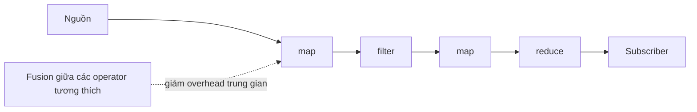

# Tối ưu chuỗi toán tử và khái niệm hợp nhất toán tử

## Vì sao chuỗi toán tử ảnh hưởng đến hiệu năng?

Trong Project Reactor, một pipeline được tạo bằng cách nối các toán tử như `map`, `filter`, `flatMap`, `publishOn`, `buffer` và `reduce`. Mỗi toán tử biểu đạt một bước xử lý trong luồng dữ liệu. Cách chia bước giúp mã dễ đọc và dễ kết hợp, nhưng một pipeline có thể phát sinh chi phí điều phối nếu có quá nhiều ranh giới thực thi, hàng đợi, lần chuyển thread hoặc thao tác tạo đối tượng không cần thiết.

Reactor có một nhóm tối ưu nội bộ gọi là **operator fusion** (hợp nhất toán tử). Khi các publisher và operator tương thích, chúng có thể phối hợp để giảm chi phí truyền tín hiệu giữa các bước, hạn chế việc tạo và đọc hàng đợi trung gian, hoặc cho phép downstream lấy dữ liệu trực tiếp từ upstream theo giao thức fusion. Nhờ vậy, pipeline vẫn giữ cách viết theo từng toán tử nhưng runtime có thể thực thi chuỗi hiệu quả hơn.

Fusion là tối ưu triển khai của Reactor. Người dùng thường không cần gọi một toán tử đặc biệt để bật nó, cũng không nên phụ thuộc vào việc một cặp operator cụ thể chắc chắn được fusion trong mọi phiên bản. Điều cần làm là hiểu những ranh giới làm thay đổi cách thực thi, tránh tạo thêm boundary không cần thiết và đo hiệu năng trên phiên bản Reactor thực tế của ứng dụng.

## Operator fusion là gì?

Thông thường, một phần tử đi qua pipeline bằng các tín hiệu Reactive Streams: upstream gọi `onNext`, operator thực hiện biến đổi rồi chuyển tín hiệu đến operator tiếp theo. Nếu chuỗi có nhiều operator, cách thực thi đơn giản có thể tạo nhiều lần gọi callback cho mỗi phần tử.

Với fusion, các operator tương thích thương lượng một giao thức nội bộ khi subscription được thiết lập. Thay vì mọi phần tử luôn phải đi qua đầy đủ chuỗi callback, một số operator có thể dùng hàng đợi chung hoặc cơ chế pull nội bộ để downstream lấy phần tử khi cần. Mục tiêu là giảm overhead điều phối mà vẫn giữ kết quả quan sát được theo hợp đồng của publisher.



Sơ đồ chỉ minh họa ý tưởng. Fusion không nhất thiết biến toàn bộ pipeline thành một hàm duy nhất hoặc loại bỏ mọi lời gọi hàm. Nó là giao thức phối hợp giữa các operator hỗ trợ fusion; operator không tương thích hoặc ranh giới bất đồng bộ có thể làm thay đổi cách tối ưu.

### Fusion không thay đổi ngữ nghĩa dữ liệu

Một pipeline được fusion và một pipeline không được fusion phải có hành vi nghiệp vụ tương đương: cùng giá trị, thứ tự theo hợp đồng, tín hiệu hoàn tất/lỗi và quy tắc cancellation. Fusion nhằm giảm chi phí thực thi nội bộ, không phải thay đổi số phần tử hoặc bỏ qua một bước xử lý.

Không nên dựa vào số lần một lambda được gọi theo một thứ tự thread cụ thể để xác định đúng sai. Reactor bảo đảm các tín hiệu theo hợp đồng Reactive Streams, còn cách các operator nội bộ phối hợp có thể khác giữa phiên bản hoặc tùy nguồn. Side effect nên được đặt trong các hook phù hợp và không phụ thuộc vào chi tiết fusion.

## Hai dạng fusion chính: SYNC và ASYNC

Reactor có thể thương lượng các chế độ fusion khác nhau. Hai dạng thường được nhắc đến là synchronous fusion và asynchronous fusion.

| Chế độ | Ý nghĩa khái quát | Ví dụ tình huống |
|---|---|---|
| SYNC fusion | Nguồn có dữ liệu đồng bộ để downstream lấy theo nhu cầu trong quá trình drain | Nguồn hữu hạn như `Flux.range` kết hợp các operator hỗ trợ fusion |
| ASYNC fusion | Nguồn hoặc operator đưa dữ liệu vào queue; downstream được báo khi có dữ liệu để lấy tiếp | Một số ranh giới bất đồng bộ và operator có queue hỗ trợ fusion |

Trong SYNC fusion, dữ liệu có thể được lấy trực tiếp từ nguồn đồng bộ mà không cần tạo một chuỗi callback `onNext` riêng cho từng phần tử ở mọi ranh giới. Trong ASYNC fusion, upstream có thể đưa phần tử vào queue rồi báo cho downstream rằng có dữ liệu sẵn sàng; downstream drain queue theo demand và cơ chế nội bộ đã thương lượng.

Đây là mô tả khái niệm. Chi tiết protocol, interface và các mode fusion thuộc phần triển khai nội bộ của Reactor; ứng dụng thông thường không nên tự triển khai hoặc ép mode fusion bằng API nội bộ. Các mode có thể thay đổi theo phiên bản, operator và loại nguồn.

## Chuỗi đồng bộ là nơi fusion thường có ích

Một chuỗi `map` và `filter` đơn giản trên nguồn đồng bộ là ví dụ dễ hình dung:

```java
import reactor.core.publisher.Flux;
import reactor.core.publisher.Mono;

Mono<Integer> total = Flux.range(1, 1_000)
    .map(number -> number * 2)
    .filter(number -> number % 3 == 0)
    .map(number -> number + 1)
    .reduce(0, Integer::sum);
```

Nguồn `range` phát một dãy hữu hạn. Các operator biến đổi và lọc phần tử, còn `reduce` tính tổng. Những operator hỗ trợ fusion có thể phối hợp để giảm overhead truyền phần tử qua từng ranh giới. Mã nguồn vẫn mô tả từng bước nghiệp vụ, không cần viết một vòng lặp imperative chỉ để tránh overhead callback.

Một ví dụ tương tự với kết quả cần giữ thứ tự:

```java
Flux<String> labels = Flux.range(1, 5)
    .map(number -> "item-" + number)
    .filter(label -> !label.endsWith("3"))
    .map(String::toUpperCase);
```

Fusion không làm `filter` bỏ qua điều kiện hoặc làm `map` thay đổi thứ tự dữ liệu. Nó chỉ cho phép các operator tương thích phối hợp cách chuyển phần tử hiệu quả hơn.

## Ranh giới bất đồng bộ và publishOn

`publishOn(scheduler)` chuyển việc xử lý tín hiệu downstream sang worker của scheduler. Để thực hiện việc chuyển này, Reactor cần điều phối tín hiệu qua một ranh giới bất đồng bộ và thường dùng queue/prefetch. Ranh giới đó có chi phí: phần tử có thể phải được xếp hàng, thread cần được đánh thức hoặc lập lịch, và downstream drain dữ liệu trên worker khác.

```java
import reactor.core.publisher.Flux;
import reactor.core.scheduler.Schedulers;

Flux<Result> results = Flux.range(1, 1_000)
    .map(this::decode)
    .publishOn(Schedulers.parallel(), 64)
    .map(this::calculate)
    .filter(Result::isValid);
```

`decode` nằm trước `publishOn`; các operator phía sau được thực thi trên worker của scheduler được chọn. Tham số `64` là prefetch cho ranh giới này, không phải giới hạn tổng số phần tử của nguồn hoặc tốc độ mỗi giây. Một queue có thể được dùng để chuyển dữ liệu sang worker downstream.

Không cần thêm `publishOn` sau mọi operator. Nếu không có yêu cầu chuyển scheduler, nhiều boundary có thể tạo queue và chi phí lập lịch mà không tăng throughput. Hãy đặt boundary tại nơi thực sự cần đổi loại công việc hoặc cô lập một đoạn xử lý.

Fusion có thể vẫn được sử dụng ở hai phía của một ranh giới bất đồng bộ nếu các operator trong từng đoạn tương thích. Tuy nhiên, không nên hình dung fusion sẽ xóa bỏ việc chuyển thread mà `publishOn` yêu cầu. Ranh giới scheduler vẫn cần phối hợp queue và drain để đảm bảo thực thi đúng worker.

## subscribeOn không giống publishOn

`subscribeOn(scheduler)` điều phối quá trình subscribe và việc khởi chạy nguồn upstream trên scheduler được chỉ định. Nó thường hữu ích khi nguồn bắt đầu bằng một lời gọi đồng bộ hoặc blocking cần được cô lập. `publishOn(scheduler)` chuyển việc xử lý tín hiệu ở phía downstream kể từ vị trí xuất hiện trong chuỗi.

```java
import reactor.core.publisher.Mono;
import reactor.core.scheduler.Schedulers;

Mono<Record> record = Mono.fromCallable(() -> legacyRepository.load(recordId))
    .subscribeOn(Schedulers.boundedElastic())
    .map(this::toRecordView);
```

`fromCallable` trì hoãn lời gọi đến subscription; `subscribeOn` đưa thao tác blocking sang scheduler phù hợp. Nó không biến repository blocking thành non-blocking và không phải công cụ để chia một phép tính thành nhiều phần song song.

Không thêm `subscribeOn` lặp lại ở mọi tầng chỉ để “tăng tốc”. Một subscription có thể đi qua nhiều operator nhưng việc điều phối nguồn thường chỉ cần được quyết định ở ranh giới nơi nguồn được khởi chạy. Nếu cần chuyển một đoạn xử lý downstream, dùng `publishOn` ở đúng vị trí. Việc chuyển scheduler không phải là fusion; hai cơ chế giải quyết hai vấn đề khác nhau.

## Operator nào có thể fusion?

Không phải mọi operator đều tham gia fusion theo cùng cách. Nhiều operator cơ bản trong Reactor có triển khai hỗ trợ fusion, đặc biệt là các phép biến đổi một phần tử như `map` và `filter`. Một số operator khác có thể tạo ranh giới bất đồng bộ, buffer hoặc nhiều publisher con, làm thay đổi cách dữ liệu được điều phối.

| Nhóm operator | Ảnh hưởng thường gặp | Cách suy nghĩ khi tối ưu |
|---|---|---|
| `map`, `filter` | Có thể phối hợp fusion với nguồn và operator tương thích | Nối trực tiếp nếu logic rõ ràng; tránh thêm boundary chỉ vì muốn tối ưu |
| `doOnNext` và hook quan sát | Thêm hành vi quan sát; hỗ trợ fusion tùy operator và vị trí | Giữ side effect nhẹ, tránh I/O hoặc log quá nặng trên mỗi phần tử |
| `publishOn` | Tạo ranh giới chuyển scheduler và queue/prefetch | Dùng khi cần đổi worker, không thêm tùy tiện |
| `subscribeOn` | Điều phối subscription và khởi chạy nguồn | Dùng để cô lập nguồn blocking hoặc chọn scheduler cho nguồn |
| `flatMap` | Quản lý nhiều publisher con và concurrency | Đặt giới hạn concurrency; không xem đây là phép fusion đơn giản |
| `buffer`, `window`, `groupBy` | Thay đổi cách nhóm hoặc phân luồng dữ liệu, có thể giữ dữ liệu nội bộ | Đánh giá kích thước buffer, số group và vòng đời |
| `hide` | Che giấu identity/khả năng fuseable của upstream đối với downstream | Dùng để chẩn đoán hoặc khi cần ngăn một tối ưu cụ thể, không dùng mặc định |

Bảng mô tả xu hướng, không phải cam kết API rằng một operator cụ thể luôn fusion hoặc luôn tạo boundary trong mọi phiên bản. Tối ưu nội bộ có thể thay đổi; hãy kiểm tra phiên bản Reactor đang dùng và benchmark theo pipeline thực tế.

## hide: tạo ranh giới để so sánh hoặc che giấu nguồn

`hide()` trả về một publisher che giấu một số đặc điểm và identity của nguồn upstream. Một tác dụng thực tế là ngăn downstream tận dụng một số tối ưu dựa trên khả năng fuseable của nguồn. Nó hữu ích trong test hoặc chẩn đoán khi muốn so sánh đường thực thi có fusion với đường không fusion.

```java
import reactor.core.publisher.Flux;

Flux<Integer> normal = Flux.range(1, 100)
    .map(number -> number + 1)
    .filter(number -> number % 2 == 0);

Flux<Integer> withoutExposedFusion = Flux.range(1, 100)
    .hide()
    .map(number -> number + 1)
    .filter(number -> number % 2 == 0);
```

Hai publisher có cùng kết quả quan sát được. Ở nhánh thứ hai, `hide()` ngăn downstream nhìn thấy một số khả năng tối ưu của nguồn. Dùng `hide()` có thể giúp kiểm tra xem kết quả hoặc hiệu năng có phụ thuộc vào tối ưu nội bộ hay không, nhưng nó cũng có thể làm mất lợi ích fusion. Không chèn `hide()` vào production chỉ để làm pipeline “rõ ràng” hơn nếu không có lý do cụ thể.

`hide()` không phải toán tử đồng bộ hóa, không sao chép dữ liệu và không tạo một cache. Nó cũng không bảo đảm mọi operator phía sau đều không fusion với nhau; nó che giấu đặc điểm của publisher upstream tại ranh giới đó.

## Phân biệt fusion với batching, parallelism và caching

Các khái niệm này có thể cùng xuất hiện trong một pipeline nhưng giải quyết vấn đề khác nhau:

| Khái niệm | Mục tiêu | Ví dụ |
|---|---|---|
| Operator fusion | Giảm overhead phối hợp giữa các operator tương thích | Chuỗi `range().map().filter().map()` |
| Batching | Gom nhiều phần tử thành một nhóm để xử lý hoặc gửi theo lô | `buffer(100)` rồi ghi bulk |
| Parallelism | Chia công việc để nhiều worker xử lý cùng lúc | `parallel().runOn(Schedulers.parallel())` |
| Concurrency | Cho phép nhiều publisher con hoặc I/O cùng hoạt động | `flatMap(client::fetch, 16)` |
| Caching | Giữ kết quả/tín hiệu để dùng lại cho subscriber sau | `Mono.cache(Duration.ofSeconds(10))` |
| Backpressure | Điều tiết số phần tử subscriber yêu cầu | `request(n)`, `limitRate(n)` |

Fusion không gom dữ liệu thành batch nghiệp vụ, không tạo thêm core CPU và không giữ kết quả để replay. Batching có thể giảm số lần gọi database nhưng tăng bộ nhớ tạm; parallelism có thể tăng throughput CPU nhưng tạo thêm chi phí điều phối; caching giảm số lần truy cập nguồn nhưng cần quản lý TTL và tính nhất quán. Chọn đúng cơ chế theo điểm nghẽn.

## Tránh tạo ranh giới thực thi không cần thiết

Một cách tối ưu pipeline phổ biến là xem lại số lần chuyển scheduler và số queue cần thiết. Ví dụ sau có nhiều lần chuyển worker mà không có lý do rõ ràng:

```java
Flux<View> inefficient = source
    .publishOn(Schedulers.parallel())
    .map(this::decode)
    .publishOn(Schedulers.parallel())
    .map(this::enrich)
    .publishOn(Schedulers.parallel())
    .map(this::toView);
```

Nếu cả ba bước đều là phép biến đổi CPU ngắn và không cần cô lập riêng, có thể giữ chúng trong cùng một đoạn thực thi:

```java
Flux<View> simpler = source
    .publishOn(Schedulers.parallel())
    .map(this::decode)
    .map(this::enrich)
    .map(this::toView);
```

Ví dụ chỉ minh họa việc giảm boundary; nó không chứng minh pipeline thứ hai luôn nhanh hơn. Nếu một bước cần blocking isolation, một bước cần scheduler khác hoặc có yêu cầu fairness, boundary riêng có thể là cần thiết. Đừng gộp operator chỉ để giảm số dòng mã; hãy giữ ranh giới khi chúng biểu đạt một yêu cầu thực thi có thật.

### Không chuyển CPU-bound công việc dài lên event loop

Fusion không làm một lambda CPU nặng trở nên rẻ hơn. Nếu một phép tính kéo dài chạy trên event loop, nó vẫn chặn event loop. Với công việc CPU-bound, chọn scheduler CPU phù hợp và giới hạn số tác vụ đang chạy; với API blocking, cô lập bằng `boundedElastic` hoặc thay bằng client non-blocking. Không dùng fusion như một lý do để bỏ qua việc chọn scheduler.

## Giảm chi phí trong thân operator

Fusion chỉ giảm một phần overhead giữa các operator. Chi phí lớn có thể nằm ngay trong hàm được truyền vào `map`, `filter` hoặc `flatMap`. Một phép biến đổi tạo nhiều object tạm, regex phức tạp, parse payload lớn hoặc log đồng bộ trên mỗi phần tử có thể chiếm phần lớn thời gian xử lý.

Ví dụ, tránh tính lại cùng một giá trị bất biến cho mọi phần tử nếu có thể tính một lần ở assembly:

```java
String normalizedPrefix = configuration.prefix().toLowerCase(Locale.ROOT);

Flux<String> names = source
    .map(item -> normalizedPrefix + normalize(item.name()));
```

Nếu giá trị phụ thuộc request hoặc subscription, không đưa nó vào biến dùng chung chỉ để tránh tính toán. Phạm vi state và tính đúng đắn vẫn quan trọng hơn một phép tối ưu nhỏ. Dùng `defer` hoặc Reactor Context khi dữ liệu phải được tạo/đọc theo subscription.

Giữ các callback nhẹ và không blocking. Nếu cần gọi dịch vụ phụ, biểu diễn lời gọi đó thành publisher và kết hợp bằng `flatMap` với concurrency hữu hạn. Nếu cần batch database, dùng toán tử gom nhóm phù hợp với giới hạn bộ nhớ. Nếu cần quan sát, cân nhắc sampling hoặc metric tổng hợp thay vì ghi log đồng bộ cho mọi phần tử ở tải cao.

## Đo hiệu năng để xác nhận lợi ích

Không thể kết luận fusion giúp một pipeline nhanh hơn chỉ bằng cách nhìn số lượng operator. Kết quả phụ thuộc nguồn, kiểu dữ liệu, kích thước phần tử, scheduler, mức concurrency, JVM warm-up và chi phí của logic nghiệp vụ. Hãy đo trước và sau một thay đổi với cùng điều kiện.

Một benchmark có ý nghĩa nên:

1. Dùng dữ liệu đại diện và đủ lớn để giảm ảnh hưởng của setup.
2. Tách thời gian dựng publisher khỏi thời gian thực thi nếu mục tiêu là đo throughput khi subscribe.
3. Warm up JVM và chạy nhiều iteration; tránh đo một lần duy nhất.
4. Đo throughput, latency và allocation/GC, không chỉ đo tổng thời gian một lần chạy.
5. Giữ cùng scheduler, concurrency, prefetch và kích thước dữ liệu giữa các biến thể.
6. So sánh pipeline bình thường với biến thể có `hide()` chỉ khi muốn kiểm tra ảnh hưởng của fusion; không dùng `hide()` như một tối ưu.
7. Chạy benchmark ở môi trường ít nhiễu và dùng công cụ như JMH cho microbenchmark JVM.

Không dùng `System.nanoTime()` quanh một lần `subscribe()` đơn giản rồi xem đó là kết luận hiệu năng. Pipeline có thể thực thi đồng bộ, bất đồng bộ hoặc tiếp tục sau khi lời gọi subscribe trả về. Benchmark cần chờ đúng terminal signal, kiểm soát scheduler và tránh đo chi phí không thuộc mục tiêu.

Ví dụ kiểm tra ngữ nghĩa bằng StepVerifier vẫn cần được giữ riêng với benchmark:

```java
import reactor.core.publisher.Flux;
import reactor.test.StepVerifier;

Flux<Integer> pipeline = Flux.range(1, 10)
    .map(number -> number * 2)
    .filter(number -> number > 10);

StepVerifier.create(pipeline)
    .expectNext(12, 14, 16, 18, 20)
    .verifyComplete();
```

Test này xác nhận kết quả và tín hiệu hoàn tất. Nó không đo hiệu năng và không khẳng định fusion đã được bật. Kiểm thử hành vi và benchmark hiệu năng là hai nhiệm vụ riêng.

## Quan sát pipeline mà không làm sai lệch phép đo

Các operator như `log`, `checkpoint`, `doOnNext` hoặc hook debug giúp chẩn đoán tín hiệu, nhưng có thể tạo thêm chi phí. Ghi log từng phần tử trên một luồng lớn có thể tốn thời gian hơn cả phép biến đổi chính. Hook debug toàn cục cũng có thể ảnh hưởng đến assembly và stack trace.

Trong quá trình đo hiệu năng, tắt các instrumentation nặng không thuộc cấu hình production mục tiêu, hoặc đo riêng tác động của chúng. Trong production, vẫn cần metric và tracing, nhưng nên chọn mức chi tiết phù hợp: đếm số phần tử, đo latency theo batch hoặc sampling thay vì ghi toàn bộ payload ở mọi `onNext`.

Không nên introspect các interface fusion nội bộ để điều khiển hành vi ứng dụng. Các interface này phục vụ tối ưu trong Reactor; việc phụ thuộc trực tiếp vào chúng có thể khiến code dễ vỡ khi nâng phiên bản. Quan sát từ API công khai, metric và benchmark sẽ bền vững hơn.

## Những lỗi tối ưu thường gặp

- **Cho rằng nhiều operator luôn chậm:** operator tương thích có thể được fusion; ưu tiên pipeline dễ đọc rồi đo thực tế.
- **Cho rằng fusion loại bỏ toàn bộ chi phí:** thân lambda, allocation, queue ở boundary, scheduler và I/O vẫn có chi phí.
- **Thêm `publishOn` sau mọi operator:** mỗi boundary có thể thêm queue và điều phối; chỉ chuyển thread khi có lý do.
- **Dùng `subscribeOn` như công cụ chia song song:** nó điều phối subscription/nguồn, không tự chia từng phần tử thành nhiều core.
- **Nhầm fusion với batching:** fusion không tạo batch nghiệp vụ và không thay thế `buffer` hoặc bulk API.
- **Dùng `hide()` trong production để “tối ưu”:** nó có thể ngăn một số tối ưu fusion và làm tăng overhead.
- **Giả định một operator luôn fuse ở mọi phiên bản:** khả năng fusion là chi tiết triển khai phụ thuộc operator, nguồn và phiên bản.
- **Dựa vào side effect để suy ra mode fusion:** cách thực thi nội bộ có thể thay đổi; side effect không nên phụ thuộc callback/thread cụ thể.
- **Benchmark không chờ pipeline kết thúc:** phép đo có thể chỉ tính thời gian đăng ký, bỏ qua công việc bất đồng bộ.
- **Tối ưu operator nhưng bỏ qua điểm nghẽn thật:** database, network, lock, CPU lambda hoặc queue thường có ảnh hưởng lớn hơn overhead callback.

## Quy trình tối ưu chuỗi toán tử

Trước tiên, xác định mục tiêu đo được: throughput, p95 latency, allocation, CPU hoặc memory. Tìm đoạn pipeline đang tốn thời gian và phân loại nó là CPU-bound, I/O-bound, chờ scheduler hay tích lũy dữ liệu. Không thay đổi cấu trúc chỉ vì chuỗi operator trông dài.

Tiếp theo, giữ các phép biến đổi đồng bộ tương thích trong một đoạn pipeline rõ ràng để Reactor có cơ hội áp dụng fusion. Giảm `publishOn` không cần thiết, giới hạn concurrency và prefetch ở các nhánh bất đồng bộ, kiểm soát buffer và tránh blocking trong callback. Dùng `hide()` chỉ như công cụ chẩn đoán khi cần so sánh đường fusion với đường không fusion.

Cuối cùng, kiểm tra ngữ nghĩa bằng `StepVerifier` và đo hiệu năng bằng benchmark có warm-up, dữ liệu đại diện và cùng điều kiện chạy. Theo dõi cả allocation, queue, scheduler và độ trễ dependency. Operator fusion giúp Reactor giảm một phần chi phí phối hợp trong chuỗi toán tử; hiệu năng tổng thể vẫn phụ thuộc vào cách thiết kế toàn pipeline, loại tải và tài nguyên mà ứng dụng sử dụng.
