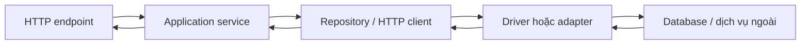

# Chuyển đổi từng phần và tiêu chí đánh giá tính phù hợp

Trong chương **Thiết kế ứng dụng**, bài học này hướng dẫn cách chuyển một hệ thống hiện có sang kiến trúc reactive theo từng phần và cách quyết định phần nào thực sự nên chuyển. Một hệ thống không cần viết lại toàn bộ trong một lần. Có thể bắt đầu từ một luồng nghiệp vụ có lợi ích rõ ràng, thiết lập ranh giới với phần còn lại và mở rộng khi số liệu vận hành chứng minh được hiệu quả.

Bài học thuộc module **REACTIVE_PROGRAMMING**. Module hướng dẫn: “Học tư duy reactive qua các luồng sự kiện bất đồng bộ, hợp đồng Publisher–Subscriber và cơ chế backpressure của Reactive Streams. Thực hành Mono, Flux, kết hợp toán tử, kiểm soát scheduler, xử lý lỗi và kiểm thử pipeline trong hệ sinh thái Java.” Vì vậy, quyết định chuyển đổi cần xét cả mô hình Publisher–Subscriber, backpressure, scheduler, lỗi, transaction và khả năng kiểm thử của toàn bộ đường đi dữ liệu.

## 1. Chuyển đổi reactive là thay đổi mô hình thực thi

Trong ứng dụng imperative, một request thường gọi hàm, chờ hàm trả về rồi tiếp tục bước tiếp theo. Khi một lời gọi I/O đồng bộ chờ database hoặc HTTP service, thread thực hiện lời gọi bị giữ trong thời gian chờ.

Trong ứng dụng reactive, các bước được biểu diễn thành publisher. Khi I/O được hỗ trợ bất đồng bộ từ driver đến adapter, thread không cần bị giữ chỉ để chờ kết quả. Subscriber nhận tín hiệu khi dữ liệu sẵn sàng; demand và cancellation có thể được truyền qua pipeline.

Điểm quan trọng là mô hình thực thi thay đổi xuyên suốt đường đi. Chỉ đổi chữ ký từ `Order` sang `Mono<Order>` không làm một lời gọi JDBC hoặc SDK đồng bộ trở thành non-blocking.

Ví dụ này vẫn thực hiện I/O đồng bộ ngay khi lắp ráp publisher:

```java
Mono<Order> order =
    Mono.just(jdbcRepository.findById(orderId));
```

Nếu `findById` là blocking, lời gọi đã giữ thread trước khi `Mono.just` được tạo. Cách cô lập thao tác legacy là trì hoãn lời gọi và điều phối nó trên scheduler dành cho blocking:

```java
Mono<Order> order =
    Mono.fromCallable(() -> jdbcRepository.findById(orderId))
        .subscribeOn(Schedulers.boundedElastic());
```

Đoạn này bảo vệ event-loop khỏi phải trực tiếp chờ JDBC, nhưng JDBC vẫn là blocking. Khi chuyển đổi, cần ghi nhận rõ ranh giới này để biết phần nào đã reactive thực sự và phần nào mới được cô lập.

## 2. Khi nào reactive phù hợp?

Reactive thường có lợi khi ứng dụng cần giữ nhiều thao tác I/O đồng thời, xử lý luồng dữ liệu liên tục hoặc điều phối các nguồn bất đồng bộ với backpressure. Nó cũng có thể giúp kiểm soát tài nguyên khi downstream chậm, nếu toàn bộ connector và pipeline hỗ trợ demand hoặc có chính sách buffer rõ ràng.

Các dấu hiệu thuận lợi:

- Nhiều request đồng thời chủ yếu chờ database, HTTP service, message broker hoặc object storage.
- Có luồng dữ liệu dài hạn như event stream, SSE hoặc xử lý message.
- Cần giới hạn số tác vụ đồng thời và lượng dữ liệu được yêu cầu trước.
- Các driver và thư viện quan trọng có API reactive hoặc asynchronous thực sự.
- Đội ngũ có thể vận hành, debug và kiểm thử publisher, scheduler, cancellation và Context.

Reactive có thể không đem lại lợi ích tương xứng nếu:

- Ứng dụng nhỏ, tải thấp và phần lớn công việc là CPU-bound.
- Hệ sinh thái phụ thuộc nhiều vào thư viện blocking không thể thay thế hoặc cô lập an toàn.
- Nghiệp vụ đơn giản, ít I/O đồng thời và mô hình imperative đã đáp ứng SLO.
- Đội ngũ chưa có khả năng quan sát event-loop, scheduler, backpressure và lỗi bất đồng bộ.
- Chi phí duy trì hai mô hình lập trình lớn hơn lợi ích đo được.

Không nên chọn reactive chỉ vì số thread ít hơn hoặc vì một endpoint có thể trả về `Flux`. Hãy xác định vấn đề hiện tại trước, chẳng hạn thread bị giữ khi chờ I/O, buffer tăng không kiểm soát, hoặc cần xử lý stream với độ trễ thấp.

## 3. Đánh giá theo toàn bộ đường đi, không theo một lớp riêng

Một request thường đi qua nhiều thành phần:



Để đánh giá tính phù hợp, hãy lập danh sách cho từng chặng:

| Chặng | Câu hỏi cần trả lời |
|---|---|
| HTTP server | Server có hỗ trợ mô hình non-blocking và streaming cần thiết không? |
| Service | Có thể nối publisher bằng toán tử mà không tự subscribe không? |
| Database | Driver là R2DBC/reactive hay JDBC blocking? |
| HTTP client | Client có I/O bất đồng bộ thực sự hay chỉ bọc API đồng bộ? |
| Message broker | Connector có hỗ trợ demand, pause/resume hoặc giới hạn prefetch không? |
| File và SDK | Có API asynchronous hay cần cô lập blocking? |
| Serialization | Codec có streaming và giới hạn buffer phù hợp không? |
| Vận hành | Có metric cho queue, pool, event-loop, cancellation và latency không? |

Một luồng chỉ có một chặng blocking cũng có thể làm mất phần lớn lợi ích nếu chặng đó chạy trên event-loop hoặc tạo ra hàng đợi không giới hạn. Ngược lại, một ứng dụng hỗn hợp vẫn có thể hữu ích nếu phần blocking được cô lập, giới hạn và theo dõi rõ ràng.

## 4. Bắt đầu bằng một vertical slice

Chọn một luồng nghiệp vụ hoàn chỉnh, có đầu vào và kết quả đo được. Ví dụ, một endpoint đọc trạng thái đơn hàng và gọi thêm dịch vụ khách hàng có thể là lát cắt đầu tiên.

Lát cắt nên bao gồm các phần cần thiết để kiểm chứng lợi ích:

1. Endpoint hoặc handler nhận request.
2. Service kết hợp dữ liệu.
3. Database hoặc HTTP client được dùng trong luồng đó.
4. Error mapping, timeout và cancellation.
5. Metric và test qua ranh giới thực tế.

Đừng chỉ chuyển một helper nhỏ sang trả về `Mono` rồi kết luận kiến trúc đã cải thiện. Lợi ích chỉ có thể đánh giá khi một luồng thực tế đi qua các adapter và tài nguyên mà request sử dụng.

Một lát cắt tốt có phạm vi vừa đủ nhỏ để rollback hoặc so sánh, nhưng đủ hoàn chỉnh để đo latency, throughput, số thread, connection usage và tỷ lệ lỗi.

## 5. Giữ ranh giới rõ giữa imperative và reactive

Trong giai đoạn chuyển tiếp, một service imperative có thể gọi adapter reactive, hoặc một endpoint reactive có thể phải dùng adapter legacy. Hãy tạo ranh giới tường minh để mỗi bên biết ai sở hữu subscription và cách lỗi được truyền.

Một interface reactive có thể trả publisher:

```java
public interface CustomerLookup {
    Mono<Customer> findById(String customerId);
}
```

Adapter dùng client reactive:

```java
@Component
final class ReactiveCustomerLookup implements CustomerLookup {

    private final WebClient webClient;

    ReactiveCustomerLookup(WebClient webClient) {
        this.webClient = webClient;
    }

    @Override
    public Mono<Customer> findById(String customerId) {
        return webClient.get()
            .uri("/customers/{id}", customerId)
            .retrieve()
            .bodyToMono(Customer.class);
    }
}
```

Phần service nối publisher bằng `flatMap`:

```java
Mono<OrderView> loadOrder(String orderId) {
    return orderRepository.findById(orderId)
        .flatMap(order ->
            customerLookup.findById(order.customerId())
                .map(customer -> OrderView.from(order, customer))
        );
}
```

Không gọi `subscribe()` bên trong adapter hoặc service để “chạy” công việc rồi trả một publisher khác. Hãy trả publisher về caller để một subscription quản lý kết quả, lỗi và cancellation từ đầu đến cuối.

Nếu cần cung cấp API imperative cho một caller cũ, tạo một adapter ở biên và xác định rõ nơi được phép chờ. Không để các lệnh `block()` lan vào service reactive hoặc event-loop.

## 6. Cô lập phần blocking trong thời gian chuyển tiếp

Không phải mọi thư viện đều có phiên bản reactive. Có thể tiếp tục dùng thành phần blocking trong giai đoạn chuyển đổi nếu cô lập đúng vị trí:

```java
Mono<LegacyCustomer> findLegacyCustomer(String id) {
    return Mono.fromCallable(() ->
        legacyCustomerClient.fetch(id)
    )
    .subscribeOn(Schedulers.boundedElastic());
}
```

Các nguyên tắc quan trọng:

- Dùng `fromCallable` hoặc `defer` để lời gọi chỉ xảy ra khi subscribe.
- Chỉ chuyển phần blocking cần thiết sang scheduler phù hợp.
- Không đưa toàn bộ pipeline sang bounded elastic nếu chỉ một lời gọi legacy cần cách ly.
- Giới hạn concurrency và theo dõi hàng đợi, thời gian chờ, timeout.
- Có kế hoạch thay thế adapter khi lợi ích và điều kiện kỹ thuật cho phép.

`boundedElastic` ngăn thao tác blocking giữ event-loop, nhưng không làm thao tác đó non-blocking. Nếu tải vượt khả năng thread và hàng đợi của scheduler, request vẫn có thể chờ lâu hoặc bị từ chối. Cần đặt timeout ở client và có chính sách quá tải phù hợp.

## 7. Chọn thứ tự chuyển đổi theo rủi ro phụ thuộc

Một lộ trình thực tế có thể tiến hành như sau:

| Giai đoạn | Công việc | Điều kiện để mở rộng |
|---|---|---|
| 1. Baseline | Đo tải, latency, thread, pool và lỗi của hệ thống hiện tại | Có số liệu trước chuyển đổi |
| 2. Chọn lát cắt | Chọn endpoint hoặc luồng có lợi ích rõ và phạm vi kiểm soát | Có tiêu chí thành công và rollback |
| 3. Reactive ở biên | Chuyển endpoint/client hoặc adapter độc lập | Hợp đồng HTTP và lỗi được kiểm thử |
| 4. Xử lý dependency | Dùng driver reactive hoặc cô lập blocking | Không có blocking ngoài dự kiến trên event-loop |
| 5. Mở rộng transaction | Thiết kế lại persistence và ranh giới giao dịch nếu cần | Commit/rollback và tính nhất quán được xác minh |
| 6. Vận hành thử | Chạy tải, quan sát và so sánh với baseline | SLO đạt, không tăng lỗi hoặc tiêu thụ tài nguyên bất thường |
| 7. Mở rộng | Chuyển lát cắt kế tiếp và loại bỏ adapter tạm khi có thể | Chi phí hai mô hình vẫn kiểm soát được |

Không nhất thiết chuyển từ HTTP đến database theo một thứ tự cố định. Hãy chọn điểm bắt đầu dựa trên bottleneck và khả năng thay thế dependency. Một endpoint streaming có thể là ứng viên tốt nếu client và server đều hỗ trợ stream; một luồng ghi dữ liệu có transaction phức tạp có thể cần thiết kế kỹ hơn trước khi chuyển.

## 8. Chú ý transaction khi trộn JDBC và R2DBC

Transaction imperative và reactive thường được quản lý bởi các transaction manager và tài nguyên khác nhau. Một transaction JDBC gắn với thread hoặc transaction context imperative không tự động bao trùm thao tác R2DBC trong một pipeline reactive.

Ví dụ, không nên giả định một phương thức dùng `@Transactional` với JDBC có thể làm cho một lệnh ghi R2DBC và một lệnh ghi JDBC trở thành một transaction nguyên tử duy nhất chỉ vì chúng được gọi trong cùng service.

Khi chuyển persistence:

- Xác định transaction manager thực tế của từng repository.
- Kiểm tra propagation và rollback behavior.
- Không giữ transaction lâu trong khi chờ dịch vụ HTTP không liên quan.
- Nếu cần thay đổi nhiều hệ thống độc lập, cân nhắc outbox, saga hoặc quy trình bù trừ thay vì giả định có distributed transaction tự động.
- Viết integration test trên database và driver thật để xác nhận commit/rollback.

Thay JDBC bằng R2DBC không chỉ là đổi dependency hoặc kiểu trả về. Cần kiểm tra SQL, mapping, connection pool, migration, transaction, locking và hành vi khi cancellation.

## 9. Backpressure và giới hạn tài nguyên ở ranh giới tích hợp

Một publisher reactive có thể truyền demand ngược upstream. Tuy nhiên, broker, callback API hoặc SDK push có thể phát dữ liệu bất kể subscriber đang cần bao nhiêu phần tử.

Khi nguồn không hỗ trợ backpressure, adapter cần có chính sách rõ:

- Buffer hữu hạn khi có thể chờ trong giới hạn.
- Drop nếu nghiệp vụ cho phép mất một số dữ liệu.
- Reject hoặc pause nguồn nếu connector hỗ trợ.
- Ghi vào durable queue nếu cần giữ dữ liệu qua restart.
- Giới hạn concurrency để bảo vệ database và dịch vụ phụ thuộc.

Ví dụ giới hạn số thao tác con đồng thời:

```java
Flux<Result> results =
    incomingEvents.flatMap(
        this::process,
        12,
        24
    );
```

Concurrency 12 giới hạn số publisher con đang hoạt động; prefetch 24 điều khiển lượng phần tử được yêu cầu trước theo semantics của toán tử. Các giá trị cần dựa trên khả năng của dependency và số liệu tải. Đây không phải rate limit theo giây.

Khi chuyển đổi một nguồn push, hãy kiểm tra adapter có buffer nội bộ hay không và hành vi khi buffer đầy. Backpressure ở một đoạn downstream không thể tự bảo vệ một queue vô hạn nằm trước adapter.

## 10. Giữ hợp đồng API ổn định trong quá trình chuyển đổi

Chuyển implementation không nhất thiết phải đổi hợp đồng bên ngoài ngay lập tức. Có thể giữ nguyên HTTP path, request/response schema và status code trong khi thay đổi cách service thực thi bên trong.

Điều này giúp so sánh phiên bản cũ và mới bằng cùng bộ contract test. Nếu muốn đổi từ JSON array sang NDJSON hoặc SSE, đó là thay đổi hợp đồng API: cần xác định client nào hỗ trợ, cách reconnect, xử lý lỗi giữa stream và phiên bản tương thích.

Một chiến lược an toàn là:

1. Giữ nguyên contract hiện tại khi chỉ thay đổi implementation.
2. Thêm endpoint streaming riêng nếu có nhu cầu truyền dữ liệu theo thời gian.
3. Đo hành vi client và server trước khi chuyển traffic.
4. Dùng feature flag hoặc routing để chuyển một phần traffic khi kiến trúc cho phép.
5. Có đường quay lại implementation cũ nếu SLO hoặc lỗi vượt ngưỡng.

Không dùng một feature flag để chạy đồng thời hai thao tác ghi nghiệp vụ nếu chưa có cơ chế chống trùng. Shadow traffic phù hợp hơn với request đọc hoặc luồng có thể phát lại an toàn.

## 11. Kiểm thử trước khi mở rộng

Mỗi lát cắt nên có nhiều lớp kiểm thử:

| Loại test | Điều cần chứng minh |
|---|---|
| Unit test | Toán tử, mapping, nhánh lỗi và logic thuần đúng |
| StepVerifier | Giá trị, thứ tự, complete/error, demand và cancellation đúng |
| Contract test | HTTP schema, status, header và media type không đổi ngoài chủ ý |
| Integration test | Driver, repository, transaction và codec hoạt động với hạ tầng thật |
| BlockHound test | Blocking không mong muốn không chạy trên scheduler non-blocking |
| Load test | Throughput, latency, queue và tài nguyên đạt mục tiêu |
| Failure test | Timeout, dependency chậm, retry và cancellation có hành vi xác định |

Đặc biệt, hãy kiểm thử cancellation. Khi client rời đi, pipeline cần dừng truy vấn hoặc tác vụ không còn cần thiết theo khả năng của driver. Nếu adapter legacy không thể hủy thao tác blocking, hãy ghi nhận giới hạn đó và đặt timeout phù hợp.

## 12. Tiêu chí đánh giá trước và sau chuyển đổi

Không dùng cảm nhận “code reactive hơn” làm tiêu chí. So sánh bằng số liệu trên cùng workload và môi trường tương đương.

| Nhóm tiêu chí | Chỉ số hoặc câu hỏi |
|---|---|
| Hiệu năng | Throughput, p50/p95/p99 latency, thời gian đến phần tử đầu |
| Tài nguyên | CPU, heap, số thread, connection, buffer |
| Khả năng chịu tải | Số request đồng thời, queue growth, hành vi khi burst |
| Độ tin cậy | Error rate, timeout, retry, cancellation và phục hồi |
| Dependency | Có driver/client non-blocking thực sự không? |
| Tính đúng đắn | Transaction, thứ tự sự kiện, idempotency và dữ liệu có đúng không? |
| Vận hành | Trace, metric, thread dump và cảnh báo có đủ không? |
| Chi phí phát triển | Độ phức tạp code, thời gian debug, kỹ năng và chi phí duy trì hai mô hình |

Một chuyển đổi có thể giảm thread nhưng làm tăng latency p99, số connection chờ hoặc độ phức tạp vận hành. Khi đó chưa thể xem là thành công. Ngược lại, nếu giữ được SLO với ít tài nguyên hơn hoặc xử lý được concurrency/streaming mà hệ thống cũ khó đáp ứng, đó là bằng chứng có ích.

Hãy đặt ngưỡng chấp nhận trước khi chạy thử, ví dụ p95 không vượt SLO, error rate không tăng, heap không tăng liên tục trong soak test và không có blocking ngoài dự kiến trên event-loop. Ngưỡng cụ thể phải dựa trên yêu cầu sản phẩm.

## 13. Dấu hiệu nên dừng hoặc điều chỉnh kế hoạch

Trong quá trình chuyển đổi, cần xem lại phạm vi nếu:

- Driver hoặc SDK quan trọng không có API non-blocking và việc cô lập blocking tạo thêm queue lớn.
- Lợi ích hiệu năng không xuất hiện trên workload thực tế.
- Transaction cần thiết không thể được bảo toàn với cách tích hợp hiện tại.
- Đội ngũ không có công cụ hoặc kỹ năng chẩn đoán lỗi bất đồng bộ.
- Hai mô hình imperative/reactive tạo ra quá nhiều adapter và logic trùng lặp.
- Latency, error rate hoặc mức tiêu thụ tài nguyên xấu đi so với baseline.
- Việc thay đổi contract buộc quá nhiều client phải nâng cấp cùng lúc.

Dừng mở rộng không đồng nghĩa phải bỏ toàn bộ phần đã chuyển. Có thể giữ reactive ở những luồng streaming hoặc I/O concurrency có lợi, còn các phần CRUD đơn giản tiếp tục dùng imperative. Kiến trúc hỗn hợp là lựa chọn hợp lệ nếu ranh giới rõ và chi phí vận hành chấp nhận được.

## 14. Bài tập vận dụng

Một hệ thống quản lý đơn hàng hiện chạy Spring MVC, JDBC và một HTTP client đồng bộ. Khi tải tăng, thread web bị giữ trong lúc chờ database và dịch vụ khách hàng. Nhóm muốn chuyển toàn bộ hệ thống sang WebFlux trong một đợt.

Hãy đề xuất kế hoạch chuyển đổi từng phần:

1. Thu thập baseline gồm arrival rate, throughput, p95/p99 latency, thread, CPU, heap, JDBC pool và thời gian phản hồi của dịch vụ khách hàng.
2. Chọn một endpoint đọc có nhiều I/O đồng thời làm vertical slice đầu tiên.
3. Xác định phần nào có thể dùng WebClient và driver reactive; phần nào cần cô lập bằng `fromCallable` và bounded elastic.
4. Giữ hợp đồng HTTP hiện tại và viết contract test trước khi thay implementation.
5. Thiết kế cách kiểm tra transaction nếu endpoint có cả JDBC và R2DBC.
6. Đặt giới hạn concurrency, timeout, buffer và chính sách quá tải cho dependency.
7. Viết unit test, StepVerifier, integration test, BlockHound test và load test.
8. So sánh kết quả với baseline trên cùng workload, rồi đặt ngưỡng quyết định mở rộng hoặc rollback.
9. Xác định những module nên giữ imperative nếu lợi ích reactive không bù được chi phí chuyển đổi.

Cuối cùng, hãy lập bảng cho từng lát cắt với bốn quyết định: **chuyển ngay**, **chuyển sau khi thay dependency**, **giữ imperative**, hoặc **cần thêm số liệu**. Mỗi quyết định phải có lý do kỹ thuật và chỉ số dùng để kiểm chứng.

Một lộ trình tốt chuyển đổi theo giá trị đo được, giữ ranh giới rõ với phần legacy và chỉ mở rộng khi toàn bộ đường đi đáp ứng được yêu cầu về tính đúng đắn, hiệu năng và khả năng vận hành.
