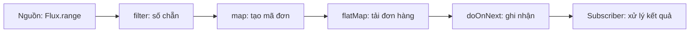

# Nguồn, toán tử, bên tiêu thụ và đồ thị xử lý

## Nhìn một pipeline reactive như một đồ thị

Trong lập trình reactive với Java, dữ liệu thường đi qua một chuỗi bước: một nguồn phát dữ liệu, các toán tử biến đổi hoặc điều phối dữ liệu, rồi một bên tiêu thụ nhận kết quả. Chuỗi bước đó tạo thành **đồ thị xử lý (processing graph)**. Mỗi nút trong đồ thị đảm nhiệm một vai trò; các cạnh thể hiện hướng dữ liệu và tín hiệu đi qua pipeline.

Trong hệ sinh thái Reactive Streams, `Publisher` là thành phần phát các phần tử, `Subscriber` là thành phần nhận chúng, còn `Subscription` nối hai phía và cho phép bên nhận yêu cầu dữ liệu hoặc hủy việc nhận. Các thư viện như Project Reactor cung cấp `Mono` và `Flux` để biểu diễn nguồn dữ liệu và các bước trong đồ thị:

- `Mono<T>` biểu diễn một kết quả có thể không xuất hiện hoặc xuất hiện tối đa một lần.
- `Flux<T>` biểu diễn một luồng có thể không có phần tử, có một phần tử hoặc có nhiều phần tử.

Một pipeline thường được mô tả bằng cách nối các toán tử. Khi có subscriber đăng ký, việc thực thi mới bắt đầu đối với các nguồn và toán tử lazy. Từ thời điểm đó, dữ liệu đi xuôi về phía subscriber; nhu cầu dữ liệu và lệnh hủy được truyền ngược về phía nguồn theo hợp đồng Reactive Streams.

## Bốn thành phần chính

### 1. Nguồn dữ liệu (source)

Nguồn tạo ra hoặc tiếp nhận dữ liệu đầu vào cho pipeline. Nguồn có thể là dữ liệu có sẵn trong bộ nhớ, một phép tính được trì hoãn, một lời gọi dịch vụ, luồng sự kiện hoặc một adapter kết nối thư viện khác.

Một số cách tạo nguồn phổ biến trong Reactor:

| API | Vai trò | Khi phù hợp |
|---|---|---|
| `Flux.just(a, b, c)` | Phát các giá trị đã có | Dữ liệu nhỏ, đã được tính trước |
| `Flux.fromIterable(items)` | Phát lần lượt các phần tử của `Iterable` | Danh sách hoặc tập hợp có sẵn |
| `Flux.range(start, count)` | Phát một dãy số nguyên | Ví dụ, sinh chỉ số hoặc dữ liệu theo khoảng |
| `Mono.just(value)` | Phát một giá trị đã có | Một kết quả đơn đã được tính |
| `Mono.fromCallable(callable)` | Gọi hàm khi có subscription và phát kết quả | Phép tính hoặc API đồng bộ cần được trì hoãn |
| `Mono.defer(supplier)` / `Flux.defer(supplier)` | Tạo publisher mới cho từng subscription | Cần đọc trạng thái mới hoặc tạo nguồn riêng mỗi lần đăng ký |

Phân biệt nguồn eager và lazy rất quan trọng. Trong `Mono.just(repository.find(id))`, biểu thức `find(id)` được gọi ngay khi Java đánh giá đối số để tạo `Mono`. Trong `Mono.fromCallable(() -> repository.find(id))`, lời gọi được trì hoãn đến khi có subscription. Nếu cần tạo cả publisher theo từng lần đăng ký, có thể dùng `defer`:

```java
Mono<User> eager = Mono.just(repository.findUser(userId));

Mono<User> lazy = Mono.fromCallable(
    () -> repository.findUser(userId)
);

Mono<User> perSubscription = Mono.defer(
    () -> reactiveRepository.findById(userId)
);
```

Trong ví dụ, `repository.findUser` trả về một `User`, còn `reactiveRepository.findById` trả về `Mono<User>`. Đoạn `eager` gọi phương thức đồng bộ ngay khi dựng biểu thức; `lazy` trì hoãn lời gọi đồng bộ đến lúc subscription; `perSubscription` trì hoãn cả việc gọi phương thức reactive và tạo publisher mới cho mỗi subscription. Giá trị truyền vào `Mono.just` phải khác `null`.

Nguồn cũng có thể phát lỗi thay vì phát dữ liệu, hoặc hoàn tất mà không có phần tử. Ví dụ `Mono.empty()` hoàn tất bình thường nhưng không phát `onNext`; `Mono.error(exception)` phát tín hiệu lỗi. Đây là các kết quả hợp lệ của pipeline, không phải trường hợp bất thường cần che giấu.

### 2. Toán tử (operator)

Toán tử nhận một publisher làm đầu vào và tạo publisher khác làm đầu ra. Nó có thể biến đổi phần tử, lọc phần tử, kết hợp nhiều nguồn, điều khiển luồng, chuyển ngữ cảnh thực thi hoặc xử lý lỗi. Phần lớn toán tử không tự khởi chạy toàn bộ pipeline; chúng mô tả các bước sẽ được áp dụng khi có subscription.

Các nhóm toán tử thường gặp:

| Nhóm | Toán tử tiêu biểu | Ý nghĩa |
|---|---|---|
| Biến đổi | `map`, `cast` | Chuyển từng giá trị sang dạng khác |
| Lọc | `filter`, `distinct`, `take` | Giữ lại hoặc giới hạn các giá trị phù hợp |
| Kết hợp | `concat`, `merge`, `zip`, `combineLatest` | Ghép hoặc phối hợp nhiều nguồn |
| Ánh xạ sang publisher khác | `flatMap`, `concatMap`, `switchMap` | Từ mỗi giá trị tạo một publisher con rồi hợp nhất kết quả theo chính sách của toán tử |
| Tích lũy | `reduce`, `scan`, `collectList` | Tổng hợp một hoặc nhiều phần tử |
| Quan sát | `doOnNext`, `doOnError`, `doFinally` | Quan sát tín hiệu để ghi log, đo đạc hoặc chẩn đoán |
| Xử lý lỗi | `onErrorReturn`, `onErrorResume`, `retry` | Chọn giá trị thay thế, nguồn dự phòng hoặc chính sách thử lại |
| Điều phối thực thi | `subscribeOn`, `publishOn` | Chọn scheduler cho nguồn hoặc các bước phía sau vị trí điều phối |

Ví dụ, `map` giữ quan hệ một giá trị đầu vào thành một giá trị đầu ra, còn `filter` có thể loại bỏ phần tử. `flatMap` cho phép mỗi phần tử mở ra một publisher khác, thường hữu ích khi gọi nhiều dịch vụ bất đồng bộ. Kết quả của `flatMap` có thể xen kẽ và không đảm bảo giữ thứ tự nguồn. Nếu cần xử lý tuần tự và giữ thứ tự, hãy cân nhắc `concatMap`; nếu chỉ quan tâm đến publisher mới nhất và muốn ngừng publisher trước, có thể cân nhắc `switchMap`.

Toán tử quan sát như `doOnNext` không nên được dùng để thay thế phép biến đổi dữ liệu. Hãy dùng `map` để tạo giá trị mới và dành `doOnNext` cho tác vụ phụ như ghi log hoặc tăng bộ đếm. Tách rõ hai mục đích giúp đồ thị dễ đọc và tránh phụ thuộc vào side effect khó kiểm soát.

### 3. Bên tiêu thụ (subscriber)

Subscriber là điểm nhận dữ liệu và quyết định làm gì khi có phần tử, lỗi hoặc tín hiệu hoàn tất. Trong ứng dụng Reactor, các overload của `subscribe` tạo subscriber tiện dụng:

```java
Flux<Integer> numbers = Flux.range(1, 5)
    .filter(number -> number % 2 == 1)
    .map(number -> number * 10);

numbers.subscribe(
    value -> System.out.println("Giá trị: " + value),
    error -> System.err.println("Lỗi: " + error.getMessage()),
    () -> System.out.println("Luồng đã hoàn tất")
);
```

Kết quả là `10`, `30`, `50`, sau đó pipeline hoàn tất. Hàm thứ nhất xử lý từng giá trị, hàm thứ hai xử lý lỗi, hàm thứ ba xử lý hoàn tất bình thường. Nếu chỉ truyền hàm nhận giá trị mà không định nghĩa xử lý lỗi, hãy cân nhắc cách lỗi được ghi nhận và chuyển tiếp trong ứng dụng; không nên để lỗi bị bỏ qua.

Ở mức Reactive Streams, subscriber nhận các tín hiệu theo thứ tự hợp đồng:

1. `onSubscribe(subscription)` được gọi để thiết lập quan hệ nhận dữ liệu.
2. Subscriber dùng `Subscription` nhận được để gọi `request(n)`, báo số phần tử mình sẵn sàng nhận, hoặc gọi `cancel()` để hủy.
3. Publisher gửi không quá nhu cầu đã được yêu cầu qua các tín hiệu `onNext(value)`.
4. Nếu subscription không bị hủy, luồng kết thúc bằng đúng một tín hiệu `onComplete()` hoặc `onError(error)`; sau tín hiệu kết thúc sẽ không còn phần tử tiếp theo.

Reactor còn cung cấp `BaseSubscriber` để kiểm soát yêu cầu dữ liệu tường minh. Ví dụ sau yêu cầu hai phần tử ban đầu và yêu cầu thêm hai phần tử sau mỗi lần xử lý:

```java
import org.reactivestreams.Subscription;
import reactor.core.publisher.BaseSubscriber;
import reactor.core.publisher.Flux;

Flux.range(1, 10).subscribe(new BaseSubscriber<Integer>() {
    @Override
    protected void hookOnSubscribe(Subscription subscription) {
        request(2);
    }

    @Override
    protected void hookOnNext(Integer value) {
        System.out.println("Đã xử lý: " + value);
        request(2);
    }
});
```

Đây là cách minh họa cơ chế demand; trong ứng dụng thực tế, lượng yêu cầu tiếp theo cần dựa trên khả năng xử lý và giới hạn tài nguyên. Yêu cầu `Long.MAX_VALUE` tương đương với nhu cầu không giới hạn. Yêu cầu số không dương vi phạm hợp đồng và dẫn đến tín hiệu lỗi theo Reactive Streams.

### 4. Đồ thị xử lý (processing graph)

Đồ thị là cách nhìn tổng thể về các nguồn, toán tử và subscriber được nối với nhau. Ví dụ, một luồng số được lọc, đổi thành mã đơn hàng, tải thông tin đơn hàng bất đồng bộ, ghi nhận quan sát rồi chuyển cho bên tiêu thụ:



Mã minh họa phần xử lý chính:

```java
Flux.range(1, 8)
    .filter(id -> id % 2 == 0)
    .map(id -> "ORDER-" + id)
    .flatMap(orderId -> orderService.findReactive(orderId))
    .doOnNext(order -> metrics.recordReceived(order.id()))
    .subscribe(
        order -> responseHandler.accept(order),
        error -> errorHandler.accept(error),
        () -> logger.info("Đã xử lý xong các đơn hàng")
    );
```

Ở đây, `range` tạo nguồn, `filter` và `map` biến đổi luồng, `flatMap` kết nối mỗi mã với một publisher tải đơn hàng, `doOnNext` quan sát kết quả và `subscribe` đưa dữ liệu đến bên tiêu thụ. Giả sử `findReactive` trả về `Mono<Order>`. Nếu các yêu cầu tải hoàn tất không cùng thứ tự, kết quả từ `flatMap` có thể đến theo thứ tự hoàn tất; thay `flatMap` bằng `concatMap` nếu nghiệp vụ yêu cầu giữ thứ tự và chấp nhận xử lý tuần tự.

Đồ thị có thể chứa nhiều nguồn được kết hợp hoặc nhiều nhánh xử lý. Tuy nhiên, việc gọi `subscribe` nhiều lần trên cùng một pipeline không mặc nhiên tạo ra một nhánh dùng chung một lần chạy. Với nguồn cold, mỗi subscriber thường kích hoạt một lần thực thi độc lập. Điều này có thể khiến truy vấn hoặc phép tính nguồn được thực hiện lặp lại. Khi cần chia sẻ một nguồn giữa nhiều subscriber, hãy tìm hiểu các cơ chế multicast như `publish`, `share` hoặc `Sinks` của Reactor, đồng thời xác định rõ thời điểm kết nối, hủy kết nối và chính sách lưu đệm.

## Dữ liệu và tín hiệu đi theo hai hướng

Một đặc điểm quan trọng của Reactive Streams là dữ liệu và demand đi theo hai hướng khác nhau:

- **Xuôi dòng (downstream):** các giá trị `onNext`, tín hiệu lỗi `onError` và hoàn tất `onComplete` đi từ publisher qua các toán tử đến subscriber.
- **Ngược dòng (upstream):** subscriber yêu cầu số phần tử qua `request(n)` hoặc dừng nhận qua `cancel()`. Các toán tử trung gian chuyển tiếp và điều chỉnh demand để phối hợp với publisher phía trước.

Đây là nền tảng của backpressure. Subscriber có thể yêu cầu lượng dữ liệu phù hợp với năng lực xử lý, nhờ đó tránh để nguồn phát không giới hạn làm bên nhận quá tải. Một toán tử có thể đệm, gom nhóm, tạo publisher con hoặc yêu cầu trước một số phần tử, nên demand không nhất thiết được chuyển tiếp nguyên trạng theo tỷ lệ một-một qua mọi nút. Khi thiết kế pipeline, cần chú ý các toán tử có prefetch hoặc buffer và chọn giới hạn phù hợp.

Sơ đồ tín hiệu tổng quát:

```mermaid
flowchart TB
    P[Publisher / nguồn] -->|onNext, onError, onComplete| O[Toán tử trung gian]
    O -->|tín hiệu dữ liệu| S[Subscriber]
    S -->|request(n), cancel()| O
    O -->|nhu cầu được chuyển tiếp| P
```

Đừng nhầm backpressure với việc luồng gọi bị chặn. Backpressure điều tiết lượng dữ liệu được phép phát; blocking/non-blocking mô tả việc luồng thực thi có phải đứng chờ hay không. Một pipeline có backpressure vẫn có thể chứa lời gọi I/O chặn nếu mã bên trong toán tử thực hiện thao tác chặn.

## Thời điểm dựng đồ thị và thời điểm chạy

Với các nguồn và toán tử lazy của Reactor, việc nối toán tử thường chỉ dựng mô tả pipeline. Ví dụ:

```java
Flux<String> names = Flux.just("An", "Bình", "Chi")
    .filter(name -> name.length() > 2)
    .map(String::toUpperCase);
```

Đoạn trên tạo một publisher mới mô tả các bước cần thực hiện. Chưa có subscriber nên pipeline chưa phát dữ liệu đến bên tiêu thụ. Khi gọi `names.subscribe(...)`, subscription được thiết lập và nguồn bắt đầu phát theo nhu cầu. Nếu gọi `subscribe` lần nữa trên nguồn cold này, pipeline chạy lại cho subscriber mới.

Điều này giúp tách phần khai báo đồ thị khỏi phần kích hoạt và tiêu thụ. Có thể xây dựng các hàm trả về `Mono` hoặc `Flux` để ghép pipeline ở nhiều tầng ứng dụng; tầng phù hợp sẽ quyết định nơi đăng ký subscription. Trong ứng dụng web reactive, framework thường quản lý subscription ở ranh giới HTTP. Nếu mỗi tầng tự `subscribe`, luồng điều khiển và xử lý lỗi có thể bị tách rời, khiến caller không còn phối hợp được kết quả.

Một số nguồn là **cold**: mỗi subscription thường nhận một lần thực thi riêng, ví dụ `Flux.range` hoặc publisher được tạo từ một thao tác đọc dữ liệu lazy. Một số nguồn là **hot**: dữ liệu phát theo thời gian và subscriber chỉ nhận những tín hiệu có sẵn trong khoảng thời gian mình tham gia, tùy chính sách của nguồn. Việc chọn cold hay hot ảnh hưởng đến chia sẻ công việc, tính nhất quán dữ liệu và vòng đời subscription.

## Đưa scheduler vào đồ thị

Scheduler quyết định nơi một phần công việc được thực thi. Nó không thay đổi vai trò nguồn, toán tử hay subscriber, nhưng ảnh hưởng đến luồng chạy của các nút trong đồ thị.

```java
import reactor.core.publisher.Flux;
import reactor.core.scheduler.Schedulers;

Flux.range(1, 5)
    .map(number -> number * 2)
    .publishOn(Schedulers.parallel())
    .map(number -> "Giá trị " + number)
    .subscribe(System.out::println);
```

Trong ví dụ này, `publishOn` chuyển việc xử lý các tín hiệu ở phía downstream của nó sang scheduler được chỉ định. `subscribeOn` thường được dùng để điều phối quá trình subscription và thực thi nguồn upstream. Việc chọn scheduler cần dựa trên loại công việc: `parallel` phù hợp cho tác vụ tính toán ngắn, còn `boundedElastic` thường dùng để cô lập tác vụ blocking có kiểm soát. Chuyển một hàm blocking sang scheduler khác chỉ cô lập nơi nó chiếm luồng; bản thân thao tác vẫn blocking. Tránh gọi `block()` trên các luồng event loop hoặc luồng được thiết kế để xử lý nhiều sự kiện.

## Xử lý lỗi trong đồ thị

Lỗi là một tín hiệu kết thúc của nhánh publisher đang phát lỗi. Nếu không được xử lý tại một toán tử phục hồi, lỗi truyền downstream và kết thúc subscription. Có thể ghi nhận lỗi bằng `doOnError`, cung cấp giá trị dự phòng bằng `onErrorReturn`, hoặc chuyển sang publisher dự phòng bằng `onErrorResume`:

```java
Mono<User> user = userService.findById(userId)
    .doOnError(error -> logger.warn("Không tải được người dùng", error))
    .onErrorResume(error -> userCache.findById(userId));
```

`doOnError` chỉ quan sát lỗi; nó không xử lý hay xóa lỗi. `onErrorResume` thay đường đi sau lỗi bằng publisher dự phòng. Vì vậy, vị trí đặt toán tử phục hồi quyết định phạm vi lỗi nào được xử lý. Hãy tránh biến mọi lỗi thành giá trị rỗng hoặc giá trị mặc định nếu điều đó che giấu lỗi nghiệp vụ hay lỗi hạ tầng.

## Cách đọc và thiết kế một đồ thị tốt

Khi đọc pipeline, hãy lần theo đồ thị theo trình tự sau:

1. Xác định nguồn phát dữ liệu, thời điểm nguồn được tạo và nguồn là cold hay hot.
2. Đọc các toán tử theo thứ tự nối để hiểu kiểu dữ liệu, số lượng phần tử và thứ tự kết quả có thể thay đổi ra sao.
3. Xác định subscriber hoặc nơi framework thực hiện subscription; kiểm tra cách xử lý giá trị, lỗi và hoàn tất.
4. Theo dõi demand, hủy subscription, buffer và prefetch để hiểu áp lực dữ liệu được truyền ngược thế nào.
5. Kiểm tra scheduler và các lời gọi blocking bên trong nguồn hoặc toán tử.
6. Xem xét việc có nhiều subscriber hay nhiều nhánh không, và xác định liệu nguồn có bị thực thi lặp lại hoặc được chia sẻ.

Một đồ thị dễ bảo trì thường có nguồn và kiểu dữ liệu rõ ràng, mỗi toán tử đảm nhiệm một bước có ý nghĩa, xử lý lỗi được đặt tại tầng có đủ ngữ cảnh, và subscription nằm ở ranh giới quản lý vòng đời. Khi cần quan sát, dùng các toán tử `doOn...` hoặc công cụ đo đạc phù hợp; khi cần thay đổi dữ liệu, dùng toán tử biến đổi. Cách tổ chức này giúp lần theo luồng dữ liệu, tìm điểm nghẽn và kiểm soát hành vi khi tải tăng.
