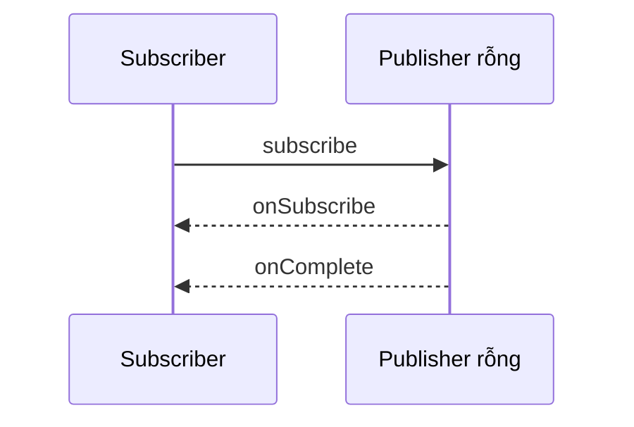
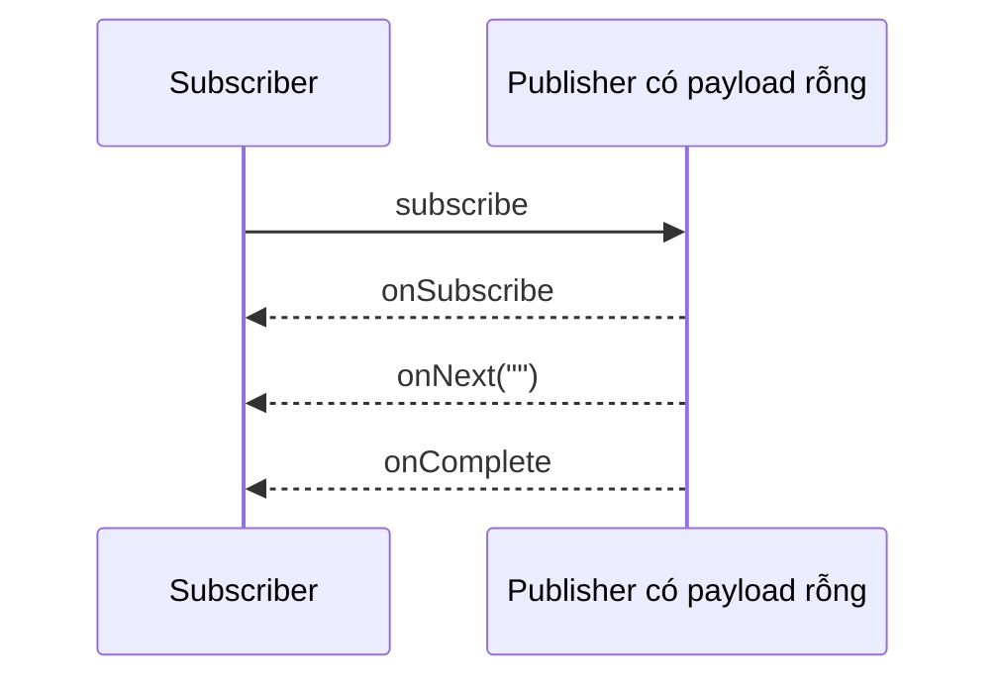

# Không có phần tử, phần tử rỗng và giá trị null

Trong Java, một lời gọi có thể không tìm thấy dữ liệu, trả về một đối tượng hợp lệ nhưng không chứa nội dung, hoặc trả về `null`. Ba tình huống này dễ bị xem là giống nhau vì đều có thể khiến chương trình không có dữ liệu hữu ích để xử lý. Trong Reactive Programming, chúng có ý nghĩa khác nhau: một publisher có thể hoàn tất mà không phát phần tử, có thể phát một phần tử mang giá trị rỗng theo miền nghiệp vụ, còn `null` không được phép xuất hiện như một tín hiệu dữ liệu trong Reactive Streams.

Phân biệt đúng ba trường hợp giúp thiết kế hợp đồng của `Mono` và `Flux`, xử lý dữ liệu thiếu có chủ đích, tránh lỗi null và kiểm thử pipeline chính xác. Đây là một phần của mô hình luồng trong hệ sinh thái Java: dữ liệu được truyền bằng tín hiệu bất đồng bộ, và mỗi tín hiệu phải có ý nghĩa rõ ràng với subscriber.

## 1. Ba tình huống có ý nghĩa khác nhau

Hãy xét một dịch vụ tìm hồ sơ người dùng theo mã:

1. Không tìm thấy hồ sơ: không có phần tử nào được phát.
2. Tìm thấy hồ sơ nhưng tên hiển thị là chuỗi rỗng: có một hồ sơ được phát, nhưng một trường dữ liệu không chứa ký tự.
3. API Java cũ trả về `null`: nguồn không cung cấp đối tượng Java; cần chuyển đổi kết quả đó thành một biểu diễn hợp lệ trước khi đưa vào publisher.

| Tình huống | Ý nghĩa | Biểu diễn thường dùng trong Reactor |
| --- | --- | --- |
| Không có phần tử | Publisher kết thúc thành công mà không có `onNext` | `Mono.empty()` hoặc `Flux.empty()` |
| Phần tử có nội dung rỗng | Có một giá trị hợp lệ, dù nội dung không có dữ liệu | `Mono.just("")`, `Mono.just(List.of())`, hoặc đối tượng miền nghiệp vụ rỗng |
| Giá trị `null` | Không có tham chiếu Java tới đối tượng | Chuyển thành empty, `Optional`, hoặc kiểu kết quả miền nghiệp vụ trước khi phát |

Điểm cần nhớ là **rỗng về nội dung không đồng nghĩa với vắng mặt về phần tử**. Một chuỗi rỗng vẫn là một chuỗi. Một danh sách rỗng vẫn là một đối tượng danh sách. Publisher phát các giá trị đó bằng `onNext` giống như khi phát một chuỗi hay danh sách có nội dung.

## 2. Publisher hoàn tất mà không phát phần tử

Reactive Streams phân biệt tín hiệu dữ liệu và tín hiệu kết thúc. `onNext(value)` truyền một phần tử; `onComplete()` báo publisher đã kết thúc bình thường; `onError(error)` báo kết thúc do lỗi. Một publisher rỗng phát tín hiệu hoàn tất mà không phát bất kỳ phần tử nào:



Trong Reactor, `Mono.empty()` là publisher không phát phần tử và hoàn tất bình thường. `Flux.empty()` có cùng ý nghĩa nhưng mang kiểu publisher nhiều phần tử:

```java
Mono<User> missingUser = Mono.empty();
Flux<Order> noOrders = Flux.empty();
```

Với `Mono<T>`, có hai kết quả thành công khác nhau: phát đúng một phần tử rồi hoàn tất, hoặc hoàn tất ngay mà không phát phần tử. Cả hai đều không phải lỗi. Với `Flux<T>`, publisher có thể phát không phần tử, một phần tử hoặc nhiều phần tử trước khi hoàn tất.

Hoàn tất rỗng cũng khác với hủy subscription. `onComplete` là tín hiệu kết thúc bình thường từ publisher; `cancel()` là yêu cầu do subscriber gửi để ngừng nhận dữ liệu. Khi subscriber hủy, không nên diễn giải việc đó như một kết quả truy vấn rỗng hay chờ publisher phát `onComplete` để xác nhận hủy.

Một pipeline cũng có thể trở thành rỗng do một toán tử. Ví dụ `filter` loại bỏ phần tử khi điều kiện không đúng:

```java
Mono<User> activeUser = userRepository.findById(userId)
    .filter(User::isActive);
```

Nếu repository không tìm thấy người dùng, `Mono` ban đầu đã rỗng. Nếu tìm thấy nhưng người dùng không hoạt động, `filter` loại bỏ phần tử và kết quả cũng là `Mono.empty()`. Hai đường đi có thể cùng tạo ra kết quả rỗng; nếu nghiệp vụ cần phân biệt chúng, hãy giữ thông tin trạng thái riêng thay vì dựa vào một publisher rỗng duy nhất.

## 3. Phần tử có nội dung rỗng vẫn là một phần tử

Một publisher có thể phát giá trị mà nội dung của giá trị đó rỗng. Ví dụ:

```java
Mono<String> emptyText = Mono.just("");
Mono<List<String>> emptyList = Mono.just(List.of());
Flux<List<String>> oneEmptyList = Flux.just(List.of());
```

Các publisher trên đều phát một phần tử. Phần tử thứ nhất là chuỗi rỗng, phần tử thứ hai và thứ ba là danh sách rỗng. Subscriber nhận được `onNext` trước `onComplete`:



Ngược lại, `Flux.fromIterable(List.of())` không phát phần tử nào vì iterable đầu vào không có phần tử để duyệt:

```java
Flux<String> noTextItems = Flux.fromIterable(List.of());
Flux<List<String>> oneEmptyListItem = Flux.just(List.of());
```

Hai biểu thức có kiểu kết quả khác nhau và hợp đồng khác nhau:

- `Flux.fromIterable(List.of())` phát không phần tử.
- `Flux.just(List.of())` phát một phần tử, chính là danh sách rỗng.

Tương tự, `Mono.just(Optional.empty())` phát một phần tử kiểu `Optional<String>` có giá trị `Optional.empty()`. Đối tượng `Optional.empty()` là một giá trị Java không null; nó không phải là tín hiệu publisher rỗng.

Sự khác biệt này quan trọng khi thiết kế API. Nếu một danh sách rỗng có nghĩa là truy vấn thành công nhưng không có bản ghi, `Mono<List<T>>` có thể phát một danh sách rỗng. Nếu hợp đồng biểu diễn từng bản ghi bằng `Flux<T>`, không có bản ghi sẽ được biểu diễn bằng `Flux.empty()`. Hai kiểu API cho phép downstream hiểu khác nhau về kết quả.

## 4. null không phải là phần tử hợp lệ của Reactive Streams

Java cho phép biến tham chiếu nhận `null`, nhưng hợp đồng Reactive Streams không cho phép publisher phát `null` qua `onNext`. Subscriber phải luôn nhận được một đối tượng dữ liệu hợp lệ khi có tín hiệu `onNext`. Điều này giúp downstream không phải kiểm tra null ở mọi toán tử.

Reactor tuân thủ quy tắc đó:

```java
Mono<String> invalid = Mono.just(null); // Không hợp lệ: Reactor từ chối null.
```

`Mono.just(null)` thường ném `NullPointerException` ngay khi tạo publisher. Nếu một toán tử như `map` trả về null trong lúc pipeline chạy, Reactor chuyển vi phạm đó thành tín hiệu lỗi thay vì phát `onNext(null)`:

```java
Mono<String> invalidMapping = Mono.just("user-42")
    .map(id -> (String) null); // Pipeline kết thúc bằng onError.
```

Không nên dùng `null` như một cách viết tắt cho “không tìm thấy” trong pipeline. Hãy chuyển đổi kết quả của API cũ tại ranh giới tích hợp, nơi ý nghĩa của null được hiểu rõ. Sau khi đã chuyển đổi, các toán tử còn lại chỉ làm việc với tín hiệu hợp lệ.

## 5. Chuyển đổi kết quả nullable thành publisher

Reactor cung cấp một số cách để chuyển dữ liệu có thể null thành biểu diễn reactive.

### Dùng Mono.justOrEmpty

`Mono.justOrEmpty(value)` phát một phần tử nếu `value` khác null; nếu `value` là null, publisher hoàn tất rỗng:

```java
User legacyResult = legacyUserService.findById(userId);

Mono<User> user = Mono.justOrEmpty(legacyResult);
```

Nếu đầu vào là `Optional<T>`, overload tương ứng phát giá trị bên trong khi Optional có mặt và hoàn tất rỗng khi Optional là empty:

```java
Optional<User> result = legacyUserService.findOptional(userId);

Mono<User> user = Mono.justOrEmpty(result);
```

Lưu ý `Mono.justOrEmpty(legacyUserService.findById(userId))` đánh giá lời gọi dịch vụ ngay khi biểu thức được thực thi. Nếu cần trì hoãn cả lời gọi blocking cho đến khi có subscription, có thể dùng `fromCallable` hoặc `defer`.

### Dùng Mono.fromCallable cho lời gọi có thể trả null

`Mono.fromCallable` gọi hàm khi có subscription. Nếu hàm trả về một giá trị khác null, publisher phát giá trị đó; nếu hàm trả về null, publisher hoàn tất rỗng. Nếu hàm ném exception, publisher kết thúc bằng `onError`:

```java
Mono<User> user = Mono.fromCallable(
    () -> legacyUserService.findById(userId)
);
```

Cách này phù hợp khi bọc một API đồng bộ có thể trả null. Nếu lời gọi có blocking I/O trong ứng dụng Reactor, hãy cô lập nó trên scheduler thích hợp:

```java
Mono<User> user = Mono.fromCallable(
        () -> legacyUserService.findById(userId)
    )
    .subscribeOn(Schedulers.boundedElastic());
```

`subscribeOn` không biến API blocking thành non-blocking; nó đưa lời gọi sang nhóm luồng phù hợp để tránh chặn event loop. Nếu API nguồn đã trả về publisher non-blocking, hãy sử dụng publisher đó trực tiếp.

### Dùng defer để tạo publisher theo từng subscription

`Mono.defer` nhận một supplier tạo publisher khi có subscription. Điều này hữu ích khi cần trì hoãn việc đọc dữ liệu hoặc tạo publisher thay thế:

```java
Mono<User> user = Mono.defer(() ->
    Mono.justOrEmpty(legacyUserService.findById(userId))
);
```

Mỗi subscription gọi supplier để tạo publisher tương ứng. Nếu lời gọi bên trong blocking, vẫn cần chuyển nó sang scheduler phù hợp; `defer` chỉ điều khiển thời điểm tạo publisher.

## 6. Optional có thể là giá trị được phát hoặc cách biểu diễn absence

`Optional<T>` là một đối tượng Java có thể biểu diễn sự hiện diện hoặc vắng mặt của giá trị. Khi kết hợp với Reactor, cần phân biệt hai hợp đồng:

```java
// Publisher phát một Optional, kể cả khi Optional là empty.
Mono<Optional<User>> optionalAsValue = Mono.just(Optional.empty());

// Publisher phát User nếu Optional có giá trị; nếu empty thì không phát phần tử.
Mono<User> absenceAsEmpty = Mono.justOrEmpty(Optional.<User>empty());
```

Ở biểu thức đầu, subscriber nhận một `onNext` chứa `Optional.empty()`. Ở biểu thức sau, subscriber không nhận `onNext`; publisher chỉ gửi `onComplete`. Việc chọn cách nào phụ thuộc vào hợp đồng mong muốn:

- Dùng `Mono<Optional<T>>` khi sự hiện diện/vắng mặt cần được xử lý như dữ liệu tường minh trong mỗi kết quả, chẳng hạn một API tổng hợp luôn phải phát một trạng thái.
- Dùng `Mono<T>` có thể empty khi “không có kết quả” được mô hình hóa như publisher hoàn tất mà không phát phần tử.

Không nên bọc `Optional` nhiều lớp nếu không có lý do nghiệp vụ rõ ràng. Hãy chọn một cách biểu diễn và giữ nhất quán giữa repository, service và controller.

## 7. Xử lý publisher rỗng bằng toán tử phù hợp

`defaultIfEmpty` cung cấp một giá trị thay thế khi publisher hoàn tất mà không phát phần tử. `switchIfEmpty` chuyển sang một publisher khác trong cùng tình huống:

```java
Mono<User> user = userRepository.findById(userId)
    .defaultIfEmpty(User.guest());

Mono<User> requiredUser = userRepository.findById(userId)
    .switchIfEmpty(Mono.error(new UserNotFoundException(userId)));
```

Hai toán tử này chỉ phản ứng với publisher rỗng. Chúng không kích hoạt khi publisher phát `""`, `List.of()` hoặc `Optional.empty()` như một phần tử. Chúng cũng không thay thế xử lý lỗi: nếu nguồn kết thúc bằng `onError`, fallback của `switchIfEmpty` không được dùng.

Nếu việc tạo publisher thay thế có chi phí hoặc cần thực hiện đúng lúc có dữ liệu thiếu, hãy trì hoãn bằng `defer`:

```java
Mono<User> user = userRepository.findById(userId)
    .switchIfEmpty(Mono.defer(() -> {
        auditService.recordMissingUser(userId);
        return Mono.error(new UserNotFoundException(userId));
    }));
```

Đoạn callback trong `defer` chỉ chạy khi publisher nguồn hoàn tất rỗng và nhánh thay thế được đăng ký. Nếu viết lời gọi có tác dụng phụ trực tiếp làm đối số cho `switchIfEmpty`, lời gọi đó có thể xảy ra sớm hơn thời điểm mong muốn.

Nếu cần biến một lỗi thành hoàn tất rỗng, `onErrorComplete` có thể làm điều đó, nhưng đây là quyết định ngữ nghĩa riêng:

```java
Mono<User> bestEffortUser = userRepository.findById(userId)
    .onErrorComplete(RecoverableLookupException.class);
```

Chỉ chuyển lỗi thành empty khi nghiệp vụ thực sự xem lỗi đó tương đương với không có kết quả. Nếu không, việc chuyển đổi có thể che giấu lỗi hệ thống và khiến downstream hiểu sai rằng truy vấn thành công nhưng không có dữ liệu.

## 8. Các toán tử tổng hợp có thể biến luồng rỗng thành một kết quả

Một nguồn rỗng không có nghĩa mọi pipeline phía sau cũng không phát giá trị. Một số toán tử tổng hợp tạo ra giá trị đại diện cho kết quả rỗng:

| Toán tử | Khi nguồn `Flux` rỗng | Kết quả |
| --- | --- | --- |
| `count()` | Không có phần tử để đếm | `Mono<Long>` phát `0` |
| `collectList()` | Không có phần tử để thu thập | `Mono<List<T>>` phát danh sách rỗng |
| `hasElements()` | Không có phần tử | `Mono<Boolean>` phát `false` |
| `reduce(accumulator)` không có giá trị seed | Không có phần tử để gộp | `Mono<T>` hoàn tất rỗng |
| `reduce(seed, accumulator)` có seed | Không có phần tử, giữ nguyên seed | `Mono<T>` phát seed |

Ví dụ:

```java
Flux<Integer> noNumbers = Flux.empty();

Mono<Long> total = noNumbers.count();             // Phát 0L.
Mono<List<Integer>> values = noNumbers.collectList(); // Phát List.of().
Mono<Boolean> hasValues = noNumbers.hasElements(); // Phát false.
Mono<Integer> noSum = noNumbers.reduce(Integer::sum); // Hoàn tất rỗng.
Mono<Integer> zeroSum = noNumbers.reduce(0, Integer::sum); // Phát 0.
```

Các kết quả này không mâu thuẫn với việc `Flux.empty()` không phát phần tử. Toán tử tổng hợp tạo một publisher mới với hợp đồng đầu ra riêng. Ví dụ `collectList()` chuyển nhiều phần tử đầu vào thành một danh sách duy nhất; khi đầu vào không có phần tử, danh sách kết quả vẫn là một giá trị hợp lệ được phát.

## 9. Mono<Void> là hoàn tất không có payload

Một thao tác có thể chỉ cần báo đã hoàn tất, không cần trả dữ liệu. Trong Reactor, `Mono<Void>` thường biểu diễn loại tác vụ này:

```java
Mono<Void> saveAudit = auditRepository.save(event);
Mono<Void> sendNotification = notificationClient.send(event);

Mono<Void> workflow = saveAudit.then(sendNotification);
```

Một `Mono<Void>` hoàn tất thành công mà không phát `onNext` chứa giá trị. Vì vậy, về mặt tín hiệu, nó hoàn tất rỗng dù thao tác có thể đã thành công. Không nên dùng `switchIfEmpty` trên `Mono<Void>` để kết luận thao tác lưu hoặc gửi đã thất bại: nhánh empty cũng là cách biểu diễn thành công bình thường của kiểu `Void`.

Nếu cần xác nhận kết quả nghiệp vụ, hãy trả về kiểu có dữ liệu như `Mono<SaveResult>`, hoặc chuyển trạng thái thành công/thất bại thành một giá trị rõ ràng. Nếu chỉ cần nối thứ tự các thao tác và giữ hợp đồng hoàn tất, `then` là toán tử phù hợp.

## 10. Kiểm thử sự khác nhau bằng StepVerifier

Khi kiểm thử pipeline, đừng chỉ kiểm tra rằng nó “không ném lỗi”. Hãy xác minh publisher có phát phần tử hay không, giá trị phát ra là gì và kết thúc bằng tín hiệu nào. Với Reactor Test, `StepVerifier` thể hiện rõ các kỳ vọng đó:

```java
StepVerifier.create(Mono.<String>empty())
    .expectNextCount(0)
    .verifyComplete();

StepVerifier.create(Mono.just(""))
    .expectNext("")
    .verifyComplete();

StepVerifier.create(Mono.justOrEmpty((String) null))
    .expectNextCount(0)
    .verifyComplete();

StepVerifier.create(Mono.just(Optional.<String>empty()))
    .expectNext(Optional.empty())
    .verifyComplete();
```

Các kiểm thử trên xác nhận bốn hợp đồng khác nhau: publisher không phát phần tử; publisher phát chuỗi rỗng; null được chuyển thành publisher rỗng; và publisher phát một đối tượng `Optional.empty()` như một phần tử. `Mono.just(null)` không nên được dùng làm trường hợp kiểm thử cho empty vì nó vi phạm hợp đồng và ném lỗi.

Có thể kiểm tra riêng nhánh fallback:

```java
StepVerifier.create(Mono.<String>empty().defaultIfEmpty("unknown"))
    .expectNext("unknown")
    .verifyComplete();

StepVerifier.create(Mono.just("").defaultIfEmpty("unknown"))
    .expectNext("")
    .verifyComplete();
```

Kiểm thử thứ hai chứng minh `defaultIfEmpty` không thay thế một chuỗi rỗng, vì chuỗi rỗng vẫn là phần tử đã được phát. Khi kiểm thử một publisher có thể lỗi, hãy dùng `expectError...` để xác nhận lỗi được giữ nguyên hoặc được chuyển đổi đúng theo chính sách.

## 11. Chọn biểu diễn phù hợp với hợp đồng nghiệp vụ

Trước khi quyết định trả `Mono.empty()`, một payload rỗng hay một `Optional`, hãy xác định ý nghĩa của kết quả ở tầng nghiệp vụ. Nếu không tìm thấy bản ghi và hợp đồng cho phép không có kết quả, `Mono<T>` rỗng là biểu diễn tự nhiên. Nếu truy vấn thành công và trả về một tập hợp không có bản ghi, `Mono<List<T>>` phát danh sách rỗng có thể phù hợp. Nếu một trường văn bản không có nội dung nhưng đối tượng vẫn tồn tại, hãy phát đối tượng đó với trường là chuỗi rỗng hoặc kiểu dữ liệu miền nghiệp vụ tương ứng.

Ở ranh giới với thư viện Java cũ, chuyển `null` thành empty hoặc `Optional` ngay khi tiếp nhận. Không để null đi sâu vào pipeline rồi buộc từng toán tử tự xử lý. Với `Mono<Void>`, hiểu rằng hoàn tất không payload là một kết quả thành công hợp lệ. Với các toán tử fallback và tổng hợp, kiểm tra xem chúng phản ứng với empty completion, error hay payload rỗng.

Khi thiết kế hoặc đọc một pipeline, hãy lần theo tín hiệu: có `onNext` hay không, payload đó chứa gì, publisher kết thúc bằng `onComplete` hay `onError`, và có bị hủy trước khi kết thúc không. Cách nhìn theo tín hiệu giúp phân biệt chính xác sự vắng mặt của dữ liệu, dữ liệu có nội dung rỗng và giá trị null trong mô hình luồng reactive.
