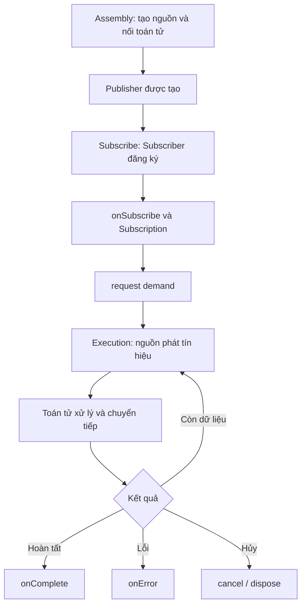

# Lắp ráp chuỗi xử lý, đăng ký nhận và thực thi

Trong Reactive Programming, viết các toán tử để tạo một pipeline và thực sự chạy pipeline là hai thời điểm khác nhau. Với Reactor, các lời gọi như `map`, `filter`, `flatMap` hoặc `timeout` thường lắp ráp một chuỗi xử lý mới. Chuỗi đó mô tả dữ liệu sẽ được biến đổi như thế nào khi có người đăng ký. Khi một `Subscriber` đăng ký với `Publisher`, quá trình phát tín hiệu mới bắt đầu; các toán tử được kích hoạt theo dữ liệu và demand từ subscription.

Ba khái niệm cần phân biệt là **assembly** (lắp ráp pipeline), **subscription** (đăng ký nhận) và **execution** (thực thi công việc, phát tín hiệu). Hiểu ranh giới này giúp tránh lỗi thường gặp như tưởng rằng tạo `Mono` đã gọi cơ sở dữ liệu, vô tình gọi một tác vụ nhiều lần khi có nhiều subscriber, hoặc dùng `block()` để ép một pipeline bất đồng bộ trở lại cách gọi đồng bộ.

## 1. Ba giai đoạn của một pipeline

Một pipeline Reactor thường đi qua ba giai đoạn logic:

1. **Lắp ráp (assembly):** tạo publisher nguồn và nối các toán tử để mô tả cách xử lý. Ở giai đoạn này, ứng dụng thường chỉ xây dựng cấu trúc xử lý; dữ liệu chưa nhất thiết được đọc hoặc phát.
2. **Đăng ký (subscription):** một subscriber đăng ký với publisher. Publisher thiết lập `Subscription`, subscriber nhận `onSubscribe` và có thể yêu cầu demand bằng `request(n)` hoặc hủy bằng `cancel()`.
3. **Thực thi (execution):** khi subscription và demand cho phép, nguồn phát dữ liệu; các toán tử xử lý tín hiệu rồi chuyển tiếp đến downstream. Luồng kết thúc bằng `onComplete`, `onError` hoặc có thể bị hủy trước khi kết thúc.



Đây là mô hình khái niệm. Một nguồn có thể phát đồng bộ ngay trong lời gọi `subscribe`, hoặc phát bất đồng bộ sau khi I/O, timer hay một tác vụ khác hoàn tất. Scheduler có thể thay đổi thread thực thi, nhưng không làm thay đổi sự phân biệt giữa lắp ráp và đăng ký.

## 2. Giai đoạn assembly: mô tả pipeline

Assembly là lúc ứng dụng tạo các publisher và ghép chúng bằng toán tử. Mỗi toán tử thường trả về một publisher khác đại diện cho bước xử lý tiếp theo.

```java
Flux<Integer> numbers = Flux.range(1, 5);

Flux<String> pipeline = numbers
    .filter(number -> number % 2 == 1)
    .map(number -> "item-" + number)
    .take(2);
```

Sau đoạn mã trên, biến `pipeline` tham chiếu đến một chuỗi xử lý đã được lắp ráp. Các lời gọi `filter`, `map` và `take` đã cấu hình cách dữ liệu sẽ đi qua publisher khi có subscription. Chưa có subscriber nào được đăng ký trong đoạn mã này, nên chưa có phần tử nào được tiêu thụ bởi pipeline.

Khi đọc mã, hãy xem các toán tử như các bước trong một công thức. Công thức có thể được xây dựng trước; việc áp dụng nó lên dữ liệu diễn ra khi publisher được subscribe. Điều này giúp tách phần mô tả luồng xử lý khỏi thời điểm kích hoạt luồng.

### Assembly không có nghĩa là mọi biểu thức đều trì hoãn

Điểm cần chú ý là Java đánh giá đối số của phương thức trước khi gọi phương thức. Vì vậy, một biểu thức tạo ra giá trị ngay trong lúc assembly vẫn được thực thi ngay cả khi publisher chưa được subscribe.

```java
// loadUser(userId) được gọi ngay khi dòng này được đánh giá.
Mono<User> eager = Mono.just(repository.loadUser(userId));

// Lời gọi repository được trì hoãn đến khi có subscription.
Mono<User> lazy = Mono.fromCallable(() -> repository.loadUser(userId));
```

`Mono.just(...)` nhận một giá trị đã được tính trước. Nếu `repository.loadUser` là lời gọi blocking hoặc có side effect, lời gọi đó đã xảy ra trước khi `Mono.just` được tạo. `Mono.fromCallable(...)` nhận một `Callable`; Reactor gọi callable khi có subscription, vì vậy thao tác bên trong được trì hoãn đến lúc thực thi pipeline.

Nếu cần tạo một publisher mới cho mỗi subscriber, có thể dùng `defer`:

```java
Mono<Instant> timestamp = Mono.defer(() -> Mono.just(Instant.now()));
```

Với `defer`, supplier được gọi khi mỗi subscription đến. Nếu dùng `Mono.just(Instant.now())`, thời điểm được lấy một lần khi assembly và các subscriber sau có thể quan sát cùng giá trị đã tạo đó. `defer` hữu ích khi giá trị hoặc publisher cần phụ thuộc vào thời điểm đăng ký, context hoặc trạng thái hiện tại.

Không nên đặt side effect không cần thiết ở assembly. Ví dụ, ghi log, tăng bộ đếm hoặc gọi dịch vụ bên ngoài ngay khi xây publisher có thể làm hành vi xảy ra dù pipeline chưa bao giờ được subscribe. Hãy đặt công việc thuộc luồng reactive bên trong nguồn lazy hoặc toán tử phù hợp, và chỉ giữ assembly-time code cho việc cấu hình cấu trúc pipeline.

## 3. Giai đoạn subscription: kích hoạt và thiết lập hợp đồng

Subscription bắt đầu khi một subscriber đăng ký với publisher. Trong Reactor, cách thường gặp nhất là gọi một overload của `subscribe`:

```java
Flux.range(1, 3)
    .subscribe(value -> System.out.println("Nhận được: " + value));
```

Khi `subscribe` được gọi, subscriber được đăng ký. Reactor thiết lập subscription và yêu cầu dữ liệu theo demand của subscriber. Các overload `subscribe` đơn giản thường yêu cầu demand không giới hạn (`Long.MAX_VALUE`), phù hợp với ví dụ nhỏ nhưng không thể hiện việc điều tiết từng phần tử.

Một subscription đại diện cho một lần đăng ký cụ thể. Nếu một publisher cold được subscribe hai lần, thông thường sẽ có hai subscription độc lập và nguồn có thể được chạy lại cho mỗi subscription. Vì vậy, không nên mặc định rằng một biến `Mono` hay `Flux` chỉ thực thi một lần.

```java
Mono<String> greeting = Mono.fromSupplier(() -> {
    System.out.println("Tạo giá trị cho subscriber");
    return "hello";
});

greeting.subscribe(System.out::println);
greeting.subscribe(System.out::println);
```

Với publisher cold này, supplier thường được gọi một lần cho mỗi subscription. Chạy đoạn mã sẽ thấy thông báo tạo giá trị xuất hiện hai lần. Đây là hành vi có ý nghĩa nếu nguồn là một truy vấn hoặc lời gọi dịch vụ: hai subscription có thể đồng nghĩa với hai lần gọi nguồn.

### Các overload subscribe thường dùng

Reactor cung cấp nhiều overload để khai báo callback nhận giá trị, lỗi và hoàn tất:

```java
Disposable disposable = service.loadEvents()
    .subscribe(
        event -> handle(event),
        error -> logError(error),
        () -> logCompleted()
    );
```

Trong ví dụ:

- Callback thứ nhất xử lý từng phần tử `onNext`.
- Callback thứ hai xử lý tín hiệu `onError`.
- Callback thứ ba chạy khi publisher phát `onComplete`.
- `subscribe` trả về `Disposable` để caller có thể yêu cầu hủy subscription.

Nếu không truyền error consumer, Reactor vẫn có cơ chế xử lý lỗi mặc định, thường ghi nhận lỗi chưa được xử lý. Với ứng dụng, nên cung cấp chính sách lỗi rõ ràng thay vì phụ thuộc vào hành vi mặc định. Callback `onComplete` chỉ chạy khi hoàn tất bình thường; nó không chạy thay cho callback lỗi.

`subscribe` là thao tác kết thúc thường dùng ở ranh giới nơi ứng dụng chủ động sở hữu việc tiêu thụ. Trong service reactive, thông thường nên trả về `Mono` hoặc `Flux` để caller hoặc framework quản lý subscription. Nếu tự gọi `subscribe()` bên trong service, service đã tự kích hoạt một luồng riêng; caller có thể không còn kiểm soát được lifecycle, lỗi và cancellation của công việc đó.

## 4. Giai đoạn execution: dữ liệu đi qua pipeline

Sau khi có subscription và demand, nguồn bắt đầu phát tín hiệu theo cách triển khai của nó. Các toán tử nhận tín hiệu upstream, thực hiện xử lý rồi phát tín hiệu downstream. Với một nguồn đồng bộ như `Flux.range`, việc phát và xử lý có thể xảy ra ngay trên thread gọi `subscribe`.

```java
Flux.range(1, 4)
    .doOnSubscribe(subscription -> System.out.println("Đã subscribe"))
    .doOnNext(value -> System.out.println("Nguồn phát: " + value))
    .map(value -> value * 10)
    .doOnNext(value -> System.out.println("Sau map: " + value))
    .doOnComplete(() -> System.out.println("Nguồn hoàn tất"))
    .subscribe(value -> System.out.println("Consumer nhận: " + value));
```

Ví dụ cho thấy các hook quan sát vị trí tín hiệu đi qua. `doOnNext` không thay đổi giá trị; nó chỉ thực hiện hành động phụ khi tín hiệu giá trị đi qua. `map` mới là toán tử biến đổi giá trị. Các hook hữu ích khi logging hoặc đo lường, nhưng không nên đặt logic nghiệp vụ thiết yếu vào hook quan sát vì chúng không phải nơi biểu diễn kết quả biến đổi của pipeline.

### Quan sát demand và vòng đời

Các hook như `doOnSubscribe`, `doOnRequest`, `doOnNext`, `doOnError`, `doOnComplete` và `doFinally` giúp quan sát từng phần của vòng đời. Ví dụ:

```java
Flux.range(1, 5)
    .doOnSubscribe(s -> log("subscribe"))
    .doOnRequest(n -> log("request=" + n))
    .doOnNext(value -> log("next=" + value))
    .doOnError(error -> log("error=" + error.getMessage()))
    .doOnComplete(() -> log("complete"))
    .doFinally(signal -> log("finally=" + signal))
    .subscribe();
```

`doFinally` quan sát kết thúc do hoàn tất, lỗi hoặc hủy. `doOnComplete` chỉ quan sát hoàn tất bình thường. Khi debug, đặt hook ở các vị trí khác nhau trong pipeline giúp biết tín hiệu đã đi đến đâu và toán tử nào đã được thực thi.

### Demand quyết định lượng dữ liệu được yêu cầu

Subscription không chỉ là lệnh bật pipeline. Nó còn là kênh để subscriber yêu cầu số phần tử mình sẵn sàng nhận. Ví dụ sau yêu cầu hai phần tử ban đầu rồi yêu cầu thêm một phần tử sau mỗi lần xử lý:

```java
Flux.range(1, 5)
    .subscribe(new BaseSubscriber<Integer>() {
        @Override
        protected void hookOnSubscribe(Subscription subscription) {
            request(2);
        }

        @Override
        protected void hookOnNext(Integer value) {
            process(value);
            request(1);
        }
    });
```

`BaseSubscriber` giúp kiểm soát demand tường minh. Với mã thực tế, cần xem xét xử lý lỗi trong `process`, thời điểm yêu cầu phần tử tiếp theo và điều kiện hủy. Backpressure có thể điều tiết luồng khi nguồn tham gia giao thức; với nguồn không hỗ trợ demand, adapter vẫn cần chính sách buffer hoặc quá tải phù hợp.

## 5. Thực thi đồng bộ và bất đồng bộ

Một hiểu lầm phổ biến là mọi pipeline reactive đều chạy bất đồng bộ trên thread khác. Thực tế, Reactor không tự tạo một thread mới cho mỗi toán tử. Nguồn có thể phát đồng bộ ngay trong `subscribe`, còn nguồn I/O hoặc timer có thể phát tín hiệu sau đó trên thread do thư viện quản lý.

Ví dụ `Flux.range` thường phát đồng bộ:

```java
System.out.println("Trước subscribe");

Flux.range(1, 2)
    .doOnNext(value -> System.out.println("Giá trị: " + value))
    .subscribe();

System.out.println("Sau subscribe");
```

Với nguồn đồng bộ này, các giá trị thường được in giữa hai dòng “Trước subscribe” và “Sau subscribe”, vì việc phát tín hiệu diễn ra ngay trong lời gọi `subscribe`. Điều này không mâu thuẫn với mô hình reactive: reactive mô tả giao thức và cách compose luồng, không bắt buộc mọi nguồn phải phát bất đồng bộ.

Khi cần điều khiển thread, Reactor có `subscribeOn` và `publishOn`:

```java
Mono<User> user = Mono.fromCallable(() -> legacyRepository.findById(userId))
    .subscribeOn(Schedulers.boundedElastic());

user.publishOn(Schedulers.parallel())
    .map(this::buildView)
    .subscribe(this::render);
```

Trong ví dụ, lời gọi repository blocking được cô lập trên `boundedElastic`; bước downstream sau `publishOn` được chuyển sang scheduler `parallel`. Đây là ví dụ về vị trí chuyển thực thi, không phải khuyến nghị rằng mọi pipeline đều cần hai scheduler. Chỉ chuyển thread khi có lý do: cô lập blocking, thực hiện công việc CPU-bound hoặc đáp ứng yêu cầu thread-affinity. Chuyển quá nhiều có thể tăng overhead và làm khó quan sát.

`subscribeOn` tác động đến nơi subscription bắt đầu và quá trình upstream được khởi động. `publishOn` tạo ranh giới cho các toán tử downstream kể từ vị trí đặt nó. Cả hai đều ảnh hưởng đến execution, không thay đổi việc pipeline được lắp ráp trước và kích hoạt bởi subscription.

## 6. Một publisher được subscribe nhiều lần

Với cold publisher, mỗi subscription thường tạo một lần thực thi riêng. Điều này rất quan trọng với nguồn có side effect như gọi HTTP, truy vấn cơ sở dữ liệu, đọc file hoặc ghi dữ liệu.

```java
Mono<User> user = Mono.fromCallable(() -> repository.load(userId));

user.subscribe(this::showHeader);
user.subscribe(this::writeAuditRecord);
```

Hai lệnh subscribe có thể khiến `repository.load(userId)` được gọi hai lần. Nếu muốn dùng chung một kết quả đã phát, cần chọn cơ chế chia sẻ hoặc cache có chủ đích, chẳng hạn `cache()` cho publisher phù hợp. Tuy nhiên, cache thay đổi semantics: kết quả, lỗi hoặc tín hiệu được lưu theo chính sách của toán tử; cần xem xét thời hạn, bộ nhớ, tính mới của dữ liệu và vòng đời.

Hot publisher có thể phát dữ liệu độc lập với từng subscriber. Subscriber đến muộn có thể chỉ nhận những phần tử được phát sau khi nó đăng ký, trừ khi publisher có cơ chế replay. Vì vậy, số lần subscribe và thời điểm subscribe có thể ảnh hưởng trực tiếp đến dữ liệu mà consumer quan sát.

Một quy tắc thực hành hữu ích: nếu một publisher đại diện cho lời gọi bên ngoài, hãy hỏi “mỗi lần subscribe có thực hiện lại lời gọi này không?”. Câu trả lời phụ thuộc nguồn và các toán tử chia sẻ được dùng, không phụ thuộc vào số lần biến publisher được khai báo.

## 7. Các thao tác kích hoạt khác và nguy cơ block

Ngoài `subscribe`, một số thao tác kết thúc cũng có thể tạo subscription để lấy kết quả theo một cách khác. Chẳng hạn `block()` đăng ký publisher rồi chặn thread hiện tại cho đến khi có kết quả hoặc lỗi:

```java
User user = userRepository.findById(userId).block();
```

`block()` có thể tiện trong mã kiểm thử, script hoặc ranh giới imperative được kiểm soát. Nhưng nếu gọi giữa một pipeline reactive hoặc trên event-loop, nó có thể chặn thread quan trọng và làm mất lợi ích non-blocking. Với `Mono`, `block()` trả về giá trị hoặc `null` khi publisher hoàn tất rỗng; lỗi được ném ra caller. Với `Flux`, các biến thể như `blockFirst` hoặc `blockLast` cũng tạo subscription và chặn thread để lấy phần tử.

Một số thao tác khác như `toFuture()` cũng đăng ký publisher để kết nối với abstraction khác. Khi dùng bất kỳ thao tác kết thúc nào, cần hiểu rằng nó có thể kích hoạt một lần thực thi mới. Không nên gọi `subscribe`, `block` hoặc `toFuture` nhiều lần một cách vô tình nếu nguồn có side effect hoặc chi phí cao.

Trong ứng dụng Spring WebFlux, thông thường controller/service trả `Mono` hoặc `Flux`; framework sẽ đăng ký và quản lý subscription theo vòng đời request. Cách này giữ quyền điều phối ở framework và cho phép cancellation khi client ngắt kết nối nếu chuỗi thành phần hỗ trợ truyền hủy.

## 8. Hủy subscription và kết thúc pipeline

Khi caller dùng overload `subscribe`, Reactor trả về một `Disposable`. Caller có thể gọi `dispose()` khi không còn cần nhận dữ liệu:

```java
Disposable subscription = eventSource
    .subscribe(this::handleEvent, this::handleError);

// Khi component không còn cần nhận sự kiện:
subscription.dispose();
```

`dispose()` yêu cầu hủy subscription. Nó không đồng nghĩa với `onComplete` hoặc `onError`; subscriber đã yêu cầu ngừng tiêu thụ. Nguồn có thể giải phóng tài nguyên nếu hỗ trợ cancellation, nhưng một thao tác đã gửi tới hệ thống bên ngoài có thể không thu hồi được.

Khi pipeline hoàn tất bình thường, publisher phát `onComplete`. Khi gặp lỗi chưa được phục hồi, publisher phát `onError`. Đây là hai tín hiệu terminal loại trừ nhau. Sau terminal signal, subscription đó không tiếp tục phát `onNext`. Khi dùng `onErrorResume` hoặc toán tử phục hồi khác, lỗi có thể được chuyển thành một publisher thay thế; downstream khi đó quan sát kết quả của publisher thay thế và tín hiệu kết thúc tương ứng.

Quản lý vòng đời là một phần của thiết kế: xác định ai tạo subscription, ai giữ `Disposable`, ai chịu trách nhiệm hủy, và điều gì xảy ra khi nguồn hoàn tất hoặc lỗi. Với listener hoặc luồng sự kiện dài hạn, quên dispose có thể khiến công việc tiếp tục chạy và giữ tham chiếu đến component không còn sử dụng.

## 9. Assembly, subscription và execution qua một ví dụ đầy đủ

Ví dụ sau minh họa ba giai đoạn trong một service tìm đơn hàng và tạo nhãn hiển thị:

```java
Mono<String> label = Mono.fromCallable(() -> orderRepository.findById(orderId))
    .switchIfEmpty(Mono.error(new OrderNotFoundException(orderId)))
    .map(order -> order.id() + " - " + order.status())
    .doOnSubscribe(s -> log("Đăng ký pipeline"))
    .doOnNext(value -> log("Đã tạo nhãn: " + value))
    .doOnError(error -> log("Pipeline lỗi: " + error.getMessage()));

// Assembly đã hoàn tất; chưa kích hoạt publisher ở trên.

Disposable disposable = label.subscribe(
    value -> display(value),
    error -> displayError(error),
    () -> log("Hoàn tất")
);
```

Phân tích theo giai đoạn:

1. **Assembly:** `fromCallable`, `switchIfEmpty`, `map` và các hook tạo publisher `label`. Lời gọi repository được đặt trong callable nên chưa chạy tại thời điểm tạo pipeline.
2. **Subscription:** `label.subscribe(...)` đăng ký subscriber và trả về `Disposable`. `doOnSubscribe` quan sát subscription khi tín hiệu đăng ký đi qua vị trí hook.
3. **Execution:** callable được gọi để lấy đơn hàng; giá trị được chuyển thành nhãn qua `map`; `doOnNext` quan sát giá trị; subscriber gọi `display`. Nếu repository không có kết quả, `switchIfEmpty` chuyển sang publisher lỗi. Nếu pipeline hoàn tất bình thường, callback hoàn tất được gọi; nếu lỗi, error consumer được gọi.

Ví dụ giả định `orderRepository.findById` trả về một `Order` hoặc `null` khi không tìm thấy, và các kiểu miền/hàm logging đã được khai báo. `fromCallable` chuyển kết quả `null` thành publisher rỗng nên `switchIfEmpty` có thể xử lý trường hợp không tìm thấy. Nếu repository là blocking, cần cô lập callable trên scheduler thích hợp, ví dụ `subscribeOn(Schedulers.boundedElastic())`, trước khi dùng trong ứng dụng có event-loop. Nếu caller không còn cần kết quả, có thể dispose subscription; với request do framework quản lý, nên để framework điều phối cancellation.

## 10. Những sai lầm thường gặp

- **Nghĩ rằng khai báo `Mono` đã gọi nguồn:** assembly thường chỉ tạo mô tả pipeline. Dùng `fromCallable` hoặc `defer` khi công việc cần trì hoãn đến subscription.
- **Đặt lời gọi blocking vào đối số của `Mono.just`:** Java đánh giá lời gọi đó ngay trong assembly. Dùng `fromCallable` để trì hoãn, sau đó cô lập blocking nếu cần.
- **Cho rằng một publisher chỉ chạy một lần:** mỗi subscription cold có thể thực hiện lại nguồn. Kiểm tra số lần subscribe và side effect.
- **Gọi `subscribe()` trong mọi lớp service:** subscription tự tạo khiến caller mất quyền quản lý lỗi và cancellation. Thông thường hãy trả publisher để caller compose.
- **Cho rằng `subscribe()` luôn chạy trên thread khác:** nguồn đồng bộ có thể phát ngay trên thread gọi subscribe. Dùng scheduler khi có yêu cầu thực thi cụ thể.
- **Bỏ qua error consumer:** lỗi terminal cần được xử lý theo chính sách ứng dụng; không phụ thuộc hoàn toàn vào log mặc định.
- **Không giữ `Disposable` của luồng dài hạn:** component không còn dùng có thể vẫn nhận sự kiện nếu không dispose.
- **Dùng `block()` giữa pipeline:** thao tác này tạo subscription và chặn thread hiện tại, có thể làm nghẽn event-loop.
- **Đặt logic nghiệp vụ trong `doOnNext`:** hook quan sát không thay thế toán tử biến đổi hoặc bước compose có kết quả rõ ràng.
- **Nhầm cancellation với hoàn tất:** `dispose()` yêu cầu hủy; nó không phát `onComplete` thay cho nguồn.

## 11. Cách kiểm tra hành vi của ba giai đoạn

Khi một pipeline có hành vi không như dự kiến, hãy kiểm tra lần lượt:

| Câu hỏi | Dấu hiệu cần quan sát |
| --- | --- |
| Assembly có chạy side effect không? | Kiểm tra biểu thức được đánh giá ngay, như đối số `Mono.just`, hoặc code nằm trong supplier của `defer`/`fromCallable` |
| Có subscriber đăng ký không? | Quan sát `doOnSubscribe`, số lần gọi `subscribe` và nơi framework quản lý subscription |
| Demand được yêu cầu thế nào? | Quan sát `doOnRequest` hoặc dùng `BaseSubscriber` trong ví dụ kiểm soát demand |
| Nguồn chạy trên thread nào? | Ghi tên thread tại nguồn và sau các ranh giới `publishOn`/`subscribeOn` |
| Pipeline kết thúc vì sao? | Quan sát `doOnComplete`, `doOnError` và `doFinally` |
| Có subscription nào bị tạo lặp? | Đếm số lần nguồn lazy được gọi và kiểm tra các thao tác kết thúc như `subscribe`, `block`, `toFuture` |
| Cancellation có được truyền không? | Gọi `dispose` hoặc ngắt request trong môi trường kiểm thử, rồi quan sát nguồn và tài nguyên |

Trong kiểm thử, `StepVerifier` có thể subscribe publisher và xác minh chuỗi tín hiệu một cách có kiểm soát. Khi cần kiểm tra assembly không kích hoạt nguồn, có thể dùng bộ đếm hoặc mock để xác nhận supplier chưa được gọi trước subscription, sau đó xác nhận số lần gọi khi đăng ký một hoặc nhiều subscriber. Không cần dùng `Thread.sleep` để suy đoán thời điểm thực thi; hãy kiểm tra tín hiệu hoặc dùng công cụ kiểm thử thời gian của Reactor khi pipeline có timer.

## 12. Ghi nhớ khi thiết kế pipeline

Hãy coi assembly là nơi mô tả cách xử lý, subscription là nơi bắt đầu một lần tiêu thụ cụ thể, và execution là quá trình nguồn cùng các toán tử phát và xử lý tín hiệu. Với publisher cold, mỗi subscription có thể tạo một lần thực thi mới; với publisher hot hoặc publisher được chia sẻ, thời điểm đăng ký và chính sách replay quyết định dữ liệu subscriber quan sát. Nguồn có thể chạy đồng bộ hoặc bất đồng bộ; scheduler xác định ranh giới thực thi, còn demand và cancellation điều khiển vòng đời tiêu thụ.

Trong ứng dụng Java, nên compose `Mono`/`Flux` xuyên suốt các lớp reactive và để thành phần ở ranh giới thích hợp sở hữu subscription. Trì hoãn lời gọi có side effect bằng nguồn lazy, tránh `block()` trên event-loop, xử lý lỗi tường minh và quản lý `Disposable` cho luồng dài hạn. Khi phân biệt đúng assembly, subscription và execution, người học có thể dự đoán chính xác lúc nào công việc bắt đầu, vì sao nó có thể chạy nhiều lần, và nơi cần quan sát để kiểm soát một pipeline Reactive Programming.
