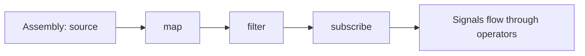

# Quên đăng ký hoặc bỏ qua chuỗi mới do toán tử trả về

Một lỗi thường gặp khi viết code Project Reactor là gọi toán tử rồi bỏ qua publisher mà toán tử trả về, hoặc tạo publisher nhưng không có subscription nào tiêu thụ nó. Code nhìn bề ngoài vẫn có `map`, `filter`, `doOnNext` hay `flatMap`, nhưng hành vi mong đợi không xảy ra. Nguyên nhân nằm ở hai quy tắc cốt lõi: publisher được xây dựng theo kiểu bất biến, và phần lớn công việc chỉ bắt đầu khi có subscription.

Mỗi toán tử như `map`, `filter`, `doOnNext`, `onErrorResume` hoặc `publishOn` tạo một publisher mới mô tả bước xử lý bổ sung. Toán tử không sửa publisher nguồn tại chỗ. Nếu không giữ hoặc compose publisher mới đó vào chuỗi được subscribe, bước xử lý sẽ bị bỏ qua. Tương tự, gọi một service trả `Mono`/`Flux` mà không trả publisher cho caller, không nối nó vào pipeline và không subscribe tại một ranh giới sở hữu rõ ràng thì công việc có thể không chạy.

## 1. Publisher là mô tả chuỗi xử lý, không phải lệnh thực thi ngay

Khi viết:

```java
Flux<String> names = Flux.just("an", "binh", "chi");
```

ta tạo một publisher mô tả nguồn dữ liệu. Với các nguồn cold thông thường, việc tạo publisher chưa phát dữ liệu và chưa gọi các callback downstream. Subscription mới kích hoạt quá trình phát tín hiệu:

```java
names.subscribe(System.out::println);
```

Các toán tử cũng tạo publisher mô tả thêm bước xử lý. Ví dụ:

```java
Flux<String> upperNames = names.map(String::toUpperCase);
```

`upperNames` mô tả một pipeline có bước chuyển chữ hoa. Publisher `names` ban đầu vẫn giữ nguyên hành vi phát các chuỗi chữ thường. Reactor không thay đổi đối tượng nguồn để thêm toán tử vào nó.

Có thể hình dung chuỗi xử lý được lắp ráp trước, sau đó mới chạy khi subscribe:



Phân biệt assembly và execution giúp nhận ra vì sao một dòng code có gọi toán tử nhưng callback không được chạy.

## 2. Bỏ qua publisher mới làm toán tử không có tác dụng

Đây là ví dụ điển hình:

```java
Flux<String> names = Flux.just("an", "binh", "chi");

names.map(String::toUpperCase); // Publisher mới bị bỏ qua.

names.subscribe(System.out::println);
```

Kết quả vẫn là `an`, `binh`, `chi`. `map` đã trả về một `Flux<String>` mới, nhưng code không lưu kết quả đó. Subscription sau cùng được tạo từ `names`, nên nó không biết bước `map` từng được gọi.

Giữ publisher trả về và subscribe vào chính publisher đó:

```java
Flux<String> upperNames = names.map(String::toUpperCase);

upperNames.subscribe(System.out::println);
```

Hoặc compose trực tiếp thành một chuỗi:

```java
names
    .map(String::toUpperCase)
    .filter(name -> name.startsWith("A"))
    .subscribe(System.out::println);
```

Quy tắc này áp dụng cho mọi operator trả publisher mới, không riêng `map`:

```java
Flux<Integer> values = Flux.just(1, 2, 3, 4);

values.filter(value -> value % 2 == 0); // Bị bỏ qua.
values.take(2);                         // Bị bỏ qua.
values.onErrorResume(error -> Flux.empty()); // Bị bỏ qua.

values.subscribe(System.out::println); // Vẫn phát 1, 2, 3, 4.
```

Nếu muốn lọc, giới hạn số phần tử hoặc phục hồi lỗi, hãy dùng publisher trả về từ toán tử đó trong chuỗi cuối cùng.

## 3. Bỏ qua doOnNext cũng làm mất callback

`doOnNext` thường được dùng để log hoặc ghi nhận metric. Dù callback có tác dụng phụ, toán tử vẫn trả về một publisher được trang trí; callback chỉ chạy khi publisher đó được subscribe và phát `onNext`:

```java
AtomicInteger observed = new AtomicInteger();
Flux<Integer> source = Flux.just(10, 20, 30);

source.doOnNext(value -> observed.incrementAndGet()); // Bị bỏ qua.

StepVerifier.create(source)
    .expectNext(10, 20, 30)
    .verifyComplete();

assertEquals(0, observed.get());
```

Publisher được kiểm thử là `source`, không phải publisher trả về từ `doOnNext`. Vì thế callback không được đăng ký vào subscription và bộ đếm vẫn bằng 0.

Đúng cách:

```java
Flux<Integer> observedSource = source
    .doOnNext(value -> observed.incrementAndGet());

StepVerifier.create(observedSource)
    .expectNext(10, 20, 30)
    .verifyComplete();

assertEquals(3, observed.get());
```

Hoặc nối toán tử ngay tại nơi tạo publisher:

```java
StepVerifier.create(
        source.doOnNext(value -> observed.incrementAndGet())
    )
    .expectNext(10, 20, 30)
    .verifyComplete();
```

`doOnNext` không chạy nếu publisher hoàn tất rỗng vì không có `onNext`. Nếu cần quan sát cả complete/error/cancel, cân nhắc `doFinally` hoặc hook phù hợp với tín hiệu cần theo dõi.

## 4. Toán tử trả publisher mới vì pipeline được compose theo kiểu bất biến

Các operator tạo thành một chuỗi các publisher được liên kết. Cách viết fluent:

```java
Mono<OrderView> view = orderRepository.findById(orderId)
    .filter(Order::isVisible)
    .map(orderMapper::toView)
    .doOnNext(metrics::recordView);
```

Mỗi toán tử nhận publisher trước và trả publisher kế tiếp. Biến `view` tham chiếu tới chuỗi hoàn chỉnh. Khi caller subscribe vào `view`, tín hiệu đi qua các bước theo thứ tự đã lắp ráp.

Nếu tách các bước ra biến, hãy luôn gán lại kết quả:

```java
Mono<Order> pipeline = orderRepository.findById(orderId);
pipeline = pipeline.filter(Order::isVisible);
pipeline = pipeline.doOnNext(metrics::recordRead);
```

Đoạn code trên hợp lệ vì mỗi lần gán thay biến tham chiếu bằng publisher mới. Nhưng không nên nhầm với việc operator sửa publisher ban đầu. Một biến tham chiếu có thể được cập nhật; đối tượng publisher trước đó vẫn không thay đổi.

## 5. Gọi service nhưng không nối publisher vào chuỗi

Một lỗi tương tự xảy ra khi gọi phương thức service trả `Mono` hoặc `Flux` rồi bỏ kết quả:

```java
Mono<Order> create(CreateOrder command) {
    orderRepository.save(Order.from(command)); // Không được subscribe.
    return Mono.just(Order.from(command));
}
```

`save` trả publisher đại diện cho thao tác ghi. Nếu không compose hoặc subscribe publisher đó, thao tác lưu thường không chạy. Phương thức lại trả một publisher khác chỉ phát đối tượng được tạo trong bộ nhớ, khiến caller tưởng rằng đơn hàng đã được lưu.

Hãy trả publisher lưu trực tiếp:

```java
Mono<Order> create(CreateOrder command) {
    return orderRepository.save(Order.from(command));
}
```

Nếu cần biến đổi kết quả lưu, dùng `map`; nếu cần gọi publisher khác dựa trên kết quả, dùng `flatMap`:

```java
Mono<OrderView> create(CreateOrder command) {
    return orderRepository.save(Order.from(command))
        .flatMap(saved -> auditRepository.save(AuditEntry.created(saved))
            .thenReturn(saved))
        .map(OrderView::from);
}
```

Ở đây, thao tác audit nằm trong cùng chuỗi subscription. Lỗi của audit được truyền tới caller; caller cũng có thể cancel chuỗi theo vòng đời request.

## 6. Chọn map, flatMap hoặc then theo kiểu kết quả

Một nguyên nhân khiến developer bỏ qua publisher là chọn sai toán tử khi hàm trả về publisher khác:

```java
Mono<Mono<Receipt>> nested = orderRepository.save(order)
    .map(saved -> receiptService.create(saved));
```

`map` giữ nguyên giá trị được mapper trả về. Vì mapper trả `Mono<Receipt>`, kết quả trở thành `Mono<Mono<Receipt>>`. Publisher bên trong chưa được compose thành công việc của chuỗi ngoài.

Dùng `flatMap` để nối publisher con:

```java
Mono<Receipt> receipt = orderRepository.save(order)
    .flatMap(receiptService::create);
```

Nếu bước tiếp theo chỉ cần chạy sau khi publisher trước hoàn tất và không cần payload của nó, dùng `then`:

```java
Mono<Void> workflow = auditRepository.save(entry)
    .then(notificationService.send(notification));
```

Nếu cần phát lại một giá trị sau khi thao tác hoàn tất, dùng `thenReturn`:

```java
Mono<Order> savedOrder = orderRepository.save(order)
    .flatMap(saved -> auditRepository.save(AuditEntry.created(saved))
        .thenReturn(saved));
```

| Nhu cầu | Toán tử | Kết quả |
| --- | --- | --- |
| Biến đổi một payload đồng bộ | `map` | `Mono<R>` hoặc `Flux<R>` |
| Từ payload tạo publisher tiếp theo | `flatMap` | Publisher được flatten |
| Chờ publisher trước hoàn tất rồi chạy publisher khác | `then` | Kiểu của publisher sau |
| Chờ hoàn tất rồi phát giá trị cố định | `thenReturn` | `Mono<R>` |
| Chờ hoàn tất rồi chạy luồng nhiều phần tử | `thenMany` | `Flux<R>` |

Không cần gọi `subscribe()` để làm phẳng publisher lồng nhau. Hãy chọn operator compose phù hợp để subscription ngoài sở hữu toàn bộ chuỗi.

## 7. subscribe() là ranh giới thực thi, không phải toán tử biến đổi

Gọi `subscribe()` tạo subscription và kích hoạt publisher. Nó là một terminal action ở ranh giới thực thi, không trả về publisher đã biến đổi để tiếp tục compose. Các overload có thể trả về `Disposable` để caller hủy subscription:

```java
Disposable disposable = orderService.streamUpdates()
    .subscribe(
        update -> log.info("Update {}", update.id()),
        error -> log.error("Update stream failed", error)
    );
```

Đoạn code này tạo một subscription độc lập. Nó phù hợp trong một component sở hữu rõ ràng tác vụ nền, ví dụ một listener được khởi động khi ứng dụng chạy và dispose khi ứng dụng dừng. Nó không phù hợp để gọi giữa các bước của một request service hoặc controller.

Không viết:

```java
Mono<Order> create(CreateOrder command) {
    Mono<Order> saved = orderRepository.save(Order.from(command));
    saved.subscribe(); // Subscription thứ nhất chạy độc lập.
    return saved;      // Framework/caller có thể subscribe lần thứ hai.
}
```

Với nguồn cold, mỗi subscription thường tạo một lần thực thi mới. Ví dụ trên có thể lưu đơn hàng hai lần: một lần do `saved.subscribe()`, lần thứ hai khi caller subscribe publisher được trả về. Nó còn làm lỗi của subscription thứ nhất không đi theo publisher trả về và caller không thể quản lý cancellation của nó.

Đúng cách là chỉ trả publisher:

```java
Mono<Order> create(CreateOrder command) {
    return orderRepository.save(Order.from(command));
}
```

Trong WebFlux, trả `Mono`/`Flux` từ controller để framework sở hữu subscription. Trong service, compose publisher và để tầng gọi quyết định khi nào thực thi.

## 8. Vì sao subscribe lồng nhau làm mất lỗi và cancellation?

Khi gọi `subscribe()` bên trong `map`, `doOnNext` hoặc `flatMap`, ta tạo một subscription tách rời khỏi chuỗi chính:

```java
// Không nên.
Mono<Order> result = orderRepository.save(order)
    .doOnSuccess(saved -> notificationService.send(saved).subscribe());
```

Publisher `result` có thể complete ngay sau khi `save` xong, trong khi notification vẫn đang chạy độc lập. Nếu notification lỗi, lỗi đó không trở thành lỗi của `result`. Nếu caller cancel `result`, subscription notification cũng không tự động được hủy. Test cũng khó chờ notification hoàn tất vì nó không còn nằm trong publisher được kiểm tra.

Compose publisher notification vào chuỗi:

```java
Mono<Order> result = orderRepository.save(order)
    .flatMap(saved -> notificationService.send(saved)
        .thenReturn(saved));
```

Giờ đây publisher kết quả chỉ phát `saved` sau khi notification hoàn tất. Nếu notification lỗi, `result` phát lỗi; nếu downstream cancel, cancellation được truyền tới publisher con theo khả năng của nguồn.

Nếu notification không phải điều kiện để trả response và cần xử lý nền, hãy đưa nó tới một thành phần sở hữu tác vụ nền hoặc hàng đợi/outbox có lifecycle và chính sách retry riêng. Đừng giấu subscription độc lập bên trong callback của request.

## 9. Khi nào được subscribe trực tiếp?

Ứng dụng vẫn có những điểm cần tự khởi chạy subscription, nhưng cần một owner rõ ràng. Ví dụ một worker nền có thể giữ `Disposable`:

```java
final class EventWorker implements Disposable {
    private final Disposable subscription;

    EventWorker(EventService eventService) {
        this.subscription = eventService.events()
            .subscribe(
                this::handle,
                error -> log.error("Worker stopped", error)
            );
    }

    private void handle(Event event) {
        // Xử lý event trong phạm vi worker.
    }

    @Override
    public void dispose() {
        subscription.dispose();
    }

    @Override
    public boolean isDisposed() {
        return subscription.isDisposed();
    }
}
```

Đây là ví dụ minh họa ownership: component tạo subscription, định nghĩa xử lý lỗi và có đường dispose. Trong ứng dụng Spring, việc khởi động/dừng worker cần gắn với lifecycle bean như `@PostConstruct`/`@PreDestroy` hoặc cơ chế lifecycle phù hợp. Không tạo worker mới cho mỗi request mà không quản lý số lượng và cleanup.

Nếu chỉ cần thực thi một publisher tại top-level, có thể dùng `subscribe` với error handler và giữ `Disposable` khi cần hủy. Nhưng trong controller, service hoặc một pipeline đã có publisher trả về, hãy compose thay vì tự subscribe.

## 10. Publisher cold có thể chạy lại khi subscribe nhiều lần

Một publisher cold thường tạo một execution mới cho mỗi subscriber. Điều này hữu ích khi mỗi caller cần một lần truy vấn riêng, nhưng có thể gây tác dụng phụ lặp nếu cùng publisher được subscribe nhiều lần:

```java
Mono<Order> save = orderRepository.save(order);

save.subscribe();
save.subscribe();
```

Hai subscription có thể thực hiện hai lần lưu. Không nên coi biến `Mono` là một future đã chạy hoặc một kết quả đã được cache. Nó là mô tả công việc; mỗi subscription có thể kích hoạt công việc mới tùy loại nguồn.

Nếu thực sự cần chia sẻ một execution hoặc cache kết quả, dùng cơ chế chia sẻ phù hợp như `cache()` hoặc `share()` sau khi hiểu rõ semantics về lifecycle, lỗi, cancellation và thời điểm subscription. Không dùng chúng chỉ để che lỗi subscribe lặp; trước tiên hãy xác định ai sở hữu subscription và liệu tác dụng phụ có được thiết kế idempotent hay không.

Với hot publisher, subscriber đến muộn có thể bỏ lỡ các sự kiện đã phát trước khi đăng ký. Đây là vấn đề thời điểm subscription và semantics của nguồn hot, khác với việc bỏ qua publisher do operator trả về. Khi chẩn đoán, hãy xác định nguồn là cold hay hot trước khi kết luận dữ liệu bị mất.

## 11. Dùng StepVerifier để phát hiện operator bị bỏ qua

Test nhỏ có thể chứng minh publisher nguồn và publisher sau toán tử có hành vi khác nhau:

```java
@Test
void ignoredMapDoesNotChangeOriginalPublisher() {
    Flux<String> source = Flux.just("a", "b");

    source.map(String::toUpperCase); // Kết quả bị bỏ qua.

    StepVerifier.create(source)
        .expectNext("a", "b")
        .verifyComplete();
}

@Test
void retainedMapPublisherAppliesTransformation() {
    Flux<String> source = Flux.just("a", "b");
    Flux<String> transformed = source.map(String::toUpperCase);

    StepVerifier.create(transformed)
        .expectNext("A", "B")
        .verifyComplete();
}
```

Test cũng nên xác minh callback chỉ chạy khi publisher có subscription:

```java
AtomicInteger calls = new AtomicInteger();

Mono<String> pipeline = Mono.just("value")
    .doOnNext(value -> calls.incrementAndGet());

assertEquals(0, calls.get());

StepVerifier.create(pipeline)
    .expectNext("value")
    .verifyComplete();

assertEquals(1, calls.get());
```

Trước khi `StepVerifier` subscribe, callback chưa chạy. Sau khi verify, callback được gọi đúng một lần. Nếu test gọi `subscribe()` trước rồi lại truyền cùng publisher cho `StepVerifier`, nguồn cold có thể chạy hai lần; tránh tạo subscription thừa trong test.

## 12. Chẩn đoán một bước không có tác dụng

Khi một toán tử hoặc lời gọi service dường như không chạy, hãy lần lượt kiểm tra:

1. **Giá trị trả về có được giữ không?** Tìm các lời gọi `map`, `filter`, `doOnNext`, `onErrorResume`, `publishOn` đứng riêng mà không có assignment hoặc không được return/compose.
2. **Publisher cuối cùng có chứa bước đó không?** Kiểm tra biến được return hoặc publisher được đưa vào `StepVerifier`/framework có phải chuỗi đã biến đổi không.
3. **Có subscription không?** Đặt `doOnSubscribe` tại vị trí cần quan sát và xác nhận caller/framework sở hữu publisher.
4. **Có demand và dữ liệu không?** Dùng `doOnRequest`, `doOnNext`; xem filter có loại mọi phần tử hoặc nguồn có đang chờ I/O không.
5. **Có subscription độc lập ngoài ý muốn không?** Tìm `subscribe()` hoặc `block()` bên trong service/operator có thể làm công việc chạy hai lần hoặc tách lỗi khỏi caller.
6. **Nguồn là cold hay hot?** Subscriber muộn trên nguồn hot có thể không nhận sự kiện đã phát trước đó.

Có thể thêm hook tạm thời:

```java
Mono<Order> traced = orderRepository.findById(orderId)
    .doOnSubscribe(s -> log.debug("subscribed to order lookup"))
    .doOnRequest(n -> log.debug("requested {}", n))
    .doOnNext(order -> log.debug("received order {}", order.id()))
    .doFinally(signal -> log.debug("order lookup ended: {}", signal));
```

Đặt hook ở cả hai phía của operator nghi ngờ để xác định subscription và tín hiệu có đi qua bước đó không. Không ghi dữ liệu nhạy cảm vào log và gỡ các hook chẩn đoán không cần thiết sau khi điều tra.

## 13. Những mẫu code cần nhận diện khi review

| Mẫu code | Vấn đề | Cách sửa |
| --- | --- | --- |
| `source.map(this::convert); return source;` | Publisher sau `map` bị bỏ | `return source.map(this::convert);` |
| `service.save(value); return Mono.just(value);` | Publisher save không được compose | `return service.save(value);` |
| `mono.doOnNext(this::audit);` | Callback audit không thuộc publisher được subscribe | Return/compose publisher sau `doOnNext` |
| `mono.map(x -> service.call(x));` | Tạo publisher lồng nhau | Dùng `flatMap` |
| `mono.doOnSuccess(x -> service.call(x).subscribe());` | Subscription tách rời, mất lỗi/cancel | Dùng `flatMap` hoặc `then` |
| `saved.subscribe(); return saved;` | Có thể thực thi cold source hai lần | Chỉ return publisher |
| `source.block();` trong WebFlux | Chặn thread và tạo execution đồng bộ | Compose publisher và return cho framework |

Khi review, đừng chỉ tìm xem code có gọi operator hay không. Hãy lần theo giá trị publisher trả về cho tới điểm subscription cuối cùng. Mọi operator cần nằm trên đúng chuỗi mà caller thực sự tiêu thụ.

## 14. Áp dụng trong service và WebFlux

Trong service, trả publisher đại diện cho toàn bộ nghiệp vụ:

```java
Mono<OrderView> create(CreateOrder command) {
    return orderRepository.save(Order.from(command))
        .flatMap(saved -> auditRepository.save(AuditEntry.created(saved))
            .thenReturn(saved))
        .map(OrderView::from);
}
```

Trong controller, trả publisher cho WebFlux quản lý subscription:

```java
@PostMapping("/orders")
Mono<ResponseEntity<OrderView>> create(@RequestBody Mono<CreateOrder> body) {
    return body
        .flatMap(orderService::create)
        .map(view -> ResponseEntity.status(HttpStatus.CREATED).body(view));
}
```

Framework sẽ subscribe khi xử lý request và truyền cancellation khi client ngắt kết nối theo khả năng của server/transport. Nếu controller tự subscribe, framework có thể trả response trước khi công việc hoàn tất và không còn quản lý lỗi hoặc cancellation của subscription đó.

## 15. Nguyên tắc giữ chuỗi xử lý không bị đứt

Hãy coi kết quả của mọi toán tử Reactor là một publisher mới cần được giữ lại. Nối các bước đồng bộ bằng `map`/`filter`, nối công việc reactive bằng `flatMap` hoặc `then`, và trả publisher hoàn chỉnh tới tầng sở hữu subscription. Dùng `subscribe()` chỉ tại ranh giới thực thi độc lập có lifecycle, error handler và khả năng dispose rõ ràng.

Khi một bước “không chạy”, kiểm tra publisher cuối cùng có chứa toán tử đó hay không trước khi điều tra scheduler hoặc thread. Khi một thao tác bị chạy hai lần, tìm subscription thừa và nhớ rằng cold publisher thường thực thi một lần cho mỗi subscriber. Khi lỗi hoặc cancellation không tới caller, tìm subscription lồng nhau. Giữ chuỗi publisher liên tục giúp Project Reactor truyền dữ liệu, lỗi, demand và cancellation theo một vòng đời có thể quan sát và kiểm thử.
