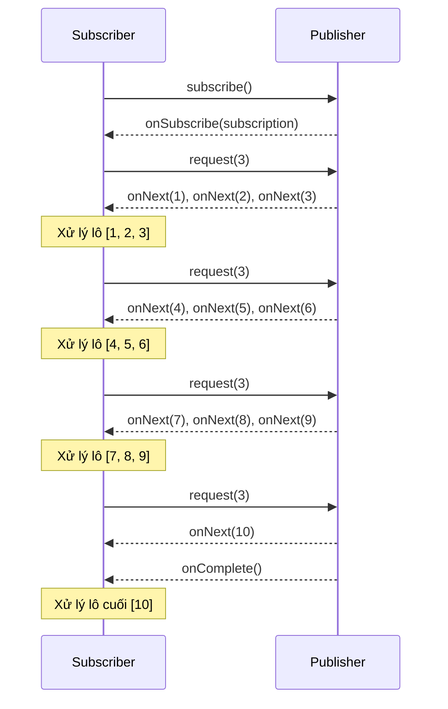

# Mô phỏng Publisher và Subscriber có yêu cầu dữ liệu theo lô

Trong chương **Bài thực hành**, bài này xây dựng một publisher phát dãy số và một subscriber chủ động yêu cầu dữ liệu theo từng lô. Mục tiêu là quan sát trực tiếp hợp đồng Publisher–Subscriber: publisher chỉ phát số phần tử đã được yêu cầu, subscriber có thể xin thêm demand sau khi xử lý xong một lô và có thể hủy subscription khi không cần dữ liệu nữa.

Bài thực hành thuộc module **REACTIVE_PROGRAMMING**. Module hướng dẫn: “Học tư duy reactive qua các luồng sự kiện bất đồng bộ, hợp đồng Publisher–Subscriber và cơ chế backpressure của Reactive Streams. Thực hành Mono, Flux, kết hợp toán tử, kiểm soát scheduler, xử lý lỗi và kiểm thử pipeline trong hệ sinh thái Java.” Vì vậy, ví dụ tập trung vào demand và cancellation của Reactive Streams, cách Reactor triển khai các hợp đồng này và cách kiểm chứng bằng StepVerifier.

## 1. Mô hình cần xây dựng

Ta mô phỏng một nguồn có 10 số nguyên, từ 1 đến 10. Subscriber yêu cầu mỗi lần 3 phần tử, xử lý đủ một lô rồi mới yêu cầu lô tiếp theo.



Các vai trò trong ví dụ:

- **Publisher:** nguồn phát dữ liệu. Ta dùng `Flux.range(1, 10)`.
- **Subscriber:** bên nhận dữ liệu. Ta viết một lớp kế thừa `BaseSubscriber<Integer>`.
- **Subscription:** cầu nối điều khiển giữa hai bên. Subscriber dùng `request(n)` để báo nhu cầu và `cancel()` để dừng nhận.
- **Demand:** số phần tử subscriber đã yêu cầu nhưng chưa nhận. Demand được tính theo phần tử, không phải số lần gọi request.

Một lần `request(3)` có nghĩa subscriber cho phép publisher phát tối đa ba phần tử bổ sung. Nó không có nghĩa publisher phải phát đúng ba phần tử: nguồn có thể hoàn tất sớm hoặc phát lỗi trước đó.

## 2. Tạo Publisher và quan sát demand

Dùng `Flux.range` để tạo nguồn hữu hạn. Thêm `doOnRequest` để quan sát số lượng demand được truyền ngược về nguồn:

```java
Flux<Integer> publisher =
    Flux.range(1, 10)
        .doOnRequest(n ->
            System.out.println("Publisher nhận request(" + n + ")")
        );
```

Publisher chưa phát dữ liệu chỉ vì biến `publisher` đã được tạo. Nó bắt đầu quá trình phát khi có subscriber đăng ký. Với nguồn `Flux.range`, việc phát thường đồng bộ theo demand được yêu cầu.

Có thể thử một subscriber yêu cầu một lô duy nhất:

```java
publisher.subscribe(new BaseSubscriber<Integer>() {
    @Override
    protected void hookOnSubscribe(Subscription subscription) {
        request(3);
    }

    @Override
    protected void hookOnNext(Integer value) {
        System.out.println("Nhận: " + value);
    }
});
```

Subscriber chỉ yêu cầu ba phần tử. Sau khi nhận ba giá trị, nó không xin thêm demand nên nguồn không tiếp tục phát các phần tử còn lại. Đây là khác biệt giữa việc subscribe và việc yêu cầu dữ liệu: đăng ký thiết lập quan hệ, còn `request(n)` cấp demand cho publisher.

## 3. Viết subscriber xử lý theo lô

Bây giờ ta gom các phần tử đã nhận vào một danh sách có kích thước tối đa bằng batch size. Khi đủ một lô, subscriber xử lý lô đó rồi yêu cầu thêm dữ liệu.

```java
import java.util.ArrayList;
import java.util.List;

import org.reactivestreams.Subscription;
import reactor.core.publisher.BaseSubscriber;

final class BatchSubscriber extends BaseSubscriber<Integer> {

    private final int batchSize;
    private final List<Integer> batch;
    private int batchNumber;

    BatchSubscriber(int batchSize) {
        if (batchSize <= 0) {
            throw new IllegalArgumentException(
                "batchSize phải lớn hơn 0"
            );
        }

        this.batchSize = batchSize;
        this.batch = new ArrayList<>(batchSize);
    }

    @Override
    protected void hookOnSubscribe(Subscription subscription) {
        System.out.println("Đăng ký; yêu cầu lô đầu tiên");
        request(batchSize);
    }

    @Override
    protected void hookOnNext(Integer value) {
        batch.add(value);
        System.out.println("Nhận phần tử: " + value);

        if (batch.size() == batchSize) {
            processBatch();
            request(batchSize);
        }
    }

    private void processBatch() {
        batchNumber++;
        System.out.println(
            "Xử lý lô " + batchNumber + ": " + List.copyOf(batch)
        );
        batch.clear();
    }

    @Override
    protected void hookOnComplete() {
        if (!batch.isEmpty()) {
            processBatch();
        }
        System.out.println("Publisher hoàn tất");
    }

    @Override
    protected void hookOnError(Throwable error) {
        System.err.println("Publisher lỗi: " + error.getMessage());
    }
}
```

Chạy subscriber với publisher:

```java
Flux.range(1, 10)
    .doOnRequest(n ->
        System.out.println("Publisher nhận request(" + n + ")")
    )
    .subscribe(new BatchSubscriber(3));
```

Kết quả có dạng:

```text
Đăng ký; yêu cầu lô đầu tiên
Publisher nhận request(3)
Nhận phần tử: 1
Nhận phần tử: 2
Nhận phần tử: 3
Xử lý lô 1: [1, 2, 3]
Publisher nhận request(3)
Nhận phần tử: 4
Nhận phần tử: 5
Nhận phần tử: 6
Xử lý lô 2: [4, 5, 6]
Publisher nhận request(3)
Nhận phần tử: 7
Nhận phần tử: 8
Nhận phần tử: 9
Xử lý lô 3: [7, 8, 9]
Publisher nhận request(3)
Nhận phần tử: 10
Xử lý lô 4: [10]
Publisher hoàn tất
```

Lô cuối chỉ có một phần tử vì nguồn có 10 phần tử, không chia hết cho batch size 3. Publisher có thể gửi `onComplete` ngay sau phần tử cuối; subscriber phải xử lý phần còn lại trong `hookOnComplete`.

Subscriber yêu cầu thêm một lô ngay sau khi xử lý đủ lô hiện tại. Với nguồn đồng bộ như `Flux.range`, request mới có thể khiến nguồn tiếp tục phát ngay trong cùng luồng gọi. Reactor quản lý việc phát tín hiệu và demand để subscriber có thể yêu cầu thêm từ callback `hookOnNext`.

## 4. Theo dõi demand bằng bộ đếm

Demand là số phần tử còn được phép phát. Khi subscriber gọi `request(3)`, demand tăng thêm ba. Mỗi `onNext` tiêu thụ một đơn vị demand. Nếu subscriber yêu cầu tiếp khi demand cũ đã được tiêu thụ, publisher nhận thêm demand mới.

| Thời điểm | Demand được cộng thêm | Phần tử được phát | Demand còn lại sau lô |
|---|---:|---|---:|
| Bắt đầu | 3 | 1, 2, 3 | 0 |
| Sau lô 1 | 3 | 4, 5, 6 | 0 |
| Sau lô 2 | 3 | 7, 8, 9 | 0 |
| Sau lô 3 | 3 | 10 | 2 trước khi complete |

Ở lô cuối, subscriber yêu cầu ba phần tử nhưng publisher chỉ còn một. Publisher phát phần tử 10 rồi hoàn tất; hai demand còn lại không cần được tiêu thụ.

Demand cộng dồn. Nếu subscriber gọi `request(3)` hai lần trước khi nhận dữ liệu, tổng demand là sáu, không phải hai lô độc lập bắt buộc có ranh giới xử lý. Muốn xử lý theo lô, subscriber cần tự theo dõi số phần tử đã nhận và chỉ cấp thêm demand ở thời điểm phù hợp.

## 5. Kiểm thử yêu cầu theo lô bằng StepVerifier

`StepVerifier` cho phép thiết lập demand ban đầu bằng 0, sau đó chủ động gọi `thenRequest(n)`. Đây là cách kiểm tra publisher có tuân thủ yêu cầu theo lô hay không.

```java
@Test
void emitsOnlyWhenDemandArrivesInBatches() {
    StepVerifier.create(Flux.range(1, 7), 0)
        .thenRequest(3)
        .expectNext(1, 2, 3)
        .thenRequest(3)
        .expectNext(4, 5, 6)
        .thenRequest(3)
        .expectNext(7)
        .verifyComplete();
}
```

Test mô phỏng ba lần cấp demand:

1. Ban đầu demand bằng 0 nên chưa yêu cầu phần tử nào.
2. `thenRequest(3)` cho phép nhận 1, 2, 3.
3. Lần yêu cầu tiếp theo cho phép nhận 4, 5, 6.
4. Lần yêu cầu thứ ba cho phép nhận phần tử cuối 7.
5. Nguồn hoàn tất bình thường.

Có thể xác nhận publisher không phát gì trước khi demand được cấp bằng `expectNoEvent` với một khoảng thời gian ngắn, nhưng test thời gian thực dễ phụ thuộc môi trường. Trong bài này, việc bắt đầu với demand bằng 0 và chỉ đặt `expectNext` sau `thenRequest` đã thể hiện rõ thứ tự điều khiển demand.

### Kiểm tra cancellation sau một lô

Subscriber có thể hủy khi đã nhận đủ dữ liệu cần thiết. Test sau xác nhận publisher nhận cancellation sau ba phần tử:

```java
@Test
void cancelsAfterFirstBatch() {
    AtomicBoolean cancelled = new AtomicBoolean();

    Flux<Integer> source =
        Flux.range(1, 10)
            .doOnCancel(() -> cancelled.set(true));

    StepVerifier.create(source, 0)
        .thenRequest(3)
        .expectNext(1, 2, 3)
        .thenCancel()
        .verify();

    assertTrue(cancelled.get());
}
```

Cần import `AtomicBoolean` và assertion `assertTrue` từ thư viện test đang dùng. Test không mong đợi `onComplete`, vì subscriber chủ động hủy subscription. Với nguồn thực tế, cancellation nên dẫn đến việc đóng cursor, hủy request hoặc giải phóng tài nguyên nếu connector hỗ trợ.

## 6. Phân biệt demand theo lô với batch ở tầng database

`request(100)` là yêu cầu publisher phát tối đa 100 phần tử bổ sung theo hợp đồng Reactive Streams. Nó không đồng nghĩa với:

- Database thực hiện câu SQL `LIMIT 100`.
- Driver tải đúng 100 hàng trong một network packet.
- HTTP client nhận đúng 100 bản ghi trong một lần đọc socket.
- Publisher phải phát đủ 100 phần tử.
- Ứng dụng đã giới hạn tốc độ ở 100 phần tử mỗi giây.

Batch demand là cơ chế điều khiển số phần tử được phép phát. Batch fetch của database hoặc batch write của dịch vụ ngoài là cơ chế riêng ở tầng connector và cần được cấu hình hoặc xác minh độc lập.

Ví dụ, subscriber yêu cầu 100 phần tử nhưng nguồn chỉ có 20; publisher phát 20 rồi complete. Ngược lại, nếu connector có prefetch nội bộ, nó có thể đọc trước dữ liệu từ hệ thống bên dưới theo chính sách riêng. Vì vậy, demand ở biên subscriber không tự động chứng minh không có buffer ở mọi chặng.

## 7. Chọn kích thước lô và xử lý chậm

Batch size ảnh hưởng đến số lần request, lượng dữ liệu đang được phép phát và thời điểm subscriber xử lý. Lô lớn có thể giảm overhead điều phối nhưng làm tăng lượng dữ liệu tạm thời; lô nhỏ giúp phản hồi theo từng nhóm nhanh hơn nhưng tăng số lần cấp demand.

| Batch size | Đặc điểm | Khi cân nhắc |
|---:|---|---|
| 1 | Cấp demand từng phần tử | Xử lý tuần tự cần kiểm soát chặt |
| 10–50 | Lô nhỏ | Dữ liệu nhẹ, cần giới hạn buffer |
| 100–500 | Lô trung bình | Cần cân bằng overhead và bộ nhớ |
| Lớn hơn | Nhiều phần tử được phép phát trước | Chỉ khi đo đạc cho thấy tài nguyên đáp ứng |

Không có một batch size đúng cho mọi ứng dụng. Hãy đo kích thước đối tượng, chi phí xử lý mỗi phần tử, thời gian phục vụ, heap và tốc độ nguồn. Nếu xử lý một lô mất nhiều thời gian, subscriber không nên yêu cầu lô kế tiếp trước khi có đủ năng lực nhận nó.

Ví dụ trên xử lý lô đồng bộ ngay trong callback. Nếu việc xử lý lô là bất đồng bộ, cần chỉ yêu cầu lô tiếp theo sau khi publisher xử lý lô hiện tại hoàn tất. Có thể dùng `concatMap` và giới hạn concurrency thay vì tự xây một subscriber nếu không cần kiểm soát giao thức ở mức thấp.

## 8. Xử lý lỗi và demand không hợp lệ

Subscriber không được yêu cầu số phần tử bằng 0 hoặc số âm. Theo Reactive Streams, `request(n)` với `n <= 0` là vi phạm giao thức và subscription phải kết thúc bằng lỗi. Khi dùng Reactor `BaseSubscriber`, hãy bảo đảm batch size dương ngay trong constructor để không tạo request sai.

Nếu publisher phát lỗi giữa các lô, subscriber nhận `onError` thay cho `onComplete`. Những phần tử đã nhận trước lỗi vẫn đã được xử lý; publisher không tự hoàn tác side effect của các lô trước đó.

Ví dụ kiểm tra lỗi giữa luồng:

```java
Flux<Integer> source =
    Flux.concat(
        Flux.range(1, 4),
        Flux.error(new IllegalStateException("source failed"))
    );

StepVerifier.create(source, 0)
    .thenRequest(3)
    .expectNext(1, 2, 3)
    .thenRequest(3)
    .expectNext(4)
    .expectErrorMessage("source failed")
    .verify();
```

Test này yêu cầu ba phần tử đầu, sau đó yêu cầu thêm. Nguồn phát phần tử 4 rồi phát lỗi. Không có `onComplete` sau lỗi.

Nếu mỗi lô thực hiện ghi dữ liệu, hãy thiết kế idempotency hoặc transaction theo lô. Backpressure điều khiển lượng dữ liệu được phát, không bảo đảm các side effect đã thực hiện được rollback khi nguồn lỗi.

## 9. Khi nào nên dùng BaseSubscriber và khi nào nên dùng operator?

`BaseSubscriber` hữu ích khi cần mô phỏng trực tiếp hành vi subscriber, quan sát demand hoặc tích hợp một API yêu cầu điều khiển request thủ công. Tuy nhiên, trong ứng dụng thường ngày, các toán tử Reactor thường dễ bảo trì hơn.

Ví dụ xử lý tuần tự theo từng lô có thể dùng `buffer` kết hợp `concatMap`:

```java
Flux<List<Event>> batches =
    eventSource.buffer(3);

Flux<Result> results =
    batches.concatMap(batch ->
        processBatch(batch)
    );
```

`buffer(3)` gom tối đa ba phần tử thành một danh sách. `concatMap` xử lý từng danh sách tuần tự và chờ publisher con hoàn tất trước khi xử lý lô kế tiếp. Cách này phù hợp khi yêu cầu là xử lý nghiệp vụ theo nhóm; nó khác với việc tự điều khiển `request(n)` ở subscriber.

Hãy chọn theo mục tiêu:

- Muốn học hoặc tích hợp giao thức demand trực tiếp: dùng `BaseSubscriber`.
- Muốn gom phần tử thành danh sách theo kích thước: dùng `buffer(n)`.
- Muốn xử lý publisher con tuần tự: dùng `concatMap`.
- Muốn giới hạn số publisher con chạy đồng thời: cấu hình concurrency cho `flatMap`.
- Muốn giới hạn tốc độ request theo thời gian: dùng rate limiter phù hợp; `request(n)` không phải rate limiter.

## 10. Bài tập mở rộng

Thực hiện các thay đổi sau trên ví dụ:

1. Đổi nguồn thành `Flux.range(1, 23)` và batch size thành 5. Ghi lại số lô đầy đủ và lô cuối.
2. Thêm `doOnRequest` để xác nhận mỗi lần subscriber cấp demand.
3. Thêm bộ đếm tổng số phần tử và tổng số lô đã xử lý.
4. Hủy subscription sau khi xử lý lô thứ hai; xác nhận không có phần tử tiếp theo được xử lý.
5. Thay nguồn bằng publisher phát lỗi sau phần tử thứ 12. Xác nhận lô đã xử lý và hành vi `onError`.
6. Viết StepVerifier với demand ban đầu bằng 0, yêu cầu theo các nhóm 5, rồi xác nhận thứ tự phần tử.
7. So sánh subscriber tự điều khiển demand với `buffer(5).concatMap(...)`.

Khi thực hiện, trả lời các câu hỏi:

- Vì sao `subscribe()` chưa đồng nghĩa với việc publisher được phép phát vô hạn dữ liệu?
- Demand được tính theo phần tử hay theo số lần gọi `request`?
- Điều gì xảy ra nếu subscriber yêu cầu nhiều hơn số phần tử nguồn còn lại?
- Vì sao batch demand không tương đương với batch fetch của database?
- Cancellation khác `onComplete` như thế nào?
- Khi xử lý một lô bất đồng bộ, thời điểm nào an toàn để cấp demand cho lô tiếp theo?

Bài thực hành hoàn tất khi subscriber chỉ nhận dữ liệu theo demand đã cấp, xử lý được lô cuối chưa đầy, phản ứng đúng với lỗi và cancellation, và test chứng minh được hành vi đó.
