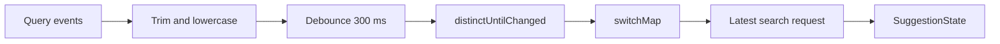

# Tìm kiếm gợi ý với debounce, loại trùng và switchMap

Một ô tìm kiếm gợi ý thường nhận rất nhiều sự kiện khi người dùng gõ. Với từ khóa `reactor`, trình duyệt có thể phát các giá trị `r`, `re`, `rea`, `reac`... Nếu gửi request cho từng ký tự, hệ thống tạo nhiều request không cần thiết; kết quả của request cũ cũng có thể về sau kết quả mới và ghi đè giao diện.

Trong bài thực hành này, ta xây dựng pipeline Reactor nhận một luồng từ khóa, chờ người dùng ngừng gõ trong một khoảng thời gian (*debounce*), loại các từ khóa liên tiếp trùng nhau bằng `distinctUntilChanged()` và dùng `switchMap` để chỉ giữ request của từ khóa mới nhất. Bài tập cũng kiểm tra cancellation, lỗi, timeout và hành vi của pipeline bằng `StepVerifier` cùng `TestPublisher`.

## 1. Mục tiêu và hợp đồng của bài thực hành

Đầu vào là `Flux<String>` mô phỏng các thay đổi của ô tìm kiếm. Đầu ra là `Flux<SuggestionState>` để giao diện nhận danh sách gợi ý hoặc trạng thái lỗi tương ứng với từ khóa.

Pipeline phải đáp ứng các yêu cầu:

1. Chuẩn hóa từ khóa bằng cách bỏ khoảng trắng đầu/cuối và chuyển về chữ thường.
2. Chỉ phát từ khóa sau khi không có giá trị mới trong 300 ms.
3. Bỏ qua từ khóa đã phát liên tiếp giống từ khóa trước đó.
4. Khi từ khóa mới được chấp nhận, hủy publisher tìm kiếm cũ nếu nó còn chạy.
5. Từ khóa rỗng phải hủy tìm kiếm đang chạy và trả danh sách gợi ý rỗng.
6. Timeout hoặc lỗi của một request được biểu diễn thành trạng thái lỗi của từ khóa đó, không làm chết luồng nhận từ khóa tiếp theo.

Ở đây `Flux<String>` đại diện cho một luồng sự kiện liên tục, chẳng hạn sự kiện từ WebSocket hoặc một adapter nhận input từ giao diện. Nếu trình duyệt gửi một HTTP request độc lập cho mỗi ký tự, debounce thường được thực hiện ngay trên client trước khi gửi request; server khi đó chỉ nhận các từ khóa đã được điều tiết.

## 2. Chuẩn bị kiểu dữ liệu và service

Tạo kiểu dữ liệu cho gợi ý và trạng thái trả về:

```java
public record Suggestion(String id, String label) {}

public record SuggestionState(
    String query,
    List<Suggestion> items,
    String error
) {
    public static SuggestionState success(
            String query, List<Suggestion> items) {
        return new SuggestionState(query, List.copyOf(items), null);
    }

    public static SuggestionState empty(String query) {
        return new SuggestionState(query, List.of(), null);
    }

    public static SuggestionState failure(String query, Throwable error) {
        return new SuggestionState(query, List.of(), error.getMessage());
    }
}
```

`SuggestionState` phân biệt kết quả thành công, danh sách rỗng và lỗi. Không dùng `Flux.empty()` để biểu diễn lỗi tìm kiếm vì giao diện sẽ không nhận được trạng thái nào để cập nhật. Việc sao chép danh sách bằng `List.copyOf` cũng tránh để subscriber nhìn thấy collection bị thay đổi sau khi phát.

Giả sử service tìm kiếm có hợp đồng:

```java
public interface SuggestionService {
    Mono<List<Suggestion>> suggest(String normalizedQuery);
}
```

Service có thể gọi repository, WebClient hoặc một nguồn dữ liệu khác. Trong bài tập, ta truyền service vào pipeline để có thể thay bằng publisher giả lập trong test.

## 3. Hiểu vai trò của ba operator

Ba operator giải quyết ba vấn đề khác nhau:

| Operator | Vai trò | Hiệu quả |
| --- | --- | --- |
| `sampleTimeout` | Giữ phần tử mới nhất và chỉ phát nếu khoảng chờ của nó kết thúc trước khi phần tử mới tới | Debounce: tránh tìm kiếm khi người dùng vẫn đang gõ |
| `distinctUntilChanged` | Bỏ phần tử nếu bằng phần tử được phát gần nhất | Không gọi lại service cho cùng từ khóa liên tiếp |
| `switchMap` | Chuyển mỗi từ khóa thành publisher tìm kiếm và hủy inner publisher cũ khi có từ khóa mới | Chỉ giữ kết quả của lần tìm kiếm mới nhất |

Trong Reactor, có thể biểu diễn debounce theo thời gian bằng `sampleTimeout(query -> Mono.delay(duration))`. Mỗi từ khóa tạo một publisher timer. Khi từ khóa tiếp theo tới, timer trước bị hủy; chỉ từ khóa có timer chạy hết mới được phát xuống downstream.

Thứ tự các bước trong bài này là:



Đặt `distinctUntilChanged` sau debounce giúp loại các từ khóa đã được phát liên tiếp sau khi người dùng ngừng gõ. Nếu đặt trước debounce, một sự kiện trùng lặp có thể bị loại trước khi làm mới bộ đếm thời gian chờ; hai cách có thể cho thời điểm phát khác nhau.

## 4. Xây dựng pipeline tìm kiếm

Tạo một lớp điều phối nhận luồng input và service tìm kiếm:

```java
public final class SuggestionPipeline {
    private static final Duration DEBOUNCE = Duration.ofMillis(300);
    private static final Duration SEARCH_TIMEOUT = Duration.ofSeconds(2);

    private final SuggestionService suggestionService;

    public SuggestionPipeline(SuggestionService suggestionService) {
        this.suggestionService = suggestionService;
    }

    public Flux<SuggestionState> suggestions(Flux<String> queryEvents) {
        return queryEvents
            .map(String::trim)
            .map(query -> query.toLowerCase(Locale.ROOT))
            .sampleTimeout(query -> Mono.delay(DEBOUNCE))
            .distinctUntilChanged()
            .switchMap(this::searchLatest);
    }

    private Mono<SuggestionState> searchLatest(String query) {
        if (query.isBlank()) {
            return Mono.just(SuggestionState.empty(query));
        }

        return suggestionService.suggest(query)
            .timeout(SEARCH_TIMEOUT)
            .map(items -> SuggestionState.success(query, items))
            .onErrorResume(error ->
                Mono.just(SuggestionState.failure(query, error))
            );
    }
}
```

`sampleTimeout` là bước debounce. Nếu người dùng gõ `r`, `re`, `rea` trong vòng 300 ms, timer của `r` và `re` bị hủy; chỉ `rea` được phát sau khi không có ký tự mới trong 300 ms.

`distinctUntilChanged()` so sánh từ khóa đã chuẩn hóa với từ khóa được phát trước đó. Ví dụ ` Reactor ` và `reactor` trở thành cùng một chuỗi sau trim/lowercase nên lần thứ hai không tạo request mới. Operator này chỉ loại các giá trị trùng liên tiếp; nếu chuỗi là `reactor`, `java`, `reactor`, giá trị `reactor` cuối vẫn được phát.

`switchMap` biến từ khóa thành một `Mono<SuggestionState>`. Khi từ khóa mới đi qua debounce và distinct, `switchMap` hủy inner publisher cũ rồi subscribe publisher tìm kiếm mới. Nếu từ khóa là chuỗi rỗng, nhánh `Mono.just(emptyState)` vẫn đi qua `switchMap`, nhờ đó request cũ bị hủy và giao diện được xóa gợi ý.

Timeout được đặt bên trong từng request. `onErrorResume` cũng nằm bên trong inner publisher, vì vậy lỗi của một lần tìm kiếm được chuyển thành `SuggestionState.failure`; luồng query bên ngoài vẫn tiếp tục nhận các từ khóa tiếp theo.

## 5. Theo dõi luồng bằng một ví dụ thời gian

Giả sử debounce là 300 ms và người dùng gõ nhanh:

| Thời điểm | Sự kiện | Điều xảy ra |
| ---: | --- | --- |
| 0 ms | `r` | Bắt đầu timer cho `r` |
| 100 ms | `re` | Hủy timer `r`, bắt đầu timer `re` |
| 180 ms | `rea` | Hủy timer `re`, bắt đầu timer `rea` |
| 480 ms | Không có ký tự mới | `rea` được phát qua debounce |
| 480 ms | `switchMap` | Bắt đầu request tìm kiếm `rea` |
| 600 ms | `reac` | Bắt đầu timer mới; request `rea` vẫn chạy trong lúc debounce |
| 900 ms | Không có ký tự mới | `reac` được phát; `switchMap` hủy request `rea` và bắt đầu request `reac` |

Điểm quan trọng: `switchMap` hủy request trước khi nhận inner mới, tức là sau khi từ khóa mới vượt qua debounce và distinct. Trong khoảng debounce 300 ms, request hiện tại vẫn có thể tiếp tục. Đây là hành vi mong muốn để không hủy request chỉ vì một phím vừa được nhấn nhưng người dùng có thể tiếp tục gõ.

Cancellation truyền xuống HTTP client hoặc repository theo khả năng của publisher nguồn. Với WebClient reactive, cancellation thường được truyền tới transport để ngừng tiêu thụ response và có thể hủy request đang chạy. Tuy nhiên, server đích có thể đã nhận và tiếp tục xử lý request; cancellation không phải cam kết rằng công việc ở hệ thống ngoài bị dừng tức thời.

## 6. Kiểm thử debounce bằng virtual time

Không dùng `Thread.sleep(300)` trong test để chờ debounce. `StepVerifier.withVirtualTime` cho phép tiến thời gian ảo mà không phải chờ thật:

```java
@Test
void emitsOnlyTheLastQueryAfterDebounceWindow() {
    TestPublisher<String> input = TestPublisher.create();
    SuggestionService service = query -> Mono.just(List.of(
        new Suggestion("1", "Result for " + query)
    ));
    SuggestionPipeline pipeline = new SuggestionPipeline(service);

    StepVerifier.withVirtualTime(() -> pipeline.suggestions(input.flux()))
        .then(() -> input.next("r"))
        .thenAwait(Duration.ofMillis(100))
        .then(() -> input.next("re"))
        .thenAwait(Duration.ofMillis(100))
        .then(() -> input.next("rea"))
        .expectNoEvent(Duration.ofMillis(299))
        .thenAwait(Duration.ofMillis(1))
        .expectNext(SuggestionState.success(
            "rea", List.of(new Suggestion("1", "Result for rea"))))
        .then(input::complete)
        .verifyComplete();
}
```

Test phát `r`, `re`, `rea` với khoảng cách ngắn hơn debounce. Trong 299 ms sau `rea`, chưa có kết quả. Khi đủ 300 ms, chỉ `rea` được tìm kiếm và phát. `TestPublisher` giữ nguồn mở cho tới khi test chủ động complete, tránh phụ thuộc vào cách xử lý phần tử cuối khi nguồn hoàn tất ngay.

Các publisher timer phải được tạo trong supplier của `withVirtualTime`, như trong ví dụ, để Reactor cài virtual scheduler trước khi pipeline được lắp ráp. Nếu tự truyền scheduler khác vào `sampleTimeout` hoặc `Mono.delay`, test cần điều khiển scheduler đó riêng.

## 7. Kiểm thử loại từ khóa trùng

Ta cần xác minh hai sự kiện sau chuẩn hóa thành cùng từ khóa chỉ tạo một lần gọi service:

```java
@Test
void ignoresConsecutiveDuplicateQueries() {
    TestPublisher<String> input = TestPublisher.create();
    AtomicInteger calls = new AtomicInteger();

    SuggestionService service = query -> {
        calls.incrementAndGet();
        return Mono.just(List.of(new Suggestion("1", query)));
    };

    SuggestionPipeline pipeline = new SuggestionPipeline(service);

    StepVerifier.withVirtualTime(() -> pipeline.suggestions(input.flux()))
        .then(() -> input.next(" Reactor "))
        .thenAwait(Duration.ofMillis(300))
        .expectNext(SuggestionState.success(
            "reactor", List.of(new Suggestion("1", "reactor"))))
        .then(() -> input.next("reactor"))
        .thenAwait(Duration.ofMillis(300))
        .then(input::complete)
        .verifyComplete();

    assertEquals(1, calls.get());
}
```

Hai giá trị sau chuẩn hóa đều là `reactor`. Giá trị thứ hai đi qua debounce nhưng bị `distinctUntilChanged` loại trước `switchMap`, nên service chỉ được gọi một lần. Nếu muốn loại trùng trên toàn bộ lịch sử thay vì chỉ liên tiếp, `distinctUntilChanged` không đáp ứng yêu cầu đó; cần một chính sách lưu lịch sử riêng và phải giới hạn bộ nhớ của nó.

## 8. Kiểm thử switchMap hủy request cũ

Để chứng minh request cũ bị hủy, dùng một `TestPublisher` làm inner publisher đầu tiên. Sau khi từ khóa mới vượt qua debounce, `switchMap` phải cancel inner cũ:

```java
@Test
void cancelsPreviousSearchWhenNewQueryIsAccepted() {
    TestPublisher<String> input = TestPublisher.create();
    TestPublisher<List<Suggestion>> oldRequest = TestPublisher.create();
    AtomicInteger calls = new AtomicInteger();

    SuggestionService service = query -> {
        calls.incrementAndGet();
        if (query.equals("ca")) {
            return oldRequest.mono();
        }
        return Mono.just(List.of(new Suggestion("2", "Cat")));
    };

    SuggestionPipeline pipeline = new SuggestionPipeline(service);

    StepVerifier.withVirtualTime(() -> pipeline.suggestions(input.flux()))
        .then(() -> input.next("ca"))
        .thenAwait(Duration.ofMillis(300))
        .then(() -> input.next("cat"))
        .thenAwait(Duration.ofMillis(300))
        .expectNext(SuggestionState.success(
            "cat", List.of(new Suggestion("2", "Cat"))))
        .then(input::complete)
        .verifyComplete();

    oldRequest.assertWasSubscribed();
    oldRequest.assertCancelled();
    assertEquals(2, calls.get());
}
```

Request `ca` được subscribe sau debounce đầu tiên nhưng không phát kết quả. Khi `cat` được chấp nhận, `switchMap` hủy publisher `oldRequest` rồi subscribe publisher mới. Test xác minh request cũ đã được subscribe và sau đó nhận cancellation; service chỉ được gọi cho `ca` và `cat`.

## 9. Kiểm thử từ khóa rỗng hủy request và xóa gợi ý

Không lọc chuỗi rỗng trước `switchMap`. Nếu làm vậy, sự kiện xóa ô tìm kiếm sẽ không tới `switchMap`, request cũ có thể tiếp tục và kết quả cũ vẫn xuất hiện. Pipeline hiện tại giữ chuỗi rỗng qua debounce và distinct, sau đó `searchLatest` trả danh sách rỗng:

```java
@Test
void blankQueryCancelsActiveSearchAndClearsSuggestions() {
    TestPublisher<String> input = TestPublisher.create();
    TestPublisher<List<Suggestion>> activeRequest = TestPublisher.create();

    SuggestionService service = query -> query.equals("reactor")
        ? activeRequest.mono()
        : Mono.just(List.of());

    SuggestionPipeline pipeline = new SuggestionPipeline(service);

    StepVerifier.withVirtualTime(() -> pipeline.suggestions(input.flux()))
        .then(() -> input.next("reactor"))
        .thenAwait(Duration.ofMillis(300))
        .then(() -> input.next("   "))
        .thenAwait(Duration.ofMillis(300))
        .expectNext(SuggestionState.empty(""))
        .then(input::complete)
        .verifyComplete();

    activeRequest.assertCancelled();
}
```

Khi chuỗi rỗng được chuẩn hóa thành `""`, nó đi qua debounce. `switchMap` hủy request `reactor` đang chờ rồi phát state rỗng. Giao diện có thể dùng state này để xóa danh sách gợi ý và ẩn menu kết quả.

## 10. Kiểm thử timeout và lỗi mà không làm chết luồng query

Lỗi cần được xử lý bên trong publisher do `switchMap` tạo ra. Nếu đặt `onErrorResume` bên ngoài toàn bộ pipeline và biến lỗi thành một `Flux` hoàn tất, luồng nhận sự kiện tìm kiếm có thể kết thúc; các từ khóa tiếp theo sẽ không còn được xử lý.

```java
private Mono<SuggestionState> searchLatest(String query) {
    if (query.isBlank()) {
        return Mono.just(SuggestionState.empty(query));
    }

    return suggestionService.suggest(query)
        .timeout(SEARCH_TIMEOUT)
        .map(items -> SuggestionState.success(query, items))
        .onErrorResume(error ->
            Mono.just(SuggestionState.failure(query, error))
        );
}
```

Kiểm thử timeout bằng virtual time:

```java
@Test
void convertsSearchTimeoutToFailureState() {
    TestPublisher<String> input = TestPublisher.create();
    SuggestionService service = query -> query.equals("reactor")
        ? Mono.never()
        : Mono.just(List.of(new Suggestion("2", "Java")));
    SuggestionPipeline pipeline = new SuggestionPipeline(service);

    StepVerifier.withVirtualTime(() -> pipeline.suggestions(input.flux()))
        .then(() -> input.next("reactor"))
        .thenAwait(Duration.ofMillis(300)) // Debounce.
        .thenAwait(Duration.ofSeconds(2))  // Search timeout.
        .expectNextMatches(state ->
            state.query().equals("reactor") && state.error() != null)
        .then(() -> input.next("java"))
        .thenAwait(Duration.ofMillis(300))
        .expectNextMatches(state -> state.query().equals("java"))
        .then(input::complete)
        .verifyComplete();
}
```

Test xác minh timeout của request đầu trở thành một state lỗi, sau đó luồng query vẫn xử lý được từ khóa `java`. Trong dự án thực tế, nên phân biệt timeout, lỗi mạng và lỗi nghiệp vụ để giao diện có thể hiển thị thông điệp phù hợp; không nhất thiết đưa thông điệp exception thô cho người dùng cuối.

## 11. Kết nối pipeline với nguồn sự kiện thực tế

Một WebSocket handler có thể chuyển message văn bản thành luồng từ khóa và gửi state tìm kiếm trở lại client. Phần mã sau minh họa ranh giới reactive; việc serialize state thành JSON có thể dùng codec hoặc mapper của ứng dụng:

```java
Mono<Void> handle(WebSocketSession session) {
    Flux<String> queryEvents = session.receive()
        .map(WebSocketMessage::getPayloadAsText);

    Flux<String> responses = suggestionPipeline
        .suggestions(queryEvents)
        .map(this::encodeState);

    return session.send(
        responses.map(session::textMessage)
    );
}
```

Handler trả `Mono<Void>` cho framework quản lý subscription. Khi WebSocket đóng, subscription của receive/send kết thúc hoặc bị hủy; pipeline tìm kiếm cũng được hủy theo chuỗi compose. Không gọi `subscribe()` bên trong handler vì sẽ tách vòng đời tìm kiếm khỏi vòng đời kết nối.

Nếu triển khai qua HTTP request độc lập, frontend thường debounce và loại trùng trước khi gửi request; mỗi request mới có thể abort request cũ bằng cơ chế của HTTP client. Phần backend vẫn cần xử lý timeout, lỗi và cancellation vì client có thể ngắt kết nối bất cứ lúc nào.

## 12. Những lỗi thường gặp khi triển khai

- **Đặt filter loại chuỗi rỗng trước switchMap:** sự kiện clear không hủy request cũ. Hãy để chuỗi rỗng đi tới `switchMap` và trả state rỗng.
- **Đặt `distinctUntilChanged` trước chuẩn hóa:** `"reactor"` và `" reactor "` có thể bị xem là khác nhau. Chuẩn hóa trước khi so sánh.
- **Dùng `flatMap` thay cho `switchMap`:** request cũ vẫn có thể phát kết quả sau request mới. Chọn `switchMap` khi chỉ kết quả mới nhất còn hợp lệ.
- **Đặt xử lý lỗi ngoài toàn bộ luồng:** một lỗi inner có thể kết thúc luồng sự kiện. Phục hồi bên trong `searchLatest` nếu muốn tiếp tục nhận query.
- **Không đặt timeout:** request treo có thể giữ inner publisher và trạng thái loading mãi.
- **Dùng `Thread.sleep` trong test:** test chậm và phụ thuộc lịch chạy. Dùng virtual time.
- **Giả định cancellation luôn dừng xử lý ở server đích:** cancellation được truyền theo khả năng của client/transport, nhưng server ngoài có thể đã bắt đầu công việc.
- **Gọi `subscribe()` bên trong handler:** tách subscription khỏi lifecycle của WebSocket hoặc HTTP request.

## 13. Bài tập mở rộng

Sau khi hoàn thành pipeline cơ bản, thử các thay đổi sau:

1. Cho phép cấu hình debounce theo loại thiết bị: 150 ms trên desktop và 350 ms trên kết nối chậm.
2. Giới hạn kết quả gợi ý ở 10 phần tử và kiểm tra thứ tự xếp hạng từ service.
3. Thêm trạng thái `loading` khi request mới bắt đầu và trạng thái `success`/`failure` khi kết thúc.
4. Dùng cache cho từ khóa phổ biến nhưng vẫn bảo đảm query mới hủy subscription cũ.
5. Thêm correlation ID để theo dõi query từ WebSocket handler tới service tìm kiếm.
6. Viết test chứng minh `"reactor"`, `"java"`, `"reactor"` tạo ba lần tìm kiếm vì `distinctUntilChanged` chỉ loại trùng liên tiếp.

Khi thêm trạng thái loading, có thể dùng `Flux.concat` hoặc `startWith` bên trong inner publisher để phát loading trước rồi mới phát kết quả. Cần giữ toàn bộ chuỗi trong `switchMap` để loading và kết quả cũ cùng bị hủy khi query mới được chấp nhận.

## 14. Tiêu chí hoàn thành

Bài thực hành hoàn tất khi bạn có thể chứng minh bằng test rằng:

- Nhiều ký tự đến trong cửa sổ 300 ms chỉ tạo một request cho từ khóa cuối.
- Từ khóa được trim và chuẩn hóa trước khi so sánh trùng.
- Hai từ khóa giống nhau liên tiếp chỉ gọi service một lần.
- Từ khóa mới được chấp nhận sẽ hủy inner request cũ.
- Chuỗi rỗng hủy request đang chạy và xóa gợi ý.
- Timeout/lỗi của một request tạo state lỗi nhưng luồng query vẫn hoạt động.
- Subscription được quản lý bởi caller hoặc framework và được hủy khi nguồn sự kiện đóng.

Ba operator kết hợp theo đúng trách nhiệm: debounce giảm số lần tìm kiếm khi người dùng đang gõ; `distinctUntilChanged` bỏ lần tìm kiếm lặp liên tiếp; `switchMap` giữ request mới nhất và hủy request cũ. Khi đặt đúng thứ tự và kiểm thử cả tín hiệu lẫn cancellation, pipeline gợi ý tìm kiếm trở nên tiết kiệm tài nguyên và không để kết quả cũ ghi đè kết quả mới.
