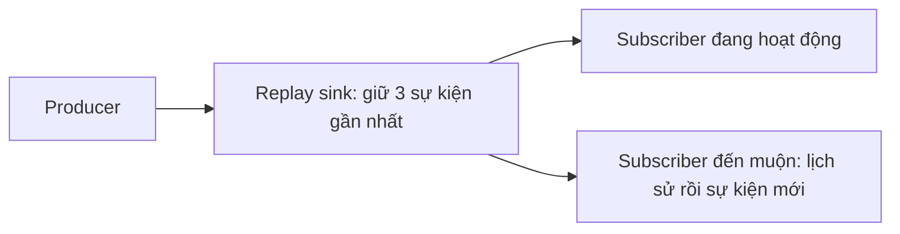

# Xây dựng luồng sự kiện dùng chung có phát lại giới hạn

Trong một hệ thống theo dõi đơn hàng, bảng điều khiển và bộ phận kiểm toán cần nhận cùng một luồng sự kiện. Bảng điều khiển có thể đã đăng ký từ đầu, trong khi một nhân viên kiểm toán chỉ mở màn hình sau khi đơn hàng đã phát sinh vài thay đổi. Khi đó, subscriber mới cần xem được một phần lịch sử gần nhất rồi tiếp tục nhận sự kiện mới.

Trong bài thực hành này, bạn sẽ tạo một luồng nóng dùng chung bằng `Sinks.Many` của Project Reactor. Cấu hình `replay().limit(n)` giữ lại tối đa `n` sự kiện gần nhất để phát lại cho subscriber đến muộn. Các subscriber đang hoạt động cùng nhận những sự kiện được phát vào sink.

## Mục tiêu

Sau bài thực hành, bạn có thể:

- Tạo một `Sinks.Many` làm điểm phát sự kiện dùng chung.
- Chuyển sink thành `Flux` để nhiều subscriber đăng ký cùng một nguồn.
- Giải thích sự khác nhau giữa sự kiện trực tiếp và phần lịch sử được phát lại.
- Giới hạn số sự kiện được giữ lại bằng `replay().limit(n)`.
- Kiểm tra hành vi của subscriber đến muộn bằng `StepVerifier`.
- Kiểm tra kết quả phát sự kiện và xử lý vòng đời hoàn tất của sink.

## Bài toán và tiêu chí hoàn thành

Bạn xây dựng luồng sự kiện trạng thái đơn hàng với các yêu cầu sau:

1. Một producer phát các sự kiện trạng thái theo thứ tự.
2. Subscriber đang hoạt động nhận mỗi sự kiện mới đúng một lần từ luồng dùng chung.
3. Subscriber đăng ký sau khi đã có sự kiện nhận được tối đa ba sự kiện gần nhất, theo đúng thứ tự.
4. Sau khi nhận phần lịch sử, subscriber tiếp tục nhận các sự kiện mới.
5. Khi producer hoàn tất luồng, các subscriber nhận tín hiệu hoàn tất.

Sơ đồ luồng dữ liệu:



## 1. Chọn đúng loại nguồn sự kiện

`Flux` mô tả một chuỗi tín hiệu, còn `Sinks.Many` cung cấp điểm để mã ứng dụng chủ động phát tín hiệu vào chuỗi đó. Khi gọi `asFlux()`, bạn tạo một góc nhìn `Flux` cho các subscriber dùng chung sink.

| Cấu hình | Hành vi chính | Khi phù hợp |
|---|---|---|
| `Sinks.many().multicast().onBackpressureBuffer()` | Chỉ chuyển các sự kiện được phát sau khi subscriber đăng ký; hỗ trợ nhiều subscriber và phối hợp với demand | Subscriber chỉ cần sự kiện trực tiếp |
| `Sinks.many().replay().limit(n)` | Phát lại tối đa `n` sự kiện gần nhất cho subscriber mới, sau đó chuyển tiếp sự kiện trực tiếp | Subscriber mới cần một phần ngữ cảnh gần đây |
| `Sinks.many().replay().all()` | Phát lại toàn bộ lịch sử đã phát | Lịch sử nhỏ, hữu hạn và thực sự cần phát lại toàn bộ |

Với bài toán này, chọn `replay().limit(3)`. Cấu hình giới hạn lịch sử theo số phần tử. Nó không phải kho lưu trữ bền vững: dữ liệu nằm trong bộ nhớ của tiến trình và mất khi tiến trình dừng. Nếu cần lịch sử kiểm toán lâu dài, hãy lưu sự kiện vào cơ sở dữ liệu hoặc event log riêng.

## 2. Chuẩn bị thư viện

Ví dụ dùng Java 17 để khai báo `record`, Project Reactor và JUnit 5. Nếu dự án đã dùng Spring WebFlux thì `reactor-core` thường đã có trong dependency graph. Khi cần viết kiểm thử bằng `StepVerifier`, thêm `reactor-test` với phiên bản tương thích với `reactor-core`.

```xml
<dependency>
    <groupId>io.projectreactor</groupId>
    <artifactId>reactor-core</artifactId>
</dependency>

<dependency>
    <groupId>io.projectreactor</groupId>
    <artifactId>reactor-test</artifactId>
    <scope>test</scope>
</dependency>

<dependency>
    <groupId>org.junit.jupiter</groupId>
    <artifactId>junit-jupiter</artifactId>
    <scope>test</scope>
</dependency>
```

Nếu dự án không quản lý phiên bản bằng Spring Boot hoặc Reactor BOM, hãy khai báo các phiên bản tương thích theo dependency management hiện có của dự án.

## 3. Tạo sink và phát sự kiện

Tạo sink một lần ở nơi quản lý vòng đời của luồng. Sau đó chia sẻ cùng một `Flux` cho các thành phần cần đăng ký. Không tạo sink mới bên trong từng lời gọi xử lý request, vì mỗi sink mới sẽ tạo ra một nguồn sự kiện độc lập.

```java
import reactor.core.publisher.Flux;
import reactor.core.publisher.Sinks;

public final class BoundedReplayDemo {

    private record OrderEvent(long sequence, String orderId, String status) {}

    public static void main(String[] args) {
        Sinks.Many<OrderEvent> eventSink = Sinks.many().replay().limit(3);
        Flux<OrderEvent> sharedEvents = eventSink.asFlux();

        // Subscriber thứ nhất đăng ký trước khi có sự kiện.
        sharedEvents
            .doOnNext(event -> System.out.println("[dashboard] " + event))
            .doOnComplete(() -> System.out.println("[dashboard] completed"))
            .subscribe();

        publish(eventSink, new OrderEvent(1, "ORD-42", "CREATED"));
        publish(eventSink, new OrderEvent(2, "ORD-42", "CONFIRMED"));
        publish(eventSink, new OrderEvent(3, "ORD-42", "PACKING"));
        publish(eventSink, new OrderEvent(4, "ORD-42", "SHIPPED"));

        System.out.println("-- audit subscriber joins --");

        // Subscriber đến muộn nhận lại các sự kiện 2, 3, 4.
        sharedEvents
            .doOnNext(event -> System.out.println("[audit] " + event))
            .doOnComplete(() -> System.out.println("[audit] completed"))
            .subscribe();

        // Cả hai subscriber tiếp tục nhận sự kiện mới.
        publish(eventSink, new OrderEvent(5, "ORD-42", "DELIVERED"));
        complete(eventSink);
    }

    private static void publish(
        Sinks.Many<OrderEvent> sink,
        OrderEvent event
    ) {
        Sinks.EmitResult result = sink.tryEmitNext(event);
        if (result != Sinks.EmitResult.OK) {
            throw new IllegalStateException(
                "Cannot publish order event " + event.sequence() + ": " + result
            );
        }
    }

    private static void complete(Sinks.Many<OrderEvent> sink) {
        Sinks.EmitResult result = sink.tryEmitComplete();
        if (result != Sinks.EmitResult.OK) {
            throw new IllegalStateException("Cannot complete event stream: " + result);
        }
    }
}
```

Kết quả quan sát được có dạng:

```text
[dashboard] OrderEvent[sequence=1, orderId=ORD-42, status=CREATED]
[dashboard] OrderEvent[sequence=2, orderId=ORD-42, status=CONFIRMED]
[dashboard] OrderEvent[sequence=3, orderId=ORD-42, status=PACKING]
[dashboard] OrderEvent[sequence=4, orderId=ORD-42, status=SHIPPED]
-- audit subscriber joins --
[audit] OrderEvent[sequence=2, orderId=ORD-42, status=CONFIRMED]
[audit] OrderEvent[sequence=3, orderId=ORD-42, status=PACKING]
[audit] OrderEvent[sequence=4, orderId=ORD-42, status=SHIPPED]
[dashboard] OrderEvent[sequence=5, orderId=ORD-42, status=DELIVERED]
[audit] OrderEvent[sequence=5, orderId=ORD-42, status=DELIVERED]
[dashboard] completed
[audit] completed
```

Subscriber `dashboard` đã có mặt từ đầu nên nhận đủ năm sự kiện. Subscriber `audit` đăng ký sau sự kiện thứ tư nên được phát lại ba sự kiện cuối cùng, rồi nhận sự kiện thứ năm khi producer phát nó. Cả hai subscriber đều dùng cùng một nguồn `Flux` được tạo từ `eventSink`.

## 4. Kiểm thử giới hạn phát lại bằng StepVerifier

Không cần kiểm tra bằng cách đọc log thủ công. `StepVerifier` cho phép mô tả chính xác chuỗi tín hiệu mà subscriber phải nhận.

```java
import static org.junit.jupiter.api.Assertions.assertEquals;

import org.junit.jupiter.api.Test;
import reactor.core.publisher.Flux;
import reactor.core.publisher.Sinks;
import reactor.test.StepVerifier;

class BoundedReplaySinkTest {

    @Test
    void lateSubscriberReceivesOnlyTheLatestThreeEvents() {
        Sinks.Many<Integer> sink = Sinks.many().replay().limit(3);

        for (int value = 1; value <= 5; value++) {
            assertEquals(Sinks.EmitResult.OK, sink.tryEmitNext(value));
        }

        StepVerifier.create(sink.asFlux())
            .expectNext(3, 4, 5)
            .thenCancel()
            .verify();
    }

    @Test
    void lateSubscriberReceivesHistoryThenNewEvents() {
        Sinks.Many<Integer> sink = Sinks.many().replay().limit(2);
        Flux<Integer> sharedEvents = sink.asFlux();

        // Subscriber đầu tiên nhận sự kiện trực tiếp.
        StepVerifier.create(sharedEvents)
            .then(() -> assertEquals(Sinks.EmitResult.OK, sink.tryEmitNext(10)))
            .expectNext(10)
            .then(() -> assertEquals(Sinks.EmitResult.OK, sink.tryEmitNext(20)))
            .expectNext(20)
            .thenCancel()
            .verify();

        // Subscriber thứ hai nhận lịch sử 10, 20 rồi nhận sự kiện 30.
        StepVerifier.create(sharedEvents)
            .expectNext(10, 20)
            .then(() -> assertEquals(Sinks.EmitResult.OK, sink.tryEmitNext(30)))
            .expectNext(30)
            .thenCancel()
            .verify();
    }

    @Test
    void lateSubscriberReceivesCompletionAfterRetainedEvents() {
        Sinks.Many<String> sink = Sinks.many().replay().limit(2);
        assertEquals(Sinks.EmitResult.OK, sink.tryEmitNext("CREATED"));
        assertEquals(Sinks.EmitResult.OK, sink.tryEmitNext("SHIPPED"));
        assertEquals(Sinks.EmitResult.OK, sink.tryEmitComplete());

        StepVerifier.create(sink.asFlux())
            .expectNext("CREATED", "SHIPPED")
            .verifyComplete();
    }
}
```

Ba kiểm thử trên xác nhận ba phần của hợp đồng: giới hạn số phần tử được phát lại, tiếp tục nhận sự kiện trực tiếp sau phần lịch sử, và phát lại tín hiệu kết thúc sau các phần tử còn được giữ. `StepVerifier` cũng đăng ký subscriber theo cách có thể kiểm soát demand, giúp kiểm tra chuỗi tín hiệu thay vì phụ thuộc vào thời điểm in log.

## 5. Hiểu giới hạn và vòng đời của replay sink

Tham số trong `limit(3)` là số sự kiện được giữ lại cho subscriber đến muộn. Khi sink đã phát nhiều hơn ba sự kiện, phần lịch sử cũ hơn bị loại khỏi vùng replay. Một subscriber đã đăng ký từ trước vẫn nhận các sự kiện trực tiếp theo luồng của nó.

Giới hạn theo số phần tử không đồng nghĩa với giới hạn chính xác theo byte. Ba sự kiện có thể chứa ba đối tượng nhỏ hoặc ba payload rất lớn. Nếu kích thước payload biến động mạnh, hãy giới hạn kích thước dữ liệu sự kiện, chỉ phát các trường cần thiết hoặc cân nhắc chính sách lưu trữ theo thời gian bằng `replay().limit(Duration)` hay kết hợp cả số lượng và thời gian bằng `replay().limit(n, duration)`.

Replay cũng không thay thế thiết kế backpressure cho toàn hệ thống. Nó quyết định lịch sử nào được phát lại; producer vẫn cần xử lý tốc độ phát, lỗi phát và cách phối hợp với các consumer chậm. Khi cần một sink multicast chỉ chuyển sự kiện mới và phối hợp demand của các subscriber, hãy đánh giá `multicast().onBackpressureBuffer()` cùng chính sách giới hạn buffer phù hợp. Khi cần replay, hãy kiểm thử cả trường hợp subscriber yêu cầu dữ liệu chậm và xác định rõ giới hạn bộ nhớ của ứng dụng.

Các phương thức `tryEmitNext`, `tryEmitComplete` và `tryEmitError` trả về `Sinks.EmitResult`. Luôn kiểm tra kết quả thay vì bỏ qua. Ví dụ, `FAIL_TERMINATED` cho biết sink đã kết thúc; `FAIL_NON_SERIALIZED` có thể xuất hiện khi nhiều producer đồng thời phát tín hiệu. Nếu có nhiều producer, hãy tuần tự hóa điểm phát hoặc thiết kế cơ chế retry có giới hạn và quan sát được. Không lặp vô hạn khi phát thất bại.

Sink cũng có vòng đời rõ ràng. Gọi `tryEmitComplete()` khi nguồn đã phát xong bình thường; dùng `tryEmitError(error)` khi luồng kết thúc do lỗi. Subscriber đến sau thời điểm kết thúc vẫn nhận phần tử còn được replay rồi nhận tín hiệu terminal tương ứng. Không tiếp tục phát sự kiện sau khi sink đã kết thúc.

## 6. Những lỗi thường gặp

- **Dùng `replay().all()` cho luồng chạy lâu dài:** toàn bộ lịch sử được giữ trong bộ nhớ và có thể tăng liên tục. Chọn giới hạn theo nhu cầu thực tế.
- **Tạo một sink cho mỗi subscriber:** các subscriber không còn dùng chung một nguồn sự kiện. Tạo sink ở thành phần quản lý vòng đời và chia sẻ `asFlux()`.
- **Cho rằng replay là lưu trữ bền vững:** sink trong bộ nhớ không thay thế database, message broker hoặc event log.
- **Nhầm giới hạn replay với backpressure:** `limit(n)` giới hạn lịch sử cho subscriber đến muộn; nó không tự định nghĩa chính sách điều tiết producer cho mọi tình huống.
- **Bỏ qua `EmitResult`:** ứng dụng có thể không phát được sự kiện hoặc đã phát sau khi sink kết thúc mà không có xử lý phù hợp.
- **Không kết thúc sink:** subscriber không nhận được tín hiệu hoàn tất khi vòng đời nguồn đã kết thúc. Hãy quản lý rõ thời điểm complete hoặc error.

## 7. Bài tập mở rộng

1. Đổi `limit(3)` thành `limit(1)`, phát năm sự kiện rồi xác nhận subscriber mới chỉ nhận sự kiện cuối.
2. Thử `limit(3, Duration.ofMinutes(2))`. Tạo các sự kiện cách nhau theo thời gian và quan sát phần tử nào còn nằm trong cửa sổ replay.
3. Thêm một toán tử `filter` để subscriber kiểm toán chỉ nhận sự kiện có trạng thái `SHIPPED` hoặc `DELIVERED`. Xác nhận việc lọc ở một nhánh subscriber không thay đổi dữ liệu của nhánh khác.
4. Mô phỏng producer phát đồng thời từ hai thread. Quan sát `EmitResult`, sau đó tuần tự hóa điểm phát và viết kiểm thử để xác nhận thứ tự sự kiện.
5. So sánh `replay().limit(3)` với `multicast().onBackpressureBuffer()`: kiểm tra subscriber đến muộn và giải thích vì sao hai cấu hình đáp ứng hai hợp đồng khác nhau.

## Tự kiểm tra

Trước khi hoàn thành, hãy xác nhận:

- [ ] Chỉ có một sink được tạo cho luồng sự kiện dùng chung.
- [ ] Nhiều subscriber nhận sự kiện từ cùng một `Flux`.
- [ ] Subscriber đến muộn nhận đúng số phần tử gần nhất theo cấu hình `limit`.
- [ ] Subscriber đến muộn tiếp tục nhận sự kiện được phát sau khi đăng ký.
- [ ] Kiểm thử xác nhận thứ tự sự kiện và tín hiệu hoàn tất.
- [ ] Mã xử lý `EmitResult` và có chính sách cho producer đồng thời.
- [ ] Giới hạn replay được chọn dựa trên dung lượng sự kiện và nhu cầu nghiệp vụ.

Tài liệu tham khảo: [Project Reactor Reference Guide — Sinks](https://projectreactor.io/docs/core/release/reference/coreFeatures/sinks.html).
