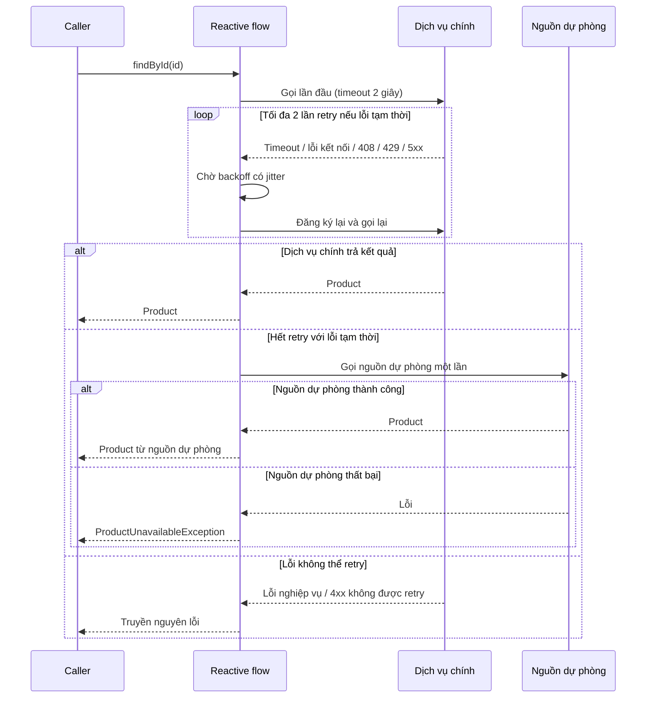

# Khôi phục lời gọi dịch vụ bằng retry có giới hạn và nguồn dự phòng

## Bối cảnh

Một ứng dụng Reactive gọi dịch vụ danh mục sản phẩm để lấy thông tin theo mã sản phẩm. Dịch vụ chính đôi khi phản hồi chậm, mất kết nối hoặc trả lỗi tạm thời khi đang triển khai. Hệ thống có một nguồn dự phòng (replica) chứa dữ liệu đủ mới để tiếp tục phục vụ một số yêu cầu đọc.

Hãy xây dựng luồng gọi dịch vụ có khả năng tự phục hồi: thử lại một số lỗi tạm thời với thời gian chờ tăng dần, sau đó chuyển sang nguồn dự phòng nếu các lần thử lại vẫn thất bại. Luồng phải có giới hạn thời gian và số lần gọi rõ ràng để sự cố ở dịch vụ chính không tạo ra một chuỗi yêu cầu vô hạn.

Bài thực hành này áp dụng tư duy Reactive Programming trong hệ sinh thái Java: mỗi lần retry là một lần đăng ký lại vào publisher nguồn; các toán tử `timeout`, `retryWhen` và `onErrorResume` phối hợp để điều khiển vòng đời của một lời gọi bất đồng bộ.

## Mục tiêu

Sau bài thực hành, bạn có thể:

- Phân biệt lỗi tạm thời có thể retry với lỗi nghiệp vụ hoặc lỗi cấu hình cần trả về ngay.
- Giới hạn số lần retry và khoảng chờ giữa các lần gọi bằng exponential backoff.
- Thêm jitter để nhiều client không đồng loạt retry vào cùng một thời điểm.
- Đặt timeout cho từng lần gọi và deadline cho toàn bộ luồng.
- Chuyển sang nguồn dự phòng sau khi chính sách retry của dịch vụ chính kết thúc.
- Giữ lại thông tin lỗi của cả dịch vụ chính và nguồn dự phòng khi cả hai đều thất bại.
- Kiểm thử số lần gọi, thứ tự phục hồi và hành vi khi gặp lỗi không thể retry.

## Yêu cầu của bài toán

Giả sử ứng dụng có hai `WebClient`: `primaryClient` gọi dịch vụ chính và `replicaClient` gọi nguồn dự phòng. Hãy triển khai phương thức `findById(String id)` theo các quy tắc sau:

1. Mỗi lần gọi dịch vụ chính có timeout 2 giây.
2. Khi gặp lỗi tạm thời, thực hiện tối đa 2 lần retry. Như vậy, dịch vụ chính được gọi tối đa 3 lần tính cả lần đầu.
3. Khoảng chờ retry tăng theo exponential backoff, bắt đầu từ 100 ms, có jitter và có giới hạn trên 500 ms.
4. Chỉ retry timeout, lỗi kết nối, HTTP 408, HTTP 429 và lỗi HTTP 5xx. Lỗi xác thực, lỗi phân quyền, lỗi dữ liệu hoặc các lỗi 4xx khác được truyền về ngay.
5. Nếu dịch vụ chính vẫn gặp lỗi tạm thời sau chính sách retry, gọi nguồn dự phòng đúng một lần. Nguồn dự phòng có timeout 2 giây và không có vòng retry riêng.
6. Nếu nguồn dự phòng cũng thất bại, trả về một exception chứa lỗi nguồn dự phòng làm nguyên nhân chính và giữ lỗi cuối cùng của dịch vụ chính dưới dạng suppressed exception.
7. Toàn bộ thao tác có deadline 9 giây. Giá trị này là giới hạn của ví dụ; hệ thống thực tế phải chọn deadline theo SLA và ngân sách thời gian của caller.

Với một subscription, số lần gọi tối đa theo thiết kế là 3 lần đến dịch vụ chính và 1 lần đến nguồn dự phòng. Nếu publisher trả `Mono.empty()`, đó là tín hiệu hoàn tất không có dữ liệu, không phải lỗi; các toán tử retry và fallback theo lỗi sẽ không được kích hoạt.

## Luồng xử lý mong đợi



## Triển khai với Reactor

Đoạn mã dưới đây minh họa một triển khai dùng Spring WebFlux `WebClient` và Reactor `Mono`. Giả sử `Product` là kiểu dữ liệu miền đã có trong ứng dụng và hai client đã được cấu hình endpoint tương ứng.

```java
import java.time.Duration;
import java.util.concurrent.TimeoutException;

import org.springframework.web.reactive.function.client.WebClient;
import org.springframework.web.reactive.function.client.WebClientRequestException;
import org.springframework.web.reactive.function.client.WebClientResponseException;

import reactor.core.publisher.Mono;
import reactor.util.retry.Retry;

public final class ProductService {
    private static final Duration PRIMARY_ATTEMPT_TIMEOUT = Duration.ofSeconds(2);
    private static final Duration REPLICA_ATTEMPT_TIMEOUT = Duration.ofSeconds(2);
    private static final Duration TOTAL_TIMEOUT = Duration.ofSeconds(9);

    private final WebClient primaryClient;
    private final WebClient replicaClient;

    public ProductService(WebClient primaryClient, WebClient replicaClient) {
        this.primaryClient = primaryClient;
        this.replicaClient = replicaClient;
    }

    public Mono<Product> findById(String id) {
        return Mono.defer(() -> primaryClient.get()
                        .uri("/products/{id}", id)
                        .retrieve()
                        .bodyToMono(Product.class))
                // Timeout này áp dụng cho từng lần gọi đến dịch vụ chính.
                .timeout(PRIMARY_ATTEMPT_TIMEOUT)
                .retryWhen(Retry.backoff(2, Duration.ofMillis(100))
                        .maxBackoff(Duration.ofMillis(500))
                        .jitter(0.5)
                        .filter(this::isTransientFailure)
                        // Trả lại lỗi gốc cuối cùng để bước fallback phân loại được lỗi.
                        .onRetryExhaustedThrow((spec, signal) -> signal.failure()))
                // Chỉ chuyển nguồn khi dịch vụ chính kết thúc với lỗi tạm thời.
                .onErrorResume(this::isTransientFailure, primaryError ->
                        Mono.defer(() -> replicaClient.get()
                                        .uri("/products/{id}", id)
                                        .retrieve()
                                        .bodyToMono(Product.class))
                                .timeout(REPLICA_ATTEMPT_TIMEOUT)
                                .onErrorMap(replicaError -> {
                                    ProductUnavailableException combined =
                                            new ProductUnavailableException(
                                                    "Primary and replica failed for product " + id,
                                                    replicaError);
                                    if (primaryError != replicaError) {
                                        combined.addSuppressed(primaryError);
                                    }
                                    return combined;
                                }))
                // Deadline này giới hạn cả retry, thời gian chờ và lần gọi nguồn dự phòng.
                .timeout(TOTAL_TIMEOUT);
    }

    private boolean isTransientFailure(Throwable error) {
        if (error instanceof TimeoutException
                || error instanceof WebClientRequestException) {
            return true;
        }

        if (error instanceof WebClientResponseException response) {
            int status = response.getStatusCode().value();
            return status == 408
                    || status == 429
                    || response.getStatusCode().is5xxServerError();
        }

        return false;
    }
}
```

Exception dùng khi cả hai nguồn đều không thể phục vụ:

```java
public final class ProductUnavailableException extends RuntimeException {
    public ProductUnavailableException(String message, Throwable cause) {
        super(message, cause);
    }
}
```

Trong ví dụ, `replicaError` là cause của `ProductUnavailableException`; `primaryError` được đính kèm bằng `addSuppressed`. Nhờ đó, log và hệ thống quan sát có thể giữ lại cả hai nguyên nhân khi cần điều tra sự cố.

## Vì sao thứ tự toán tử quan trọng?

### `timeout` trước `retryWhen`

`timeout(PRIMARY_ATTEMPT_TIMEOUT)` nằm trước `retryWhen`, nên mỗi subscription đến dịch vụ chính có giới hạn 2 giây. Nếu đặt timeout này sau `retryWhen`, timeout sẽ giới hạn toàn bộ publisher retry; khi hết thời gian, lỗi timeout được phát ra ở phía downstream và không quay ngược vào chính sách retry ở upstream.

Deadline tổng thể được đặt sau fallback. Nó bao gồm thời gian gọi dịch vụ chính, các khoảng chờ backoff và lần gọi nguồn dự phòng. Hai loại timeout giải quyết hai phạm vi khác nhau và không thay thế cho nhau.

### `retryWhen` trước `onErrorResume`

`retryWhen` xử lý lỗi từ dịch vụ chính trước. Chỉ khi chính sách retry kết thúc mà lỗi vẫn còn, `onErrorResume` mới quyết định có chuyển sang nguồn dự phòng hay không. Nếu lỗi không nằm trong nhóm được phép retry, publisher kết thúc ngay và predicate của `onErrorResume` cũng từ chối fallback.

### `Mono.defer` tạo lời gọi mới khi đăng ký lại

Retry hoạt động bằng cách subscribe lại vào publisher nguồn. `Mono.defer` trì hoãn việc tạo request đến lúc có subscription, giúp mỗi lần retry tạo một request mới. Không đặt một kết quả đã được tính sẵn hoặc một publisher nóng không thể phát lại vào vị trí nguồn retry rồi kỳ vọng nó tự thực hiện lại thao tác I/O.

### Backoff và jitter giảm áp lực lên dịch vụ

Exponential backoff tăng khoảng chờ sau mỗi lần thất bại. Jitter thêm độ lệch ngẫu nhiên để các client không cùng retry theo một nhịp cố định sau một sự cố diện rộng. `maxBackoff` giới hạn khoảng chờ tăng lên theo thời gian. Retry vẫn phải có số lần tối đa; backoff không tự làm cho một vòng retry vô hạn trở nên an toàn.

## Các bước thực hành

1. Tạo `ProductService` với hai `WebClient` trỏ đến dịch vụ chính và replica. Dùng một endpoint đọc sản phẩm theo mã để tập trung vào hành vi phục hồi.
2. Viết hàm phân loại lỗi tạm thời. Bắt đầu với timeout, lỗi request, HTTP 408, HTTP 429 và HTTP 5xx. Xác nhận HTTP 400, 401, 403 và 404 không bị retry theo chính sách của bài.
3. Thêm `Retry.backoff` với tối đa 2 lần retry, backoff khởi đầu 100 ms, jitter 0.5 và giới hạn 500 ms.
4. Đặt timeout 2 giây trước `retryWhen`. Theo dõi số lần request để xác nhận một lỗi tạm thời có thể tạo tối đa 3 lần gọi đến dịch vụ chính.
5. Thêm `onErrorResume` sau retry để gọi replica đúng một lần khi lỗi cuối cùng vẫn thuộc nhóm tạm thời.
6. Khi replica lỗi, tạo `ProductUnavailableException`, giữ lỗi replica làm cause và lỗi chính làm suppressed exception.
7. Đặt deadline tổng thể ở cuối luồng. Kiểm tra rằng deadline có thể kết thúc cả quá trình nếu tổng thời gian vượt ngân sách.
8. Viết kiểm thử cho các trường hợp trong bảng bên dưới. Dùng `StepVerifier` để xác minh tín hiệu phát ra và `AtomicInteger` hoặc mock verify để đếm số lần gọi.

## Ma trận kiểm thử

| Tình huống | Hành vi mong đợi | Điều cần xác minh |
|---|---|---|
| Dịch vụ chính thành công ngay | Trả sản phẩm từ dịch vụ chính | Primary gọi 1 lần, replica không được gọi |
| Hai lần đầu timeout, lần thứ ba thành công | Trả sản phẩm từ dịch vụ chính | Primary gọi 3 lần, replica không được gọi |
| Primary trả HTTP 503 trong mọi lần gọi | Sau khi hết retry, đọc từ replica | Primary gọi tối đa 3 lần, replica gọi 1 lần |
| Primary trả HTTP 429 | Áp dụng retry rồi fallback nếu vẫn thất bại | Không vượt quá giới hạn retry |
| Primary trả HTTP 400 hoặc 401 | Truyền lỗi về caller | Primary gọi 1 lần, replica không được gọi |
| Primary timeout, replica thành công | Trả sản phẩm từ replica | Replica chỉ gọi 1 lần |
| Primary và replica đều thất bại | Trả `ProductUnavailableException` | Cause là lỗi replica; suppressed có lỗi primary |
| Tổng thời gian vượt deadline | Kết thúc bằng timeout tổng thể | Không tiếp tục chờ các lần gọi sau deadline |
| Primary trả `Mono.empty()` | Hoàn tất rỗng theo hợp đồng hiện tại | Không retry và không gọi replica |

Với kiểm thử backoff, ưu tiên `StepVerifier.withVirtualTime` để điều khiển thời gian và tránh làm bộ kiểm thử phải chờ thật. Tạo publisher và chính sách retry bên trong supplier của `withVirtualTime` để scheduler ảo được áp dụng ngay từ đầu. Với kiểm thử tích hợp `WebClient`, có thể dùng HTTP server giả lập để chủ động trả chuỗi trạng thái như 503, 503, 200 hoặc giữ request quá thời gian timeout.

## Tiêu chí hoàn thành

- [ ] Số lần retry không vượt quá 2; số lần gọi primary tối đa là 3 cho một subscription.
- [ ] Chỉ các lỗi đã được phân loại là tạm thời mới kích hoạt retry.
- [ ] Khoảng chờ tăng dần, có jitter và bị giới hạn bởi `maxBackoff`.
- [ ] Timeout từng lần gọi và deadline tổng thể được đặt đúng vị trí.
- [ ] Fallback chỉ chạy sau khi retry của primary kết thúc và chỉ chạy một lần.
- [ ] Lỗi không được retry được truyền về mà không gọi replica.
- [ ] Khi cả hai nguồn thất bại, exception giữ được cả hai nguyên nhân.
- [ ] Các kiểm thử xác minh cả kết quả lẫn số lần gọi đến từng nguồn.

## Câu hỏi mở rộng

1. Nếu endpoint thực hiện thao tác ghi dữ liệu thay vì đọc, điều kiện nào phải được đáp ứng trước khi cho phép retry? Hãy xem xét idempotency key và khả năng server đã xử lý request dù client chỉ nhận timeout.
2. Nếu nhiều tầng trong hệ thống đều tự retry, tổng số request đến dịch vụ downstream có thể tăng như thế nào? Hãy đề xuất một nơi sở hữu chính sách retry và một ngân sách retry dùng chung.
3. Nếu replica có dữ liệu cũ hơn primary, API cần thể hiện độ mới của dữ liệu hoặc giới hạn chấp nhận dữ liệu cũ ra sao?
4. Khi dịch vụ chính đang lỗi diện rộng, circuit breaker hoặc bulkhead có thể phối hợp với retry và fallback như thế nào để bảo vệ tài nguyên?

Trong môi trường thực tế, hãy ghi nhận số lần retry, độ trễ từng attempt, tỷ lệ fallback và tỷ lệ thất bại của replica bằng metric. Tránh ghi token, thông tin xác thực hoặc dữ liệu nhạy cảm vào log. Chỉ retry thao tác có ngữ nghĩa an toàn; với thao tác ghi, cần thiết kế tính idempotent trước khi bật retry.
