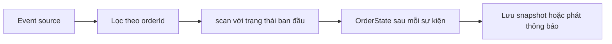

# Theo dõi trạng thái đơn hàng bằng sự kiện và `scan`

## Mục tiêu

Trong bài thực hành này, bạn sẽ xây dựng một pipeline nhận các sự kiện cập nhật đơn hàng và tạo ra trạng thái mới sau mỗi sự kiện hợp lệ. Bạn sẽ dùng `Flux` để biểu diễn luồng sự kiện, `scan` để tích lũy trạng thái, các toán tử lọc và kiểm soát luồng để xử lý dữ liệu, cùng `StepVerifier` để kiểm thử hành vi bất đồng bộ.

Sau khi hoàn thành, bạn có thể:

- Mô hình hóa sự kiện và trạng thái đơn hàng theo hướng bất biến.
- Xác định quy tắc chuyển trạng thái và từ chối sự kiện không hợp lệ.
- Dùng `scan(initialState, accumulator)` để phát ra toàn bộ lịch sử trạng thái.
- Xử lý sự kiện trùng lặp, sai thứ tự và sự kiện thuộc đơn hàng khác.
- Kiểm soát nhu cầu dữ liệu, chọn scheduler phù hợp và kiểm thử bằng `StepVerifier`.

## Bối cảnh bài toán

Một hệ thống bán hàng nhận sự kiện từ nhiều thành phần: thanh toán, kho hàng và đơn vị vận chuyển. Mỗi sự kiện mô tả một thay đổi của đơn hàng, chẳng hạn `PAID`, `PACKING` hoặc `SHIPPED`. Dịch vụ theo dõi cần dựng lại trạng thái hiện tại từ chuỗi sự kiện và phát ra cập nhật để giao diện hoặc dịch vụ thông báo sử dụng.

Luồng đầu vào có thể chứa sự kiện của nhiều đơn hàng, sự kiện gửi lại do retry, hoặc sự kiện đến sai thứ tự. Vì vậy, reducer phải kiểm tra mã đơn hàng, mã sự kiện, thời điểm và quy tắc chuyển trạng thái. Bài thực hành dùng một nguồn `Flux` hữu hạn để kết quả dễ tái hiện; trong ứng dụng thực tế, nguồn này có thể đến từ Kafka, RabbitMQ hoặc một adapter Reactive Streams khác.

## 1. Xác định hợp đồng trạng thái

Một đơn hàng bắt đầu ở trạng thái `CREATED`. Các chuyển trạng thái hợp lệ được quy định như sau:

| Trạng thái hiện tại | Trạng thái tiếp theo hợp lệ |
|---|---|
| `CREATED` | `PAID`, `CANCELLED` |
| `PAID` | `PACKING`, `CANCELLED` |
| `PACKING` | `SHIPPED`, `CANCELLED` |
| `SHIPPED` | `DELIVERED` |
| `DELIVERED` | Không có; trạng thái kết thúc |
| `CANCELLED` | Không có; trạng thái kết thúc |

Mỗi `OrderEvent` mang bốn thông tin: `orderId`, `eventId`, `nextStatus` và `occurredAt`. `eventId` định danh duy nhất một sự kiện trong phạm vi đơn hàng. Khi cùng một `eventId` được gửi lại, pipeline phải bỏ qua sự kiện đó để tránh cập nhật trạng thái hai lần.

Sự kiện mới cũng phải có `occurredAt` không sớm hơn thời điểm cập nhật gần nhất. Quy tắc này giúp phát hiện dữ liệu đến sai thứ tự theo thời gian nghiệp vụ. Trong hệ thống phân tán thực tế, cần thống nhất nguồn thời gian và chính sách xử lý sự kiện đến muộn; bài tập này chọn cách từ chối sự kiện cũ để giữ reducer đơn giản, dễ kiểm chứng.



## 2. Tạo mô hình dữ liệu và reducer

Sử dụng Java 17 trở lên và Reactor Core. Đặt các kiểu dữ liệu dưới đây trong file `OrderTracking.java`. Các `record` giúp trạng thái dễ so sánh và hạn chế việc sửa dữ liệu sau khi phát ra downstream.

```java
import java.time.Instant;
import java.util.ArrayList;
import java.util.HashSet;
import java.util.List;
import java.util.Map;
import java.util.Objects;
import java.util.Set;

import reactor.core.publisher.Flux;

public class OrderTracking {
    enum OrderStatus {
        CREATED, PAID, PACKING, SHIPPED, DELIVERED, CANCELLED;

        boolean isTerminal() {
            return this == DELIVERED || this == CANCELLED;
        }
    }

    record OrderEvent(
            String orderId,
            String eventId,
            OrderStatus nextStatus,
            Instant occurredAt) {

        OrderEvent {
            Objects.requireNonNull(orderId, "orderId");
            Objects.requireNonNull(eventId, "eventId");
            Objects.requireNonNull(nextStatus, "nextStatus");
            Objects.requireNonNull(occurredAt, "occurredAt");
            if (orderId.isBlank() || eventId.isBlank()) {
                throw new IllegalArgumentException("orderId và eventId không được rỗng");
            }
        }
    }

    record OrderState(
            String orderId,
            OrderStatus status,
            Instant updatedAt,
            List<OrderStatus> history,
            Set<String> processedEventIds) {

        OrderState {
            Objects.requireNonNull(orderId, "orderId");
            Objects.requireNonNull(status, "status");
            Objects.requireNonNull(updatedAt, "updatedAt");
            history = List.copyOf(history);
            processedEventIds = Set.copyOf(processedEventIds);
        }

        static OrderState created(String orderId, Instant createdAt) {
            return new OrderState(
                    orderId,
                    OrderStatus.CREATED,
                    createdAt,
                    List.of(OrderStatus.CREATED),
                    Set.of());
        }
    }

    private static final Map<OrderStatus, Set<OrderStatus>> ALLOWED_TRANSITIONS = Map.of(
            OrderStatus.CREATED, Set.of(OrderStatus.PAID, OrderStatus.CANCELLED),
            OrderStatus.PAID, Set.of(OrderStatus.PACKING, OrderStatus.CANCELLED),
            OrderStatus.PACKING, Set.of(OrderStatus.SHIPPED, OrderStatus.CANCELLED),
            OrderStatus.SHIPPED, Set.of(OrderStatus.DELIVERED));

    static OrderState apply(OrderState current, OrderEvent event) {
        if (!current.orderId().equals(event.orderId())) {
            throw new IllegalArgumentException("Sự kiện không thuộc đơn hàng đang xử lý");
        }

        // Một sự kiện đã xử lý có thể được broker gửi lại sau retry.
        if (current.processedEventIds().contains(event.eventId())) {
            return current;
        }

        if (current.status().isTerminal()) {
            throw new IllegalStateException("Đơn hàng đã ở trạng thái kết thúc: " + current.status());
        }
        if (event.occurredAt().isBefore(current.updatedAt())) {
            throw new IllegalStateException("Sự kiện đến muộn hơn trạng thái hiện tại");
        }

        Set<OrderStatus> allowed = ALLOWED_TRANSITIONS.getOrDefault(current.status(), Set.of());
        if (!allowed.contains(event.nextStatus())) {
            throw new IllegalStateException(
                    "Không thể chuyển từ " + current.status() + " sang " + event.nextStatus());
        }

        List<OrderStatus> nextHistory = new ArrayList<>(current.history());
        nextHistory.add(event.nextStatus());

        Set<String> nextProcessedIds = new HashSet<>(current.processedEventIds());
        nextProcessedIds.add(event.eventId());

        return new OrderState(
                current.orderId(),
                event.nextStatus(),
                event.occurredAt(),
                nextHistory,
                nextProcessedIds);
    }

    static Flux<OrderState> track(
            String orderId,
            Instant createdAt,
            Flux<OrderEvent> incomingEvents) {

        OrderState initial = OrderState.created(orderId, createdAt);

        return incomingEvents
                .filter(event -> event.orderId().equals(orderId))
                .scan(initial, OrderTracking::apply)
                .distinctUntilChanged();
    }

    public static void main(String[] args) {
        Instant createdAt = Instant.parse("2026-11-22T09:00:00Z");

        Flux<OrderEvent> incomingEvents = Flux.just(
                new OrderEvent("ORD-2048", "evt-001", OrderStatus.PAID,
                        createdAt.plusSeconds(30)),
                new OrderEvent("ORD-2048", "evt-002", OrderStatus.PACKING,
                        createdAt.plusSeconds(90)),
                new OrderEvent("ORD-9999", "evt-003", OrderStatus.PAID,
                        createdAt.plusSeconds(100)),
                new OrderEvent("ORD-2048", "evt-004", OrderStatus.SHIPPED,
                        createdAt.plusSeconds(180)),
                new OrderEvent("ORD-2048", "evt-005", OrderStatus.DELIVERED,
                        createdAt.plusSeconds(600)));

        track("ORD-2048", createdAt, incomingEvents)
                .subscribe(
                        state -> System.out.printf(
                                "%s | %s | %s%n",
                                state.orderId(), state.status(), state.history()),
                        error -> System.err.println(
                                "Không thể cập nhật đơn hàng: " + error.getMessage()));
    }
}
```

Reducer `apply` là hàm đồng bộ, chỉ dựa vào trạng thái hiện tại và sự kiện đầu vào. Nó tạo một `OrderState` mới thay vì sửa danh sách hoặc tập hợp bên trong trạng thái cũ. Điều này rất quan trọng với `scan`: cùng một trạng thái đã phát ra có thể được nhiều subscriber quan sát, nên thay đổi nó về sau sẽ khiến kết quả khó dự đoán.

## 3. Đọc pipeline và kết quả

Pipeline trong `track` có ba bước:

1. `filter` giữ lại sự kiện có `orderId` đúng với đơn hàng cần theo dõi. Phải lọc trước `scan`, nếu không sự kiện của đơn hàng khác sẽ đi vào reducer.
2. `scan(initial, OrderTracking::apply)` phát trạng thái ban đầu trước, sau đó phát một trạng thái mới sau mỗi sự kiện được xử lý. Khác với `reduce`, `scan` không đợi nguồn hoàn tất mới phát kết quả tích lũy.
3. `distinctUntilChanged` bỏ lần phát liên tiếp có trạng thái bằng trạng thái ngay trước đó. Vì reducer trả lại cùng trạng thái khi nhận `eventId` trùng lặp, sự kiện gửi lại không tạo cập nhật giả.

Với dữ liệu mẫu, kết quả có dạng:

```text
ORD-2048 | CREATED | [CREATED]
ORD-2048 | PAID | [CREATED, PAID]
ORD-2048 | PACKING | [CREATED, PAID, PACKING]
ORD-2048 | SHIPPED | [CREATED, PAID, PACKING, SHIPPED]
ORD-2048 | DELIVERED | [CREATED, PAID, PACKING, SHIPPED, DELIVERED]
```

Sự kiện của `ORD-9999` bị loại ở bước `filter`. Trạng thái `CREATED` xuất hiện vì overload `scan(initial, accumulator)` phát cả giá trị khởi tạo. Nếu màn hình chỉ muốn hiển thị thay đổi sau khi có sự kiện, có thể thêm `.skip(1)` sau `scan`; hãy giữ trạng thái ban đầu nếu downstream cần biết đơn hàng tồn tại trước khi có cập nhật.

`Flux` là lazy: pipeline chỉ bắt đầu khi có subscriber. Trong ví dụ chạy độc lập, `main` gọi `subscribe` để quan sát kết quả. Trong service WebFlux hoặc một service reactive khác, nên trả `Flux<OrderState>` cho framework hoặc caller quản lý subscription; tránh tự `subscribe` bên trong phương thức nghiệp vụ vì sẽ tách vòng đời xử lý khỏi caller.

## 4. Bài tập mở rộng: backpressure, scheduler và lưu trạng thái

Thực hiện các thay đổi sau trên pipeline:

**A. Kiểm soát nhu cầu dữ liệu.** Thêm `.limitRate(32)` trước `scan` để điều chỉnh cách pipeline yêu cầu dữ liệu từ upstream theo từng đợt. Quan sát rằng backpressure là tín hiệu nhu cầu từ subscriber truyền ngược về publisher; nó không làm cho một nguồn không hỗ trợ backpressure tự động trở nên an toàn. Tránh thêm `onBackpressureBuffer()` không giới hạn vì hàng đợi có thể tăng liên tục khi tốc độ đầu vào vượt tốc độ xử lý.

**B. Chuyển tác vụ downstream sang scheduler.** Thêm `.publishOn(Schedulers.parallel())` sau `scan` khi phần xử lý tiếp theo là công việc CPU-bound. `publishOn` chuyển các toán tử phía sau nó sang scheduler đã chọn và vẫn giữ thứ tự tín hiệu trên một subscription. Nó không tự chia một chuỗi sự kiện thành nhiều tác vụ chạy song song. Với I/O blocking từ thư viện cũ, bọc lời gọi bằng `Mono.fromRunnable(...)` hoặc `Mono.fromCallable(...)` và dùng `subscribeOn(Schedulers.boundedElastic())`; không chạy thao tác blocking trên `parallel`.

**C. Lưu từng snapshot.** Giả sử repository reactive có phương thức `Mono<Void> save(OrderState state)`. Nối các trạng thái bằng `concatMap`:

```java
Flux<Void> saves = track(orderId, createdAt, incomingEvents)
        .skip(1)
        .concatMap(repository::save);
```

`concatMap` đợi thao tác lưu hiện tại hoàn tất rồi mới chuyển sang trạng thái tiếp theo. Cách này giữ thứ tự ghi cho một đơn hàng và chỉ có một thao tác lưu đang hoạt động trên subscription đó. Nếu thay bằng `flatMap` có concurrency lớn hơn một, các thao tác lưu có thể hoàn tất không theo thứ tự phát ra. Với repository blocking, chuyển riêng lời gọi blocking sang `boundedElastic`.

**D. Xử lý lỗi ở ranh giới phù hợp.** Reducer ném lỗi khi sự kiện vi phạm hợp đồng; lỗi đó kết thúc subscription hiện tại. Dùng `doOnError` để ghi log và `onErrorMap` để chuyển sang ngoại lệ miền nghiệp vụ nếu caller cần một kiểu lỗi ổn định. Chỉ retry lỗi I/O tạm thời ở đoạn lưu hoặc đọc dữ liệu; retry một chuyển trạng thái sai sẽ lặp lại cùng lỗi. Không dùng `onErrorContinue` như cách mặc định để bỏ qua dữ liệu lỗi vì nó có thể che giấu việc mất cập nhật.

## 5. Kiểm thử với `StepVerifier`

Thêm `reactor-test` và JUnit 5 vào scope test của dự án. Nếu dự án dùng Spring Boot dependency management, dùng các phiên bản được BOM của dự án quản lý.

```java
import static org.junit.jupiter.api.Assertions.assertEquals;

import java.time.Instant;

import org.junit.jupiter.api.Test;

import reactor.core.publisher.Flux;
import reactor.test.StepVerifier;

class OrderTrackingTest {
    @Test
    void emitsInitialAndEveryValidOrderState() {
        Instant createdAt = Instant.parse("2026-11-22T09:00:00Z");
        Flux<OrderTracking.OrderEvent> events = Flux.just(
                new OrderTracking.OrderEvent(
                        "ORD-2048", "evt-001", OrderTracking.OrderStatus.PAID,
                        createdAt.plusSeconds(30)),
                new OrderTracking.OrderEvent(
                        "ORD-2048", "evt-002", OrderTracking.OrderStatus.PACKING,
                        createdAt.plusSeconds(90)));

        StepVerifier.create(OrderTracking.track("ORD-2048", createdAt, events))
                .assertNext(state -> assertEquals(
                        OrderTracking.OrderStatus.CREATED, state.status()))
                .assertNext(state -> assertEquals(
                        OrderTracking.OrderStatus.PAID, state.status()))
                .assertNext(state -> {
                    assertEquals(OrderTracking.OrderStatus.PACKING, state.status());
                    assertEquals(3, state.history().size());
                })
                .verifyComplete();
    }

    @Test
    void rejectsAnIllegalTransition() {
        Instant createdAt = Instant.parse("2026-11-22T09:00:00Z");
        Flux<OrderTracking.OrderEvent> events = Flux.just(
                new OrderTracking.OrderEvent(
                        "ORD-2048", "evt-001", OrderTracking.OrderStatus.SHIPPED,
                        createdAt.plusSeconds(30)));

        StepVerifier.create(OrderTracking.track("ORD-2048", createdAt, events))
                .expectNextMatches(state ->
                        state.status() == OrderTracking.OrderStatus.CREATED)
                .expectError(IllegalStateException.class)
                .verify();
    }
}
```

Hai kiểm thử trên xác nhận trạng thái ban đầu được phát ra, mỗi sự kiện hợp lệ tạo ra snapshot mới, và một chuyển trạng thái sai làm luồng phát lỗi. Hãy bổ sung kiểm thử cho các trường hợp sau:

- Một `eventId` được gửi hai lần: chỉ có một lần cập nhật trạng thái được phát ra.
- Sự kiện có `orderId` khác: không làm thay đổi lịch sử của đơn hàng đang theo dõi.
- `occurredAt` cũ hơn `updatedAt`: luồng phát `IllegalStateException`.
- Đơn hàng đã `DELIVERED` hoặc `CANCELLED`: mọi chuyển trạng thái tiếp theo đều bị từ chối.
- Subscriber yêu cầu từng phần tử bằng `StepVerifier.create(publisher, 0)` và `thenRequest(1)`: xác nhận publisher chỉ phát theo nhu cầu đã yêu cầu.

## 6. Thử thách: theo dõi nhiều đơn hàng

Mở rộng nguồn sự kiện để chứa nhiều `orderId` đồng thời. Dùng `groupBy(OrderEvent::orderId)` để tạo một nhóm cho mỗi đơn hàng, sau đó áp dụng `scan` riêng trong từng nhóm với trạng thái ban đầu tương ứng. Mỗi nhóm phải có reducer và lịch sử riêng; không dùng chung một `OrderState` cho nhiều đơn hàng.

Khi nối các nhóm bằng `flatMap`, trạng thái của nhiều đơn hàng có thể xen kẽ trong luồng kết quả. Điều đó phù hợp nếu downstream xử lý độc lập theo `orderId`. Nếu cần giữ thứ tự giữa các đơn hàng theo một quy tắc nghiệp vụ toàn cục, hãy xác định rõ khóa và cơ chế sắp thứ tự trước khi chọn toán tử kết hợp. Với nguồn có số lượng khóa lớn, cũng cần giới hạn và giám sát số nhóm đang hoạt động vì `groupBy` giữ các group cho đến khi chúng được tiêu thụ hoặc kết thúc.

## Tiêu chí hoàn thành

- [ ] Reducer tạo `OrderState` bất biến và chỉ chấp nhận các chuyển trạng thái trong bảng quy tắc.
- [ ] Pipeline lọc theo `orderId` trước khi gọi `scan`.
- [ ] Subscriber nhận trạng thái ban đầu và từng trạng thái hợp lệ tiếp theo.
- [ ] Sự kiện trùng `eventId` không tạo cập nhật lặp; sự kiện sai thứ tự hoặc chuyển trạng thái sai phát lỗi có thể kiểm thử.
- [ ] Các kiểm thử `StepVerifier` chạy ổn định mà không cần `Thread.sleep`.
- [ ] Việc lưu snapshot giữ thứ tự bằng `concatMap`, và scheduler được chọn theo loại công việc.
- [ ] Giải thích được vì sao `scan` phù hợp để phát trạng thái liên tục, trong khi `reduce` chỉ phát kết quả tích lũy khi nguồn hoàn tất.

## Lỗi thường gặp cần tránh

- Dùng `map` thay cho `scan`: mỗi sự kiện được xử lý độc lập, không có trạng thái tích lũy.
- Đặt `filter` sau `scan`: sự kiện của đơn hàng khác có thể đi vào reducer.
- Sửa trực tiếp `history` hoặc `processedEventIds` của trạng thái cũ: các subscriber có thể quan sát dữ liệu bị thay đổi ngoài dự kiến.
- Quên rằng `scan(initial, accumulator)` phát cả trạng thái ban đầu.
- Dùng `last()` hoặc `collectList()` cho một luồng sự kiện không bao giờ kết thúc: kết quả chỉ có khi nguồn hoàn tất, còn `collectList()` giữ toàn bộ phần tử trong bộ nhớ.
- Gọi `subscribe()` bên trong service nghiệp vụ: caller không còn kiểm soát được subscription, lỗi và vòng đời xử lý.
- Chuyển mọi thao tác sang `Schedulers.parallel()` hoặc bọc mọi lỗi bằng `onErrorResume`: cả hai cách đều có thể che mất đặc tính thực của công việc và lỗi miền nghiệp vụ.

Khi hoàn tất, bạn có một pipeline có thể dựng trạng thái đơn hàng từ sự kiện, kiểm tra hợp đồng chuyển trạng thái và phát snapshot theo nhu cầu của subscriber. Đây là nền tảng để kết nối nguồn sự kiện thực, lưu trạng thái và phát thông báo trong một hệ thống reactive.
