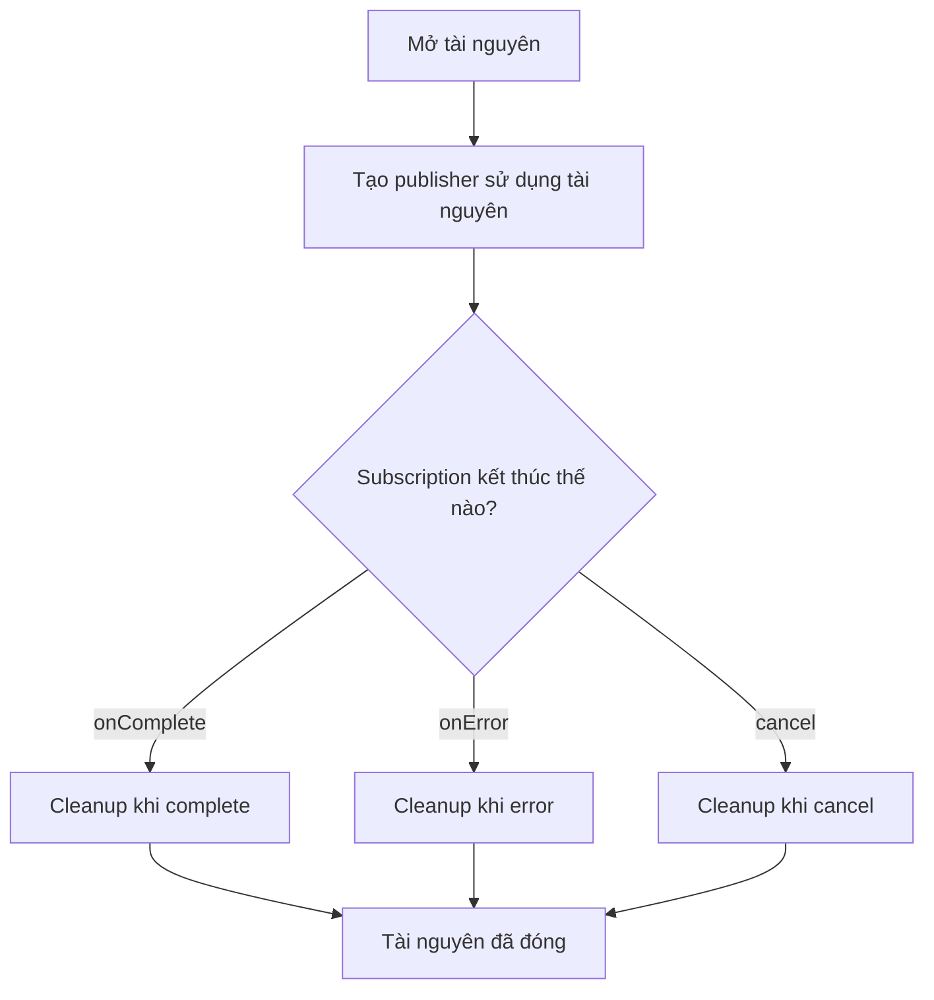

# Thiết kế hủy tác vụ và xác minh tài nguyên được giải phóng

Trong chương **Bài thực hành**, bài này xây dựng một pipeline có tài nguyên cần đóng và chủ động hủy subscription ở nhiều thời điểm khác nhau. Mục tiêu là xác minh rằng tài nguyên được giải phóng khi luồng hoàn tất bình thường, phát lỗi hoặc bị hủy bởi subscriber. Ta sẽ thực hành với `Disposable`, `doOnCancel`, `doFinally`, `usingWhen` và `StepVerifier`.

Bài thực hành thuộc module **REACTIVE_PROGRAMMING**. Module hướng dẫn: “Học tư duy reactive qua các luồng sự kiện bất đồng bộ, hợp đồng Publisher–Subscriber và cơ chế backpressure của Reactive Streams. Thực hành Mono, Flux, kết hợp toán tử, kiểm soát scheduler, xử lý lỗi và kiểm thử pipeline trong hệ sinh thái Java.” Nội dung tập trung vào vòng đời subscription và cleanup của tài nguyên trong pipeline Reactor, gồm cursor, kết nối, file, response body và tác vụ bất đồng bộ.

## 1. Mô hình tài nguyên và ba cách kết thúc

Giả sử một dịch vụ đọc các dòng dữ liệu từ cursor. Cursor phải được đóng dù subscriber đọc hết dữ liệu, gặp lỗi hay ngừng nhận giữa chừng.

Ba đường kết thúc cần kiểm tra:

- **Complete:** nguồn phát hết dữ liệu và gửi `onComplete`; cleanup bình thường được thực hiện.
- **Error:** nguồn phát `onError`; cleanup theo nhánh lỗi được thực hiện.
- **Cancel:** subscriber không cần dữ liệu nữa và hủy subscription; cleanup theo nhánh cancellation phải được thực hiện.



Cancellation không phải là một tín hiệu terminal gửi xuống subscriber. Sau khi subscriber gọi `cancel()`, nó không nhận `onComplete` hoặc `onError` để xác nhận việc hủy. Vì vậy, cần một cơ chế cleanup gắn trực tiếp với vòng đời publisher thay vì trông chờ callback terminal ở phía subscriber.

## 2. Tạo tài nguyên có thể quan sát trong bài thực hành

Để kiểm tra cleanup, ta tạo một tài nguyên đơn giản có bộ đếm số lần đóng. Trong ứng dụng thực tế, tài nguyên có thể là cursor, file handle, session hoặc đối tượng quản lý buffer.

```java
import java.util.concurrent.atomic.AtomicInteger;

final class DemoResource {

    private final AtomicInteger closeCount;

    DemoResource(AtomicInteger closeCount) {
        this.closeCount = closeCount;
    }

    String read() {
        return "data";
    }

    void close() {
        closeCount.incrementAndGet();
    }
}
```

Bộ đếm giúp test xác nhận cleanup đã xảy ra đúng số lần. Nếu cùng một tài nguyên bị đóng hai lần do nhiều callback cùng chạy, giá trị sẽ lớn hơn một. Nếu tài nguyên không được đóng, giá trị vẫn bằng không.

Trong production, thao tác đóng cần phù hợp hợp đồng của tài nguyên. Một số API có `close()` đồng bộ; một số API cần trả về publisher để giải phóng bất đồng bộ, ví dụ trả connection về pool hoặc đóng session qua client reactive. Với trường hợp bất đồng bộ, `usingWhen` là lựa chọn phù hợp hơn.

## 3. Quan sát cancellation bằng doOnCancel và doFinally

`doOnCancel` thực hiện một callback khi subscription upstream nhận yêu cầu hủy. `doFinally` quan sát tín hiệu kết thúc cuối cùng và nhận `SignalType` tương ứng, gồm `ON_COMPLETE`, `ON_ERROR` hoặc `CANCEL`.

```java
AtomicInteger cancelCount = new AtomicInteger();

Flux<Long> ticks =
    Flux.interval(Duration.ofMillis(100))
        .doOnCancel(cancelCount::incrementAndGet)
        .doFinally(signal ->
            log.info("Pipeline kết thúc với {}", signal)
        );
```

Có thể subscribe và hủy sau một khoảng thời gian:

```java
Disposable subscription =
    ticks.subscribe(value -> log.info("tick={}", value));

subscription.dispose();
```

Gọi `dispose()` trên `Disposable` trả về từ `subscribe()` yêu cầu hủy subscription. Nếu nguồn hỗ trợ cancellation, nó dừng phát và thực hiện cleanup của chính nguồn. `doOnCancel` được gọi khi cancellation đi qua vị trí của toán tử; `doFinally` nhận `SignalType.CANCEL`.

Hai callback này hữu ích cho quan sát, metric hoặc side effect nhỏ, đồng bộ. Không dùng chúng để chờ một thao tác cleanup bất đồng bộ. Callback của `doFinally` không nhận publisher cleanup để Reactor chờ hoàn tất; nếu cần giải phóng tài nguyên bất đồng bộ, hãy dùng `usingWhen`.

Cũng không nên thực hiện công việc blocking lâu trong `doOnCancel` hoặc `doFinally`. Cancellation cần được truyền nhanh qua pipeline. Nếu cleanup có thể chờ I/O, hãy biểu diễn nó bằng publisher cleanup.

## 4. Hủy nguồn sau khi nhận đủ dữ liệu

Một toán tử như `take(n)` tự hủy upstream sau khi nhận đủ số phần tử được yêu cầu. Đây là cách đơn giản để mô phỏng client không cần toàn bộ luồng.

```java
AtomicInteger closeCount = new AtomicInteger();

Flux<Integer> source =
    Flux.using(
        () -> new DemoResource(closeCount),
        resource -> Flux.range(1, 10)
            .map(value -> value),
        DemoResource::close
    );

Flux<Integer> firstThree = source.take(3);
```

`Flux.using` quản lý một tài nguyên đồng bộ: tạo tài nguyên khi subscribe và gọi disposer khi sequence kết thúc hoặc bị hủy. Sau khi `take(3)` nhận ba phần tử, nó hoàn tất downstream và hủy subscription upstream. Disposer của `using` được gọi để đóng tài nguyên.

Dùng `StepVerifier` để xác nhận:

```java
StepVerifier.create(firstThree)
    .expectNext(1, 2, 3)
    .verifyComplete();

assertEquals(1, closeCount.get());
```

Đoạn test giả định `DemoResource::close` là thao tác đồng bộ và nguồn được tạo riêng cho subscription này. `verifyComplete()` xác nhận downstream hoàn tất sau ba phần tử; bộ đếm xác nhận tài nguyên đã được đóng.

`using` phù hợp với cleanup đồng bộ. Nếu việc mở hoặc đóng tài nguyên là bất đồng bộ, hãy dùng `usingWhen`.

## 5. Dùng usingWhen để cleanup theo complete, error và cancel

`usingWhen` nhận một publisher tạo tài nguyên, một hàm sử dụng tài nguyên và các hàm cleanup riêng cho ba đường kết thúc. Cleanup được biểu diễn bằng publisher nên Reactor có thể quản lý vòng đời của thao tác giải phóng.

Ví dụ dưới đây mô phỏng cursor bất đồng bộ:

```java
interface RowCursor {
    Flux<String> rows();
    Mono<Void> closeAsync();
}

interface CursorFactory {
    Mono<RowCursor> open();
}
```

Pipeline đọc cursor:

```java
Flux<String> readRows(CursorFactory factory) {
    return Flux.usingWhen(
        factory.open(),
        RowCursor::rows,
        RowCursor::closeAsync,
        (cursor, error) -> cursor.closeAsync(),
        RowCursor::closeAsync
    );
}
```

Các tham số tương ứng:

1. `factory.open()`: publisher mở và phát tài nguyên.
2. `RowCursor::rows`: publisher sử dụng tài nguyên để phát dữ liệu.
3. `RowCursor::closeAsync`: cleanup khi nguồn hoàn tất bình thường.
4. `(cursor, error) -> cursor.closeAsync()`: cleanup khi nguồn phát lỗi.
5. `RowCursor::closeAsync`: cleanup khi downstream hủy.

Trong ví dụ đơn giản, cả ba nhánh gọi cùng một phương thức đóng. Ứng dụng thực tế có thể cần cleanup khác nhau, ví dụ rollback khi lỗi, trả message về queue khi cancellation hoặc commit cursor position khi hoàn tất. Các hàm cleanup cần idempotent nếu API tài nguyên có thể được gọi đóng từ nhiều đường bảo vệ khác nhau.

Không đặt `closeAsync().subscribe()` bên trong các callback. Hãy trả publisher cleanup trực tiếp để `usingWhen` quản lý subscription và lỗi của thao tác giải phóng.

## 6. Kiểm thử cleanup khi hoàn tất bình thường

Ta dùng bộ đếm để xác nhận nhánh cleanup complete được gọi:

```java
@Test
void closesResourceAfterComplete() {
    AtomicInteger closeCount = new AtomicInteger();

    Mono<String> result = Mono.usingWhen(
        Mono.fromSupplier(() -> new DemoResource(closeCount)),
        resource -> Mono.just(resource.read()),
        resource -> Mono.fromRunnable(resource::close),
        (resource, error) -> Mono.fromRunnable(resource::close),
        resource -> Mono.fromRunnable(resource::close)
    );

    StepVerifier.create(result)
        .expectNext("data")
        .verifyComplete();

    assertEquals(1, closeCount.get());
}
```

Publisher phát giá trị rồi hoàn tất. `usingWhen` chạy cleanup bình thường trước khi hoàn tất luồng kết quả; test xác nhận tài nguyên được đóng đúng một lần.

Đây là test cơ bản nhất. Nó không đủ để chứng minh cleanup khi lỗi hoặc cancellation, vì hai trường hợp đó đi qua nhánh cleanup khác.

## 7. Kiểm thử cleanup khi nguồn phát lỗi

Khi publisher sử dụng tài nguyên phát lỗi, hàm cleanup nhận cả tài nguyên và nguyên nhân lỗi. Sau cleanup, lỗi nguồn được truyền xuống subscriber theo semantics của `usingWhen`.

```java
@Test
void closesResourceAfterError() {
    AtomicInteger closeCount = new AtomicInteger();

    Mono<String> result = Mono.usingWhen(
        Mono.fromSupplier(() -> new DemoResource(closeCount)),
        resource -> Mono.<String>error(
            new IllegalStateException("read failed")
        ),
        resource -> Mono.fromRunnable(resource::close),
        (resource, error) -> Mono.fromRunnable(resource::close),
        resource -> Mono.fromRunnable(resource::close)
    );

    StepVerifier.create(result)
        .expectErrorMessage("read failed")
        .verify();

    assertEquals(1, closeCount.get());
}
```

Test xác nhận nhánh cleanup error được chạy và lỗi ban đầu được quan sát ở downstream. Nếu cleanup cũng phát lỗi, hành vi lỗi tổng hợp có thể phụ thuộc semantics của Reactor và loại cleanup; ứng dụng cần log nguyên nhân cleanup để không làm mất thông tin vận hành.

Với transaction, nhánh error thường cần rollback hoặc giải phóng connection. Không thay rollback bằng một thao tác đóng connection tùy tiện nếu transaction manager đang sở hữu tài nguyên đó; hãy để transaction manager thực hiện cleanup theo hợp đồng của nó.

## 8. Kiểm thử cleanup khi subscriber hủy

Cancellation là trường hợp dễ bị bỏ sót vì downstream không nhận terminal signal. Ta tạo một publisher không bao giờ phát kết quả để test chủ động hủy subscription:

```java
@Test
void closesResourceAfterCancel() {
    AtomicInteger closeCount = new AtomicInteger();

    Mono<String> result = Mono.usingWhen(
        Mono.fromSupplier(() -> new DemoResource(closeCount)),
        resource -> Mono.<String>never(),
        resource -> Mono.fromRunnable(resource::close),
        (resource, error) -> Mono.fromRunnable(resource::close),
        resource -> Mono.fromRunnable(resource::close)
    );

    StepVerifier.create(result)
        .thenCancel()
        .verify();

    assertEquals(1, closeCount.get());
}
```

Khi StepVerifier hủy subscription, `usingWhen` gọi nhánh cleanup dành cho cancellation. Cleanup trong ví dụ là `Mono.fromRunnable`, nên thao tác đóng chạy đồng bộ và bộ đếm có thể được kiểm tra ngay sau khi verify.

Nếu cleanup là bất đồng bộ và cần thời gian thực hiện, hãy thiết kế test chờ tín hiệu cleanup hoàn tất bằng một sink hoặc latch có timeout. Không dùng `Thread.sleep` vì nó không chứng minh cleanup đã hoàn tất và làm test phụ thuộc tốc độ máy.

Ví dụ xác nhận cleanup bằng sink:

```java
@Test
void observesAsyncCleanupAfterCancel() {
    AtomicBoolean cleaned = new AtomicBoolean();
    Sinks.One<Void> cleanupFinished = Sinks.one();

    Mono<String> result = Mono.usingWhen(
        Mono.just("resource"),
        resource -> Mono.<String>never(),
        resource -> Mono.empty(),
        (resource, error) -> Mono.empty(),
        resource -> Mono.fromRunnable(() -> {
            cleaned.set(true);
            cleanupFinished.tryEmitEmpty();
        })
    );

    StepVerifier.create(result)
        .thenCancel()
        .verify();

    StepVerifier.create(cleanupFinished.asMono())
        .verifyComplete();

    assertTrue(cleaned.get());
}
```

Sink ở đây chỉ làm tín hiệu đồng bộ cho test. Trong ứng dụng thực, publisher cleanup có thể thực hiện trả connection về pool hoặc đóng tài nguyên từ xa. Test phải có timeout phù hợp để tránh chờ vô hạn nếu cleanup bị treo.

## 9. Hủy bằng Disposable và cancellation từ toán tử

Khi dùng `subscribe()`, Reactor trả về `Disposable`. Gọi `dispose()` là cách yêu cầu hủy subscription ở biên imperative:

```java
AtomicBoolean cancelled = new AtomicBoolean();

Disposable disposable =
    Flux.interval(Duration.ofMillis(50))
        .doOnCancel(() -> cancelled.set(true))
        .subscribe();

disposable.dispose();

assertTrue(cancelled.get());
```

Trong ứng dụng server, thường không tự quản lý `Disposable` cho từng request vì WebFlux quản lý subscription theo vòng đời HTTP. Client ngắt kết nối hoặc hủy body có thể khiến server cancel publisher response. Tuy nhiên, việc cleanup chỉ hoàn tất nếu nguồn và adapter tôn trọng cancellation.

Các toán tử như `take`, `next`, `timeout` hoặc downstream cancellation cũng có thể hủy upstream:

```java
Flux<Integer> firstTwo =
    Flux.range(1, 100)
        .doOnCancel(() -> log.info("Upstream bị hủy"))
        .take(2);
```

Sau hai phần tử, `take(2)` hoàn tất downstream và hủy upstream. Nếu upstream quản lý tài nguyên bằng `using` hoặc `usingWhen`, nhánh cleanup tương ứng được kích hoạt.

## 10. Cancellation không bảo đảm dừng ngay mọi tác vụ blocking

Hủy subscription là tín hiệu hợp đồng để publisher ngừng công việc. Nó không thể bảo đảm một thư viện blocking bên ngoài sẽ dừng ngay lập tức. Ví dụ, một lời gọi JDBC hoặc SDK đồng bộ có thể không hỗ trợ hủy giữa lúc đang chờ socket.

Nếu buộc phải tích hợp blocking:

- Đặt timeout ở client hoặc driver.
- Cô lập lời gọi trên scheduler dành cho blocking.
- Kiểm tra thư viện có hỗ trợ interrupt hoặc cancellation hay không.
- Đóng tài nguyên ở đúng owner và không đóng connection đang được transaction manager sử dụng.
- Đo thời gian từ lúc cancel đến khi tài nguyên thực sự được giải phóng.

Không giả định `Disposable.dispose()` luôn interrupt thread đang chạy. Hành vi phụ thuộc scheduler, publisher và API bên dưới. Một tác vụ đã bắt đầu có thể tiếp tục chạy cho đến khi API trả về hoặc timeout.

## 11. Cleanup cho DataBuffer và tài nguyên có ownership rõ ràng

Một số loại tài nguyên yêu cầu giải phóng tường minh. Ví dụ, `DataBuffer` có thể được backed bởi pooled memory. Nếu ứng dụng giữ hoặc bỏ buffer ngoài các operator quản lý tự động, cần tuân thủ ownership và release theo API Spring.

Khi một operator có thể discard phần tử, có thể gắn cleanup phù hợp:

```java
Flux<DataBuffer> buffers =
    source
        .filter(this::isAccepted)
        .doOnDiscard(
            DataBuffer.class,
            DataBufferUtils::release
        );
```

Ví dụ này minh họa việc giải phóng DataBuffer bị operator discard nếu loại buffer và vị trí hook phù hợp với pipeline. Không gọi release tùy tiện cho buffer mà downstream vẫn sở hữu hoặc đang sử dụng; release hai lần hoặc dùng buffer sau khi release có thể gây lỗi nghiêm trọng.

Tương tự, với cursor, file handle, pooled connection hoặc message lease, cần biết rõ ai sở hữu tài nguyên, ai được phép đóng và đường kết thúc nào chịu trách nhiệm cleanup.

## 12. Bài thực hành tổng hợp: đọc stream và hủy giữa chừng

Xây dựng một `CursorFactory` giả lập mở cursor, phát 10 dòng và đếm số lần đóng:

```java
final class TestCursor implements RowCursor {

    private final AtomicInteger closeCount;

    TestCursor(AtomicInteger closeCount) {
        this.closeCount = closeCount;
    }

    @Override
    public Flux<String> rows() {
        return Flux.range(1, 10)
            .map(number -> "row-" + number);
    }

    @Override
    public Mono<Void> closeAsync() {
        return Mono.fromRunnable(closeCount::incrementAndGet);
    }
}
```

Tạo factory:

```java
AtomicInteger closeCount = new AtomicInteger();

CursorFactory factory = () ->
    Mono.fromSupplier(() -> new TestCursor(closeCount));
```

Tạo pipeline bằng `usingWhen`:

```java
Flux<String> rows = Flux.usingWhen(
    factory.open(),
    RowCursor::rows,
    RowCursor::closeAsync,
    (cursor, error) -> cursor.closeAsync(),
    RowCursor::closeAsync
);
```

Kiểm thử subscriber chỉ nhận hai dòng rồi hủy:

```java
StepVerifier.create(rows)
    .expectNext("row-1", "row-2")
    .thenCancel()
    .verify();

assertEquals(1, closeCount.get());
```

Sau khi test chạy, hãy kiểm tra rằng cursor đã được đóng đúng một lần. Lặp lại test với publisher phát lỗi ở giữa luồng và với publisher hoàn tất bình thường để xác nhận cả ba nhánh cleanup.

## 13. Những lỗi thường gặp

- **Chỉ dùng doOnComplete để đóng tài nguyên.** Callback này không chạy khi subscription bị hủy hoặc phát lỗi.
- **Chờ onComplete sau cancellation.** Cancellation không phát terminal signal đến subscriber.
- **Dùng doFinally cho cleanup bất đồng bộ.** Callback này không cho Reactor chờ publisher cleanup.
- **Tự subscribe trong callback cleanup.** Điều đó tạo subscription phụ và tách cleanup khỏi vòng đời publisher chính.
- **Quên nhánh cancel trong usingWhen.** Tài nguyên có thể không được giải phóng khi client ngắt kết nối.
- **Đóng tài nguyên nhiều lần.** Hãy xác định owner và làm cleanup idempotent nếu hợp đồng tài nguyên yêu cầu.
- **Giả định cancel interrupt mọi blocking call.** Kiểm tra khả năng cancellation của client, driver và scheduler.
- **Dùng Thread.sleep để chờ cleanup trong test.** Dùng tín hiệu đồng bộ có timeout để xác nhận cleanup thật sự hoàn tất.
- **Release DataBuffer không đúng ownership.** Release sai thời điểm có thể gây use-after-release hoặc double-release.
- **Chỉ test complete.** Cần có test riêng cho error và cancel vì chúng đi qua các nhánh cleanup khác nhau.

## 14. Bài tập mở rộng

Hãy hoàn thiện các yêu cầu sau:

1. Viết `TestCursor` có bộ đếm số lần mở và đóng.
2. Dùng `Flux.usingWhen` để phát 20 dòng dữ liệu.
3. Dùng `take(5)` để mô phỏng consumer chỉ cần năm dòng; xác nhận nhánh cancel cleanup chạy.
4. Tạo một nguồn phát lỗi sau dòng thứ bảy; xác nhận cleanup error chạy.
5. Để nguồn hoàn tất bình thường; xác nhận cleanup complete chạy.
6. Thay cleanup đồng bộ bằng publisher có độ trễ và dùng sink/latch để xác nhận cleanup bất đồng bộ đã kết thúc.
7. Gọi `dispose()` trên subscription của một `Flux.interval`; quan sát `SignalType.CANCEL` trong `doFinally`.
8. Viết StepVerifier cho cả ba trường hợp complete, error và cancel.
9. Kiểm tra tài nguyên chỉ đóng đúng một lần và không có subscription phụ.
10. Ghi lại giới hạn cancellation nếu tài nguyên thực tế là một lời gọi blocking không thể dừng ngay.

Trả lời các câu hỏi:

- Vì sao cancellation không đồng nghĩa với `onComplete`?
- Khi nào nên dùng `using` và khi nào nên dùng `usingWhen`?
- Vì sao `doFinally` phù hợp để quan sát nhưng không thay thế cleanup publisher?
- Làm thế nào chứng minh tài nguyên được đóng sau khi client hủy response?
- Vì sao cần kiểm tra riêng complete, error và cancel?
- Những tác vụ blocking nào có thể tiếp tục chạy sau khi subscription đã bị hủy?

Bài thực hành hoàn tất khi cả ba đường kết thúc đều có cleanup được xác minh, tài nguyên không bị đóng thiếu hoặc đóng lặp và test có thể phát hiện trường hợp cancellation không truyền đến đúng nguồn.
