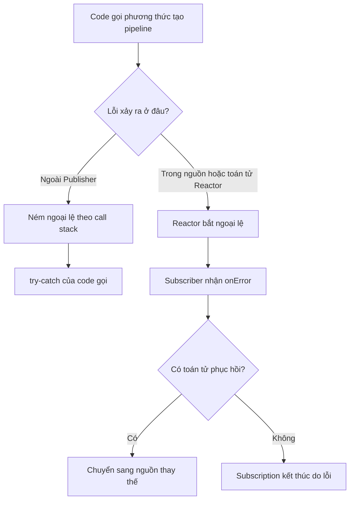

# Truyền lỗi qua tín hiệu so với ném ngoại lệ trực tiếp

Trong module `REACTIVE_PROGRAMMING` — học tư duy reactive qua các luồng sự kiện bất đồng bộ, hợp đồng Publisher–Subscriber và cơ chế backpressure của Reactive Streams; thực hành `Mono`, `Flux`, kết hợp toán tử, kiểm soát scheduler, xử lý lỗi và kiểm thử pipeline trong hệ sinh thái Java — cần phân biệt hai cách một lỗi đi qua chương trình: ngoại lệ được ném trực tiếp trong luồng gọi Java thông thường và lỗi được truyền xuống subscriber bằng tín hiệu `onError`.

Hai cách này đều có thể mang cùng một đối tượng `Throwable`, nhưng xuất hiện ở những thời điểm và ranh giới khác nhau. Nhận diện đúng ranh giới giúp chọn cách xử lý phù hợp, tránh để lỗi thoát khỏi nơi dự kiến hoặc làm pipeline kết thúc ngoài ý muốn.

## 1. Hai cách truyền lỗi

**Ném ngoại lệ trực tiếp** xảy ra khi một câu lệnh Java thực thi và ném lỗi ngay tại thời điểm câu lệnh đó chạy. Ngoại lệ đi ngược lên call stack của thread hiện tại. Nếu không có `try-catch` phù hợp, nó tiếp tục thoát khỏi phương thức đang gọi.

**Truyền lỗi bằng tín hiệu reactive** xảy ra khi một `Publisher` đã có thể phát tín hiệu và quá trình xử lý stream gặp lỗi. Publisher truyền đối tượng lỗi đến subscriber qua `onError(Throwable)`. Đây là tín hiệu kết thúc của subscription: sau `onError`, subscription đó không được phát thêm `onNext` hoặc `onComplete`.

| Khía cạnh | Ngoại lệ trực tiếp | Tín hiệu `onError` |
|---|---|---|
| Cơ chế | Ném `Throwable` trong lời gọi Java | Publisher gọi `Subscriber.onError` |
| Thời điểm | Ngay khi câu lệnh gây lỗi được thực thi | Khi nguồn hoặc toán tử trong pipeline phát hiện lỗi |
| Đường truyền | Call stack của thread hiện tại | Luồng tín hiệu của subscription |
| Nơi xử lý | `try-catch` ở các frame phía trên | Toán tử xử lý lỗi hoặc `Subscriber.onError` |
| Ý nghĩa với stream | Có thể chưa tạo được Publisher | Subscription kết thúc bằng lỗi |

Sự khác biệt quan trọng không nằm ở lớp ngoại lệ. Một `NumberFormatException` có thể được ném trực tiếp hoặc được chuyển thành tín hiệu `onError`, tùy vị trí thực thi phép chuyển đổi.

## 2. Hợp đồng tín hiệu của Reactive Streams

Với mỗi subscription, chuỗi tín hiệu hợp lệ có dạng tổng quát:

```text
onSubscribe(subscription)
    onNext(value)       // có thể không có hoặc có nhiều lần
    onNext(value)
    ...
    onComplete()        // kết thúc thành công
        HOẶC
    onError(error)      // kết thúc do lỗi
```

`onComplete` và `onError` là hai tín hiệu kết thúc loại trừ lẫn nhau. Một subscription chỉ kết thúc bằng một trong hai tín hiệu đó; không có tín hiệu `onNext` nào được gửi sau tín hiệu kết thúc. `onError` vì vậy không đơn thuần là một thông báo log: nó là một phần của giao thức điều khiển vòng đời stream.

Backpressure điều tiết số phần tử `onNext` mà subscriber yêu cầu thông qua `Subscription.request(n)`. Tín hiệu kết thúc vẫn có thể được gửi mà không cần thêm demand cho một phần tử. Vì vậy, đừng xem `onError` như một phần tử dữ liệu nằm trong hàng đợi `onNext`.

## 3. Ngoại lệ xảy ra trước khi Publisher được tạo

Java đánh giá đối số của phương thức trước khi gọi phương thức đó. Vì vậy, trong ví dụ sau, `Integer.parseInt` chạy trước `Mono.just`:

```java
String raw = "not-a-number";

Mono<Integer> number = Mono.just(Integer.parseInt(raw));
```

`Integer.parseInt(raw)` ném `NumberFormatException` ngay khi dòng lệnh được thực thi. `Mono.just` chưa được gọi và biến `number` chưa nhận được Publisher. Không có subscription nào tồn tại để nhận `onError`.

Muốn chuyển lỗi đồng bộ này thành một Publisher lỗi, có thể bắt ngoại lệ rồi tạo `Mono.error`:

```java
Mono<Integer> parseEagerly(String raw) {
    try {
        return Mono.just(Integer.parseInt(raw));
    } catch (NumberFormatException error) {
        return Mono.error(error);
    }
}
```

Phương thức trên vẫn thực hiện phép phân tích ngay khi được gọi. Điểm khác là nó chủ động chuyển ngoại lệ thành một Publisher kết thúc bằng `onError`.

## 4. Đưa công việc có thể lỗi vào pipeline

Nếu muốn phép tính chỉ chạy khi có subscription và lỗi được truyền theo hợp đồng reactive, hãy đặt công việc bên trong một nguồn hoặc toán tử có khả năng chuyển ngoại lệ thành tín hiệu lỗi.

### Dùng `fromCallable`

```java
Mono<Integer> parseOnSubscribe(String raw) {
    return Mono.fromCallable(() -> Integer.parseInt(raw));
}
```

`fromCallable` gọi `Callable` khi Publisher được subscribe. Nếu callable trả về giá trị, Mono phát giá trị đó rồi hoàn tất. Nếu callable ném ngoại lệ, Reactor chuyển ngoại lệ thành `onError` cho subscriber.

### Dùng toán tử `map`

```java
Mono<Integer> number = Mono.just("not-a-number")
    .map(Integer::parseInt);
```

`Mono.just` tạo nguồn chứa chuỗi hợp lệ. Khi subscription chạy đến `map`, hàm chuyển đổi được gọi. Nếu `Integer.parseInt` ném `NumberFormatException`, Reactor bắt lỗi phát sinh từ hàm của toán tử và truyền nó xuống dưới dạng `onError`.

### Dùng `defer` để trì hoãn việc tạo nguồn

```java
Mono<Integer> parseWithDefer(String raw) {
    return Mono.defer(() -> Mono.just(Integer.parseInt(raw)));
}
```

Supplier của `defer` chỉ chạy khi có subscription. Nếu việc tạo Publisher bên trong supplier ném ngoại lệ, Reactor chuyển lỗi đó thành tín hiệu lỗi của Mono được trả về.

Ba cách trên có thời điểm thực thi khác nhau, nhưng đều đặt phần công việc có thể lỗi vào ranh giới mà Reactor quản lý. Chọn `fromCallable` cho một tác vụ đồng bộ trả về một giá trị; chọn `map` để biến đổi phần tử đã có; chọn `defer` khi cần trì hoãn cả việc tạo Publisher hoặc chọn nguồn theo từng subscription.

## 5. Xác định lỗi thuộc ranh giới nào

| Vị trí phát sinh | Ví dụ | Kết quả thường thấy |
|---|---|---|
| Biểu thức Java bên ngoài pipeline | `Mono.just(parse(raw))` | Ném trực tiếp trong lúc gọi phương thức tạo pipeline |
| Hàm do toán tử Reactor gọi | `map(value -> parse(value))` | Reactor chuyển ngoại lệ của hàm thành `onError` |
| Tác vụ được bọc bởi nguồn trì hoãn | `Mono.fromCallable(() -> read())` | Ngoại lệ từ tác vụ thành `onError` |
| Supplier của `defer` | `Mono.defer(() -> createSource())` | Ngoại lệ khi supplier chạy thành `onError` |
| Tạo nguồn vi phạm điều kiện đầu vào | `Mono.just(null)` | Có thể ném lỗi đồng bộ ngay khi gọi API |

Reactive Streams không cho phép `null` làm tín hiệu phần tử. Do đó, không dùng `null` để biểu diễn lỗi hoặc giá trị vắng mặt. Hãy dùng `Mono.empty()` cho trường hợp không có phần tử, hoặc `Mono.error(cause)` cho trường hợp thất bại. Các API kiểm tra đối số ngay lúc tạo nguồn cũng có thể ném ngoại lệ trực tiếp; việc đó không phải là tín hiệu của một subscription chưa tồn tại.

Có thể hình dung ranh giới thực thi như sau:



Sơ đồ mô tả hành vi của các nguồn và toán tử Reactor thông dụng. Không nên suy rộng rằng mọi ngoại lệ ở bất kỳ đâu trong ứng dụng đều tự động trở thành `onError`. Một lỗi xảy ra trước khi pipeline được tạo, trong mã gọi subscriber, hoặc tại một API không thuộc ranh giới xử lý của Reactor vẫn cần được xem xét theo hợp đồng riêng của vị trí đó.

## 6. Xử lý tín hiệu lỗi trong pipeline

Khi lỗi đã trở thành `onError`, các toán tử xử lý lỗi quyết định tín hiệu đó được quan sát, biến đổi, thử lại hay thay thế.

**`doOnError` chỉ quan sát lỗi.** Toán tử phù hợp cho ghi log, tăng metric hoặc bổ sung hành động phụ. Nó không biến lỗi thành thành công; nếu không có toán tử phục hồi phía sau, lỗi vẫn đi đến subscriber.

```java
Mono<User> user = userRepository.findById(userId)
    .doOnError(error -> log.warn("Không thể đọc user {}", userId, error));
```

**`onErrorMap` đổi loại hoặc nội dung ngoại lệ.** Tín hiệu vẫn là lỗi, nhưng downstream nhận ngoại lệ đã được ánh xạ.

```java
Mono<User> user = userRepository.findById(userId)
    .onErrorMap(
        DataAccessException.class,
        error -> new UserReadException(userId, error)
    );
```

**`onErrorResume` chuyển sang Publisher thay thế.** Toán tử này hữu ích khi có phương án dự phòng hoặc cần chuyển lỗi thành một luồng xử lý khác.

```java
Mono<Profile> profile = profileRepository.findById(userId)
    .onErrorResume(CacheUnavailableException.class,
        error -> backupProfileRepository.findById(userId));
```

Nếu Publisher dự phòng phát dữ liệu và hoàn tất, downstream quan sát kết quả dự phòng. Nếu Publisher dự phòng cũng lỗi, lỗi đó tiếp tục truyền xuống.

**`onErrorReturn` cung cấp một giá trị mặc định.** Đây là cách phục hồi đơn giản khi một giá trị thay thế có ý nghĩa nghiệp vụ.

```java
Mono<String> displayName = accountService.loadName(userId)
    .onErrorReturn("Không xác định");
```

**`retry` hoặc `retryWhen` đăng ký lại nguồn theo chính sách.** Retry không làm cho lần thực thi thất bại trước đó trở thành thành công; nó yêu cầu nguồn chạy lại. Chỉ dùng khi thao tác có thể lặp an toàn hoặc đã có cơ chế bảo vệ tính idempotent. Nếu số lần thử cạn, lỗi cuối cùng vẫn có thể được truyền bằng `onError`.

Chọn toán tử theo mục tiêu: quan sát bằng `doOnError`, đổi loại lỗi bằng `onErrorMap`, phục hồi bằng `onErrorResume` hoặc `onErrorReturn`, và thử lại có kiểm soát bằng `retry`/`retryWhen`. Không dùng `doOnError` với kỳ vọng nó sẽ nuốt lỗi.

## 7. Ví dụ tổng hợp: đọc đơn hàng

Giả sử repository trả về `Optional<Order>` và có thể ném `SQLException`. Ta muốn truy vấn chỉ chạy khi subscribe, báo lỗi rõ ràng nếu không tìm thấy đơn hàng, rồi chuyển lỗi truy cập dữ liệu thành ngoại lệ ở tầng nghiệp vụ.

```java
Mono<Order> loadOrder(String orderId) {
    return Mono.fromCallable(() -> repository.findById(orderId))
        .flatMap(result -> result
            .<Mono<Order>>map(Mono::just)
            .orElseGet(() -> Mono.error(
                new OrderNotFoundException(orderId)
            ))
        )
        .map(this::validateOrder)
        .onErrorMap(SQLException.class,
            error -> new OrderReadException(orderId, error));
}
```

Diễn tiến của pipeline:

1. Gọi `loadOrder` chỉ lắp ráp Publisher; repository chưa được gọi.
2. Khi subscribe, `fromCallable` gọi repository. Nếu repository ném `SQLException`, lỗi trở thành `onError`.
3. Nếu repository trả về `Optional.empty()`, `flatMap` chuyển trường hợp đó thành `Mono.error(OrderNotFoundException)`.
4. Nếu có đơn hàng, `map` kiểm tra đơn hàng. Ngoại lệ phát sinh trong `validateOrder` cũng trở thành `onError`.
5. `onErrorMap` đổi riêng `SQLException` thành `OrderReadException`. `OrderNotFoundException` và các lỗi khác không khớp kiểu vẫn được truyền tiếp.

Ví dụ giả định `repository.findById` trả về `Optional<Order>` và `validateOrder` trả về một `Order`. Kiểu dữ liệu thực tế của ứng dụng có thể khác, nhưng nguyên tắc vẫn là đặt thao tác có thể lỗi trong nguồn/toán tử reactive và chọn rõ cách truyền lỗi xuống tầng gọi.

## 8. Kiểm thử sự khác nhau

Có thể dùng JUnit để xác nhận ngoại lệ trực tiếp xảy ra trước khi có Publisher:

```java
@Test
void eagerExpressionThrowsBeforePublisherExists() {
    assertThrows(NumberFormatException.class, () -> {
        Mono<Integer> number = Mono.just(Integer.parseInt("abc"));
    });
}
```

Với `StepVerifier`, kiểm tra lỗi được truyền như tín hiệu của Publisher:

```java
@Test
void exceptionInsideMapBecomesOnError() {
    Mono<Integer> number = Mono.just("abc")
        .map(Integer::parseInt);

    StepVerifier.create(number)
        .expectError(NumberFormatException.class)
        .verify();
}

@Test
void exceptionInsideCallableBecomesOnError() {
    Mono<Integer> number = Mono.fromCallable(
        () -> Integer.parseInt("abc")
    );

    StepVerifier.create(number)
        .expectErrorMatches(error ->
            error instanceof NumberFormatException
        )
        .verify();
}
```

Hai kiểm thử sau chứng minh lỗi xuất hiện khi subscription thực thi nguồn hoặc toán tử và được quan sát bằng `StepVerifier`. Kiểm thử đầu xác nhận biểu thức Java được đánh giá ngay lúc lắp ráp, nên ngoại lệ được ném trực tiếp cho caller.

## 9. Cách chọn và rà soát

Khi gặp một lỗi trong code reactive, hãy lần lượt xác định:

1. **Publisher đã được tạo chưa?** Nếu lỗi xảy ra khi đánh giá đối số hoặc câu lệnh bên ngoài pipeline, hãy xử lý nó như ngoại lệ Java thông thường hoặc chủ động chuyển thành `Mono.error`/`Flux.error`.
2. **Công việc có nằm trong nguồn hoặc callback của Reactor không?** Nếu có, các nguồn và toán tử phù hợp thường chuyển ngoại lệ phát sinh trong quá trình xử lý thành `onError`.
3. **Downstream cần làm gì?** Ghi nhận, ánh xạ, dùng dữ liệu dự phòng, trả giá trị mặc định hay thử lại là các quyết định khác nhau; chọn toán tử tương ứng.
4. **Lỗi có thật sự được phục hồi không?** `doOnError` chỉ quan sát. Nếu không có toán tử thay thế hoặc phục hồi, subscription vẫn kết thúc bằng lỗi.
5. **Có kiểm thử đúng ranh giới không?** Dùng `assertThrows` cho lỗi đồng bộ trước Publisher và `StepVerifier.expectError...` cho lỗi được truyền qua tín hiệu.

Khi nắm rõ ranh giới giữa call stack Java và giao thức tín hiệu Publisher–Subscriber, ta có thể dự đoán chính xác thời điểm lỗi xuất hiện, nơi nó được quan sát và trạng thái kết thúc của stream. Đây là nền tảng để xây dựng pipeline `Mono`/`Flux` có hành vi lỗi rõ ràng và kiểm thử được.
