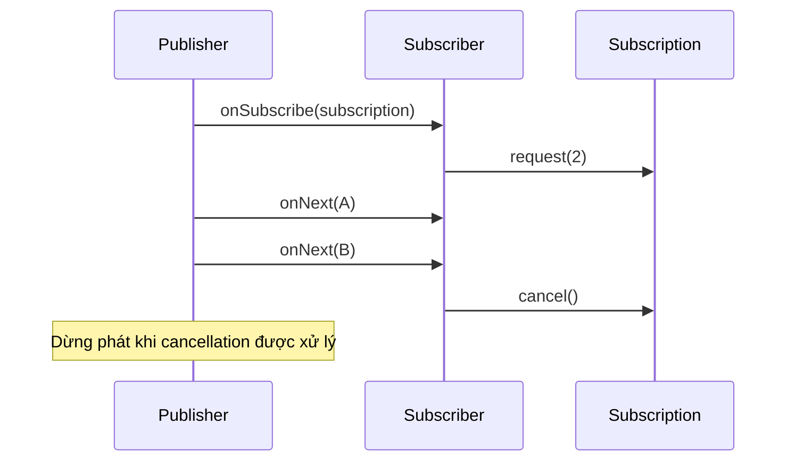

# Hủy đăng ký trong khi dữ liệu hoặc tín hiệu đang được phát

Trong Reactive Streams, subscriber có thể ngừng nhận dữ liệu bằng cách gọi `cancel()` trên `Subscription`. Với Reactor, thao tác tương ứng thường được thực hiện qua `Disposable.dispose()` hoặc các toán tử tự hủy nguồn như `take`. Cancellation có thể xảy ra khi người dùng rời màn hình, client HTTP đóng kết nối, kết quả không còn cần thiết hoặc một nhánh xử lý khác đã khiến công việc hiện tại trở nên thừa.

Hủy đăng ký là một phần của hợp đồng vòng đời, không phải một tín hiệu dữ liệu. `cancel()` đi từ subscriber về publisher để yêu cầu dừng việc phát; `onNext`, `onError` và `onComplete` đi từ publisher đến subscriber. Vì vậy, cancellation khác với hoàn tất bình thường và khác với lỗi. Nó cũng không bảo đảm có thể thu hồi một thao tác đã được gửi đến hệ thống bên ngoài. Khi thiết kế pipeline, cần xác định ai sở hữu subscription, cancellation được truyền qua những thành phần nào, tài nguyên nào phải giải phóng và cách xử lý kết quả đang đến dở.

## 1. Cancellation trong vòng đời Reactive Streams

Sau khi subscriber đăng ký, publisher cung cấp một `Subscription`. Subscriber dùng subscription để yêu cầu dữ liệu bằng `request(n)` và có thể gọi `cancel()` khi không muốn nhận thêm. Hai thao tác có mục đích khác nhau:

- `request(n)` điều tiết lượng phần tử subscriber muốn nhận thêm.
- `cancel()` yêu cầu kết thúc việc tiêu thụ trên subscription đó.

Sơ đồ dưới đây minh họa hướng đi của tín hiệu:



`cancel()` không phải một callback mà publisher gửi lại cho subscriber. Subscriber cũng không nhận `onComplete` chỉ vì nó đã gọi cancel. Đây là yêu cầu hủy được truyền ngược về nguồn. Publisher phải tôn trọng cancellation và cuối cùng dừng phát tín hiệu cho subscription đó, nhưng việc dừng có thể không tức thời nếu một tín hiệu hoặc công việc đã bắt đầu trước khi yêu cầu hủy đến nơi.

Trong một hệ thống có nhiều toán tử, cancellation thường được truyền từ downstream ngược qua chuỗi toán tử về upstream. Mỗi toán tử có thể cần hủy nguồn chính, publisher con hoặc tác vụ đang chờ. Việc truyền hủy thành công đến đâu phụ thuộc vào cách toán tử và nguồn dữ liệu triển khai giao thức.

## 2. Hủy khi dữ liệu đang được phát

Một tình huống dễ gây nhầm lẫn là subscriber gọi `cancel()` trong lúc đang xử lý `onNext`. Ví dụ, callback nhận một đơn hàng rồi phát hiện người dùng đã đóng màn hình. Subscriber có thể yêu cầu hủy ngay trong callback:

```java
Flux.range(1, 10)
    .subscribe(new BaseSubscriber<Integer>() {
        @Override
        protected void hookOnSubscribe(Subscription subscription) {
            request(1);
        }

        @Override
        protected void hookOnNext(Integer value) {
            process(value);

            if (value == 3) {
                cancel();
                return;
            }

            request(1);
        }
    });
```

Subscriber yêu cầu từng phần tử. Sau khi xử lý giá trị `3`, nó gọi `cancel()` và không yêu cầu thêm phần tử. Publisher được yêu cầu dừng việc phát tiếp cho subscription này.

Cancellation không giống như ngắt luồng Java hiện tại. Nếu `process(value)` đang chạy khi một thread khác gọi cancel, lời gọi cancel không tự động cưỡng bức dừng đoạn code Java đó. Callback đang thực thi cần kết thúc theo cơ chế của chính nó; công việc blocking hoặc tác vụ bên ngoài chỉ dừng nếu API tương ứng hỗ trợ hủy hoặc có cơ chế timeout/interruption riêng. Vì vậy, không nên dựa vào cancellation để cắt ngang một đoạn xử lý không có điểm kiểm tra trạng thái.

### Có thể có race giữa tín hiệu và cancellation

Publisher và subscriber có thể chạy trên các thread khác nhau. Khi một tín hiệu `onNext` đã được phát hoặc đang được chuyển qua hàng đợi, yêu cầu cancel có thể đến gần như đồng thời. Subscriber cần thiết kế để xử lý an toàn kết quả đến sát thời điểm hủy:

- Không giả định `cancel()` sẽ ngắt callback đang chạy.
- Không thực hiện side effect không thể lặp lại chỉ dựa trên giả định rằng cancel luôn đến trước tín hiệu tiếp theo.
- Nếu kết quả đến sau khi màn hình hoặc request đã kết thúc, kiểm tra trạng thái vòng đời trước khi cập nhật đối tượng liên quan.
- Dùng dữ liệu bất biến hoặc đồng bộ thích hợp nếu cancellation và callback cùng truy cập trạng thái mutable.

Các tín hiệu của một subscription được tuần tự hóa theo hợp đồng Reactive Streams, nhưng cancellation có thể được gọi từ một thread khác và đua với công việc đang diễn ra. Việc xử lý kết quả muộn vẫn cần được tính đến trong logic ứng dụng.

## 3. Hủy một subscription trong Reactor

Khi dùng các overload `subscribe`, Reactor trả về một `Disposable`. Caller có thể giữ đối tượng này và gọi `dispose()` khi vòng đời của consumer kết thúc:

```java
Disposable subscription = eventSource
    .subscribe(
        event -> updateView(event),
        error -> showError(error)
    );

// Gọi khi component không còn cần nhận sự kiện.
subscription.dispose();
```

`dispose()` yêu cầu hủy subscription gắn với disposable đó. Nó phù hợp với một luồng sự kiện dài hạn do component tự quản lý, chẳng hạn listener cho màn hình hoặc tác vụ nền gắn với một phiên làm việc. Component cần giữ handle ở đúng phạm vi vòng đời và gọi dispose khi không còn sử dụng.

Không nên tạo subscription trong một phương thức rồi làm mất `Disposable` nếu công việc có thể chạy vô thời hạn. Khi đó, ứng dụng không còn handle rõ ràng để hủy. Với một endpoint reactive được quản lý bởi Spring WebFlux, thông thường controller trả `Mono` hoặc `Flux` để framework sở hữu subscription và liên kết cancellation với vòng đời request; không tự subscribe trong controller/service để tạo một luồng độc lập.

### Dùng BaseSubscriber để hủy theo điều kiện

`BaseSubscriber` cho phép điều khiển demand và cancellation ngay trong subscriber:

```java
Flux.range(1, 100)
    .subscribe(new BaseSubscriber<Integer>() {
        @Override
        protected void hookOnSubscribe(Subscription subscription) {
            request(1);
        }

        @Override
        protected void hookOnNext(Integer value) {
            if (!shouldContinue(value)) {
                cancel();
                return;
            }

            process(value);
            request(1);
        }
    });
```

Ví dụ chỉ yêu cầu phần tử tiếp theo khi điều kiện cho phép. Nếu điều kiện không còn đúng, subscriber hủy subscription và không yêu cầu thêm. Trong mã thật, cần xác định thứ tự giữa kiểm tra điều kiện và xử lý side effect: nếu phải kiểm tra trước khi xử lý, hãy đặt kiểm tra ở trước `process` như ví dụ. Nếu công việc xử lý có thể thất bại, cần xác định cách chuyển lỗi và dọn dẹp.

## 4. Toán tử có thể chủ động hủy upstream

Không phải lúc nào ứng dụng cũng cần tự gọi `dispose()`. Một số toán tử biết khi nào đã đủ dữ liệu và chủ động hủy publisher upstream.

| Toán tử hoặc tình huống | Hành vi liên quan đến cancellation |
| --- | --- |
| `take(n)` | Sau khi nhận đủ tối đa `n` phần tử, downstream hoàn tất và toán tử hủy upstream nếu nguồn còn hoạt động |
| `next()` | Chuyển `Flux` thành `Mono` lấy phần tử đầu tiên; sau khi nhận được phần tử, upstream không cần phát tiếp |
| `timeout(...)` | Khi hết thời hạn, toán tử hủy nguồn đang chờ rồi phát lỗi timeout hoặc chuyển sang publisher dự phòng |
| `switchMap(...)` | Khi có giá trị nguồn mới, publisher con trước đó bị hủy để chuyển sang publisher con mới |
| Hủy downstream của `flatMap` | Yêu cầu hủy nguồn ngoài và các publisher con đang hoạt động |

Ví dụ `take` giới hạn số phần tử tiêu thụ:

```java
Flux.range(1, 100)
    .doOnCancel(() -> log("Upstream đã nhận yêu cầu hủy"))
    .take(3)
    .subscribe(System.out::println);
```

Subscriber nhận `1`, `2`, `3`. Sau đó `take(3)` hoàn tất downstream và hủy upstream vì không cần các phần tử còn lại. Đây là cách giới hạn công việc ngay trong pipeline, không cần giữ một `Disposable` bên ngoài chỉ để đếm phần tử.

Với `switchMap`, cancellation của publisher con cũ là một phần của semantics chuyển sang dữ liệu mới. Điều này hữu ích cho tìm kiếm gợi ý: mỗi lần người dùng nhập ký tự mới, kết quả tìm kiếm của truy vấn trước không còn cần thiết. Tuy nhiên, nếu publisher con đã gửi một request đến server, hủy subscription phía client không bảo đảm server đã dừng xử lý request đó.

## 5. Cancellation lan truyền qua pipeline như thế nào?

Một pipeline có thể gồm nguồn, nhiều toán tử và publisher con:

```text
Source -> map -> flatMap -> filter -> Subscriber
```

Khi subscriber cuối gọi cancel, yêu cầu hủy đi từ downstream về upstream. `filter` chuyển yêu cầu hủy đến phần trước; `flatMap` cần dừng nhận dữ liệu nguồn và hủy những publisher con còn hoạt động; các toán tử khác giải phóng hàng đợi hoặc tài nguyên nội bộ theo khả năng của chúng.

Với `flatMap`, có thể có nhiều publisher con đang chạy đồng thời. Hủy subscription downstream yêu cầu dừng toàn bộ nhánh liên quan. Tuy vậy, một tác vụ con đã bắt đầu gọi thư viện blocking hoặc gửi thông điệp ra ngoài có thể tiếp tục nếu thư viện đó không hỗ trợ cancellation. Cần phân biệt:

- **Hủy đăng ký reactive:** dừng việc tiêu thụ tín hiệu qua subscription.
- **Hủy tác vụ nội bộ:** dừng computation, timer hoặc future nếu nguồn có cơ chế tương ứng.
- **Hủy I/O:** đóng hoặc hủy request/response ở client nếu client hỗ trợ.
- **Hoàn tác side effect:** đảo ngược thay đổi đã xảy ra ở hệ thống bên ngoài; cancellation tự nó không thực hiện việc này.

Một yêu cầu hủy có thể truyền qua nhiều lớp nhưng hiệu lực cuối cùng vẫn phụ thuộc từng adapter. Khi tích hợp HTTP client, database driver hoặc message broker, hãy đọc semantics cancellation và xác minh bằng kiểm thử thay vì giả định mọi thao tác bên ngoài đều có thể thu hồi.

## 6. Cancellation khác với onComplete và onError

Ba cách kết thúc dưới đây có ý nghĩa khác nhau:

| Trường hợp | Ai khởi tạo? | Tín hiệu quan sát ở subscriber downstream |
| --- | --- | --- |
| Hoàn tất bình thường | Publisher | `onComplete` |
| Kết thúc do lỗi | Publisher | `onError(error)` |
| Hủy đăng ký | Subscriber hoặc toán tử downstream | Không có `onComplete`/`onError` chỉ vì cancellation |

Nếu subscriber gọi cancel, nó không nên chờ callback hoàn tất hoặc callback lỗi để biết mình đã hủy. Trong Reactor, có thể quan sát cancellation bằng các hook như `doOnCancel` hoặc `doFinally`.

```java
Flux<Long> ticks = Flux.interval(Duration.ofMillis(250))
    .doOnCancel(() -> log("Nhận yêu cầu hủy"))
    .doFinally(signal -> log("Kết thúc với: " + signal));

Disposable subscription = ticks.subscribe(this::handleTick);

// Khi vòng đời consumer kết thúc:
subscription.dispose();
```

`doOnCancel` chỉ quan sát nhánh hủy. `doFinally` quan sát kết thúc do hoàn tất, lỗi hoặc hủy; `SignalType.CANCEL` cho biết pipeline kết thúc vì cancellation. Nếu chỉ cần giải phóng tài nguyên trong mọi trường hợp kết thúc, `doFinally` có thể phù hợp. Nếu cleanup phụ thuộc loại kết thúc, hãy kiểm tra `SignalType` hoặc dùng abstraction quản lý tài nguyên thích hợp.

## 7. Giải phóng tài nguyên khi bị hủy

Cancellation có ý nghĩa vận hành khi nó giúp giải phóng tài nguyên: đóng file, kết nối, cursor, listener, timer hoặc buffer. Không nên giả định mọi nguồn tự giải phóng đúng tài nguyên nghiệp vụ; cần đặt cleanup tại nơi sở hữu tài nguyên.

### Dùng using cho tài nguyên đồng bộ

`Flux.using` quản lý tài nguyên gắn với subscription. Supplier tạo tài nguyên, function tạo publisher sử dụng tài nguyên, consumer cleanup giải phóng tài nguyên khi luồng kết thúc hoặc bị hủy:

```java
Flux<Row> rows = Flux.using(
    connectionFactory::open,
    connection -> connection.readRows(),
    Connection::close
);
```

Ví dụ giả định `open`, `readRows` và `close` là API minh họa. Mỗi subscription sở hữu tài nguyên được tạo cho lần đăng ký đó; cleanup được gọi khi publisher kết thúc hoặc subscription bị hủy theo semantics của `using`. Nếu cleanup là blocking, cần đặt nó ở ranh giới thực thi phù hợp để không chặn event-loop.

### Cleanup bất đồng bộ với usingWhen

Nếu việc đóng tài nguyên cũng bất đồng bộ, Reactor cung cấp `usingWhen`. Abstraction này cho phép định nghĩa publisher cleanup cho các nhánh hoàn tất, lỗi và cancellation. Điều đó quan trọng với tài nguyên cần giải phóng qua I/O, chẳng hạn session hoặc transaction reactive. Cleanup bất đồng bộ phải được thiết kế để có thể hoàn tất và xử lý lỗi cleanup; không nên giả định cancellation của luồng chính sẽ tự chờ một thao tác cleanup tùy ý nếu ứng dụng không định nghĩa nó.

### Chọn hook quan sát đúng mục đích

| Hook | Dùng khi | Giới hạn |
| --- | --- | --- |
| `doOnCancel` | Ghi log, metric hoặc hành động nhẹ chỉ dành cho cancellation | Không chạy khi hoàn tất bình thường hoặc lỗi |
| `doFinally` | Ghi nhận mọi kiểu kết thúc: cancel, complete, error | Hành động trong hook cần ngắn; không dùng để thay thế cleanup bất đồng bộ phức tạp |
| `using` | Sở hữu tài nguyên đồng bộ gắn với subscription | Cleanup đồng bộ; cần chú ý nếu thao tác đóng blocking |
| `usingWhen` | Sở hữu tài nguyên có cleanup reactive/bất đồng bộ | Cần định nghĩa cleanup cho các kiểu kết thúc và xử lý lỗi cleanup |

Một số toán tử có thể loại bỏ phần tử đã được prefetch hoặc buffer khi cancellation xảy ra. Nếu phần tử bị loại bỏ cũng sở hữu tài nguyên, hãy xem xét cơ chế discard tương ứng, ví dụ `doOnDiscard`, và kiểm tra toán tử đang dùng có hỗ trợ discard hay không. Không phải mọi phần tử bị hủy đều tự động được cleanup theo cách ứng dụng mong muốn.

## 8. Cancellation không phải rollback

Đây là ranh giới đặc biệt quan trọng khi pipeline gọi dịch vụ bên ngoài. Giả sử ứng dụng gửi yêu cầu thanh toán rồi client đóng kết nối trước khi nhận phản hồi. Cancellation có thể dừng việc chờ hoặc tiêu thụ response ở client, nhưng server có thể đã nhận và xử lý thanh toán. Việc không nhận được phản hồi không chứng minh rằng giao dịch chưa xảy ra.

Với các thao tác có side effect như thanh toán, tạo đơn, gửi email hoặc ghi dữ liệu:

- Dùng idempotency key hoặc mã yêu cầu duy nhất nếu API hỗ trợ.
- Có cơ chế truy vấn trạng thái hoặc đối soát khi kết quả không rõ ràng.
- Phân biệt timeout/cancellation ở client với trạng thái xử lý ở server.
- Không tự động retry một thao tác không idempotent chỉ vì subscriber đã hủy hoặc không nhận được response.
- Nếu cần hoàn tác, thiết kế nghiệp vụ bù trừ hoặc transaction phù hợp; `cancel()` không thay thế cơ chế đó.

Cancellation là yêu cầu dừng việc tiêu thụ và có thể giúp dừng công việc còn có thể dừng. Nó không phải lệnh rollback phân tán và không thể xóa bỏ một side effect đã được hệ thống khác chấp nhận.

## 9. Backpressure và cancellation giải quyết hai vấn đề khác nhau

Backpressure điều tiết tốc độ nhận dữ liệu; cancellation chấm dứt việc tiêu thụ. Hai cơ chế có thể được dùng cùng nhau nhưng không thể thay thế cho nhau.

| Nhu cầu | Cơ chế phù hợp |
| --- | --- |
| Consumer chỉ muốn nhận thêm một số phần tử | Gọi `request(n)` |
| Consumer xử lý chậm và cần giới hạn lượng dữ liệu đang chuyển | Demand/backpressure cùng chính sách buffer phù hợp |
| Consumer đã có đủ dữ liệu | Hủy upstream, ví dụ qua `take(n)` |
| Client đã ngắt kết nối hoặc kết quả không còn cần | Cancellation/dispose |
| Nguồn không hỗ trợ demand | Adapter cần buffer giới hạn, drop/latest hoặc chính sách quá tải |

Nếu consumer chậm nhưng vẫn cần toàn bộ dữ liệu, cancellation không giải quyết bài toán; cần điều tiết demand hoặc thiết kế buffer/flow control. Nếu consumer không còn cần bất kỳ dữ liệu nào, tiếp tục yêu cầu ít phần tử hơn vẫn giữ nguồn hoạt động không cần thiết; lúc đó cần cancel.

## 10. Kiểm thử cancellation

Kiểm thử cần xác minh cả hành vi downstream và việc yêu cầu hủy được truyền đến nguồn. Reactor Test cung cấp `StepVerifier.thenCancel()` để kết thúc subscription bằng cancellation. Có thể kết hợp virtual time khi nguồn dùng timer:

```java
AtomicBoolean cancelled = new AtomicBoolean();

StepVerifier.withVirtualTime(() ->
        Flux.interval(Duration.ofSeconds(1))
            .doOnCancel(() -> cancelled.set(true)))
    .thenAwait(Duration.ofSeconds(1))
    .expectNext(0L)
    .thenCancel()
    .verify();

assertTrue(cancelled.get());
```

Ví dụ xác minh nguồn quan sát được cancellation sau khi subscriber nhận phần tử đầu tiên. `withVirtualTime` giúp test timer mà không phải chờ một giây thực. Trong dự án, cần import Reactor Test và assertion library tương ứng.

Ngoài test đơn giản này, nên kiểm tra các trường hợp:

1. Hủy trước khi nguồn phát phần tử đầu tiên.
2. Hủy sau một hoặc nhiều `onNext`.
3. Hủy trong khi xử lý một callback đang chạy.
4. Hủy downstream của `flatMap` khi nhiều publisher con đang hoạt động.
5. `take(n)` hoặc `timeout` có hủy upstream như mong đợi không.
6. Tài nguyên được giải phóng khi cancel, complete và error.
7. Kết quả đến muộn sau cancellation có bị bỏ qua an toàn ở tầng ứng dụng không.
8. Hủy thao tác HTTP hoặc database có thực sự truyền đến client/driver không, và side effect phía server có thể đã xảy ra hay không.

Không dùng `Thread.sleep` để đoán rằng cancellation đã xảy ra. Dùng `StepVerifier`, cờ quan sát, fake publisher hoặc hook `doOnCancel` để kiểm tra sự kiện. Với tích hợp I/O thật, test cần kiểm tra hành vi của adapter và hệ thống đích trong phạm vi có thể quan sát.

## 11. Quy trình thiết kế cancellation cho một pipeline

Khi xây một pipeline dài hạn hoặc có I/O, hãy xác định các điểm sau trước khi triển khai:

| Câu hỏi thiết kế | Quyết định cần có |
| --- | --- |
| Ai sở hữu subscription? | Framework, caller, component UI hay service nền? |
| Khi nào không còn cần kết quả? | Client ngắt kết nối, người dùng rời màn hình, đủ dữ liệu hoặc nhánh khác thất bại |
| Ai gọi cancel/dispose? | Chủ sở hữu subscription hoặc toán tử có điều kiện kết thúc |
| Cancellation đi qua những thành phần nào? | Toán tử, publisher con, adapter, client I/O và nguồn |
| Tài nguyên nào cần cleanup? | File, connection, cursor, listener, timer, buffer hoặc session |
| Cleanup có blocking không? | Chọn vị trí thực thi phù hợp; không chặn event-loop |
| Có side effect bên ngoài không? | Xác định idempotency, truy vấn trạng thái và nghiệp vụ bù trừ |
| Kết quả muộn được xử lý ra sao? | Bỏ qua an toàn, kiểm tra lifecycle hoặc lưu trạng thái để đối soát |
| Đã kiểm thử chưa? | Kiểm tra cancel trước/sau onNext, race, cleanup và adapter |

Với luồng sự kiện dài hạn, hãy giữ `Disposable` ở đối tượng thực sự sở hữu vòng đời và dispose khi đối tượng kết thúc. Với request reactive, trả publisher để framework quản lý subscription. Với pipeline tự kết thúc sau một lượng dữ liệu, ưu tiên toán tử như `take`. Với nguồn callback, bảo đảm adapter gắn cancellation với việc gỡ listener hoặc hủy tác vụ nếu API nguồn hỗ trợ.

## 12. Những lỗi thường gặp

- **Coi cancel là complete:** cancellation không phát `onComplete` cho subscriber.
- **Chờ error callback sau khi hủy:** cancel là yêu cầu dừng tiêu thụ, không phải một lỗi terminal.
- **Giả định callback đang chạy bị ngắt ngay:** `cancel()` không tự động interrupt thread hiện tại.
- **Không xử lý kết quả đến muộn:** tín hiệu hoặc công việc đã bắt đầu có thể đua với yêu cầu hủy; tầng ứng dụng cần bảo vệ trạng thái vòng đời.
- **Không truyền hủy đến publisher con:** với `flatMap` hoặc adapter tùy chỉnh, cần kiểm tra việc hủy nhánh con và tài nguyên tương ứng.
- **Làm mất `Disposable`:** luồng dài hạn có thể tiếp tục chạy sau khi component không còn cần dữ liệu.
- **Cleanup chỉ chạy ở onComplete:** nếu subscriber hủy hoặc pipeline lỗi, cleanup tài nguyên vẫn phải được thực hiện.
- **Dùng `doOnCancel` cho mọi cleanup:** hook này không chạy ở complete/error; cân nhắc `doFinally`, `using` hoặc `usingWhen` theo loại tài nguyên.
- **Cho rằng cancel rollback được request từ xa:** server có thể đã thực hiện side effect trước khi client hủy.
- **Nhầm backpressure với cancellation:** demand điều tiết tốc độ; cancellation dừng việc tiêu thụ.
- **Không kiểm thử race và cancellation của adapter:** hành vi của publisher giả lập có thể khác client HTTP, driver hoặc broker thật.

Hủy đăng ký giúp một pipeline reactive dừng tiêu thụ khi kết quả không còn cần thiết và tạo cơ hội giải phóng tài nguyên. Để sử dụng đúng, cần hiểu hướng truyền `cancel`, khả năng dừng có tính hợp tác, race với tín hiệu đang phát và giới hạn của các thao tác I/O bên ngoài. Khi kết hợp ownership rõ ràng, cleanup phù hợp, chính sách xử lý side effect và kiểm thử cancellation, ứng dụng Java có thể quản lý vòng đời publisher–subscriber một cách an toàn hơn.
