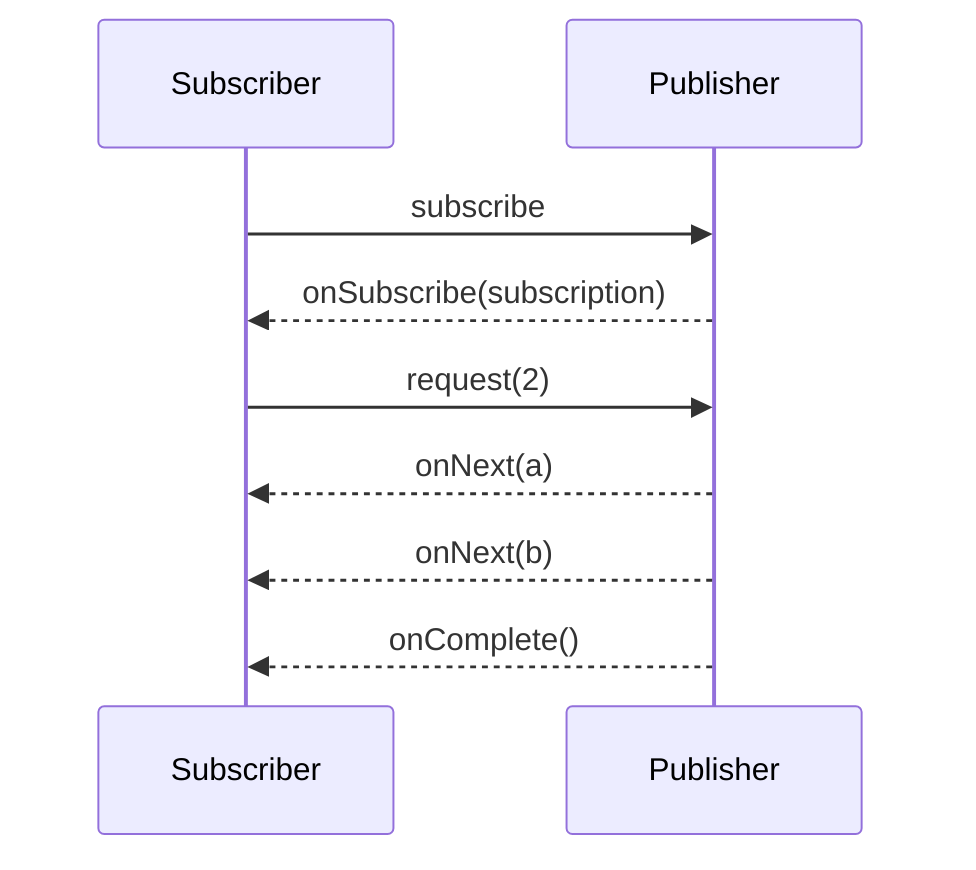
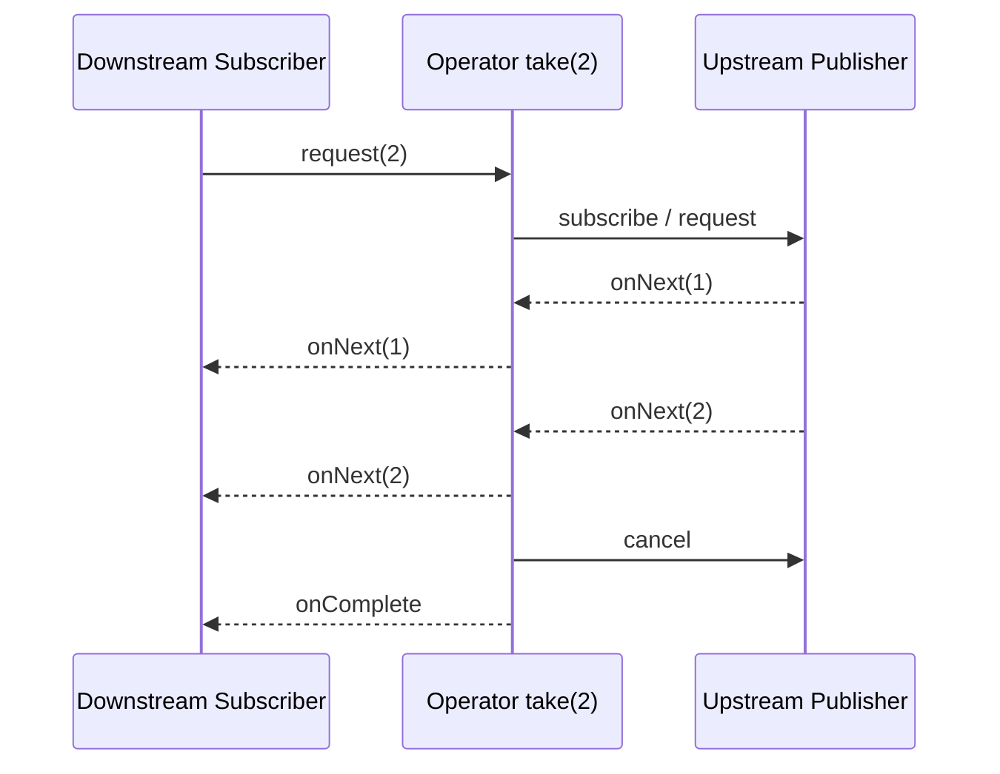

# Đọc diễn tiến tín hiệu của các tình huống biên bằng sơ đồ marble

Trong Reactive Programming, một pipeline không chỉ mô tả giá trị nào được xử lý mà còn mô tả **tín hiệu nào đến trước, tín hiệu nào bị loại bỏ và pipeline kết thúc như thế nào**. Sơ đồ marble (marble diagram) giúp nhìn diễn tiến đó theo thời gian. Đây là cách đọc hữu ích khi học hợp đồng Publisher–Subscriber, `Mono`, `Flux` và backpressure trong Reactive Streams của Java.

Các tình huống biên thường gây nhầm lẫn gồm nguồn không phát phần tử, nguồn phát rồi gặp lỗi, subscriber hủy giữa chừng, toán tử thay thế khi rỗng, retry sau lỗi và nhiều nguồn phát xen kẽ. Nếu chỉ đọc kiểu trả về hoặc nhìn vào giá trị cuối cùng, ta có thể bỏ qua các tín hiệu đã phát trước đó. Marble diagram làm rõ những gì subscriber thực sự quan sát được.

## 1. Cách đọc một sơ đồ marble

Một sơ đồ marble biểu diễn luồng tín hiệu từ trái sang phải. Trục ngang là thứ tự/thời gian tương đối; khoảng cách giữa các ký hiệu chỉ mang tính minh họa, không phải đồng hồ đo chính xác. Mỗi hàng thường là một publisher hoặc một giai đoạn trong pipeline.

| Ký hiệu | Ý nghĩa |
| --- | --- |
| `●a`, `●b` | Một tín hiệu `onNext` mang giá trị `a`, `b` |
| `|` | Tín hiệu `onComplete`: kết thúc bình thường |
| `X lỗi` | Tín hiệu `onError`: kết thúc bằng lỗi |
| `---->` | Hướng diễn tiến của thời gian/tín hiệu |
| `cancel` | Subscriber yêu cầu hủy subscription; đây là hành động điều khiển, không phải terminal signal |
| `request(n)` | Subscriber yêu cầu tối đa thêm `n` phần tử |

Ví dụ một publisher phát hai phần tử rồi hoàn tất:

```text
Publisher:  ----●a----●b----|
                 |     |    |
                 |     |    +-- onComplete
                 |     +------- onNext(b)
                 +------------- onNext(a)
```

Ví dụ publisher phát một phần tử rồi lỗi:

```text
Publisher:  ----●a----X lỗi
```

Phần tử `a` đã được phát trước khi lỗi xảy ra. `onError` không xóa hay thu hồi phần tử đã đến subscriber. Một terminal signal chỉ kết thúc chuỗi tín hiệu; sau `onComplete` hoặc `onError`, publisher không được phát thêm `onNext` hay terminal signal thứ hai.

## 2. Đọc sơ đồ cùng hợp đồng Reactive Streams

Một subscription hợp lệ bắt đầu bằng `onSubscribe`. Sau đó publisher có thể phát không hoặc nhiều `onNext`, rồi kết thúc bằng đúng một trong hai tín hiệu `onComplete` hoặc `onError`. Subscriber có thể gọi `request(n)` để cho biết nhu cầu và `cancel()` để dừng nhận dữ liệu.



`request(n)` kiểm soát số phần tử `onNext` mà subscriber đang yêu cầu. `onComplete` và `onError` là tín hiệu kết thúc, không phải phần tử dữ liệu và không tiêu thụ một đơn vị demand. Vì vậy publisher có thể báo lỗi hoặc hoàn tất ngay cả khi subscriber chưa yêu cầu phần tử nào.

Các quy tắc đọc quan trọng:

- `onComplete` và `onError` loại trừ lẫn nhau: một subscription không kết thúc bằng cả hai.
- Sau terminal signal, không có tín hiệu dữ liệu tiếp theo.
- `cancel()` đi từ subscriber về subscription để yêu cầu ngừng truyền dữ liệu; nó không có nghĩa publisher phải gửi `onComplete`.
- Nếu `request` nhận số không dương, subscription phải báo lỗi theo hợp đồng Reactive Streams.
- Sơ đồ thông thường không tự thể hiện số luồng, hàng đợi nội bộ, prefetch hay demand. Muốn phân tích các yếu tố này, cần vẽ thêm chúng thành các làn riêng.

## 3. Empty completion khác với một phần tử rỗng

`Mono.empty()` hoàn tất mà không phát `onNext`. `Mono.just("")` phát một phần tử là chuỗi rỗng rồi hoàn tất. Nhìn bằng sơ đồ:

```text
Mono.empty():       ----------------|

Mono.just(""):      ----●""---------|
```

Với `Flux`, một nguồn không có phần tử cũng hoàn tất bình thường:

```text
Flux.empty():       ----------------|

Flux.just(List.of()): ----●[]--------|
```

Trong sơ đồ thứ hai, `[]` là một danh sách rỗng nhưng vẫn là payload được phát bằng `onNext`. Đây là khác biệt quan trọng khi đọc các toán tử fallback.

`defaultIfEmpty` chỉ thêm giá trị khi nguồn hoàn tất mà không phát phần tử:

```text
Nguồn rỗng:         ----------------|
defaultIfEmpty:     ----------------●fallback|

Nguồn phát "":     ----●""---------|
defaultIfEmpty:     ----●""---------|
```

Ví dụ Reactor:

```java
Mono<String> label = lookupLabel(id)
    .defaultIfEmpty("chưa đặt tên");
```

Nếu `lookupLabel` là `Mono.empty()`, subscriber nhận `"chưa đặt tên"`. Nếu nguồn phát `""`, subscriber nhận chuỗi rỗng. `defaultIfEmpty` không xem payload rỗng là vắng mặt.

`switchIfEmpty` cũng chỉ chuyển sang publisher thay thế khi nguồn hoàn tất rỗng:

```java
Mono<User> user = userRepository.findById(userId)
    .switchIfEmpty(Mono.defer(() -> userArchive.findById(userId)));
```

Sơ đồ cho thấy nhánh thay thế chỉ chạy sau khi nguồn chính hoàn tất mà chưa phát phần tử:

```text
Nguồn chính:       ----------------|
Nguồn thay thế:                    ----●user----|
Kết quả downstream:                ----●user----|
```

Nếu nguồn chính phát một user, nhánh thay thế không được đăng ký để cung cấp kết quả. Nếu nguồn chính kết thúc bằng `onError`, `switchIfEmpty` cũng không kích hoạt; lỗi được chuyển tiếp theo đường lỗi.

## 4. Lọc phần tử có thể tạo ra luồng rỗng

`filter` giữ lại những phần tử thỏa điều kiện. Những phần tử bị loại bỏ không tạo ra tín hiệu thay thế; nếu tất cả đều bị loại, publisher có thể hoàn tất rỗng:

```text
Nguồn:              --●1--●2--●3--●4--|
filter(n % 2 == 0): -----●2------●4--|

Nguồn:              --●1--●3--●5------|
filter(n % 2 == 0): ------------------|
```

Ví dụ:

```java
Flux<Integer> evenNumbers = Flux.just(1, 2, 3, 4)
    .filter(number -> number % 2 == 0);
```

Ở trường hợp đầu, downstream nhận `2` và `4`. Ở trường hợp thứ hai, downstream không nhận phần tử nào nhưng vẫn nhận `onComplete`. Điều này có thể làm `defaultIfEmpty` phía sau phát giá trị mặc định:

```java
Mono<Integer> firstEven = Flux.just(1, 3, 5)
    .filter(number -> number % 2 == 0)
    .next()
    .defaultIfEmpty(-1);
```

Kết quả là `-1`. Nếu cần phân biệt “nguồn vốn không có dữ liệu” với “có dữ liệu nhưng mọi phần tử đều bị filter loại”, hãy giữ lại thông tin đó trước khi áp dụng toán tử làm hai trường hợp hội tụ thành empty.

## 5. Đọc lỗi và các toán tử phục hồi

Lỗi là terminal signal. Khi publisher phát `onError`, đường thành công của nguồn kết thúc. Toán tử phục hồi có thể thay terminal error bằng một publisher khác, nhưng không thể thu hồi những phần tử đã phát trước lỗi.

Với `onErrorReturn`, lỗi được thay bằng một giá trị dự phòng rồi downstream hoàn tất:

```text
Nguồn:              --●a--X lỗi
onErrorReturn(b):   --●a--●b--|
```

Với `onErrorResume`, publisher thay thế có thể phát nhiều phần tử:

```text
Nguồn chính:        --●a--X lỗi
Publisher dự phòng:       ----●b--●c--|
Kết quả downstream: --●a------●b--●c--|
```

```java
Flux<String> names = primarySource()
    .onErrorResume(error -> backupSource());
```

Subscriber vẫn thấy `a` từ nguồn chính trước khi thấy `b` và `c` từ nguồn dự phòng. Nếu lỗi xuất hiện sau khi đã phát một số phần tử, những phần tử đó vẫn thuộc kết quả quan sát được. Khi fallback cũng lỗi, downstream kết thúc bằng lỗi của publisher thay thế.

`onErrorComplete` chuyển lỗi thành hoàn tất bình thường:

```text
Nguồn:              --●a--X lỗi
onErrorComplete():  --●a--|
```

Chỉ nên dùng khi nghiệp vụ chủ động xem loại lỗi đó là kết thúc bình thường. Nếu biến mọi lỗi thành empty một cách tùy tiện, hệ thống giám sát và tầng gọi sẽ không phân biệt được “không có dữ liệu” với “không đọc được dữ liệu”.

## 6. Retry có thể phát lại những phần tử đã thấy

`retry` không xóa các phần tử mà subscriber đã nhận trong lần đăng ký trước. Khi nguồn phát một phần tử rồi lỗi, retry đăng ký lại nguồn. Nếu lần đăng ký mới phát lại cùng phần tử, downstream có thể nhìn thấy giá trị trùng:

```text
Lần thử 1:          --●a--X lỗi
Lần thử 2:          --------●a--●b--|
Kết quả downstream: --●a------●a--●b--|
```

Đây là lý do retry một thao tác có tác dụng phụ như trừ tiền hoặc ghi dữ liệu cần được thiết kế cẩn thận. Dùng khóa idempotency, transaction hoặc cơ chế chống xử lý trùng khi nghiệp vụ yêu cầu. Retry chỉ có nghĩa là đăng ký lại theo chính sách; nó không bảo đảm tác vụ trước đó chưa tạo tác dụng phụ.

Ví dụ giới hạn số lần thử:

```java
Flux<Event> events = eventSource()
    .retry(2);
```

`retry(2)` cho phép đăng ký lại tối đa hai lần sau lần đầu. Sơ đồ marble giúp nhận ra rằng phần tử phát ở lần thử trước vẫn nằm trong lịch sử mà subscriber đã quan sát.

## 7. Hủy subscription và take

Hủy là hành động điều khiển từ subscriber tới upstream. Nó khác với `onComplete` và `onError`: subscriber không yêu cầu publisher gửi một terminal signal để xác nhận việc hủy.



`take(2)` chỉ cho downstream thấy tối đa hai phần tử, sau đó hoàn tất phía downstream và hủy subscription upstream:

```text
Upstream nếu không bị hủy: --●1--●2--●3--●4--●5--|
Downstream take(2): --●1--●2--|
                              cancel upstream
```

Sơ đồ là góc nhìn ở ranh giới subscriber. Trong hệ thống thực, một operator có thể đã yêu cầu trước (prefetch) hoặc đã có tín hiệu đang được xử lý khi lệnh hủy lan truyền. Vì vậy, không nên suy ra rằng nguồn vật lý chắc chắn chưa đọc hoặc chưa tạo phần tử thứ ba; điều được bảo đảm ở tầng downstream là `take(2)` không chuyển thêm phần tử vượt quá giới hạn.

Hủy cũng không đồng nghĩa với interrupt một thread đang chạy. Một nguồn I/O hoặc thư viện blocking chỉ dừng công việc thực tế nếu nó hỗ trợ cơ chế cancellation tương ứng. Khi thiết kế nguồn, cần kết hợp cancellation với timeout và quản lý tài nguyên phù hợp.

## 8. Backpressure: demand giới hạn số onNext

Trong Reactive Streams, subscriber gọi `request(n)` để báo số phần tử nó sẵn sàng nhận thêm. Publisher không được phát vượt quá tổng demand đã được yêu cầu. Ví dụ subscriber yêu cầu hai phần tử, nhận hai `onNext`, rồi yêu cầu thêm một phần tử:

```text
Subscriber:         request(2)                 request(1)
                       |                          |
Publisher:          --●a------●b------------------●c--|
                       <--- 2 --->                 <-1->
```

Terminal signal không cần demand. Một publisher rỗng có thể gửi `onComplete` dù subscriber chưa gọi `request(1)`:

```text
Subscriber:         subscribe (chưa request)
Publisher rỗng:     ----------------------------|
Downstream:         onComplete
```

Tương tự, `onError` không phải phần tử nên có thể được gửi mà không chờ demand. Demand điều tiết `onNext`; nó không trì hoãn việc kết thúc bằng `onComplete` hay `onError`.

Các toán tử như `buffer`, `flatMap` hoặc `publishOn` có thể duy trì hàng đợi và prefetch upstream. Vì thế sơ đồ ở ranh giới downstream không luôn phản ánh chính xác số phần tử đã được yêu cầu từ nguồn gốc. Khi phân tích áp lực ngược, hãy ghi rõ demand tại từng subscription, kích thước buffer và chính sách overflow nếu có.

## 9. Ghép nguồn: concat và merge tạo diễn tiến khác nhau

`concat` đăng ký nguồn tiếp theo sau khi nguồn trước hoàn tất. Các phần tử được giữ theo thứ tự từng nguồn:

```text
Nguồn A:            --●a1--●a2--|
Nguồn B:                         --●b1--●b2--|
concat(A, B):       --●a1--●a2----●b1--●b2--|
```

Nếu A kết thúc bằng lỗi, B không được đăng ký trong `concat` thông thường vì chuỗi đã kết thúc do lỗi. Muốn tiếp tục sau lỗi cần đặt toán tử phục hồi phù hợp trước khi nối.

`merge` đăng ký nhiều nguồn và chuyển các phần tử tới downstream khi chúng đến. Thứ tự có thể xen kẽ tùy thời điểm phát:

```text
Nguồn A:            --●a1--------●a2----|
Nguồn B:            ----●b1--●b2--------|
merge(A, B):        --●a1-●b1-●b2-●a2--|
```

Sơ đồ minh họa một lịch phát có thể xảy ra; lịch thực tế phụ thuộc thời gian và scheduler. Nếu cần giữ thứ tự phần tử theo nguồn đầu vào trong khi mỗi phần tử mở ra một publisher bất đồng bộ, hãy cân nhắc `concatMap`. `flatMap` cho phép các publisher con chạy xen kẽ nên thứ tự đầu ra có thể khác thứ tự đầu vào.

Với `merge` mặc định, lỗi từ một nguồn có thể kết thúc luồng hợp nhất sớm và hủy các nguồn còn lại. Nếu yêu cầu nghiệp vụ là thu thập lỗi sau khi các nguồn khác đã hoàn tất, hãy tìm hiểu biến thể delay-error và biểu diễn lỗi phù hợp thay vì giả định mọi merge đều chờ tất cả nguồn.

## 10. Marble diagram không thay thế kiểm thử tín hiệu

Sơ đồ giúp suy luận nhưng cần xác nhận hành vi bằng kiểm thử. Với Reactor Test, `StepVerifier` cho phép khẳng định phần tử, lỗi và hoàn tất theo đúng thứ tự quan sát:

```java
StepVerifier.create(
        Flux.just(1, 2, 3, 4).filter(value -> value % 2 == 0)
    )
    .expectNext(2, 4)
    .verifyComplete();

StepVerifier.create(Mono.<String>empty().defaultIfEmpty("fallback"))
    .expectNext("fallback")
    .verifyComplete();

StepVerifier.create(
        Flux.just("a").concatWith(Flux.error(new IllegalStateException("boom")))
    )
    .expectNext("a")
    .expectErrorMessage("boom")
    .verify();
```

Khi kiểm thử tình huống biên, hãy xác nhận cả phần tử đã phát trước terminal signal. Nếu chỉ kiểm tra `expectError`, có thể bỏ sót việc downstream đã nhận dữ liệu trước khi lỗi xuất hiện. Nếu kiểm tra hủy hoặc backpressure, dùng các API kiểm thử tương ứng của Reactor Test để điều khiển demand và xác minh cancellation thay vì suy ra từ sơ đồ thời gian.

## 11. Quy trình đọc một tình huống biên

Khi gặp một pipeline khó hiểu, hãy đọc theo trình tự:

1. Xác định nguồn và subscription: ai đăng ký, ai sở hữu subscription và demand ban đầu là bao nhiêu?
2. Đánh dấu mọi `onNext`: phần tử nào thực sự tới downstream, phần tử nào bị `filter`, `take` hoặc operator khác loại bỏ?
3. Tìm terminal signal của mỗi nguồn: hoàn tất, lỗi hay bị hủy? Đừng xem ba trạng thái này là tương đương.
4. Đi qua từng operator: operator có thể biến empty thành giá trị, chuyển lỗi sang nguồn khác, đăng ký lại nguồn hoặc hủy upstream không?
5. Phân biệt góc nhìn upstream và downstream: một operator có thể thay đổi số phần tử, thứ tự, thời điểm và cách kết thúc mà subscriber quan sát được.

Marble diagram có ích nhất khi nó ghi rõ ranh giới quan sát và mục đích của từng hàng. Một sơ đồ tốt cho biết subscriber đã nhận những giá trị nào, terminal signal nào kết thúc chuỗi và hành động điều khiển nào đã xảy ra. Kết hợp cách đọc này với hợp đồng Publisher–Subscriber, `Mono`, `Flux` và backpressure sẽ giúp phân tích các tình huống biên một cách nhất quán trong ứng dụng Java reactive.
