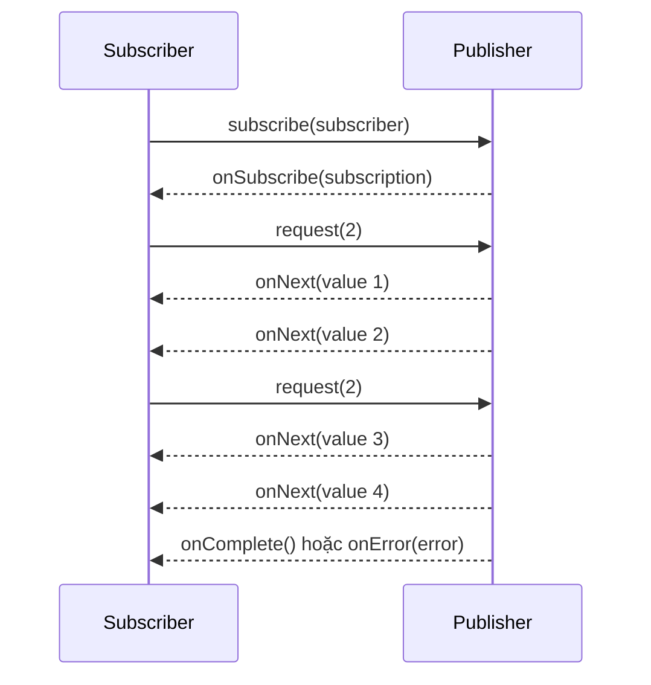

# Subscription: yêu cầu dữ liệu bằng request và hủy bằng cancel

## Subscription điều phối việc nhận dữ liệu

Trong Reactive Streams, `Publisher` phát dữ liệu và `Subscriber` tiếp nhận dữ liệu thông qua một hợp đồng có tên `Subscription`. Khi subscriber đăng ký với publisher, publisher gọi `onSubscribe(subscription)` để trao cho subscriber một tay điều khiển. Từ đó, subscriber có thể yêu cầu thêm phần tử bằng `request(n)` hoặc dừng nhận bằng `cancel()`.

`Subscription` giải quyết hai nhu cầu cốt lõi:

- **Điều tiết nhu cầu (demand):** subscriber cho publisher biết mình có thể tiếp nhận bao nhiêu phần tử. Publisher không được phát `onNext` vượt quá nhu cầu đã được yêu cầu.
- **Hủy việc tiêu thụ:** subscriber thông báo rằng mình không còn quan tâm đến dữ liệu tiếp theo. Publisher cần dừng phát cho subscription đó và giải phóng tài nguyên liên quan khi có thể.

Đây là cơ chế nền tảng của backpressure trong Reactive Streams. Subscriber có thể yêu cầu dữ liệu theo từng phần phù hợp với khả năng xử lý, thay vì mặc định nhận một lượng dữ liệu không giới hạn. `request` và `cancel` là hai thao tác khác nhau: một thao tác bổ sung nhu cầu, thao tác còn lại kết thúc việc nhận dữ liệu.

## Vòng đời của một Subscription

Một subscription thường trải qua các bước sau:

1. Subscriber gọi `publisher.subscribe(subscriber)` để đăng ký.
2. Publisher gọi `subscriber.onSubscribe(subscription)` và cung cấp đối tượng subscription.
3. Subscriber gọi `subscription.request(n)` với `n` là số dương để yêu cầu phần tử, hoặc gọi `subscription.cancel()` nếu không muốn tiếp tục.
4. Publisher phát tối đa số phần tử tương ứng với demand qua `onNext(value)`. Khi cần thêm dữ liệu, subscriber có thể gọi `request(n)` lần nữa.
5. Nếu luồng kết thúc tự nhiên, publisher phát một trong hai tín hiệu kết thúc: `onComplete()` hoặc `onError(error)`. Nếu subscriber hủy trước, subscription kết thúc theo hướng hủy và không cần phát `onComplete()` cho subscriber.

`onSubscribe` được gọi trước các tín hiệu dữ liệu hoặc tín hiệu kết thúc. Mỗi lần đăng ký tạo một subscription riêng; demand và trạng thái hủy của subscriber này không tự động áp dụng cho subscriber khác. Một publisher có thể phục vụ nhiều subscription, nhưng chính sách chia sẻ hoặc chạy lại nguồn phụ thuộc cách publisher được xây dựng.



Sơ đồ thể hiện một luồng hữu hạn. Publisher có thể phát ít hơn số phần tử đã được yêu cầu nếu nguồn hiện không có thêm dữ liệu; demand còn lại vẫn có thể được dùng khi dữ liệu xuất hiện hoặc khi nguồn tiếp tục phát.

## request(n): khai báo lượng dữ liệu có thể tiếp nhận

`request(n)` thông báo rằng subscriber sẵn sàng nhận thêm tối đa `n` phần tử; tham số `n` có kiểu `long` và phải là số nguyên dương. Nếu truyền `0` hoặc số âm, subscriber vi phạm hợp đồng Reactive Streams; publisher phải kết thúc subscription bằng tín hiệu lỗi, thường là `IllegalArgumentException`.

Demand có tính tích lũy. Nếu subscriber gọi `request(3)` rồi gọi tiếp `request(2)` trước khi toàn bộ nhu cầu được đáp ứng, tổng nhu cầu được bổ sung là năm phần tử. Khi publisher phát một `onNext`, phần demand hữu hạn còn lại giảm đi một. Nếu phép cộng demand vượt giới hạn của `long`, nhu cầu được xem như `Long.MAX_VALUE`. Publisher có thể phát ít hơn demand, nhưng không được phát nhiều hơn số phần tử đã được yêu cầu.

Ví dụ, subscriber có thể yêu cầu hai phần tử ban đầu, xử lý chúng, rồi mới yêu cầu hai phần tử tiếp theo. Với Reactor, `BaseSubscriber` giúp kiểm soát demand một cách tường minh:

```java
import org.reactivestreams.Subscription;
import reactor.core.publisher.BaseSubscriber;
import reactor.core.publisher.Flux;

Flux.range(1, 5).subscribe(new BaseSubscriber<Integer>() {
    private int receivedInBatch;

    @Override
    protected void hookOnSubscribe(Subscription subscription) {
        request(2); // Chỉ yêu cầu hai phần tử ban đầu.
    }

    @Override
    protected void hookOnNext(Integer value) {
        System.out.println("Đã xử lý: " + value);
        receivedInBatch++;

        if (receivedInBatch == 2) {
            receivedInBatch = 0;
            request(2); // Bổ sung nhu cầu sau mỗi nhóm hai phần tử.
        }
    }

    @Override
    protected void hookOnComplete() {
        System.out.println("Đã nhận hết dữ liệu");
    }
});
```

Với nguồn `Flux.range` đồng bộ, việc gọi `request` có thể làm publisher phát các phần tử ngay trong quá trình gọi đó. Vì thế, không nên giả định `request` luôn tạo một tác vụ bất đồng bộ hoặc luôn trả về trước khi có `onNext`. Subscriber nên xử lý tín hiệu ngắn gọn và tránh thực hiện công việc chặn trong các callback.

### Nhu cầu hữu hạn và nhu cầu không giới hạn

Một subscriber có thể yêu cầu một lượng hữu hạn nhiều lần, hoặc yêu cầu `Long.MAX_VALUE` để biểu thị nhu cầu không giới hạn. Khi demand là `Long.MAX_VALUE`, publisher có thể phát liên tục mà không cần subscriber yêu cầu thêm. Các thư viện reactive thường dùng giá trị này cho những overload `subscribe` tiện dụng khi người gọi không chỉ định chiến lược demand.

Trong Reactor, các dạng `subscribe` nhận consumer thường yêu cầu không giới hạn. Cách dùng này đơn giản cho luồng hữu hạn hoặc khi bên nhận đủ khả năng xử lý mọi phần tử, nhưng không thể hiện một giới hạn tiêu thụ cụ thể. Nếu cần kiểm soát lượng dữ liệu, hãy dùng `BaseSubscriber` hoặc một subscriber tự cài đặt để quyết định thời điểm gọi `request(n)`.

Demand không phải số lượng phần tử mà publisher bắt buộc phải phát ngay lập tức. Nó là giới hạn cho phép phát. Nguồn có thể phát chậm, phát ít hơn số lượng đã yêu cầu hoặc hoàn tất trước khi dùng hết demand. Các tín hiệu kết thúc `onComplete` và `onError` không cần chờ demand của `onNext`.

## cancel(): dừng nhận dữ liệu

`cancel()` thông báo rằng subscriber không muốn nhận thêm phần tử từ subscription hiện tại. Sau khi nhận yêu cầu hủy, publisher phải dừng phát tín hiệu cho subscription đó trong thời gian hợp lý và nên giải phóng tài nguyên liên quan, chẳng hạn hủy truy vấn đang chạy, đóng cursor, tháo listener hoặc ngừng đăng ký với message source nếu có thể.

Hủy có các đặc điểm cần nhớ:

- Gọi `cancel()` nhiều lần không làm thay đổi ý nghĩa; thao tác hủy phải có tính idempotent.
- Subscriber có thể hủy ngay cả khi chưa yêu cầu dữ liệu hoặc khi đang chờ dữ liệu.
- Hủy không đồng nghĩa với hoàn tất thành công. Publisher không cần gửi `onComplete()` sau khi subscriber đã hủy.
- Hủy là yêu cầu dừng việc phát dữ liệu cho subscription; nó không tự động hoàn tác side effect đã xảy ra hoặc bảo đảm một tác vụ bên ngoài dừng tức thì.
- Nếu một tín hiệu đang được xử lý đồng thời với thời điểm hủy, ứng dụng cần thiết kế callback an toàn với tình huống cạnh tranh và không dựa vào việc mọi công việc đang chạy đều bị thu hồi ngay lập tức.

Với các overload `subscribe` của Reactor, giá trị trả về là một `Disposable`. Gọi `dispose()` trên đối tượng này yêu cầu hủy subscription:

```java
import java.time.Duration;
import reactor.core.Disposable;
import reactor.core.publisher.Flux;

Disposable subscription = Flux.interval(Duration.ofMillis(250))
    .subscribe(tick -> System.out.println("Tick: " + tick));

// Khi thành phần sở hữu luồng không còn cần dữ liệu:
subscription.dispose();
```

Trong ứng dụng thực tế, thành phần tạo subscription nên giữ handle này và gọi `dispose()` khi vòng đời của nó kết thúc, ví dụ khi một phiên làm việc bị đóng hoặc người dùng rời khỏi màn hình. Tránh tạo subscription mà không quản lý handle nếu nguồn có thể phát vô hạn hoặc giữ tài nguyên lâu dài.

### Hủy upstream không nhất thiết là hoàn tất downstream

Một toán tử có thể hủy subscription upstream nhưng vẫn gửi một tín hiệu hoàn tất bình thường cho downstream. Ví dụ `take(3)` chỉ cần ba phần tử đầu tiên, nên sau khi nhận đủ ba phần tử, nó hủy nguồn phía trên và báo hoàn tất cho subscriber phía dưới:

```java
import reactor.core.publisher.Flux;

Flux.range(1, 100)
    .doFinally(signal -> System.out.println("Nguồn kết thúc: " + signal))
    .take(3)
    .subscribe(
        value -> System.out.println("Nhận: " + value),
        error -> System.err.println("Lỗi: " + error.getMessage()),
        () -> System.out.println("Đã nhận đủ ba phần tử")
    );
```

Toán tử `take(3)` hủy việc nhận từ nguồn sau ba phần tử. `doFinally` đặt trước `take` quan sát việc hủy ở phía upstream, còn subscriber downstream nhận `onComplete` vì `take` đã thỏa mãn giới hạn của nó. Đây là ví dụ cho thấy tín hiệu hủy và tín hiệu hoàn tất có ý nghĩa khác nhau ở các vị trí khác nhau trong đồ thị.

## Subscription và backpressure trong pipeline

Trong một pipeline có nhiều toán tử, mỗi ranh giới publisher–subscriber nội bộ đều tham gia phối hợp demand. Subscriber cuối yêu cầu dữ liệu; các toán tử trung gian chuyển tiếp hoặc điều chỉnh nhu cầu đến nguồn upstream. Do đó, một yêu cầu ở downstream không nhất thiết được chuyển thành đúng cùng một số yêu cầu ở upstream.

Một số toán tử cần đọc trước dữ liệu hoặc giữ dữ liệu trong buffer để thực hiện công việc. Ví dụ, toán tử chuyển ngữ cảnh như `publishOn` có thể dùng hàng đợi nội bộ và cơ chế prefetch. Toán tử gom nhóm, sắp xếp hoặc kết hợp nhiều nguồn cũng có thể cần giữ phần tử trong bộ nhớ. Những toán tử này có thể phát sinh yêu cầu upstream theo lô để duy trì hiệu suất, trong khi vẫn tôn trọng hợp đồng demand giữa các ranh giới.

```mermaid
flowchart LR
    S["Subscriber cuối"] -->|request(n)| O["Toán tử / hàng đợi"]
    O -->|request đã điều chỉnh hoặc prefetch| P["Publisher nguồn"]
    P -->|onNext| O
    O -->|onNext theo downstream demand| S
    S -->|cancel| O
    O -->|cancel upstream| P
```

Vì vậy, backpressure không đồng nghĩa với việc toàn bộ pipeline không dùng bộ nhớ hoặc không thể bị quá tải. Cần hiểu các toán tử nào đệm dữ liệu, kích thước prefetch, giới hạn buffer và chính sách khi buffer đầy. Một subscriber có demand thấp vẫn có thể đứng sau một toán tử đang giữ dữ liệu trong hàng đợi; việc cấu hình pipeline phải tính đến tổng lượng dữ liệu đang chờ trên các ranh giới.

Reactor cung cấp `limitRate` để điều chỉnh cách demand được truyền lên upstream theo các lô nhỏ hơn. Ví dụ:

```java
import reactor.core.publisher.Flux;

Flux.range(1, 1_000)
    .limitRate(32)
    .map(number -> "record-" + number)
    .subscribe(System.out::println);
```

`limitRate(32)` điều chỉnh việc yêu cầu dữ liệu upstream thành các lô có high-tide tối đa là 32 phần tử. Nó không giới hạn tổng số phần tử của luồng ở 32; nguồn vẫn có thể phát đủ 1.000 phần tử nếu downstream tiếp tục yêu cầu. Nếu muốn giới hạn tổng số phần tử, dùng toán tử như `take(32)`. Hai thao tác có mục đích khác nhau: `limitRate` điều tiết demand theo lô, còn `take` giới hạn số phần tử được chuyển tiếp.

## Quan sát trạng thái kết thúc và hủy

Khi phân tích vòng đời subscription, cần phân biệt ba trường hợp:

| Trường hợp | Tín hiệu quan sát | Ý nghĩa |
|---|---|---|
| Hoàn tất bình thường | `onComplete` | Nguồn kết thúc mà không có lỗi |
| Kết thúc do lỗi | `onError(error)` | Pipeline kết thúc vì lỗi chưa được phục hồi |
| Bị hủy | `cancel()` ở upstream; Reactor có thể quan sát bằng `doOnCancel` hoặc `doFinally` với `SignalType.CANCEL` | Subscriber hoặc toán tử không còn yêu cầu dữ liệu |

`doOnComplete` chỉ quan sát hoàn tất bình thường; `doOnError` quan sát lỗi; `doOnCancel` quan sát yêu cầu hủy. `doFinally` hữu ích khi cần thực hiện tác vụ dọn dẹp cho mọi kiểu kết thúc vì nó nhận loại tín hiệu cuối cùng. Không nên dùng `onComplete` để suy ra rằng subscriber đã hủy, hoặc dùng `cancel` như cách biểu diễn một lỗi nghiệp vụ.

Ví dụ ghi nhận cả ba trạng thái:

```java
import reactor.core.publisher.Flux;
import reactor.core.publisher.SignalType;

Flux<Integer> pipeline = Flux.range(1, 10)
    .doOnComplete(() -> System.out.println("Nguồn hoàn tất bình thường"))
    .doOnError(error -> System.err.println("Nguồn gặp lỗi: " + error))
    .doFinally(signal -> {
        if (signal == SignalType.CANCEL) {
            System.out.println("Subscription đã bị hủy");
        }
    });

pipeline.subscribe();
```

Trong ứng dụng, có thể bổ sung `doFinally` để giải phóng tài nguyên do pipeline sở hữu. Với tài nguyên ngoài như kết nối, cursor hoặc request đến dịch vụ khác, cần bảo đảm adapter của nguồn thực sự liên kết việc hủy với thao tác dừng hoặc giải phóng tương ứng.

## Những lỗi thiết kế thường gặp

- **Không yêu cầu dữ liệu sau `onSubscribe`:** subscriber không phát sinh demand nên không nhận `onNext`. Với `BaseSubscriber`, nếu ghi đè `hookOnSubscribe`, cần chủ động gọi `request(n)` khi muốn bắt đầu nhận.
- **Yêu cầu không dương:** `request(0)` hoặc `request(-1)` vi phạm hợp đồng. Chỉ yêu cầu một số nguyên dương.
- **Yêu cầu không giới hạn mà không cân nhắc tải:** `Long.MAX_VALUE` thuận tiện nhưng có thể khiến bên nhận phải xử lý nhanh một lượng dữ liệu lớn. Hãy chọn chiến lược demand phù hợp với khả năng tiêu thụ.
- **Quên hủy nguồn dài hạn:** subscription đến nguồn sự kiện vô hạn có thể giữ listener, timer hoặc tài nguyên lâu hơn vòng đời thành phần sở hữu. Hãy lưu và quản lý handle hủy.
- **Xem hủy là hoàn tác:** hủy không đảo ngược các side effect đã thực hiện và không bảo đảm một tác vụ I/O bên ngoài dừng tức thì.
- **Nhầm hủy upstream với hoàn tất toàn pipeline:** toán tử như `take` có thể hủy nguồn upstream rồi chủ động phát `onComplete` xuống downstream.
- **Cho rằng demand được truyền nguyên trạng qua mọi toán tử:** toán tử có thể prefetch hoặc buffer. Cần xem xét giới hạn hàng đợi và chính sách điều tiết của từng bước.

## Nguyên tắc sử dụng trong ứng dụng Java

Khi xây dựng subscriber hoặc pipeline Reactor, hãy xác định rõ ai sở hữu subscription, subscriber có thể xử lý bao nhiêu phần tử cùng lúc và điều kiện nào khiến luồng không còn cần thiết. Dùng `request(n)` để biểu đạt năng lực tiêu thụ, bổ sung demand khi đã xử lý dữ liệu, và gọi `cancel()` hoặc `dispose()` khi vòng đời công việc kết thúc. Kiểm tra các toán tử có buffer hoặc prefetch để tránh tích tụ dữ liệu ngoài dự kiến.

Với những pipeline đơn giản, các overload `subscribe` tiện dụng giúp mã ngắn gọn và thường yêu cầu không giới hạn. Với nguồn dài hạn, tải lớn hoặc yêu cầu kiểm soát tài nguyên, hãy quản lý demand và vòng đời subscription tường minh. Thiết kế đúng hai thao tác `request` và `cancel` giúp hệ thống phối hợp tốc độ phát với khả năng tiêu thụ, dừng công việc không còn cần thiết và vận hành ổn định hơn khi xử lý luồng sự kiện bất đồng bộ.
