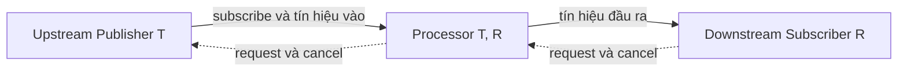
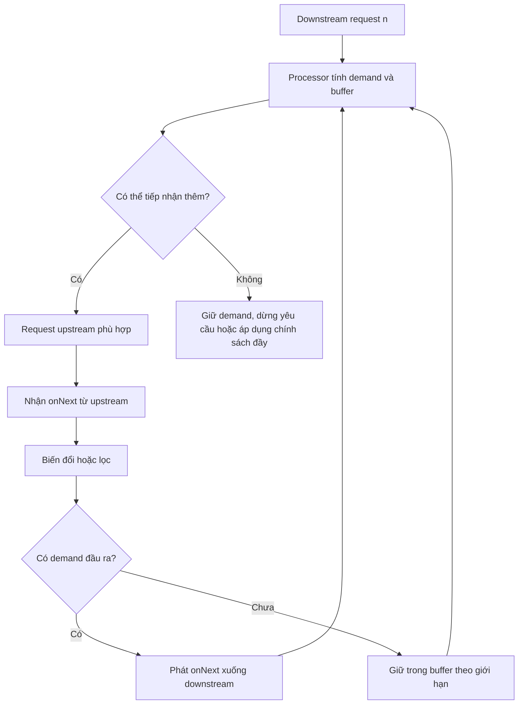

# Processor: vai trò trung gian vừa nhận vừa phát dữ liệu

Trong module `REACTIVE_PROGRAMMING`, ta học cách tổ chức các luồng sự kiện bất đồng bộ theo hợp đồng Publisher–Subscriber và cơ chế backpressure của Reactive Streams, đồng thời thực hành `Mono`, `Flux`, toán tử, scheduler, xử lý lỗi và kiểm thử pipeline trong hệ sinh thái Java. Một thành phần đáng chú ý trong hợp đồng này là **Processor**: một đối tượng đứng giữa hai phía của stream, vừa nhận dữ liệu từ upstream như một `Subscriber`, vừa cung cấp dữ liệu cho downstream như một `Publisher`.

Processor hữu ích khi cần tạo một ranh giới xử lý có thể nhận một luồng đầu vào, áp dụng chính sách riêng rồi phát luồng đầu ra. Vì nó tham gia cả hai phía của giao thức, Processor phải quản lý vòng đời tín hiệu và backpressure ở cả đầu vào lẫn đầu ra. Chỉ triển khai hai nhóm phương thức là chưa đủ; thành phần đó còn phải giữ đúng hợp đồng Reactive Streams.

## 1. Processor là gì?

Trong thư viện Reactive Streams, interface `org.reactivestreams.Processor<T, R>` được định nghĩa bằng cách kết hợp hai vai trò:

```java
public interface Processor<T, R>
        extends Subscriber<T>, Publisher<R> {
}
```

- `T` là kiểu dữ liệu Processor nhận từ upstream.
- `R` là kiểu dữ liệu Processor phát đến downstream.
- Phía `Subscriber<T>` cho phép upstream gọi `onSubscribe`, `onNext`, `onError` và `onComplete` trên Processor.
- Phía `Publisher<R>` cho phép downstream đăng ký vào Processor và nhận một `Subscription` cùng các tín hiệu đầu ra.

Ví dụ, một Processor có thể nhận `Order`, kiểm tra trạng thái đơn hàng rồi phát `OrderSummary`. Dữ liệu đầu vào và đầu ra có thể cùng kiểu hoặc khác kiểu; interface không áp đặt một phép biến đổi cụ thể.



Processor là một cầu nối giao thức, không phải tên gọi chung cho mọi toán tử. Một toán tử như `map` cũng nằm giữa nguồn và subscriber trong pipeline, nhưng API của nó thường được biểu diễn như một Publisher mới được lắp ghép từ Publisher trước đó. Processor công khai đồng thời hai vai trò `Subscriber` và `Publisher` trên cùng một đối tượng.

## 2. Hai phía của vòng đời subscription

Processor tham gia vào hai quan hệ đăng ký riêng biệt. Upstream đăng ký Processor làm subscriber; downstream đăng ký vào Processor như một publisher.

```java
import org.reactivestreams.Processor;
import org.reactivestreams.Publisher;
import org.reactivestreams.Subscriber;

void connect(
        Publisher<Event> upstream,
        Processor<Event, Event> processor,
        Subscriber<Event> downstream) {

    processor.subscribe(downstream);
    upstream.subscribe(processor);
}
```

Đoạn mã thể hiện cách nối các vai trò của interface; `processor` ở đây là một implementation đã được xây dựng. Đăng ký downstream trước giúp Processor có thể thiết lập phía nhận trước khi upstream bắt đầu phát dữ liệu. Một implementation vẫn phải xử lý đúng thứ tự callback theo hợp đồng và không được giả định rằng upstream sẽ luôn phát ngay sau lời gọi `subscribe`.

Các bước chính diễn ra như sau:

1. Downstream gọi `processor.subscribe(downstream)`. Processor phải cung cấp cho subscriber một `Subscription` để subscriber có thể yêu cầu dữ liệu hoặc hủy đăng ký.
2. Upstream gọi `upstream.subscribe(processor)`. Upstream truyền `Subscription` của nó đến Processor qua `onSubscribe`.
3. Processor quyết định yêu cầu bao nhiêu dữ liệu từ upstream, dựa trên nhu cầu downstream và khả năng tiếp nhận nội bộ.
4. Khi nhận `onNext(T)`, Processor có thể biến đổi, lọc, kiểm tra hoặc chuyển tiếp dữ liệu rồi phát `onNext(R)` đến downstream.
5. Khi upstream phát `onError` hoặc `onComplete`, Processor truyền tín hiệu kết thúc phù hợp đến downstream theo chính sách của nó.

Hai phía có hai đối tượng subscription khác nhau: subscription mà upstream trao cho Processor và subscription mà Processor trao cho downstream. Processor chịu trách nhiệm liên kết nhu cầu và việc hủy đăng ký giữa hai phía. Không nên coi hai subscription này là cùng một đối tượng hoặc mặc định mọi lời gọi `request` có thể chuyển nguyên xi qua ranh giới.

## 3. Processor phải tuân thủ hợp đồng tín hiệu

Vì vừa là Subscriber vừa là Publisher, Processor phải tôn trọng quy tắc ở cả hai đầu:

- Phía subscriber: tiếp nhận `onSubscribe` từ upstream, không xử lý dữ liệu trước khi có subscription hợp lệ, và không yêu cầu dữ liệu sau khi đã hủy hoặc kết thúc.
- Phía publisher: mỗi downstream subscriber phải nhận `onSubscribe` trước các tín hiệu dữ liệu hoặc kết thúc; chỉ phát `onNext` khi đã có demand tương ứng.
- Tín hiệu `onError` và `onComplete` là tín hiệu kết thúc. Sau một trong hai tín hiệu này, không phát thêm `onNext` hay một tín hiệu kết thúc thứ hai cho cùng subscription.
- Các tín hiệu trên một subscription phải được tuần tự hóa. Processor không được đồng thời gọi `onNext` và `onComplete` trên cùng subscriber theo cách vi phạm thứ tự tín hiệu.
- Khi downstream hủy subscription, Processor phải ngừng phát dữ liệu cho subscriber đó và áp dụng chính sách hủy upstream thích hợp.

Processor không tự động trở nên an toàn đa luồng chỉ vì nó triển khai interface Reactive Streams. Tính an toàn khi có nhiều thread gọi vào, cách tuần tự hóa tín hiệu và việc bảo vệ trạng thái nội bộ phụ thuộc implementation. Nếu upstream có thể gọi đồng thời hoặc dữ liệu đến từ nhiều nguồn, Processor phải xử lý tình huống đó một cách tường minh.

## 4. Backpressure đi qua Processor như thế nào?

Backpressure là phần khó nhất khi thiết kế Processor. Downstream gửi `request(n)` đến subscription do Processor cung cấp. Processor phải chuyển nhu cầu đó thành chiến lược yêu cầu upstream, đồng thời tính đến số phần tử đang chờ xử lý hoặc đang nằm trong buffer.

Trong trường hợp biến đổi một-một đơn giản, Processor có thể yêu cầu upstream theo lượng dữ liệu mà downstream cần, miễn là không có phần tử đang được giữ trong buffer và phép biến đổi không làm thay đổi số lượng phần tử. Nhưng nhiều phép xử lý không có quan hệ một-một:

| Kiểu xử lý | Quan hệ đầu vào và đầu ra | Điều Processor cần tính đến |
|---|---|---|
| `map` | Một đầu vào tạo một đầu ra | Có thể duy trì nhu cầu gần một-một nếu không có buffer khác |
| `filter` | Một đầu vào có thể không tạo đầu ra | Có thể cần yêu cầu thêm upstream để đáp ứng demand đầu ra |
| Mở rộng một phần tử thành nhiều phần tử | Một đầu vào tạo nhiều đầu ra | Phải giới hạn lượng đầu ra đang chờ và quản lý demand còn lại |
| Gom nhóm hoặc tổng hợp | Nhiều đầu vào tạo một đầu ra | Có thể cần tích lũy dữ liệu trước khi phát, đồng thời giới hạn bộ nhớ |

Ví dụ, downstream yêu cầu một phần tử. Nếu Processor lọc bỏ ba phần tử đầu vào trước khi phần tử thứ tư vượt qua điều kiện, Processor có thể cần yêu cầu thêm dữ liệu upstream để tạo ra một phần tử đầu ra. Ngược lại, nếu một phần tử đầu vào được mở rộng thành một nghìn phần tử đầu ra, Processor không thể phát cả nghìn phần tử khi downstream chỉ yêu cầu một.

Một Processor có buffer cần xác định rõ:

- Dung lượng buffer và cách giới hạn lượng dữ liệu được yêu cầu từ upstream.
- Hành vi khi buffer đầy: dừng yêu cầu upstream, báo lỗi, loại bỏ phần tử theo chính sách, hoặc dùng một cơ chế khác đã được xác định.
- Cách tính demand còn lại sau khi phát dữ liệu.
- Điều gì xảy ra khi downstream hủy đăng ký trong lúc buffer vẫn còn dữ liệu.

Không có một chính sách buffer phù hợp cho mọi ứng dụng. Buffer không giới hạn có thể che giấu tình trạng downstream xử lý chậm và làm bộ nhớ tăng liên tục. Chính sách bỏ phần tử có thể làm mất dữ liệu nghiệp vụ. Báo lỗi khi đầy có thể phù hợp với hệ thống cần bảo toàn dữ liệu và muốn thất bại rõ ràng. Hãy chọn theo yêu cầu của luồng dữ liệu.



Sơ đồ mô tả trách nhiệm khái quát. Thuật toán cụ thể phụ thuộc phép biến đổi, số subscriber và cấu trúc buffer của implementation.

## 5. Tín hiệu lỗi, hoàn tất và hủy đăng ký

Processor phải quyết định cách chuyển các tín hiệu kết thúc giữa hai phía, đồng thời bảo đảm mỗi downstream subscription có vòng đời hợp lệ.

**Lỗi từ upstream.** Khi upstream gọi `onError(error)`, Processor thường truyền lỗi đó xuống downstream bằng `onError(error)`. Nếu Processor có bước xử lý lỗi riêng, nó có thể ánh xạ hoặc thay thế lỗi theo hợp đồng đã công bố. Sau khi downstream nhận tín hiệu lỗi kết thúc, không phát thêm phần tử cho subscription đó.

**Hoàn tất từ upstream.** Khi upstream gọi `onComplete()`, Processor có thể phát nốt dữ liệu đã được tích lũy hợp lệ rồi gửi `onComplete` xuống downstream. Thứ tự này quan trọng: không được báo hoàn tất trước khi đã xử lý xong các phần tử mà implementation cam kết phát.

**Hủy từ downstream.** Khi subscriber hủy subscription, Processor cần dừng phát dữ liệu đến subscriber đó. Nếu chỉ có một downstream subscriber, việc hủy thường dẫn đến hủy upstream để tránh tiếp tục làm công việc không còn người nhận. Nếu hỗ trợ nhiều subscriber, chính sách có thể phức tạp hơn: một subscriber hủy không nhất thiết có nghĩa tất cả subscriber đều hủy. Implementation phải xác định rõ điều kiện dừng upstream.

**Lỗi nội bộ.** Nếu phép biến đổi trong Processor thất bại, Processor cần kết thúc đường truyền tương ứng bằng `onError`, giải phóng tài nguyên và tránh tiếp tục phát dữ liệu sau đó. Không để ngoại lệ thoát khỏi callback rồi kỳ vọng upstream hoặc downstream tự hiểu đó là tín hiệu lỗi.

## 6. Một Processor có thể phục vụ bao nhiêu downstream?

Interface `Publisher` cho phép một đối tượng được nhiều subscriber đăng ký, nhưng điều đó không có nghĩa mọi implementation Processor đều hỗ trợ nhiều subscriber. Đây là quyết định thiết kế của implementation.

| Kiểu hỗ trợ | Hành vi thường gặp | Điều cần công bố |
|---|---|---|
| Unicast | Chỉ chấp nhận một downstream subscriber | Cách xử lý khi subscriber thứ hai đăng ký |
| Multicast | Phát dữ liệu cho nhiều subscriber đang đăng ký | Demand giữa các subscriber được phối hợp thế nào |
| Replay | Subscriber đến sau có thể nhận lại một phần dữ liệu trước đó | Giới hạn lịch sử, thời gian lưu và dung lượng |

Với multicast, mỗi subscriber có demand riêng. Processor không thể đơn giản lấy `request(n)` của từng subscriber rồi cộng tất cả thành số lượng yêu cầu upstream mà không xét chính sách phát. Nếu một subscriber chậm hơn các subscriber khác, implementation phải quyết định chờ subscriber chậm, buffer riêng, bỏ dữ liệu cho subscriber đó hay kết thúc subscription của nó. Các lựa chọn này ảnh hưởng trực tiếp đến độ trễ, bộ nhớ và tính đầy đủ dữ liệu.

Vì vậy, khi dùng một Processor có sẵn, hãy đọc rõ chính sách unicast/multicast, replay, buffer và cancellation. Đừng suy ra các khả năng này chỉ từ tên interface `Processor`.

## 7. Processor trong ứng dụng Reactor

Khi lập trình với Reactor, phần lớn phép biến đổi luồng thông thường nên được biểu diễn bằng các toán tử `Flux` hoặc `Mono`. Ví dụ, lọc đơn hàng đã thanh toán rồi chuyển thành bản tóm tắt có thể viết trực tiếp:

```java
Flux<OrderSummary> summaries = orders
    .filter(Order::isPaid)
    .map(OrderSummary::from);
```

Đây là một pipeline toán tử Publisher–Subscriber. Nó tạo ra luồng mới từ luồng đầu vào và Reactor quản lý subscription cùng backpressure qua các toán tử. Đoạn mã này không tạo một đối tượng `org.reactivestreams.Processor`.

Nếu ứng dụng cần nhận sự kiện được đẩy vào từ một nguồn bên ngoài rồi cung cấp chúng như một Publisher, Reactor có API `Sinks`. Ví dụ sau minh họa một cổng phát sự kiện cho các subscriber:

```java
Sinks.Many<OrderEvent> sink =
    Sinks.many().multicast().onBackpressureBuffer();

Flux<OrderEvent> events = sink.asFlux();

Sinks.EmitResult result = sink.tryEmitNext(orderEvent);
if (result.isFailure()) {
    // Xử lý kết quả phát thất bại theo chính sách của ứng dụng.
}
```

`Sinks` cung cấp API để producer chủ động phát dữ liệu; `asFlux()` công bố luồng cho subscriber. Đây là một mô hình hữu ích cho nguồn sự kiện được đẩy từ bên ngoài, nhưng `Sinks.Many` không phải là `Processor`: nó không đóng vai trò `Subscriber` để nhận trực tiếp subscription và tín hiệu từ một upstream Publisher. Khi cần nối hai Publisher bằng các bước xử lý, hãy ưu tiên các toán tử Reactor. Khi cần một cổng phát dữ liệu thủ công, cân nhắc `Sinks` và chọn rõ chính sách phát.

Ngoài ra, không nhầm `org.reactivestreams.Processor` với `java.util.concurrent.Flow.Processor` của JDK. Hai API có vai trò tương tự nhưng sử dụng các kiểu `Publisher`, `Subscriber` và `Subscription` thuộc hai package khác nhau; không thể truyền trực tiếp một implementation của API này vào nơi yêu cầu API kia nếu không có adapter.

## 8. Kiểm thử Processor

Một bài kiểm thử Processor nên xác nhận cả dữ liệu đầu ra lẫn hợp đồng tín hiệu. Với implementation cụ thể `ParsingProcessor` nhận chuỗi số và phát số nguyên, có thể dùng `StepVerifier` theo mẫu sau:

```java
Processor<String, Integer> processor = new ParsingProcessor();

StepVerifier.create(processor)
    .then(() -> Flux.just("12", "7").subscribe(processor))
    .expectNext(12, 7)
    .verifyComplete();
```

Trong ví dụ, `ParsingProcessor` là implementation của ứng dụng; phần cài đặt của nó phải bảo đảm các quy tắc Reactive Streams đã nêu. `StepVerifier` đăng ký làm downstream trước, sau đó `then` mới kết nối một upstream thử nghiệm. Bài kiểm thử xác nhận hai giá trị được chuyển đổi và tín hiệu hoàn tất đến đúng downstream.

Có thể kiểm tra đường lỗi tương tự:

```java
Processor<String, Integer> processor = new ParsingProcessor();

StepVerifier.create(processor)
    .then(() -> Flux.just("12", "invalid").subscribe(processor))
    .expectNext(12)
    .expectError(NumberFormatException.class)
    .verify();
```

Nếu Processor hỗ trợ backpressure, hãy kiểm tra với demand ban đầu bằng không hoặc một phần tử:

```java
Processor<String, Integer> processor = new ParsingProcessor();

StepVerifier.create(processor, 0)
    .thenRequest(1)
    .then(() -> Flux.just("12", "7").subscribe(processor))
    .expectNext(12)
    .thenCancel()
    .verify();
```

Kiểm thử cuối xác nhận downstream chỉ yêu cầu một phần tử rồi hủy. Tùy implementation, nên bổ sung kiểm tra rằng upstream được hủy khi không còn subscriber cần dữ liệu, buffer không vượt giới hạn, tín hiệu không phát sau khi kết thúc và nhiều subscriber nhận dữ liệu đúng theo chính sách đã công bố.

## 9. Khi nào nên dùng Processor?

Processor phù hợp khi ứng dụng thực sự cần một thành phần có hai mặt giao thức: nhận dữ liệu như Subscriber và công bố kết quả như Publisher. Chẳng hạn, một adapter có thể nhận callback từ upstream, áp dụng giao thức riêng rồi phát một stream khác; hoặc một thành phần có sẵn có thể cung cấp chính sách buffer và fan-out được kiểm soát.

Trước khi tự viết Processor, hãy xác định rõ kiểu dữ liệu đầu vào/đầu ra, số subscriber được hỗ trợ, chính sách demand, dung lượng buffer, xử lý lỗi, hoàn tất, hủy đăng ký và đồng bộ hóa. Đây là các phần của hợp đồng mà implementation phải chịu trách nhiệm.

Trong các pipeline Reactor thông thường, dùng `map`, `filter`, `flatMap`, `publishOn` và các toán tử phù hợp thường đơn giản hơn và giúp thư viện quản lý phần lớn chi tiết giao thức. Dùng `Sinks` khi cần một API phát sự kiện thủ công. Chỉ chọn Processor khi cần chính đối tượng vừa là Subscriber vừa là Publisher và đã có lý do rõ ràng cho ranh giới đó.

Hiểu đúng vai trò Processor giúp ta nhìn thấy backpressure và vòng đời subscription ở hai phía của một thành phần trung gian. Nó cũng giúp phân biệt ba nhu cầu thường gặp: biến đổi stream bằng toán tử, nhận dữ liệu được đẩy vào bằng sink, và triển khai một cầu nối Reactive Streams thực sự.
