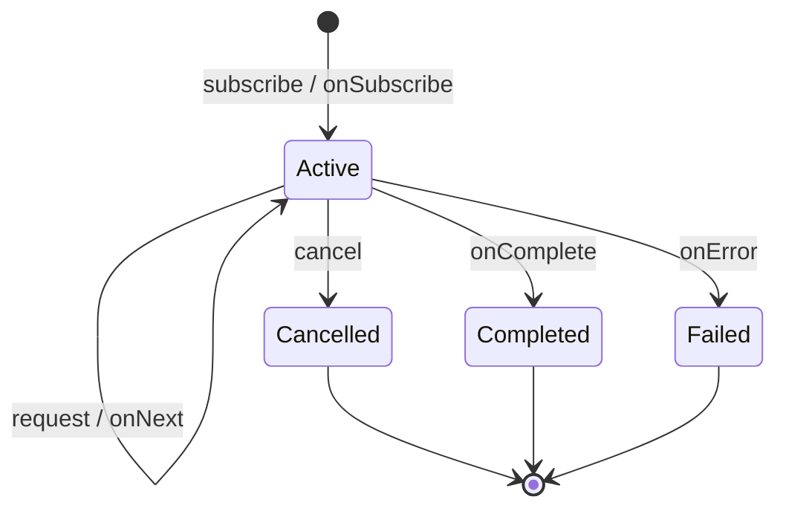

# Bộ kiểm tra tương thích TCK và giới hạn của việc tự cài đặt

Reactive Streams định nghĩa một hợp đồng nhỏ cho việc truyền dữ liệu bất đồng bộ giữa `Publisher`, `Subscriber` và `Subscription`. Một implementation có thể chạy đúng trong vài ví dụ nhưng vẫn vi phạm hợp đồng khi subscriber yêu cầu dữ liệu theo từng đợt, gọi `cancel()` đồng thời với lúc nguồn phát, hoặc gửi một yêu cầu không hợp lệ. Reactive Streams Technology Compatibility Kit (TCK) cung cấp bộ kiểm tra tương thích để phát hiện nhiều lỗi tuân thủ đặc tả như vậy.

TCK đặc biệt hữu ích khi xây thư viện, adapter hoặc một implementation `Publisher`/`Subscriber`/`Processor` mới. Với ứng dụng Java thông thường, Reactor đã cung cấp implementation Reactive Streams; người học thường cần hiểu TCK để biết cách đánh giá một thành phần tích hợp hoặc vì sao không nên tự viết giao thức từ đầu. TCK không chứng minh toàn bộ ứng dụng đúng nghiệp vụ, nhanh, không rò rỉ tài nguyên hay vận hành tốt dưới mọi loại tải. Nó kiểm tra sự phù hợp với các quy tắc giao thức trong phạm vi các test được thực thi.

## 1. TCK dùng để kiểm tra điều gì?

TCK là một bộ kiểm thử tương thích với đặc tả (Technology Compatibility Kit). Trong Reactive Streams, bộ kiểm thử cung cấp các lớp kiểm tra và môi trường hỗ trợ để đánh giá hành vi của các thành phần triển khai giao thức. Thay vì chỉ viết một test cho đường đi thành công, TCK kiểm tra nhiều tình huống biên và tương tác giữa các tín hiệu.

Các nhóm hành vi quan trọng gồm:

- **Thứ tự tín hiệu:** subscriber nhận `onSubscribe` trước các tín hiệu khác; các tín hiệu `onNext` được tuần tự hóa; sau `onComplete` hoặc `onError` không được phát thêm tín hiệu dữ liệu.
- **Demand:** publisher không phát nhiều `onNext` hơn số phần tử subscriber đã yêu cầu. Nhu cầu được cộng dồn và cần xử lý đúng các giá trị lớn.
- **Yêu cầu không hợp lệ:** `request(0)` hoặc `request(n)` với `n` âm vi phạm hợp đồng; publisher phải kết thúc subscription theo quy tắc lỗi tương ứng.
- **Terminal signal:** hoàn tất bình thường và lỗi là hai kết quả kết thúc loại trừ nhau; lỗi phải được truyền qua `onError` theo hợp đồng.
- **Cancellation:** publisher phải tôn trọng yêu cầu hủy và dừng phát dữ liệu cho subscription đã bị hủy, kể cả khi cancellation xảy ra gần thời điểm phát tín hiệu.
- **An toàn khi tương tác đồng thời:** những thao tác request, cancel và phát tín hiệu có thể đến từ các thread khác nhau; implementation phải duy trì các bảo đảm tuần tự mà đặc tả yêu cầu.
- **Hành vi subscriber:** subscriber phải nhận và xử lý các tín hiệu theo hợp đồng, không giả định dữ liệu sẽ đến ngay hoặc chỉ có một phần tử.

TCK kiểm tra hành vi quan sát được ở ranh giới giao thức. Nó không yêu cầu implementation phải dùng một thuật toán hàng đợi, executor hoặc cấu trúc dữ liệu nội bộ cụ thể. Hai implementation có thể có kiến trúc khác nhau nhưng đều tuân thủ cùng một hợp đồng.

## 2. Những thành phần có thể được kiểm tra

Reactive Streams định nghĩa ba abstraction cốt lõi và một abstraction kết hợp:

| Thành phần | Trách nhiệm | Hướng kiểm tra |
| --- | --- | --- |
| `Publisher<T>` | Cấp subscription và phát các phần tử cùng tín hiệu kết thúc | Kiểm tra demand, thứ tự, terminal signal, cancellation và hành vi khi lỗi |
| `Subscriber<T>` | Nhận subscription, yêu cầu dữ liệu và xử lý tín hiệu | Kiểm tra phản ứng với `onSubscribe`, `onNext`, `onError`, `onComplete` và việc quản lý demand |
| `Subscription` | Cung cấp `request(n)` và `cancel()` cho một lần đăng ký | Kiểm tra số lượng phần tử được yêu cầu, yêu cầu không hợp lệ và hủy |
| `Processor<T, R>` | Vừa là subscriber ở upstream vừa là publisher ở downstream | Kiểm tra cả hai phía và cách chuyển tiếp dữ liệu, demand, lỗi, hoàn tất, cancellation |

Trong thực tế, TCK cung cấp các lớp verification tương ứng cho publisher, subscriber và processor. Bộ test cho publisher thường là điểm bắt đầu khi xây một nguồn dữ liệu tùy chỉnh. Với processor, cần kiểm tra cả hành vi nhận dữ liệu từ upstream lẫn hành vi phát dữ liệu cho downstream; chỉ test riêng một phía là chưa đủ.

Một adapter chuyển callback thành publisher cũng là một thành phần cần được kiểm tra. Adapter phải xử lý việc đăng ký và gỡ callback, chuyển lỗi, giới hạn hoặc xử lý buffer, và phản ánh cancellation nếu API nguồn có hỗ trợ. Chỉ vì adapter có thể phát vài giá trị trong test đơn giản không có nghĩa nó tuân thủ Reactive Streams khi consumer yêu cầu từng phần tử hoặc hủy giữa chừng.

## 3. Thêm Reactive Streams TCK vào dự án

TCK thường được khai báo như dependency chỉ dùng trong test. Hãy chọn phiên bản tương thích với phiên bản Reactive Streams API mà dự án đang sử dụng và quản lý tập trung qua dependency management của dự án.

Ví dụ cấu hình Maven:

```xml
<properties>
    <reactive-streams.version>1.0.4</reactive-streams.version>
</properties>

<dependencies>
    <dependency>
        <groupId>org.reactivestreams</groupId>
        <artifactId>reactive-streams-tck</artifactId>
        <version>${reactive-streams.version}</version>
        <scope>test</scope>
    </dependency>
</dependencies>
```

Phiên bản trong ví dụ là một mốc minh họa; hãy kiểm tra version đang được dự án và thư viện nền tảng sử dụng trước khi thêm dependency. TCK cần nằm trong test scope vì mục tiêu của nó là xác minh implementation trong quá trình phát triển và CI, không phải thêm bộ kiểm thử vào runtime của ứng dụng.

Tùy phiên bản TCK và cấu hình dự án, các lớp verification có thể tích hợp với test runner cụ thể. Hãy dùng đúng test framework mà artifact đang yêu cầu và đảm bảo CI thực sự phát hiện các test kế thừa từ lớp verification. Một lớp test biên dịch được nhưng không được test runner thực thi sẽ không cung cấp bằng chứng tương thích.

## 4. Kiểm tra Publisher bằng PublisherVerification

Khi tự triển khai `Publisher<T>`, lớp verification của TCK giúp chạy một tập test chung. Với API TCK phổ biến, `PublisherVerification<T>` yêu cầu implementation cung cấp publisher phát một số lượng phần tử hữu hạn và một publisher kết thúc bằng lỗi.

Ví dụ khung kiểm thử:

```java
public final class CustomPublisherVerification
        extends PublisherVerification<Long> {

    public CustomPublisherVerification() {
        super(new TestEnvironment());
    }

    @Override
    public Publisher<Long> createPublisher(long elements) {
        return customPublisherOf(elements);
    }

    @Override
    public Publisher<Long> createFailedPublisher() {
        return customPublisherThatFails();
    }
}
```

`customPublisherOf` và `customPublisherThatFails` đại diện cho implementation của dự án, không phải API có sẵn của TCK. Publisher thứ nhất phải có khả năng phát số phần tử hữu hạn phù hợp với yêu cầu test; publisher thứ hai phải thể hiện lỗi theo đúng giao thức, bao gồm thứ tự đăng ký và tín hiệu lỗi. Các phương thức abstract và constructor cần được xác nhận theo phiên bản TCK cụ thể đang dùng.

Không nên viết `createFailedPublisher()` bằng cách ném exception ngay khi tạo đối tượng publisher. Việc tạo publisher và việc một subscription nhận tín hiệu lỗi là hai thời điểm khác nhau. Test cần quan sát lỗi được phát theo giao thức khi subscriber đăng ký.

TCK còn có các điểm mở rộng để giới hạn số phần tử, cấu hình môi trường kiểm thử hoặc bỏ qua một số test tùy trường hợp mà API cho phép. Chỉ nên thay đổi các thiết lập này khi có lý do kỹ thuật rõ ràng. Bỏ qua test để làm build xanh không phải là bằng chứng implementation tuân thủ đặc tả.

## 5. Kiểm tra Subscriber và Processor

PublisherVerification tập trung vào publisher. Nếu thư viện của bạn cũng cung cấp subscriber hoặc processor tùy chỉnh, cần dùng các verification phù hợp cho từng vai trò.

Với subscriber, test cần xác minh subscriber:

- Xử lý `onSubscribe` và giữ subscription đúng cách.
- Không yêu cầu lượng dữ liệu vượt quá chính sách mà nó dự định tiêu thụ.
- Không giả định `onNext` chỉ được gọi đúng một lần.
- Phân biệt hoàn tất bình thường với lỗi.
- Không tiếp tục yêu cầu hoặc xử lý dữ liệu như thể subscription còn hoạt động sau khi đã hủy.
- Không làm hỏng giao thức khi logic xử lý nội bộ gặp lỗi.

TCK có các kiểu kiểm tra subscriber theo cách black-box hoặc white-box. Kiểu black-box đánh giá hành vi qua giao diện công khai. Kiểu white-box có thể dùng probe để quan sát tương tác bên trong theo giao thức kiểm thử. Hãy chọn kiểu verification phù hợp với mức độ kiểm soát implementation và API của phiên bản TCK.

Processor vừa nhận tín hiệu upstream vừa cung cấp publisher downstream. Khi kiểm thử processor, cần xác minh demand được truyền đúng hướng, cancellation downstream có được chuyển upstream, và lỗi/hoàn tất được chuyển tiếp đúng cách. Nếu processor biến đổi dữ liệu, ngoài TCK cần có unit test cho phép biến đổi nghiệp vụ; TCK không biết phép biến đổi đó có đúng yêu cầu sản phẩm hay không.

## 6. Những lỗi TCK thường giúp phát hiện

Tự viết một publisher thường có vẻ đơn giản: lưu subscriber, gọi `onSubscribe`, rồi phát `onNext` trong vòng lặp. Nhưng chỉ một vài giả định sai cũng có thể làm hỏng giao thức.

### Phát vượt demand

Giả sử subscriber chỉ gọi `request(1)`, nhưng publisher phát ngay năm phần tử. Consumer có thể bị quá tải và implementation vi phạm hợp đồng. Publisher cần theo dõi demand và chỉ phát số phần tử được phép. Khi cộng dồn demand, cần xử lý tràn số an toàn; không được để số âm do overflow khiến publisher phát sai hoặc dừng sai.

### Phát tín hiệu đồng thời

Nếu nhiều thread cùng gọi `onNext` trên một subscriber mà không tuần tự hóa, subscriber có thể nhận callback chồng lấn. Điều đó vi phạm bảo đảm tuần tự tín hiệu. Dùng một hàng đợi và một cơ chế drain tuần tự, hoặc một thiết kế tương đương, để đảm bảo tín hiệu được phát theo thứ tự và không gọi đồng thời lên cùng subscriber.

### Phát sau terminal signal

Sau `onComplete` hoặc `onError`, publisher không được phát thêm `onNext` hay terminal signal thứ hai. Một cờ trạng thái đơn giản có thể chưa đủ nếu nhiều thread cùng thay đổi trạng thái; cần bảo vệ chuyển trạng thái terminal một cách nguyên tử.

### Xử lý sai request không hợp lệ

`request(0)` và request số âm phải được xử lý theo hợp đồng, thường bằng `onError` với `IllegalArgumentException`. Không được coi chúng là yêu cầu không có dữ liệu rồi tiếp tục bình thường. Đồng thời, publisher phải bảo đảm không phát thêm phần tử sau khi kết thúc do lỗi.

### Bỏ qua cancellation

Nếu subscriber hủy mà publisher vẫn tiếp tục phát vô hạn, implementation tiêu tốn CPU, I/O hoặc bộ nhớ cho một consumer không còn tồn tại. Hủy cần được kiểm tra ở các ranh giới thích hợp, nguồn callback cần được gỡ khi có thể, và publisher con/tác vụ nội bộ cần được dừng theo khả năng.

### Gửi null hoặc sai thứ tự đăng ký

Reactive Streams không cho phép `null` làm phần tử `onNext`. Publisher cũng phải gửi `onSubscribe` trước các tín hiệu khác. Các lỗi kiểu này có thể không xuất hiện trong test happy path nếu dữ liệu luôn khác null và nguồn luôn phát theo một thứ tự thuận lợi.

## 7. Giới hạn của TCK

TCK là một công cụ quan trọng nhưng phạm vi của nó cần được hiểu chính xác.

| TCK có thể cung cấp bằng chứng về | TCK không tự chứng minh |
| --- | --- |
| Tuân thủ các quy tắc Reactive Streams được test | Đúng nghiệp vụ của ứng dụng |
| Demand và số lượng phần tử phát ra theo hợp đồng | Hiệu năng tốt ở mọi tải và mọi cấu hình |
| Thứ tự tín hiệu và terminal signal | Không có memory leak trong toàn bộ ứng dụng |
| Hành vi cancellation ở ranh giới publisher/subscriber được kiểm tra | Mọi request HTTP hoặc thao tác database bên ngoài đều được thu hồi |
| Một số tình huống tương tác đồng thời và race được TCK mô phỏng | Không có deadlock hoặc starvation trong mọi đường chạy |
| Hành vi của component theo test harness | Tính đúng đắn của logic biến đổi, dữ liệu và transaction nghiệp vụ |

TCK chỉ kiểm tra những hành vi mà bộ test thực thi. Nó không thể bao phủ mọi lịch chạy thread, mọi loại nguồn dữ liệu, mọi adapter hoặc mọi tình huống vận hành. Test pass không phải chứng nhận rằng implementation hoàn toàn không có lỗi. Nó cũng không thay thế unit test, integration test, load test, soak test, kiểm tra leak hoặc quan sát production.

Một publisher có thể vượt qua TCK nhưng vẫn có thiết kế bộ nhớ kém, buffer không giới hạn, thuật toán chậm, metric thiếu hoặc xử lý sai dữ liệu nghiệp vụ. Ngược lại, một test TCK thất bại có thể phản ánh implementation không tuân thủ giao thức, hoặc test harness chưa được cấu hình đúng cho nguồn và giới hạn của implementation. Cần đọc nguyên nhân thất bại và stack trace để phân biệt lỗi sản phẩm với lỗi cấu hình test.

## 8. Vì sao tự cài đặt Reactive Streams thường có chi phí cao?

Một implementation publisher nhỏ có thể chỉ cần một subscription và một vòng lặp phát dữ liệu. Nhưng để hoạt động đúng trong môi trường thực tế, nó cần phối hợp nhiều trạng thái cùng lúc:

- Demand tích lũy, kể cả khi `request(n)` được gọi đồng thời với phát dữ liệu.
- Cancellation có thể đến trước, trong hoặc sau một lần phát.
- Trạng thái terminal chỉ được chuyển một lần và không phát tín hiệu sau đó.
- Nhiều subscriber có thể có demand, tốc độ tiêu thụ và thời điểm hủy khác nhau.
- Nguồn có thể là đồng bộ, bất đồng bộ, callback, I/O hoặc một publisher khác.
- Buffer cần có giới hạn và chính sách quá tải rõ ràng.
- Tín hiệu phải được tuần tự hóa theo hợp đồng, dù nguồn sử dụng nhiều thread.
- Tài nguyên và tác vụ bên ngoài cần cleanup khi lỗi hoặc cancellation.

Các chi tiết này tương tác với nhau. Ví dụ, khi subscriber gọi `request(1)` ngay bên trong `onNext`, publisher có thể cần xử lý demand mới trong khi drain loop đang chạy. Nếu publisher gọi subscriber trực tiếp từ nhiều thread, việc đồng bộ hóa có thể gây lock contention hoặc deadlock. Nếu giải quyết bằng buffer, buffer có thể tăng không giới hạn khi consumer chậm. Nếu cancellation chỉ đặt một cờ nhưng nguồn callback không được gỡ, công việc bên ngoài vẫn tiếp tục tạo dữ liệu.

Vì vậy, tự cài đặt giao thức chỉ nên được cân nhắc khi bạn đang phát triển thư viện hoặc adapter có yêu cầu đặc biệt mà implementation hiện có không đáp ứng, hoặc khi mục tiêu là học cách hoạt động của giao thức. Với ứng dụng nghiệp vụ, dùng Reactor hoặc một thư viện Reactive Streams đã được kiểm chứng thường giảm đáng kể rủi ro và chi phí bảo trì.

## 9. Nếu buộc phải tự cài đặt, hãy làm theo quy trình

Một quy trình thận trọng giúp thu hẹp rủi ro:

1. **Đọc đặc tả trước khi viết code.** Liệt kê các quy tắc về subscription, demand, tín hiệu, terminal state, cancellation và serialization.
2. **Xác định vai trò cần triển khai.** Chỉ viết `Publisher`, `Subscriber`, `Processor` hoặc adapter thực sự cần thiết; tránh triển khai lại các phần không thuộc phạm vi.
3. **Thiết kế state machine.** Xác định trạng thái chưa subscribe, active, cancelled, completed và failed; mô tả chuyển trạng thái hợp lệ.
4. **Thiết kế demand an toàn.** Dùng phép cộng có kiểm soát overflow và bảo đảm chỉ phát trong giới hạn demand.
5. **Tuần tự hóa tín hiệu.** Đảm bảo `onNext`, `onError` và `onComplete` không được gọi chồng lấn trên cùng subscriber.
6. **Định nghĩa chính sách buffer và quá tải.** Giới hạn bộ nhớ, xác định khi đầy sẽ báo lỗi, drop, giữ latest hay làm chậm nguồn.
7. **Liên kết cancellation với nguồn.** Gỡ listener, hủy timer, đóng tài nguyên hoặc dừng publisher con khi API hỗ trợ.
8. **Chạy TCK trong CI.** Mọi thay đổi liên quan đến giao thức phải chạy lại toàn bộ verification phù hợp.
9. **Bổ sung test ngoài TCK.** Kiểm tra semantics nghiệp vụ, lỗi tích hợp, tài nguyên, hiệu năng và tải dài hạn.

State machine đơn giản có thể được mô tả như sau:



Đây là mô hình khái niệm để suy nghĩ về vòng đời. Implementation thực tế còn phải xử lý các thao tác đồng thời, demand bằng không, yêu cầu không hợp lệ và race tại thời điểm terminal/cancel.

## 10. Tách TCK khỏi các lớp kiểm thử khác

Một thư viện hoặc ứng dụng sử dụng Reactive Streams nên có nhiều lớp kiểm thử với mục tiêu khác nhau:

| Loại kiểm thử | Câu hỏi chính | Ví dụ |
| --- | --- | --- |
| TCK | Thành phần có tuân thủ giao thức Reactive Streams không? | Publisher không phát vượt demand, tôn trọng cancel và terminal signal |
| Unit test | Logic biến đổi có đúng không? | `map`/processor tính đúng tổng hoặc lọc đúng sự kiện |
| Integration test | Adapter và phụ thuộc có phối hợp đúng không? | HTTP client hủy request, broker acknowledgement đúng semantics |
| Load test | Hệ thống phản ứng thế nào khi tải tăng? | Throughput, latency, queue depth và heap ở nhiều mức concurrency |
| Soak test | Hệ thống có ổn định trong thời gian dài không? | Buffer, thread, connection và bộ nhớ có tăng liên tục không |
| Observability check | Có thể phát hiện sự cố khi vận hành không? | Metric, log và tracing cho timeout, cancellation, retry và lỗi |

TCK nên chạy sớm trong quá trình phát triển implementation. Unit và integration test xác minh ý nghĩa cụ thể của ứng dụng. Load và soak test cần môi trường cùng dữ liệu đại diện; không thể thay thế chúng bằng việc chạy TCK nhiều lần.

## 11. Khi nào nên dùng implementation có sẵn?

Đối với phần lớn ứng dụng Java, mục tiêu là xử lý luồng dữ liệu và I/O reactive, không phải xây một thư viện giao thức mới. Reactor cung cấp `Mono`, `Flux`, toán tử, scheduler, xử lý lỗi và tích hợp Reactive Streams. Spring WebFlux, WebClient và các adapter tương thích có thể sử dụng các kiểu này trong ứng dụng.

Hãy ưu tiên implementation có sẵn khi:

- Bài toán chỉ cần compose request, dữ liệu hoặc sự kiện trong ứng dụng.
- Nhu cầu chủ yếu là `Mono`, `Flux`, backpressure và cancellation ở cấp ứng dụng.
- Không có yêu cầu đặc biệt buộc phải kiểm soát giao thức ở mức thấp.
- Đội ngũ muốn tập trung vào nghiệp vụ, test và vận hành thay vì duy trì state machine của publisher.

Tự triển khai có thể hợp lý khi viết adapter cho một nguồn callback đặc thù, tích hợp thiết bị hoặc giao thức không có thư viện phù hợp, hoặc phát triển thư viện nền tảng. Ngay cả khi đó, nên giới hạn code tự viết ở ranh giới adapter và chuyển dữ liệu sang Reactor càng sớm càng tốt. Adapter cần được kiểm tra kỹ về demand, cancellation, cleanup và chính sách buffer.

## 12. Checklist đánh giá một implementation

Trước khi phát hành một publisher hoặc adapter tùy chỉnh, hãy xác minh:

- [ ] `onSubscribe` được gửi trước các tín hiệu khác.
- [ ] Không phát `null` qua `onNext`.
- [ ] Không phát vượt demand đã được yêu cầu.
- [ ] `request(n)` xử lý đúng cả demand lớn và yêu cầu không hợp lệ.
- [ ] Các tín hiệu được tuần tự hóa và không chồng lấn trên cùng subscriber.
- [ ] `onComplete` và `onError` loại trừ lẫn nhau và chỉ xảy ra một lần.
- [ ] Không phát thêm tín hiệu sau terminal state hoặc sau khi cancellation đã được xử lý.
- [ ] Cancellation được truyền đến callback, timer, publisher con hoặc I/O khi nguồn hỗ trợ.
- [ ] Buffer và hàng đợi có giới hạn, cùng chính sách khi quá tải.
- [ ] Tài nguyên được giải phóng khi complete, error và cancel.
- [ ] TCK phù hợp đã chạy trong CI và không bị bỏ qua tùy tiện.
- [ ] Unit, integration, load và soak test bao phủ các rủi ro ngoài phạm vi TCK.

TCK cung cấp bằng chứng có hệ thống rằng một thành phần tuân thủ các quy tắc Reactive Streams mà bộ kiểm tra thực thi. Nó đặc biệt quan trọng khi tự viết publisher, subscriber, processor hoặc adapter. Tuy nhiên, một kết quả TCK thành công chỉ là một phần của đánh giá chất lượng: ứng dụng vẫn cần kiểm thử nghiệp vụ, tích hợp, hiệu năng, tài nguyên và khả năng vận hành. Với phần lớn ứng dụng Java, dùng Reactor và các adapter đã được kiểm chứng giúp tập trung vào pipeline `Mono`/`Flux` và tránh gánh nặng duy trì một implementation giao thức riêng.
