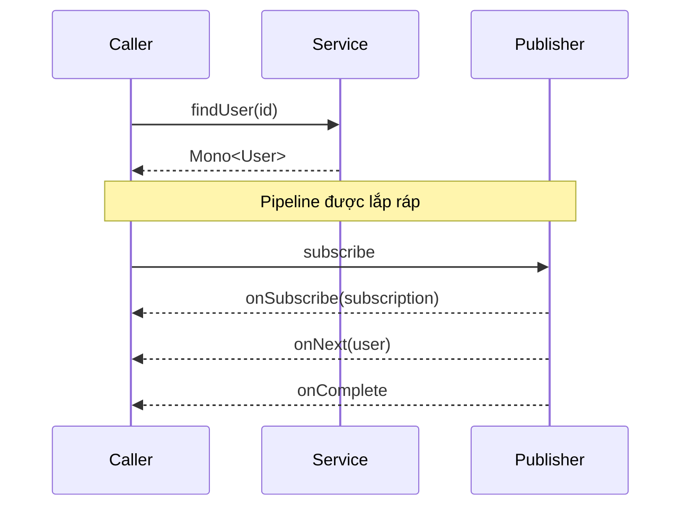

# Trả về chuỗi xử lý so với tự gọi subscribe trong tầng nghiệp vụ

Trong ứng dụng Java reactive, một service thường xây dựng chuỗi xử lý bằng `Mono<T>` hoặc `Flux<T>`. Service có thể trả publisher đó cho tầng gọi để tầng gọi kết hợp thêm bước xử lý và quyết định thời điểm đăng ký. Cách này giữ toàn bộ công việc trong cùng một vòng đời subscription. Nếu service tự gọi `subscribe()` rồi trả về `void` hoặc một kết quả không liên quan, nó tự khởi chạy một luồng xử lý tách rời khỏi bên gọi.

Khác biệt này ảnh hưởng trực tiếp tới việc truyền lỗi, hủy tác vụ, backpressure, transaction, kiểm thử và quản lý tài nguyên. Trong Reactive Programming, subscription là thời điểm pipeline bắt đầu xử lý và cũng là ranh giới để điều khiển nhu cầu nhận dữ liệu. Vì vậy, cần xác định rõ thành phần nào sở hữu subscription trước khi viết service, controller hoặc background worker.

## 1. Phân biệt lắp ráp pipeline và đăng ký subscription

Khi gọi các toán tử như `map`, `flatMap`, `filter` hoặc `onErrorResume`, chương trình thường đang mô tả một pipeline mới. Với các nguồn cold phổ biến của Reactor, công việc nguồn được thực thi khi có subscriber đăng ký. Quá trình lắp ráp và quá trình thực thi vì vậy là hai thời điểm khác nhau.

```java
Mono<User> user = userRepository.findById(userId)
    .map(userMapper::toView)
    .doOnNext(view -> log.debug("Đã tạo view cho {}", view.id()));
```

Đoạn mã trên tạo biến `user` mang một publisher. Nếu chưa có subscription, các toán tử trong pipeline chưa nhận tín hiệu để xử lý. Khi một subscriber đăng ký, dữ liệu đi qua chuỗi toán tử và subscriber nhận kết quả hoặc lỗi.



Publisher không phải lúc nào cũng cold. Một số nguồn hot, nguồn đã chạy từ trước hoặc thao tác được thực hiện ngay khi tạo đối tượng có thể hoạt động trước subscription. Tuy nhiên, với các nguồn reactive thông thường như repository trả `Mono`/`Flux`, nên thiết kế service theo hướng trả pipeline và để ranh giới ứng dụng quản lý subscription.

## 2. Service trả về chuỗi xử lý

Một service có thể nối các thao tác phụ thuộc và trả kết quả cuối cùng:

```java
public Mono<Order> createOrder(CreateOrder command) {
    return orderRepository.save(Order.from(command))
        .flatMap(order -> paymentClient.authorize(order.getId())
            .thenReturn(order))
        .flatMap(order -> auditRepository.save(AuditEntry.created(order))
            .thenReturn(order));
}
```

Service trả `Mono<Order>` cho caller. Mỗi bước tiếp theo chỉ chạy khi bước trước hoàn tất thành công. Nếu lưu đơn hàng, thanh toán hoặc ghi audit phát sinh lỗi, lỗi được truyền dọc chuỗi. Nếu subscriber hủy subscription, tín hiệu hủy có thể lan ngược qua các toán tử tới nguồn, tùy khả năng hỗ trợ cancellation của từng thành phần.

Nếu nghiệp vụ chỉ cần báo thao tác đã hoàn tất, service có thể trả `Mono<Void>`:

```java
public Mono<Void> archiveOrder(String orderId) {
    return orderRepository.findById(orderId)
        .flatMap(order -> orderRepository.save(order.archive()))
        .then();
}
```

`then()` chờ publisher trước hoàn tất rồi trả một `Mono<Void>` chỉ biểu diễn việc hoàn tất. Nếu cần trả lại một đối tượng đã có sau một thao tác phụ, dùng `thenReturn(value)`; nếu cần nối một thao tác reactive khác, dùng `then(otherPublisher)` hoặc `flatMap` tùy quan hệ dữ liệu. Trả `Mono<Void>` vẫn cho caller biết thao tác thành công hay lỗi, dù không có payload `onNext`.

Một service trả `Flux<Event>` cũng giữ được hợp đồng luồng nhiều phần tử:

```java
public Flux<Event> eventsForAccount(String accountId) {
    return eventRepository.findByAccountId(accountId)
        .filter(Event::isVisible)
        .map(eventMapper::toView);
}
```

Caller có thể tiếp tục lọc, giới hạn số phần tử, kết hợp với nguồn khác hoặc áp dụng chính sách lỗi trước khi đăng ký. Subscriber ở ranh giới cuối cùng điều khiển demand thông qua subscription; các toán tử reactive phối hợp nhu cầu đó với upstream.

## 3. Caller sở hữu subscription ở ranh giới ứng dụng

Trong ứng dụng WebFlux, controller thường trả `Mono` hoặc `Flux` cho framework. Framework đăng ký subscription khi xử lý request và quản lý vòng đời kết quả HTTP:

```java
@PostMapping("/orders")
public Mono<ResponseEntity<OrderView>> create(
        @RequestBody CreateOrder command) {
    return orderService.createOrder(command)
        .map(order -> ResponseEntity.accepted()
            .body(OrderView.from(order)));
}
```

Controller không cần tự gọi `subscribe()`. Khi client ngắt kết nối hoặc request bị hủy, framework có thể hủy subscription tương ứng và tín hiệu hủy đi ngược vào pipeline. Framework cũng có thể chuyển lỗi sang cơ chế xử lý lỗi HTTP đã cấu hình.

Tầng gọi khác cũng có thể compose pipeline trước khi trả về:

```java
public Mono<OrderView> createAndEnrich(CreateOrder command) {
    return orderService.createOrder(command)
        .flatMap(order -> inventoryService.loadSummary(order)
            .map(summary -> OrderView.from(order, summary)));
}
```

Toàn bộ chuỗi chỉ có một subscription ở ranh giới cuối cùng. Nhờ đó, caller có thể quyết định timeout, retry, xử lý lỗi, transaction và cancellation cho cả quy trình theo một chính sách thống nhất.

Không có nghĩa mọi ứng dụng chỉ được subscribe ở controller. Một message listener, command-line runner, scheduler hoặc thành phần tích hợp có thể là ranh giới ứng dụng hợp lệ. Quy tắc thiết kế là subscription được sở hữu ở nơi thực sự điều phối vòng đời công việc, thay vì bị tạo ngầm bên trong một service dùng chung.

## 4. Tự gọi subscribe trong service tạo ra một nhánh tách rời

Ví dụ service tự đăng ký rồi không trả lại publisher:

```java
public void createOrder(CreateOrder command) {
    orderRepository.save(Order.from(command))
        .flatMap(paymentClient::authorize)
        .subscribe();
}
```

Khi phương thức trả về, subscription nội bộ có thể vẫn đang chạy. Caller không có `Mono` để chờ, nối bước tiếp theo hoặc biết kết quả cuối cùng. Nếu caller gọi một thao tác khác ngay sau `createOrder`, thứ tự giữa hai công việc không còn được thể hiện bằng chuỗi reactive.

Ngay cả khi service truyền callback lỗi cho `subscribe`, subscription vẫn tách rời:

```java
public void sendReceipt(Receipt receipt) {
    mailClient.send(receipt)
        .subscribe(
            ignored -> {},
            error -> log.error("Không gửi được biên nhận", error),
            () -> log.info("Đã gửi biên nhận")
        );
}
```

Callback lỗi giúp quan sát lỗi của subscription nội bộ, nhưng caller vẫn không thể nhận lỗi đó qua hợp đồng phương thức, không thể ghép nó vào transaction hoặc yêu cầu hủy nó theo vòng đời request. Log lỗi cũng không tự biến công việc thành một quy trình có retry, lưu trữ hay bảo đảm giao nhận.

## 5. Hệ quả của subscription bị tách khỏi caller

| Khía cạnh | Service trả `Mono`/`Flux` | Service tự gọi `subscribe()` |
| --- | --- | --- |
| Kết quả | Caller nhận publisher để tiếp tục xử lý | Caller thường không nhận được kết quả của công việc |
| Lỗi | Truyền theo chuỗi tới subscriber cuối | Phải tự xử lý tại subscription nội bộ; không truyền tự nhiên về caller |
| Cancellation | Có thể lan từ ranh giới cuối tới upstream | Caller không có handle để hủy subscription nội bộ |
| Backpressure | Demand của subscriber có thể truyền qua pipeline | Các overload `subscribe` thông dụng yêu cầu không giới hạn phần tử (`Long.MAX_VALUE`) |
| Thứ tự | Có thể biểu diễn bằng `flatMap`, `then`, `concatMap`... | Caller không thể đảm bảo thứ tự với công việc đã tách rời |
| Kiểm thử | Có thể kiểm tra publisher bằng `StepVerifier` | Cần chờ hoặc đồng bộ hóa công việc nền riêng, dễ tạo test không ổn định |
| Transaction/context | Có thể nằm trong cùng subscription và Reactor Context | Subscription mới có thể nằm ngoài transaction hoặc context của caller |

Một điểm đáng chú ý là `subscribe()` không tham số và các overload nhận callback phổ biến của Reactor thường yêu cầu demand không giới hạn. Khi service tự subscribe vào một `Flux` lớn hoặc không kết thúc, nó có thể tiêu thụ dữ liệu nhanh hơn khả năng xử lý mong muốn nếu không có cơ chế điều tiết riêng. Caller đã mất quyền quyết định demand ở ranh giới đó.

Cancellation cũng không bảo đảm mọi thao tác I/O lập tức dừng. Tuy nhiên, khi trả publisher, tín hiệu hủy ít nhất có thể được truyền theo chuỗi và các nguồn hỗ trợ cancellation có cơ hội giải phóng tài nguyên. Khi tự subscribe và bỏ qua `Disposable`, service không cung cấp cách điều khiển vòng đời đó cho thành phần quản lý.

## 6. Transaction và Reactor Context cần cùng subscription

Các cơ chế reactive như transaction manager, security context hoặc tracing context thường gắn với subscription và Reactor Context. Khi caller bọc một pipeline bằng ranh giới transaction, các bước trong cùng pipeline có thể chia sẻ transaction context:

```java
public Mono<Order> createInTransaction(CreateOrder command) {
    Mono<Order> workflow = orderRepository.save(Order.from(command))
        .flatMap(order -> paymentRepository.recordAuthorization(order)
            .thenReturn(order));

    return transactionalOperator.transactional(workflow);
}
```

Caller đăng ký publisher được bọc bởi `transactionalOperator`; transaction được gắn với quá trình thực thi reactive của chuỗi đó. Nếu service gọi `subscribe()` bên trong `workflow`, nó tạo subscription khác. Subscription bên trong không tự động trở thành một phần của transaction hoặc context thuộc subscription ngoài. Điều này có thể khiến thao tác ghi dữ liệu chạy ngoài ranh giới transaction dự kiến.

Nguyên tắc tương tự áp dụng cho thông tin xác thực, correlation ID và tracing. Trả publisher giúp các toán tử trong cùng pipeline tiếp tục sử dụng context đã được thiết lập ở ranh giới subscription. Một subscription tự tạo cần được truyền context và cấu hình riêng nếu muốn có hành vi tương đương.

## 7. Dùng doOn... để quan sát, dùng toán tử để nối tác vụ

Một lý do thường gặp khiến service tự subscribe là muốn ghi log, cập nhật bộ đếm hoặc gọi một hành động phụ sau khi có kết quả. Với các tác vụ quan sát, có thể dùng các hook như `doOnNext`, `doOnSuccess`, `doOnError`, `doOnCancel` hoặc `doFinally` mà vẫn trả publisher:

```java
public Mono<User> loadUser(String userId) {
    return userRepository.findById(userId)
        .doOnNext(user -> log.debug("Đã tải user {}", user.getId()))
        .doOnError(error -> log.warn("Lỗi tải user {}", userId, error))
        .doFinally(signal -> log.debug("Kết thúc pipeline: {}", signal));
}
```

Các hook `doOn...` dùng để quan sát hoặc thực hiện tác dụng phụ nhỏ gắn với tín hiệu. Chúng không thay thế xử lý nghiệp vụ bất đồng bộ. Nếu cần gọi một service khác và phải chờ nó hoàn tất, hãy dùng toán tử kết hợp:

```java
public Mono<Order> createAndNotify(CreateOrder command) {
    return orderRepository.save(Order.from(command))
        .flatMap(order -> notificationClient.sendCreated(order)
            .thenReturn(order));
}
```

Nếu muốn ghi nhận lỗi rồi vẫn truyền lỗi tiếp, dùng `doOnError`. Nếu muốn chuyển lỗi thành kết quả hoặc publisher khác, dùng `onErrorReturn`, `onErrorResume` hay toán tử phù hợp với hợp đồng nghiệp vụ. Không cần subscribe chỉ để “kích hoạt” một hook; hook chạy khi publisher được subscriber cuối cùng đăng ký.

## 8. Khi nào một thành phần được phép tự subscribe?

Có trường hợp ứng dụng chủ động khởi chạy một công việc nền không thuộc vòng đời request hiện tại. Ví dụ một worker lắng nghe nguồn sự kiện trong suốt thời gian ứng dụng hoạt động. Ở ranh giới này, một thành phần điều phối có thể tự subscribe, nhưng nó phải sở hữu rõ subscription và vòng đời của nó.

```java
public final class EventWorker {
    private final Disposable subscription;

    public EventWorker(Flux<Event> source, EventHandler handler) {
        this.subscription = source
            .concatMap(handler::handle)
            .subscribe(
                ignored -> {},
                error -> log.error("Event worker kết thúc do lỗi", error)
            );
    }

    public void stop() {
        subscription.dispose();
    }
}
```

Ví dụ minh họa một worker tự quản lý `Disposable`: thành phần tạo subscription giữ handle và gọi `dispose()` khi dừng. Trong ứng dụng thực tế, cần tích hợp việc khởi động/dừng với lifecycle của container, quyết định chính sách khi luồng lỗi, giới hạn concurrency, theo dõi trạng thái và bảo đảm tài nguyên được giải phóng. Nếu cần worker tiếp tục chạy sau khi process khởi động lại hoặc không được mất sự kiện, hãy dùng broker, hàng đợi bền vững hoặc outbox phù hợp; một subscription trong bộ nhớ không cung cấp bảo đảm lưu trữ.

Không nên biến mọi service thành một worker nền. Hãy đặt việc tự subscribe tại thành phần điều phối chuyên trách, nơi có thể trả lời được ai khởi động, ai dừng, lỗi được xử lý thế nào và công việc có cần giao nhận bền vững hay không.

## 9. Kiểm thử khi service trả publisher

Một service trả `Mono`/`Flux` có thể được kiểm thử trực tiếp mà không cần tạo thread để chờ subscription tự phát:

```java
StepVerifier.create(orderService.createOrder(command))
    .assertNext(order -> assertEquals("order-42", order.getId()))
    .verifyComplete();
```

Có thể xác minh đường lỗi:

```java
StepVerifier.create(orderService.createOrder(command))
    .expectError(PaymentRejectedException.class)
    .verify();
```

Với `Flux`, `StepVerifier` có thể kiểm tra thứ tự phần tử, số phần tử và terminal signal. Khi cần kiểm tra demand hoặc cancellation, có thể điều khiển request theo từng bước và xác minh hành vi của pipeline. Việc kiểm thử theo publisher cũng giúp mock repository/client bằng `Mono.just`, `Mono.empty` hoặc `Mono.error` để bao phủ các trường hợp biên.

Ngược lại, nếu service tự subscribe rồi trả `void`, kiểm thử không còn publisher để xác minh. Test phải chờ callback, latch hoặc một tín hiệu đồng bộ khác. Nếu thời gian chờ không được thiết kế cẩn thận, test có thể kết thúc trước công việc nền hoặc phụ thuộc vào lịch chạy thread, gây lỗi chập chờn.

## 10. Cách quyết định ở ranh giới service

Trước khi gọi `subscribe()`, hãy xác định thành phần nào đang sở hữu công việc. Nếu caller cần kết quả, cần biết lỗi, cần hủy theo request hoặc muốn kết hợp thêm bước, service nên trả `Mono` hoặc `Flux`. Nếu thao tác không có payload, trả `Mono<Void>` để caller vẫn theo dõi được hoàn tất và lỗi. Nếu công việc là một subscription nền độc lập, hãy đặt nó trong worker hoặc adapter có lifecycle rõ ràng, giữ `Disposable`, xử lý lỗi và định nghĩa chính sách dừng.

Với các API reactive trong ứng dụng Java, việc trả publisher giúp giữ luồng xử lý trong một chuỗi có thể compose. Tầng sở hữu subscription có thể quản lý demand, timeout, cancellation, transaction và xử lý lỗi tại một ranh giới nhất quán. Tự subscribe trong tầng nghiệp vụ tách công việc khỏi ranh giới đó và chỉ nên xuất hiện khi một thành phần điều phối thực sự chịu trách nhiệm cho vòng đời độc lập của nó.
