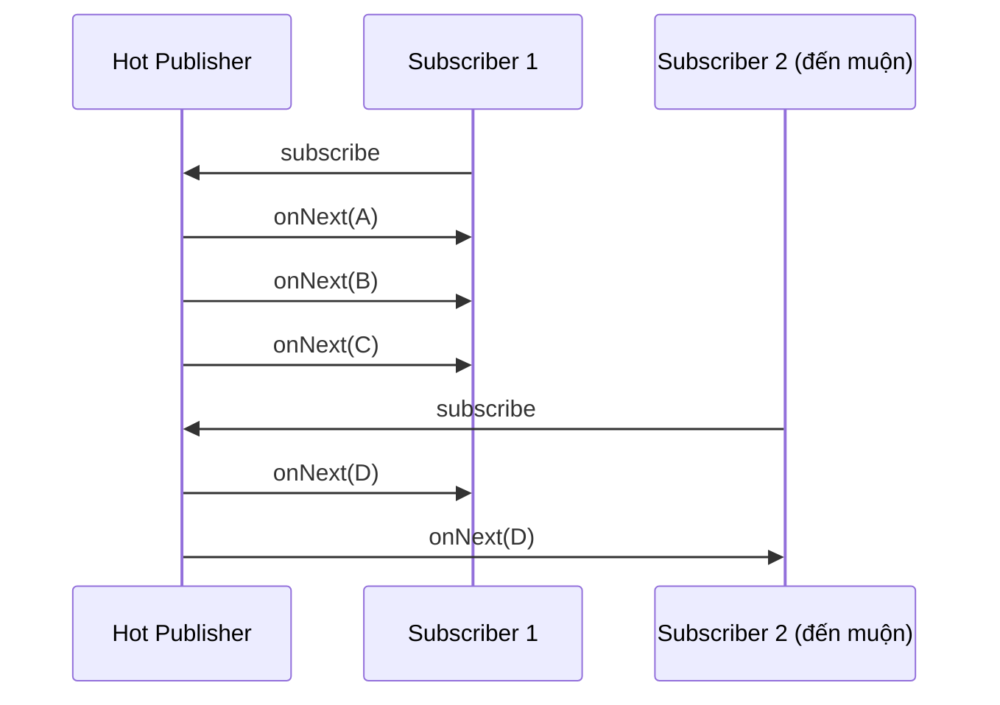

# Đăng ký muộn và nguy cơ bỏ lỡ phần tử

Trong Reactive Programming, thời điểm một subscriber đăng ký có thể quyết định những dữ liệu mà nó quan sát được. Với một cold publisher, mỗi subscription thường khởi chạy một lần tạo dữ liệu riêng, vì vậy subscriber đến sau vẫn có thể nhận luồng từ đầu. Với một hot publisher đang phát dữ liệu dùng chung, subscriber đăng ký muộn thường chỉ nhận những phần tử được phát sau thời điểm nó tham gia. Các phần tử đã đi qua trước đó không tự động được phát lại.

Đây là khác biệt quan trọng khi xây hệ thống sự kiện. Một màn hình giám sát có thể chỉ cần trạng thái mới nhất, trong khi bộ xử lý thanh toán hoặc lịch sử đơn hàng có thể cần nhận đủ mọi sự kiện. Chọn sai semantics có thể khiến consumer bỏ lỡ sự kiện khởi tạo, thiếu dữ liệu để dựng trạng thái hoặc xử lý một chuỗi sự kiện không đầy đủ. Reactor cung cấp các lựa chọn multicast, replay và cache để điều khiển hành vi của subscriber đến muộn, nhưng mỗi lựa chọn có giới hạn về bộ nhớ, thời gian lưu và độ bền dữ liệu.

## 1. Điều gì xảy ra khi subscriber đăng ký muộn?

Giả sử một nguồn đang phát các sự kiện theo thứ tự `A`, `B`, `C`, `D`. Subscriber thứ nhất đã đăng ký trước khi nguồn phát. Subscriber thứ hai chỉ đăng ký sau khi `C` đã được phát.



Trong mô hình multicast không replay, subscriber 1 nhận `A`, `B`, `C`, `D`; subscriber 2 chỉ nhận `D`. Việc đăng ký thành công không có nghĩa là publisher sẽ phát lại lịch sử. Subscriber đến muộn nhận các tín hiệu kể từ thời điểm nó tham gia, cùng với terminal signal nếu nguồn đã kết thúc.

Nếu publisher đã phát `onComplete` trước khi subscriber đăng ký, subscriber mới thường chỉ nhận `onSubscribe` rồi `onComplete`, không nhận lại các phần tử cũ. Nếu nguồn đã kết thúc bằng lỗi, subscriber đến muộn có thể nhận tín hiệu lỗi đã lưu hoặc hành vi phụ thuộc loại publisher/replay được cấu hình. Cần kiểm tra semantics cụ thể của nguồn thay vì suy ra chỉ từ tên `hot`.

## 2. Cold publisher: subscription mới thường bắt đầu một lần thực thi mới

Cold publisher tạo dữ liệu theo từng subscriber. Khi subscriber mới đăng ký, publisher thường khởi động lại nguồn từ đầu. Đây là hành vi phù hợp với một phép tính hoặc một thao tác có thể thực hiện riêng cho từng người tiêu thụ.

Ví dụ với một collection:

```java
Flux<String> products = Flux.fromIterable(List.of("book", "pen", "lamp"));

products.subscribe(product -> System.out.println("A: " + product));
products.subscribe(product -> System.out.println("B: " + product));
```

Cả hai subscriber đều nhận `book`, `pen`, `lamp`. Subscriber B không cần đăng ký đúng lúc A đăng ký vì mỗi subscription duyệt lại collection.

Một lời gọi HTTP reactive cũng thường được thực hiện lại cho mỗi subscription:

```java
Mono<Customer> customer = webClient.get()
    .uri("/customers/{id}", customerId)
    .retrieve()
    .bodyToMono(Customer.class);

customer.subscribe(this::showCustomer);
customer.subscribe(this::writeAuditEntry);
```

Trong ví dụ, hai subscription thường tạo hai lần request độc lập. Chúng có thể nhận dữ liệu khác nhau nếu trạng thái trên server thay đổi giữa hai lần gọi. Vì vậy, cold không đồng nghĩa với “phát lại cùng một bản ghi lịch sử”; nó thường có nghĩa là nguồn được thực thi lại. Với truy vấn cơ sở dữ liệu, lần đăng ký thứ hai có thể thấy trạng thái mới hơn lần đầu.

Cold publisher hữu ích khi mỗi consumer cần một lần thực thi riêng, chẳng hạn đọc file, truy vấn dữ liệu hoặc tính toán. Nó cũng có thể gây chi phí không mong muốn nếu nhiều subscriber vô tình kích hoạt cùng một request đắt tiền hoặc side effect. Hãy xác định rõ số lần subscription và liệu nguồn có an toàn khi chạy lại hay không.

## 3. Hot publisher: subscriber mới tham gia vào luồng đang diễn ra

Hot publisher chia sẻ một nguồn phát chung. Nguồn có thể hoạt động độc lập với subscriber cụ thể; khi một subscriber đăng ký sau khi luồng đã bắt đầu, nó thường không nhận lại các phần tử đã phát.

Trong Reactor, có thể tạo nguồn hot dùng chung bằng `Sinks.Many` hoặc chuyển một nguồn thành luồng chia sẻ bằng `publish`, `share` hay `replay`. Các toán tử này có semantics khác nhau, vì vậy cần chọn đúng chính sách lịch sử.

Ví dụ multicast sink:

```java
Sinks.Many<String> sink = Sinks.many()
    .multicast()
    .onBackpressureBuffer();

Flux<String> events = sink.asFlux();

Disposable first = events.subscribe(value ->
    System.out.println("Subscriber 1: " + value));

sink.tryEmitNext("OrderCreated").orThrow();
sink.tryEmitNext("PaymentReceived").orThrow();

Disposable late = events.subscribe(value ->
    System.out.println("Subscriber 2: " + value));

sink.tryEmitNext("OrderPacked").orThrow();

first.dispose();
late.dispose();
```

Subscriber 1 nhận cả ba sự kiện. Subscriber 2 tham gia sau `PaymentReceived`, nên chỉ nhận `OrderPacked`. `multicast()` phân phối tín hiệu cho các subscriber hiện tại; nó không giữ lịch sử để phát lại cho subscriber đến muộn. `onBackpressureBuffer()` xử lý chênh lệch demand của các subscriber đang tham gia theo chính sách buffer của sink; nó không biến multicast thành replay history.

`tryEmitNext` trả về kết quả phát. Ví dụ dùng `orThrow()` để làm rõ rằng lỗi phát sẽ được ném ra trong đoạn minh họa. Trong ứng dụng thật, nên xử lý `EmitResult` theo nguyên nhân như sink đã kết thúc, không còn subscriber phù hợp hoặc cạnh tranh phát đồng thời; không nên bỏ qua kết quả phát nếu việc mất sự kiện có ý nghĩa nghiệp vụ.

## 4. Chuyển nguồn thành luồng chia sẻ bằng publish và share

Một nguồn cold có thể được chia sẻ để nhiều subscriber quan sát cùng một lần thực thi. `publish()` tạo `ConnectableFlux`, cho phép kiểm soát thời điểm bắt đầu kết nối với nguồn. Subscriber có thể đăng ký trước, sau đó caller gọi `connect()` để khởi động upstream.

```java
ConnectableFlux<Long> sharedTicks = Flux.interval(Duration.ofMillis(500))
    .publish();

Disposable first = sharedTicks.subscribe(value ->
    System.out.println("A: " + value));

Disposable connection = sharedTicks.connect();

// Đăng ký sau khi luồng đã bắt đầu.
Disposable late = sharedTicks.subscribe(value ->
    System.out.println("B: " + value));

// Khi không còn cần nguồn dùng chung:
late.dispose();
first.dispose();
connection.dispose();
```

Nguồn interval được kết nối một lần và phát các tick cho những subscriber hiện tại. Subscriber B đến sau nên không nhận lại những tick đã phát trước lúc đăng ký. Việc đăng ký subscriber trước `connect()` giúp subscriber đầu tiên sẵn sàng khi nguồn bắt đầu. Nếu gọi `connect()` trước và nguồn phát ngay, dữ liệu ban đầu có thể không có consumer nào quan sát.

`autoConnect(n)` có thể tự kết nối khi đủ số subscriber đăng ký; `refCount(n)` quản lý kết nối dựa trên số subscriber đang hoạt động và có thể ngắt upstream khi số lượng giảm dưới ngưỡng. `share()` thường được dùng để chia sẻ một nguồn theo semantics ref-count. Các subscriber đến khi nguồn đang chạy chỉ nhận phần tử từ thời điểm họ tham gia; khi kết nối bị ngắt và được tạo lại, hành vi nguồn có thể bắt đầu một chu kỳ mới. Cần hiểu rõ chính sách connect/disconnect trước khi dựa vào nó cho dữ liệu nghiệp vụ.

Chia sẻ một lần thực thi giúp tránh gọi lại nguồn cho mỗi subscriber, nhưng cũng làm cho các subscriber phụ thuộc vào cùng một luồng thời gian. Nếu một consumer đến muộn cần lịch sử, `publish` hoặc `share` đơn thuần không đáp ứng yêu cầu đó.

## 5. Replay: giữ một phần lịch sử cho subscriber đến muộn

Replay publisher lưu lại một phần dữ liệu đã phát để subscriber mới có thể nhận lại. Reactor cung cấp replay sink với các chính sách lưu giữ khác nhau. Ví dụ dưới đây giữ hai phần tử gần nhất:

```java
Sinks.Many<String> replaySink = Sinks.many()
    .replay()
    .limit(2);

Flux<String> replayedEvents = replaySink.asFlux();

replaySink.tryEmitNext("OrderCreated").orThrow();
replaySink.tryEmitNext("PaymentReceived").orThrow();
replaySink.tryEmitNext("OrderPacked").orThrow();

replayedEvents.subscribe(value ->
    System.out.println("Late subscriber: " + value));
```

Subscriber đăng ký sau ba lần phát sẽ nhận hai phần tử gần nhất: `PaymentReceived` và `OrderPacked`. Phần tử cũ hơn đã bị loại khỏi vùng replay do giới hạn là hai phần tử.

Một số chiến lược replay thường dùng:

| Chiến lược | Subscriber đến muộn nhận gì? | Khi phù hợp |
| --- | --- | --- |
| `replay().all()` | Toàn bộ phần tử đã được lưu | Lịch sử nhỏ, hữu hạn và có giới hạn vòng đời rõ ràng |
| `replay().limit(n)` | Tối đa `n` phần tử gần nhất | Cần một cửa sổ lịch sử theo số lượng |
| `replay().limit(Duration)` | Phần tử nằm trong cửa sổ thời gian | Dữ liệu gần đây có thời hạn hữu ích |
| `replay().latest()` | Giá trị mới nhất | Consumer cần trạng thái hiện tại hơn là toàn bộ chuỗi thay đổi |

Replay giải quyết việc subscriber đến muộn cần một phần lịch sử, nhưng không nên mặc định lưu tất cả. Một nguồn phát liên tục có thể tạo lượng dữ liệu không giới hạn; replay toàn bộ sẽ làm bộ nhớ tăng theo thời gian. Cần chọn giới hạn số phần tử, thời gian lưu hoặc chỉ giữ trạng thái mới nhất theo yêu cầu nghiệp vụ.

Replay cũng không tự tạo độ bền dữ liệu. Dữ liệu được giữ trong bộ nhớ của process có thể mất khi ứng dụng khởi động lại hoặc gặp sự cố. Nếu cần phát lại sau restart, cần một kho lưu trữ hoặc message broker có retention và offset phù hợp.

## 6. Phân biệt replay với buffer dành cho backpressure

Hai khái niệm thường bị nhầm là buffer để xử lý consumer chậm và replay để phục vụ subscriber đến muộn. Chúng giải quyết hai tình huống khác nhau.

**Backpressure buffer** giữ phần tử cho subscriber đã đăng ký nhưng chưa có đủ demand để nhận ngay. Mục đích là điều tiết chênh lệch tốc độ giữa producer và consumer hiện tại. **Replay buffer** giữ lịch sử đã phát để một subscriber đăng ký sau vẫn có thể nhận lại phần tử cũ.

| Tiêu chí | Backpressure buffer | Replay buffer |
| --- | --- | --- |
| Đối tượng phục vụ | Subscriber hiện tại đang thiếu demand | Subscriber đến sau |
| Mục đích | Giữ phần tử chưa được giao do consumer chậm | Phát lại phần tử đã phát trong quá khứ |
| Thời điểm sử dụng | Trong lúc subscription đang hoạt động | Khi subscriber mới đăng ký |
| Rủi ro | Buffer tăng nếu producer nhanh hơn consumer | Lịch sử tăng nếu retention không giới hạn |
| Cấu hình cần xem | Capacity, overflow policy, demand | Số phần tử, thời gian lưu, replay policy |

Ví dụ `Sinks.many().multicast().onBackpressureBuffer()` có buffer cho các subscriber hiện tại theo demand. Nó không có nghĩa là mọi subscriber mới đều nhận lại các phần tử đã phát trước đó. Nếu cần cả multicast lẫn lịch sử cho subscriber mới, hãy chọn replay sink hoặc một cơ chế lưu trữ phù hợp, đồng thời đặt giới hạn rõ ràng.

## 7. Cache một kết quả Mono cho nhiều subscriber

Với một kết quả đơn lẻ, `Mono.cache()` có thể chia sẻ và lưu tín hiệu để các subscriber tiếp theo nhận cùng kết quả đã được cache, thay vì kích hoạt lại nguồn mỗi lần. Có thể đặt TTL để giới hạn thời gian lưu:

```java
Mono<Product> cachedProduct = productClient.findById(productId)
    .cache(Duration.ofSeconds(30));

cachedProduct.subscribe(this::showProduct);
cachedProduct.subscribe(this::recordView);
```

Trong khoảng TTL, subscriber tiếp theo có thể nhận lại tín hiệu đã cache. Cần nhớ rằng cache có thể lưu cả tín hiệu rỗng hoặc lỗi theo semantics của operator; TTL và chính sách cache cần được chọn theo dữ liệu. Nếu dữ liệu thay đổi nhanh, cache lâu có thể trả kết quả cũ. Nếu kết quả phụ thuộc người dùng hoặc quyền truy cập, không chia sẻ cache giữa các ngữ cảnh có thể làm lộ dữ liệu hoặc dùng sai danh tính.

Với `Flux`, cache toàn bộ luồng có thể giữ tất cả phần tử và terminal signal cho subscriber sau. Nếu nguồn lớn hoặc liên tục, cách này dễ tiêu tốn bộ nhớ không giới hạn. Thường nên dùng replay có giới hạn hoặc lưu lịch sử trong hệ thống chuyên dụng thay vì cache toàn bộ một stream vô hạn.

## 8. Đăng ký muộn trong ứng dụng thực tế

### Màn hình dashboard

Một dashboard có thể cần hiển thị trạng thái hiện tại của thiết bị. Nếu subscriber chỉ nhận các cập nhật mới kể từ lúc mở màn hình, nó có thể không biết trạng thái ban đầu. Có thể giải quyết bằng cách lấy snapshot hiện tại trước rồi đăng ký luồng cập nhật, hoặc dùng nguồn replay giá trị mới nhất. Nếu lấy snapshot và đăng ký stream riêng biệt, cần xử lý khoảng thời gian giữa hai thao tác để không bỏ sót thay đổi; một cách phổ biến là dùng version/sequence hoặc giao thức snapshot-plus-offset.

### Thông báo và sự kiện nghiệp vụ

Một consumer xử lý `OrderCreated`, `PaymentReceived` và `OrderShipped` cần biết đầy đủ các sự kiện liên quan. Nếu nó đăng ký muộn vào một hot stream chỉ multicast, nó có thể bỏ lỡ `OrderCreated` rồi nhận `PaymentReceived` mà không có ngữ cảnh. Điều đó có thể khiến consumer không dựng được trạng thái hợp lệ.

Nếu sự kiện phải được xử lý đầy đủ, hãy dùng nguồn lưu giữ bền vững như message broker có retention/consumer offset hoặc event store. Consumer có thể tiếp tục từ offset đã xác nhận, phát lại sự kiện chưa xử lý và xử lý trùng bằng idempotency. In-memory replay hữu ích cho lịch sử ngắn trong một process, nhưng không thay thế lưu trữ bền vững.

### Tác vụ giám sát

Một màn hình giám sát thường chỉ cần giá trị mới nhất, chẳng hạn CPU hiện tại hoặc nhiệt độ mới nhất. Replay toàn bộ lịch sử có thể lãng phí bộ nhớ. Một sink replay giữ giá trị mới nhất hoặc một snapshot được cập nhật có thể phù hợp hơn. Ngược lại, hệ thống cảnh báo cần phát hiện mọi lần vượt ngưỡng thì không nên chỉ giữ latest nếu các chuyển trạng thái trung gian mang ý nghĩa.

## 9. Các rủi ro khi xử lý subscriber đến muộn

### Bỏ lỡ sự kiện khởi tạo

Consumer có thể nhận một sự kiện cập nhật nhưng chưa nhận sự kiện tạo đối tượng. Trước khi xử lý, cần xác định consumer có thể dựng trạng thái từ sự kiện hiện tại hay phải lấy snapshot/historical event trước.

### Nhận dữ liệu không đủ để dựng trạng thái

Replay giới hạn chỉ cung cấp một cửa sổ lịch sử. Nếu consumer cần toàn bộ chuỗi để tính trạng thái, replay `limit(10)` không bảo đảm đủ dữ liệu. Cần định nghĩa checkpoint hoặc snapshot để consumer bắt đầu từ một trạng thái nhất quán.

### Trùng lặp khi kết hợp snapshot và stream

Nếu ứng dụng lấy snapshot rồi đăng ký stream, sự kiện có thể xảy ra trong khoảng giữa hai bước. Nếu đăng ký stream trước rồi lấy snapshot, một sự kiện có thể xuất hiện cả trong snapshot lẫn stream. Dùng sequence number, event version hoặc offset giúp xác định điểm bắt đầu và loại bỏ trùng lặp một cách có kiểm soát.

### Cache dữ liệu cũ hoặc sai ngữ cảnh

Cache/replay có thể phát lại kết quả cũ. Với dữ liệu nhạy theo tenant, user hoặc quyền truy cập, không chia sẻ publisher cache giữa các ngữ cảnh nếu khóa cache không thể hiện đầy đủ phạm vi. Đặt TTL, invalidation và giới hạn retention theo yêu cầu dữ liệu.

### Mất dữ liệu khi process dừng

Sinks và replay cache trong bộ nhớ thường không tồn tại qua restart. Nếu yêu cầu là xử lý sự kiện đáng tin cậy, hãy dùng broker hoặc event store có cơ chế lưu bền, acknowledgement và offset. Đừng nhầm việc replay trong RAM với khả năng phục hồi sau sự cố.

## 10. Kiểm thử hành vi của subscriber đến muộn

Kiểm thử cần chứng minh subscriber thứ hai không nhận lịch sử ở multicast, nhưng nhận phần tử được lưu ở replay. Có thể dùng `Sinks.Many` và `StepVerifier` để điều khiển thời điểm phát.

### Multicast không phát lại lịch sử

```java
Sinks.Many<Integer> multicast = Sinks.many()
    .multicast()
    .onBackpressureBuffer();

Flux<Integer> live = multicast.asFlux();
List<Integer> firstValues = new CopyOnWriteArrayList<>();
Disposable first = live.subscribe(firstValues::add);

multicast.tryEmitNext(1).orThrow();

StepVerifier.create(live)
    .then(() -> multicast.tryEmitNext(2).orThrow())
    .expectNext(2)
    .thenCancel()
    .verify();

assertEquals(List.of(1, 2), firstValues);
first.dispose();
```

Subscriber đầu tiên đã nhận `1` trước khi subscriber do `StepVerifier` tạo đăng ký. Subscriber thứ hai chỉ nhận `2`, là phần tử phát sau khi nó tham gia. Ví dụ giả định test chạy tuần tự và emission thành công; trong test tích hợp có cạnh tranh thread, cần đồng bộ thời điểm đăng ký/phát rõ ràng.

### Replay giới hạn lịch sử

```java
Sinks.Many<Integer> replay = Sinks.many()
    .replay()
    .limit(2);

Flux<Integer> history = replay.asFlux();
replay.tryEmitNext(1).orThrow();
replay.tryEmitNext(2).orThrow();
replay.tryEmitNext(3).orThrow();

StepVerifier.create(history)
    .expectNext(2, 3)
    .thenCancel()
    .verify();
```

Subscriber mới nhận hai phần tử gần nhất vì replay được giới hạn ở hai. Test này kiểm tra chính sách retention theo số lượng. Có thể bổ sung test cho `latest`, TTL, terminal signal và trường hợp nguồn kết thúc trước khi subscriber đăng ký.

Ngoài ra, nên kiểm thử:

- Subscriber đến trước nguồn, đúng lúc nguồn bắt đầu và sau khi nguồn đã phát nhiều phần tử.
- Subscriber đến sau `onComplete` hoặc `onError`.
- Nhiều subscriber đến ở các thời điểm khác nhau.
- Subscriber chậm có demand thấp trong khi subscriber khác nhận nhanh.
- Buffer đầy hoặc replay đạt giới hạn retention.
- Nguồn hot bị disconnect/reconnect khi dùng `refCount` hoặc `share`.
- Cache hết TTL hoặc dữ liệu bị invalidation.
- Nguồn process restart nếu ứng dụng tuyên bố có khả năng phục hồi lịch sử.

Không dùng `Thread.sleep` để đoán thời điểm subscriber đăng ký. Dùng `StepVerifier`, sink phát thủ công, virtual time hoặc latch chỉ ở test harness để điều khiển thứ tự sự kiện.

## 11. Chọn chiến lược phù hợp

Trước khi chọn hot, cold, replay hoặc cache, hãy trả lời các câu hỏi:

| Câu hỏi | Hướng lựa chọn |
| --- | --- |
| Mỗi subscriber có cần thực hiện nguồn riêng? | Cold publisher |
| Nhiều subscriber cần cùng một lần phát trực tiếp? | Hot multicast, `publish` hoặc `share` |
| Subscriber đến muộn cần một số phần tử gần nhất? | Replay có giới hạn theo số lượng hoặc thời gian |
| Consumer chỉ cần trạng thái hiện tại? | Replay latest hoặc snapshot trạng thái |
| Cần dùng lại một kết quả đơn lẻ trong thời gian ngắn? | `Mono.cache` với TTL phù hợp |
| Cần phát lại sau restart hoặc xử lý đủ mọi sự kiện? | Broker/event store bền vững với offset hoặc checkpoint |
| Consumer chậm nhưng đã đăng ký? | Backpressure và buffer/overflow policy; replay không giải quyết thay |

Đừng chọn replay toàn bộ chỉ để “chắc chắn không mất dữ liệu”. Cần xác định retention có thể tăng đến đâu, consumer bắt đầu từ điểm nào và dữ liệu nào có thể dựng lại từ snapshot. Cũng đừng dùng multicast không replay cho một consumer cần lịch sử đầy đủ. Hành vi subscriber đến muộn phải là một quyết định rõ ràng trong hợp đồng của nguồn dữ liệu.

## 12. Những lỗi thường gặp

- **Cho rằng mọi publisher hot đều replay lịch sử:** hot multicast thường chỉ phát cho subscriber hiện tại; cần cấu hình replay nếu subscriber mới phải nhận phần tử cũ.
- **Cho rằng cold luôn phát lại cùng dữ liệu:** nguồn cold có thể được thực thi lại và trả dữ liệu mới ở mỗi subscription.
- **Nhầm backpressure buffer với replay:** buffer giữ phần tử cho subscriber hiện tại đang thiếu demand; replay giữ lịch sử cho subscriber đến sau.
- **Dùng `share()` khi cần lịch sử:** share giúp dùng chung nguồn đang hoạt động nhưng không tự giữ lịch sử cho subscriber mới.
- **Replay toàn bộ một stream vô hạn:** retention không giới hạn có thể làm heap tăng liên tục.
- **Dùng in-memory replay cho yêu cầu durable:** cache trong process không bảo đảm dữ liệu tồn tại qua restart.
- **Ghép snapshot và stream mà không có version/offset:** có thể bỏ sót hoặc xử lý trùng sự kiện ở ranh giới đăng ký.
- **Không kiểm tra kết quả `tryEmitNext`:** sự kiện có thể không được phát như mong đợi khi sink đã kết thúc hoặc gặp tình trạng cạnh tranh.
- **Chia sẻ cache giữa các ngữ cảnh người dùng:** có thể trả dữ liệu cũ hoặc dữ liệu sai phạm vi bảo mật.

Subscriber đăng ký muộn là một tình huống bình thường trong hệ thống phát sự kiện. Cold publisher thường tạo lại luồng cho mỗi subscription; hot multicast thường chỉ cung cấp phần tử mới từ thời điểm đăng ký; replay và cache cho phép chia sẻ một phần lịch sử theo chính sách retention. Cần phân biệt lịch sử được replay với buffer phục vụ backpressure, xác định yêu cầu về trạng thái và độ bền dữ liệu, rồi chọn cơ chế phù hợp. Khi hành vi đăng ký muộn được thiết kế và kiểm thử rõ ràng, ứng dụng Reactor có thể tránh bỏ lỡ sự kiện quan trọng mà vẫn kiểm soát được bộ nhớ và vòng đời của publisher.
