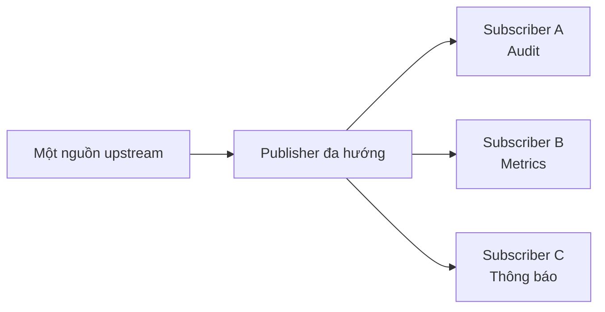

# Phát đa hướng và chia sẻ một nguồn cho nhiều bên tiêu thụ

Trong chương **Nguồn nóng và lạnh**, bài học này giải quyết một tình huống phổ biến: nhiều thành phần cần quan sát cùng một luồng dữ liệu, nhưng hệ thống chỉ nên thực hiện một lần công việc tạo dữ liệu ở phía nguồn. Ví dụ, một luồng sự kiện đơn hàng có thể đồng thời phục vụ màn hình theo dõi, bộ ghi audit, bộ tính chỉ số và dịch vụ thông báo.

Bài học thuộc module **REACTIVE_PROGRAMMING**. Module hướng dẫn: “Học tư duy reactive qua các luồng sự kiện bất đồng bộ, hợp đồng Publisher–Subscriber và cơ chế backpressure của Reactive Streams. Thực hành Mono, Flux, kết hợp toán tử, kiểm soát scheduler, xử lý lỗi và kiểm thử pipeline trong hệ sinh thái Java.” Vì vậy, khi chia sẻ một nguồn, ta cần hiểu cả vòng đời subscription lẫn cách nhu cầu của nhiều subscriber tác động đến nguồn upstream.

## 1. Vì sao cần chia sẻ một nguồn?

Một publisher lạnh thường bắt đầu công việc khi có subscriber. Mỗi lần subscribe có thể tạo một subscription mới và thực thi lại nguồn. Điều này phù hợp khi mỗi bên tiêu thụ cần một lần đọc độc lập, nhưng có thể gây lãng phí khi tất cả cần cùng một chuỗi sự kiện.

Ví dụ, một nguồn lấy trạng thái đơn hàng được subscribe riêng cho phần audit và phần thống kê:

```java
Flux<OrderEvent> source = orderService.streamEvents();

source.subscribe(auditService::record);
source.subscribe(metricsService::update);
```

Nếu `source` là publisher lạnh, hai lệnh subscribe thường tạo hai lần đăng ký upstream. Với nguồn đọc cơ sở dữ liệu hoặc gọi dịch vụ từ xa, công việc có thể bị lặp. Hai subscriber cũng có thể nhận hai lần truy vấn với dữ liệu hoặc thời điểm khác nhau.

Khi mục tiêu là cho nhiều bên quan sát cùng một lần phát dữ liệu, ta cần một publisher đa hướng (*multicast*). Publisher này duy trì một subscription đến upstream và phân phối từng tín hiệu đến các subscriber đang tham gia.



Mỗi subscriber vẫn có subscription và nhu cầu nhận dữ liệu riêng ở phía downstream. Điểm được chia sẻ là quá trình đăng ký và phát dữ liệu từ nguồn upstream.

## 2. Đa hướng không đồng nghĩa với phát lại lịch sử

Hãy phân biệt ba hành vi:

- **Cold publisher:** mỗi subscriber thường khởi tạo một lần thực thi nguồn riêng. Subscriber mới có thể nhận lại chuỗi dữ liệu từ đầu.
- **Hot publisher:** nguồn có thể phát dữ liệu độc lập với thời điểm subscribe. Subscriber chỉ quan sát được những tín hiệu được phát trong khoảng thời gian nó tham gia, trừ khi publisher có cơ chế lưu và phát lại.
- **Shared publisher:** nhiều subscriber dùng chung một subscription upstream. Đây là cách biến một nguồn lạnh thành luồng dùng chung trong một khoảng thời gian; hành vi với subscriber đến muộn phụ thuộc toán tử chia sẻ được chọn.

Vì thế, “nhiều subscriber cùng nhận dữ liệu” chưa đủ để kết luận rằng mọi subscriber đều nhận toàn bộ lịch sử. Một subscriber đến sau có thể chỉ nhận những sự kiện tiếp theo. Muốn phát lại dữ liệu cũ, cần chọn cơ chế replay hoặc cache có giới hạn phù hợp.

## 3. Dùng `publish()` và `connect()` để điều khiển thời điểm bắt đầu

Trong Reactor, `publish()` chuyển một `Flux` thành `ConnectableFlux`. Các subscriber có thể đăng ký trước; nguồn upstream chỉ bắt đầu phát khi ứng dụng gọi `connect()`.

```java
ConnectableFlux<Integer> shared = Flux.range(1, 5)
    .doOnSubscribe(s -> System.out.println("Upstream subscribed"))
    .publish();

shared.subscribe(value -> System.out.println("A: " + value));
shared.subscribe(value -> System.out.println("B: " + value));

// Bắt đầu một subscription upstream sau khi cả A và B đã đăng ký.
Disposable connection = shared.connect();
```

Cả A và B nhận các giá trị từ 1 đến 5 qua cùng một lần đăng ký upstream. Dòng `Upstream subscribed` chỉ xuất hiện một lần. Thứ tự các dòng log giữa những subscriber có thể phụ thuộc scheduler và cách xử lý downstream; điều quan trọng là cả hai cùng quan sát một chuỗi giá trị được phát từ nguồn dùng chung.

`connect()` trả về một `Disposable` đại diện cho kết nối. Với một nguồn chạy lâu như luồng sự kiện liên tục, ứng dụng có thể giữ đối tượng này để chủ động ngắt kết nối khi vòng đời nghiệp vụ kết thúc:

```java
connection.dispose();
```

Không gọi `connect()` thì `ConnectableFlux` chưa khởi động nguồn. Đây là lỗi thường gặp khi tạo publisher bằng `publish()` rồi chờ dữ liệu mà quên kích hoạt kết nối.

## 4. Chọn cách kết nối tự động: `autoConnect`, `refCount` và `share`

Trong ứng dụng thực tế, ta thường muốn nguồn tự bắt đầu khi có đủ subscriber. Reactor cung cấp các toán tử để quản lý thời điểm kết nối và vòng đời của subscription upstream.

### `autoConnect(n)`: bắt đầu sau khi đủ subscriber

`autoConnect(n)` tự gọi kết nối khi có ít nhất `n` subscriber đăng ký:

```java
Flux<Integer> shared = Flux.range(1, 5)
    .doOnSubscribe(s -> System.out.println("Upstream subscribed"))
    .publish()
    .autoConnect(2);

shared.subscribe(value -> System.out.println("A: " + value));
shared.subscribe(value -> System.out.println("B: " + value));
```

Nguồn chỉ bắt đầu sau khi subscriber thứ hai đăng ký. Cách này hữu ích khi một nhóm consumer cần cùng bắt đầu quan sát một luồng. Tuy nhiên, `autoConnect` không tự ngắt kết nối chỉ vì subscriber rời đi. Sau khi đạt ngưỡng, nguồn tiếp tục chạy cho đến khi kết thúc hoặc kết nối được quản lý và dispose theo cách phù hợp.

Nếu subscriber thứ hai không bao giờ xuất hiện, nguồn cũng không bắt đầu. Vì vậy, ngưỡng kết nối phải phản ánh đúng số consumer mà ứng dụng có thể bảo đảm.

### `refCount(n)`: gắn kết nối với số subscriber đang hoạt động

`refCount(n)` cũng chờ đủ `n` subscriber để kết nối. Điểm khác biệt là kết nối upstream được ngắt khi số subscriber còn hoạt động giảm xuống dưới ngưỡng.

```java
Flux<PriceUpdate> sharedPrices = priceFeed
    .publish()
    .refCount(2);
```

Với ví dụ này, nguồn giá bắt đầu khi có đủ hai subscriber. Nếu số subscriber đang tham gia giảm xuống dưới hai, Reactor ngắt subscription upstream. Khi một nhóm subscriber mới đạt ngưỡng, kết nối có thể được thiết lập lại theo vòng đời của publisher.

Có thể dùng `refCount` kèm khoảng thời gian chờ trước khi ngắt kết nối để tránh đóng rồi mở nguồn liên tục khi subscriber tạm thời rời đi. Chỉ nên thêm khoảng chờ khi độ trễ và tài nguyên giữ kết nối phù hợp với yêu cầu nghiệp vụ.

### `share()`: chia sẻ ngay khi subscriber đầu tiên tham gia

`share()` là cách viết ngắn cho hành vi `publish().refCount(1)`. Nguồn được kết nối khi subscriber đầu tiên đăng ký và được chia sẻ với những subscriber cùng tham gia trong thời gian kết nối còn hoạt động.

```java
Flux<OrderEvent> sharedEvents = orderService.streamEvents()
    .doOnSubscribe(s -> log.info("Đăng ký nguồn sự kiện đơn hàng"))
    .share();

sharedEvents.subscribe(auditService::record);
sharedEvents.subscribe(metricsService::update);
sharedEvents.subscribe(notificationService::handle);
```

Trong trường hợp các subscriber tham gia gần nhau và nguồn vẫn đang phát, chúng cùng dùng một subscription upstream. Subscriber đến muộn chỉ nhận các sự kiện được phát sau thời điểm nó tham gia; `share()` không lưu lịch sử để phát lại từ đầu.

Hãy tạo một biến `sharedEvents` rồi truyền cùng biến đó cho các consumer. Nếu mỗi consumer tự gọi `orderService.streamEvents().share()`, mỗi lời gọi tạo ra một nhóm chia sẻ riêng và không đạt được mục tiêu dùng chung một subscription.

## 5. Phát lại một phần lịch sử với `replay`

Nếu subscriber đến muộn cần một phần dữ liệu gần nhất, có thể dùng `replay(history)`. Toán tử này lưu lại số lượng tín hiệu gần nhất được chỉ định và gửi chúng cho subscriber mới, sau đó tiếp tục gửi dữ liệu đang phát.

```java
Flux<Integer> recentValues = Flux.range(1, 5)
    .replay(2)
    .autoConnect(1);

recentValues.subscribe(value -> System.out.println("First: " + value));
recentValues.subscribe(value -> System.out.println("Late: " + value));
```

Trong ví dụ dùng nguồn đồng bộ đã hoàn tất, subscriber đầu tiên kích hoạt nguồn và nhận 1 đến 5. Subscriber thứ hai đến sau nhận hai giá trị cuối là 4 và 5, rồi nhận tín hiệu kết thúc. Với nguồn vẫn đang hoạt động, subscriber mới nhận phần lịch sử được giữ lại rồi tiếp tục theo dõi các tín hiệu mới.

Chọn giới hạn replay theo nhu cầu thực tế. `replay()` không giới hạn lịch sử có thể giữ lại nhiều dữ liệu theo thời gian và làm tăng bộ nhớ. Nếu consumer chỉ cần trạng thái gần nhất hoặc một số sự kiện gần nhất, hãy đặt giới hạn rõ ràng.

## 6. Tạo nguồn sự kiện đa hướng bằng `Sinks.Many`

Các toán tử `publish`, `share` và `replay` thường chia sẻ một publisher đã có. Khi ứng dụng cần chủ động đẩy sự kiện từ một thành phần imperative vào luồng reactive, Reactor cung cấp `Sinks`.

Một multicast sink có thể phát cùng một sự kiện đến nhiều subscriber:

```java
Sinks.Many<String> eventBus =
    Sinks.many().multicast().onBackpressureBuffer();

Flux<String> events = eventBus.asFlux();

events.subscribe(event -> System.out.println("Audit: " + event));

events.map(String::toUpperCase)
    .subscribe(event -> System.out.println("Metrics: " + event));

eventBus.tryEmitNext("order-created").orThrow();
eventBus.tryEmitNext("payment-confirmed").orThrow();
eventBus.tryEmitComplete().orThrow();
```

Cả hai subscriber đều nhận `order-created` và `payment-confirmed`. Subscriber thứ hai có thể biến đổi dữ liệu thành chữ hoa trong pipeline riêng mà không làm thay đổi dữ liệu mà subscriber audit nhận được.

Với `multicast().onBackpressureBuffer()`, sink có thể đệm tín hiệu trong giai đoạn khởi động trước subscriber đầu tiên. Sau khi quá trình multicast bắt đầu, subscriber tham gia muộn chỉ nhận các tín hiệu tiếp theo; sink này không phải một kho lưu lịch sử để replay cho mọi subscriber mới.

Kết quả của `tryEmitNext` cho biết việc phát có thành công hay không. `orThrow()` chuyển kết quả thất bại thành exception để lỗi không bị bỏ qua âm thầm. Khi có nhiều luồng cùng phát vào một sink, cần tuần tự hóa việc phát hoặc xử lý các kết quả như `FAIL_NON_SERIALIZED`; không nên giả định mọi lần gọi đồng thời đều thành công.

## 7. Backpressure và vòng đời khi nhiều consumer dùng chung nguồn

Chia sẻ một nguồn giúp tránh thực hiện công việc upstream nhiều lần, nhưng cũng khiến các consumer có liên hệ với nhau qua cơ chế demand.

Với `publish()`, Reactor phối hợp nhu cầu của các subscriber. Nếu một subscriber chưa yêu cầu thêm dữ liệu, publisher có thể tạm dừng việc yêu cầu tín hiệu từ upstream để không đẩy dữ liệu vượt quá khả năng tiếp nhận của subscriber đó. Vì vậy, một consumer xử lý chậm có thể ảnh hưởng tốc độ của những consumer còn lại.

Cần quyết định rõ cách hệ thống xử lý chênh lệch tốc độ:

- Nếu tất cả consumer phải xử lý đầy đủ từng sự kiện, hãy thiết kế dung lượng đệm, giới hạn hàng đợi và chính sách khi quá tải.
- Nếu một consumer chỉ cần dữ liệu mới nhất, có thể cân nhắc chiến lược bỏ bớt dữ liệu cũ hoặc lấy mẫu, miễn là nghiệp vụ cho phép.
- Nếu mỗi consumer cần tiến độ và lỗi độc lập, hãy cân nhắc hàng đợi riêng hoặc cơ chế phân phối riêng. Cách này cần quản lý tài nguyên và độ bền dữ liệu rõ ràng.

Các chính sách đệm không loại bỏ giới hạn tài nguyên. Một consumer chậm kéo dài có thể khiến hàng đợi tăng và tiêu thụ bộ nhớ. Với luồng dài hạn, cần có giới hạn và hành vi khi giới hạn bị chạm tới.

Vòng đời kết nối cũng cần được xác định:

| Toán tử | Khi nào kết nối nguồn? | Khi subscriber rời đi |
|---|---|---|
| `publish()` | Khi gọi `connect()` | Kết nối được quản lý qua `Disposable` |
| `publish().autoConnect(n)` | Khi đủ `n` subscriber | Không tự ngắt chỉ vì số subscriber giảm |
| `publish().refCount(n)` | Khi đủ `n` subscriber | Ngắt khi số subscriber giảm dưới ngưỡng |
| `share()` | Khi subscriber đầu tiên tham gia | Dùng vòng đời `refCount(1)` |
| `replay(n)` | Khi gọi `connect()` hoặc dùng cơ chế tự kết nối | Giữ lại tối đa `n` tín hiệu gần nhất để phát cho subscriber mới |

Khi upstream phát `onComplete` hoặc `onError`, các subscriber đang tham gia nhận cùng tín hiệu kết thúc. Hãy xác định rõ ứng dụng mong đợi nguồn kết thúc, được tạo lại hay giữ lịch sử cho subscriber đến sau; hành vi đó phụ thuộc toán tử chia sẻ và publisher nguồn.

## 8. Chọn đúng cơ chế theo yêu cầu

| Nhu cầu | Cách chọn phù hợp |
|---|---|
| Đăng ký nhiều consumer trước, rồi tự quyết định thời điểm nguồn bắt đầu | `publish()` và `connect()` |
| Chỉ bắt đầu khi đủ một nhóm subscriber, sau đó giữ kết nối đến khi nguồn kết thúc | `publish().autoConnect(n)` |
| Chỉ duy trì nguồn khi số subscriber đang hoạt động đạt ngưỡng | `publish().refCount(n)` |
| Chia sẻ nguồn với ngưỡng một subscriber | `share()` |
| Subscriber đến muộn cần một số tín hiệu gần nhất | `replay(n)` |
| Thành phần ứng dụng cần chủ động phát sự kiện cho nhiều consumer | `Sinks.many().multicast()` |

Trước khi chọn toán tử, hãy trả lời bốn câu hỏi: nguồn có được chạy lại cho từng subscriber không; subscriber đến muộn cần nhận dữ liệu từ thời điểm nào; khi subscriber rời đi thì upstream có nên dừng không; và consumer chậm sẽ được xử lý bằng backpressure, đệm hay bỏ dữ liệu?

## 9. Những lỗi thiết kế thường gặp

**Quên gọi `connect()`.** `publish()` tạo ra `ConnectableFlux`; nếu không gọi `connect()` hoặc dùng một toán tử tự kết nối, nguồn sẽ không bắt đầu.

**Mong `share()` phát lại dữ liệu cũ.** `share()` phân phối dữ liệu cho subscriber đang tham gia. Nếu cần lịch sử, hãy dùng replay hoặc một kho lưu trạng thái riêng.

**Tạo nhiều nhóm chia sẻ.** Gọi `share()` nhiều lần trên những biểu thức nguồn riêng biệt không tạo ra một nguồn chung. Hãy tạo publisher dùng chung một lần và truyền nó đến các consumer.

**Chọn ngưỡng subscriber quá cao.** Với `autoConnect(n)` hoặc `refCount(n)`, nguồn không bắt đầu nếu không đạt đủ số lượng subscriber. Hãy kiểm tra các nhánh đăng ký có thể bị bỏ qua hoặc khởi tạo trễ.

**Bỏ qua consumer chậm.** Chia sẻ không làm biến mất backpressure. Cần quan sát tốc độ tiêu thụ, dung lượng đệm và hành vi khi quá tải.

**Không kiểm tra kết quả phát từ sink.** Các lần phát có thể thất bại do sink đã kết thúc, bị hủy hoặc có thao tác phát đồng thời. Hãy xử lý `EmitResult` thay vì bỏ qua.

## 10. Bài tập vận dụng

Một dịch vụ đơn hàng phát `OrderEvent` liên tục. Ba thành phần cần tiêu thụ dữ liệu:

1. Audit cần ghi lại mọi sự kiện theo đúng thứ tự.
2. Dashboard chỉ cần cập nhật từ những sự kiện được phát trong lúc dashboard đang hoạt động.
3. Một dashboard mới mở cần nhận lại tối đa năm sự kiện gần nhất trước khi tiếp tục nhận sự kiện mới.

Hãy đề xuất publisher cho từng yêu cầu và giải thích cách các subscriber dùng chung nguồn. Sau đó trả lời:

- Nếu dùng `share()` cho cả ba consumer, dashboard mới mở có nhận được năm sự kiện đã phát trước đó không?
- Nếu dùng `replay(5)`, cần cân nhắc điều gì về bộ nhớ và vòng đời nguồn?
- Nếu audit xử lý chậm hơn dashboard, backpressure có thể ảnh hưởng đến nguồn upstream như thế nào?
- Nếu nguồn chỉ nên chạy khi audit và dashboard cùng đăng ký, nên dùng `autoConnect(2)` hay `refCount(2)`? Điều gì xảy ra khi một consumer hủy subscription?

Một thiết kế tốt phải mô tả được cả dữ liệu mỗi consumer nhận, thời điểm nguồn bắt đầu và kết thúc, cùng hành vi khi tốc độ tiêu thụ giữa các subscriber khác nhau.
