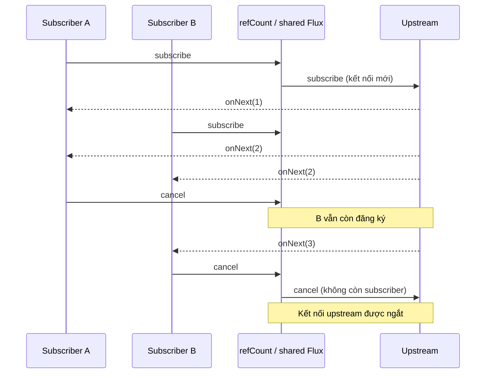

# Tái kết nối sau khi tất cả bên đăng ký rời đi

Một nguồn dữ liệu được chia sẻ cho nhiều subscriber thường chỉ cần một kết nối upstream. Khi subscriber đầu tiên xuất hiện, ứng dụng bắt đầu nhận dữ liệu; các subscriber đến sau cùng quan sát luồng đang chạy. Khi tất cả subscriber rời đi, ứng dụng có thể hủy kết nối upstream để giải phóng tài nguyên. Nếu một subscriber mới xuất hiện sau đó, nguồn được đăng ký lại và một kết nối mới được tạo.

Trong Reactor, `publish().refCount()` và toán tử rút gọn `share()` thường được dùng cho vòng đời này. Hiểu rõ thời điểm kết nối, ngắt kết nối và tái kết nối giúp thiết kế nguồn nóng/lạnh, tránh tạo nhiều kết nối không cần thiết và dự đoán chính xác dữ liệu mà subscriber mới có thể quan sát.

## 1. Kết nối được chia sẻ có vòng đời riêng

Một publisher cold thường tạo hoặc khởi động công việc nguồn cho mỗi lần subscribe. Nếu nhiều subscriber subscribe độc lập vào một nguồn cold, mỗi subscriber có thể tạo một lần thực thi riêng. Khi muốn nhiều subscriber cùng quan sát một lần thực thi upstream, có thể biến nguồn thành `ConnectableFlux` bằng `publish()`:

```java
Flux<Long> source = Flux.interval(Duration.ofSeconds(1));

ConnectableFlux<Long> shared = source.publish();
```

`publish()` chưa tự kết nối nguồn. Có thể gọi `connect()` thủ công để bắt đầu nguồn, hoặc dùng `refCount` để tự động quản lý kết nối theo số subscriber:

```java
Flux<Long> shared = Flux.interval(Duration.ofSeconds(1))
    .publish()
    .refCount(1);
```

Với `refCount(1)`, subscriber đầu tiên làm số subscriber đạt ngưỡng một và kích hoạt kết nối upstream. Các subscriber khác đăng ký trong khi kết nối đang hoạt động sẽ cùng nhận tín hiệu từ kết nối đó. Khi subscriber cuối cùng hủy subscription, số subscriber giảm xuống dưới ngưỡng và kết nối upstream được ngắt.

`share()` là cách viết gọn cho mô hình `publish().refCount()` với ngưỡng mặc định một subscriber:

```java
Flux<Long> sharedTicks = Flux.interval(Duration.ofSeconds(1))
    .doOnSubscribe(ignored -> log.info("Bắt đầu đăng ký nguồn tick"))
    .doOnCancel(() -> log.info("Đã hủy đăng ký nguồn tick"))
    .share();
```

Điều quan trọng là `share()` chia sẻ một kết nối đang hoạt động. Nó không mặc định lưu lại toàn bộ phần tử đã phát cho subscriber đến muộn. Một subscriber mới tham gia khi kết nối đang chạy chỉ quan sát các tín hiệu từ thời điểm tham gia trở đi.

## 2. Diễn tiến khi subscriber cuối cùng rời đi

Với `refCount(1)`, vòng đời điển hình có thể đọc như sau:



Nếu sau đó C đăng ký, `refCount(1)` thiết lập một subscription upstream mới:

```text
Kết nối thứ nhất:   --●1--●2--●3--X cancel
Khoảng không có subscriber:       (không có kết nối được chia sẻ)
Kết nối thứ hai:                               --●1--●2--...
Subscriber mới C:                              --●1--●2--...
```

Trong sơ đồ, `X cancel` biểu diễn hành động hủy kết nối upstream để minh họa, không phải tín hiệu `onError`. Subscriber cuối cùng rời đi không làm publisher gửi lỗi cho các subscriber đã hủy; subscription đó đơn giản được dispose/cancel. Khi có subscriber mới đạt ngưỡng, publisher được đăng ký lại với nguồn.

Với nguồn cold như `Flux.interval`, subscription mới tạo một vòng thực thi mới. Bộ đếm trong ví dụ bắt đầu lại từ giá trị đầu tiên của nguồn. Với nguồn cold thực hiện truy vấn hoặc gọi dịch vụ, kết nối lại có thể chạy lại truy vấn hoặc lặp lại tác dụng phụ. Vì vậy, hãy xem mỗi lần tái kết nối là một lần thực thi nguồn mới.

## 3. Phân biệt tái kết nối với replay

`publish().refCount(1)` chia sẻ tín hiệu trong thời gian kết nối đang hoạt động, nhưng không phát lại lịch sử cho subscriber mới. Ví dụ:

```text
Nguồn đang chạy:     --●a--●b--●c--●d--●e--|
Subscriber A:        --●a--●b--●c--●d--●e--|
Subscriber B đến muộn:          --●c--●d--●e--|
```

B chỉ nhận các phần tử được phát sau khi B đăng ký. Nếu A rời đi nhưng B vẫn còn, kết nối vẫn được duy trì. Khi B cũng rời đi, kết nối bị hủy; subscriber C đến sau sẽ tạo kết nối mới và không tự động nhận `a`, `b`, `c`, `d` hay `e` từ kết nối cũ.

Nếu yêu cầu nghiệp vụ là subscriber đến muộn phải nhận một phần lịch sử, hãy cân nhắc `replay()` hoặc một chiến lược cache có giới hạn. Ví dụ `replay(2)` tạo luồng chia sẻ có thể phát lại tối đa hai phần tử đã lưu cho subscriber tham gia sau khi kết nối được thiết lập:

```java
ConnectableFlux<Event> replaying = eventSource.replay(2);
Flux<Event> sharedWithHistory = replaying.refCount(1);
```

Replay thay đổi hợp đồng dữ liệu và tiêu thụ bộ nhớ để giữ phần tử. Cần xác định số phần tử hoặc khoảng thời gian lưu, hành vi khi nguồn kết thúc và chính sách reset của phiên bản/operator đang dùng. `cache()` còn có chính sách giữ và phát lại riêng; nó không nên được xem như một bí danh của `share()` vì mục tiêu vòng đời khác nhau.

## 4. Ngưỡng subscriber với refCount(n)

`refCount(n)` cho phép đặt số subscriber tối thiểu cần có trước khi kết nối upstream được khởi động. Ví dụ:

```java
Flux<Quote> quotes = quoteSource()
    .publish()
    .refCount(2);
```

Trong trường hợp này, một subscriber đơn lẻ chưa làm nguồn bắt đầu phát qua kết nối được chia sẻ. Khi subscriber thứ hai tham gia, ngưỡng đạt hai và nguồn được kết nối. Nếu số subscriber giảm xuống dưới hai, kết nối upstream được ngắt theo chính sách của `refCount`.

| Cấu hình | Khi nào kết nối | Khi nào ngắt kết nối |
| --- | --- | --- |
| `refCount(1)` | Subscriber đầu tiên đăng ký | Số subscriber giảm xuống 0 |
| `refCount(2)` | Có ít nhất hai subscriber | Số subscriber giảm xuống dưới 2 |
| `refCount(n)` | Có ít nhất `n` subscriber | Số subscriber giảm xuống dưới `n` |

Ngưỡng lớn hơn một hữu ích khi nguồn chỉ nên chạy khi có đủ người tiêu thụ. Tuy nhiên, nếu subscriber đến và đi liên tục quanh ngưỡng, kết nối có thể bị tạo rồi hủy nhiều lần. Điều này gây chi phí khởi tạo, đóng kết nối và có thể làm nguồn cold thực thi lặp lại.

## 5. Dùng grace period để tránh ngắt kết nối quá sớm

Một số ứng dụng có khoảng nghỉ ngắn giữa hai nhóm subscriber. Nếu ngắt nguồn ngay khi subscriber cuối cùng rời đi, một subscriber mới đến sau vài mili giây có thể khiến nguồn phải khởi động lại. `refCount` có overload nhận grace period để trì hoãn việc ngắt kết nối:

```java
Flux<Metric> metrics = metricSource()
    .publish()
    .refCount(1, Duration.ofSeconds(5));
```

Khi số subscriber giảm xuống dưới ngưỡng, Reactor chờ hết khoảng năm giây trước khi ngắt kết nối. Nếu subscriber mới đến trong khoảng chờ, việc ngắt kết nối đang chờ được hủy và kết nối hiện tại tiếp tục được dùng. Nếu hết grace period mà vẫn không có đủ subscriber, upstream bị hủy. Một subscriber đến sau thời điểm đó sẽ kích hoạt kết nối mới.

```text
Subscriber A:       subscribe -------- cancel
Subscriber B:                         subscribe
                                    <--- grace --->
Upstream:           connect ====================== tiếp tục

Trường hợp khác:
Subscriber A:       subscribe -------- cancel
                                    <--- grace --->
Upstream:           connect ====================== X cancel
Subscriber B:                                                subscribe
Upstream mới:                                               connect ===
```

Grace period là lựa chọn cân bằng giữa độ trễ tái kết nối và thời gian giữ tài nguyên. Khoảng chờ quá dài có thể giữ socket, listener hoặc tác vụ nền không cần thiết; khoảng chờ quá ngắn có thể làm kết nối dao động khi subscriber thường xuyên xuất hiện rồi biến mất. Hãy chọn thời lượng theo đặc điểm của nguồn và hành vi thực tế của subscriber.

## 6. Nguồn cold và hot có hành vi khác nhau khi kết nối lại

Việc `refCount` đăng ký lại upstream không có nghĩa mọi loại nguồn đều tạo lại cùng một dữ liệu.

**Nguồn cold** tạo luồng dữ liệu theo từng subscription. Khi kết nối cũ bị hủy và subscriber mới xuất hiện, một lần subscription mới thường bắt đầu một lần thực thi mới:

```java
Flux<Integer> coldSequence = Flux.defer(() -> {
    log.info("Tạo lần đọc dữ liệu mới");
    return Flux.range(1, 3);
}).share();
```

Nếu nhóm subscriber đầu tiên nhận `1, 2, 3` rồi rời đi, nhóm subscriber sau có thể kích hoạt lần đọc mới và cũng nhận `1, 2, 3`. Với nguồn đọc tệp, truy vấn database hoặc gọi API, điều đó có thể làm công việc được thực hiện lại.

**Nguồn hot** phát dữ liệu độc lập với một subscriber cụ thể. Nếu upstream hot tiếp tục phát khi không có kết nối downstream, những tín hiệu trong khoảng gián đoạn có thể bị bỏ lỡ. Khi `refCount` kết nối lại, subscriber mới chỉ nhận tín hiệu mà nguồn hot phát từ thời điểm đăng ký mới:

```text
Nguồn hot:           --●a--●b--●c--●d--●e--●f-->
Kết nối chia sẻ:     --●a--●b--X cancel       --●e--●f-->
Subscriber:          --●a--●b                 --●e--●f-->
                                      c, d bị bỏ lỡ
```

Nếu không được phép mất sự kiện trong thời gian không có subscriber, cần một cơ chế lưu trữ hoặc replay phù hợp, chẳng hạn broker bền vững, log sự kiện hoặc buffer có giới hạn và chính sách overflow rõ ràng. `refCount` chỉ quản lý vòng đời subscription; nó không tự lưu dữ liệu đã phát khi không có subscriber.

## 7. Kết nối lại không đồng nghĩa phục hồi sau mọi terminal signal

Ngắt kết nối do số subscriber giảm xuống dưới ngưỡng là một sự kiện vòng đời do subscription điều khiển. Nó khác với việc nguồn tự kết thúc bằng `onComplete` hoặc `onError`:

- `cancel` do subscriber rời đi yêu cầu upstream ngừng phát cho kết nối đó.
- `onComplete` cho biết nguồn đã kết thúc bình thường.
- `onError` cho biết nguồn kết thúc do lỗi.

Không nên xem `refCount` như một chính sách tự động retry sau lỗi. Nếu nguồn lỗi, cần xác định rõ subscriber tiếp theo sẽ quan sát terminal state hay một lần đăng ký mới được tạo theo ngữ nghĩa của publisher/operator cụ thể. Hành vi sau terminal signal có thể khác với tình huống tất cả subscriber chủ động cancel, và các operator có replay/cache có chính sách giữ terminal signal riêng.

Nếu muốn thử lại nguồn sau lỗi, hãy dùng `retry` hoặc `retryWhen` với điều kiện và giới hạn phù hợp. Nếu muốn khởi động lại khi không còn subscriber rồi có subscriber mới, dùng `refCount`/`share` với nguồn có thể subscribe lại. Hai chính sách này giải quyết hai nguyên nhân khác nhau và cần được kiểm thử độc lập.

## 8. So sánh refCount, autoConnect và connect thủ công

Ba cách điều khiển kết nối có vòng đời khác nhau:

| Cách dùng | Bắt đầu nguồn | Khi subscriber rời đi |
| --- | --- | --- |
| `publish().refCount(n)` | Khi số subscriber đạt `n` | Tự ngắt khi số subscriber xuống dưới `n` |
| `publish().autoConnect(n)` | Khi số subscriber đạt `n` | Không tự ngắt chỉ vì subscriber rời đi |
| `publish()` + `connect()` | Khi thành phần quản lý gọi `connect()` | Thành phần quản lý phải giữ và dispose `Disposable` kết nối |

`autoConnect` phù hợp khi nguồn nên chạy sau khi đã được khởi động và tiếp tục chạy dù subscriber tạm thời không còn. `refCount` phù hợp khi kết nối chỉ cần tồn tại trong lúc có đủ subscriber. `connect()` thủ công phù hợp khi lifecycle của nguồn gắn với một thành phần điều phối khác, chẳng hạn lifecycle ứng dụng:

```java
ConnectableFlux<Event> connectable = eventSource().publish();
Disposable connection = connectable.connect();

// Khi thành phần sở hữu nguồn dừng:
connection.dispose();
```

Với `connect()` thủ công, không được quên lưu `Disposable`. Nếu không dispose khi thành phần dừng, nguồn có thể tiếp tục chạy và giữ tài nguyên dù không còn subscriber.

## 9. Kiểm thử hành vi disconnect và reconnect

Nên kiểm thử vòng đời kết nối bằng cách đếm số lần upstream được subscribe và cancel. Ví dụ dùng `AtomicInteger` để quan sát:

```java
AtomicInteger subscriptions = new AtomicInteger();
AtomicInteger cancellations = new AtomicInteger();

Flux<Long> shared = Flux.interval(Duration.ofMillis(100))
    .doOnSubscribe(ignored -> subscriptions.incrementAndGet())
    .doOnCancel(cancellations::incrementAndGet)
    .share();
```

Một bài kiểm thử nên bao phủ các bước:

1. Subscriber A đăng ký; xác minh upstream được subscribe một lần.
2. Subscriber B đăng ký khi A còn hoạt động; xác minh không tạo thêm subscription upstream.
3. A hủy; xác minh upstream chưa bị cancel vì B vẫn còn.
4. B hủy; xác minh upstream nhận một lần cancel.
5. Subscriber C đăng ký sau khi kết nối đã ngắt; xác minh upstream có subscription mới.

Với grace period, dùng `StepVerifier.withVirtualTime` hoặc cơ chế điều khiển thời gian phù hợp để xác minh subscriber mới đến trước hạn sẽ giữ kết nối, còn subscriber đến sau hạn sẽ kích hoạt kết nối mới. Không dựa vào `Thread.sleep` dài trong unit test vì kết quả dễ phụ thuộc tốc độ máy và lịch chạy thread.

Ví dụ kiểm tra hai subscriber dùng chung một kết nối và subscriber mới tạo kết nối sau khi tất cả subscriber cũ đã hủy:

```java
AtomicInteger runs = new AtomicInteger();
AtomicInteger cancellations = new AtomicInteger();

Flux<Long> shared = Flux.defer(() -> {
    runs.incrementAndGet();
    return Flux.interval(Duration.ofSeconds(1))
        .doOnCancel(cancellations::incrementAndGet);
}).share();

Disposable a = shared.subscribe();
Disposable b = shared.subscribe();
assertEquals(1, runs.get());

a.dispose();
assertEquals(0, cancellations.get()); // B vẫn giữ kết nối.

b.dispose();
assertEquals(1, cancellations.get()); // Subscriber cuối cùng đã rời đi.

Disposable c = shared.subscribe();
assertEquals(2, runs.get());
c.dispose();
```

`Flux.defer` tăng bộ đếm mỗi khi `share()` tạo subscription upstream. `Flux.interval` giữ nguồn hoạt động cho tới khi bị hủy, nên ví dụ có thể xác minh chia sẻ và tái kết nối mà không cần chờ nguồn hoàn tất. Trong test thực tế, thêm assertion cho `cancellations` sau khi C dispose và dùng `StepVerifier` hoặc virtual time khi cần kiểm tra phần tử phát ra hay grace period.

## 10. Chọn chính sách vòng đời theo yêu cầu dữ liệu

Trước khi dùng `share()` hoặc `refCount`, hãy xác định nguồn là cold hay hot, có thể subscribe lại hay không, và điều gì xảy ra khi không còn subscriber. Nếu mỗi nhóm subscriber cần một lần thực thi cold mới, `refCount(1)` có thể phù hợp. Nếu subscriber thường xuyên rời đi trong khoảng ngắn, grace period có thể tránh tạo kết nối liên tục. Nếu subscriber đến muộn cần dữ liệu cũ, cần replay hoặc lưu trữ riêng. Nếu nguồn phải chạy suốt vòng đời ứng dụng, `autoConnect` hoặc `connect()` do lifecycle quản lý có thể phù hợp hơn.

Hãy phân biệt việc kết nối lại sau khi tất cả subscriber cancel với retry sau `onError`, và với replay cho subscriber đến muộn. Mỗi hành vi có một hợp đồng riêng. Khi đã chọn chính sách, kiểm thử số lần subscribe/cancel, dữ liệu bị bỏ lỡ, nguồn cold có chạy lại hay không và hành vi khi nguồn hoàn tất hoặc lỗi. Như vậy, vòng đời nguồn nóng/lạnh sẽ rõ ràng với cả upstream lẫn mọi subscriber downstream.
