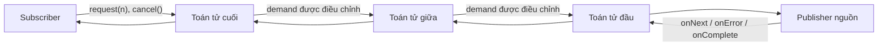

# Truyền nhu cầu qua từng toán tử trong chuỗi

## Demand đi ngược chiều dữ liệu

Trong Reactive Streams, dữ liệu và nhu cầu được truyền theo hai hướng. Các phần tử cùng tín hiệu kết thúc đi từ nguồn đến subscriber theo hướng **upstream → downstream**. Ngược lại, yêu cầu `request(n)` và lệnh `cancel()` đi từ subscriber về phía nguồn theo hướng **downstream → upstream**.

Mỗi toán tử nằm giữa hai phía thường đóng vai trò vừa là subscriber của publisher phía trước, vừa là publisher đối với bước phía sau. Vì thế, toán tử phải chuyển tiếp hoặc điều chỉnh demand sao cho phù hợp với cách nó biến đổi dữ liệu. Khi subscriber cuối yêu cầu ba phần tử, nguồn không nhất thiết chỉ nhận đúng một lời gọi `request(3)`: các toán tử có thể yêu cầu bù, chia lô, đọc trước hoặc phối hợp nhiều nguồn.

Đây là lý do cần hiểu demand tại từng ranh giới của pipeline. `request(n)` luôn nói về số phần tử mà subscriber của ranh giới đó sẵn sàng nhận; nó không nhất thiết bằng số phần tử mà nguồn ban đầu phải đọc để tạo ra chúng.



Trong hệ sinh thái Java reactive, `Publisher` và `Subscriber` tuân theo hợp đồng Reactive Streams; Reactor cung cấp `Flux` và `Mono` cùng các toán tử để xây dựng đồ thị xử lý. Cách truyền demand phụ thuộc vào ngữ nghĩa của từng toán tử, số lượng nguồn, khả năng đệm và scheduler được sử dụng.

## Quy tắc cơ bản của demand

`Subscription.request(n)` nhận tham số kiểu `long`. Giá trị phải lớn hơn không; `request(0)` và số âm vi phạm hợp đồng và dẫn đến lỗi. Các yêu cầu được cộng dồn; nếu tổng vượt giới hạn biểu diễn của `long`, demand được xem như `Long.MAX_VALUE`, tức nhu cầu không giới hạn.

Publisher không được phát nhiều tín hiệu `onNext` hơn tổng demand còn lại. Tuy nhiên, publisher có thể phát ít hơn demand nếu nguồn chưa có dữ liệu hoặc kết thúc sớm. `onComplete` và `onError` là tín hiệu kết thúc, không cần tiêu thụ một đơn vị demand như `onNext`.

Demand có ý nghĩa tại từng ranh giới. Nếu một toán tử nhận một phần tử nhưng loại bỏ nó, phần tử đó không đi đến subscriber phía sau. Nếu toán tử gom nhiều phần tử thành một kết quả, một đơn vị demand downstream có thể đòi hỏi nhiều phần tử upstream. Do đó, không thể nhìn `request(5)` ở subscriber rồi kết luận nguồn chỉ xử lý năm phần tử.

## Toán tử một vào, một ra

Với toán tử giữ nguyên số lượng phần tử như `map`, `cast` hoặc một bước quan sát `doOnNext`, một phần tử upstream tạo ra một phần tử downstream. Về mặt ngữ nghĩa, demand có thể được chuyển tiếp theo tỷ lệ một-một: downstream yêu cầu `n` phần tử thì toán tử cần tối đa `n` phần tử upstream để tạo ra chúng.

```java
Flux<Integer> values = Flux.range(1, 100)
    .map(number -> number * 2)
    .doOnNext(value -> System.out.println("Đã biến đổi: " + value));
```

`map` không cần đọc thêm phần tử để bù cho phần tử bị loại bỏ, vì mỗi đầu vào tạo đúng một đầu ra. Nếu hàm mapper ném ngoại lệ, pipeline phát `onError` và kết thúc nhánh đó; toán tử không thể tạo thêm giá trị hợp lệ để đáp ứng demand còn lại.

Trong thực tế, các thư viện có thể tối ưu việc truyền tín hiệu và gộp yêu cầu. Vì vậy, quy tắc một-một mô tả ngữ nghĩa số lượng phần tử, không bảo đảm rằng log luôn hiển thị một lời gọi `request` riêng cho từng phần tử.

## Toán tử có thể loại bỏ phần tử: filter và skip

`filter` chỉ chuyển tiếp những phần tử thỏa điều kiện. Nếu subscriber yêu cầu hai phần tử nhưng nguồn phát ra nhiều giá trị không đạt điều kiện, toán tử phải tiếp tục yêu cầu upstream để tìm đủ hai phần tử phù hợp, hoặc chờ nguồn kết thúc.

```java
Flux<Integer> selected = Flux.range(1, 20)
    .filter(number -> number % 5 == 0);
```

Giả sử downstream yêu cầu hai giá trị. `filter` có thể phải kiểm tra các phần tử `1`, `2`, `3`, `4`, `5`, rồi `6`, `7`, `8`, `9`, `10` để chuyển tiếp hai giá trị `5` và `10`. Nguồn đã phát nhiều hơn hai phần tử dù downstream chỉ yêu cầu hai phần tử đầu ra. Nếu nguồn hoàn tất trước khi tìm đủ, subscriber nhận số phần tử ít hơn yêu cầu rồi nhận `onComplete`.

`skip(k)` cũng tiêu thụ các phần tử đầu tiên nhưng không chuyển chúng xuống dưới. Để tạo đủ `n` phần tử đầu ra, toán tử cần bỏ qua `k` phần tử rồi lấy thêm phần tử từ upstream. Có thể hiểu gần đúng rằng nhu cầu upstream cần bao gồm phần bị bỏ qua và phần downstream muốn nhận; cách triển khai thực tế có thể chia yêu cầu thành nhiều đợt.

Điểm cần nhớ: demand downstream đếm các phần tử được chuyển tiếp qua ranh giới downstream. Nó không đếm số phần tử nguồn đã kiểm tra hoặc loại bỏ.

## Toán tử giới hạn: take

`take(k)` giới hạn số phần tử được chuyển tiếp xuống dưới tối đa là `k`. Khi đã nhận đủ số phần tử đó, toán tử hủy subscription upstream và hoàn tất phía downstream. Nó vừa giới hạn số lượng đầu ra, vừa có thể ngăn nguồn tiếp tục thực hiện công việc.

```java
Flux.range(1, 1_000)
    .take(3)
    .subscribe(System.out::println);
```

Subscriber tiện dụng trong ví dụ thường yêu cầu không giới hạn, nhưng `take(3)` chỉ cho phép tối đa ba phần tử đi qua. Sau phần tử thứ ba, nó hủy upstream. Đây là khác biệt giữa `take(3)` và `limitRate(3)`: `take` giới hạn tổng số phần tử được chuyển tiếp, còn `limitRate` điều chỉnh cách yêu cầu dữ liệu theo từng lô.

## Toán tử gom nhóm: buffer và collectList

Với `buffer(size)`, một phần tử downstream là một collection chứa nhiều phần tử upstream. Nếu kích thước buffer là năm, một yêu cầu cho một buffer thường cần tối đa năm phần tử nguồn để tạo ra buffer đầy đủ. Nếu nguồn hoàn tất khi buffer chưa đầy, toán tử có thể phát buffer cuối cùng chứa ít hơn năm phần tử.

```java
Flux.range(1, 100)
    .buffer(5)
    .take(2)
    .subscribe(batch -> System.out.println("Nhóm: " + batch));
```

`take(2)` yêu cầu hai phần tử ở ranh giới sau `buffer`; mỗi phần tử là một danh sách. Để tạo hai danh sách đầy đủ, `buffer(5)` cần tối đa mười phần tử nguồn. Khi đã tạo đủ hai danh sách và downstream không cần thêm, `take` có thể hủy upstream. Con số cụ thể ở ranh giới nguồn còn chịu ảnh hưởng bởi cách toán tử triển khai prefetch và việc nguồn kết thúc sớm.

`collectList()` cũng gom nhiều phần tử thành một kết quả duy nhất:

```java
Mono<List<Integer>> allValues = Flux.range(1, 1_000)
    .collectList();
```

Subscriber của `Mono<List<Integer>>` chỉ cần yêu cầu một kết quả, nhưng toán tử phải tiêu thụ toàn bộ nguồn hữu hạn và chờ nguồn hoàn tất mới phát danh sách. Một đơn vị demand downstream vì thế có thể tương ứng với một nghìn phần tử upstream. Với nguồn vô hạn, `collectList()` không thể phát danh sách hoàn chỉnh và có nguy cơ giữ dữ liệu tăng liên tục trong bộ nhớ.

`reduce` và `count` cũng là các ví dụ về phép tổng hợp: chúng có thể nhận nhiều phần tử upstream để tạo một kết quả downstream. Khi phân tích backpressure, hãy xem đơn vị đầu ra của toán tử là gì và toán tử cần bao nhiêu đầu vào để tạo ra đơn vị đó.

## Toán tử tạo publisher con: flatMap và concatMap

`flatMap` biến mỗi phần tử nguồn thành một publisher con rồi hợp nhất các phần tử phát ra từ những publisher con đó. Đây là trường hợp demand phức tạp hơn quan hệ một-một, bởi có một nguồn outer và nhiều nguồn inner.

```java
import java.time.Duration;
import reactor.core.publisher.Flux;
import reactor.core.publisher.Mono;

Flux.range(1, 20)
    .flatMap(
        id -> Mono.delay(Duration.ofMillis(100)).map(tick -> "Kết quả " + id),
        4,
        1
    )
    .subscribe(System.out::println);
```

Trong ví dụ, `flatMap` cho phép tối đa bốn publisher con hoạt động đồng thời. Tham số cuối cấu hình prefetch cho mỗi publisher con. Nhu cầu downstream được phân phối qua các kết quả inner; đồng thời `flatMap` quản lý số phần tử outer cần lấy để mở thêm publisher con và lượng dữ liệu được yêu cầu từ từng inner. Vì thế, không thể quy đổi đơn giản một `request(n)` cuối pipeline thành đúng `request(n)` ở nguồn outer.

Các publisher con có thể hoàn tất theo thứ tự khác với thứ tự phần tử outer. Nếu cần xử lý lần lượt và giữ thứ tự, `concatMap` chỉ đăng ký publisher con kế tiếp sau khi publisher con hiện tại hoàn tất. Nó vẫn có thể prefetch một số phần tử outer để duy trì hiệu suất, nhưng không chạy nhiều publisher con đồng thời như `flatMap`.

Khi dùng `flatMap`, hãy lựa chọn rõ `concurrency` và `prefetch`. Concurrency quá cao có thể tạo nhiều request bên ngoài cùng lúc; prefetch lớn có thể làm tăng số phần tử được giữ trong bộ nhớ. Hai tham số này ảnh hưởng đến lượng công việc đang hoạt động và hàng đợi, kể cả khi subscriber cuối có demand thấp.

## Kết hợp nhiều nguồn: zip và merge

`zip` cần lấy một phần tử từ mỗi nguồn để tạo một kết quả kết hợp. Vì vậy, khi downstream yêu cầu một kết quả zip, toán tử phải phối hợp nhu cầu ở tất cả nguồn tham gia để có đủ một phần tử từ mỗi nguồn. Nếu một nguồn kết thúc mà không còn phần tử để tạo cặp, zip có thể kết thúc mà không tạo đủ số kết quả downstream đã yêu cầu.

`merge` hợp nhất tín hiệu từ nhiều nguồn và chuyển tiếp phần tử khi chúng đến. Nó phải quản lý demand của downstream cùng nhu cầu được gửi đến từng nguồn đang hoạt động. Kết quả có thể xen kẽ theo thời điểm phát của các nguồn.

Hai toán tử này cho thấy demand không chỉ được truyền qua một đường thẳng. Khi đồ thị phân nhánh, toán tử kết hợp phải phân phối nhu cầu và phối hợp việc kết thúc hoặc lỗi từ nhiều upstream.

## publishOn: demand đi qua hàng đợi và prefetch

`publishOn` tạo ranh giới thực thi: các tín hiệu ở phía downstream của toán tử được xử lý trên scheduler được chỉ định. Để không phải chuyển từng phần tử theo kiểu chờ từng lần, Reactor có thể yêu cầu trước một lượng dữ liệu upstream và giữ chúng trong hàng đợi nội bộ. Khi downstream yêu cầu và xử lý dữ liệu, hàng đợi được tiêu thụ và toán tử bổ sung demand upstream theo cơ chế prefetch.

```java
import reactor.core.publisher.Flux;
import reactor.core.scheduler.Schedulers;

Flux.range(1, 100)
    .publishOn(Schedulers.parallel(), 8)
    .map(number -> number * 10)
    .subscribe(System.out::println);
```

Ở đây, `publishOn` có prefetch được cấu hình là tám phần tử. Nó có thể yêu cầu dữ liệu trước từ nguồn, giữ chúng trong hàng đợi và phát sang bước `map` theo demand downstream. Do đó, nguồn có thể nhận yêu cầu trước khi subscriber cuối xử lý xong phần tử hiện tại. Prefetch cải thiện khả năng tận dụng scheduler nhưng cũng làm phát sinh bộ nhớ đệm và lượng dữ liệu đang chờ.

`subscribeOn` chủ yếu điều phối quá trình subscription và thực thi nguồn upstream trên scheduler được chọn. Nó không có cùng vai trò với ranh giới hàng đợi downstream do `publishOn` tạo ra. Khi phân tích demand, hãy xác định toán tử nào thực sự có prefetch hoặc buffer thay vì suy luận chỉ từ việc pipeline dùng scheduler.

## limitRate: chia yêu cầu thành các lô

Reactor cung cấp `limitRate(highTide)` và biến thể có thêm `lowTide` để điều chỉnh cách demand được truyền lên upstream. Thay vì chuyển tiếp một yêu cầu lớn thành một yêu cầu lớn tương ứng, toán tử chia nó thành các đợt nhỏ hơn và bổ sung nhu cầu theo ngưỡng đã cấu hình.

```java
Flux.range(1, 1_000)
    .limitRate(32)
    .map(number -> "record-" + number)
    .subscribe(System.out::println);
```

`limitRate(32)` điều chỉnh việc yêu cầu upstream theo các lô có high-tide là 32. Nó không giới hạn tổng số phần tử của luồng ở 32; nếu downstream tiếp tục yêu cầu, toàn bộ 1.000 phần tử vẫn có thể được phát. Nếu muốn giới hạn tổng số phần tử, dùng `take(32)`.

`limitRate` hữu ích khi muốn điều tiết kích thước các đợt yêu cầu đến nguồn. Tuy nhiên, nó không phải giới hạn bộ nhớ toàn cục cho mọi toán tử trong pipeline. Nếu phía sau hoặc phía trước còn có buffer, prefetch hoặc publisher con, cần tính cả các hàng đợi đó khi đánh giá áp lực bộ nhớ.

## Quan sát demand tại từng vị trí bằng doOnRequest

`doOnRequest` cho phép quan sát số lượng demand đi qua vị trí được đặt toán tử. Đặt nó ở hai phía của một toán tử có thể giúp thấy toán tử đã chuyển tiếp hoặc điều chỉnh nhu cầu ra sao.

```java
import org.reactivestreams.Subscription;
import reactor.core.publisher.BaseSubscriber;
import reactor.core.publisher.Flux;

Flux<Integer> pipeline = Flux.range(1, 20)
    .doOnRequest(n -> System.out.println("Nguồn nhận request: " + n))
    .map(number -> number * 2)
    .filter(number -> number % 6 == 0)
    .doOnRequest(n -> System.out.println("Downstream yêu cầu: " + n));

pipeline.subscribe(new BaseSubscriber<Integer>() {
    @Override
    protected void hookOnSubscribe(Subscription subscription) {
        request(2);
    }

    @Override
    protected void hookOnNext(Integer value) {
        System.out.println("Nhận: " + value);
    }
});
```

Subscriber chỉ yêu cầu hai phần tử phù hợp. `filter` có thể cần đọc nhiều phần tử nguồn hơn để tìm đủ hai giá trị thỏa điều kiện. `doOnRequest` đặt sau `filter` quan sát yêu cầu từ subscriber; `doOnRequest` đặt trước `filter` quan sát các yêu cầu mà filter chuyển lên nguồn, bao gồm yêu cầu bù cho phần tử bị loại bỏ.

Không nên dùng số dòng log làm bằng chứng rằng mỗi toán tử luôn gửi một lời gọi request cụ thể. Tối ưu nội bộ, fusion, nguồn đồng bộ, scheduler và cách một toán tử gom yêu cầu có thể làm số lần gọi khác nhau. Hãy đọc log như quan sát tại một ranh giới, rồi đối chiếu với ngữ nghĩa số lượng phần tử của toán tử.

## Cách lần theo demand trong một pipeline thực tế

Khi một subscriber nhận ít dữ liệu hơn nguồn có thể phát hoặc hệ thống có dấu hiệu tích tụ hàng đợi, hãy phân tích theo thứ tự:

1. Xác định demand ban đầu của subscriber cuối. Các overload `subscribe` tiện dụng thường yêu cầu không giới hạn; `BaseSubscriber` cho phép yêu cầu theo lô.
2. Đi ngược từng toán tử và xác định đơn vị đầu ra của nó: một phần tử, một buffer, một publisher con hay một kết quả tổng hợp.
3. Xác định toán tử nào có thể loại bỏ phần tử và phải yêu cầu bù, như `filter` hoặc `skip`.
4. Xác định toán tử nào gom nhiều đầu vào thành một đầu ra, hoặc tạo nhiều publisher con, như `buffer`, `collectList`, `reduce` và `flatMap`.
5. Kiểm tra các ranh giới scheduler và tham số prefetch, concurrency, buffer; đặc biệt chú ý `publishOn` và các toán tử kết hợp nguồn.
6. Kiểm tra giới hạn tổng số phần tử và lệnh hủy. `take` có thể kết thúc upstream; `limitRate` chỉ điều tiết các đợt demand.
7. Dùng `doOnRequest`, metric và log tại các ranh giới cần thiết để đối chiếu hành vi thực tế với mô hình demand.

## Những nhầm lẫn thường gặp

- **Một request downstream luôn tương ứng một request upstream:** chỉ gần đúng với toán tử một vào, một ra. `filter`, `buffer`, `flatMap` và các phép tổng hợp thay đổi quan hệ số lượng.
- **Subscriber yêu cầu hai phần tử thì nguồn chỉ xử lý hai phần tử:** nếu toán tử lọc hoặc loại bỏ dữ liệu, nguồn có thể cần phát nhiều hơn hai phần tử để tạo đủ hai đầu ra.
- **Một demand cho một buffer chỉ cần một phần tử nguồn:** buffer có thể cần nhiều phần tử nguồn để tạo một collection đầu ra.
- **`flatMap` chỉ chuyển tiếp demand theo một đường thẳng:** nó quản lý demand của nguồn outer, nhiều publisher inner, concurrency và prefetch.
- **`publishOn` chỉ đổi thread:** nó còn tạo ranh giới bất đồng bộ với hàng đợi và prefetch, ảnh hưởng đến lượng dữ liệu được yêu cầu trước và giữ trong bộ nhớ.
- **`limitRate(32)` giới hạn luồng còn 32 phần tử:** nó chia demand upstream thành lô; `take(32)` mới giới hạn số phần tử được chuyển tiếp.
- **Backpressure bảo đảm không có buffer:** toán tử có thể giữ dữ liệu nội bộ. Cần kiểm soát prefetch và giới hạn hàng đợi trên toàn đồ thị.

Khi thiết kế pipeline Reactor, hãy xem demand như một lượng phần tử có ý nghĩa tại từng ranh giới. Mỗi toán tử có trách nhiệm chuyển tiếp hoặc điều chỉnh lượng nhu cầu đó theo cách nó biến đổi dữ liệu. Nắm được mối quan hệ này giúp chọn đúng `concurrency`, `prefetch`, buffer và giới hạn tốc độ, từ đó kiểm soát lượng công việc đang hoạt động và tránh để nguồn hoặc bên tiêu thụ bị quá tải trong các luồng sự kiện bất đồng bộ.
