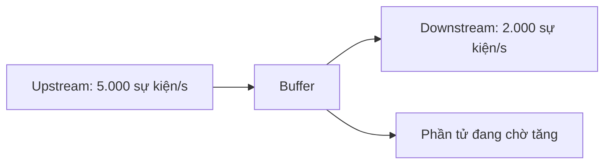

# Đệm có giới hạn và chính sách khi bộ đệm đầy

Trong module `REACTIVE_PROGRAMMING`, ta học cách tổ chức luồng sự kiện bất đồng bộ theo hợp đồng Publisher–Subscriber và cơ chế backpressure của Reactive Streams, đồng thời thực hành `Mono`, `Flux`, toán tử, scheduler, xử lý lỗi và kiểm thử pipeline trong hệ sinh thái Java. Khi tốc độ phát dữ liệu của upstream cao hơn tốc độ xử lý của downstream, một bộ đệm có thể hấp thụ chênh lệch trong một khoảng thời gian. Nhưng nếu bộ đệm không có giới hạn, dữ liệu chờ có thể tiếp tục tăng cho đến khi tiêu thụ hết bộ nhớ.

**Đệm có giới hạn** đặt ra dung lượng tối đa cho số phần tử đang chờ. Khi bộ đệm đầy, hệ thống phải có một chính sách rõ ràng: báo lỗi, bỏ phần tử mới, bỏ phần tử cũ, giữ giá trị mới nhất, hoặc điều tiết nguồn nếu nguồn hỗ trợ backpressure. Lựa chọn này quyết định ứng dụng ưu tiên tính đầy đủ dữ liệu, độ mới của dữ liệu hay khả năng tiếp tục hoạt động.

## 1. Vì sao cần giới hạn bộ đệm?

Giả sử một nguồn nhận được 5.000 sự kiện mỗi giây trong khi downstream chỉ xử lý được 2.000 sự kiện mỗi giây. Mỗi giây có khoảng 3.000 sự kiện chưa được xử lý. Nếu chênh lệch này kéo dài, hàng đợi tăng liên tục.



Một buffer không giới hạn chỉ trì hoãn thời điểm sự cố xảy ra. Nó không làm downstream xử lý nhanh hơn và cũng không làm giảm tốc độ upstream. Khi hàng đợi lớn dần, bộ nhớ tăng, độ trễ của từng sự kiện tăng và hệ thống có thể rơi vào tình trạng hết bộ nhớ.

Buffer có giới hạn giúp giới hạn lượng dữ liệu nằm trong bộ nhớ. Khi đạt giới hạn, ứng dụng phải thực hiện một hành động đã xác định. Đây là quyết định về hành vi nghiệp vụ, không chỉ là một tham số kỹ thuật.

## 2. Mô hình hàng đợi và tốc độ tiêu thụ

Gọi:

- \(\lambda\): tốc độ phần tử đến từ upstream, tính bằng phần tử/giây.
- \(\mu\): tốc độ downstream xử lý, tính bằng phần tử/giây.
- \(B\): số phần tử tối đa mà buffer giữ được.

Nếu \(\lambda \leq \mu\) trong thời gian dài, downstream có khả năng theo kịp nguồn. Nếu \(\lambda > \mu\), hàng đợi có xu hướng tăng với tốc độ xấp xỉ \(\lambda - \mu\), khi chưa có điều tiết hoặc loại bỏ dữ liệu.

Nếu hệ thống cần chịu một đợt quá tải kéo dài \(T\) giây, dung lượng tối thiểu ước tính để hấp thụ phần chênh lệch là:

\[
B \geq (\lambda - \mu) \times T
\]

Ví dụ, nguồn phát 5.000 phần tử/giây, downstream xử lý 2.000 phần tử/giây và ta muốn hấp thụ chênh lệch trong 4 giây:

\[
B \geq (5000 - 2000) \times 4 = 12000
\]

Con số này là ước tính cho một đợt quá tải ổn định. Trong hệ thống thực tế, tốc độ đến thay đổi theo thời gian, phần tử có kích thước khác nhau và buffer còn có chi phí quản lý. Cần chừa biên an toàn và đo bằng tải thực tế.

Dung lượng theo số phần tử cũng chưa đủ để dự đoán bộ nhớ. Nếu mỗi phần tử giữ trung bình 2 KB dữ liệu, 12.000 phần tử có thể giữ khoảng 24 MB payload, chưa tính object header, tham chiếu, cấu trúc queue và dữ liệu được các phần tử tham chiếu tới. Vì vậy, khi phần tử có kích thước lớn hoặc không đồng nhất, cần theo dõi cả số lượng lẫn bộ nhớ thực tế.

## 3. Các chính sách khi buffer đầy

Không có chính sách overflow tốt cho mọi loại dữ liệu. Cần chọn theo ý nghĩa của sự kiện và hậu quả khi mất dữ liệu.

| Chính sách | Hành vi khi đầy | Phù hợp khi |
|---|---|---|
| `ERROR` | Kết thúc luồng bằng lỗi overflow | Mất dữ liệu không được chấp nhận; cần phát hiện quá tải rõ ràng |
| `DROP_LATEST` | Bỏ phần tử mới đến, giữ các phần tử cũ đang chờ | Ưu tiên xử lý những dữ liệu đã vào hàng đợi trước đó |
| `DROP_OLDEST` | Bỏ phần tử cũ nhất đang nằm trong buffer để nhận phần tử mới | Dữ liệu gần hiện tại có giá trị cao hơn dữ liệu đã cũ |
| Drop khi không có demand | Bỏ phần tử đến trong lúc downstream chưa yêu cầu | Dữ liệu có thể mất và cần tiếp tục xử lý phần còn lại |
| Giữ giá trị mới nhất | Thay giá trị đang chờ bằng giá trị mới nhất | Chỉ trạng thái gần nhất có ý nghĩa, như nhiệt độ hoặc vị trí hiện tại |
| Điều tiết upstream | Giảm hoặc tạm dừng lượng yêu cầu upstream | Nguồn có khả năng tuân thủ backpressure và cần giữ dữ liệu |

`DROP_LATEST` và `DROP_OLDEST` khác nhau ở phần tử nào bị loại. Với buffer đang giữ `[A, B, C]` và phần tử mới `D` đến:

- `DROP_LATEST` bỏ `D`, buffer vẫn là `[A, B, C]`.
- `DROP_OLDEST` bỏ `A`, buffer trở thành `[B, C, D]`.

Nếu ứng dụng chỉ cần trạng thái gần nhất, chiến lược giữ phần tử mới nhất có thể đơn giản và hiệu quả hơn việc giữ nhiều sự kiện rồi loại bỏ từng phần tử. Tuy nhiên, không dùng chính sách này cho các sự kiện biểu diễn giao dịch hoặc hành động phải được ghi nhận đầy đủ.

## 4. Dùng buffer có giới hạn trong Reactor

Reactor cung cấp `onBackpressureBuffer` để giữ các phần tử khi downstream chưa có đủ demand. Có thể đặt giới hạn số phần tử và chính sách khi giới hạn bị vượt.

```java
import reactor.core.publisher.BufferOverflowStrategy;
import reactor.core.publisher.Flux;

Flux<Event> events = eventSource
    .onBackpressureBuffer(256);
```

Overload nhận `maxSize` đặt giới hạn 256 phần tử. Khi vượt giới hạn, hành vi mặc định là phát lỗi overflow và kết thúc subscription. Cách này phù hợp khi việc vượt ngưỡng phải được phát hiện rõ ràng.

Nếu dữ liệu mới có giá trị hơn dữ liệu cũ đang chờ, có thể chọn `DROP_OLDEST`:

```java
Flux<Event> recentEvents = eventSource
    .onBackpressureBuffer(
        256,
        BufferOverflowStrategy.DROP_OLDEST
    );
```

Nếu muốn giữ những phần tử cũ đang chờ và bỏ phần tử mới đến khi buffer đầy, chọn `DROP_LATEST`:

```java
Flux<Event> preserveQueuedEvents = eventSource
    .onBackpressureBuffer(
        256,
        BufferOverflowStrategy.DROP_LATEST
    );
```

Hai ví dụ trên minh họa lựa chọn chính sách. Khi dùng drop trong ứng dụng thực tế, nên ghi nhận số lượng phần tử bị bỏ bằng callback overflow hoặc metric tương ứng để có thể phát hiện và định lượng mất dữ liệu.

### `onBackpressureBuffer` không làm upstream chậm lại

Điểm quan trọng khi dùng toán tử này là nó yêu cầu upstream phát dữ liệu với demand lớn (thông thường là không giới hạn), rồi giữ dữ liệu trong buffer để downstream tiêu thụ theo demand của nó. Vì vậy, `maxSize` giới hạn số phần tử được giữ trong buffer của toán tử, nhưng không tự động tạo ra cơ chế tạm dừng upstream mỗi khi downstream chậm.

Nếu nguồn phát nhanh và buffer đầy, chính sách overflow sẽ được áp dụng. Đây là khác biệt giữa **đệm để hấp thụ chênh lệch** và **điều tiết nhu cầu để nguồn phát chậm lại**.

## 5. Phân biệt buffer, drop và latest

Reactor cung cấp các toán tử có hành vi khác nhau khi downstream thiếu demand:

```java
// Giữ tối đa 256 phần tử; mặc định báo lỗi khi vượt giới hạn.
Flux<Event> buffered = eventSource.onBackpressureBuffer(256);

// Bỏ các phần tử đến khi downstream chưa có demand.
Flux<Event> dropped = eventSource.onBackpressureDrop();

// Chỉ giữ phần tử mới nhất đang chờ downstream.
Flux<Event> latest = eventSource.onBackpressureLatest();
```

| Toán tử | Dữ liệu được giữ | Hệ quả |
|---|---|---|
| `onBackpressureBuffer(n)` | Tối đa `n` phần tử chờ | Bảo toàn thứ tự trong phần được giữ; overflow mặc định thành lỗi |
| `onBackpressureDrop()` | Không tích lũy hàng đợi các phần tử bị thiếu demand | Phần tử đến khi không có demand bị bỏ |
| `onBackpressureLatest()` | Một phần tử mới nhất đang chờ | Các giá trị trung gian có thể bị thay thế |

Các toán tử drop/latest này cũng nhận dữ liệu upstream theo cách không buộc nguồn phải chờ demand từng phần tử. Chúng là chính sách xử lý khi downstream chậm, không phải cơ chế bảo đảm mọi phần tử đều được giao.

Nếu mục tiêu là giới hạn lượng demand gửi upstream, có thể cân nhắc `limitRate`:

```java
Flux<Event> inBatches = eventSource
    .limitRate(64);
```

`limitRate(64)` chia các yêu cầu lớn từ downstream thành các đợt request nhỏ hơn gửi upstream. Nó hữu ích khi upstream tuân thủ backpressure và ta muốn điều tiết lượng dữ liệu được yêu cầu. Nó không phải là chính sách overflow của một buffer đầy, và không thể buộc một nguồn nóng không tuân thủ demand ngừng phát.

## 6. Chọn chính sách theo ý nghĩa dữ liệu

Hãy bắt đầu từ câu hỏi: nếu phải bỏ một phần tử, phần tử nào có thể bỏ mà không làm sai ý nghĩa của hệ thống?

**Sự kiện giao dịch hoặc nghiệp vụ.** Ví dụ thanh toán, đặt hàng, ghi nhận thay đổi số dư hoặc nhật ký kiểm toán thường cần giữ đầy đủ và đúng thứ tự. Không nên âm thầm dùng `DROP_LATEST` hoặc `DROP_OLDEST`. Có thể chọn `ERROR` để dừng luồng và kích hoạt xử lý sự cố, hoặc chuyển dữ liệu sang một hàng đợi bền vững có dung lượng và chính sách tiếp nhận rõ ràng.

**Dữ liệu đo đạc liên tục.** Với telemetry hoặc số liệu cảm biến, một số mẫu bị bỏ có thể chấp nhận được nếu mục tiêu là quan sát xu hướng. `DROP_OLDEST` giúp ưu tiên mẫu mới hơn, còn `DROP_LATEST` giữ các mẫu đã chờ. Việc chọn phụ thuộc vào yêu cầu phân tích.

**Trạng thái hiện tại.** Với vị trí mới nhất của thiết bị, giá cổ phiếu mới nhất hoặc trạng thái hiển thị, các giá trị trung gian đôi khi không còn hữu ích. `onBackpressureLatest()` có thể phù hợp vì downstream chỉ cần cập nhật gần nhất.

**Nguồn có thể điều tiết.** Nếu upstream là một Publisher tuân thủ Reactive Streams, hãy ưu tiên truyền demand ngược về nguồn hoặc chia nhỏ request. Cách này giữ dữ liệu mà không cần tích lũy một hàng đợi lớn, miễn là nguồn có khả năng đáp ứng backpressure.

## 7. Ví dụ kiểm thử overflow và DROP_OLDEST

`StepVerifier` có thể tạo subscriber ban đầu không yêu cầu phần tử. Khi đó, toán tử buffer phải xử lý dữ liệu upstream trong lúc downstream chưa có demand.

Ví dụ sau kiểm tra chính sách `DROP_OLDEST`:

```java
import reactor.core.publisher.BufferOverflowStrategy;
import reactor.core.publisher.Flux;
import reactor.test.StepVerifier;

Flux<Integer> source = Flux.range(1, 5)
    .onBackpressureBuffer(
        2,
        BufferOverflowStrategy.DROP_OLDEST
    );

StepVerifier.create(source, 0)
    .thenRequest(2)
    .expectNext(4, 5)
    .verifyComplete();
```

Do buffer chỉ giữ hai phần tử và chính sách loại phần tử cũ nhất, sau khi nguồn phát `1` đến `5` trong lúc subscriber chưa yêu cầu, hai phần tử còn lại là `4` và `5`. Khi subscriber yêu cầu hai phần tử, nó nhận đúng hai giá trị này.

Có thể kiểm tra overflow mặc định bằng cách không yêu cầu phần tử và để nguồn phát nhiều hơn dung lượng:

```java
Flux<Integer> overflowing = Flux.range(1, 10)
    .onBackpressureBuffer(2);

StepVerifier.create(overflowing, 0)
    .expectError()
    .verify();
```

Nguồn phát nhiều hơn hai phần tử trong khi downstream chưa yêu cầu. Buffer đầy và subscription kết thúc bằng lỗi. Trong kiểm thử ứng dụng, có thể kiểm tra cụ thể kiểu lỗi hoặc metric overflow nếu logic xử lý phụ thuộc vào chúng.

## 8. Thiết kế dung lượng và giám sát

Không nên chọn `maxSize` chỉ bằng cách thử một con số tùy ý. Hãy ước lượng theo tốc độ đến, tốc độ xử lý và thời gian quá tải cần hấp thụ. Sau đó kiểm tra với dữ liệu thực tế:

1. Đo tốc độ đến trung bình và tốc độ đến ở đỉnh tải.
2. Đo tốc độ xử lý của downstream trong điều kiện bình thường và khi phụ thuộc bên ngoài chậm.
3. Xác định khoảng thời gian quá tải mà hệ thống cần chịu được.
4. Ước lượng kích thước phần tử và chi phí bộ nhớ của queue.
5. Chạy thử với burst lớn hơn dự kiến, downstream tạm dừng và nhiều subscription đồng thời.
6. Đặt ngưỡng cảnh báo trước khi buffer đạt dung lượng tối đa.

Các metric hữu ích gồm số phần tử đang chờ, dung lượng tối đa, số lần overflow, số phần tử bị drop, thời gian chờ trung bình và độ trễ đầu-cuối. Nếu chỉ đo throughput mà không đo queue depth, hệ thống có thể trông vẫn hoạt động trong khi độ trễ đang tăng nhanh.

Buffer có giới hạn cũng cần được xem xét cùng các queue khác trong pipeline. Một ứng dụng có thể có queue trong driver, scheduler, operator và client mạng. Giới hạn một buffer không có nghĩa tổng lượng dữ liệu chờ của toàn hệ thống đã được giới hạn. Hãy xác định tất cả nơi có thể tích lũy dữ liệu và tổng ngân sách bộ nhớ cho chúng.

## 9. Những sai lầm thường gặp

| Sai lầm | Hậu quả | Điều chỉnh |
|---|---|---|
| Dùng buffer không giới hạn để tránh lỗi overflow | Bộ nhớ có thể tăng đến khi ứng dụng hết bộ nhớ | Đặt giới hạn và chọn chính sách đầy |
| Nghĩ buffer có giới hạn sẽ làm upstream chậm lại | Nguồn vẫn có thể phát nhanh; buffer cuối cùng vẫn đầy | Dùng demand/`limitRate` nếu nguồn hỗ trợ backpressure |
| Drop dữ liệu giao dịch mà không có metric | Mất dữ liệu nghiệp vụ khó phát hiện | Báo lỗi hoặc dùng hàng đợi bền vững; giám sát mọi lần drop |
| Dùng `DROP_OLDEST` khi cần xử lý đủ lịch sử | Các sự kiện cũ chưa xử lý bị loại | Chọn chính sách bảo toàn hoặc lưu trữ bền vững |
| Chọn dung lượng chỉ theo số phần tử | Phần tử lớn có thể chiếm nhiều bộ nhớ hơn dự tính | Đo kích thước payload và chi phí object |
| Chỉ giám sát lỗi cuối cùng | Không nhận ra buffer đang tăng và độ trễ đang xấu đi | Theo dõi queue depth, drop count và latency |

## 10. Quy trình lựa chọn

Khi thêm buffer vào pipeline, hãy xác định theo thứ tự:

1. **Nguồn có tuân thủ backpressure không?** Nếu có, cân nhắc điều tiết demand trước khi tích lũy dữ liệu. Nếu nguồn nóng hoặc không thể tạm dừng, cần chính sách overflow.
2. **Có được phép mất dữ liệu không?** Nếu không, chọn fail-fast hoặc một cơ chế lưu trữ bền vững; không âm thầm drop.
3. **Nếu được phép mất, phần tử nào có thể bỏ?** Chọn `DROP_LATEST`, `DROP_OLDEST`, drop hoặc latest theo ý nghĩa dữ liệu.
4. **Cần hấp thụ quá tải trong bao lâu?** Ước lượng `maxSize` từ chênh lệch tốc độ và thời gian, rồi kiểm tra ngân sách bộ nhớ.
5. **Làm sao phát hiện chính sách đang kích hoạt?** Đo overflow, drop, queue depth và độ trễ; kiểm thử cả đường bình thường lẫn đường đầy buffer.

Một buffer có giới hạn giúp hệ thống kiểm soát lượng dữ liệu chờ và đưa ra quyết định rõ ràng khi downstream không theo kịp. Chọn đúng chính sách đòi hỏi hiểu giá trị của dữ liệu, khả năng điều tiết của upstream và ngân sách bộ nhớ của toàn pipeline. Khi ba yếu tố này được xác định, backpressure trở thành một phần có thể thiết kế và kiểm thử của ứng dụng reactive.
