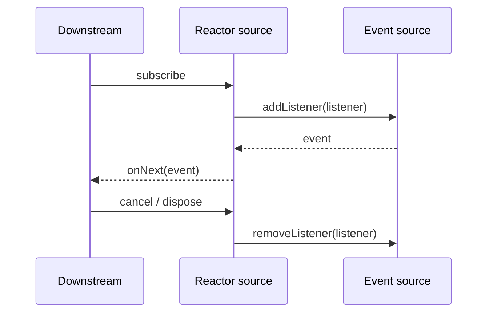

# Gỡ bộ lắng nghe và giải phóng tài nguyên khi nguồn bị hủy

## Subscription kết thúc thì nguồn phải dọn dẹp

Khi tạo một nguồn reactive từ API bên ngoài, chẳng hạn event listener, socket, message consumer, timer hoặc cursor cơ sở dữ liệu, việc đăng ký thường tạo ra một tài nguyên cần được quản lý. Nếu subscriber hủy subscription nhưng nguồn vẫn giữ listener hoặc tiếp tục đọc socket, tài nguyên có thể bị rò rỉ và công việc không còn cần thiết vẫn tiếp tục chạy.

Trong Reactive Streams, subscriber có thể hủy thông qua `Subscription.cancel()`. Với Reactor, các overload `subscribe` thường trả về một `Disposable`; gọi `dispose()` yêu cầu hủy subscription. Khi xây dựng nguồn bằng `Flux.create` hoặc `Flux.push`, `FluxSink` cung cấp các hook để gắn việc giải phóng tài nguyên với vòng đời nguồn:

- `onCancel(...)` đăng ký hành động chạy khi downstream hủy subscription.
- `onDispose(...)` đăng ký hành động chạy khi sink bị hủy hoặc kết thúc bằng `complete`/`error`.

Nếu chỉ gỡ listener khi bị hủy, listener vẫn có thể tồn tại sau khi nguồn hoàn tất tự nhiên hoặc phát lỗi. Vì thế, với tài nguyên cần giải phóng ở mọi đường kết thúc, `onDispose` thường là hook quan trọng. Có thể kết hợp cả hai hook nếu cần phân biệt hành động riêng khi hủy với hành động dọn dẹp chung; phần dọn dẹp dùng chung phải an toàn khi được gọi nhiều lần.

## Vòng đời của một nguồn dựa trên listener

Giả sử ứng dụng nhận sự kiện từ một thư viện Java bên ngoài có API đăng ký và gỡ listener:

```java
interface EventSource {
    void addListener(java.util.function.Consumer<DomainEvent> listener);
    void removeListener(java.util.function.Consumer<DomainEvent> listener);
}

record DomainEvent(String type, String payload) {}
```

Khi chuyển API này thành `Flux<DomainEvent>`, mỗi subscription có thể cần đăng ký một listener riêng. Listener chuyển sự kiện vào `FluxSink`; khi subscription kết thúc, nguồn phải gỡ đúng listener đã đăng ký. Không được tạo một listener mới khi gọi `removeListener`, vì nhiều event source xác định listener bằng chính đối tượng đã truyền vào lúc đăng ký.

Một vòng đời thông thường có dạng:



Nếu nguồn phát `onComplete` hoặc `onError` trước khi downstream hủy, listener cũng phải được gỡ. Điều này giúp tài nguyên có cùng vòng đời với subscription và tránh phụ thuộc vào việc người gọi có nhớ dọn dẹp thủ công hay không.

## Dùng onCancel và onDispose trong Flux.create

`Flux.create` phù hợp khi adapter nhận callback từ một API có thể phát sự kiện bất đồng bộ, kể cả từ nhiều thread. Ví dụ sau đăng ký listener và gỡ nó khi sink bị hủy hoặc kết thúc:

```java
import java.util.concurrent.atomic.AtomicBoolean;
import java.util.function.Consumer;
import reactor.core.publisher.Flux;
import reactor.core.publisher.FluxSink;

Flux<DomainEvent> eventsFrom(EventSource source) {
    return Flux.create(sink -> {
        AtomicBoolean registered = new AtomicBoolean();
        AtomicBoolean cleanupRequested = new AtomicBoolean();

        Consumer<DomainEvent> listener = event -> {
            if (!sink.isCancelled()) {
                sink.next(event);
            }
        };

        Runnable removeListener = () -> {
            cleanupRequested.set(true);
            if (registered.compareAndSet(true, false)) {
                source.removeListener(listener);
            }
        };

        sink.onCancel(removeListener::run);
        sink.onDispose(removeListener::run);

        if (!sink.isCancelled() && !cleanupRequested.get()) {
            source.addListener(listener);
            registered.set(true);

            // Bù cho trường hợp bị hủy trong lúc addListener đang chạy.
            if (sink.isCancelled() || cleanupRequested.get()) {
                removeListener.run();
            }
        }
    }, FluxSink.OverflowStrategy.ERROR);
}
```

Hai cờ phục vụ hai việc khác nhau. `cleanupRequested` ghi nhận yêu cầu dọn dẹp, kể cả khi yêu cầu đến trước lúc đăng ký listener hoàn tất. `registered` cho biết listener đã được thêm thành công và dùng `compareAndSet` để chỉ gỡ listener một lần. Sau khi `addListener` trả về, mã kiểm tra lại trạng thái hủy; nhờ đó, nếu cancellation xảy ra trong lúc đăng ký, listener vẫn được gỡ ngay khi thao tác đăng ký hoàn tất.

Ví dụ giả định `addListener` đăng ký nguyên tử: khi phương thức trả về thành công, listener đã được đăng ký; nếu thất bại, nó không để lại đăng ký một phần. Nếu thư viện bên ngoài không bảo đảm điều này, adapter cần xử lý riêng trường hợp đăng ký thất bại một phần và gọi thao tác gỡ tương ứng. `removeListener` cũng nên an toàn khi được gọi lặp hoặc khi listener đã không còn được đăng ký.

`onCancel` và `onDispose` cùng gọi một hành động dọn dẹp. Khi downstream hủy, cả hai hook có thể tham gia vòng đời kết thúc; `compareAndSet` bảo đảm việc gỡ listener chỉ xảy ra một lần. Khi nguồn gọi `sink.complete()` hoặc `sink.error(...)`, `onDispose` vẫn chạy và gỡ listener dù không có cancellation.

`FluxSink.OverflowStrategy.ERROR` trong ví dụ làm rõ chính sách khi nguồn phát nhanh hơn demand: thay vì giữ hàng đợi không giới hạn, pipeline báo lỗi khi không thể chuyển tiếp theo chính sách này. Hãy chọn chiến lược theo ý nghĩa dữ liệu. Nếu mọi sự kiện đều phải được xử lý, cần một hàng đợi có giới hạn và cơ chế xử lý overflow rõ ràng; nếu chỉ quan tâm trạng thái mới nhất, có thể cân nhắc `LATEST`; nếu cho phép bỏ sự kiện, cân nhắc `DROP`. Chính sách overflow là vấn đề riêng với việc gỡ listener, nhưng cả hai đều cần được thiết kế cho nguồn sự kiện dài hạn.

## Hủy từ downstream và dừng nguồn tự động

Một subscriber có thể hủy tường minh bằng `Disposable.dispose()`:

```java
import reactor.core.Disposable;

Disposable subscription = eventsFrom(eventSource)
    .subscribe(event -> System.out.println("Nhận: " + event));

// Khi màn hình hoặc thành phần sở hữu luồng bị đóng:
subscription.dispose();
```

Khi gọi `dispose()`, cancellation đi ngược qua pipeline đến nguồn. Hook `onCancel` được gọi và listener được gỡ. Subscriber cũng có thể hủy gián tiếp qua toán tử. Ví dụ `take(10)` tự hủy upstream sau khi nhận đủ mười sự kiện:

```java
eventsFrom(eventSource)
    .take(10)
    .subscribe(
        event -> System.out.println("Nhận: " + event),
        error -> System.err.println("Lỗi nguồn: " + error.getMessage()),
        () -> System.out.println("Đã nhận đủ mười sự kiện")
    );
```

Ở ví dụ thứ hai, subscriber phía dưới nhận `onComplete` do `take(10)` hoàn tất giới hạn của nó. Nguồn phía trên lại nhận cancellation; `onCancel` và `onDispose` của sink thực hiện việc gỡ listener. Đây là điểm cần phân biệt: downstream có thể hoàn tất bình thường trong khi upstream bị hủy để dừng việc đọc thêm dữ liệu.

Cancellation là yêu cầu dừng, không phải lệnh hoàn tác. Nếu callback đang chạy hoặc thư viện bên ngoài có một thao tác I/O không thể ngắt tức thời, công việc đó có thể cần thời gian để dừng. Adapter nên kiểm tra trạng thái hủy trước khi chuyển sự kiện, ngừng phát sinh công việc mới và liên kết cancellation với API hủy của nguồn nếu API đó hỗ trợ.

## Gỡ listener cả khi nguồn hoàn tất hoặc gặp lỗi

Nguồn có thể kết thúc theo nhiều cách: hết dữ liệu, phát lỗi, hoặc bị downstream hủy. Dọn dẹp tài nguyên cần bao phủ tất cả các đường này.

Trong adapter thực tế, callback báo hết dữ liệu cần gọi `sink.complete()`, còn callback báo lỗi cần gọi `sink.error(error)`. Cả hai tín hiệu đều kết thúc sink và kích hoạt `onDispose`, vì vậy listener được gỡ ngay cả khi downstream không gọi `dispose()`. Nếu adapter bỏ qua các tín hiệu kết thúc từ thư viện nguồn, subscription có thể bị giữ vô thời hạn dù nguồn không còn dữ liệu.

Không nên dùng `onCancel` làm hook duy nhất cho tài nguyên phải được giải phóng sau khi nguồn hoàn tất tự nhiên. `onCancel` biểu diễn việc downstream chủ động hủy; `onDispose` biểu diễn việc sink đã kết thúc hoặc bị hủy. Nếu có hành động riêng khi hủy, đặt nó trong `onCancel` và đặt phần giải phóng chung trong `onDispose`.

## Quản lý tài nguyên bằng using

Khi nguồn reactive sở hữu một tài nguyên có phương thức đóng rõ ràng, `Flux.using` hoặc `Mono.using` thường dễ đọc và ít lỗi hơn việc tự viết nhiều hook. `using` tạo tài nguyên, dùng tài nguyên để tạo publisher, rồi gọi hàm cleanup khi publisher hoàn tất, phát lỗi hoặc bị hủy.

Ví dụ đọc file theo từng dòng:

```java
import java.nio.file.Files;
import java.nio.file.Path;
import java.util.stream.Stream;
import reactor.core.publisher.Flux;

Flux<String> lines = Flux.using(
    () -> Files.lines(Path.of("data.txt")),
    stream -> Flux.fromStream(stream),
    Stream::close
);
```

`Files.lines` mở một stream có giữ tài nguyên file. `Flux.using` bảo đảm `Stream.close()` được gọi khi việc tiêu thụ kết thúc hoặc bị hủy. Cách này phù hợp với tài nguyên có thao tác cleanup đồng bộ như đóng stream, cursor hoặc handle file. Nếu nguồn là vô hạn, subscriber phải có cơ chế kết thúc hoặc hủy để tài nguyên được giải phóng.

Mặc định `using` thực hiện cleanup eager: cleanup diễn ra trước khi tín hiệu kết thúc được chuyển tiếp downstream. Có thể chọn overload có tham số `eager` khi cần thay đổi thời điểm cleanup, nhưng nên giữ mặc định trừ khi có lý do rõ ràng.

## Cleanup bất đồng bộ với usingWhen

Một số tài nguyên cần được giải phóng bằng thao tác bất đồng bộ, ví dụ kết nối reactive, transaction hoặc request đang chạy trên một client. Khi đó, `usingWhen` cho phép định nghĩa cleanup riêng cho ba trường hợp: hoàn tất, lỗi và cancellation.

```java
Mono<Result> loadResult(ConnectionFactory connectionFactory, String sql) {
    return Mono.usingWhen(
        connectionFactory.create(),
        connection -> connection.query(sql),
        Connection::close,
        (connection, error) -> connection.close(),
        connection -> connection.cancelQuery().then(connection.close())
    );
}
```

Trong ví dụ, `connectionFactory.create()` trả về `Mono<Connection>`, `query` trả về `Mono<Result>`, còn `close` và `cancelQuery` trả về `Mono<Void>`. Khi truy vấn hoàn tất, `usingWhen` gọi cleanup hoàn tất; khi truy vấn lỗi, nó gọi cleanup lỗi; khi downstream hủy, nó gọi cleanup cancellation. Nhánh cancellation có thể yêu cầu hủy truy vấn trước rồi mới đóng kết nối.

Việc tách ba callback cho phép xử lý transaction chính xác hơn. Chẳng hạn, khi hoàn tất có thể commit rồi đóng kết nối; khi lỗi hoặc cancellation có thể rollback rồi đóng. Các thao tác cleanup bất đồng bộ phải tự hoàn tất và xử lý lỗi theo chính sách của ứng dụng; nếu cleanup không kết thúc, vòng đời kết thúc của tài nguyên cũng bị kéo dài.

## Chia sẻ nguồn và quyền sở hữu listener

Một nguồn được tạo bằng `Flux.create` thường chạy callback tạo nguồn cho mỗi subscription. Nếu có ba subscriber độc lập, adapter có thể đăng ký ba listener riêng; khi mỗi subscriber hủy, listener tương ứng được gỡ. Điều này phù hợp khi mỗi subscriber cần vòng đời độc lập, nhưng có thể tạo nhiều đăng ký đến cùng một event source.

Nếu nhiều subscriber cần cùng một lần đăng ký listener, có thể chia sẻ publisher upstream:

```java
Flux<DomainEvent> sharedEvents = eventsFrom(eventSource).share();
```

Các subscriber đang tham gia cùng nhận dữ liệu từ một subscription upstream. Khi subscriber cuối cùng rời đi, `share()`/ref-count hủy subscription upstream; hook cleanup của `eventsFrom` gỡ listener. Subscriber đến sau có thể tạo một subscription upstream mới và đăng ký listener mới. `share()` không lưu lịch sử để phát lại các sự kiện đã trôi qua.

Việc chia sẻ thay đổi quyền sở hữu tài nguyên: listener gắn với subscription upstream dùng chung, không gắn riêng với từng subscriber downstream. Vì thế, cần xác định rõ điều gì xảy ra khi một subscriber rời đi, subscriber cuối cùng rời đi hoặc một subscriber mới tham gia sau đó.

## Các lỗi thường gặp khi cleanup

- **Chỉ gỡ listener khi gọi `dispose()` thủ công:** nguồn vẫn có thể hoàn tất hoặc lỗi trước khi người gọi hủy. Hãy gắn cleanup với `onDispose` hoặc `using`/`usingWhen`.
- **Gỡ một listener khác đối tượng đã đăng ký:** lưu lại đúng instance listener và dùng chính instance đó khi gọi `removeListener`.
- **Cleanup bị gọi nhiều lần:** `onCancel` và `onDispose` có thể cùng chạy trên đường hủy. Làm cleanup idempotent bằng cờ trạng thái hoặc handle tài nguyên có tính idempotent.
- **Cancellation xảy ra trong lúc đăng ký:** cài hook cleanup trước khi thêm listener, kiểm tra lại trạng thái sau khi đăng ký và bảo đảm listener không bị bỏ sót trong tình huống cạnh tranh.
- **Cho rằng cancellation ngắt ngay mọi tác vụ bên ngoài:** liên kết cancellation với API dừng thực tế; nếu thư viện không hỗ trợ hủy, công việc đang chạy có thể vẫn hoàn tất.
- **Dùng cleanup đồng bộ cho tài nguyên cần đóng bất đồng bộ:** dùng `usingWhen` để cleanup có thể được biểu diễn bằng publisher và phân biệt complete, error, cancel.
- **Quên chính sách overflow:** gỡ listener đúng lúc không ngăn hàng đợi tăng trong lúc subscription còn hoạt động. Chọn chiến lược overflow và giới hạn buffer phù hợp.
- **Chia sẻ nguồn nhưng giả định mỗi subscriber sở hữu listener riêng:** khi dùng `share` hoặc `refCount`, tài nguyên gắn với subscription upstream dùng chung và chỉ được gỡ khi subscription đó bị hủy hoặc kết thúc.

## Quy trình thiết kế nguồn có cleanup an toàn

Khi adapter một API callback hoặc tài nguyên bên ngoài thành `Mono`/`Flux`, hãy xác định tài nguyên được tạo ở thời điểm nào và subscription nào sở hữu nó. Đăng ký cleanup ngay khi tạo nguồn; bảo đảm cleanup chạy khi hoàn tất, lỗi và hủy; giữ lại đúng handle hoặc listener đã đăng ký; và làm thao tác cleanup idempotent để xử lý được các tình huống cạnh tranh.

Tiếp theo, kiểm tra cách cancellation truyền qua pipeline. Các toán tử như `take`, `timeout`, `switchMap` hoặc subscriber gọi `dispose()` có thể hủy upstream. Xác nhận adapter nguồn nhận được cancellation và thật sự tháo listener, dừng timer, đóng cursor hoặc hủy request. Nếu tài nguyên cần cleanup bất đồng bộ, dùng `usingWhen` và cung cấp nhánh cleanup phù hợp cho hoàn tất, lỗi và cancellation.

Trong hệ sinh thái reactive Java, một nguồn chỉ thực sự có vòng đời tốt khi dữ liệu, demand và tài nguyên được quản lý cùng nhau. Gắn cleanup với subscription giúp nguồn dừng đúng lúc, tránh listener mồ côi và giảm công việc bên ngoài tiếp tục chạy sau khi không còn subscriber cần kết quả.
