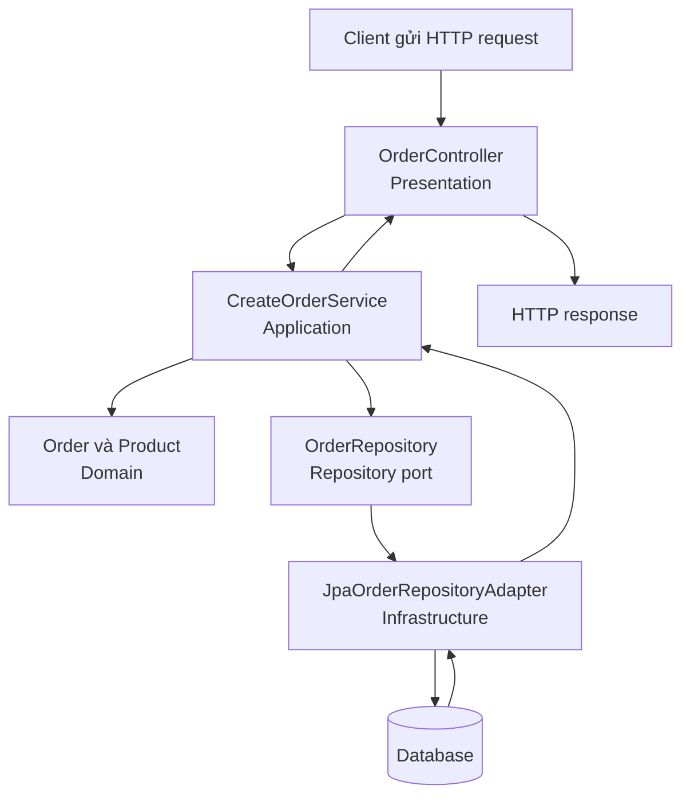

# Kiến trúc phân tầng là gì, giải quyết vấn đề nào và khác gì cách chia thư mục?

> Chương: **Tổng quan kiến trúc phân tầng**

Trong module học cách tổ chức phần mềm theo kiến trúc phân tầng, bài này giới thiệu ý nghĩa của việc chia hệ thống thành các tầng trách nhiệm. Mục tiêu không phải là ghi nhớ một sơ đồ cố định, mà là hiểu vì sao cần ranh giới giữa giao tiếp với người dùng, điều phối ca sử dụng, quy tắc nghiệp vụ và truy cập dữ liệu; đồng thời biết cách nhận ra một kiến trúc phân tầng thực sự trong mã nguồn.

## 1. Vấn đề xuất hiện khi mọi trách nhiệm nằm chung một chỗ

Hãy hình dung một API tạo đơn hàng. Một phương thức xử lý HTTP có thể đồng thời:

- Đọc và kiểm tra dữ liệu JSON gửi lên.
- Kiểm tra quyền của người gọi.
- Tìm sản phẩm trong cơ sở dữ liệu.
- Tính tiền, kiểm tra số lượng và áp dụng quy tắc đặt hàng.
- Ghi đơn hàng xuống cơ sở dữ liệu.
- Chuyển kết quả thành JSON và chọn mã trạng thái HTTP.

Ban đầu, cách viết này có vẻ nhanh vì mọi thứ đều ở gần nhau. Khi ứng dụng lớn lên, một thay đổi nhỏ lại có thể chạm vào nhiều trách nhiệm. Chẳng hạn, đổi từ REST API sang giao diện dòng lệnh vẫn phải đi qua đoạn mã đang phụ thuộc vào HTTP; thay cơ sở dữ liệu có thể buộc phải sửa cả phần xử lý nghiệp vụ; muốn kiểm tra quy tắc tính tiền lại phải khởi động web server hoặc kết nối cơ sở dữ liệu.

Vấn đề cốt lõi là các lý do thay đổi khác nhau đang bị trộn lẫn. Giao thức giao tiếp, quy trình của một ca sử dụng, quy tắc kinh doanh và cách lưu trữ dữ liệu có vòng đời thay đổi riêng. Kiến trúc phân tầng tạo ra các ranh giới để mỗi phần tập trung vào một nhóm trách nhiệm và giao tiếp với phần khác qua hợp đồng rõ ràng.

## 2. Kiến trúc phân tầng là gì?

**Kiến trúc phân tầng (Layered Architecture)** là cách tổ chức một hệ thống thành các tầng logic, trong đó mỗi tầng đảm nhận một nhóm trách nhiệm và cung cấp khả năng cho tầng khác sử dụng. Tầng thường được phân biệt theo mức độ trừu tượng hoặc loại công việc, chẳng hạn giao tiếp, điều phối ứng dụng, nghiệp vụ và truy cập hạ tầng.

Tầng là ranh giới về trách nhiệm và phụ thuộc trong thiết kế. Một tầng có thể gồm nhiều package, class hoặc module; nó không nhất thiết tương ứng với một tiến trình, máy chủ hay dịch vụ riêng. Một ứng dụng Java chạy trong một Spring Boot process vẫn có thể có nhiều tầng logic.

Một cách chia thường gặp là bốn nhóm sau. Đây là mô hình minh họa để giải thích trách nhiệm, không phải quy định rằng mọi ứng dụng đều phải có đúng bốn tầng.

| Tầng | Trách nhiệm chính | Ví dụ trong ứng dụng đặt hàng |
|---|---|---|
| Presentation (trình bày) | Nhận yêu cầu từ bên ngoài, chuyển dữ liệu vào/ra và biểu diễn kết quả theo giao thức | Spring MVC controller, request DTO, response DTO |
| Application (ứng dụng) | Thực hiện một ca sử dụng bằng cách điều phối các bước, quản lý ranh giới giao dịch và phối hợp các thành phần | `CreateOrderService`, `CreateOrderUseCase` |
| Domain/Business (nghiệp vụ) | Mô hình hóa khái niệm, quy tắc và bất biến của lĩnh vực | `Order`, `Product`, quy tắc số lượng đặt hàng và trạng thái đơn |
| Data Access/Infrastructure (truy cập dữ liệu/hạ tầng) | Giao tiếp với cơ sở dữ liệu và hệ thống bên ngoài; chuyển đổi giữa mô hình ứng dụng và cơ chế lưu trữ | JPA adapter, Spring Data repository, HTTP client |

Ở một ứng dụng CRUD đơn giản, tầng Application và Domain có thể chưa cần tách rõ; một kiến trúc ba tầng thường gộp chúng thành tầng Business. Ở hệ thống khác, Infrastructure có thể được tách thành nhiều phần như persistence, messaging và tích hợp dịch vụ ngoài. Số tầng nên phản ánh độ phức tạp và ranh giới cần quản lý, không phải một con số bắt buộc.

Điều quan trọng là mỗi tầng có mục đích rõ ràng. Controller không nên tự quyết định quy tắc giá bán; domain model không nên biết request HTTP được gửi bằng JSON; quy tắc nghiệp vụ không nên phụ thuộc trực tiếp vào câu lệnh SQL hay API cụ thể của một nhà cung cấp cơ sở dữ liệu.

## 3. Một yêu cầu đi qua các tầng như thế nào?

Xét yêu cầu `POST /orders` để tạo đơn hàng. Luồng xử lý điển hình trong một ứng dụng Spring có thể được mô tả như sau:



Các bước có thể diễn ra như sau:

1. **Presentation nhận và chuyển đổi yêu cầu.** `OrderController` nhận JSON, kiểm tra định dạng đầu vào bằng cơ chế như Bean Validation, chuyển các trường cần thiết thành command rồi gọi ca sử dụng. Controller xử lý chi tiết HTTP như đường dẫn, mã trạng thái và định dạng response.
2. **Application điều phối ca sử dụng.** `CreateOrderService` tải dữ liệu cần thiết, gọi các hành vi nghiệp vụ, lưu kết quả và trả về dữ liệu kết quả. Đây cũng thường là nơi đặt ranh giới giao dịch, ví dụ dùng `@Transactional` trong Spring.
3. **Domain thực thi quy tắc.** Đối tượng hoặc dịch vụ nghiệp vụ kiểm tra các điều kiện như số lượng phải lớn hơn không, sản phẩm có thể được đặt hay tổng tiền được tính thế nào. Quy tắc này có thể được gọi từ REST API, tác vụ nền hoặc một giao diện khác.
4. **Infrastructure thực hiện thao tác kỹ thuật.** Adapter dùng JPA, JDBC hoặc một cơ chế khác để đọc và ghi dữ liệu. Application làm việc với một hợp đồng lưu trữ; adapter chịu trách nhiệm hiện thực hợp đồng đó bằng công nghệ cụ thể.
5. **Kết quả quay lại Presentation.** Controller chuyển kết quả của ca sử dụng thành response phù hợp với API.

Ví dụ rút gọn về ranh giới giữa controller và application service:

```java
@RestController
class OrderController {
    private final CreateOrderUseCase createOrder;

    @PostMapping("/orders")
    OrderResponse create(@Valid @RequestBody CreateOrderRequest request) {
        var command = new CreateOrderCommand(
            request.productId(), request.quantity());
        var result = createOrder.execute(command);
        return OrderResponse.from(result);
    }
}
```

```java
@Service
class CreateOrderService implements CreateOrderUseCase {
    private final ProductRepository products;
    private final OrderRepository orders;

    @Transactional
    public OrderResult execute(CreateOrderCommand command) {
        Product product = products.findById(command.productId())
            .orElseThrow(ProductNotFoundException::new);

        Order order = Order.create(product, command.quantity());
        orders.save(order);
        return OrderResult.from(order);
    }
}
```

Đây là ví dụ về cách phân công trách nhiệm, không phải bộ mã hoàn chỉnh cho mọi dự án. `Order.create(...)` đại diện cho nơi kiểm tra các bất biến của đơn hàng; `OrderRepository` là hợp đồng mà ca sử dụng cần để lưu đơn. Tùy quy ước của dự án, interface repository có thể nằm trong package application hoặc domain, còn lớp triển khai JPA nằm ở infrastructure. Điểm cần giữ là quy tắc nghiệp vụ không phải tự biết cách JPA ghi dữ liệu.

## 4. Tầng logic khác với tầng triển khai và chiều phụ thuộc

Khi đọc kiến trúc, cần phân biệt **luồng gọi lúc chạy** với **phụ thuộc trong mã nguồn**.

Trong ví dụ trên, một request đi từ controller qua application service, gọi logic domain và cuối cùng kích hoạt adapter để truy cập cơ sở dữ liệu. Đó là luồng thực thi. Nhưng hướng phụ thuộc giữa các class có thể được thiết kế theo nhiều cách.

Ở cách phân tầng truyền thống, tầng phía trên thường gọi tầng phía dưới thông qua API của tầng dưới. Cách này dễ hiểu và có thể phù hợp với ứng dụng nhỏ. Tuy nhiên, nếu application phụ thuộc trực tiếp vào API cụ thể của thư viện persistence, việc thay công nghệ lưu trữ có thể lan lên phần điều phối.

Một cách tổ chức khác dùng **Dependency Inversion**: application hoặc domain định nghĩa interface mà nó cần, còn adapter ở Infrastructure triển khai interface đó. Khi ấy, lớp triển khai JPA phụ thuộc vào hợp đồng ở phía trong; phần nghiệp vụ không import lớp triển khai JPA. Cơ chế này thường được dùng cùng kiến trúc phân tầng, nhưng không có nghĩa mọi dự án phân tầng đều phải áp dụng đầy đủ mô hình ports and adapters.

Một nguyên tắc hữu ích là tránh để tầng có mức nghiệp vụ ổn định phụ thuộc vào chi tiết giao tiếp hoặc lưu trữ dễ thay đổi. Đồng thời, cần tránh phụ thuộc vòng: ví dụ package domain import controller, trong khi controller lại import domain. Ranh giới chỉ có ý nghĩa khi các phụ thuộc được giữ nhất quán.

Một số tài liệu còn phân biệt **closed layering** và **open layering**:

- Với tầng đóng (closed), một tầng chỉ được đi qua tầng liền kề bên dưới theo quy tắc đã chọn. Ví dụ Presentation gọi Application, Application gọi Domain hoặc hợp đồng mà nó cần; Presentation không tự ý truy cập thẳng persistence.
- Với tầng mở (open), một số tầng được phép đi xuyên qua tầng trung gian khi có lý do thiết kế rõ ràng. Ví dụ một truy vấn chỉ đọc có thể đi tới read model chuyên biệt thay vì buộc đi qua toàn bộ luồng ghi.

Tầng mở không có nghĩa là mọi class được phép gọi tùy ý mọi nơi. Dự án cần ghi rõ trường hợp nào được đi tắt và vì sao; nếu không, ranh giới sẽ dần mất tác dụng. Cũng không nên nhầm khái niệm open layering với nguyên tắc Open/Closed trong SOLID: đây là hai khái niệm khác nhau.

## 5. Kiến trúc phân tầng khác gì cách chia thư mục?

Thư mục và package là cách **sắp xếp vật lý** mã nguồn. Tầng là cách **phân chia trách nhiệm và kiểm soát phụ thuộc**. Hai cách tổ chức có thể hỗ trợ nhau, nhưng không đồng nhất.

Ví dụ, một dự án có thể đặt class theo loại kỹ thuật:

```text
src/main/java/com/example/shop/
    controller/
    service/
    repository/
    entity/
```

Tên thư mục gợi ý một số tầng, nhưng tự nó chưa chứng minh kiến trúc được phân tầng đúng. Nếu một controller tự tính giá, cập nhật nhiều bảng và gửi email; hoặc một entity phụ thuộc vào `HttpServletRequest`, thì trách nhiệm vẫn đang bị trộn dù tên thư mục trông có vẻ hợp lý. Một class tên `Service` cũng không tự động trở thành Application layer: cần xem nó làm gì và phụ thuộc vào đâu.

Một cấu trúc khác có thể thể hiện ranh giới theo vai trò rõ hơn:

```text
src/main/java/com/example/shop/
    presentation/
        OrderController.java
        CreateOrderRequest.java
        OrderResponse.java
    application/
        CreateOrderUseCase.java
        CreateOrderService.java
        CreateOrderCommand.java
    domain/
        Order.java
        Product.java
        OrderRepository.java
    infrastructure/
        persistence/
            JpaOrderRepositoryAdapter.java
            SpringDataOrderJpaRepository.java
```

Đây cũng chỉ là một cách biểu diễn. Dự án có thể tổ chức theo tính năng trước rồi chia tầng bên trong từng tính năng, ví dụ `orders/presentation`, `orders/application`, `orders/domain` và `orders/infrastructure`. Cách nào dễ điều hướng hơn phụ thuộc quy mô nhóm, số lượng tính năng và cách các phần thay đổi. Dù chọn bố cục nào, nhóm vẫn cần quy tắc về trách nhiệm, API được phép gọi và hướng phụ thuộc.

Có thể kiểm tra kiến trúc bằng cách đọc luồng xử lý và các import giữa package, xem interface nào được gọi, adapter nào triển khai chúng, và liệu quy tắc nghiệp vụ có phụ thuộc vào framework hay cơ sở dữ liệu không. Với dự án Java, các bài kiểm tra kiến trúc tự động (chẳng hạn quy tắc ArchUnit) có thể giúp phát hiện một package vi phạm hướng phụ thuộc đã thống nhất.

## 6. Tầng logic khác với tầng triển khai (tier)

Từ “layer” và “tier” đôi khi được dùng lẫn nhau trong hội thoại, nhưng chúng mô tả hai khía cạnh khác nhau:

| Khái niệm | Mô tả | Ví dụ |
|---|---|---|
| Layer (tầng logic) | Ranh giới trách nhiệm trong thiết kế và mã nguồn | Presentation, Application, Domain, Infrastructure |
| Tier (tầng triển khai) | Ranh giới triển khai hoặc thực thi, thường là tiến trình, máy chủ hay môi trường riêng | Web server, application server, database server |

Một ứng dụng Spring Boot dạng monolith có thể chứa cả Presentation, Application, Domain và Infrastructure trong cùng một tiến trình, kết nối tới một database server riêng. Khi đó có nhiều layer logic nhưng không nhất thiết có bốn tier triển khai. Ngược lại, một hệ thống triển khai nhiều service trên các máy chủ khác nhau vẫn cần tổ chức trách nhiệm bên trong từng service; việc tách máy chủ không tự động tạo ra thiết kế phân tầng tốt.

Vì vậy, không nên suy ra số tầng logic từ sơ đồ hạ tầng, hoặc nghĩ rằng muốn có kiến trúc phân tầng thì phải tách thành nhiều microservice. Phân tầng thường là cách tổ chức bên trong một ứng dụng; phân tán thành nhiều tiến trình là quyết định triển khai khác và kéo theo các vấn đề giao tiếp mạng, độ trễ, độ tin cậy và vận hành.

## 7. Kiến trúc phân tầng giúp kiểm thử và thay đổi ra sao?

Ranh giới rõ giúp chọn loại kiểm thử phù hợp với trách nhiệm:

- **Domain:** kiểm thử đơn vị các quy tắc như số lượng hợp lệ, trạng thái đơn hàng và cách tính tổng tiền. Những kiểm thử này thường không cần Spring context hay database.
- **Application:** dùng fake hoặc mock cho repository và các cổng tích hợp để kiểm tra trình tự điều phối, nhánh xử lý và kết quả của ca sử dụng.
- **Infrastructure:** kiểm thử tích hợp adapter với cơ sở dữ liệu thật hoặc cơ sở dữ liệu kiểm thử để xác minh mapping, truy vấn và giao dịch.
- **Presentation:** kiểm thử controller để xác minh request, validation, mã HTTP và response được ánh xạ đúng.

Sự phân chia này không có nghĩa mỗi tầng chỉ được kiểm thử riêng. Một số luồng quan trọng vẫn cần kiểm thử tích hợp từ HTTP tới database để xác nhận các phần phối hợp đúng với nhau. Mục đích là có thể kiểm tra quy tắc cốt lõi nhanh và độc lập, đồng thời vẫn xác minh được hành vi toàn hệ thống.

Ranh giới cũng giảm phạm vi thay đổi. Nếu đổi định dạng API, phần Presentation thường là nơi thay đổi chính; nếu đổi JPA sang JDBC, adapter persistence có thể thay đổi trong khi ca sử dụng vẫn làm việc với cùng hợp đồng; nếu quy tắc đặt hàng thay đổi, phần Domain là nơi thích hợp để cập nhật và kiểm thử.

## 8. Chi phí và giới hạn của kiến trúc phân tầng

Phân tầng mang lại sự rõ ràng, khả năng kiểm thử và khả năng cô lập thay đổi, nhưng cũng tạo thêm cấu trúc. Một request DTO có thể được chuyển thành command, rồi thành đối tượng domain và cuối cùng thành entity persistence. Nếu mỗi lớp chỉ chuyển tiếp dữ liệu mà không bảo vệ một ranh giới có ý nghĩa, dự án sẽ có nhiều boilerplate và phải điều hướng qua nhiều file để hiểu một thao tác đơn giản.

Với ứng dụng nhỏ, ít quy tắc và chỉ có một kiểu lưu trữ, một cấu trúc gọn hơn có thể hợp lý. Khi nghiệp vụ phức tạp hơn, có nhiều cách đưa yêu cầu vào hệ thống, hoặc cần thay đổi giao diện và hạ tầng độc lập, việc tách tầng rõ ràng thường đem lại lợi ích lớn hơn chi phí.

Không phải mọi ứng dụng đều cần domain model phong phú, cũng không phải cứ dùng kiến trúc phân tầng là phải áp dụng Domain-Driven Design. DDD là một nhóm phương pháp mô hình hóa và tổ chức miền nghiệp vụ có thể kết hợp với nhiều kiến trúc. Quyết định tách bao nhiêu tầng nên dựa trên độ phức tạp thực tế, ranh giới thay đổi và nhu cầu kiểm thử của hệ thống.

## 9. Cách tự đánh giá một thiết kế có phân tầng hay chỉ có thư mục

Khi xem một tính năng trong codebase, hãy lần theo một yêu cầu cụ thể và tự hỏi:

1. Thành phần nào nhận giao tiếp từ bên ngoài, và thành phần nào điều phối ca sử dụng?
2. Quy tắc nghiệp vụ nằm ở đâu? Có thể gọi và kiểm thử chúng mà không cần dựng HTTP server hay database không?
3. Phần nghiệp vụ cần hợp đồng nào để lưu hoặc lấy dữ liệu? Chi tiết JPA, SQL hay HTTP client được đặt ở đâu?
4. Các tầng có phụ thuộc theo hướng đã thống nhất không? Có import ngược hoặc phụ thuộc vòng không?
5. Nếu thay giao diện, quy tắc nghiệp vụ hoặc công nghệ lưu trữ, phần mã nào thực sự phải thay đổi?

Nếu câu trả lời chỉ là “class nằm trong folder `service`” hoặc “dự án có folder `controller` và `repository`”, bạn mới biết cách sắp xếp file. Để kết luận có kiến trúc phân tầng, cần thấy được trách nhiệm được tách ra, hợp đồng giữa các phần và quy tắc phụ thuộc được duy trì trong luồng xử lý thực tế.

## Ghi nhớ

- Kiến trúc phân tầng chia hệ thống thành các tầng **logic** theo trách nhiệm và quy tắc phụ thuộc.
- Presentation xử lý giao tiếp; Application điều phối ca sử dụng; Domain giữ quy tắc nghiệp vụ; Data Access/Infrastructure thực hiện tích hợp và lưu trữ. Đây là các vai trò phổ biến, không phải số tầng bắt buộc.
- Tên package hoặc thư mục chỉ là cách bố trí mã nguồn. Chúng không tự đảm bảo trách nhiệm được tách đúng.
- Layer mô tả cấu trúc logic; tier mô tả cách triển khai hoặc thực thi.
- Phân tầng giúp giới hạn ảnh hưởng của thay đổi và hỗ trợ kiểm thử, nhưng cần cân bằng với chi phí gián tiếp và độ phức tạp của ứng dụng.
