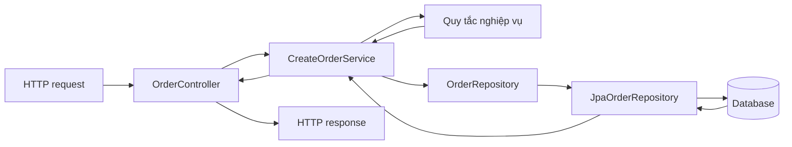

# Vấn đề khi trộn giao diện, quy tắc nghiệp vụ và truy cập dữ liệu

Trong kiến trúc phân tầng, một nguyên tắc quan trọng là đặt mỗi loại trách nhiệm vào nơi phù hợp. Giao diện tiếp nhận và trình bày thông tin; phần nghiệp vụ quyết định hệ thống được phép làm gì; phần truy cập dữ liệu đọc và ghi trạng thái bền vững. Khi cả ba trách nhiệm nằm trong cùng một hàm hoặc một lớp, chương trình có thể chạy tốt lúc đầu nhưng trở nên khó thay đổi, kiểm thử và mở rộng.

Bài học này thuộc module `SOFTWARE_DESIGN_ARCHITECTURE_ARCHITECTURAL_PATTERN_LAYERED`, tập trung vào cách tổ chức phần mềm theo kiến trúc phân tầng. Ta sẽ dùng một API đặt hàng trong Java/Spring để nhận diện vấn đề và xem cách tách trách nhiệm ở mức vừa đủ.

## Ba loại trách nhiệm cần phân biệt

| Trách nhiệm | Công việc chính | Ví dụ trong ứng dụng đặt hàng |
|---|---|---|
| Giao diện (presentation) | Nhận yêu cầu, chuyển đổi dữ liệu đầu vào, gọi ca sử dụng và tạo phản hồi phù hợp với HTTP hoặc giao diện người dùng | Đọc JSON thành `CreateOrderRequest`, trả mã HTTP và `OrderResponse` |
| Nghiệp vụ (business/domain) | Thực thi chính sách và bảo vệ các quy tắc, bất biến của bài toán | Tính mức giảm giá, kiểm tra đơn hàng có thể được xác nhận hay không |
| Truy cập dữ liệu (data access) | Truy vấn, lưu trữ và chuyển đổi dữ liệu giữa mô hình ứng dụng với cơ sở dữ liệu | Tìm khách hàng, lưu đơn hàng bằng JPA hoặc JDBC |

Trong ứng dụng lớn hơn, thường có thêm trách nhiệm điều phối ứng dụng (application orchestration). Thành phần này thực hiện một ca sử dụng bằng cách gọi các đối tượng nghiệp vụ và cổng truy cập dữ liệu theo đúng trình tự, đồng thời thường xác định ranh giới giao dịch. Nó không nên trở thành nơi chứa mọi quy tắc nghiệp vụ. Cách chia thành bao nhiêu lớp hoặc package tùy quy mô và nhu cầu; không có một con số tầng bắt buộc cho mọi hệ thống.

### Phân biệt kiểm tra đầu vào và quy tắc nghiệp vụ

Hai loại kiểm tra thường bị đặt lẫn vào nhau:

- **Kiểm tra hình dạng yêu cầu** thuộc biên giao diện: trường `customerId` có được gửi không, `quantity` có phải số dương theo định dạng API chấp nhận không, chuỗi có vượt giới hạn độ dài không. Trong Spring, các kiểm tra này có thể dùng Bean Validation như `@NotNull`, `@NotBlank` hoặc `@Positive`.
- **Quy tắc của bài toán** thuộc nghiệp vụ: khách hàng có đủ điều kiện hưởng ưu đãi không, đơn hàng ở trạng thái hiện tại có được hủy không, số lượng yêu cầu có thể được đáp ứng theo chính sách tồn kho không. Những quy tắc này phải được bảo vệ ở phía máy chủ và không phụ thuộc vào việc yêu cầu đến từ REST API, giao diện web hay một tác vụ nền.

`@Valid` giúp kiểm tra cấu trúc dữ liệu ở biên nhận yêu cầu; nó không thay thế các bất biến cần được bảo vệ trong mô hình nghiệp vụ.

## Khi tất cả được đặt trong controller

Ví dụ rút gọn dưới đây cho thấy một controller vừa xử lý HTTP, vừa quyết định giảm giá, vừa ghi cơ sở dữ liệu:

```java
@RestController
class OrderController {
    private final JdbcTemplate jdbc;

    OrderController(JdbcTemplate jdbc) {
        this.jdbc = jdbc;
    }

    @PostMapping("/orders")
    String create(@RequestBody OrderRequest request) {
        if (request.items().isEmpty()) {
            throw new IllegalArgumentException("Đơn hàng phải có sản phẩm");
        }

        BigDecimal total = calculateSubtotal(request.items());
        if ("VIP".equals(request.customerType())) {
            total = total.multiply(new BigDecimal("0.90"));
        }

        jdbc.update(
            "insert into orders(customer_id, total) values (?, ?)",
            request.customerId(), total
        );
        return "Đã tạo đơn hàng";
    }
}
```

Đây là ví dụ minh họa, không phải cấu trúc nên dùng cho ứng dụng thực tế. Hàm `create` đang đảm nhiệm nhiều việc: hiểu giao thức HTTP, kiểm tra dữ liệu, áp dụng chính sách khách hàng VIP, tính tiền, ghi SQL và quyết định nội dung phản hồi. Những trách nhiệm này thay đổi vì các lý do khác nhau nhưng lại bị buộc chặt vào một chỗ.

## Hệ quả của việc trộn trách nhiệm

**Một thay đổi nhỏ có thể kéo theo nhiều thay đổi không liên quan.** Nếu API chuyển từ JSON sang một giao diện khác, phần tính giá vẫn phải được giữ nguyên nhưng đang nằm trong controller. Nếu cấu trúc bảng thay đổi, mã xử lý yêu cầu cũng phải sửa vì nó biết trực tiếp câu SQL.

**Quy tắc dễ bị lặp và không nhất quán.** Sau này hệ thống có thêm luồng tạo đơn từ tác vụ nhập dữ liệu hoặc từ một dịch vụ khác. Nếu quy tắc VIP chỉ nằm trong controller REST, luồng mới có thể quên áp dụng giảm giá hoặc tự viết một phiên bản khác. Kết quả là cùng một nghiệp vụ nhưng cho ra kết quả khác nhau tùy điểm gọi.

**Kiểm thử trở nên nặng nề.** Muốn kiểm tra công thức giảm giá có thể phải dựng controller, cấu hình Spring và cơ sở dữ liệu. Một lỗi tính toán đơn giản cũng khó được cô lập khỏi lỗi kết nối hoặc ánh xạ SQL.

**Chi tiết kỹ thuật xâm nhập vào mô hình bài toán.** Khi đối tượng nghiệp vụ phụ thuộc trực tiếp vào `HttpServletRequest`, `JdbcTemplate` hoặc kiểu entity của một thư viện ORM, việc tái sử dụng và kiểm thử nó ngoài môi trường web hoặc cơ sở dữ liệu sẽ khó hơn.

**Luồng xử lý khó quan sát.** Việc kiểm tra giao dịch, xử lý lỗi, phân quyền và ghi log có thể bị rải rác trong những hàm vừa làm nghiệp vụ vừa truy cập dữ liệu. Khi xảy ra lỗi, người đọc khó xác định trách nhiệm nào cần được sửa.

## Tách trách nhiệm trong một luồng Spring

Có thể tổ chức lại luồng tạo đơn như sau:



Controller chuyển dữ liệu của giao thức thành lệnh ứng dụng và chuyển kết quả thành phản hồi. Application service điều phối ca sử dụng. Mô hình nghiệp vụ thực hiện các quyết định thuộc bài toán. Repository cung cấp thao tác lưu và truy vấn; phần triển khai JPA hoặc JDBC chịu trách nhiệm chi tiết kỹ thuật của cơ sở dữ liệu.

Ví dụ về controller sau khi tách:

```java
@RestController
class OrderController {
    private final CreateOrderService createOrder;

    OrderController(CreateOrderService createOrder) {
        this.createOrder = createOrder;
    }

    @PostMapping("/orders")
    OrderResponse create(@Valid @RequestBody CreateOrderRequest request) {
        List<CreateOrderItem> items = request.items().stream()
            .map(item -> new CreateOrderItem(item.productId(), item.quantity()))
            .toList();
        CreateOrderCommand command = new CreateOrderCommand(
            request.customerId(), items
        );
        OrderResult result = createOrder.handle(command);
        return OrderResponse.from(result);
    }
}
```

Controller không cần biết câu SQL hoặc cách tính ưu đãi. Nó chỉ chuyển đổi giữa hợp đồng HTTP và lệnh/kết quả của ứng dụng.

Phần điều phối có thể đặt ranh giới giao dịch và phối hợp các thành phần:

```java
@Service
class CreateOrderService {
    private final CustomerRepository customers;
    private final ProductRepository products;
    private final OrderRepository orders;
    private final PricingPolicy pricingPolicy;

    CreateOrderService(
            CustomerRepository customers,
            ProductRepository products,
            OrderRepository orders,
            PricingPolicy pricingPolicy) {
        this.customers = customers;
        this.products = products;
        this.orders = orders;
        this.pricingPolicy = pricingPolicy;
    }

    @Transactional
    OrderResult handle(CreateOrderCommand command) {
        Customer customer = customers.getById(command.customerId());
        List<OrderLine> lines = command.items().stream()
            .map(item -> {
                Product product = products.getById(item.productId());
                return OrderLine.from(product, item.quantity());
            })
            .toList();
        Order order = Order.create(customer, lines, pricingPolicy);
        orders.save(order);
        return OrderResult.from(order);
    }
}
```

Trong ví dụ, `Order.create` và `PricingPolicy` đại diện cho phần nghiệp vụ; chúng quyết định đơn hàng hợp lệ và giá phải trả. `CreateOrderService` điều phối việc lấy khách hàng, tạo đơn và lưu đơn. `@Transactional` minh họa ranh giới giao dịch thường được đặt ở ca sử dụng khi nhiều thao tác dữ liệu cần thành công hoặc thất bại cùng nhau. Cách đặt giao dịch cụ thể còn tùy mô hình ứng dụng.

`OrderRepository` có thể là một giao diện mà application service sử dụng. Một adapter như `JpaOrderRepository` triển khai giao diện đó bằng Spring Data JPA; adapter khác có thể dùng JDBC. Nhờ vậy, phần nghiệp vụ không phải gọi trực tiếp `JdbcTemplate` hoặc phụ thuộc vào chi tiết của bảng dữ liệu. Vị trí package của giao diện repository tùy cách tổ chức dự án, nhưng hướng phụ thuộc nên giúp quy tắc bài toán không bị chi phối bởi framework hay cơ sở dữ liệu.

## Kiểm thử theo đúng trách nhiệm

Việc tách trách nhiệm tạo ra những điểm kiểm thử rõ ràng:

| Phần cần kiểm tra | Loại kiểm thử phù hợp | Điều cần xác nhận |
|---|---|---|
| Controller | Kiểm thử web hoặc `@WebMvcTest` | JSON được ánh xạ đúng, validation trả lỗi phù hợp, phản hồi có cấu trúc và mã HTTP đúng |
| Quy tắc nghiệp vụ | Unit test thuần Java | Chính sách giảm giá, điều kiện chuyển trạng thái và các bất biến hoạt động đúng ở nhiều trường hợp biên |
| Application service | Unit test với repository giả hoặc test tích hợp theo ca sử dụng | Các bước được điều phối đúng, dữ liệu được lưu khi hợp lệ và giao dịch bao phủ đúng thao tác |
| Repository triển khai | Integration test với cơ sở dữ liệu kiểm thử | Truy vấn, ánh xạ entity và thao tác lưu thực sự hoạt động |

Không cần dựng cơ sở dữ liệu thật cho mọi bài kiểm thử. Chẳng hạn, công thức giảm giá nên được kiểm tra trực tiếp trên lớp chính sách; kiểm thử repository mới cần xác nhận hành vi với cơ sở dữ liệu. Ngược lại, chỉ dùng mock không thể chứng minh câu truy vấn JPA hoặc ánh xạ cột đang đúng.

## Tách đến mức nào là hợp lý?

Tách trách nhiệm giúp thay đổi tập trung, giảm lặp quy tắc và làm cho kiểm thử sát với mục đích hơn. Tuy nhiên, mỗi lớp, interface hoặc adapter cũng tạo thêm mã và đường đi cần hiểu. Với một ứng dụng CRUD rất nhỏ, một service đơn giản có thể là đủ; không cần tạo nhiều tầng rỗng chỉ để tuân theo một sơ đồ.

Hãy tách khi có ranh giới trách nhiệm có ý nghĩa: quy tắc có thể được dùng từ nhiều luồng, chi tiết lưu trữ có khả năng thay đổi, hoặc một phần cần được kiểm thử độc lập. Giữ quy tắc nghiệp vụ ở nơi có thể bảo vệ nó cho mọi điểm gọi; để giao diện xử lý giao thức; để lớp dữ liệu xử lý lưu trữ. Có thể nhóm các thành phần theo tính năng như `orders` thay vì tạo một package khổng lồ cho từng loại lớp trên toàn hệ thống.

Cuối cùng, phân tầng là cách tổ chức **logic và trách nhiệm**. Một ứng dụng Spring Boot hoàn toàn có thể chạy controller, application service, domain và repository adapter trong cùng một tiến trình. Việc tách thành nhiều máy chủ hoặc dịch vụ triển khai là một quyết định kiến trúc khác, không tự động phát sinh từ việc tách các trách nhiệm này.
